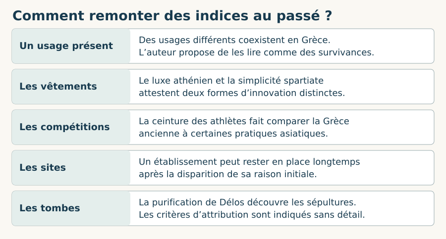

# ENS-PSL · CNEL Lettres — Thucydide — les origines de l’histoire grecque 2021 · Corrigé brut

*Corrigé rédigé par IA, non officiel. Signalez toute erreur.*

**Rédaction** · GPT-6.2 Astra Ultra · vitesse non renseignée

**Autocontrôle** · GPT-6.2 Astra Ultra · vitesse non renseignée

## Faire parler les pratiques présentes sur des temps sans témoins

Dans les chapitres VI à VIII du premier livre de la *Guerre du Péloponnèse*, Thucydide suspend le récit des événements qui opposent Athènes et Sparte pour examiner des gestes aussi ordinaires que se vêtir ou se rendre à une compétition. Ces détails importent à son projet de mesurer les changements qui ont rendu possible la grande guerre de son temps. La question est aussi une question de connaissance. Comment écrire sur des périodes dont les acteurs ne peuvent plus répondre à l’historien ? L’extrait met successivement à l’épreuve des ressemblances entre coutumes, la permanence des lieux habités et des vestiges rendus accessibles par un rite contemporain.

Le chapitre VI associe une ancienne habitude de porter les armes à l’insécurité des demeures et des communications. Une explication par les conditions de vie se substitue à une prétendue disposition permanente des Grecs. Le passage formule ensuite la règle sur laquelle repose sa reconstruction. Certaines régions grecques vivent encore de cette façon et constituent, dit-il, un signe, *sêmeion*, que la pratique s’étendait jadis à tous. Le « encore » convertit une différence géographique actuelle en hypothèse sur une différence chronologique. La comparaison avec les peuples dits barbares étend la même opération au-delà de l’espace grec. Cette inférence est féconde, mais elle n’a rien d’une observation directe du passé. Elle suppose précisément ce qu’une enquête sur les échanges ou les innovations locales devrait vérifier, à savoir que des pratiques semblables occupent des places comparables dans le temps.

Les Athéniens puis les Lacédémoniens sont présentés chacun comme premiers dans un domaine différent. À Athènes, la vie plus sûre aurait permis un raffinement qui se reconnaissait jusqu’à une date récente aux vêtements de lin et aux cigales d’or des vieillards aisés. Les Ioniens apparentés auraient longtemps partagé cette mode. La note de l’édition rappelle que l’identification précise de l’ornement reste discutée. Le témoignage porte donc plus sûrement sur sa valeur sociale et mémorielle que sur la reconstitution exacte de sa forme. Sparte apparaît ensuite comme innovatrice dans la simplicité du costume et dans les usages athlétiques. L’égalité accrue, précise le texte, concerne la façon de vivre des riches et de la multitude. Il ne s’ensuit pas que la société spartiate aurait ignoré les inégalités de statut. L’alternance des deux villes interdit de faire d’une seule cité le point de départ de tout changement.

L’exemple des concours athlétiques pousse plus loin la comparaison. La nudité que l’observateur grec contemporain pourrait tenir pour une marque évidente de sa culture n’a pas toujours prévalu aux concours olympiques. Les ceintures portées encore dans certains concours asiatiques rendent concevable un passé grec analogue. La conclusion selon laquelle les Grecs anciens vivaient à de nombreux égards comme des barbares actuels désessentialise une distinction présente. Elle maintient en revanche un regard grec sur des sociétés étrangères diverses, choisies pour éclairer le passé de l’auteur. C’est distinguer deux usages du même passage que d’y étudier une critique des mœurs prétendument immuables et d’y chercher une connaissance propre des peuples asiatiques.

Le chapitre VII change de trace. Des établissements anciens demeurent à l’intérieur des terres tandis que des cités plus récentes se sont installées sur le littoral. Thucydide explique cette différence par l’évolution conjointe des échanges maritimes, de la richesse disponible et de la sécurité. Il attire l’attention sur les isthmes comme lieux de relations économiques et de puissance régionale. Le présent d’une ville n’indique pas nécessairement les conditions de sa fondation. Un site peut rester occupé après que les raisons qui l’ont autrefois rendu préférable ont disparu. La permanence spatiale est ainsi un document sur le changement, pourvu que l’historien distingue le moment du choix initial et celui de sa propre observation.

Le chapitre VIII aboutit à des vestiges matériels paradoxalement connus grâce à une intervention contemporaine. Lors de la purification de Délos par les Athéniens, en 426 avant notre ère, l’enlèvement des sépultures aurait permis d’en attribuer plus de la moitié à des Cariens. Le texte invoque à la fois les objets déposés auprès du défunt et le mode de sépulture, comparé aux pratiques cariennes actuelles. La note précise que le passage ne décrit pas ces traits en détail. On peut donc reconstruire le principe de l’argument, non vérifier sa classification tombe par tombe. Les Phéniciens sont également mentionnés parmi les anciens insulaires, mais aucune proportion de tombes phéniciennes n’est fournie. Le témoignage religieux de la guerre en cours devient ici l’occasion d’obtenir un renseignement sur un passé éloigné.

Un projet sur les usages antiques des objets funéraires pourrait partir de cette distinction entre découverte, description et attribution. Il comparerait le vocabulaire du signe chez Thucydide aux conditions dans lesquelles des fouilles documentées associent des pratiques à des communautés. L’intérêt du rapprochement serait de mesurer ce que chaque méthode conserve du contexte, non d’identifier immédiatement un objet et une origine collective.

[Sujet officiel](https://www.ens.psl.eu/sites/default/files/dsa-2-sujet_epreuve_ecrite.pdf)
