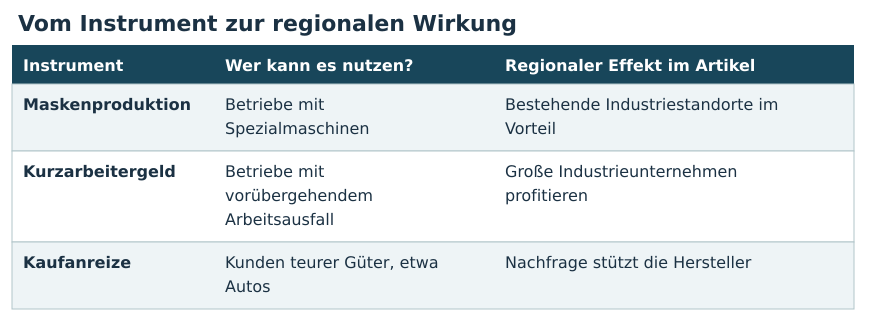

# ENS Rennes · D-E · Allemand (oral) 2021 — Corrigé brut

*Corrigé rédigé par IA, non officiel. Signalez toute erreur.*

**Rédaction** · GPT-6.2 Astra Ultra · vitesse non renseignée

Les quatre sujets imprimés sont traités dans leur ordre. Le rapport prévoit vingt minutes de préparation, puis six à huit minutes d’exposé au sein d’un oral de quinze minutes. Les exposés se développent à partir des exemples et des réponses proposées pour l’entretien.

## Billet 1 — Pandemie unterbricht günstige Arbeitsmarktentwicklung für Menschen mit Migrationshintergrund

**Vortrag.** Ein Vater schreibt eine Sprachnachricht auf Farsi. Er hat seine Stelle bei einer Transportfirma verloren und versucht seit fünf Monaten, Hilfe zu bekommen. Andrea König beginnt ihren Tagesschau-Beitrag vom 13. Mai 2021 mit diesem konkreten Fall. Er führt zu zwei Fragen: Warum verloren manche Beschäftigte während der Pandemie besonders häufig ihre Arbeit? Und warum erreichte die Hilfe einen Teil von ihnen nur schwer?

Der alleinerziehende Vater wendet sich über Facebook an „Handbook Germany“. Die Beraterin kennt aus eigener Erfahrung sowohl die Sprache als auch die Lage von Geflüchteten. Weil viele Stellen nicht mehr persönlich erreichbar sind, bekommt das digitale Projekt nach Angaben seiner Leiterin monatlich etwa tausend Anfragen. Daraus ergibt sich ein scheinbarer Widerspruch. Eine digitale Behörde kann den Zugang erschweren, wenn ihr Formular kompliziert ist. Dieselbe Technik erleichtert den Zugang, wenn man einer Person in der vertrauten Sprache eine Nachricht schicken darf. Entscheidend ist also auch, wie eine Dienstleistung gestaltet ist.

Im zweiten Teil wechselt die Journalistin vom Einzelfall zur Untersuchung des Instituts für Arbeitsmarkt- und Berufsforschung. Viele Geflüchtete hatten befristete Stellen, gehörten ihrem Betrieb erst kurz an oder arbeiteten in Berufen, die sie von zu Hause aus kaum ausüben konnten. Dazu kam, dass Kurse und Maßnahmen zur Arbeitsmarktintegration ausfielen. Der frühe Einbruch traf die Gruppe besonders hart, doch nach dem ersten Lockdown nahm die Beschäftigung wieder zu. Kurzarbeit erlaubte es Unternehmen, Beschäftigte auch bei vorübergehendem Arbeitsausfall zu halten.

Was kann Politik daraus lernen? Wer den Verlust einer Stelle verhindern will, braucht andere Mittel als jemand, der einen bereits entlassenen Menschen beim Antrag unterstützt. Eine verständliche mehrsprachige Auskunft hilft dem Vater sofort. Verlässliche Kurse und eine bessere Absicherung bei kurzen Beschäftigungszeiten wirken auf die Ursachen der Unsicherheit. Gerade die Verbindung von persönlicher Geschichte und Statistik macht diese beiden Aufgaben sichtbar.

**Wofür steht die Zahl tausend?** Sie bezeichnet nach Aussage der Projektleiterin die ungefähre Zahl der monatlichen Anfragen bei ihrem Projekt. Ein Mensch kann mehrere Anfragen stellen. Die Zahl misst weder alle Geflüchteten noch die Arbeitslosigkeit.

**Ist Digitalisierung für diesen Vater ein Hindernis?** Bei der Antragstellung offenbar schon, beim ersten Kontakt zur Beratung dagegen kaum. Ein leicht erreichbarer Mensch kann erklären, welche Nachweise die Behörde benötigt.

## Billet 2 — Wirtschaftshilfen : Pandemie vergrößert Ost-West-Lücke

**Vortrag.** Dieselbe Bundesregel kann in Bayern und in einem ostdeutschen Bundesland ganz unterschiedliche wirtschaftliche Folgen haben. Cerstin Gammelin untersucht am 10. März 2021 in der Süddeutschen Zeitung, wohin die staatlichen Wirtschaftshilfen geflossen sind. Sie stützt sich vor allem auf den Wirtschaftsforscher Marcel Fratzscher. Er befürchtet, dass sich der Abstand zwischen wirtschaftsstarken und strukturschwächeren Regionen vergrößert.

Zunächst war der wirtschaftliche Schaden ungleich verteilt. Große Teile der Industrie konnten weiterarbeiten. Viele Dienstleistungen, die den Kontakt zu Kundinnen und Kunden voraussetzen, wurden dagegen zeitweise untersagt. In den ostdeutschen Ländern gibt es verhältnismäßig viele kleine Unternehmen und Dienstleister. Hinzu kommt ein zweiter Unterschied: Wer eine Förderung für die Umstellung auf die Maskenproduktion beantragen will, braucht Maschinen und oft auch Partner in der Nähe. Vorhandene Industrie zieht daher weitere Förderung an. Wenige Anträge sind noch kein Beweis für geringen wirtschaftlichen Bedarf.

Auch die knapp 190 Milliarden Euro, die der Bund laut Artikel bis dahin insgesamt gezahlt hatte, muss man nach Instrumenten unterscheiden. Kurzarbeitergeld hielt Arbeitnehmer in den Betrieben. Fratzscher wirft jedoch die Frage auf, ob bei Autoherstellern bereits vorher Überkapazitäten bestanden. Eine zeitweilige Senkung der Mehrwertsteuer konnte vor allem teure Anschaffungen vorziehen. Die Kaufprämie für Elektroautos förderte ebenfalls eine Branche mit vielen Standorten im Westen und Süden.

Die journalistische Stärke liegt im Weg vom nationalen Gesamtbetrag über einzelne Programme bis zur regionalen Wirtschaftsstruktur. Eine Grenze des Artikels ist die überwiegende Orientierung an einem Ökonomen. Für eine Bewertung würde ich zusätzlich wissen wollen, wie viele Arbeitsplätze je Region bedroht waren, welche Anträge abgelehnt wurden und wie viele Unternehmen nach der Förderung fortbestanden. Man könnte dann zwischen zwei Zielen unterscheiden: kurzfristig Beschäftigung stabilisieren und langfristig regionale Unterschiede verringern. Erfolg beim ersten Ziel garantiert keinen Erfolg beim zweiten.

**Belegen höhere Zahlungen an eine Region automatisch eine Bevorzugung?** Dafür müsste man Bedarf, Unternehmensstruktur und Zugangsvoraussetzungen vergleichen. Gleiche Regeln können ungleiche Ergebnisse haben, auch wenn sie keinen Standort ausdrücklich bevorzugen.

**Welche Hilfe wäre für einen geschlossenen kleinen Betrieb denkbar?** Eine Unterstützung für unvermeidbare laufende Kosten würde an seinem tatsächlichen Ausfall ansetzen. Sie würde andere Voraussetzungen haben als die Förderung einer neuen industriellen Produktion.

## Billet 3 — Danke, liebe Reiche!

**Vortrag.** Alexander Neubachers Kolumne „Danke, liebe Reiche!“ vom 20. Februar 2021 setzt schon im Titel auf Provokation. Während Menschen auf eine Impfung warten, dankt er vermögenden Investoren. Anlass ist die Forderung des damaligen Linken-Chefs Bernd Riexinger, Biontech solle seine Impfstofflizenzen freigeben. Der Autor hält dem die bereits bestehende Zusammenarbeit privater Unternehmen entgegen.

Seine Argumentation hat drei Schritte. Zuerst nennt er Biontechs Kooperation mit Pfizer, den Kauf des Werks in Marburg und eine geplante Rolle von Sanofi. Das soll zeigen, dass auch kommerzielle Interessen Zusammenarbeit ermöglichen. Dann stellt er funktionsfähige Lieferketten den Schwierigkeiten der öffentlichen Verwaltung gegenüber. Schließlich nennt er einzelne Investoren, die früh finanzielle Risiken übernommen haben. Der Leser soll erkennen, was privates Kapital zur Entwicklung eines knappen Gutes beitragen kann.

Überzeugend ist der Hinweis, dass die Fähigkeit zu investieren zählt und dass Gewinne Kooperation nicht ausschließen. Zugleich setzt die Kolumne unterschiedliche Fragen gleich. Ob Unternehmen erfolgreich zusammenarbeiten, sagt wenig darüber aus, zu welchen Preisen verschiedene Länder Zugang haben. Und eine allgemeine Lizenzfreigabe ist begrifflich etwas anderes als die Verstaatlichung einer Firma. Der Sprung vom Streit über Lizenzen zur staatlichen Industrie in Venezuela verschärft den Gegensatz. Die Anekdoten über Fußballfans und Toilettenpapier machen den Text anschaulich, ersetzen aber keine Untersuchung der weltweiten Verteilung.

Ich würde die Frage am Schluss anders stellen: Wie kann ein System frühzeitige Investitionen ermöglichen und anschließend eine breite und bezahlbare Versorgung fördern? Verträge können neben einer Vergütung auch Lieferzusagen enthalten. Die Öffentlichkeit kann fragen, welche Zusagen eingehalten werden und wer zunächst leer ausgeht. Der Gewinn einzelner Investoren wäre dabei eine Folge unter mehreren. Das Wort „Danke“ im Titel signalisiert eine pointierte Antwort, noch bevor das Argument entfaltet ist.

**Warum vergleicht der Autor Impfstoffe mit Alltagswaren?** Die Alltagsbeispiele sollen das Vertrauen in die Leistungsfähigkeit privater Unternehmen erhöhen. Bei einem knappen Gesundheitsgut spielen jedoch Verteilung und öffentlicher Bedarf eine andere Rolle.

**Welche Funktion hat die geplante Zusammenarbeit mit Sanofi?** Der Autor nutzt sie als Gegenbeispiel zur Vorstellung einer völlig abgeschlossenen Produktion. Im Text ist diese Zusammenarbeit eine Ankündigung für die Zukunft. Sie belegt dort noch keine tatsächlich gelieferte Menge.

## Billet 4 — Braucht es ein Recht auf Homeoffice?

**Vortrag.** Wer zu Hause arbeiten kann, gewinnt womöglich Zeit für seine Familie. Wer zu Hause arbeiten muss und gleichzeitig ein kleines Kind betreut, erlebt denselben Ort ganz anders. Von dieser Spannung handelt der Beitrag der Deutschen Welle vom 9. Oktober 2020. Arbeitsminister Hubertus Heil schlug damals einen gesetzlichen Anspruch auf 24 Tage Homeoffice im Jahr vor. Innerhalb der Großen Koalition stieß das Vorhaben bei der Union auf Ablehnung, während die SPD es unterstützte.

Der Beitrag untersucht zunächst ein Kostenargument. Beschäftigte könnten Wege sparen, ein Unternehmen möglicherweise Büroräume. Der Arbeitsmarktexperte Oliver Stettes weist jedoch darauf hin, dass Arbeit im Betrieb und zu Hause oft nebeneinander besteht. Muss der Arbeitgeber geeignete Arbeitsmittel zur Verfügung stellen, können für dieselbe Person zwei Arbeitsplätze Kosten verursachen. Die Erfahrung eines pandemiebedingten Ausnahmezustands lässt sich daher nicht einfach auf eine dauerhafte Regel übertragen.

Die zweite Perspektive betrifft die Gleichberechtigung. Elke Ahlers von der Hans-Böckler-Stiftung erklärt, dass Eltern Termine besser abstimmen können, wenn ein Teil der Arbeit zu Hause möglich ist. Ihr Argument hat eine wichtige Bedingung: Es muss eine verlässliche Kinderbetreuung geben. Sonst gewinnt eine Person zwar den Arbeitsweg als Zeit zurück, übernimmt aber womöglich gleichzeitig zusätzliche unbezahlte Arbeit. Die Herkunft der beiden Stimmen – arbeitgebernahes Institut und gewerkschaftsnahe Stiftung – hilft zu verstehen, warum sie unterschiedliche Fragen stellen.

Ein Recht kann die Verhandlungsmacht von Arbeitnehmern stärken. Ein Beschäftigter müsste dann nicht bei jedem Vorgesetzten völlig neu um Flexibilität bitten. Allerdings unterscheiden sich Tätigkeiten erheblich: Eine Buchhalterin kann zu Hause Unterlagen prüfen, ein Busfahrer kann seine Strecke dort nicht fahren. Ein tragfähiges Modell müsste erklären, welche betrieblichen Gründe eine Ablehnung rechtfertigen, wer erforderliche Geräte bezahlt und wann jemand erreichbar sein soll. Das Urteil über den Vorschlag hängt für mich an diesen praktischen Folgen.

**Kann man Bürofläche einfach entsprechend der Zahl der Homeoffice-Tage kürzen?** Das wäre nur möglich, wenn die Anwesenheit verlässlich verteilt und weniger Fläche tatsächlich benötigt würde. Sind alle an denselben Tagen im Büro, fällt die mögliche Ersparnis kleiner aus.

**Warum erwähnt die Autorin oder der Autor Kinderbetreuung?** Arbeitsort und Betreuungsarbeit sind zwei verschiedene Dinge. Verlässliche Betreuung ermöglicht konzentrierte Erwerbsarbeit und kann verhindern, dass flexible Arbeit alte Rollen verfestigt.

[Sujet](https://www.ens-rennes.fr/medias/fichier/annales-oraux-allemand-d-e-2021_1652428589168-pdf) · [Rapport](https://www.ens-rennes.fr/medias/fichier/rapport-de-jury-oral-allemand-d-e-2021_1634310558037-pdf)
