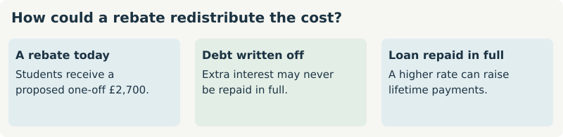
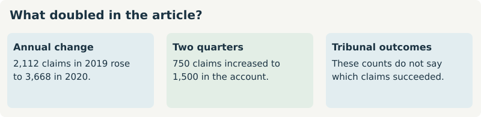
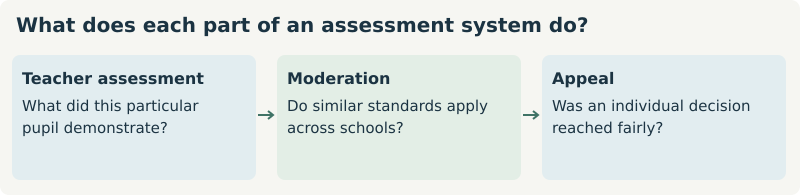

# ENS Rennes D-E — Anglais oral 2021 · Corrigé guidé

*Corrigé rédigé par IA, non officiel. Signalez toute erreur.*

**Lecture du rapport du jury** · GPT-6.2 Astra Ultra · vitesse non renseignée

**Rédaction** · GPT-6.2 Astra Ultra · vitesse non renseignée

Each talk starts with a question, summarises the article and examines how it makes its case. The follow-up questions and answers are for practice.

## 1. Students in England call for 30% Covid discount on tuition fees

*Rachel Hall, The Guardian, 31 May 2021.* [Exam article, pp. 1–2](https://www.ens-rennes.fr/medias/fichier/annales-oraux-anglais-d-e-2021_1652428630096-pdf#page=1)

> [!INDICATION]
> Say *a rise of three percentage points* for the proposed move from 3.2 to 6.2 per cent. Explain why the balance on a statement, the annual deduction from a salary and the total repaid over a lifetime can all be different.

**Opening.** What would it mean to compensate students for disruption without sending the bill to either universities or taxpayers? Rachel Hall reports a scheme that brings money forward but distributes its cost over graduates’ working lives. I will first explain the proposed transfer and then look at the evidence behind the claim that it is fair.

**Summary.** Students’ unions led by representatives at the LSE and Sheffield have written to ministers proposing a £2,700 rebate, described as 30% of tuition fees, for the affected year in England. Students would accept a higher interest rate on their loans. Modelling commissioned from London Economics suggests that the extra cost would fall mainly on graduates who earn enough to pay off their balances. The campaign follows months of restricted access to campuses, libraries and accommodation. The article records frustration with university recruitment promises and earlier attempts to secure redress through regulators and complaints bodies.

**Commentary.** The proposal turns a complaint about the service delivered into a question of who should bear a financial loss. A student who missed laboratory work and one who followed most lectures online would receive the same rebate. That simplicity avoids having to price every lost hour, but it does not establish that the loss was identical. Nor does reimbursing tuition directly compensate someone for rent already paid on an inaccessible room. The case for a payment to an entire cohort rests on a shared disruption, rather than a proven breach in each individual case.

The interest mechanism provides the most interesting test of the headline. Under the repayment rules described, a graduate can have an outstanding balance after thirty years and see it written off. Charging more interest may increase that balance without increasing what this person actually repays. Graduates on sufficiently high incomes can pay more over their lifetime. The projected difference between average male and female repayments reflects assumed earnings paths. Sex itself is not the pricing rule. The students describe the plan as “fiscally neutral”. That is a modelled claim about future revenue and write-offs, dependent on earnings and repayment assumptions. Hall identifies the campaigners and their modelling source, yet the excerpt contains no Treasury cost assessment or ministerial commitment.

**Practice interview. Could a graduate end up paying more than the initial rebate?** Yes. The model puts the extra amount for the highest earners well above £2,700. The scheme redistributes between graduates as well as between present and future income. **Why might low earners still care about the headline interest rate?** A larger displayed balance can matter psychologically and future earnings are uncertain. Neither point means every pound of added interest will be collected.

## 2. Work is where your laptop is: meet the globetrotting digital nomads

*Julia Kollewe, The Guardian, 30 May 2021.* [Exam article, pp. 3–4](https://www.ens-rennes.fr/medias/fichier/annales-oraux-anglais-d-e-2021_1652428630096-pdf#page=3)

> [!INDICATION]
> Distinguish *working from home*, *working remotely* and *working abroad*. Compare *eleven per cent of long-stay bookers* with *eleven per cent of workers*. The denominator changes the claim. When speaking, stress the first syllable in the noun *survey*.

**Opening.** Does the freedom to do a job online include the freedom to move it across borders? Julia Kollewe’s travel feature presents the attraction through individual lives. Its numbers and its silences help define who can exercise that freedom.

**Summary.** A former London commuter can now walk on the beach before work. Another interviewee, a freelance translator, shares a villa on Fuerteventura and says that the arrangement costs her €450 a month. The article traces a wider interest in location-independent work during the pandemic. Airbnb reports that 11% of its long-stay bookers surveyed in 2021 describe themselves as nomadic. A separate five-country survey reports substantial interest in living away from an employer’s base. Interviewees mention reliable internet, a proper place to work, health, travel’s environmental cost and a possible sense of rootlessness.

**Commentary.** The scene on the beach is persuasive because it replaces a familiar cost, the crowded commute, with something the reader can picture. Yet Scott still gets up early and the translator still needs clients and dependable connectivity. The work has moved, not disappeared. Moreover, a freelance translator can negotiate a place of work more readily than a nurse or shop assistant. A salaried employee whose tasks can be performed online may still need consent to work abroad. Immigration status, tax residence, employment obligations and access to health care can depend on the host country and length of stay. A laptop does not settle any of those questions.

The feature moves from personal testimony to platform data. Long-stay guests on a travel platform have already selected themselves for mobility. A company that benefits from long stays also has a reason to publicise enthusiasm for them. Neither observation invalidates the reported survey. It does limit its reach. Wanting to live somewhere else does not mean being able to move, and neither figure tells us how often moves last. The residents of the destination are largely missing from the story. A longer stay may bring off-season income to local businesses, while demand for furnished accommodation can make competition for housing more intense in a tight market. Both effects are possible; neither can be measured from the cost of a single shared villa.

**Practice interview. Would remote work necessarily reduce emissions?** It might remove repeated journeys to an office, but flights between destinations have an environmental cost. We would have to compare complete travel patterns. **What evidence would make this feature more representative?** A survey of workers across occupations, including those unable to work remotely, would tell us how large the eligible group is. Following respondents over time would distinguish interest from actual relocation.

## 3. Ministers urged not to ‘threaten’ NHS staff over mandatory Covid jab

*Aubrey Allegretti, The Guardian, 30 May 2021.* [Exam article, pp. 5–6](https://www.ens-rennes.fr/medias/fichier/annales-oraux-anglais-d-e-2021_1652428630096-pdf#page=5)

> [!INDICATION]
> *Mandatory* describes a requirement. *A proposal is being considered* describes the state of the decision in May 2021. Use those tenses to avoid reporting an NHS-wide mandate as an established rule. In a presentation, *vaccination* is a more neutral term than the headline’s *jab*.

**Opening.** What obligations may a hospital attach to particular duties when patients are especially vulnerable? Aubrey Allegretti sets a minister’s appeal to professional responsibility beside the opposition’s warning about staff trust. The scope and timing of the proposal matter to both arguments.

**Summary.** In May 2021 the government is exploring whether Covid vaccination should be required for NHS staff. A consultation concerning care workers has already gathered evidence. Vaccines minister Nadhim Zahawi invokes a duty to protect vulnerable patients, referring to hepatitis B vaccination in surgery as a precedent. He distinguishes a condition of deployment from a condition of employment and stresses that a decision has yet to be made. Labour’s Thangam Debbonaire argues that threats may undermine cooperation, especially where recruiting staff is difficult. The report also mentions behavioural concerns and possible challenges under human rights legislation.

**Commentary.** The distinction over deployment changes the practical question. Restricting assignments in certain clinical settings need not automatically end an employment contract. If an organisation has few alternative posts, however, an employee may still face a serious loss of opportunity, and an already understaffed ward may lose trained staff. The minister’s comparison with surgical work suggests a narrower argument than the headline. A rule for a procedure involving particular risks does not automatically justify an identical requirement for workers whose patient contact varies widely. A proportionate policy would need a stated objective, evidence about the relevant risk and a comparison with realistic alternatives, including access to vaccination and a chance to discuss concerns.

Debbonaire’s argument is also empirical. Collaboration may improve uptake, and a badly communicated rule may damage trust. A plausible mechanism does not tell us how often either effect occurs. The article juxtaposes two politicians interviewed on the same programme, but offers no testimony from a vulnerable patient, a hesitant employee or a ward manager implementing either approach. The title highlights the word “threaten”, an opponent’s characterisation. The underlying question is how to protect patients while retaining staff, sustaining trust and making exceptions or alternative assignments workable.

**Practice interview. Would a legal challenge prove the policy unlawful?** No. A challenge would test the authority for the rule and the justification for its effects. In May the report describes a possible challenge to a proposal. **How might a hospital tell whether voluntary measures are working?** It could compare uptake and access difficulties across staff groups and seek confidential feedback about obstacles. Differences in those measures could inform a more targeted response.

## 4. King's College apologises for 'harm' caused to staff by photo tribute to Prince Philip

*Jamie Fullerton, The Telegraph, 30 May 2021.* [Exam article, pp. 7–8](https://www.ens-rennes.fr/medias/fichier/annales-oraux-anglais-d-e-2021_1652428630096-pdf#page=7)

> [!INDICATION]
> Attribute the phrase *kangaroo court* to the unnamed source. It describes that person’s view of a discussion, not an employment tribunal or a formal court. Use *the college*, *a member of library staff* and *a spokesperson* deliberately when identifying who said what.

**Opening.** Can a photograph serve as an archival record and still be read as a tribute? Jamie Fullerton’s account of an email at King’s College London turns on that ambiguity. It also shows how a disagreement inside a library can acquire wider political meaning through the way it is reported.

**Summary.** After Prince Philip’s death, a staff bulletin reproduced a photograph of him and the Queen opening the Maughan Library in 2002. Some colleagues objected because of the Duke’s record of offensive remarks. Joleen Clarke, an associate director at the libraries, apologised for the effect on members of the community and explained that the picture had been intended as a historical reference. A university spokesperson separately reaffirmed the institution’s appreciation of the Duke’s longstanding support. The article closes by recalling government plans concerning freedom of speech at universities.

**Commentary.** The image documents an event. The choice to select it shortly after the Duke’s death, with a caption inviting colleagues to remember it, also gives it a commemorative function in the eyes of some readers. A recipient can recognise the historical connection while questioning the terms in which it is recalled. Conversely, the photograph’s inclusion does not show that the sender endorsed all of the Duke’s remarks. An institution can archive the image, present a fuller caption or explain the disagreement. These are distinct editorial choices with different audiences and implications.

The article’s headline assigns an apology to the college as a whole. The body separates the libraries’ internal email from a spokesperson’s public tribute. The quotation marks around “harm”, the anonymous source’s hostile description of the discussion, and the final reference to ministers’ free-speech plans broaden the frame. Yet the extract does not establish that a legal sanction was imposed, that the photograph was removed from an archive or that all staff held either view. No complainant speaks at length in their own name. What the account documents most securely is a dispute about institutional communication. The leap to a general crisis of free speech requires additional evidence.

**Practice interview. Does an apology settle which interpretation of the picture is correct?** It acknowledges an effect on recipients. Intention, context and interpretation can still be discussed separately. **What would you ask before calling this censorship?** I would ask whether anyone was prevented from publishing, speaking or consulting the record, by whom and under what rule. Criticism from colleagues alone does not answer those questions.

## 5. Age discrimination claims by workers who have lost jobs double in pandemic

*Charles Hymas, The Telegraph, 31 May 2021.* [Exam article, pp. 9–10](https://www.ens-rennes.fr/medias/fichier/annales-oraux-anglais-d-e-2021_1652428630096-pdf#page=9)

> [!INDICATION]
> Use *claims rose from 2,112 to 3,668* and *claims rose by about 74 per cent*. For the second comparison use *from 750 to 1,500*. The sheet says “the last quarter of 2021” although the article is dated May 2021. Flag that inconsistency rather than assigning the quarter a date you cannot establish from the cutting.

**Opening.** What does a rise in discrimination claims tell us about the treatment of older workers? Charles Hymas brings employment tribunal figures together with campaigning testimony. We need to separate what the figures count from what the campaigner fears may happen next.

**Summary.** The Ministry of Justice recorded 3,668 age discrimination claims in 2020, up from 2,112 in 2019. The article gives an annual rise of about 74%, while complaints across the tribunal system fell slightly. It also reports a rise from 750 claims in one quarter to 1,500 in the next. Stuart Lewis, the founder of Rest Less, warns that workers over fifty face redundancy and may remain unemployed for longer. More than a million over-fifties were still on furlough at the time of writing, and the campaigner fears further job losses as support ends.

**Commentary.** The headline’s doubling fits the quarter-to-quarter comparison. It does not describe the annual increase. Subtracting the annual totals gives 1,556 additional claims and dividing that number by 2,112 gives roughly 74%. The clipping labels the later quarter the last quarter of 2021, which lies after its publication on 31 May 2021. We can report the quoted comparison while leaving that dating discrepancy explicit. There is a second distinction. A claim is an allegation submitted to a tribunal. It is neither a finding of discrimination nor a count of every incident that occurred. A rise might reflect more redundancies, a change in the proportion of disputed decisions or a change in workers’ ability to seek redress.

Employers facing lost business may have to reduce staffing. The fairness question concerns how they choose whom to dismiss and whether assumptions about age substitute for an assessment of individual skills. Older workers who lose a job before pension age may experience a long income gap, and delayed re-employment can remove their experience from the workforce. Lewis’s organisation has direct contact with this group, which gives its testimony value and also explains its advocacy role. The report does not include employers’ selection records, decisions on the merits or workers who chose not to bring a claim. To test the proposed explanation we would need those sources alongside information on age, occupation and redundancy rates.

**Practice interview. If total complaints fell, could this category still rise?** Yes. A subset can grow while other categories decline by more. The share of this type of claim can therefore rise faster than its absolute number. **Does the end of furlough inevitably result in a new wave of dismissals?** That is a risk the campaigner identifies. It depends on demand, employers’ finances and whether affected posts can be retained or workers redeployed.

## 6. Extending school day to help children catch up will not improve results, Cambridge University says

*Telegraph Reporters, The Telegraph, 28 May 2021.* [Exam article, pp. 11–12](https://www.ens-rennes.fr/medias/fichier/annales-oraux-anglais-d-e-2021_1652428630096-pdf#page=11)

> [!INDICATION]
> Distinguish *value added* as a school progress measure from *marks* as scores on a pupil’s exam. The numbers 0.12 and 0.18 are changes in the study’s score, not percentage-point gains in pupils’ GCSE grades. Say *the evidence suggests*, with a singular verb.

**Opening.** Does a longer day guarantee that the pupils who missed the most learning will benefit the most? The headline gives a stronger answer than the research summary. I will look first at what the study measured and then at what it can legitimately tell a school deciding how to spend its next hour.

**Summary.** The *Telegraph* reports a Cambridge analysis of five years of government data from more than 2,800 English schools. Extra classroom time in Year 11 English or maths was associated with only small gains on a school-level GCSE progress measure. The figures quoted are 0.12 and 0.18 points respectively, against a reported range of roughly 994 to 1,006 for most schools. The findings also suggest limited benefits to disadvantaged pupils from increasing the same instruction. Researcher Vaughan Connolly proposes reconsidering the mix and quality of activities. Fatigue for staff and pupils is presented as one possible explanation.

**Commentary.** The headline says a longer day “will not improve results”. The text itself describes small positive associations. That difference matters. A decision about adding a universal hour cannot be made by treating a small effect as exactly zero, or by assuming that its average applies to every pupil. A student who missed a particular concept might benefit considerably from a short, focused session. A whole class repeating material late in the day could gain far less at a higher staffing cost. A smaller but well-targeted programme might therefore deliver more benefit per pound. This is an argument about what to compare, not proof that any particular alternative works.

The statistical evidence concerns variation between schools over time. School timetables may reflect staffing, resources or pupils’ starting points. Even a plausible estimate is not an experiment that randomly assigned extra pandemic recovery hours. The outcome is a school progress indicator. Additional time spent on wellbeing or speaking skills might have value outside that measure, while a policy adopted to improve GCSE progress should still be tested against that objective. The study usefully challenges the idea that more time automatically means more learning, without closing the debate about tutoring, subject choice or access for pupils who need support most.

**Practice interview. How would you compare an extended day with targeted tutoring?** I would specify a comparable group, the resources available and an outcome measured before and after the intervention. I would also check who actually attends and whether the learning gap narrows. **Why might an identical extra hour widen a gap?** Transport, care responsibilities and prior learning can affect attendance or how much students gain. Offering everyone the same time does not ensure equal access to its benefits.

## 7. Parents in UK prepare for legal action over A-level results

*Anna Fazackerley and Michael Savage, The Observer, 30 May 2021.* [Exam article, pp. 13–14](https://www.ens-rennes.fr/medias/fichier/annales-oraux-anglais-d-e-2021_1652428630096-pdf#page=13)

> [!INDICATION]
> Say *parents are seeking legal advice*, not *parents have won a lawsuit*. An appeal through a school and exam board is not the same process as bringing a court claim. Practise the indirect question *The article asks how schools can be compared*, retaining statement word order.

**Opening.** How can an assessment system recognise what an individual pupil achieved when schools no longer administer the same final examination? The *Observer* reports fears before the summer 2021 A-level results. Its interviews expose a tension between discretion, comparability and a meaningful right to challenge a decision.

**Summary.** With examinations cancelled, teachers are to award grades. The previous summer an algorithm had lowered almost 40% of predicted grades according to the article, and ministers abandoned that approach. Before the 2021 results are published, some parents have contacted education lawyers about possible bias and the treatment of special educational needs or disabilities. School leaders say guidance on comparability and appeals has come too late. Ofqual says schools must pass on a requested appeal to the exam board, cites its analysis of the previous year and describes guidance and specialist input designed to reduce bias.

**Commentary.** An algorithm that brings a school’s overall results into line with past performance may be consistent between cohorts yet miss a particular pupil’s exceptional progress. A teacher can recognise such progress but must decide how to compare a home assignment completed under uncertain conditions with more controlled evidence. Different schools may make different choices. Giving discretion to those who know a pupil therefore increases the need to explain the evidence used and to check how consistently standards are being applied. For a pupil with a disability the relevant question might be whether the assessment allowed them to demonstrate their learning fairly, not whether their work deserved automatic extra marks.

The journalist begins with parents consulting lawyers before there is a result to contest. That opening establishes anxiety more securely than it establishes wrongdoing. Ofqual’s finding of no evidence of systematic bias in 2020 is relevant, but it neither decides a particular pupil’s case nor establishes that the 2021 method is fair. A published route for appeals helps correct individual mistakes. It may also widen inequality if only parents with legal knowledge or money can use it effectively. Clear reasons, access to evidence and a straightforward school-to-board procedure would make redress more meaningful to pupils across schools.

**Practice interview. Is a rise in grades proof of unfair grading?** An aggregate rise calls for investigation, but its causes could include changed assessment, learning patterns or different standards. It does not identify an error in a particular grade. **If the school must forward an appeal, what uncertainty remains?** Families may still need to know the permissible grounds, what evidence can be inspected, who reviews the decision and how long it will take, especially when university places depend on the outcome.

[Jury report, 2021 session](https://www.ens-rennes.fr/medias/fichier/rapport-de-jury-oral-anglais-d-e-2021_1634310546626-pdf)
