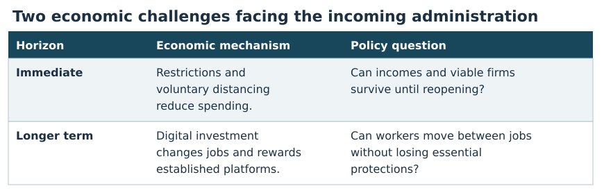

# ENS Rennes · D-E · Anglais 2021 — Corrigé brut

*Corrigé rédigé par IA, non officiel. Signalez toute erreur.*

**Rédaction** · GPT-6.2 Astra Ultra · vitesse non renseignée

## I. Version

En un an, depuis qu’il a remporté une majorité de 80 sièges, Boris Johnson a perdu autant de proches collaborateurs que la plupart des Premiers ministres en un mandat entier. Il en est déjà à son deuxième ministre des Finances et à son deuxième secrétaire du Cabinet, tandis que deux de ceux qui figuraient autrefois parmi ses plus proches conseillers à Downing Street sont désormais bel et bien écartés. Même de la part d’un homme politique connu pour sa capacité à se réinventer, une telle situation risque de passer pour de la négligence. Ses relations avec les parlementaires de son parti se sont également beaucoup dégradées. Autrefois perçu comme un partisan du Brexit épris de liberté qui leur avait donné leur plus forte majorité depuis Margaret Thatcher, il passe maintenant pour un dirigeant « autoritaire », en désaccord avec nombre de ses députés sur la question du moment, celle du coronavirus.

Le problème, pour le Premier ministre à l’approche de 2021, c’est que rien ou presque n’indique que ses difficultés vont bientôt s’atténuer. Elles seraient même plutôt sur le point de s’aggraver.

Alors que les contaminations augmentent, que les médecins tirent la sonnette d’alarme et que les appels à un confinement total se multiplient, Johnson va devoir prendre de nouvelles décisions impopulaires. « On a du mal à dire à quel point janvier et février vont être difficiles », confie un collaborateur de Downing Street.

Le projet de décaler d’une semaine les vacances parlementaires a irrité des députés qui s’inquiètent de l’insuffisance du contrôle exercé par le Parlement sur les décisions prises. Selon un haut responsable conservateur, il a « mis le feu aux poudres » en déclenchant un débat plus large sur la gestion de l’épidémie. Les groupes WhatsApp débordent de questions sur la réouverture des écoles, les hôpitaux d’urgence Nightingale et la stratégie de sortie de crise.

## II. Thème

The head of state has made his decision. The possibility of moving two great French poets, Arthur Rimbaud (1854–1891) and Paul Verlaine (1844–1896), to the Panthéon had provoked controversy. Rimbaud devotees had even dubbed the idea a “Panthéon farce”. Respecting the opposition of the poet’s family, Emmanuel Macron has rejected the proposal to transfer Arthur Rimbaud’s remains to the Panthéon, despite a public petition to that effect backed by Culture Minister Roselyne Bachelot. The French president announced his decision in a letter obtained by Agence France-Presse (AFP) on Thursday, 14 January.

President Macron recalled that admission to the Panthéon is intended to “honour individuals whose public commitments are identified with passing on the values of the Republic”. He explained that, “given the particular role played by the Panthéon in shaping a shared republican memory”, he did not “wish to go against the wishes expressed by the family of the deceased”.

Arthur Rimbaud “will remain buried alongside his relatives, in the family vault in the cemetery at Charleville-Mézières, his birthplace and final resting place”, Mr Macron added. He also paid tribute to “a major figure in French literature, an essential poet and a rebellious spirit” whose “name endures in our history”.

## III.1. How is the COVID-19 pandemic reshaping the US economy?

The pandemic has caused both a sudden interruption of economic activity and a lasting shift in the way American businesses operate. Restrictions stopped many transactions that required face-to-face contact. Even without an official order, customers might stay away from a restaurant if they believed a visit put them at risk. Unemployment reached 14.7 per cent in April before falling to 6.9 per cent in October, according to the article. The rebound was substantial, but the prospect of another winter wave made it dangerous to assume that jobs would continue to return at the same pace.

The shock also redistributed demand. An independent shop that relied on commuters might lose sales while a delivery platform hired staff. Businesses already planning to sell online suddenly had a reason to invest immediately in software, payment systems and distribution. Some of those investments would remain worthwhile after restrictions ended. A platform that attracted more customers could also attract more sellers, giving an established operator an advantage that lasted beyond the emergency.

These two changes create different problems for the incoming administration. A restaurant may need a loan to bridge a temporary interruption, whereas a worker whose former job disappears permanently may need time, training and income to move into another occupation. Nor is digital change confined to technology companies: the article points to carmakers and retailers rethinking their existing businesses. A recovery in aggregate output could therefore coexist with serious losses for particular workers, firms and places.

*245 mots.*

## III.2. To what extent should a government get involved in the economy in times of crisis?

During a crisis, the government has responsibilities that even well-run firms cannot discharge individually. If customers stay home during an epidemic, a small cinema may lose its entire income while its rent remains due. A temporary loan guarantee or wage subsidy can prevent an otherwise viable business from closing. Unemployment insurance also allows a family to pay for food without taking an unsafe job immediately. By maintaining spending, it protects other firms from a second round of losses.

Public intervention is especially justified where the benefits of an action extend beyond those who pay for it. Testing and timely information can help employers, workers and customers make decisions affecting many other people. Under such conditions, simply waiting for individual demand to finance the necessary services may be both costly and slow. Governments should publish the criteria for support so that firms without political connections can apply on equal terms.

However, rescuing every employer indefinitely would freeze the economy in its earlier shape and transfer private losses to taxpayers. Emergency assistance should have review dates and conditions related to actual losses. As activity resumes, some support can shift from preserving particular posts to helping people find new ones. Training, portable benefits and help with transport can give a former employee a choice beyond returning to the same firm. Government involvement should therefore be extensive enough to insure people against a common shock, with sufficient scrutiny and flexibility to withdraw measures whose justification has expired.

*243 mots.*

[Sujet](https://www.ens-rennes.fr/medias/fichier/sujet-e-crit-anglais-2021_1631710099168-pdf) · [Rapport](https://www.ens-rennes.fr/medias/fichier/rapport-de-jury-anglais-ecrit-d-e-2021_1634139985259-pdf)
