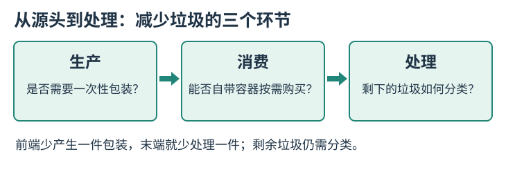

# ENS Rennes · D-E · Chinois (oral) 2021 — Corrigé brut

*Corrigé rédigé par IA, non officiel. Signalez toute erreur.*

**Rédaction** · GPT-6.2 Astra Ultra · vitesse non renseignée

Le fascicule comporte un article à analyser, suivi d’une aide lexicale. Les questions d’entretien sont proposées pour l’entraînement.

## Billet 1 — “零废弃”生活：方法总比困难多

### 从两罐垃圾说起

两个人生活三个月，会留下多少垃圾？阚超群在二〇一九年发表的这篇文章从一个很具体的例子说起。二〇一七年，在北京工作的余元看了国外一个家庭实践“零废弃”的视频，决定和男朋友一起尝试。三个月下来，他们产生的不可降解垃圾只装了两个五百毫升的罐子。后来她在北京开了一家没有包装的零废弃商店，也开始在线上和社区里分享经验。我想讨论的是：一个人的尝试为什么会发展成一家商店，又为什么需要一个社区？

### 从个人习惯到社会条件

文章先指出，许多人听到“零”这个字，就以为必须从第一天起一点垃圾也不能产生。余元的解释降低了这个门槛：先问自己到底需不需要某件商品，再想能不能少用一层包装。两罐垃圾的故事把抽象的目标变成了看得见的东西。不过，罐子里只有不可降解的垃圾。单靠这个例子，还不知道生产和运输这些商品时用了多少资源，也不能断定所有家庭都能马上做到同样的程度。

另一个困难来自消费环境。广告容易让人觉得不买就落后；到了商店，塑料袋随手可得，能够自带容器的地方却不好找。即使顾客愿意改变，没有合适的商店，也很难一直坚持。这就说明余元为什么不满足于在网上告诉大家应该怎么做。她开店，是为了提供一种可以实际选择的购买方式；她希望建立社区，是为了让人交换信息和物品，让下一位想尝试的人不必重新摸索。

### 把分类和减量连起来

举个例子：如果我买米时自带米盒，商店也有散装米，就可以少用一个新塑料袋。回家以后，已经产生的垃圾仍然要分类。分类解决的是垃圾产生以后怎样处理的问题，而少用包装改变的是更早的一个环节。文章把生产、消费和处理放在一起，让我们看到，商家的决定和顾客的选择互相影响。要让更多人参加，办法既要方便，也要让收入不同、住在不同地方的人用得上。

标题说办法比困难多，语气很乐观。文章的说服力主要来自具体的经历，而不是要求别人照做。在我看来，这个故事最值得记住的，不是人人都要准备两个罐子，而是一个人在日常生活中遇到的难题，可以让我们重新思考商店和社区应该提供什么条件。

### 练习问答

**两罐垃圾能证明这种生活方式对所有人都有效吗？** 不能。这是一个家庭在特定条件下的经历，记录的是不可降解垃圾的体积。要判断整体效果，还要比较使用同一种商品时的包装、运输和重复使用的次数。这个例子首先说明改变习惯是可能的。

**如果附近没有散装商店，可以从哪里开始？** 我会先从可以重复使用的东西开始，例如出门带上自己已有的购物袋。还可以看看是否真的需要买新的东西。这样不用等到有人开一家专门的商店，也不用为了环保再买一批新用品。

**为什么作者把社区看得这么重要？** 因为许多困难是信息不够造成的。有人知道哪家店允许自带容器，有人有闲置的物品可以交换。把这些人联系起来，同一种选择就会变得更容易。社区还能把顾客的需求告诉商家，改变大家面对的条件。

[Sujet](https://www.ens-rennes.fr/medias/fichier/annales-oraux-chinois-d-e-2021_1652428640712-pdf)
