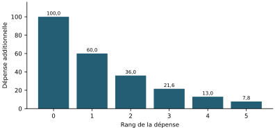
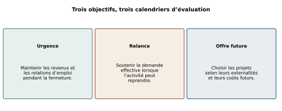

# ENS Rennes D-E — Composition d’ordre économique 2021 · Corrigé brut

*Corrigé rédigé par IA, non officiel.*

**Rédaction** · GPT-6.2 Astra Ultra · vitesse non renseignée

## Assiste-t-on actuellement à un retour de la politique budgétaire ?

### Introduction

En 2020, la crise sanitaire a fermé des lieux de production et tari une partie des revenus. En mars 2021, les États-Unis adoptaient l’*American Rescue Plan* tandis que l’Union européenne préparait la mise en œuvre d’un instrument commun de relance adopté en décembre 2020. La France avait présenté son plan France Relance en septembre 2020, en plus des mesures d’urgence. Ces séquences donnent un contenu précis au mot « actuellement », au printemps 2021. Pourtant les administrations prélevaient, dépensaient et redistribuaient avant la pandémie. En quel sens une politique qui ne s’est jamais interrompue peut-elle revenir ? [Loi fédérale américaine du 11 mars 2021](https://www.govinfo.gov/content/pkg/PLAW-117publ2/pdf/PLAW-117publ2.pdf) · [Règlement européen 2020/2094](https://eur-lex.europa.eu/legal-content/FR/TXT/?uri=CELEX:32020R2094)

Par politique budgétaire on entend l’usage des dépenses, transferts et prélèvements pour influer sur l’activité, sa composition ou sa répartition, ainsi que les stabilisateurs inscrits dans les règles existantes. Une baisse des recettes en récession creuse mécaniquement le déficit. Ce déficit ne mesure donc pas directement la décision discrétionnaire de relancer. Inversement, une garantie publique n’est pas immédiatement une dépense de même montant. La thèse d’un retour doit s’éprouver sur la taille des décisions, la place qu’on leur attribue dans la stabilisation et la durée de ce changement. La réhabilitation de l’intervention discrétionnaire apparaît nette, mais son efficacité et sa pérennité dépendent du cycle, de son financement et de ses institutions.

### I. Les crises récentes ont redonné à la politique budgétaire un rôle actif de stabilisation

#### A. Une demande publique peut enrayer une contraction cumulative quand l’économie dispose de capacités inutilisées

La critique de l’activisme budgétaire s’était nourrie des délais de décision, de l’inflation et de la difficulté à réduire les déficits pendant les expansions. Les banques centrales indépendantes, les règles budgétaires européennes et la confiance dans les incitations de marché avaient déplacé la répartition souhaitée des tâches. Les programmes de 2008-2009 montrent cependant qu’une intervention discrétionnaire restait disponible. Les consolidations ultérieures, particulièrement dans la zone euro, avaient rouvert le débat sur le coût de réduire simultanément les dépenses en période de faible demande.

Dans un modèle keynésien simple, une dépense publique devient le revenu d’un fournisseur, puis celui de ses salariés et partenaires. Si 60 % de chaque revenu supplémentaire reviennent sous forme de demande de production domestique, les tours successifs après une commande de 100 sont 100, 60, 36, 21,6, puis des termes décroissants. Leur somme vaut $100/(1-0{,}6)=250$. L’effet dépasse la commande initiale parce que chaque dépense engendre un revenu. Cet exemple suppose des prix assez rigides, des capacités disponibles et l’absence de réaction compensatrice des autorités ou des agents. Il illustre un mécanisme et ne constitue pas une estimation du multiplicateur français.

L’instrument importe. Une allocation à un ménage qui doit payer ses factures peut être dépensée rapidement. Un transfert à un ménage empêché de consommer certains services peut être épargné, puis dépensé à la réouverture. En période de fermeture administrative, soutenir la trésorerie d’une entreprise ne rouvre pas une salle de spectacle. Le but immédiat est aussi d’éviter la rupture de relations d’emploi ou une faillite d’une activité viable. Le constat d’une consommation faible au même moment ne suffit donc pas à conclure à l’échec de cette dépense.

#### B. Les circonstances monétaires, nationales et européennes expliquent l’ampleur du recours discrétionnaire

Lorsque les taux courts sont proches de leur borne basse, abaisser encore le taux directeur devient difficile. Une faiblesse persistante de la demande peut faire baisser l’inflation anticipée et relever le coût réel du crédit à taux nominal donné. La sécurité des revenus, la commande publique et les transferts ciblés agissent alors sur des agents que la seule baisse de taux atteint mal. Dans la zone euro, une politique monétaire unique rencontre en outre des chocs et des capacités budgétaires nationaux différents. Les achats de titres de la banque centrale peuvent favoriser la transmission et contenir une fragmentation financière. Le choix et le financement des dépenses demeurent des décisions budgétaires.

Le mécanisme d’activité partielle français et les dépenses sanitaires donnent l’exemple d’une action d’urgence. À cette assurance s’ajoute en 2020 un plan de relance annoncé à 100 milliards d’euros autour de l’écologie, de la compétitivité et de la cohésion. L’enveloppe annoncée ne correspond pas à une dépense intégrale sur l’année, ni à un effet immédiat de même montant sur le PIB. Aux États-Unis, la loi du 11 mars 2021 combine paiements aux ménages, soutiens sociaux et moyens pour les collectivités et la santé. Les deux interventions illustrent des instruments différents dans des économies où les stabilisateurs automatiques n’ont pas la même ampleur.

Dans l’Union, la clause dérogatoire générale du pacte de stabilité a permis de tenir compte de la grave récession. Elle n’a pas aboli le cadre budgétaire. L’instrument européen de relance autorise jusqu’à 750 milliards d’euros aux prix de 2018, sous forme de subventions et de prêts, financés par emprunt européen. Au printemps 2021, il faut distinguer cette décision et les versements futurs. Une réponse coordonnée peut réduire la tentation de laisser un partenaire soutenir seul une demande dont une partie se porte sur les importations.

### II. La durée du retour dépend de la qualité des dépenses, de la conjoncture et de la soutenabilité

#### A. L’action budgétaire peut préserver l’offre future, mais ses effets varient avec l’état de l’économie

Le chômage prolongé peut faire perdre des compétences et décourager la participation au marché du travail. Une faillite peut détruire un savoir-faire et des relations commerciales coûteuses à reconstruire. La présence de tels effets d’hystérèse modifie l’arbitrage entre stabilisation aujourd’hui et croissance demain. Maintenir un lien d’emploi pendant un choc transitoire peut soutenir la productivité future. Il faut toutefois éviter de maintenir durablement des activités dont les débouchés ont disparu, et ménager la mobilité et la formation des travailleurs concernés.

Un budget consacré à la recherche, aux infrastructures ou à l’éducation peut accroître le rendement de l’investissement privé lorsque les gains diffusés dépassent le rendement appropriable par l’investisseur. Ces projets n’ont pas le même calendrier qu’un transfert immédiat. Un chantier lancé trop tard pour stabiliser la récession peut rester socialement rentable. Inversement, accélérer sans évaluation une dépense peu utile peut créer des coûts d’entretien de longue durée. Je séparerais donc le diagnostic conjoncturel de l’évaluation du rendement social de chaque projet.

À capacité presque saturée, la demande additionnelle se transmet davantage aux prix et aux importations. Une hausse des taux peut évincer des investissements privés, surtout si l’autorité monétaire veut contenir l’inflation. À l’inverse, avec capacités inutilisées et politique monétaire accommodante, une commande peut plutôt susciter de nouvelles dépenses privées. L’équivalence ricardienne souligne que des ménages prévoyant des impôts futurs peuvent épargner une baisse d’impôt. Son résultat strict réclame des conditions fortes, dont accès au crédit, horizon suffisamment long et prélèvements futurs non distorsifs. Il ne décrit pas indifféremment le ménage contraint et le ménage disposant d’un patrimoine liquide.

#### B. L’encadrement institutionnel peut permettre l’intervention exceptionnelle comme sa sortie

La question de dette doit être rapportée à la croissance et au coût d’intérêt. Si $b$ est la dette rapportée au PIB, $i$ le taux nominal effectif, $g$ la croissance nominale et $s$ l’excédent primaire rapporté au PIB courant, on a, hors ajustements de flux et de stocks, $b_t=\frac{1+i}{1+g}b_{t-1}-s_t$. Pour une dette initiale égale au PIB, un taux d’intérêt de 1 % et une croissance nominale de 3 %, le ratio devient environ 98,1 % en l’absence de déficit primaire. Un déficit primaire de 3 % le porte au contraire à environ 101,1 %. Des taux bas desserrent une contrainte, ils ne la suppriment pas et leur permanence n’est pas garantie.

Une consolidation trop rapide peut freiner le dénominateur et aggraver la trajectoire recherchée. Reporter toutes les décisions peut aussi devenir coûteux si le service de la dette évince des dépenses prioritaires ou si les conditions de refinancement se tendent. Le calendrier devrait donc associer à l’urgence des critères de retrait, et aux investissements une évaluation de long terme. Les stabilisateurs peuvent jouer en continu tandis que les dispositifs extraordinaires doivent répondre à une justification identifiable, avec contrôle parlementaire et transparence sur les engagements conditionnels.

À la date du concours, l’emprunt commun européen est une innovation d’ampleur, créée pour la reprise après la pandémie. Son existence n’établit pas une capacité fédérale permanente. L’évolution future des règles, de leur traitement de l’investissement et du partage des risques engage un choix politique. Un retour durable se jugerait moins à un déficit exceptionnel qu’à la capacité de soutenir une récession, de reconstruire des marges pendant la reprise et de financer les biens collectifs qui traversent les frontières.

### Conclusion

Au printemps 2021, la politique budgétaire revient au premier plan par l’ampleur des mesures discrétionnaires, leur articulation avec la politique monétaire et l’innovation européenne. Le budget n’avait jamais perdu ses fonctions de prélèvement et d’assurance. Ce qui change est la responsabilité qu’on lui reconnaît pour éviter qu’un choc temporaire ne laisse des dommages persistants. La durée de cette évolution dépendra du choix des projets, de la capacité à retirer les mesures devenues inutiles et des institutions communes qui organiseront le financement.

[Sujet distribué](https://www.ens-rennes.fr/medias/fichier/sujet-e-crit-e-conomie-2021_1631710046581-pdf) · [Rapport du jury](https://www.ens-rennes.fr/medias/fichier/rapport-de-jury-economie-ecrit-d-e-2021_1645007204835-pdf)
