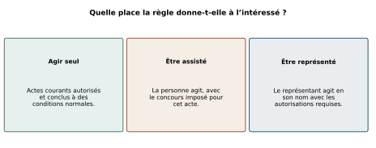
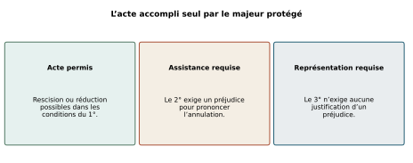

# ENS Rennes D-E — Droit civil 2021 · Corrigé guidé

*Corrigé rédigé par IA, non officiel.*

**Rédaction** · GPT-6.2 Astra Ultra · vitesse non renseignée

## L’incapable face au contrat

### Introduction

> [!INDICATION]
> Comparer un achat de faible valeur et une vente immobilière en identifiant leur auteur.

Un mineur non émancipé achète un cahier chez un libraire. Un majeur en curatelle envisage de céder un immeuble. Dans les deux cas, une personne soumise à une mesure légale de protection veut participer à un échange. On ne peut répondre par la même formule à la validité du ticket de caisse et à celle de la vente immobilière. La nature et les conditions de l’acte, le régime de protection et le rôle réservé à la volonté de l’intéressé commandent des solutions différentes.

Le sujet utilise le terme juridique « incapable ». Il désigne ici une incapacité d’exercice, dans les limites prévues par la loi. Le mineur ou le majeur protégé reste titulaire de droits et reçoit dans son patrimoine les effets d’un contrat valablement conclu en son nom. Il ne suffit pas qu’un partenaire soit économiquement faible ou se trompe pour le qualifier d’incapable. L’article 1128 distingue le consentement et la capacité de contracter parmi les conditions de validité. L’article 1145 pose le principe de capacité de toute personne physique, sous réserve des incapacités prévues par la loi. L’article 1146 vise, dans la mesure définie par celle-ci, les mineurs non émancipés et les majeurs protégés au sens de l’article 425. Conformément au sujet et au rapport, l’étude porte principalement sur le mineur non émancipé et sur les majeurs en curatelle ou en tutelle. [Article 1128](https://www.legifrance.gouv.fr/codes/article_lc/LEGIARTI000032040911/2021-04-01) · [Article 1145](https://www.legifrance.gouv.fr/codes/article_lc/LEGIARTI000036829833/2021-04-01) · [Article 1146](https://www.legifrance.gouv.fr/codes/article_lc/LEGIARTI000032041065/2021-04-01)

Puisque la protection restreint l’exercice des droits dans l’intérêt de la personne, quelle part le droit laisse-t-il à sa volonté propre, et comment réagit-il lorsqu’un contrat a été conclu en dehors du cadre admis ? Le contrat peut résulter d’une décision autonome, d’une assistance ou d’une représentation, selon la situation. L’irrégularité est ensuite traitée par des sanctions dont l’intensité se règle sur la protection requise.

### I. Le droit permet une participation graduée de la personne protégée à la conclusion du contrat

#### A. La capacité restreinte conserve un domaine d’action personnelle

> [!INDICATION]
> Examiner la qualification d’acte courant et la normalité des conditions.

L’article 1148 permet à toute personne incapable de contracter d’accomplir seule les actes courants autorisés par la loi ou l’usage, à condition qu’ils soient conclus à des conditions normales. Acheter des fournitures usuelles à un prix habituel relève en principe de la vie quotidienne. L’achat à crédit d’un équipement particulièrement coûteux, avec des obligations durables, ne devient pas courant par la seule fréquence des achats en ligne. Il faut apprécier la nature, la valeur, les conditions et les conséquences du contrat compte tenu de la situation. Cocher une case déclarant la majorité ne transforme pas cette qualification. [Article 1148](https://www.legifrance.gouv.fr/codes/article_lc/LEGIARTI000032041055/2021-04-01) · [Article 1149](https://www.legifrance.gouv.fr/codes/article_lc/LEGIARTI000032041050/2021-04-01)

Les règles de protection des majeurs poursuivent la sauvegarde de leurs intérêts, dans le respect des libertés individuelles et de la dignité, et favorisent autant que possible leur autonomie. La curatelle suppose un besoin d’assistance ou de contrôle pour les actes importants. La tutelle répond à un besoin de représentation continue dans les actes de la vie civile dans les conditions légales. Le jugement de protection peut moduler ce que l’intéressé accomplit seul ou avec assistance. Lire le régime exact et son aménagement précède toute conclusion sur un acte particulier. [Article 415](https://www.legifrance.gouv.fr/codes/article_lc/LEGIARTI000006427566/2021-04-01) · [Article 440](https://www.legifrance.gouv.fr/codes/article_lc/LEGIARTI000006427481/2021-04-01) · [Article 473](https://www.legifrance.gouv.fr/codes/article_lc/LEGIARTI000006427839/2021-04-01)

Il faut aussi se garder de déduire du droit patrimonial une incapacité générale à décider de sa personne. La loi réserve certains actes strictement personnels et organise la participation aux décisions personnelles selon l’état de l’intéressé. L’article 458, qui évoque par exemple la reconnaissance d’un enfant, marque une limite structurelle à la représentation. Cet exemple indique la portée de l’autonomie sans transformer la dissertation sur le contrat en un catalogue d’actes familiaux. La faculté réservée à une personne doit être distinguée du pouvoir de gérer son patrimoine. [Article 458](https://www.legifrance.gouv.fr/codes/article_lc/LEGIARTI000006427723/2021-04-01) · [Article 459](https://www.legifrance.gouv.fr/codes/article_lc/LEGIARTI000038310445/2021-04-01)

#### B. Assistance et représentation maintiennent l’accès au contrat lorsque l’acte dépasse ce domaine

> [!INDICATION]
> Distinguer signature personnelle, cosignature et représentation autorisée.

La personne en curatelle ne peut accomplir, sans l’assistance du curateur, un acte qui requerrait en tutelle une autorisation du juge ou du conseil de famille. Dans un écrit, l’assistance se manifeste par la signature du curateur à côté de celle de la personne protégée. Pour la vente immobilière de l’exemple, sous réserve d’une règle spéciale ou d’un aménagement du jugement, la cosignature matérialise ce concours. Le curateur n’a pas une faculté générale de décider seul ce que le majeur doit vendre. L’assistance préserve une attribution de volonté à celui qui contracte. [Article 467](https://www.legifrance.gouv.fr/codes/article_lc/LEGIARTI000006427797/2021-04-01)

Sous tutelle, le tuteur représente l’intéressé dans les actes que celui-ci ne peut accomplir seul ou avec assistance. Il accomplit en principe seul les actes conservatoires et d’administration, sous réserve des textes applicables. Un acte de disposition requiert l’autorisation du conseil de famille ou, à défaut, du juge. Une opération qui modifie durablement et substantiellement le patrimoine ne se traite donc pas comme son entretien courant. L’acte régulièrement conclu au nom du majeur produit ses effets dans le patrimoine de ce dernier. Le représentant ne devient pas le bénéficiaire économique de l’opération. [Article 473](https://www.legifrance.gouv.fr/codes/article_lc/LEGIARTI000006427839/2021-04-01) · [Article 504](https://www.legifrance.gouv.fr/codes/article_lc/LEGIARTI000006428288/2021-04-01) · [Article 505](https://www.legifrance.gouv.fr/codes/article_lc/LEGIARTI000006428299/2021-04-01)

Pour le mineur, l’administration légale revient au parent ou aux parents désignés par l’article 382. Certains actes graves requièrent en plus l’autorisation préalable du juge. Tel est notamment le cas de la vente de gré à gré d’un immeuble appartenant au mineur ou d’un emprunt en son nom. Un acquéreur ne peut donc s’en tenir à constater qu’un parent a signé. À l’inverse, demander systématiquement une autorisation pour l’achat du cahier viderait de son sens l’autonomie de la vie courante. Le droit ménage l’accès à l’échange en rattachant l’intensité du contrôle au risque encouru par la personne que la loi protège. [Article 382](https://www.legifrance.gouv.fr/codes/article_lc/LEGIARTI000031345310/2021-04-01) · [Article 387-1](https://www.legifrance.gouv.fr/codes/article_lc/LEGIARTI000031322948/2021-04-01)

### II. L’irrégularité du contrat donne lieu à une protection différenciée et à des effets maîtrisés

#### A. La sanction varie avec l’acte et avec le concours qui faisait défaut

> [!INDICATION]
> Partir du rôle qui aurait dû revenir à la personne et lire la branche correspondante de l’article 465.

L’article 1147 qualifie l’incapacité de cause de nullité relative. La règle protège la personne visée et ne fournit pas au cocontractant capable une faculté générale de se dégager d’un marché devenu défavorable. Cela ne signifie pas que tout contrat conclu par une personne protégée serait nul, ni que la preuve d’une lésion serait toujours nécessaire. Il faut d’abord qualifier l’acte, vérifier qui devait agir et appliquer les règles propres au régime. [Article 1147](https://www.legifrance.gouv.fr/codes/article_lc/LEGIARTI000032041060/2021-04-01) · [Article 1181](https://www.legifrance.gouv.fr/codes/article_lc/LEGIARTI000032041228/2021-04-01)

Pour le mineur, l’article 1149 précise que les actes courants qu’il a accomplis peuvent être annulés pour simple lésion, sauf si la lésion résulte d’un événement imprévisible. Le problème est donc différent selon que le contrat excédait ce qu’il pouvait faire seul ou qu’un acte courant lui a causé une lésion dans les conditions prévues par le texte. La simple déclaration de majorité ne ferme pas l’action. La loi réserve les engagements pris par le mineur dans l’exercice de sa profession. Elle évite ainsi que la protection soit indistinctement transposée à toutes les situations. [Article 1149](https://www.legifrance.gouv.fr/codes/article_lc/LEGIARTI000032041050/2021-04-01)

Pour le majeur protégé, l’article 1150 renvoie au régime spécial. À compter de la publicité du jugement d’ouverture, l’article 465 distingue plusieurs cas. Un acte que la personne pouvait faire seule peut demeurer sujet à rescision pour lésion ou réduction pour excès dans les conditions visées, sauf autorisation expresse du juge ou du conseil de famille. Lorsque l’assistance requise a manqué, l’annulation exige la preuve d’un préjudice. Lorsque la personne a accompli seule un acte pour lequel elle aurait dû être représentée, il est nul de plein droit sans justification d’un préjudice. Le texte sanctionne aussi l’intervention du protecteur au-delà de ce qu’il pouvait faire seul. La vente passée par une personne en curatelle sans assistance et la vente passée seule par une personne qui devait être représentée peuvent ainsi être irrégulières pour des raisons différentes et requérir des démonstrations distinctes. [Article 1150](https://www.legifrance.gouv.fr/codes/article_lc/LEGIARTI000032041045/2021-04-01) · [Article 465](https://www.legifrance.gouv.fr/codes/article_lc/LEGIARTI000032042597/2021-04-01)

#### B. Le droit organise la défense de l’acte utile, le temps de l’action et les restitutions

> [!INDICATION]
> Séparer la confirmation, le point de départ de la prescription et les restitutions.

Dans le cadre du droit commun de l’incapacité, l’article 1151 permet au contractant capable de faire obstacle à l’action en établissant que l’acte était utile à la personne protégée et exempt de lésion ou qu’il lui a profité. La première branche cumule l’utilité et l’absence de lésion. La seconde vise le profit effectivement retiré. Le texte permet aussi d’opposer la confirmation par le cocontractant devenu ou redevenu capable. Pour les majeurs protégés, l’article 1150 commande d’articuler cette présentation avec les régimes spéciaux et les conditions de confirmation prévues notamment à l’article 465. Un acquéreur ne saurait effacer rétrospectivement toute irrégularité en se proclamant seul juge de l’intérêt de l’opération. [Article 1151](https://www.legifrance.gouv.fr/codes/article_lc/LEGIARTI000032041040/2021-04-01) · [Article 1182](https://www.legifrance.gouv.fr/codes/article_lc/LEGIARTI000032041223/2021-04-01)

Le point de départ de la prescription tient compte de la possibilité réelle d’agir. Pour les actes du mineur, l’article 1152 le fixe à la majorité ou à l’émancipation. Pour le majeur protégé, il vise le jour où il a eu connaissance de l’acte alors qu’il était en situation de le refaire valablement. Pour les héritiers de la personne visée par les mesures mentionnées au texte, il prend en compte le décès si le délai n’avait pas déjà commencé. Il ne suffit donc pas de compter mécaniquement à partir de la date de signature. [Article 1152](https://www.legifrance.gouv.fr/codes/article_lc/LEGIARTI000032041034/2021-04-01)

L’annulation fait en principe disparaître rétroactivement le contrat et appelle la restitution des prestations. L’article 1352-4 réduit les restitutions dues par le mineur non émancipé ou le majeur protégé à hauteur du profit qu’il a retiré de l’acte annulé. Il évite qu’une restitution ordinaire ne fasse renaître la charge que la protection devait écarter. Il faut déterminer ce qui a réellement profité à l’intéressé. Enfin, la survenance d’une incapacité après une conclusion valable n’anéantit pas par elle-même le contrat déjà formé. Elle peut modifier les modalités des actes futurs d’administration ou de disposition sans constituer un vice rétroactif du consentement initial. [Article 1352-4](https://www.legifrance.gouv.fr/codes/article_lc/LEGIARTI000036829864/2021-04-01)

### Conclusion

> [!INDICATION]
> Montrer comment l’intérêt protégé influe sur l’accès à l’acte et sur la sanction.

Le statut de protection n’exclut pas la personne du contrat. Il réserve une place à ses actes ordinaires, met une assistance au service de sa décision ou organise une représentation lorsque la loi l’exige. Lorsque ce cadre n’a pas été respecté, la réponse tient à l’acte accompli, au rôle qui aurait dû être celui de l’intéressé et aux conséquences de l’échange pour lui. Cette gradation rend compatibles la protection du patrimoine, l’autonomie personnelle et la sécurité légitime des partenaires.

[Sujet distribué](https://www.ens-rennes.fr/medias/fichier/sujet-e-crit-droit-civil-2021_1631710064517-pdf) · [Rapport du jury](https://www.ens-rennes.fr/medias/fichier/rapport-de-jury-droit-civil-d-e-2021_1634139957430-pdf)
