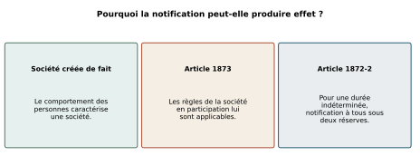
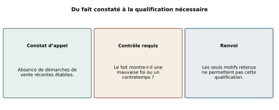

# ENS Rennes D-E — Droit commercial 2021 · Corrigé brut

*Corrigé rédigé par IA, non officiel.*

**Rédaction** · GPT-6.2 Astra Ultra · vitesse non renseignée

## Commentaire de Cass. com., 10 avril 2019, n° 17-28.834 — La dissolution par notification d’une société créée de fait

### Introduction

Deux personnes exploitent ensemble une officine de pharmacie au sein d’une société créée de fait. L’une veut mettre fin à leur relation, l’autre conteste que les circonstances le permettent. Faut-il, avant de notifier la dissolution, démontrer que l’autre a fait échouer les projets de cession ou qu’on a entrepris récemment de nouvelles recherches ? L’arrêt du 10 avril 2019 refuse que de telles exigences tiennent lieu des conditions posées par le Code civil.

Par lettre recommandée du 25 juin 2014, M. Y. notifie à M. D., son associé, sa volonté de mettre fin à leur indivision. Il l’assigne ensuite en dissolution de leur société créée de fait, sur le fondement de l’article 1872-2 du Code civil. La cour d’appel de Lyon rejette la demande le 22 juin 2017. Elle observe que M. Y. ne prouve pas l’éviction systématique par son associé de tous les candidats acquéreurs et ne justifie pas de démarches entre la fin de 2012 et la notification. La chambre commerciale casse au visa des articles 1872-2 et 1873 et renvoie à la même cour autrement composée. Elle vise les troisième et septième branches du moyen unique et ne se prononce pas sur les autres griefs. [Arrêt du 10 avril 2019](https://www.legifrance.gouv.fr/juri/id/JURITEXT000038427075/)

La cour pouvait-elle rejeter la demande en se bornant à ces constatations, alors que la dissolution unilatérale est permise sous réserve d’une notification de bonne foi et qui ne soit pas faite à contretemps ? La Cour reconnaît la force de l’initiative individuelle dans la société concernée, puis exige une motivation apte à caractériser les limites de cette initiative.

### I. Le renvoi aux règles de la société en participation donne un effet juridique à la notification unilatérale

#### A. Le droit de la société créée de fait organise la sortie d’une relation sociale avérée

La société créée de fait est reconnue à partir du comportement de personnes qui se sont comportées en associés sans avoir constitué une société immatriculée dans les formes usuelles. En principe, sa qualification réclame de caractériser les éléments d’un contrat de société, notamment des apports, une participation aux résultats et la volonté de collaborer comme associés. L’arrêt tient pour acquise la société exploitant l’officine. Le litige ne porte pas sur une recherche nouvelle de ces indices. Le mot « indivision » employé dans la lettre ne doit pas conduire à commenter seulement le partage de la propriété des biens.

En effet, l’indivision décrit une titularité commune sur des biens. La société régit une entreprise commune et les relations entre associés. L’une peut exister avec l’autre sans s’y réduire. La demande est fondée sur la dissolution de la société. Le visa conjoint des articles 1872-2 et 1873 explique pourquoi la chambre commerciale lui applique une règle figurant parmi les dispositions de la société en participation. L’article 1873 étend celles-ci aux sociétés créées de fait. Le défaut d’immatriculation ne prive donc pas l’associé de tout régime juridique de sortie.

Il convient de respecter le champ de la règle empruntée. L’article 1872-2 vise la société en participation à durée indéterminée. Dans cette hypothèse, la dissolution peut résulter à tout moment d’une notification de l’un des associés à tous les autres, sous les deux réserves énoncées par le texte. La Cour énonce la règle dans la situation qui lui est soumise. Il serait imprudent d’en tirer une faculté identique pour n’importe quelle société dotée d’un terme, ou de la confondre avec une dissolution judiciaire pour justes motifs.

#### B. La notification manifeste une initiative que le juge peut contrôler sans la soumettre à un accord de l’autre associé

L’expression « à tout moment » préserve la possibilité de sortir de la relation à durée indéterminée. Le bénéficiaire de cette faculté ne doit pas préalablement obtenir le consentement de l’autre ni lui imputer une faute de gestion. Exiger la preuve de l’obstruction de M. D. comme condition générale reviendrait à transformer une faculté de notification en sanction d’un comportement reproché. L’arrêt attire ainsi l’attention sur la différence entre expliquer pourquoi un associé souhaite partir et devoir établir une cause objective autorisant ce départ.

La notification doit être adressée à tous les associés. L’espèce en compte deux. La lettre recommandée du 25 juin 2014 rend identifiables le destinataire et la date de la démarche. La forme employée a une utilité probatoire. L’arrêt ne déduit pas de cet envoi un pouvoir général de produire n’importe quel effet sur les biens de l’officine. La dissolution de la relation sociale et la liquidation des rapports patrimoniaux, avec la question du partage des biens indivis, demeurent deux étapes.

L’assignation ultérieure n’efface pas non plus le rôle de la notification. Elle porte la contestation devant le juge. Celui-ci doit apprécier si les conditions dans lesquelles la déclaration a été faite autorisent l’effet recherché. La vente préalable de l’officine n’est pas érigée par les textes visés en condition générale. La circonstance que les parties auraient discuté des offres d’achat peut être probante pour apprécier les faits, mais elle ne peut se substituer à la qualification exigée par la loi.

### II. Les deux limites légales appellent une caractérisation concrète que les motifs d’appel ne fournissaient pas

#### A. La mauvaise foi et le contretemps ne se déduisent pas de la seule absence de démarche récente

La bonne foi concerne la loyauté avec laquelle l’associé exerce son droit. Le contretemps invite à considérer le moment de la notification dans la conduite des affaires communes. Des notions proches peuvent viser des faits différents. Une intention de nuire ou de détourner un avantage commun pourrait éclairer la mauvaise foi. Une opération engagée dont la rupture intempestive compromettrait gravement l’achèvement pourrait amener à discuter le moment choisi. Ces illustrations ne constituent pas des constatations de l’arrêt et leur qualification dépendrait du contexte et des preuves.

Les deux raisons opposées à M. Y. ne répondent pas à ce besoin. Que tous les candidats à l’acquisition n’aient pas été systématiquement écartés par son associé ne démontre pas qu’il a notifié pour lui porter préjudice. Qu’il n’ait entrepris aucune démarche de vente récente ne précise pas ce que le 25 juin 2014 avait d’intempestif pour l’activité commune. La durée de deux ans peut devenir un indice dans un ensemble plus large. Isolée, elle est compatible avec un projet loyal de mettre fin à une relation durable.

L’argument concernant la charge de la preuve doit rester précis. La bonne foi est en principe présumée. Demander à l’associé de démontrer toutes les fautes qu’il imputait à l’autre pour justifier sa sortie fait peser sur lui une exigence étrangère au dispositif de l’article 1872-2. Le texte de la décision retient expressément des « motifs impropres » et un défaut de base légale. Il ne prononce pas, dans son dispositif, une règle autonome qui attribuerait définitivement et de façon identique la charge de toute preuve du contretemps et de la mauvaise foi. Le rapport de jury souligne justement l’intérêt du débat sur les preuves. Il faut le distinguer de la portée affirmée de la cassation.

#### B. Le défaut de base légale protège le principe de sortie sans déclarer d’avance la notification irréprochable

La Cour ne rejuge pas les intentions de M. Y. Elle contrôle que les faits retenus par les juges du fond sont aptes à justifier leur refus. Elle aurait pu confirmer une décision qui, à partir de faits pertinents, aurait caractérisé une notification de mauvaise foi ou faite à contretemps. Le rejet de la demande au vu des seuls motifs exposés rend impossible ce contrôle. La cassation pour défaut de base légale laisse ouverte l’appréciation de circonstances supplémentaires.

La cour de Lyon autrement composée devra donc reprendre l’examen. Elle ne pourra refaire du manque de preuve d’une campagne de cession un préalable abstrait. Elle pourra notamment examiner la teneur des échanges, la situation concrète de l’officine au moment de la notification et les effets qu’une rupture à cette date pouvait avoir sur des opérations en cours. Il lui reviendra de rattacher les faits qu’elle retient à l’une ou l’autre limite légale. La chambre commerciale n’a pas elle-même prononcé, dans le dispositif reproduit, la liquidation ou le partage des biens.

Le contrôle présente une double valeur pratique. Si les réserves étaient interprétées comme l’obligation de démontrer à chaque fois une impossibilité de continuer ensemble, le principe de sortie à tout moment perdrait sa portée. Si l’on excluait toute appréciation de l’intention ou du moment, le pouvoir de notification deviendrait indifférent à la coopération dont l’activité a dépendu. Le défaut de base légale maintient ensemble une faculté effective et un contrôle judiciaire suffisamment motivé de son exercice.

### Conclusion

Un associé d’une société créée de fait relevant de ce régime peut notifier sa dissolution aux autres associés. L’efficacité de cette initiative reste soumise à la bonne foi et à l’absence de contretemps. L’arrêt de Lyon est cassé parce que les circonstances retenues ne caractérisent ni l’une ni l’autre défaillance. Le renvoi maintient ouverte la solution factuelle et assure que la décision future sera prise sur les conditions que la loi a effectivement posées.

[Sujet distribué](https://www.ens-rennes.fr/medias/fichier/sujet-e-crit-e-preuve-a-options-2021_1631710076477-pdf) · [Rapport du jury](https://www.ens-rennes.fr/medias/fichier/rapport-de-jury-droit-commercial-d-e-2021_1634139968713-pdf)
