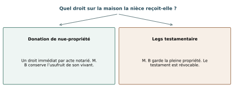
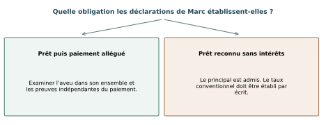
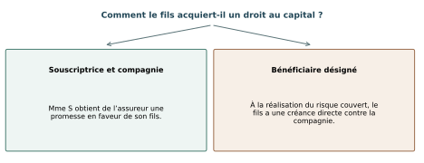

# ENS Rennes D-E — Droit (oral) 2021 · Corrigé brut

*Corrigé rédigé par IA, non officiel.*

**Rédaction** · GPT-6.2 Astra Ultra · vitesse non renseignée

Le fascicule présente 23 tirages. Chaque numéro reprend une question de cours et un cas autonome, traités dans le droit en vigueur à la session. Les numéros reproduisent ceux des pages distribuées.

## Sujet 01 — Les présomptions en droit de la preuve

*Fascicule, page 1.*

### Question théorique

Une présomption légale tire d’un fait connu une conséquence que celui qui en bénéficie est dispensé de prouver. L’article 1354 distingue les présomptions simples, mixtes ou irréfragables selon les possibilités de renversement. La présomption judiciaire relève de l’appréciation du juge. L’article 1382 exige des indices graves, précis et concordants dans les cas où la preuve par tout moyen est admise. Ni la répartition de la charge de la preuve ni les conditions d’admissibilité ne disparaissent.

### Application au cas

A doit d’abord préciser le type d’acte et sa valeur. En matière civile, au-delà de 1 500 euros, l’article 1359 exige en principe un écrit. Sans signature, la lettre ne constitue pas à elle seule un acte sous signature privée. Si elle émane bien de Z, contre qui elle est invoquée, et rend vraisemblable le contrat, c’est un commencement de preuve par écrit (art. 1362). A le complète par un autre moyen, par exemple un témoignage sur la conclusion ou des indices d’exécution (art. 1361). Lorsque la preuve est libre, le juge apprécie directement la lettre avec les autres éléments. Un aveu judiciaire, une impossibilité de se procurer un écrit ou un autre régime applicable doivent aussi être examinés.

## Sujet 02 — La charge de la preuve en droit des obligations

*Fascicule, page 2.*

### Question théorique

L’article 1353 commande à celui qui réclame l’exécution de prouver l’obligation. Celui qui se prétend ensuite libéré justifie le paiement ou le fait extinctif. Le doute subsistant après administration des preuves nuit à celui qui supportait la charge sur le point litigieux. La remise d’une somme et l’engagement de la restituer constituent deux faits à distinguer. Un virement établit le déplacement des fonds, qui peut répondre à plusieurs causes.

### Application au cas

Mme Y réclame le remboursement de 25 000 euros. Elle doit établir le prêt ou une autre obligation de restitution qu’elle invoquerait. En déduisant cette dette de la seule incapacité de X à prouver une intention libérale, le premier juge inverse la charge de la preuve. Une reconnaissance de dette, un écrit contractuel ou un commencement de preuve corroboré peuvent modifier l’issue. Si Y établit le prêt, X qui prétend l’avoir remboursé devra justifier le paiement. La qualification de don ne découle pas davantage du seul rejet de la demande.

## Sujet 03 — Le nom de la personne physique

*Fascicule, page 3.*

### Question théorique

Le nom de famille identifie une personne à l’état civil. Il se distingue du nom d’usage et sa dévolution dépend de la filiation. En 2021, pour des filiations établies simultanément, l’article 311-21 permet par déclaration conjointe le nom du père, celui de la mère ou leurs deux noms dans la limite d’un par parent. Sans déclaration, les règles supplétives s’appliquent. Si un second lien de filiation est établi pendant la minorité, l’article 311-23 organise sous conditions une déclaration conjointe de changement. À partir de treize ans l’enfant doit personnellement consentir au changement prévu par ce texte.

### Application au cas

Les enfants n’ont pas le même couple de parents. La règle d’unité de nom des enfants communs ne les oblige donc pas à porter le même. Il faut demander quels liens étaient établis à chaque naissance, quelles déclarations ont été faites et quels noms figurent aux actes. L’enfant né pendant le mariage bénéficie en principe de la présomption de paternité du mari. Si les filiations et le nom sont déjà fixés et qu’aucune déclaration fondée sur un second lien n’est ouverte, Mme L. ne peut changer seule l’état civil. En 2021, un changement pour intérêt légitime relève notamment de l’article 61. Une durée de vie commune de quatre mois n’apporte pas à elle seule la preuve d’une filiation ou de l’autorité parentale.

## Sujet 04 — La nature juridique des récoltes

*Fascicule, page 4.*

### Question théorique

L’article 520 qualifie d’immeubles les récoltes pendantes par les racines et les fruits non recueillis. Dès qu’ils sont coupés ou détachés, ils sont meubles. Une opération portant sur une prochaine récolte peut les envisager comme meubles par anticipation dans les rapports des parties. Un arbre en pleine terre appartient en principe à l’immeuble. La propriété du sol emporte, sous réserve de titres et de droits contraires, celle de ce qui s’y incorpore (art. 552–553).

### Application au cas

Il faut examiner chaque bien et le régime matrimonial. Une yourte démontable simplement posée et des tuteurs mobiles peuvent rester meubles. Une serre fixée par des fondations ou une installation incorporée peut être immeuble par nature. L’affectation d’un meuble comme immeuble par destination suppose notamment une communauté de propriétaire avec le fonds. Arbres et cultures enracinés relèvent ordinairement de l’accession. Le financement ou le travail de l’épouse peut ouvrir des comptes entre patrimoines selon le régime, sans créer à lui seul un droit d’arracher les plantations. L’époux doit établir son titre sur le terrain et chaque bien mobile doit être rattaché à son propriétaire.

## Sujet 05 — Le droit extrapatrimonial

*Fascicule, page 5.*

### Question théorique

Les droits de la personnalité protègent des intérêts attachés à la personne. Le respect de la vie privée et le droit à l’image en sont des exemples. Leur violation peut ouvrir droit à des dommages-intérêts sans rendre le droit lui-même librement cessible. L’article 9 du Code civil autorise le juge à prescrire des mesures propres à prévenir ou à faire cesser l’atteinte, en référé en cas d’urgence. Leur exercice doit aussi tenir compte de la liberté d’expression et de la proportionnalité d’une restriction.

### Application au cas

La diffusion par LAKYANA des images de son mariage manifeste un choix limité à cet événement. La grossesse, le contexte de la prise du cliché, sa diffusion annoncée et l’existence d’un consentement distinct doivent être examinés. L’artiste peut saisir le juge avant la publication imminente, établir la menace et demander une mesure proportionnée, par exemple contre la reproduction de ce cliché. La notoriété seule ne caractérise pas un débat d’intérêt général. Si le magazine invoque un tel débat, le juge apprécie contribution du cliché, conditions d’obtention et atteinte concrète. Une réparation pourra aussi être demandée si un préjudice est établi.

## Sujet 06 — Coutume et usages en droit civil

*Fascicule, page 6.*

### Question théorique

Une coutume résulte d’une pratique répétée accompagnée de la conviction de son caractère juridiquement obligatoire. Un usage peut éclairer une convention et compléter les suites que les parties ont attachées au contrat, notamment au sens de l’article 1194. Une seule habitude sociale, même répandue, ne suffit pas à créer une obligation juridique. En matière d’état des personnes, les textes et le caractère impératif de certaines règles limitent l’emprise des pratiques privées.

### Application au cas

Après le mariage, Hélène conserve son nom de famille à l’état civil. Selon l’article 225-1 en vigueur en 2021, chacun des époux peut porter à titre d’usage le nom de l’autre par substitution ou adjonction, dans l’ordre choisi. Cette faculté est réciproque. Hélène peut se marier et continuer à employer exclusivement son propre nom. Amaury ne dispose d’aucun droit pour lui imposer le sien. Le couple n’a besoin d’aucune convention dérogatoire et la divergence n’est pas un obstacle légal au mariage si chacun y consent librement.

## Sujet 07 — Le démembrement de propriété

*Fascicule, page 7.*

### Question théorique

Le nu-propriétaire détient le droit de disposer de son titre sous réserve de la jouissance de l’usufruitier. L’usufruitier peut user du bien et en recueillir les fruits en conservant sa substance (art. 578). L’usufruit viager s’éteint au décès de son titulaire, et la pleine propriété se reconstitue alors entre les mains du nu-propriétaire (art. 617). Un droit d’usage ou d’habitation peut être adapté à un souhait d’occupation purement personnelle.

### Application au cas

M. B peut envisager devant notaire une donation actuelle de la nue-propriété à sa nièce avec réserve d’usufruit viager. La nièce reçoit un droit dès maintenant, son oncle conserve le logement. Un legs par testament permet au contraire de conserver la pleine propriété pendant sa vie et reste révocable. Il faut vérifier consentement éclairé, héritiers réservataires, valeur de la maison et quotité disponible. Une obligation d’assistance éventuelle doit être définie, et le droit du travail respecté si les conditions d’un emploi sont réunies. Le seul âge n’entraîne aucune incapacité. La décision 2020-888 QPC du 12 mars 2021 invite à ne pas opposer mécaniquement une interdiction générale de recevoir à toute aide à domicile. Un statut professionnel particulier et une éventuelle influence abusive appellent une vérification concrète.

## Sujet 08 — Les attributs de la personnalité morale

*Fascicule, page 8.*

### Question théorique

L’association déclarée et rendue publique dispose, dans les conditions de la loi du 1er juillet 1901, d’une personnalité distincte de ses membres, d’un nom, d’un siège, d’un patrimoine et d’une capacité attachée à son objet. Un organe ou un mandataire la représente conformément aux textes, aux statuts et à la délégation consentie. Le titre de président ne dispense pas de vérifier ses pouvoirs. Les actes n’engagent que la personne représentée lorsque le représentant agit dans ses pouvoirs et en son nom (art. 1154).

### Application au cas

Lire la désignation du preneur dans le bail, la signature, les statuts et une éventuelle délibération. Si l’association avait la personnalité et si le président a signé valablement en son nom, elle est locataire et doit payer les loyers. Le président qui s’est engagé en son nom personnel peut au contraire être preneur. Une absence ou un dépassement de pouvoir appelle l’examen de l’opposabilité, d’une croyance légitime du bailleur dans les pouvoirs ou d’une ratification (art. 1156). Pour un groupement non déclaré, identifier les personnes réellement engagées. L’usage matériel de l’immeuble ne résout pas seul ces questions.

## Sujet 09 — Les principes généraux du droit de la preuve

*Fascicule, page 9.*

### Question théorique

Jean réclame 2 500 euros et des intérêts. Le prêt civil dépasse le seuil de l’écrit. L’aveu judiciaire peut suppléer cet écrit (art. 1361), fait foi contre son auteur et ne peut être divisé contre lui (art. 1383-2). Il faut distinguer cette règle de l’obligation pour celui qui se prétend libéré de prouver son paiement. Le paiement s’établit par tout moyen (art. 1342-8). En outre, le taux de l’intérêt conventionnel doit être fixé par écrit (art. 1907).

### Application au cas

Première hypothèse. « J’ai emprunté et tout remboursé » ne peut, s’il s’agit de l’unique déclaration invoquée, être tronqué arbitrairement. Jean peut établir le prêt par ailleurs, Marc devant alors documenter sa libération. Il peut aussi contester le fait distinct de remboursement par les circonstances et pièces produites. La Cour de cassation admet qu’un juge écarte un fait distinct dont il a apprécié l’inexactitude (1re civ., 30 octobre 2006, 04-17.098). Deuxième hypothèse. Marc admet le principal mais nie les intérêts. Sa déclaration ne démontre aucune stipulation à 5 %. Sans preuve suffisante du taux convenu, la prétention aux intérêts conventionnels échoue, indépendamment d’éventuels intérêts moratoires légaux après mise en demeure. Si le 5 % annuel était valablement établi, six mois sur 2 500 euros représenteraient 62,50 euros en calcul simple.

## Sujet 10 — Les effets du contrat entre les parties

*Fascicule, page 10.*

### Question théorique

Le contrat légalement formé oblige les parties, s’exécute de bonne foi et ne se modifie ou révoque que d’un commun accord ou pour les causes autorisées par la loi (art. 1103, 1104 et 1193). Un décès peut entraîner transmission successorale, extinction d’une obligation personnelle ou application d’une loi spéciale. Une échéance contractuelle dans deux ans ne suffit donc pas à déterminer les loyers encore dus.

### Application au cas

Pour le bail d’habitation principale régi par la loi du 6 juillet 1989, l’article 14 prévoit notamment le transfert aux descendants qui vivaient avec le locataire depuis au moins un an à la date du décès, sous réserve de la situation des autres bénéficiaires. À défaut de bénéficiaire remplissant les conditions, le bail est résilié de plein droit au décès. Si Jean recueille le bail, il peut le résilier en respectant le congé et le préavis applicables. Les loyers échus avant le décès relèvent du passif successoral selon l’option de l’héritier. Pour un bail qui échappe à cette loi, examiner le droit commun, notamment l’article 1742, le contrat et les droits éventuels de congé. Le propriétaire ne peut donc tirer du seul statut d’héritier un droit automatique à deux ans de loyers.

## Sujet 12 — Les divisions du droit

*Fascicule, page 11.*

### Question théorique

La distinction entre droit privé et droit public contribue à répartir les litiges entre ordres judiciaire et administratif. Parmi les juridictions judiciaires, le tribunal judiciaire exerce la compétence civile de droit commun, tandis que des juridictions spécialisées peuvent être compétentes. La distinction entre acte civil et acte commercial fait ici apparaître un acte mixte. Le lieu du vendeur, celui de la livraison et les options protectrices du consommateur sont à examiner séparément de la juridiction matériellement compétente.

### Application au cas

David agit contre un professionnel au titre d’un achat personnel. Il peut saisir la juridiction civile compétente, en pratique le tribunal judiciaire ou sa chambre de proximité selon l’organisation et le montant. Le demandeur non commerçant peut en principe choisir la juridiction commerciale dans les conditions applicables aux actes mixtes. Le canapé livré diffère par la matière, la couleur et les dimensions. Cela caractérise une discordance claire avec la commande et justifie d’invoquer la conformité dans sa version de 2021, avec remplacement ou autre remède selon les conditions légales. Une enseigne commerciale n’est pas la personne juridique débitrice. Il faut retrouver le vendeur sur la facture et établir la commande et la livraison.

## Sujet 13 — Les vices du consentement

*Fascicule, page 12.*

### Question théorique

L’erreur, le dol et la violence vicient le consentement lorsqu’ils ont été déterminants (art. 1130). Une erreur sur une qualité essentielle doit être excusable en l’absence de dol. Une dissimulation intentionnelle d’une information que le vendeur sait déterminante peut constituer une réticence dolosive (art. 1137). L’erreur provoquée par dol est toujours excusable (art. 1139). Les vices du consentement conduisent à une nullité relative, avec restitution et éventuellement dommages-intérêts. Le défaut caché de la chose relève aussi d’une garantie distincte.

### Application au cas

L’acquéreuse doit dater les infiltrations, établir leur gravité à la vente de septembre 2020, leur caractère caché malgré une visite normalement attentive et, pour le dol, la connaissance et l’intention de Mme A. La mention « bon état » peut établir une qualité convenue. Un jour sec ou une ampoule grillée expliquent une absence de détection sans démontrer une manœuvre volontaire. Si le défaut antérieur rend la maison impropre à l’usage convenu ou en diminue fortement l’usage, les articles 1641 et 1644 permettent restitution contre remboursement ou réduction du prix, sous conditions et dans le délai de l’article 1648. Expertise, photographies, correspondance et devis éclaireront les qualifications et les remèdes réellement ouverts.

## Sujet 14 — Les caractères du droit de propriété

*Fascicule, page 13.*

### Question théorique

La propriété comprend usage, jouissance et disposition. Elle est en principe exclusive, perpétuelle et opposable à tous. L’article 544 encadre son exercice par les lois et règlements. Une servitude confère un droit limité sur le fonds servant au profit du fonds dominant. Son étendue peut être fixée par un titre ou résulter de la loi. Le bénéficiaire doit respecter les limites de son droit et les règles protégeant le fonds voisin.

### Application au cas

Le terrain enclavé de P bénéficie d’un passage. Rechercher d’abord l’acte constituant la servitude, son tracé et sa largeur. En cas de passage légal pour enclave, l’article 682 ouvre un passage suffisant pour assurer la desserte complète du fonds, moyennant une indemnité proportionnée au dommage. L’article 683 tient compte de la distance et du moindre dommage. Si le passage est conventionnel, le titre et l’interdiction d’aggraver la charge (art. 702) sont déterminants. Le passage d’une berline à un camping-car, même unique, ne crée pas automatiquement le droit d’élargir. P doit établir des besoins normaux et objectifs de desserte, examiner les solutions moins dommageables et obtenir accord ou décision judiciaire avant tous travaux.

## Sujet 15 — Le consensualisme

*Fascicule, page 14.*

### Question théorique

De nombreux contrats se forment par le seul échange des consentements (art. 1109 et 1172). Une signature peut concerner la preuve, tandis qu’un acte solennel exige une forme pour sa validité. Les commandes en ligne impliquent notamment information sur le prix, possibilité de vérifier et corriger la commande et confirmation (art. 1127-2). Le professionnel doit rendre explicite l’obligation de paiement (art. L. 221-14 du Code de la consommation). Il faut distinguer ces formalités de la capacité et de l’identité de la personne qui s’engage.

### Application au cas

Le fils de Jérémie a utilisé une tablette et une carte liées au compte paternel pour 800 euros d’accessoires de jeu. La seule présence du moyen de paiement ne démontre ni un mandat du père ni son accord personnel. Un mineur non émancipé peut accomplir seul les actes courants autorisés par l’usage et conclus à des conditions normales (art. 1148). Âge, ressources, nature et montant cumulé des dépenses doivent être établis. Une dépense de 800 euros peut excéder ce cadre. Examiner alors nullité relative, éventuelle lésion pour un acte courant et effets de restitution protecteurs. Identifier la commande, ses confirmations et une éventuelle autorisation avant de demander au vendeur ou au prestataire de paiement les remèdes appropriés.

## Sujet 16 — La faute de la victime en droit de la responsabilité extracontractuelle

*Fascicule, page 15.*

### Question théorique

En droit commun, une faute de la victime doit avoir contribué causalement au dommage pour réduire la réparation. L’exonération totale dépend du fondement et peut exiger un fait présentant les caractères de la force majeure. Les appréciations morales ou physiques détachées de l’accident n’établissent pas une faute. Il faut choisir le régime applicable avant de raisonner sur une faute personnelle (art. 1240 et 1241), sur le fait d’une chose (art. 1242) ou sur une obligation contractuelle.

### Application au cas

Le voisin a emprunté une échelle à titre gratuit. En présence d’un prêt à usage, l’article 1891 rend le prêteur responsable des défauts dommageables qu’il connaissait et qu’il n’a pas signalés. Rechercher état du barreau, connaissance du défaut, avertissement, cause de la rupture et usage conforme aux instructions. Si le régime du fait des choses est discuté, examiner qui disposait de l’usage, de la direction et du contrôle de l’échelle et l’incidence du rapport contractuel entre ces personnes. Un surpoids ou un manque d’entraînement n’établit aucune imprudence en soi. Une charge maximale effectivement annoncée et dépassée, ou un usage objectivement anormal, peut modifier l’analyse si le lien causal est établi. Une expertise et les témoignages seront décisifs.

## Sujet 18 — Le patrimoine — notion et régime

*Fascicule, page 16.*

### Question théorique

Le patrimoine rassemble les droits et obligations évaluables en argent d’une personne. Les droits de la personnalité et le droit moral de l’auteur s’en distinguent. Le débiteur répond en principe de ses engagements sur ses biens présents et futurs (art. 2284), qui forment le gage commun des créanciers sous réserve des préférences légitimes (art. 2285). L’insaisissabilité de certains biens et les conditions de la procédure d’exécution limitent cette règle.

### Application au cas

Mme T confond le support matériel des œuvres, ses droits d’exploitation et les prérogatives morales attachées à sa personnalité. Un tableau cessible lui appartenant entre dans son patrimoine. L’article L. 111-3 du Code de la propriété intellectuelle distingue la propriété incorporelle de celle de l’objet matériel. Son droit moral demeure personnel et inaliénable, notamment quant à la divulgation des œuvres (art. L. 121-1 et L. 121-2). Inventorier les supports dont Mme T est propriétaire, les œuvres déjà divulguées, les créances d’exploitation et les protections applicables avant toute saisie. Les fournisseurs doivent justifier leur créance et disposer des conditions d’exécution requises. Une estimation à un million d’euros ne garantit ni la liquidité des œuvres ni le montant récupérable.

## Sujet 20 — Le tribunal judiciaire, juge de droit commun

*Fascicule, page 17.*

### Question théorique

Depuis le 1er janvier 2020, le tribunal judiciaire regroupe tribunal d’instance et tribunal de grande instance. Il connaît des affaires civiles ou commerciales qui ne sont pas attribuées spécialement à une autre juridiction (art. L. 211-3 du Code de l’organisation judiciaire) et dispose de compétences exclusives, notamment pour certaines actions immobilières. La compétence d’attribution se distingue de la compétence territoriale. Pour une action réelle immobilière, le tribunal du lieu de l’immeuble est seul compétent (art. 44 du Code de procédure civile).

### Application au cas

M. F conteste l’empiétement de la clôture du voisin. Une action portant sur la propriété immobilière relève du tribunal judiciaire du lieu du terrain. Il faut distinguer un bornage, qui fixe la ligne séparative en cas d’incertitude, de la demande de suppression d’un empiétement établi et éventuellement de réparation. Titres, relevé contradictoire, plans et expertise sont pertinents. Le cadastre a d’abord une finalité fiscale. Si les limites restent discutées, engager les démarches adaptées au bornage avant de se fonder sur une ligne supposée. L’exercice d’un recours amiable ou les exigences procédurales éventuelles dépendent de l’action exacte et de son objet.

## Sujet 21 — La capacité juridique du mineur

*Fascicule, page 18.*

### Question théorique

Le mineur jouit de droits mais son exercice autonome est limité. Ses représentants accomplissent ou autorisent les actes selon leur nature, sous réserve des actes courants permis par l’usage. L’émancipation judiciaire, possible à partir de seize ans dans les conditions de l’article 413-2, suppose une demande des personnes habilitées et de justes motifs. Une émancipation ne confère pas automatiquement la qualité de commerçant. L’article 413-8 exige une autorisation particulière.

### Application au cas

À la date du concours, l’article 388-1-2 permet à un mineur de seize ans révolus, autorisé par son ou ses administrateurs légaux, d’accomplir seul les actes d’administration nécessaires à la création et à la gestion d’une entreprise individuelle à responsabilité limitée ou d’une société unipersonnelle. L’autorisation écrite ou notariée énumère les actes permis. Les actes de disposition restent aux administrateurs dans le régime légal applicable. Identifier l’activité de l’inventeur, l’exploitation de ses droits, la forme et l’éventuelle qualité commerciale. Son talent ne remplace ni la capacité exigée ni les autorisations. L’EIRL faisait partie des possibilités prévues en 2021. La suppression ultérieure de l’accès à cette forme ne s’applique pas rétroactivement au sujet.

## Sujet 22 — La protection des majeurs

*Fascicule, page 19.*

### Question théorique

L’altération médicalement constatée des facultés qui empêche une personne de pourvoir seule à ses intérêts peut justifier une protection (art. 425). Nécessité, subsidiarité, proportionnalité et individualisation guident le choix (art. 428). Le séjour en établissement ne supprime pas la capacité. Rechercher les aides volontaires, les mécanismes du mariage, un mandat de protection future déjà établi et la possibilité d’une habilitation familiale. La protection de la personne et celle du patrimoine peuvent appeler des réponses différentes.

### Application au cas

Pour M. K, vérifier avec lui ses facultés présentes, ses souhaits, les actes patrimoniaux urgents et le rôle réel du conjoint et des enfants. Une sauvegarde peut répondre à une situation transitoire. Une curatelle permet une assistance pour les actes importants, une tutelle une représentation continue lorsqu’une mesure moins contraignante est insuffisante. Une habilitation familiale suppose ses conditions et une appréciation judiciaire. La demande de mesure judiciaire connaît les personnes habilitées de l’article 430 et le certificat médical circonstancié d’un médecin inscrit sur la liste du procureur (art. 431). Préserver l’audition, la participation et les choix personnels de M. K selon ses aptitudes et les exceptions légales. Le simple accord des enfants n’autorise aucune prise de contrôle générale de ses biens.

## Sujet 23 — L’immobilisation par destination

*Fascicule, page 20.*

### Question théorique

Un meuble peut suivre le sort d’un immeuble lorsque le même propriétaire l’affecte au service ou à l’exploitation du fonds, ou lorsqu’il est attaché à perpétuelle demeure (art. 524–525). Le mode de fixation, la possibilité de détacher sans fracture ou détérioration de l’objet ou du fonds, et la configuration des lieux renseignent sur cette attache. Les meubles ordinaires simplement posés restent meubles. Le prix jugé insuffisant par le vendeur est indifférent à la qualification.

### Application au cas

Examiner l’acte de vente, un éventuel inventaire ou une exclusion expresse, puis l’ajustement des rangements à chaque pièce et les dommages lors du démontage. Les surfaces abîmées sont un indice à apprécier. Quelques marques de vis sur un mur ne démontrent pas automatiquement une fixation à perpétuelle demeure. Si les rangements font partie de l’immeuble ou des accessoires que la vente comprend, M. G doit les délivrer avec le bien (art. 1604 et 1615). L’acquéreur peut demander remise en état, exécution ou réparation selon le dommage et les conditions légales. Même pour des meubles demeurés personnels au vendeur, une dégradation imputable à leur enlèvement doit être examinée séparément.

## Sujet 24 — Les effets des contrats à l’égard des tiers

*Fascicule, page 21.*

### Question théorique

Selon l’article 1199, le contrat ne crée en principe d’obligations qu’entre les parties. Les tiers doivent respecter la situation juridique créée et peuvent s’en prévaloir dans certaines conditions (art. 1200). La stipulation pour autrui permet au stipulant d’obtenir du promettant une prestation au profit d’un bénéficiaire identifiable (art. 1205). Celui-ci acquiert un droit direct à la prestation contre le promettant. L’acceptation influe sur la révocabilité selon les règles applicables, notamment les règles spéciales de l’assurance.

### Application au cas

Mme S est stipulante et souscriptrice, la compagnie est promettante et son fils majeur est bénéficiaire des 25 000 euros. Il peut recevoir un droit sans avoir signé le contrat et sans qu’une obligation lui soit imposée par sa mère. Vérifier la désignation du fils, le risque assuré, les garanties d’invalidité, le maintien du contrat et leurs conditions de paiement. Si un événement contractuellement couvert survient, le fils peut réclamer directement la prestation à l’assureur selon la clause. La possibilité de changer de bénéficiaire dépend de l’acceptation et des formalités prévues par le Code des assurances. Le seul lien de parenté ne dispense pas de lire la police.

## Sujet 25 — L’écrit électronique en droit de la preuve

*Fascicule, page 22.*

### Question théorique

L’écrit consiste en signes intelligibles quel que soit le support (art. 1365). Un écrit électronique a la même force probante que le papier si l’auteur est dûment identifié et l’intégrité assurée (art. 1366). La signature identifie son auteur et manifeste son consentement. Sous forme électronique elle repose sur un procédé fiable lié à l’acte (art. 1367). Une adresse affichée ou une signature tapée au clavier ne suffit pas toujours à établir ces conditions. Un courriel peut cependant avoir une valeur même si la fiabilité d’une signature électronique qualifiée n’est pas établie.

### Application au cas

Si l’ex-concubine réclame le prix de la voiture, examiner le montant, le lien entre la dépense et l’engagement personnel de F, le contenu exact du message et son origine. Une reconnaissance unilatérale d’une somme invoquée comme preuve parfaite appelle l’examen des mentions de l’article 1376. À défaut, un message émanant de F peut rendre la créance vraisemblable et constituer un commencement de preuve par écrit à corroborer (art. 1361–1362). Facture, flux bancaires, autres messages et circonstances du couple peuvent compléter le dossier. Une impossibilité morale de se procurer un écrit ne se présume pas du seul concubinage. Le juge appréciera ces éléments et toute contestation d’authenticité.

## Sujet 26 — L’écrit probatoire

*Fascicule, page 23.*

### Question théorique

La nécessité d’un écrit probatoire au-delà de 1 500 euros en matière civile (art. 1359) se distingue de la formation du contrat. L’écrit peut être électronique. Il faut apprécier identification, intégrité, contenu et conservation. En matière d’acte mixte, le consommateur qui prouve contre un vendeur commerçant peut en principe établir l’acte de commerce par tous moyens (art. L. 110-3 du Code de commerce). Le professionnel qui cherche à établir l’engagement civil du consommateur se trouve dans une position différente.

### Application au cas

Pour l’achat de 1 867,95 euros, comparer la confirmation reçue, le PDF enregistré, le numéro et le détail de la commande, le relevé de paiement et l’éventuelle réponse du vendeur. Un débit bancaire établit le paiement plus aisément que la nature exacte du matériel. Un PDF de confirmation émis par le vendeur a une autre portée qu’un document composé unilatéralement par l’acheteur. Le professionnel doit conserver le contrat électronique dépassant le seuil réglementaire de 120 euros et en garantir l’accès au cocontractant qui le demande (art. L. 213-1 et D. 213-1 à D. 213-2 du Code de la consommation). Les éléments décrits peuvent suffire ensemble si on les rattache à la même transaction et au même vendeur. Le nombre de cases cochées n’en décide pas.

## Sources

[Fascicule officiel](https://www.ens-rennes.fr/medias/fichier/annales-oral-de-droit-d-e-2021_1646918095041-pdf) · [Rapport du jury](https://www.ens-rennes.fr/medias/fichier/rapport-de-jury-oral-de-droit-d-e-2021_1634310491567-pdf)

[Code civil](https://www.legifrance.gouv.fr/codes/texte_lc/LEGITEXT000006070721/2021-06-01/) · [Code de procédure civile](https://www.legifrance.gouv.fr/codes/texte_lc/LEGITEXT000006070716/2021-06-01/) · [Code de la consommation](https://www.legifrance.gouv.fr/codes/texte_lc/LEGITEXT000006069565/2021-06-01/) · [Code de commerce](https://www.legifrance.gouv.fr/codes/texte_lc/LEGITEXT000005634379/2021-06-01/) · [Code des assurances](https://www.legifrance.gouv.fr/codes/texte_lc/LEGITEXT000006073984/2021-06-01/) · [Code de la propriété intellectuelle](https://www.legifrance.gouv.fr/codes/texte_lc/LEGITEXT000006069414/2021-06-01/) · [Code de l’organisation judiciaire](https://www.legifrance.gouv.fr/codes/texte_lc/LEGITEXT000006071164/2021-06-01/) · [Loi de 1901, associations](https://www.legifrance.gouv.fr/loda/id/JORFTEXT000000497458/2021-06-01/) · [Loi du 6 juillet 1989, art. 14](https://www.legifrance.gouv.fr/loda/article_lc/LEGIARTI000006475111/2021-06-01) · [Conseil constitutionnel, 12 mars 2021](https://www.legifrance.gouv.fr/jorf/id/JORFARTI000043244432) · [Cassation, 30 octobre 2006, 04-17.098](https://www.legifrance.gouv.fr/juri/id/JURITEXT000007051542)
