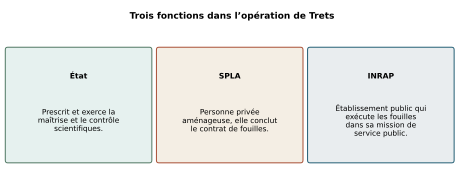
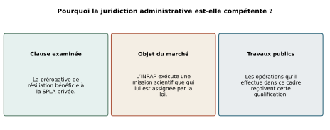

# ENS Rennes D-E — Droit public 2021 · Corrigé brut

*Corrigé rédigé par IA, non officiel.*

**Rédaction** · GPT-6.2 Astra Ultra · vitesse non renseignée

## Commentaire de TC, 2 novembre 2020, n° C4196 — La qualification d’un contrat de fouilles d’archéologie préventive

### Introduction

La présence d’un établissement public suffit-elle à faire relever du juge administratif le contrat qu’une société privée a conclu avec lui ? Dans l’affaire de la zone d’aménagement de la Burlière, le Tribunal des conflits écarte l’argument tiré d’une clause de résiliation bénéficiant à la personne privée. Il retient pourtant la compétence administrative à raison de l’objet confié à l’Institut national de recherches archéologiques préventives (INRAP) et de la qualification des travaux que celui-ci exécute.

Le 21 octobre 2010, la communauté d’agglomération du Pays d’Aix confie l’aménagement d’une zone à Trets à la SPLA Pays d’Aix territoires, société anonyme de droit privé. À la suite d’une prescription préfectorale de fouilles du 27 octobre 2015, une première procédure est abandonnée après un avis négatif sur le projet scientifique. Une nouvelle consultation est engagée en octobre 2016. L’offre d’Eveha, classée deuxième, est rejetée le 8 février 2017. Le marché est conclu le 10 mars avec l’INRAP. Eveha conteste l’attribution et demande réparation. Après rejet par le tribunal administratif de Marseille, la cour administrative d’appel de Marseille saisit le Tribunal des conflits le 15 juin 2020 sur le fondement de l’article 35 du décret du 27 février 2015. [Décision du Tribunal des conflits, n° C4196](https://www.conseil-etat.fr/fr/arianeweb/TC/decision/2020-11-02/C4196)

La saisine vise à résoudre une difficulté sérieuse de répartition des compétences. Il ne s’agit pas d’un conflit de décisions définitives entre deux juridictions ni d’une décision du Tribunal sur le classement des offres. Pour déterminer l’ordre compétent, les juges examinent d’abord les personnes et le bénéficiaire des prérogatives contractuelles. Ils recherchent ensuite la mission effectivement confiée à l’établissement public et la nature des opérations qu’il réalise.

### I. La présence d’un établissement public et d’une clause de résiliation n’emporte pas à elle seule la qualification administrative

#### A. L’aménageur privé et l’opérateur public concluent un contrat distinct de la concession initiale

Le nom de « société publique locale d’aménagement » désigne une société que l’article L. 327-1 du code de l’urbanisme soumet à la forme de société anonyme. La présence de personnes publiques à son capital ou l’utilité publique de l’aménagement ne transforme pas mécaniquement la SPLA en personne morale de droit public. L’INRAP est, lui, un établissement public administratif national. Le contrat litigieux associe donc une personne privée qui commande les fouilles et un établissement public qui les réalise.

Le montage comporte deux actes distincts. La concession de 2010 explique pourquoi la SPLA projette l’aménagement. Le contrat de 2017 a pour objet déterminé les fouilles prescrites. Le premier ne communique pas automatiquement sa qualification à tout acte ultérieurement conclu par le concessionnaire. De même, un paiement sur des fonds liés à une opération d’intérêt général ou l’organisation d’une procédure de mise en concurrence ne permet pas, isolément, de choisir l’ordre juridictionnel.

Le caractère de la mission doit en outre être apprécié à partir des dispositions spéciales du code du patrimoine reproduites au sujet. Elles distinguent la maîtrise scientifique de l’État, les responsabilités de celui qui prévoit les travaux et le rôle de l’opérateur. Si l’on confond ces trois fonctions en supposant que l’État est le cocontractant caché de chaque fouille, on manque la difficulté que le point 5 entend précisément résoudre.

#### B. La prérogative reconnue à la SPLA ne caractérise pas le régime exorbitant invoqué

Dans la ligne de la décision *AXA France IARD* du 13 octobre 2014, la présence dans un contrat entre une personne publique et une personne privée d’une clause impliquant, dans l’intérêt général, un régime exorbitant des contrats administratifs peut contribuer à la qualification. Le point 5 rappelle notamment les prérogatives reconnues à la personne publique contractante dans l’exécution de la convention. Le contrat conférait ici à la SPLA la faculté de résilier unilatéralement pour motif d’intérêt général.

Prise isolément, cette rédaction ressemble à un pouvoir couramment associé à l’administration. Mais son bénéficiaire est la SPLA, personne privée, et non l’INRAP, partie publique au contrat. C’est l’une des précisions de la décision. Le juge doit regarder ce que la clause fait et à qui elle confère un pouvoir. Son vocabulaire ou sa sévérité ne suffit pas à transposer le régime habituel des contrats administratifs. Le Tribunal refuse de tirer de ces prérogatives particulières la conclusion que le contrat est administratif.

Cet échec d’un critère ne tranche pas encore la question. Les critères matériels n’ont pas à être cumulés dans chaque affaire. Un contrat qui n’est pas administratif par la clause examinée peut encore être qualifié par son objet. En retour, la compétence administrative retenue au terme de la décision ne signifie pas que le Tribunal a changé d’avis sur le bénéficiaire de la clause. Les points 5 et 6 répondent à deux raisonnements autonomes.

### II. L’exécution par l’INRAP du service public archéologique donne aux fouilles le caractère de travaux publics

#### A. Le contrat confie à l’établissement l’exécution même d’une mission instituée par la loi

L’article L. 521-1 du code du patrimoine rattache l’archéologie préventive à des missions de service public de détection, de conservation ou de sauvegarde par l’étude, d’interprétation et de diffusion des résultats. L’État prescrit les opérations, en assure la maîtrise et le contrôle scientifiques, désigne le responsable scientifique et reçoit les données. Les diagnostics sont en principe confiés à l’établissement public national, sous réserve des services territoriaux prévus. Les fouilles peuvent être confiées également à un service territorial ou à un autre opérateur agréé, public ou privé. La concurrence pour leur réalisation coexiste ainsi avec une mission fortement encadrée.

En l’espèce, la SPLA n’a pas passé commande d’un service banal qui permettrait seulement à l’INRAP d’exercer, ultérieurement et ailleurs, sa mission. Elle lui confie la réalisation même des fouilles prescrites. Le projet scientifique fait partie intégrante du contrat. L’État vérifie les offres, contrôle la conformité scientifique et doit autoriser les fouilles. L’INRAP est en outre tenu d’intervenir sous les conditions du code lorsqu’aucun autre opérateur ne s’est porté candidat ou ne satisfait aux exigences. Ces éléments relient étroitement la prestation déterminée à la mission légale de l’établissement.

Le raisonnement par l’objet rappelle l’attention accordée à l’exécution même du service public dans *Époux Bertin* (1956). Ici, le sens de l’engagement mérite d’être précisé. La personne publique est prestataire d’une mission qui lui est attribuée par la loi. La personne privée aménageuse ne lui confère pas par contrat une qualité publique dont elle disposerait elle-même. L’existence possible d’un opérateur privé sur le marché des fouilles n’efface pas la mission accomplie, dans ce contrat précis, par l’établissement public retenu.

#### B. L’annexe Effimieff éclaire la qualification de travaux publics et la portée limitée du dispositif

Le point 6 ajoute que les opérations de fouilles effectuées par l’INRAP dans cette mission présentent le caractère de travaux publics. L’annexe reproduit la décision *Effimieff* du 28 mars 1955. Une association syndicale de reconstruction dotée par la loi du caractère d’établissement public exécutait une mission de service public même lorsque les travaux de reconstruction concernaient des immeubles de particuliers. Le caractère privé du bien ou du bénéficiaire final ne suffisait pas à exclure la qualification de travail public. Le rapprochement ne repose donc pas sur une ressemblance fortuite entre deux chantiers.

Dans l’affaire de 2020, les fouilles sont des opérations matérielles sur le site réalisées par l’établissement public dans le cadre d’une mission légale. Les travaux intéressent aussi l’aménageur qui doit pouvoir poursuivre son projet. Cette utilité privée n’efface pas la finalité scientifique du service. Il faut cependant conserver les conditions retenues. L’arrêt vise les fouilles réalisées par cet établissement dans ce cadre. Si le contrat avait été attribué par la même SPLA à un opérateur privé agréé, les personnes, l’objet exact et les autres fondements éventuels de compétence devraient être à nouveau examinés. La décision ne proclame pas que tout travail archéologique est un travail public.

Le point 7 et l’article premier du dispositif donnent compétence à la juridiction administrative pour connaître du litige entre Eveha et la SPLA. Il reviendra au juge compétent de traiter, le cas échéant, la régularité de la passation et la demande indemnitaire du candidat évincé. Le Tribunal des conflits n’accorde aucune indemnité et ne substitue pas Eveha à l’INRAP comme attributaire. Sa décision fixe la qualification qui permettra d’examiner les prétentions au fond.

### Conclusion

Le pouvoir de résiliation reconnu à l’aménageur privé n’a pas déterminé la compétence. Le contrat confie à un établissement public l’exécution même de sa mission scientifique et porte sur des fouilles qu’il réalise comme travaux publics. La décision applique à l’archéologie préventive une logique qu’éclaire l’annexe *Effimieff*, tout en réservant au juge administratif le jugement du litige d’attribution.

[Sujet distribué](https://www.ens-rennes.fr/medias/fichier/sujet-e-crit-e-preuve-a-options-2021_1631710076477-pdf) · [Rapport du jury](https://www.ens-rennes.fr/medias/fichier/rapport-de-jury-droit-public-d-e-2021_1634310446428-pdf)
