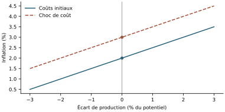
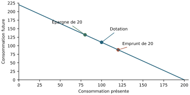
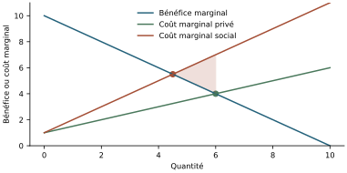
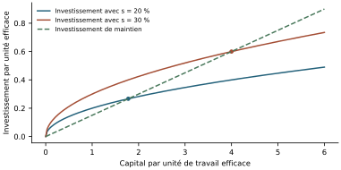
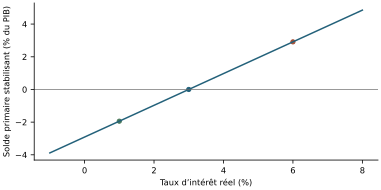
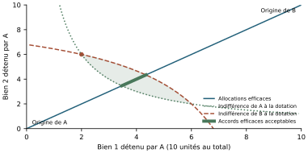

# ENS Rennes D-E — Économie (oral) 2021 · Corrigé brut

*Corrigé rédigé par IA, non officiel.*

**Rédaction** · GPT-6.2 Astra Ultra · vitesse non renseignée

Le fascicule contient 27 sujets numérotés. Le jury accorde trente minutes de préparation et environ dix minutes de présentation, puis il interroge sur l’exposé et le reste du programme. Chaque proposition développe un raisonnement en deux parties que le candidat peut illustrer au tableau. Deux sujets supplémentaires figurent dans le rapport du jury.

## Sujet 1 — La détermination du taux d’intérêt

Un épargnant qui diffère un achat demande un rendement réel. Un ménage qui conserve une encaisse renonce au rendement nominal d’un titre. Ces deux arbitrages portent sur des taux distincts. **I. L’équilibre entre ressources présentes et futures.** Si l’entreprise investit jusqu’à égalité entre rendement marginal net et coût réel de financement, une baisse du taux rend de nouveaux projets rentables. Du côté des ménages, la substitution favorise l’épargne à taux plus élevé mais l’effet de revenu d’un créancier peut aller dans l’autre sens. Le taux réel d’équilibre dépend ainsi de la productivité, des préférences, du risque et de la démographie.

**II. La formation des taux effectivement observés.** À court terme la banque centrale pilote le prix des réserves. À plus longue échéance, le rendement d’un titre incorpore les taux courts attendus et une prime de terme. Un emprunteur fragile paie aussi une prime de défaut. Avec un taux nominal de 3 % et une inflation anticipée de 2 %, le taux réel anticipé vaut 1,03/1,02 − 1, soit environ 0,98 %. La monnaie et les anticipations influencent donc le coût réel, particulièrement lorsque prix et salaires s’ajustent lentement. Une décision monétaire n’impose pas un rendement uniforme à toutes les échéances.

**Relance.** Le taux réel réalisé peut-il être négatif après un prêt consenti à 3 % ?

Oui. Avec une inflation réalisée de 5 %, le rendement réel du prêteur vaut 1,03/1,05 − 1, soit environ −1,90 %, quel qu’ait été son calcul initial.

## Sujet 2 — Salaire réel et salaire nominal

Une rémunération augmente de 3 % tandis que l’indice des prix progresse de 5 %. **I. Ce que mesure un salaire.** Le salaire nominal est exprimé en monnaie par heure ou par mois. Diviser par le prix d’un panier constant donne le pouvoir d’achat. Ici le salaire réel recule de 1,03/1,05 − 1, soit 1,90 %. Le panier du ménage, les prélèvements et la durée travaillée modifient le passage du salaire horaire brut au niveau de vie. Pour l’entreprise, le coût réel pertinent rapporte le coût du travail au prix de sa propre production, qui peut évoluer autrement que les prix à la consommation.

**II. Comment la distinction éclaire les ajustements.** Dans un modèle concurrentiel, la productivité marginale du travail détermine la demande de travail à salaire réel donné. Négociation collective, salaire minimum, pouvoir de marché ou rémunération d’efficience modifient ce résultat. Un contrat nominal convenu à l’avance transfère temporairement du pouvoir d’achat lorsque les prix surprennent. Si l’inflation vient de l’énergie importée, toutes les catégories ne peuvent simultanément conserver leur revenu réel sans hausse de productivité ou transfert extérieur. L’indexation change la répartition de ce choc et sa persistance.

**Relance.** Le coût du travail peut-il baisser pour une entreprise lorsque le salaire réel de consommation augmente ?

Oui. Pour un salaire nominal en hausse de 3 %, des prix de consommation en hausse de 2 % et un prix de vente en hausse de 5 %, les deux rapports évoluent en sens opposés.

## Sujet 3 — L’arbitrage inflation activité est-il encore d’actualité ?

En 2021, la sortie des restrictions peut ranimer la demande alors que des capacités restent indisponibles. **I. Pourquoi activité et inflation peuvent évoluer ensemble.** À prix et salaires partiellement prédéterminés, davantage de commandes accroît d’abord la production et l’emploi. Les tensions sur les capacités et la négociation salariale alimentent ensuite les prix. Dans une écriture simple de la relation de Phillips, l’inflation dépend de l’inflation attendue, de l’écart de production et d’un choc de coût. Quand les anticipations et les coûts sont fixes, la stabilisation de l’inflation et le soutien de l’activité peuvent demander des orientations différentes après certains chocs.

**II. Pourquoi la relation ne fournit aucune combinaison durable à choisir.** Un renchérissement d’une énergie importée relève les coûts tout en réduisant l’activité. Une expansion répétée au-delà des capacités peut relever l’inflation anticipée et déplacer la relation. Son aplatissement observé sur certaines périodes peut refléter l’ancrage des anticipations, une mesure imparfaite des capacités ou des transformations du marché du travail. La banque centrale doit distinguer la nature et la durée du choc. Elle peut tolérer un écart temporaire sans promettre une réduction permanente du chômage par surprise inflationniste.

**Relance.** Si la demande s’effondre, stabiliser les prix impose-t-il de contracter encore l’activité ?

Dans le modèle usuel, une expansion soutient à la fois la production et l’inflation revenue sous la cible. La tension entre objectifs est plus nette face à un choc d’offre défavorable.

## Sujet 4 — Est-il souhaitable que les prix soient flexibles ?

Une pénurie locale de fraises et une dépression générale ne posent pas la même question de prix. **I. La flexibilité des prix relatifs coordonne les usages.** Un bien devenu rare attire davantage de producteurs et les consommateurs qui peuvent le remplacer réduisent leurs achats. En concurrence et lorsque les coûts sociaux sont payés, cette réaction rapproche les usages de leurs valeurs marginales. Avec coûts de recherche, pouvoir de marché ou externalités, même des prix instantanément ajustés peuvent rationner selon le revenu ou refléter un coût privé éloigné du coût collectif.

**II. La flexibilité générale peut amplifier l’instabilité nominale.** Une baisse simultanée des prix et des salaires renchérit les dettes fixées en monnaie et peut réduire la dépense des débiteurs contraints. Si une nouvelle baisse est anticipée alors que le taux nominal est proche de son plancher, le taux réel peut monter. Une rigidité contractuelle offre aussi une assurance aux partenaires, au prix d’ajustements parfois reportés sur les quantités. Il faut donc juger la flexibilité selon l’origine du choc, les marchés d’assurance et la situation monétaire. La stabilité du niveau général des prix reste compatible avec le mouvement des prix relatifs.

**Relance.** Un plafond de prix résout-il automatiquement la pénurie de fraises ?

Sous le prix d’équilibre il peut maintenir une demande supérieure à l’offre. Qui reçoit les unités et qui supporte l’attente devient alors une question centrale.

## Sujet 5 — Faut-il encore conserver la stabilité des prix comme objectif de politique monétaire ?

La stabilité des prix peut désigner une inflation faible et prévisible sur un horizon moyen. **I. Une ancre nominale facilite les contrats.** Des prix relatifs lisibles guident la production. Une inflation inattendue redistribue entre créanciers et débiteurs et rend les contrats longs plus risqués. Une cible annoncée et crédible sert de repère aux négociations. Une inflation légèrement positive ménage une marge d’ajustement des salaires réels et réduit la fréquence des taux nominaux proches de leur plancher.

**II. L’horizon et les objectifs associés déterminent la bonne réponse.** Réagir intégralement aujourd’hui à la hausse ponctuelle du pétrole peut provoquer une forte contraction dont les effets sur l’inflation arrivent après la disparition du choc. Une cible flexible autorise un retour progressif et tient compte de l’emploi. Des prix à la consommation stables peuvent également coexister avec des dettes fragiles et une hausse des prix immobiliers. Des instruments prudentiels ciblés complètent alors le taux directeur. Conserver l’ancre nominale conduit à expliquer les écarts temporaires, les risques financiers et la trajectoire de retour.

**Relance.** Une banque qui cible l’inflation doit-elle annuler une hausse passée du niveau des prix ?

Sous une cible d’inflation ordinaire, elle vise la croissance future des prix. Une cible de niveau des prix engage au contraire à revenir vers une trajectoire de niveau.

## Sujet 6 — Le rôle des banques commerciales dans la création et la politique monétaires

Un prêt de 1 000 euros approuvé par une banque inscrit un actif de prêt et une dette de dépôt de 1 000 euros dans son bilan. **I. De l’octroi de crédit à la monnaie utilisable.** Le client peut transférer le dépôt à un vendeur qui possède un compte ailleurs. Sa banque doit alors régler la banque du vendeur en réserves et gérer son financement. Le remboursement du principal avec un dépôt détruit simultanément de la monnaie de dépôt et une créance. La décision initiale dépend de la solvabilité attendue, des fonds propres exigés, du coût des ressources et de la demande de crédit.

**II. Une transmission de la politique monétaire par les bilans.** Une baisse du taux directeur réduit normalement le coût marginal de financement et modifie la demande de prêts, les garanties et les prix d’actifs. Si les pertes entament les fonds propres ou si les entreprises renoncent à leurs projets, des réserves abondantes ne déclenchent pas à elles seules un crédit nouveau. Les garanties publiques et le refinancement peuvent agir sur des obstacles différents. La banque centrale pilote les conditions de règlement et de financement, tandis que les banques commerciales sélectionnent l’essentiel des prêts aux agents privés.

**Relance.** Une banque doit-elle disposer de 1 000 euros de réserves supplémentaires avant chaque prêt de 1 000 euros ?

Le prêt crée immédiatement le dépôt. Les besoins de réserves et de financement apparaissent avec les paiements, les obligations réglementaires et la gestion du risque de liquidité.

## Sujet 7 — La politique économique doit-elle prendre en compte les anticipations des agents ?

Annoncer une baisse d’impôt demain modifie parfois la consommation aujourd’hui. **I. Les anticipations transmettent et peuvent neutraliser une décision.** Les achats durables dépendent du revenu futur attendu, l’investissement des ventes et des taux futurs, les négociations salariales de l’inflation prévue. Une baisse de taux courts jugée transitoire peut peu déplacer les taux longs. La critique de Lucas souligne qu’une relation statistique observée sous une règle peut changer sous une autre si les agents adaptent leurs prévisions.

**II. Crédibilité, apprentissage et hétérogénéité bornent la maîtrise publique.** Une banque centrale qui promet toujours une surprise expansionniste finit par perdre l’ancrage des anticipations. Une règle, l’indépendance ou une explication publique des exceptions peuvent améliorer sa crédibilité. Mais certains ménages ne suivent pas ses annonces, manquent de liquidités ou jugent incertaine l’action des pouvoirs publics. Une annonce de soutien peut même signaler une conjoncture plus grave qu’on ne le pensait. Le décideur doit donc considérer les anticipations sans supposer des croyances homogènes ni des réactions entièrement prévisibles.

**Relance.** Une prévision rationnelle est-elle toujours exacte ?

Elle peut être contredite par un choc imprévisible. L’hypothèse concerne l’usage de l’information disponible lorsque la prévision a été formée.

## Sujet 8 — Etre rationnel(le), est-ce ne jamais se tromper ?

Deux étudiants peuvent choisir des formations différentes en utilisant rationnellement les mêmes statistiques. **I. Rationalité, information et préférences.** La théorie du choix demande des préférences cohérentes et un choix compatible avec les contraintes. Sous risque, un agent peut maximiser son utilité espérée et subir une perte dans l’état qui se réalise. Par exemple, une assurance raisonnable à la signature peut ne jamais donner lieu à indemnisation. Les anticipations rationnelles autorisent aussi des erreurs individuelles et collectives devant un événement imprévisible.

**II. Les erreurs systématiques invitent à examiner les procédures.** Si une prévision exploite toujours mal une information publique aisément utilisable, le modèle de prévision mérite un test. Les coûts de recherche peuvent pourtant rendre optimale une information incomplète. Simon étudie la rationalité limitée, dans laquelle l’agent s’arrête à une solution satisfaisante lorsque poursuivre la recherche coûte cher. Les expériences documentent aussi des biais de présentation et d’actualisation. Pour conclure à l’irrationalité, il faut préciser les informations, la règle de décision, les coûts et l’horizon, puis confronter plusieurs observations.

**Relance.** Un pari perdant prouve-t-il que le parieur s’est trompé dans son calcul ?

Il faut comparer sa décision aux probabilités et aux gains disponibles avant le tirage, puis à ses préférences face au risque. L’issue isolée ne suffit pas à identifier sa règle.

## Sujet 9 — Dette publique et équivalence ricardienne

Le Trésor réduit les impôts de 100 aujourd’hui en émettant une dette, sans modifier la dépense publique. **I. L’équivalence porte sur le calendrier du financement.** Sous solvabilité de l’État, les contribuables anticipent des impôts futurs dont la valeur actuelle est de 100. Avec taxes forfaitaires, marchés parfaits, horizon approprié et taux identiques, ils peuvent épargner la baisse pour payer la charge. La richesse privée nette et la demande agrégée restent alors inchangées. Barro montre comment des transmissions entre générations peuvent prolonger un horizon individuel limité.

**II. Pourquoi une émission peut modifier consommation et répartition.** Un ménage contraint dans ses emprunts utilise immédiatement une partie du remboursement fiscal. Des générations différentes peuvent supporter les taxes ou des impôts distorsifs peuvent frapper des assiettes différentes. L’incertitude et l’hétérogénéité des taux d’intérêt affectent aussi le calcul. Une hausse de dépense aujourd’hui pose en outre une question distincte de son financement. L’équivalence fournit un point de comparaison précis pour étudier qui reçoit la baisse, qui paiera et quand.

**Relance.** Si deux contribuables se partagent également la baisse actuelle mais qu’un seul paie l’impôt futur, la somme des consommations reste-t-elle inchangée ?

Elle peut changer. La redistribution entre leurs ressources permanentes et leurs propensions à consommer intervient, même si l’État couvre entièrement la dette.

## Sujet 10 — Jusqu’où l’intervention de l’Etat peut-elle aller ?

Un éclairage public, un transfert aux ménages modestes et une assurance contre le chômage répondent à trois problèmes distincts. **I. Pourquoi une intervention peut améliorer le résultat collectif.** La non-exclusion favorise le passager clandestin pour un bien public. Une pollution laisse une partie du coût à des tiers. L’impôt, la réglementation ou la fourniture directe peuvent alors rapprocher décision privée et intérêt social. Les transferts redistribuent selon un jugement explicite d’équité. Enfin la dépense et les stabilisateurs automatiques soutiennent l’activité lorsque les capacités sont sous-employées.

**II. Comment choisir jusqu’où intervenir.** L’État ne connaît pas toujours les coûts individuels et peut être exposé à la capture. Un prix du carbone incite à chercher une réduction peu coûteuse, alors qu’une norme fixe peut convenir pour un seuil sanitaire vérifiable. Une prestation trop dégressive peut décourager la reprise d’activité, mais supprimer son ciblage peut coûter cher. L’évaluation compare les gains, les coûts de financement, les effets distributifs et une véritable situation de référence. L’échelon territorial doit également correspondre à l’étendue des effets.

**Relance.** Un marché imparfait rend-il toute nationalisation avantageuse ?

Il justifie l’examen d’un remède. Régulation, taxation, concurrence organisée et production publique ont chacune des besoins d’information et des coûts qu’il faut comparer.

## Sujet 11 — Les contraintes de la politique économique en union monétaire

Un membre d’une union monétaire peut connaître une récession lorsque son partenaire est au plein emploi. **I. Une seule monnaie transforme les instruments nationaux.** Un pays ne dispose plus d’un taux directeur ni d’une parité propres pour répondre à un choc asymétrique. Inflation et conditions bancaires différentes rendent même un taux nominal commun inégalement restrictif. Mobilité du travail, ajustements des prix relatifs, transferts et diversification financière peuvent limiter l’ajustement par les quantités. Une baisse nationale des coûts peut être longue et contracter la demande intérieure.

**II. Les politiques budgétaires restent nationales mais interdépendantes.** La relance d’un membre accroît les importations venant de ses partenaires et engage sa dette propre. Une forte prime souveraine peut fragiliser les banques domestiques et nuire à la transmission monétaire. Coordination des budgets, supervision bancaire commune et financements européens répondent à des dimensions différentes. En 2021, la réponse commune à la pandémie illustre la possibilité d’un partage partiel, sans supprimer les contraintes de soutenabilité. Le choix porte sur la répartition des instruments entre union et États et sur les mécanismes de solidarité.

**Relance.** L’union implique-t-elle qu’une région doit toujours subir davantage de chômage après un choc propre ?

Des migrations, transferts ou assurances financières peuvent soutenir son revenu. Leur ampleur et la persistance du choc déterminent l’ajustement observé.

## Sujet 12 — Les choix intertemporels de consommation

Un ménage choisit la part de ses revenus présents et futurs qu’il consommera aujourd’hui. **I. Le coût de déplacer une unité de consommation.** Avec revenus 100 maintenant et 110 demain, taux réel de 10 % et absence de patrimoine initial, sa contrainte s’écrit c₁ + c₂/1,10 = 200. Consommer 120 maintenant exige d’emprunter 20 et laisse 88 demain. À un optimum intérieur l’utilité marginale présente égale l’utilité marginale future actualisée et multipliée par le rendement brut. Cycle de vie et revenu permanent expliquent ainsi pourquoi une hausse passagère du revenu est souvent partiellement épargnée.

**II. Quand le lissage devient coûteux ou impossible.** Un jeune ménage sans garantie peut vouloir emprunter et se heurter à une limite. Une somme ponctuelle libère alors davantage de consommation. L’incertitude peut susciter une épargne de précaution. Une hausse du taux réel encourage à différer par substitution mais enrichit les prêteurs nets et appauvrit les emprunteurs nets. Le sens global de la réaction dépend donc de la répartition des patrimoines et de l’accès au crédit.

**Relance.** Avec ces revenus, quelle est la consommation future du ménage s’il épargne 20 aujourd’hui ?

Il consomme 80 à présent. Son épargne lui rapporte 22 demain, en plus des 110 de revenu, soit 132.

## Sujet 13 — Quel est le rôle des débouchés dans la détermination de l’activité économique ?

Une entreprise capable de produire cent unités peut n’en commander que soixante à ses ateliers si elle prévoit des ventes faibles. **I. Les débouchés peuvent contraindre la quantité produite.** À prix partiellement fixés, les ventes anticipées déterminent le travail et les intrants engagés. Une hausse autonome de dépense devient le revenu du fournisseur, puis une dépense supplémentaire lorsque le fournisseur consomme. Avec une propension à consommer de 0,75, une économie fermée sans impôts ni autre réaction donne un multiplicateur de 4. Des stocks involontaires signalent une erreur de prévision à corriger.

**II. L’offre et l’ouverture déterminent la portée du mécanisme.** Quand les capacités sont saturées, une commande supplémentaire peut surtout relever les prix ou les importations. Endettement, dégradation des perspectives ou durcissement monétaire peuvent aussi freiner l’investissement. À plus long terme, des commandes durablement élevées encouragent la capacité productive, tandis qu’une longue récession peut détruire des compétences. La loi des débouchés rappelle le revenu créé par la production, mais ne garantit pas sa dépense immédiate dans les secteurs et au prix prévus.

**Relance.** Pourquoi l’épargne comptable est-elle compatible avec des invendus ?

Les invendus entrent dans la variation des stocks, donc dans l’investissement réalisé. L’égalité comptable entre épargne et investissement n’assure pas l’égalité des projets initiaux.

## Sujet 14 — Les déséquilibres macroéconomiques externes

Un pays peut importer davantage qu’il n’exporte pour équiper une industrie productive ou pour alimenter une bulle immobilière. **I. Lire les soldes et les stocks.** Le compte courant rassemble échanges de biens et services, revenus primaires et transferts courants. Son solde correspond à l’écart entre épargne nationale et investissement, avec des conventions cohérentes de comptabilité nationale. Un déficit doit avoir une contrepartie financière. La position extérieure nette dépend aussi de la valorisation du patrimoine existant et du taux de change. Un déficit commercial seul ne suffit donc pas à diagnostiquer une insolvabilité.

**II. Apprécier la capacité d’ajustement.** Examiner l’usage des capitaux reçus, la maturité des passifs, leur monnaie et la capacité à dégager des revenus futurs. Des prêts courts en devises rendent un arrêt des financements particulièrement coûteux. Un excédent persistant peut refléter un vieillissement anticipé, une demande intérieure faible ou une politique pesant sur les partenaires. L’ajustement peut venir de la dépense, des prix relatifs ou de la productivité. À l’échelle mondiale, tous les pays ne peuvent simultanément accroître leur excédent par compression de la demande.

**Relance.** Un solde courant nul élimine-t-il les risques financiers extérieurs ?

De grosses dettes à court terme peuvent être compensées comptablement par des actifs à long terme. Le risque de refinancement subsiste malgré un solde net faible.

## Sujet 15 — Où en est le débat entre les changes fixes et les changes flexibles ?

Choisir un régime de change signifie choisir qui absorbe un choc et quelle politique peut être conduite. **I. Le fixe réduit une incertitude en échange d’un engagement.** Une parité crédible facilite les contrats internationaux, réduit les frais de couverture et peut importer une ancre nominale. Avec capitaux mobiles, défendre la parité exige toutefois des réserves, un ajustement des taux ou un soutien extérieur. Si la parité est jugée insoutenable, les réserves peuvent s’épuiser. Les contrôles de capitaux redonnent une marge de taux mais ont des coûts et des limites pratiques.

**II. Le flottement déplace l’ajustement.** Une dépréciation peut soutenir la demande de biens nationaux, à condition que les quantités réagissent et que leur production reste possible. Elle renchérit aussi les importations et les dettes en devises. Une économie très ouverte, endettée dans une devise étrangère, peut donc craindre la volatilité. Taille, synchronisation des chocs, crédibilité des institutions et profondeur des marchés expliquent la diversité des régimes, y compris les arrangements intermédiaires. Le triangle d’incompatibilité clarifie le coût d’une ambition simultanée de stabilité, autonomie et liberté des capitaux.

**Relance.** Quelle contrainte une union monétaire ajoute-t-elle à une parité fixe ajustable ?

Les membres partagent l’instrument monétaire et ne disposent plus d’un taux de change national ajustable par décision ordinaire.

## Sujet 16 — Crise sanitaire et crise économique

En 2020, une salle de spectacle fermée et un restaurant autorisé mais désert ont perdu des recettes par des mécanismes différents. **I. Un choc sanitaire affecte simultanément l’offre et la demande.** Mesures de protection, maladie et ruptures d’approvisionnement réduisent certaines capacités. Crainte de contamination, baisse de revenu ou épargne contrainte réduisent ou déplacent la demande. Les branches divergent fortement entre services de contact et activités réalisables à distance. Un recul du PIB agrégé rend mal cette diversité, les pertes d’apprentissage ou le travail déplacé vers le domicile.

**II. Soutenir les revenus et préserver les capacités de reprise.** Pendant une fermeture, une relance générale ne rouvre pas l’établissement. L’activité partielle maintient des appariements, les aides ciblées couvrent des coûts fixes et les garanties traitent des tensions de trésorerie. Un prêt ne restaure pourtant pas à lui seul la solvabilité d’une activité durablement déficitaire. À la réouverture, reprise inégale, contraintes d’offre et dettes accumulées appellent un changement de dosage. Juger les réponses selon le moment, le secteur, le patrimoine du ménage et les alternatives disponibles évite une lecture uniforme de la crise.

**Relance.** Pourquoi un niveau d’épargne agrégée élevé ne signifie-t-il pas que tous les ménages peuvent consommer immédiatement davantage ?

Les avoirs ont pu s’accumuler chez les ménages aux revenus préservés tandis que des travailleurs précaires épuisaient leur trésorerie. Leur propension à dépenser diffère aussi.

## Sujet 17 — Les organismes financiers internationaux face aux crises

Un État qui manque temporairement de devises et un État dont les recettes futures ne couvrent plus sa dette ont des besoins différents. **I. Prévenir et fournir des ressources en crise.** Le Fonds monétaire international surveille les équilibres macroéconomiques et peut prêter face à un besoin de balance des paiements. Son financement peut éviter une contraction immédiate désordonnée et donner un délai d’ajustement. La Banque mondiale finance surtout des projets et politiques de développement à plus longue échéance, tout en pouvant mobiliser des financements d’urgence. Les banques régionales complètent ces interventions.

**II. Évaluer le financement, ses conditions et la répartition des pertes.** Une condition budgétaire trop rapide peut aggraver la chute de la demande et du ratio de dette, mais un programme qui ignore une trajectoire insoutenable ne rétablit pas l’accès durable au crédit. La coopération doit distinguer manque de liquidité, insolvabilité, fragilité bancaire et choc réel. Une restructuration implique les créanciers et un accord sur le partage des pertes. Représentation des emprunteurs, sécurité sociale, transparence et capacité d’adaptation déterminent l’acceptation et les effets sociaux des programmes.

**Relance.** Pourquoi un prêt d’urgence ne suffit-il pas à traiter toute crise de dette extérieure ?

S’il ne fait que remplacer un prêteur sans changer les ressources disponibles ni la valeur actualisée des obligations, un déficit de solvabilité demeure.

## Sujet 18 — Faut-il lutter contre les externalités ?

Le bruit d’une activité gêne des voisins sans apparaître dans le prix payé par son client. **I. Repérer un effet hors marché et quantifier l’écart.** La quantité concurrentielle égalise avantage marginal et coût marginal privé. Le coût social ajoute le dommage marginal pour les tiers. Si le dommage est positif, la quantité efficace est généralement inférieure à la quantité privée, mais rarement nulle. Une innovation peut à l’inverse bénéficier à d’autres producteurs et être sous-financée par son auteur. Un simple changement de prix concurrentiel n’est pas en soi une externalité technique.

**II. Choisir le remède selon l’information et les coûts.** Une taxe au dommage marginal à l’optimum, un plafond échangeable ou une norme donnent des incitations différentes sous incertitude. Lorsque les droits sont clairs, les parties peu nombreuses et les coûts de transaction faibles, une négociation peut internaliser l’effet. Pour une pollution diffuse, le nombre de victimes rend cette voie difficile. Mesure des émissions, coûts administratifs et incidence sur les revenus doivent entrer dans la comparaison. Le bon objectif égalise coût et bénéfice de la dernière réduction.

**Relance.** Pourquoi le taux correctif ne correspond-il pas nécessairement au dommage total divisé par la quantité produite ?

Le choix de la dernière unité dépend du dommage marginal au niveau efficace. Dommage moyen et dommage marginal ne coïncident que dans des cas particuliers.

## Sujet 19 — Le modèle de croissance exogène

Le modèle de Solow explique pourquoi accumuler du capital ne suffit pas à maintenir indéfiniment la croissance de la production par travailleur. **I. Une dynamique de convergence conditionnelle.** Avec rendements constants, capital par unité de travail efficace k et production f(k), l’accumulation vérifie en temps continu k′ = s f(k) − (n + g + δ)k. Le taux d’épargne s finance l’investissement et la seconde expression couvre croissance de la population, progrès technique augmentant le travail et dépréciation. Avec rendement marginal décroissant, l’intersection stable détermine k*. Une hausse de s élève ce niveau et accélère temporairement la croissance.

**II. Ce qui explique le niveau et ce qui explique le rythme.** Sur le sentier équilibré, la production par travailleur croît au rythme exogène g. Deux pays à taux d’épargne, technologie, démographie et institutions différents ne convergent pas nécessairement vers le même niveau. La règle d’or maximise la consommation soutenable par travailleur efficace en égalisant la productivité marginale du capital à n + g + δ. La théorie de la croissance endogène approfondit précisément l’origine des innovations et des externalités que Solow prend pour données.

**Relance.** Si s passe de 20 % à 30 %, le taux de croissance par tête augmente-t-il définitivement ?

Le capital par travailleur efficace converge vers un niveau supérieur. Après la transition le taux de croissance par tête retrouve g, si les autres paramètres restent fixes.

## Sujet 20 — Doit-on remettre en question la libéralisation des flux financiers internationaux ?

Une usine financée par des investissements directs étrangers et un prêt extérieur à trois mois diffèrent par leurs effets et leur fragilité. **I. Pourquoi ouvrir les mouvements de capitaux.** Les pays peuvent diversifier les risques, financer des investissements au-delà de l’épargne nationale et lisser leur consommation après un choc. L’investissement direct peut transférer des connaissances, à condition que des entreprises locales puissent les absorber. Ces gains supposent des projets viables, une intermédiation solide, une information exploitable et une répartition supportable des risques.

**II. Pourquoi distinguer les flux et leur encadrement.** Entrées abondantes, effet de levier et hausse du prix des garanties peuvent se renforcer. Un retournement soudain expose les agents endettés en devise et réduit le crédit intérieur. Une réglementation prudentielle, des exigences de liquidité en devise ou des mesures temporaires ciblant certains flux peuvent limiter ces externalités. Elles exigent une justification, un suivi et une cohérence avec la politique de change. L’arbitrage porte sur le rythme d’ouverture, la composition des flux et la qualité des institutions.

**Relance.** Un investissement direct est-il toujours sans risque pour le pays d’accueil ?

Il réduit souvent le risque de refinancement par rapport à un prêt court, mais la concentration sectorielle, les rapatriements de revenus et les liens de financement intra-groupe restent pertinents.

## Sujet 21 — La dette publique est-elle soutenable aujourd’hui dans les pays européens ?

En 2021, les budgets européens portent les dépenses d’urgence sanitaire tandis que les taux de financement sont bas. **I. Quelle trajectoire faut-il stabiliser ?** Pour dette initiale d et surplus primaire p en proportion du PIB, la variation du ratio vaut approximativement (r − g)d − p, avec des taux réels cohérents. Dans la formule discrète exacte, le premier terme devient (r − g)d/(1 + g). À dette de 100 % du PIB, r = 1 % et g = 3 %, un déficit primaire voisin de 1,94 % stabilise le ratio dans cet exemple, hors ajustements financiers. L’échéancier conditionne les besoins de financement immédiats.

**II. La soutenabilité est conditionnelle dans chaque pays.** Croissance potentielle, charge fiscale acceptable, besoins futurs et risque de refinancement diffèrent selon les économies. Des maturités longues retardent la répercussion d’une hausse des taux. Une austérité rapide peut réduire le PIB, mais reporter toute décision peut accroître une prime de risque. En union monétaire, la crédibilité des institutions et l’accès à la liquidité importent également. Une dépense qui préserve la capacité productive change le dénominateur futur. Le diagnostic demande donc des scénarios et une comparaison pays par pays.

**Relance.** Un excédent primaire suffit-il toujours à faire baisser le ratio ?

Si r dépasse fortement g, l’effet du stock initial peut être supérieur à l’excédent. Il faut comparer les deux montants.

## Sujet 22 — La zone euro doit-elle intégrer tous les pays de l’union économique européenne ?

L’appartenance à l’Union européenne et l’adoption de l’euro correspondent à des degrés différents d’intégration. **I. Ce que l’élargissement peut apporter.** Une monnaie commune réduit les coûts de conversion, supprime le risque de parité interne et facilite la comparaison des prix. Des échanges plus denses peuvent synchroniser les cycles et renforcer progressivement certains critères de zone monétaire optimale. Les critères de convergence nominale, la participation au mécanisme de change et la compatibilité juridique préparent l’entrée, sans démontrer à eux seuls l’alignement durable des structures productives.

**II. Les conditions d’une participation stabilisatrice.** Un pays spécialisé, exposé à des chocs propres, perd l’ajustement par le change. Mobilité du travail, ajustement des prix relatifs, diversification des actifs et transferts peuvent partager le risque. L’union bancaire et les institutions budgétaires renforcent certains de ces canaux. En 2021, le Danemark dispose d’une dérogation négociée. Pour les autres États non membres de la zone, obligation de principe et date effective restent distinctes. Un calendrier crédible exige adaptation réelle et capacité commune à faire face aux chocs.

**Relance.** Des taux d’inflation voisins aujourd’hui garantissent-ils des cycles identiques demain ?

Deux pays peuvent respecter un critère nominal et rester spécialisés dans des secteurs exposés à des chocs différents. Il faut examiner les structures et les mécanismes de partage.

## Sujet 23 — Comment rémunérer les facteurs de production ?

Une heure de travail, l’usage d’un équipement et l’apport d’un terrain procurent des services productifs différents. **I. Le repère de la productivité marginale.** Une entreprise concurrentielle embauche jusqu’à ce que la valeur du produit marginal du travail égale le coût du dernier travailleur. Une relation analogue fixe le coût d’usage du capital. Lorsque la fonction de production est différentiable et homogène de degré un, la rémunération de chaque facteur à son produit marginal épuise le produit par le théorème d’Euler. Les résultats dépendent du prix de vente, de la technologie et des quantités complémentaires.

**II. Les institutions et les rentes modifient le partage.** Un employeur qui exerce un pouvoir de monopsone peut payer moins que la valeur marginale ajoutée. Les négociations collectives, le salaire minimum, les droits sur la propriété intellectuelle et la concurrence sur le marché du produit influencent la répartition. La rémunération du capital inclut dépréciation, risque et éventuellement rente de rareté. Une décision normative doit préciser équité, incitation à investir, assurance et emploi. Une productivité marginale théorique ne détermine pas à elle seule la justice distributive.

**Relance.** Comment un salaire minimum peut-il accroître l’emploi dans un modèle de monopsone ?

Dans la plage adéquate, il peut réduire le coût marginal d’une embauche supplémentaire que l’employeur supportait en relevant l’ensemble des salaires. L’effet dépend du niveau choisi.

## Sujet 24 — A quoi sert la Courbe des contrats ?

Deux consommateurs se partagent des quantités fixes de deux biens. **I. Repérer les échanges mutuellement avantageux.** Dans une boîte d’Edgeworth, chaque point respecte les ressources. Si les taux marginaux de substitution diffèrent à une allocation intérieure et que les préférences sont régulières, un petit échange peut bénéficier aux deux. La courbe des contrats réunit les allocations Pareto-efficaces. Aux points intérieurs réguliers, les courbes d’indifférence sont tangentes. Il faut aussi vérifier les solutions de bord sans appliquer mécaniquement l’égalité des pentes.

**II. Passer de l’efficacité au choix d’une allocation.** Depuis une dotation donnée, seuls les accords que les deux préfèrent à cette dotation sont volontaires. L’intersection de cette zone et de la courbe donne le cœur dans une économie d’échange à deux personnes. Les prix concurrentiels compatibles avec les budgets peuvent sélectionner un équilibre sous les hypothèses usuelles. La courbe contient aussi des allocations très inégales. Elle identifie les possibilités d’amélioration mutuelle mais laisse entière la question normative ou institutionnelle du partage.

**Relance.** Toutes les allocations de la courbe sont-elles accessibles aux deux consommateurs par échange volontaire depuis leur dotation ?

Une partie peut donner à l’un une utilité inférieure à celle de sa dotation. Il refuserait un tel échange en l’absence de compensation.

## Sujet 25 — Quelles sont les grandes idées actuelles en macroéconomie ?

Quatre crises ou transformations nourrissent le débat de 2021 : crise financière, bas taux, pandémie et transition climatique. **I. Intégrer les choix et les frictions dans l’analyse agrégée.** Les modèles néokeynésiens relient anticipations, fixation imparfaite des prix et action des taux sur la demande. La crise financière a montré l’importance des bilans des intermédiaires et des contraintes de collatéral. Des ménages dont le patrimoine est illiquide peuvent fortement réagir à un revenu transitoire. L’agrégation de leurs comportements donne des effets différents de ceux d’un agent représentatif capable de lisser parfaitement ses dépenses.

**II. Éprouver les mécanismes et adapter les politiques.** La borne des taux motive achats d’actifs et coordination avec le budget. La pandémie a rendu visibles les réseaux de production et les chocs hétérogènes entre secteurs. L’économie du climat distingue dommages physiques et effets de la transition, en considérant des horizons longs. Les données administratives, expériences naturelles ou comparaisons historiques permettent de tester certains mécanismes, avec des limites d’identification. Une synthèse défendable ne proclame pas une école victorieuse : elle relie une innovation théorique à une observation et à une prédiction vérifiable.

**Relance.** Comment distinguer une chute du crédit due à la demande des entreprises d’un rationnement par les banques ?

Comparer les prêts à une même entreprise auprès de banques diversement exposées à un choc de bilan aide à isoler le canal d’offre, sous hypothèses d’identification explicites.

## Sujet 26 — Le modèle de la concurrence pure et parfaite a-t-il encore un intérêt ?

Un modèle dont les hypothèses sont rarement réunies peut rester utile si son usage est bien défini. **I. Un repère de formation des prix et d’efficacité.** Atomicité, homogénéité, libre entrée, mobilité des facteurs et information caractérisent le cadre élémentaire. L’entreprise prend le prix et ajuste sa production à l’égalité du coût marginal et du prix lorsqu’il est préférable de produire. Avec marchés complets et absence d’externalité, un équilibre concurrentiel est Pareto-efficace. L’équité et l’existence effective d’un tel équilibre relèvent d’autres questions.

**II. Un outil de comparaison à mettre à l’épreuve.** Une marge élevée peut refléter un pouvoir de marché, des coûts fixes ou un risque. L’économiste examine l’entrée, les substituts, les coûts de changement et la réponse des volumes. Les plateformes combinent effets de réseau et prix éventuellement nuls sur une face. Leur évaluation demande un modèle adapté. Une politique de concurrence raisonne sur un contrefactuel documenté, qui peut différer du modèle parfait. Celui-ci permet de formuler des hypothèses sur la source d’un écart et les effets d’une intervention.

**Relance.** Une entreprise déficitaire à court terme doit-elle toujours cesser immédiatement la production ?

À coûts fixes irrécupérables donnés, elle compare ses recettes aux coûts évitables. Elle peut produire temporairement même si ses recettes ne couvrent pas son coût total.

## Sujet 27 — Les facteurs à l’origine de la croissance économique

Produire davantage peut signifier employer plus de ressources ou obtenir davantage de produit avec les mêmes ressources. **I. Décomposer la croissance observée.** Avec une fonction Cobb-Douglas et des hypothèses de mesure appropriées, la croissance du produit se décompose en contributions du capital et du travail pondérées par leurs élasticités, plus celle de la productivité globale des facteurs. Les heures, la qualification, la qualité du capital et l’utilisation des capacités modifient ce calcul. Le résidu de productivité incorpore aussi erreurs de mesure et facteurs omis.

**II. Expliquer les contributions et juger leur durée.** Épargne et investissement accumulent du capital mais son rendement marginal décroît dans le modèle de Solow. Éducation, recherche, diffusion technologique et qualité des institutions influencent durablement la productivité. Les connaissances produisent des externalités, tandis qu’une protection excessive contre la concurrence peut freiner la diffusion. L’adoption d’une technologie étrangère peut compter davantage que l’innovation à la frontière. Enfin la croissance du PIB ne suffit pas à mesurer distribution, dégradation des ressources naturelles ou bien-être.

**Relance.** Un résidu de productivité positif prouve-t-il que de nouvelles inventions sont apparues dans l’année ?

Il peut traduire une meilleure organisation, une utilisation accrue des capacités, un changement de composition ou une mesure imparfaite des facteurs.

# Deux sujets mentionnés dans le rapport du jury, page 2

## Complément 1 — Le plein emploi est-il un concept pouvant être observé ?

Le plein emploi peut se définir comme l’emploi compatible avec les frictions d’appariement et une activité soutenable. **I. Les indicateurs éclairent plusieurs dimensions.** Le chômage au sens du BIT suppose disponibilité et recherche active. Il exclut certains découragés et masque le temps partiel subi. Examiner taux d’emploi par âge, heures souhaitées, postes vacants, durée des recherches et transitions complète la photographie. Une coexistence de chômeurs et de postes vacants peut provenir d’un appariement coûteux plutôt que d’une demande globale suffisante.

**II. Le repère structurel n’est pas directement observable.** Le chômage compatible avec une inflation stable dépend de la mesure de l’inflation, des anticipations et des chocs d’offre. Les méthodes économétriques fournissent un intervalle et révisent leurs estimations. Formation, qualité des appariements ou perte de compétences après une récession peuvent déplacer la référence elle-même. Un taux de chômage bas associé à peu de participation peut conduire à un diagnostic trompeur. Il faut donc confronter prix, quantités, trajectoires et hétérogénéité régionale.

**Relance.** Une baisse du chômage due au retrait de demandeurs découragés rapproche-t-elle nécessairement du plein emploi ?

Le taux mesuré peut baisser sans nouvel emploi ni meilleure chance de trouver du travail. Les transitions vers l’emploi et les enquêtes sur le halo permettent de préciser le diagnostic.

## Complément 2 — Faut-il gérer les déséquilibres financiers au niveau macroéconomique ?

Un prêteur peut juger son risque maîtrisé en exigeant un logement en garantie, alors que toutes les banques utilisent les mêmes garanties. **I. Du risque individuel au risque systémique.** La hausse des prix immobiliers relève les garanties disponibles, encourage le crédit et nourrit la hausse. Lorsque les prix baissent, ventes forcées et réduction du crédit se renforcent. Chaque banque peut trouver prudent de vendre alors que les ventes simultanées détériorent les bilans de toutes. Le risque commun dépend aussi des maturités, du financement de gros et des interconnexions.

**II. Articuler instruments macroprudentiels et stabilisation.** Coussin de fonds propres contracyclique, limites au rapport prêt-valeur ou service de la dette-revenu ciblent des fragilités précises. Une hausse du taux directeur affecte aussi les entreprises et ménages qui ne participent pas à l’excès de levier. Surveiller concentration, endettement et expositions partagées complète les ratios individuels. Le périmètre de la régulation doit tenir compte de la migration du risque vers des prêteurs moins réglementés et de la coopération internationale.

**Relance.** Pourquoi constituer un coussin de capital pendant l’expansion puis autoriser son relâchement en récession ?

Renforcer les bilans quand le crédit est dynamique accroît la capacité d’absorber les pertes. Un relâchement ultérieur limite la contraction de crédit provoquée par le seul respect du ratio.

[Fascicule officiel](https://www.ens-rennes.fr/medias/fichier/annales-oral-e-conomie-d-e-2021_1652428400884-pdf) · [Rapport du jury, pages 1 et 2](https://www.ens-rennes.fr/medias/fichier/rapport-de-jury-oral-economie-2021_1634310472130-pdf)
