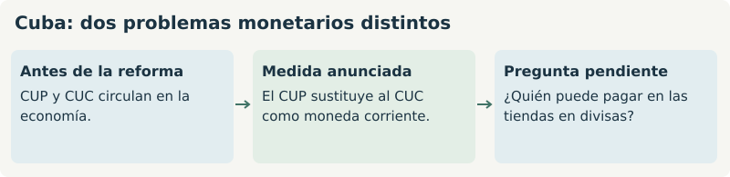
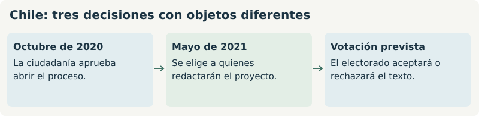

# ENS Rennes D-E — Espagnol oral 2021 · Corrigé guidé

*Corrigé rédigé par IA, non officiel. Signalez toute erreur.*

**Rédaction** · GPT-6.2 Astra Ultra · vitesse non renseignée

El cuaderno pide presentar ante el tribunal un análisis de cada texto. Las preguntas de conversación que siguen sirven para practicar.

## 1. Cuba, el bloqueo y la escasez de vacunas

*Página/12, 31 de mayo de 2021.* [Texto del examen, p. 1](https://www.ens-rennes.fr/medias/fichier/annales-oraux-espagnol-d-e-2021_1652428648736-pdf#page=1)

> [!INDICATION]
> En la libreta, escribir «vacuna / jeringa / vacunación». Explicar qué permite cada elemento y quién atribuye la falta de suministros al embargo. Distinguir el sustantivo *bloqueo*, elegido por el periódico, de la descripción jurídica y política que sugiere *embargo*.

**Síntesis.** El artículo de *Página/12* parte de una paradoja cubana. El país ha desarrollado cinco candidatos vacunales, pero, según el texto de mayo de 2021, necesita unos veinte millones de jeringas para completar la campaña de inmunización. El artículo cita a un directivo del Instituto Finlay que atribuye el ritmo de la vacunación a la falta de recursos. Vincula esa escasez con la continuidad de las sanciones estadounidenses bajo Biden, recoge las iniciativas internacionales de solidaridad y anuncia otra votación en la ONU sobre el embargo. El 70 % de población vacunada para agosto es una previsión del Gobierno en aquel momento.

**Análisis. ¿Qué revela la falta de un objeto tan corriente como una jeringa sobre la soberanía sanitaria?** La capacidad científica es solo uno de los eslabones. Para transformar un resultado de investigación en una campaña nacional hacen falta financiación, proveedores, entregas y personal que pueda utilizar los suministros. El ejemplo invierte la jerarquía intuitiva entre lo sofisticado y lo sencillo. La ausencia del elemento más sencillo puede inmovilizar toda la operación. La diferencia entre veinte millones de jeringas y poco más de once millones de habitantes tampoco significa que se pretenda vacunar a veinte millones de personas. Se cuentan unidades de material y habitantes, dos magnitudes distintas.

El periodista amplía el conflicto desde el hospital hasta Washington y Miami. La fórmula «asedio económico» atribuye intención política a la restricción y denuncia su coste para la población. La voz del instituto respalda la explicación cubana. Las campañas de donación, incluso desde Estados Unidos, permiten además distinguir posiciones gubernamentales y respuestas ciudadanas. Hay, sin embargo, un límite documental. La página no compara el peso de las sanciones con el de todas las demás dificultades de adquisición durante la pandemia. Podemos explicar por qué una restricción de pagos o de proveedores encarece una compra sin aventurar que cada jeringa ausente responde a la misma prohibición.

**Conversación. ¿La votación de la ONU que anuncia el texto puede reponer existencias?** Una resolución puede mostrar el aislamiento diplomático de una política y aumentar su coste político. La entrega material depende de decisiones de compra, transporte y financiación. **¿Qué cambiaría si el artículo incluyera el testimonio de un proveedor?** Podríamos saber si la operación se frustró por un rechazo bancario, un precio, un retraso u otra razón. Esa precisión permitiría comprobar la cadena causal que el artículo plantea.

## 2. Adiós a las dos monedas en Cuba: la isla se queda con el CUP y se enfrenta a un “dólar a corto plazo”

*El Economista, 11 de diciembre de 2020.* [Texto del examen, p. 2](https://www.ens-rennes.fr/medias/fichier/annales-oraux-espagnol-d-e-2021_1652428648736-pdf#page=2)

> [!INDICATION]
> Leer en voz alta *dólar* y *dolor*. El título impreso dice «dólar a corto plazo», mientras que el cuerpo atribuye a los economistas la expresión «dolor a corto plazo». Conservar el título tal y como se imprime y apoyar la interpretación de los costes transitorios en la frase del cuerpo.

**Síntesis.** En diciembre de 2020, *El Economista* presenta el anuncio de Díaz-Canel para el 1 de enero siguiente. Cuba retirará de la circulación corriente el peso convertible, CUC, y conservará el peso cubano, CUP. El reportaje sitúa esta decisión al final de un debate iniciado años antes. Las distintas valoraciones del dinero habían hecho difícil conocer los costes reales y favorecido a determinados sectores. El Gobierno admite un riesgo de inflación. Al mismo tiempo, algunas tiendas cobran en divisas y la caída del turismo dificulta conseguirlas.

**Análisis. ¿Basta con una moneda nacional para que los precios vuelvan a orientar la producción y el salario permita consumir?** El primer problema es de información. Si dos empresas registran un mismo insumo importado a tipos de cambio distintos, sus balances pueden sugerir una ventaja productiva que en realidad procede de la conversión. Unificar hace visibles costes antes disimulados. Una empresa que parecía rentable puede tener que subir precios, reorganizarse o pedir apoyo. Prohibir una subida considerada abusiva no hace desaparecer un mayor coste de reposición. Para proteger poder adquisitivo hay que saber si los bienes estarán disponibles y cómo se ajustarán los ingresos.

El segundo problema es distributivo. Piénsese en dos familias que perciben su salario en CUP. Una recibe remesas y puede comprar en un establecimiento que exige divisas. La otra, pese a cobrar el mismo sueldo, no puede hacerlo en iguales condiciones. La desaparición del CUC elimina una unidad monetaria, pero deja abierta esa desigualdad de acceso. El texto resulta convincente al relacionar la reforma con la historia de las tiendas en divisas y el parón turístico. Su límite es temporal. Cuando se publica, la reforma es un anuncio. El éxito dependerá de la evolución efectiva de precios, salarios y abastecimiento.

**Conversación. ¿Qué ganaría un ciudadano si desaparecieran las conversiones?** Podría comparar más fácilmente precios y salario expresados en CUP. Si un producto solo se vende en divisas, esa transparencia no garantiza que pueda comprarlo. **¿Por qué hablan los economistas de un coste inmediato?** El ajuste puede revelar pérdidas y trasladar el encarecimiento de importaciones a precios internos antes de que la producción y las remuneraciones se adapten.

## 3. España pide a Jair Bolsonaro compromisos en deforestación para que el acuerdo UE-Mercosur cuaje

*El País, 17 de mayo de 2021.* [Texto del examen, p. 3](https://www.ens-rennes.fr/medias/fichier/annales-oraux-espagnol-d-e-2021_1652428648736-pdf#page=3)

> [!INDICATION]
> En español *ratificar* tiene un sujeto jurídico. Anotar por separado lo que propone la ministra española, lo que negociaría la UE y lo que sería necesario para demostrar en Brasil que se cumple un compromiso.

**Síntesis.** En mayo de 2021, *El País* informa de la recepción de Arancha González Laya por Jair Bolsonaro y de la posterior comparecencia con el ministro brasileño Carlos França. España, favorable al acuerdo UE–Mercosur, propone añadir compromisos contra la deforestación para superar las reticencias europeas, especialmente en Austria y Francia. La ministra pide verificación y financiación, y recuerda que la negociación compete a la UE. El periódico contrasta las promesas climáticas de Bolsonaro con un recorte presupuestario y sitúa el encuentro en el contexto de su relativo aislamiento tras la derrota de Trump.

**Análisis. ¿Puede una condición ambiental facilitar un tratado comercial?** Parece una exigencia más para un acuerdo que ya cuesta ratificar. Sin embargo, para un parlamento que teme que el acceso a su mercado estimule la expansión de la frontera agrícola, una garantía comprobable puede cambiar el sentido de su voto. Hay que saber qué superficie se vigilará, quién publicará los resultados y qué se hará ante un incumplimiento. La expresión «mecanismos de verificación y de financiación» vincula la credibilidad de la promesa a la capacidad para cumplirla. El presupuesto importa porque sostener inspecciones requiere recursos y personal. Un recorte del 24 % en la cartera, tal como se cita en el artículo, refuerza las dudas, aunque por sí solo no mide cuántas inspecciones se realizarán.

La visita revela una función diplomática española concreta. Madrid lleva a Brasilia un posible punto de encuentro y escucha las condiciones del socio. No puede conceder, en nombre de todos los europeos, una ratificación que depende de más actores. Desde Brasil cabe temer que una condición unilateral sirva de protección encubierta a productores europeos. Una verificación acordada y unos recursos para adaptar la producción reducirían esa sospecha. La disyuntiva decisiva es entre una obligación verificable y una promesa cuya ejecución cada parte interpretaría a su gusto.

**Conversación. ¿Es lo mismo frenar la deforestación que alcanzar la neutralidad de carbono?** La primera meta se refiere a la pérdida de bosques. La segunda compara todas las emisiones con las absorciones. Están relacionadas, pero requieren indicadores distintos. **¿Cómo se reconoce la posición del diario?** La crónica yuxtapone palabras y decisiones presupuestarias. Esa selección invita al lector a evaluar la credibilidad del presidente, sin que el periodista tenga que declararla nula.

## 4. Elecciones en Chile: por qué es tan polémica la Constitución de Pinochet que 155 representantes van a sustituir

*BBC News Mundo, 16 de mayo de 2021.* [Texto del examen, p. 4](https://www.ens-rennes.fr/medias/fichier/annales-oraux-espagnol-d-e-2021_1652428648736-pdf#page=4)

> [!INDICATION]
> Citar *el 78 % de los votos* para responder a una pregunta precisa. ¿Se votó en 2020 un texto constitucional ya escrito? No. Se votó la apertura de un proceso. Cambiar de verbo al describir la elección de los representantes en 2021.

**Síntesis.** BBC News Mundo explica la elección de los 155 miembros de la Convención chilena en mayo de 2021. La movilización de octubre de 2019 había reclamado cambios profundos. En el plebiscito de octubre de 2020, el 78 % apoyó sustituir la Constitución de 1980. El medio, que consulta a especialistas, distingue su origen bajo la dictadura de Pinochet y su contenido, en particular las críticas al papel subsidiario del Estado. Los convencionales dispondrán de nueve meses, con una posible prórroga de tres, para presentar un proyecto que el electorado deberá aprobar o rechazar.

**Análisis. ¿Qué puede reparar un proceso constituyente que no pueda resolver una elección ordinaria?** Los representantes elegidos bajo las reglas existentes deciden políticas públicas. Una convención discute quién puede decidir en adelante, mediante qué procedimientos y con qué garantías. La expresión «ilegitimidad de origen» señala que una norma puede seguir vigente pese a que muchos ciudadanos cuestionen las condiciones en que se aprobó. Escribir unas reglas mediante un proceso democrático responde a esa crítica procedimental. No asegura el acuerdo sobre el contenido. Dos votantes pueden querer reemplazar la misma Constitución y discrepar sobre la organización de la salud o las pensiones.

El segundo debate concierne al alcance de un derecho social. Garantizar acceso a la salud puede exigir recursos, prestaciones definidas y mecanismos de reclamación. La discusión sobre el peso del sector privado en la provisión no se zanja con la palabra *derecho*. El artículo atribuye a expertos y manifestantes el diagnóstico sobre subsidiariedad y separa la esperanza del resultado. El voto de salida conserva sentido precisamente porque el proyecto todavía no existe cuando se publica el artículo.

**Conversación. ¿Por qué elegir una convención y votar otra vez después?** La primera decisión confiere un mandato para redactar. La segunda permite juzgar las soluciones concretas incluidas en el texto. **¿Qué confundiríamos si presentáramos el 78 % como un apoyo a una reforma sanitaria precisa?** Estaríamos atribuyendo a un voto sobre el proceso un contenido sectorial que la papeleta no sometió a decisión.

## 5. Crisis en Puerto Rico: 3 claves para entender por qué la isla no es ni un país ni un estado

*BBC News Mundo, 23 de julio de 2019, fecha impresa en el cuaderno.* [Texto del examen, p. 5](https://www.ens-rennes.fr/medias/fichier/annales-oraux-espagnol-d-e-2021_1652428648736-pdf#page=5)

> [!INDICATION]
> El artículo abre aludiendo a una frase de Ana Teresa Toro que la hoja no reproduce. Evitar reconstruirla. Al final el subtítulo pregunta por la independencia, pero el párrafo describe la admisión como estado de EE. UU. Explicar los dos proyectos con verbos distintos: *independizarse* e *incorporarse como estado*.

**Síntesis.** La crisis política asociada a la salida del gobernador Ricardo Rosselló sirve a BBC News Mundo para explicar el estatus de Puerto Rico. El reportaje de 2019 recuerda el paso del dominio español al estadounidense en 1898 y el establecimiento del Estado Libre Asociado en 1952. En la isla existen instituciones propias, un gobernador elegido y partidos organizados en torno a alternativas locales. Sus habitantes tienen ciudadanía estadounidense, pero la representación de la isla en el Congreso federal carece de voto decisivo en el pleno. El artículo sitúa estos hechos junto al huracán María, la crisis económica y las acusaciones contra el gobierno local.

**Análisis. ¿Cómo exigir responsabilidades cuando la autoridad se reparte entre dos niveles cuyos electorados no coinciden?** En el plano local, las protestas se dirigen contra un gobernador que responde ante los puertorriqueños. En el federal, el Congreso estadounidense conserva poderes determinantes sobre el territorio. La ciudadanía estadounidense no proporciona a los residentes de la isla una representación federal equivalente a la de un estado. La emergencia del huracán agudiza una cuestión muy concreta. Quienes necesitan ayuda deben distinguir qué administración organiza los servicios, quién aporta los medios y a quién pueden sancionar con su voto. La crisis de representación se superpone a la de gestión, pero la primera no explica por sí sola los actos de corrupción que denuncia el texto.

El nombre *Estado Libre Asociado* puede inducir a imaginar una república soberana vinculada a Estados Unidos por un tratado entre iguales. El texto describe, en cambio, un territorio con autogobierno y con límites impuestos por la autoridad federal. La incorporación como estado federado requeriría una decisión del Congreso. La independencia consistiría en adquirir soberanía propia. Al yuxtaponer una pregunta sobre separación y una respuesta sobre admisión como estado, el cierre de la hoja exige que el lector reconstruya esa diferencia. No hay base en el artículo para atribuir a todos los manifestantes una preferencia común sobre el estatus.

**Conversación. ¿Bastaría con cambiar de gobernador para transformar la condición territorial?** La elección puede modificar la gestión y las prioridades locales. No cambia por sí sola el marco federal. **¿Por qué interesan los partidos propios?** Muestran que la política insular organiza conflictos específicos, entre ellos el estatus. Reducirlos a la oposición estadounidense entre demócratas y republicanos ocultaría una parte del debate.
