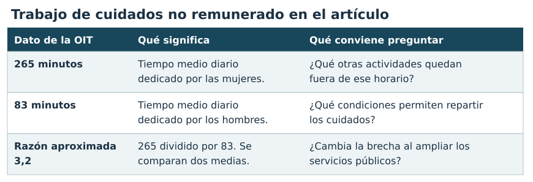

# ENS Rennes · D-E · Espagnol 2021 — Corrigé brut

*Corrigé rédigé par IA, non officiel. Signalez toute erreur.*

**Rédaction** · GPT-6.2 Astra Ultra · vitesse non renseignée

## I. Version

Apprendre de la façon qui nous plaît le plus n’est pas forcément synonyme d’efficacité. En général, personne ne nous apprend à étudier. Chacun prend spontanément ses propres habitudes, selon ses préférences quant à la manière d’occuper le temps consacré à l’étude. Pourtant, « il existe bel et bien toute une série de pratiques et de circonstances qui nous aident tous à apprendre. Seulement, elles ne sont pas intuitives et ce ne sont pas nécessairement les plus agréables », affirme Héctor Ruiz Martín, spécialiste des neurosciences et de la psychologie cognitive et auteur du livre *Aprendiendo a aprender* (éditions Vergara).

Il faut aussi préciser ce qu’il en est des différents styles d’apprentissage. Cette idée très répandue laisse penser que chacun a un cerveau différent qui apprend différemment. Or, souligne Ruiz Martín, la science a examiné cette hypothèse à de nombreuses reprises sans jamais parvenir à la démontrer : « C’est tout simple. On donne d’abord aux élèves une explication visuelle, puis on leur fait passer une épreuve là-dessus. A priori, on dirait que ceux qui obtiennent les meilleurs résultats sont les visuels, puisque l’explication était visuelle. Si, ensuite, on fait un autre cours, oral cette fois, et qu’on leur fait tous passer une épreuve, à quoi devrait-on s’attendre ? À ce que d’autres se distinguent, n’est-ce pas ? Si les styles d’apprentissage existent… Eh bien non : ce sont encore les mêmes qui se distinguent. »

Quelles stratégies permettront alors une expérience d’apprentissage plus complète ? Pour les identifier, il faut tenir compte de facteurs tant cognitifs, liés au fonctionnement de la mémoire, qu’émotionnels.

## II. Thème

Todavía es demasiado pronto para medir los efectos de la epidemia de covid-19 en la organización de nuestra sociedad. Sin embargo, hay un ámbito en el que su impacto ha sido a la vez inmediato y espectacular: la organización del trabajo. El primer confinamiento, decretado a mediados de marzo, impuso la generalización casi total del teletrabajo allí donde era posible, cuando hasta entonces esta práctica había sido marginal. En mayo de 2020, el 40 % de los asalariados de empresas de más de diez personas trabajó a distancia, según un reciente estudio del grupo Malakoff Humanis.

El segundo confinamiento, decretado en noviembre durante la segunda ola, convirtió el teletrabajo en una práctica habitual. Esto llevó a los interlocutores sociales a concluir en un tiempo récord una negociación destinada a regular su desarrollo, especialmente en materia de protección de datos, respeto de la jornada laboral y derecho a la desconexión. Las conversaciones, iniciadas el 3 de noviembre, dieron lugar tres semanas después a un acuerdo profesional de ámbito nacional, respaldado por todas las partes salvo la CGT.

Así pues, la irrupción de un acontecimiento dramático ha terminado por vencer las reticencias que hasta ahora contribuían a mantener a la inmensa mayoría de los asalariados ligados a su lugar de trabajo.

## III.1. ¿Cómo está presentada la igualdad de género en el artículo?

El artículo presenta la igualdad de género como una promesa internacional cuyo cumplimiento se puede contrastar con la vida diaria. El aniversario de la conferencia de Pekín de 1995 proporciona el punto de partida. Veinticinco años después, existen compromisos y avances, pero la pandemia impide celebrar el foro previsto y obliga a preguntarse qué ha cambiado realmente. El contraste entre aquel encuentro multitudinario y las conversaciones a distancia de 2020 da al balance un tono a la vez crítico y esperanzado.

Las voces de asociaciones, investigadoras y responsables públicos amplían el significado de la igualdad. Abarca la justicia económica, el derecho a decidir sobre la propia vida y la protección frente a la violencia. El ejemplo de los cuidados permite relacionar esas dimensiones con una experiencia concreta. Según los datos citados, las mujeres dedican en promedio 265 minutos diarios al trabajo de cuidados no remunerado, frente a 83 minutos de los hombres. Esa diferencia reduce el tiempo disponible para el empleo remunerado, la formación o la participación pública.

Las cifras también permiten juzgar la velocidad del cambio. La estimación de que cerrar una brecha podría llevar más de dos siglos prolonga el ritmo observado y advierte de las consecuencias de mantenerlo. Ante ese panorama, las organizadoras buscan que la sociedad civil influya en las propuestas que España lleve al foro. Las preguntas finales convierten la reconstrucción posterior a la pandemia en una decisión abierta: puede consolidar el reparto anterior de los cuidados o proporcionar una ocasión para modificarlo.

*248 mots.*

## III.2. ¿En qué medida le parece posible llegar a una perfecta igualdad de género?

Depende de lo que entendamos por igualdad perfecta. Es posible y necesario que una misma ley reconozca los mismos derechos a todas las personas y que existan procedimientos eficaces para hacerlos valer. Es más difícil afirmar que dos individuos tendrán exactamente las mismas oportunidades en cada momento de su vida. Intervienen la situación económica familiar, la salud o el lugar de residencia, además del género. Sin embargo, la dificultad de alcanzar una meta absoluta no justifica aceptar desigualdades que sí podemos identificar y corregir.

Por ejemplo, dos personas con idéntica preparación pueden optar a un ascenso en una empresa que exige disponibilidad a última hora. Si una de ellas asume casi todos los cuidados familiares, el procedimiento aparentemente neutral la perjudica. Ampliar los servicios de atención, ofrecer permisos de crianza a ambos progenitores y anunciar horarios con antelación modificaría las condiciones en que cada persona toma sus decisiones. Después convendría comprobar quién puede utilizar esos permisos sin perder ingresos o posibilidades de promoción.

Tampoco mediría la libertad únicamente por la coincidencia exacta de las elecciones individuales. Dos personas pueden escoger ocupaciones distintas aun disponiendo de alternativas reales. La pregunta es si podían elegir de otro modo sin afrontar una penalización ligada al género. Investigar denuncias, publicar datos comparables y escuchar a quienes abandonan determinados trabajos permite contestarla mejor. Quizá nunca pueda certificarse que se ha llegado a una igualdad perfecta y definitiva. Sí podemos exigir que una diferencia observada se examine, que haya recursos para impugnar la discriminación y que los progresos sean verificables.

*254 mots.*

[Sujet](https://www.ens-rennes.fr/medias/fichier/sujet-e-crit-espagnol-2021_1631710136869-pdf) · [Rapport](https://www.ens-rennes.fr/medias/fichier/rapport-de-jury-espagnol-ecrit-d-e-2021_1634140018150-pdf)
