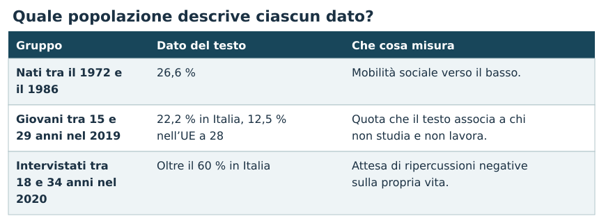

# ENS Rennes · D-E · Italien (oral) 2021 — Corrigé brut

*Corrigé rédigé par IA, non officiel. Signalez toute erreur.*

**Rédaction** · GPT-6.2 Astra Ultra · vitesse non renseignée

L’unique billet du fascicule demande d’analyser l’article d’Alice Scaglioni. Les relances sont proposées pour l’entraînement.

## Billet 1 — Il Covid-19 ha davvero cancellato i sogni dei Millennials ?

### Dalle aspettative familiari alla doppia crisi

Che cosa significa ormai avere un «posto fisso» per chi è entrato nel mondo del lavoro durante due crisi? Nell’agosto del 2020 Alice Scaglioni pone questa domanda indirettamente, partendo dal divario fra la vita immaginata dai Millennials italiani e i percorsi che hanno potuto seguire. Il titolo chiede se il Covid abbia davvero cancellato i loro sogni. Il resto dell’articolo invita a correggere la domanda: l’emergenza sanitaria ha colpito progetti che erano già diventati fragili dopo la crisi finanziaria del 2008.

I genitori fornivano ai figli una successione di tappe riconoscibile: un contratto stabile, una famiglia, qualche risparmio. Un impiego a termine non annulla automaticamente questi desideri, ma rende più difficile prevedere il reddito dei prossimi mesi. L’acquisto di una casa o la decisione di avere un figlio diventano più rischiosi. Alcuni vanno all’estero, altri rinviano una scelta. Il richiamo all’Istat aggiunge una distinzione essenziale: la famiglia non trasmette soltanto un modello di vita, trasmette anche risorse molto disuguali per affrontare l’incertezza. Perdere un contratto ha conseguenze diverse per chi può contare su un alloggio familiare e per chi deve pagare subito un affitto.

### Leggere i numeri prima di spiegare il pessimismo

Il dato del 26,6 per cento riguarda la mobilità verso il basso dei nati tra il 1972 e il 1986. La generazione descritta all’inizio dell’articolo comprende invece i nati tra il 1981 e il 1996. Le due fasce si sovrappongono solo in parte: la prima cifra illustra un problema di mobilità sociale, ma non fornisce la percentuale esatta di Millennials che hanno perso reddito durante il Covid. Un altro dato, riferito al 2019, colloca i giovani italiani fra i 15 e i 29 anni che non studiano e non lavorano al 22,2 per cento, contro il 12,5 per cento nell’Unione europea a 28. Questo confronto mostra che lo svantaggio italiano precede il primo confinamento.

L’indagine dell’Istituto Toniolo pone infine una domanda diversa. Tra la fine di marzo e l’inizio di aprile del 2020, oltre il sessanta per cento dei giovani italiani intervistati si aspetta conseguenze negative sulla propria vita, contro il quarantasei per cento dei francesi e il quarantadue per cento dei tedeschi. Si misurano aspettative formulate in un momento eccezionale. Non sappiamo ancora quanti progetti verranno abbandonati, quanti rimandati e quanti trasformati. Il diverso livello di fiducia merita comunque attenzione: se temo di non avere lavoro fra un anno, posso già oggi rinviare un progetto anche prima di subire una perdita di reddito.

### Conclusione e rilancio

Il testo convince quando collega le preoccupazioni individuali ai contratti di lavoro, alla mobilità sociale e alle condizioni di accesso all’autonomia. Il suo limite sarebbe trasformare un modello familiare in una definizione universale del successo. Un giovane può scegliere di non comprare casa o di non avere figli. La questione pubblica riguarda la possibilità di scegliere, invece di dover rinunciare per mancanza di alternative. Per approfondirla, ritroverei le stesse persone alcuni anni dopo e confronterei le decisioni effettive con le aspettative iniziali e con le risorse di partenza.

**Perché non basta parlare di disoccupazione?** Anche chi lavora può non sapere se il contratto sarà rinnovato. La disoccupazione misura una condizione presente; l’incertezza può influire su un progetto a lungo termine anche con un impiego oggi.

**Il confronto internazionale dimostra che le politiche italiane sono la causa del pessimismo?** No. Per sostenerlo dovremmo considerare l’andamento dell’epidemia, le condizioni iniziali, la situazione familiare e come sono stati formati i campioni. Il confronto segnala una differenza da spiegare.

**Quale misura approfondirebbe?** Studiare l’accesso a servizi per l’infanzia e a contratti più stabili aiuterebbe a collegare un ostacolo preciso a una scelta osservabile. Verificherei se, a parità di progetto iniziale, le persone che ottengono quel sostegno riescono più spesso a realizzarlo.

[Sujet](https://www.ens-rennes.fr/medias/fichier/annales-oraux-italien-d-e-2021_1652428658992-pdf)
