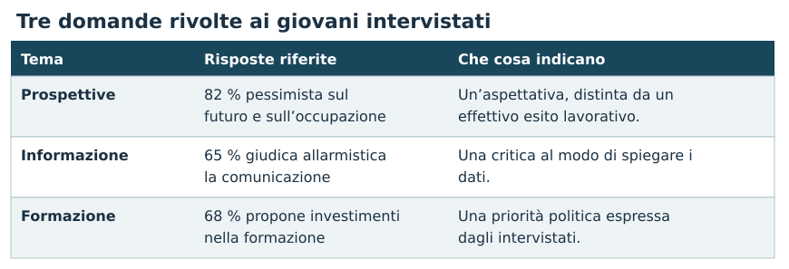

# ENS Rennes · D-E · Italien 2021 — Corrigé brut

*Corrigé rédigé par IA, non officiel. Signalez toute erreur.*

**Rédaction** · GPT-6.2 Astra Ultra · vitesse non renseignée

## I. Version

La crise du Covid a accéléré certaines transformations que les entreprises avaient, pour diverses raisons, du mal à mettre en œuvre, notamment la numérisation et le télétravail. De nombreuses entreprises ont déclaré que cette façon de travailler avait tout de même apporté des avantages : les salariés ont pris davantage de responsabilités et la productivité s’est maintenue, voire a augmenté dans certains cas. Mais le prix à payer a été élevé : une sensation de fatigue accrue.

Cette fatigue a été attribuée aux outils utilisés. Pourtant, il y a aussi notre rapport au temps, qui a changé, et l’usage que nous en faisons. En effet, les intervalles entre deux obligations ont disparu. Les réunions se sont donc multipliées. Auparavant, des considérations logistiques en limitaient le nombre, surtout quand il fallait se déplacer. Aujourd’hui, on peut aisément les enchaîner en un clic, sans interruption.

Un autre temps qui a disparu est celui que l’on qualifiait de « mort », à savoir les heures passées à se rendre sur son lieu de travail et à en revenir. Ces moments étaient pour l’essentiel des moments creux, où l’on passait d’un rôle à un autre. Désormais, nous passons directement de notre rôle de conjointe, de conjoint, de père ou de mère à notre rôle professionnel et inversement. Et nous découvrons que les brèves pauses entre deux activités n’étaient pas du temps perdu, mais du temps nécessaire pour remettre de l’ordre dans nos idées et nos pensées.

La leçon que nous pouvons en tirer, c’est que nous devons nous réapproprier de petits moments de « vide » en prévoyant dans nos agendas des plages de « déplacement virtuel », exactement comme nous le faisions auparavant. Notre efficacité n’en souffrira pas et nous réduirons le risque d’épuisement professionnel lié au télétravail.

## II. Thème

«Ius soli», ossia diritto del suolo: sulla scia del movimento Black Lives Matter negli Stati Uniti, una formula latina è tornata d’attualità in Italia, diventando lo slogan dei figli degli immigrati che chiedono di acquisire automaticamente la cittadinanza italiana.

Nella penisola la questione migratoria è al centro del dibattito politico. La discussione, tuttavia, verte soprattutto sulle imbarcazioni che attraversano il Mediterraneo e sull’accoglienza d’emergenza.

La battaglia dei figli degli immigrati è molto meno visibile. I figli e i nipoti dei migranti condividono la lingua e i codici culturali del Paese che li accoglie, ma possono ottenere la cittadinanza soltanto a diciotto anni, a determinate condizioni e spesso al termine di un vero e proprio percorso a ostacoli negli uffici pubblici.

Dei 5,3 milioni di stranieri residenti in Italia nel 2019, circa 1,3 milioni hanno meno di diciotto anni. Quasi il 75 per cento di loro è nato nella penisola. Trascorrono dunque tutta la minore età con la cittadinanza d’origine del genitore e un permesso di soggiorno per poter risiedere nel territorio nazionale.

«In questo Paese la cittadinanza non è un diritto, ma una concessione», lamenta Fatima Maiga, ventotto anni, nata in Italia e di origine ivoriana, cofondatrice dell’associazione Italiani senza cittadinanza.

## III.1. Quali emozioni, impressioni e opinioni esprimono i giovani Italiani a proposito dell’emergenza sanitaria causata dalla pandemia del Covid?

I giovani intervistati nell’indagine realizzata dagli studenti dell’Università dell’Insubria esprimono sentimenti diversi, talvolta presenti nella stessa persona. L’emergenza ha interrotto tirocini, lezioni in presenza e rapporti affettivi proprio quando molti stavano cercando una prima autonomia. Il 23 per cento dei partecipanti segnala un peggioramento delle relazioni personali e l’82 per cento guarda con pessimismo al futuro e alle prospettive di lavoro. Per alcuni andare all’estero sembra una via d’uscita. L’intenzione di partire, però, esprime un timore o un progetto, non una partenza già avvenuta.

La delusione riguarda anche il ruolo assegnato ai giovani nello spazio pubblico. Molti hanno rispettato le precauzioni sanitarie e apprezzano il lavoro del personale medico. Nello stesso tempo si sentono descritti dai media come responsabili dell’aumento dei contagi e poco ascoltati dalle autorità. Le università, secondo le testimonianze, hanno dovuto trovare soluzioni senza indicazioni abbastanza chiare. Una parte consistente degli intervistati giudica allarmistica l’informazione: presentare cifre vere senza spiegarne il significato può accrescere l’angoscia.

Eppure il pessimismo convive con il desiderio di reagire. Numerosi partecipanti chiedono investimenti nella formazione e nel sostegno alle imprese. Alcuni si dichiarano pronti ad aggiornare le proprie competenze per adattarsi alle nuove opportunità. Questa disponibilità contraddice l’immagine di una generazione uniformemente passiva. Si tratta però di un questionario diffuso in rete, al quale hanno risposto soprattutto ragazzi tra i diciotto e i venticinque anni. È prezioso per capire esperienze diverse, senza pretendere che ogni percentuale descriva tutti i giovani italiani.

*239 mots.*

## III.2. Quali misure dovrebbe adottare uno Stato europeo come l’Italia o la Francia per sostenere e incoraggiare i giovani dopo la pandemia?

Dopo la pandemia, uno Stato europeo dovrebbe offrire ai giovani la possibilità di recuperare esperienze che non torneranno semplicemente con la riapertura degli edifici. Chi ha seguito un corso a distanza può aver superato tutti gli esami senza aver mai usato le attrezzature di un laboratorio. Finanzierei quindi sessioni pratiche, tutorato e servizi di orientamento accessibili anche a chi ha già lasciato l’università. Le biblioteche e i comuni potrebbero ospitare punti di accesso per ragazzi che non dispongono di una connessione stabile o di uno spazio tranquillo.

Una seconda priorità è il passaggio dagli studi al primo impiego. Un tirocinio retribuito dovrebbe avere un progetto formativo verificabile e un referente responsabile. Lo Stato potrebbe coprire parte dei costi per le piccole imprese che non riuscirebbero altrimenti ad accogliere un apprendista, controllando che il nuovo posto non sostituisca personale già occupato. Un sostegno alle spese di trasporto o di alloggio renderebbe l’offerta accessibile anche a chi vive lontano dai centri più dinamici.

Infine, ascoltare i giovani dovrebbe cambiare il modo in cui vengono disegnati i servizi. Un comune potrebbe coinvolgere studenti, disoccupati e giovani lavoratori nella scelta degli orari di uno sportello psicologico, garantendo riservatezza e continuità a chi vi si rivolge. Per sapere se queste iniziative funzionano, confronterei partecipazione, completamento dei percorsi e stabilità del lavoro a distanza di un anno. Il numero dei bandi pubblicati dice poco, se proprio le persone che ne hanno più bisogno non riescono a utilizzarli.

*241 mots.*

[Sujet](https://www.ens-rennes.fr/medias/fichier/sujet-e-crit-italien-2021_1631710145627-pdf) · [Rapport](https://www.ens-rennes.fr/medias/fichier/rapport-de-jury-italien-ecrit-d-e-2021-1_1634140087200-pdf)
