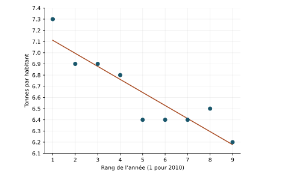
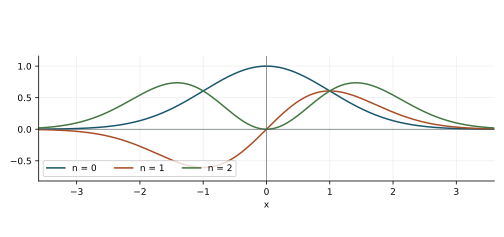

# ENS Rennes D-E — Mathématiques appliquées et statistiques 2021 · Corrigé guidé

*Corrigé rédigé par IA, non officiel. Signalez toute erreur.*

**Rédaction** · GPT-6.2 Astra Ultra · vitesse non renseignée

**Révision** · GPT-6.2 Astra Ultra · vitesse non renseignée

**Statistiques environnementales, moments gaussiens et fiabilité mécanique.** Les calculs de régression utilisent les coefficients non arrondis. Les deux demi-intégrales des moments sont contrôlées séparément.

## 1. Émissions et énergies renouvelables

### Question 1.1.a

> [!INDICATION]
> Numéroter les années à partir de 1 et placer les observations avant la droite.

#### Solution

Les rangs de 1 à 9 correspondent respectivement aux ordonnées $7{,}3$ ; $6{,}9$ ; $6{,}9$ ; $6{,}8$ ; $6{,}4$ ; $6{,}4$ ; $6{,}4$ ; $6{,}5$ ; $6{,}2$. Sur papier, on avance de 2 cm par rang et on monte de 1 cm par dixième de tonne.

### Question 1.1.b

> [!INDICATION]
> Employer le diviseur 9 pour la variance descriptive.

#### Solution

La moyenne est $\bar y=59{,}8/9\simeq6{,}64$ tonnes par habitant. La variance vaut $V(y)=\sum y_i^2/9-\bar y^2=8{,}84/81\simeq0{,}11$ en unités au carré.

### Question 1.1.c

> [!INDICATION]
> Calculer la covariance et la rapporter au produit des écarts-types.

#### Solution

Pour les rangs, $\bar x=5$ et $V(x)=20/3$. La covariance $\sum x_i y_i/9-\bar x\bar y=-7/9$ donne $r=-7/(9\sqrt{V(x)V(y)})\simeq-0{,}91$. La liaison est fortement décroissante et le nuage assez allongé pour proposer une droite sur la période observée.

### Question 1.1.d

> [!INDICATION]
> La droite passe par le point moyen et a pour pente la covariance divisée par la variance de x.

#### Solution

La pente vaut $a=(-7/9)/(20/3)=-7/60$ et $b=\bar y-a\bar x=1301/180$. Ainsi $\widehat y=-(7/60)x+1301/180$, soit à deux décimales $\widehat y=-0{,}12x+7{,}23$. On garde les fractions dans les prévisions.

### Question 1.1.e

> [!INDICATION]
> Traduire la date en rang avant d’utiliser la droite.

#### Solution

Le rang correspondant à 2050 est $2050-2009=41$. La prévision est donc $\widehat y(41)=22/9\simeq2{,}44$ tonnes par habitant. Cette valeur extrapole une droite ajustée sur 2010–2018.

### Question 1.1.f

> [!INDICATION]
> Résoudre une inégalité stricte puis prendre le premier rang entier admissible.

#### Solution

L’inégalité $-(7/60)x+1301/180<2$ équivaut à $x>941/21\simeq44{,}81$. Le premier rang est 45, soit l’année **2054**.

Aux deux rangs voisins, la droite donne $377/180\simeq2{,}09$ en 2053 et $356/180\simeq1{,}98$ en 2054. Ces deux valeurs encadrent le seuil demandé.

### Question 1.2.a

> [!INDICATION]
> Identifier la grandeur mesurée dans chaque pays.

#### Solution

C’est une série univariée quantitative continue. L’individu est un pays et sa valeur est une proportion en pourcentage, mesurée ici au dixième.

### Question 1.2.b

> [!INDICATION]
> Ranger les 28 valeurs. Pour chaque quartile, chercher le premier rang atteignant la fraction voulue de l’effectif. Pour la médiane, prendre les deux rangs centraux.

#### Solution

Dans la liste croissante des 28 pays, les quartiles occupent les rangs 7 et 21. La médiane est la moyenne des rangs 14 et 15. Les valeurs aux rangs 7, 14, 15 et 21 sont respectivement $9{,}5$, $16{,}0$, $17{,}3$ et $28{,}3$. La médiane usuelle est $(16{,}0+17{,}3)/2=16{,}65\,\%$. Les quartiles empiriques sont $Q_1=9{,}50\,\%$ et $Q_3=28{,}30\,\%$, d’où un écart de **18,80 points de pourcentage**.

### Question 1.2.c

> [!INDICATION]
> Donner à chaque pays le même poids.

#### Solution

La somme des 28 parts est $559{,}0$. Leur moyenne arithmétique vaut $559/28\simeq19{,}96\,\%$. C’est une moyenne par pays.

### Question 1.2.d

> [!INDICATION]
> Soustraire le carré de la moyenne à la moyenne des carrés.

#### Solution

Avec $\sum x_i^2=14908{,}68$, on obtient $\sigma=\sqrt{14908{,}68/28-(559/28)^2}\simeq11{,}57$ points de pourcentage.

## 2.I. Variations et intersections

### Question 2.I.1

> [!INDICATION]
> Comparer la puissance de x à l’exponentielle en x au carré.

#### Solution

Avec $u=x^2/2$, $\varphi_n(x)=(2u)^{n/2}e^{-u}$ pour $x>0$. Par croissances comparées, la limite en $+\infty$ est nulle pour tout $n\ge0$.

### Question 2.I.2

> [!INDICATION]
> Dériver le produit et traiter séparément la puissance nulle à l’origine.

#### Solution

Les deux facteurs sont dérivables. Pour $n\ge1$, $\varphi_n'(x)=(nx^{n-1}-x^{n+1})e^{-x^2/2}=(n-x^2)x^{n-1}e^{-x^2/2}$ sur toute la droite. Pour $n=0$, $\varphi_0'(x)=-xe^{-x^2/2}$, y compris en 0 ; la formule factorisée de l’énoncé pour $n=0$ s’y prolonge par continuité.

### Question 2.I.3

> [!INDICATION]
> Sur la demi-droite positive, seul le facteur n moins x carré peut changer de signe.

#### Solution

Pour $n=0$, la dérivée est strictement négative sur $]0,\infty[$ et $\varphi_0$ décroît de 1 jusqu’à sa limite 0. Pour $n\ge1$, $\varphi_n$ part de 0, croît strictement jusqu’à $x=\sqrt n$ puis décroît strictement jusqu’à 0. La valeur au sommet est $n^{n/2}e^{-n/2}$.

| Paramètre | Au départ $x=0$ | Variation sur la demi-droite positive | Limite en $+\infty$ |
|---|---:|:---|---:|
| $n=0$ | $1$ | Décroît pour tout $x>0$ | $0$ |
| $n\ge1$ | $0$ | Croît jusqu’à $x=\sqrt n$, puis décroît | $0$ |

### Question 2.I.4

> [!INDICATION]
> Lire le sommet dans chaque tableau, y compris l’extrémité pour n nul.

#### Solution

Sur $[0,+\infty[$, le maximum est $M_0=1$ atteint en 0. Pour $n\ge1$, $M_n=(n/e)^{n/2}$ est atteint uniquement en $\sqrt n$.

### Question 2.I.5

> [!INDICATION]
> Factoriser la différence et distinguer sa signification sur les abscisses négatives.

#### Solution

En factorisant on trouve $\varphi_{n+1}-\varphi_n=(x-1)x^ne^{-x^2/2}$. Toutes les paires se rencontrent en $(1,e^{-1/2})$, et pour $n\ge1$ aussi en $(0,0)$. Il n’y a aucun autre point commun. Pour $x>1$, $C_{n+1}$ est au-dessus de $C_n$, et pour $0<x<1$ elle est en dessous. Pour $x<0$ elle est en dessous si $n$ est pair, au-dessus si $n$ est impair. En $x=0$ et $n=0$ elle est en dessous.

### Question 2.I.6

> [!INDICATION]
> Comparer la valeur en x et en son opposé.

#### Solution

Comme l’exponentielle du carré est paire, $\varphi_n(-x)=(-1)^n\varphi_n(x)$. Pour $n$ pair la courbe est symétrique par rapport à l’axe des ordonnées ; pour $n$ impair elle est symétrique par rapport à l’origine.

## 2.II. Convexité et représentation des trois premières fonctions

### Question 2.II.1.a

> [!INDICATION]
> Développer le discriminant avant d’examiner le signe des deux racines.

#### Solution

Pour $n\ge2$, $\Delta=(2n+1)^2-4n(n-1)=8n+1>0$. Les racines $u_\pm=(2n+1\pm\sqrt{8n+1})/2$ sont distinctes. Leur produit $n(n-1)$ est positif et leur somme $2n+1$ positive, donc elles sont toutes deux positives.

### Question 2.II.1.b

> [!INDICATION]
> Prendre les deux racines carrées positives et conserver l’ordre.

#### Solution

On trouve $x_1=\sqrt{u_-}$ et $x_2=\sqrt{u_+}$ avec $0<x_1<x_2$. Le polynôme en $x$ est $(x^2-u_-)(x^2-u_+)$, positif sur $[0,x_1[$ et $]x_2,\infty[$, négatif entre $x_1$ et $x_2$, nul aux deux bornes intermédiaires.

### Question 2.II.2

> [!INDICATION]
> Dériver le facteur polynomial et le facteur exponentiel avant de regrouper.

#### Solution

En partant de $(nx^{n-1}-x^{n+1})e^{-x^2/2}$, le facteur polynomial après dérivation est $n(n-1)x^{n-2}-(n+1)x^n-nx^n+x^{n+2}$. Ainsi $\varphi_n''(x)=x^{n-2}e^{-x^2/2}[x^4-(2n+1)x^2+n(n-1)]$.

### Question 2.II.3

> [!INDICATION]
> Reporter le signe du polynôme sur la dérivée seconde.

#### Solution

La fonction est convexe sur $[0,x_1]$, concave sur $[x_1,x_2]$, puis convexe sur $[x_2,\infty[$. La dérivée seconde change de signe aux deux racines positives, donc ce sont les abscisses des deux points d’inflexion sur la demi-droite.

### Question 2.II.4

> [!INDICATION]
> Utiliser les maxima, les symétries et les points communs comme repères de construction.

#### Solution

Dans le repère orthonormé (3 cm par unité sur papier), $C_0$ culmine en $(0,1)$. $C_1$ a un minimum en $(-1,-e^{-1/2})$ et un maximum en $(1,e^{-1/2})$. $C_2$ touche l’axe en 0 et culmine en $(\pm\sqrt2,2/e)$. Les trois courbes sont asymptotes à l’axe des abscisses aux deux infinis.

## 2.III. Intégrales impropres et moments

### Question 2.III.1.a

> [!INDICATION]
> Garder le facteur de normalisation de la loi centrée réduite.

#### Solution

La densité normale standard sur $\mathbb R$ est $t\mapsto e^{-t^2/2}/\sqrt{2\pi}$.

### Question 2.III.1.b

> [!INDICATION]
> Utiliser l’intégrale totale de la densité.

#### Solution

Cette fonction positive a une intégrale totale égale à 1. En multipliant par $\sqrt{2\pi}$ on obtient la convergence de $I_0$ et $I_0=\sqrt{2\pi}$.

### Question 2.III.2

> [!INDICATION]
> Vérifier chaque demi-intégrale avant d’utiliser l’imparité.

#### Solution

Sur $[0,A]$, $\int_0^A te^{-t^2/2}dt=1-e^{-A^2/2}\to1$. L’intégrale sur $]-\infty,0]$ vaut $-1$ par changement de variable $u=-t$. Les deux convergent et $I_1=0$.

### Question 2.III.3

> [!INDICATION]
> Prendre t puissance n comme facteur à dériver.

#### Solution

Sur $[-M,M]$, on prend $u=t^n$ et $v' =te^{-t^2/2}$, donc $v=-e^{-t^2/2}$. L’intégration par parties donne
$$\int_{-M}^M\varphi_{n+1}(t)dt=\bigl((-M)^n-M^n\bigr)e^{-M^2/2}+n\int_{-M}^M\varphi_{n-1}(t)dt.$$

### Question 2.III.4

> [!INDICATION]
> Établir d’abord la convergence séparée sur chaque demi-axe.

#### Solution

Posons $J_m=\int_0^\infty t^m e^{-t^2/2}dt$. Les cas $J_0,J_1$ sont acquis. Pour $n\ge1$, la même intégration sur $[0,M]$ donne $\int_0^M\varphi_{n+1}=-M^ne^{-M^2/2}+n\int_0^M\varphi_{n-1}$. Si $J_{n-1}$ existe, le premier terme tend vers zéro et $J_{n+1}=nJ_{n-1}$ existe. Par récurrence de pas deux tous les $J_m$ sont finis. Le changement $t\mapsto-t$ donne aussi la convergence absolue à gauche. On peut alors passer à la limite dans l’identité précédente, d’où $I_{n+1}=nI_{n-1}$.

### Question 2.III.5

> [!INDICATION]
> Séparer les deux parités et regrouper les facteurs pairs de la factorielle.

#### Solution

À $p=0$, $I_0=\sqrt{2\pi}$ et $I_1=0$. Si les formules sont vraies au rang $p$, $I_{2p+3}=(2p+2)I_{2p+1}=0$ et $I_{2p+2}=(2p+1)I_{2p}$. Or $(2p+1)(2p)!/(2^pp!)=(2p+2)!/[2^{p+1}(p+1)!]$. Ainsi $I_{2p}=(2p)!\sqrt{2\pi}/(2^pp!)$ et $I_{2p+1}=0$.

### Question 2.III.6

> [!INDICATION]
> Diviser chaque intégrale par la constante de normalisation.

#### Solution

La formule de transfert s’applique car tous ces moments sont absolument intégrables. Elle donne $\mathbb E(X^{2p})=(2p)!/(2^pp!)$ et $\mathbb E(X^{2p+1})=0$ pour tout $p\ge0$.

## 3.I. Rayon et défaut de fabrication

### Question 3.I.1

> [!INDICATION]
> Lire séparément les fréquences des rayons et les probabilités conditionnelles.

#### Solution

Dans l’ordre demandé, $P(R_1)=0{,}50$, $P(R_2)=0{,}30$, $P(R_3)=0{,}20$, $P(D\mid R_1)=0{,}02$, $P(D\mid R_2)=0{,}10$ et $P(D\mid R_3)=0{,}15$.

### Question 3.I.2

> [!INDICATION]
> Décomposer l’événement de défaut selon le rayon.

#### Solution

Les $R_i$ forment une partition. La formule des probabilités totales donne $P(D)=0{,}50\times0{,}02+0{,}30\times0{,}10+0{,}20\times0{,}15=0{,}07$.

### Question 3.I.3.a

> [!INDICATION]
> Inverser le conditionnement avec la formule de Bayes.

#### Solution

$P(R_1\mid D)=P(R_1)P(D\mid R_1)/P(D)=0{,}01/0{,}07=1/7\simeq0{,}14$.

### Question 3.I.3.b

> [!INDICATION]
> Comparer les trois probabilités une fois le défaut observé.

#### Solution

Par la même formule, $P(R_2\mid D)=0{,}03/0{,}07=3/7$ et $P(R_3\mid D)=3/7$. Les rayons $r_2$ et $r_3$ sont donc ex æquo les plus probables après observation du défaut, avec environ $0{,}43$ chacun. Avant observation, $r_1$ était le plus fréquent.

## 3.II. Défauts dans une boîte de vitesse

### Question 3.II.1

> [!INDICATION]
> Préciser l’hypothèse d’indépendance permettant d’identifier une loi binomiale.

#### Solution

Dans le modèle retenu par les questions suivantes, les dix engrenages sont assimilés à dix essais de Bernoulli indépendants de même paramètre $p=0{,}07$. Alors $X\sim\mathcal B(10,0{,}07)$ et $P(X=k)=\binom{10}k(0{,}07)^k(0{,}93)^{10-k}$ pour $k=0,\ldots,10$. L’indépendance est une hypothèse du modèle ; les seules probabilités marginales ne déterminent pas la loi de la somme.

### Question 3.II.2

> [!INDICATION]
> Appliquer les formules des deux premiers moments de la binomiale.

#### Solution

$\mathbb EX=10\times0{,}07=0{,}70$ et $\operatorname{Var}(X)=10\times0{,}07\times0{,}93=0{,}651$.

### Question 3.II.3

> [!INDICATION]
> Passer à l’événement complémentaire de la boîte défectueuse.

#### Solution

Une boîte est défectueuse lorsque $X\ge1$. Ainsi $p_B=1-P(X=0)=1-0{,}93^{10}\simeq0{,}51602$, soit $0{,}52$ au centième.

### Question 3.II.4

> [!INDICATION]
> Une fois la boîte déclarée défectueuse, exclure le cas d’un unique défaut.

#### Solution

Comme $\{X\ge2\}\subset\{X\ge1\}$,
$$P(X\ge2\mid X\ge1)=1-\frac{P(X=1)}{p_B}
=1-\frac{10(0{,}07)(0{,}93)^9}{1-0{,}93^{10}}\simeq0{,}29.$$

## 3.III. Durée de fonctionnement

### Question 3.III.1

> [!INDICATION]
> Identifier la date de la première panne.

#### Solution

La boîte s’arrête dès que le premier de ses dix engrenages s’arrête, donc $T=\min_{1\le k\le10}X_k$. Pour tout réel $t$, $\{T>t\}=\bigcap_{k=1}^{10}\{X_k>t\}$.

### Question 3.III.2.a

> [!INDICATION]
> Utiliser l’indépendance des dix durées puis la fonction de survie exponentielle.

#### Solution

Pour $t\ge0$, $P(T>t)=\prod_{k=1}^{10}P(X_k>t)=(e^{-0{,}1t})^{10}=e^{-t}$.

### Question 3.III.2.b

> [!INDICATION]
> Reconnaître la fonction de répartition sur toute la droite.

#### Solution

Pour $t<0$, $P(T\le t)=0$, puisque les durées sont positives. Pour $t\ge0$, $P(T\le t)=1-e^{-t}$. C’est la loi exponentielle de paramètre 1 par an.

### Question 3.III.3

> [!INDICATION]
> Soustraire deux probabilités de survie.

#### Solution

La loi étant continue, les bornes ont probabilité nulle. $P(2\le T\le3)=e^{-2}-e^{-3}\simeq0{,}09$.

### Question 3.III.4

> [!INDICATION]
> Inverser le taux de panne de la boîte.

#### Solution

$\mathbb ET=1/1=1$ an. Pour une boîte initialement sans défaut, la première panne d’engrenage survient en moyenne au bout d’un an dans ce modèle.

## 3.IV. Défauts dans un lot et approximation normale

### Question 3.IV.1

> [!INDICATION]
> Répéter le test de défaut à l’échelle des boîtes.

#### Solution

Pour des boîtes indépendantes fabriquées dans les mêmes conditions, $Y\sim\mathcal B(n,p_B)$ avec $p_B=1-0{,}93^{10}$. Dans le calcul numérique qui suit, l’énoncé retient $p_B\simeq0{,}52$.

### Question 3.IV.2.a

> [!INDICATION]
> Employer la probabilité arrondie demandée pour cette approximation.

#### Solution

En remplaçant $p_B$ par $0{,}52$ et en prenant $n=10000$, la moyenne est $m=np=5200$ et la variance $\sigma^2=np(1-p)=2496$. Les deux effectifs attendus 5200 et 4800 sont grands. Ces paramètres correspondent au modèle arrondi du sujet ; l’utilisation de la probabilité exacte donnerait une moyenne d’environ 5160,18.

### Question 3.IV.2.b

> [!INDICATION]
> Centrer les bornes et diviser par l’écart-type, puis lire la table par symétrie.

#### Solution

Pour $Z\sim\mathcal N(5200,2496)$, les bornes centrées réduites sont $\pm100/\sqrt{2496}\simeq\pm2{,}00$. La table donne $\Phi(2{,}00)=0{,}9772$, d’où $P(5100\le Y\le5300)\simeq2\Phi(2{,}00)-1\simeq0{,}9544$, soit environ 95,4 %. Une lecture interpolée donne $0{,}9547$. Avec correction de continuité, les bornes sont $5099{,}5$ et $5300{,}5$, ce qui donne $0{,}9557$.
