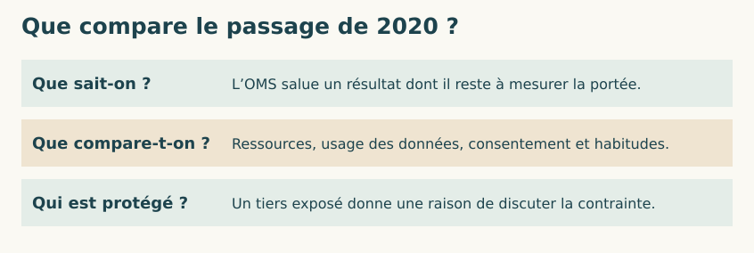
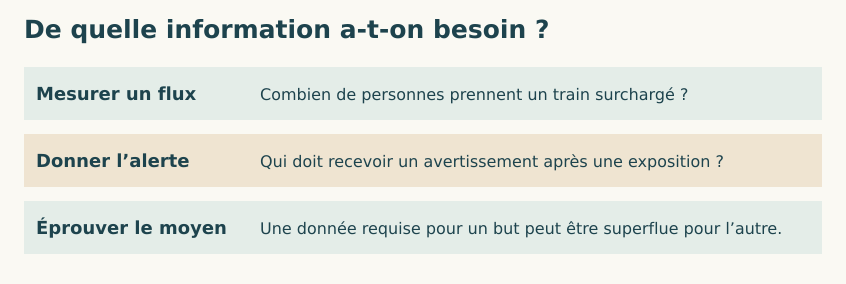

# ENS · Cycle master mathématiques — Français et culture générale 2021 · Corrigé brut

*Corrigé rédigé par IA, non officiel. Signalez toute erreur.*

**Rédaction** · GPT-6.2 Astra Ultra · vitesse non renseignée

**Autocontrôle** · GPT-6.2 Astra Ultra · vitesse non renseignée

## Sujet et consignes

Session 2021. La garde du second concours d’admission en cycle master mathématiques porte les noms de l’École normale supérieure Paris-Saclay et de l’École normale supérieure de Rennes. Les documents et calculatrices sont interdits. Durée de l’épreuve, trois heures. Les modalités du concours, p. 2, placent cet écrit d’admission le vendredi 19 mars 2021 de 8 h 30 à 11 h 30.

Yves Poullet, Marie-des-Neiges Ruffo de Calabre et Jessica Lombard, « Covid-19, numérique et libertés », Études, juin 2020, n° 6, p. 57–66. Le feuillet donne le début de l’article, p. 2–4 du PDF.

Résumer le texte en 250 mots (avec une marge de tolérance de + ou – 10%). Le nombre exact de mots utilisés sera indiqué en fin de résumé. La marge autorisée va de 225 à 275 mots.

Sous forme d’un développement construit, commenter la réflexion suivante des auteurs : Chaque exercice vaut dix points. Le feuillet demande un seul développement. La référence à Mill appartient au passage étudié. La phrase soumise au commentaire est la conclusion qu’en tirent les trois auteurs.

## 1. Résumé

Selon un rapport international de février 2020, la Chine aurait contenu le nouveau virus avec une efficacité exceptionnelle que peu de pays sauraient reproduire. Cette appréciation engage son auteur. Le recul manque encore pour mesurer les résultats. La réponse chinoise combine équipement hospitalier, confinement et surveillance. Des voisins contrôlent parfois la température sans consentement. Les traces numériques permettent aussi de régler les déplacements et de désigner publiquement les contrevenants.

Cet exemple invite nos démocraties à examiner leurs propres choix. Les services numériques devenus indispensables pour travailler ou communiquer promettent également des progrès dans la connaissance de la maladie. La peur nous dispose à accepter une surveillance étendue et durable. Certains pays surveillent étroitement les personnes. Ailleurs, les autorités étudient des déplacements collectifs ou invitent chacun à partager volontairement certaines informations pour prévenir les personnes exposées.

Les moyens disponibles, les résultats recherchés et les rapports habituels entre citoyens et autorités expliquent cette diversité. La surveillance publique occidentale surprend par sa visibilité, alors que nous acceptons quotidiennement une observation commerciale comparable. Les comportements envers les règles sanitaires varient aussi selon les traditions et conditionnent leur acceptation.

La sécurité sanitaire exige des sacrifices dont il faut discuter la portée. Contraindre des personnes saines à demeurer chez elles heurte la liberté de circulation chère aux libéraux. Pour Mill, protéger les autres pourrait justifier une telle intervention, tandis que vouloir procurer son propre bien à chacun échouerait à la légitimer. Reste à savoir comment les citoyens soumis à ces restrictions peuvent conserver leur liberté politique.

**250 mots.**

## 2. Protéger autrui en démocratie

La restriction des libertés des populations en situation de pandémie serait donc légitime dans la mesure où elle assure la sécurité d’autrui, et non pas pour assurer « leur propre bien ».

Une personne qui renonce à prendre le train peut vouloir protéger sa propre santé. Si l’État lui interdit de monter à bord, il doit donner une autre raison de la contrainte, qui peut lui coûter un salaire ou une rencontre familiale. Le texte de 2020, écrit au début de la pandémie, emprunte à John Stuart Mill la distinction entre le bien qu’une personne peut rechercher ou négliger pour elle-même et le tort que sa conduite ferait subir à d’autres. Le conditionnel « serait » ouvre cependant une enquête. En quoi la protection d’un tiers autorise-t-elle à limiter une liberté, et qui pourra contrôler que la limitation sert effectivement cette fin ? Il faut d’abord identifier le tiers exposé, puis examiner le moyen choisi, enfin donner aux citoyens une prise sur la justification et la durée de ce moyen.

Un droit de circuler garantit une faculté ordinaire de conduire sa vie. Benjamin Constant associe la liberté des modernes à la possibilité d’aller et de venir sans devoir rendre compte de ses motifs. Cette indépendance perd beaucoup de sa réalité si chaque sortie dépend de la faveur d’un agent. Aussi grave que puisse être pour moi le risque d’un déplacement, me persuader de l’éviter et m’en empêcher sont des actes différents. Dans *De la liberté* (1859, chapitre premier), Mill fait du tort causé à autrui le motif recevable de la contrainte exercée sur un adulte capable de se gouverner. Une mesure qui poursuit seulement ma santé demande pourquoi l’autorité jugerait mieux que moi la place qu’elle doit occuper dans ma vie.

Une épidémie modifie cependant le rapport entre le choix et celui qui en subira les conséquences. Le passager qui accepte un risque pour lui-même ne peut consentir pour les autres passagers assis à côté de lui. Ceux-ci peuvent ensuite rentrer chez des personnes qui n’ont jamais pris ce train. La simple invitation à la prudence laisse échapper ce tiers absent. Protéger une possibilité égale de vivre, de travailler ou de circuler peut dès lors imposer momentanément une règle commune. Que la personne contrainte en bénéficie également ne ruine pas la raison avancée. Ce qui compte est que le bénéfice invoqué pour les tiers soit réel et suffisamment important pour justifier la charge imposée à chacun.

Identifier une fin légitime laisse entier le choix du moyen. Le feuillet distingue le dénombrement agrégé de déplacements et le suivi individuel conditionnant l’accès à un lieu. Si la question publique est de savoir si un réseau de transport reste saturé, compter ses voyageurs peut suffire. Rendre publics leurs noms imposerait à chacun une perte durable de confidentialité, sans fournir l’information manquante sur la fréquentation. À l’inverse, prévenir une personne précisément exposée demande parfois un moyen de la joindre. La proportionnalité commande de préciser ce qu’on veut savoir ou empêcher, à quelle échéance, avec quels effets et au prix de quelles restrictions. Ce jugement est révisable. Les auteurs rappellent qu’au moment où ils écrivent le recul manque pour apprécier l’effet des dispositions comparées.

L’exemple d’une mesure de confinement fait enfin apparaître une différence que la seule invocation de la sécurité ne saisit pas. Un salarié pouvant travailler chez lui, une aide à domicile et un enfant sans accès à une cour supportent des charges très différentes. Une règle peut compter des exceptions justifiées, assurer un revenu ou permettre un recours. Publier la raison de la décision, ses critères de réexamen et sa date de fin donne à ceux qui la subissent la possibilité de demander des comptes. La peur favoriserait au contraire le passage d’une permission provisoire à une habitude de gouvernement. Les auteurs interrogent d’ailleurs notre indulgence envers les applications commerciales qui pratiquent déjà une observation continue. Cette habitude de fait ne vaut pas consentement à toute surveillance publique.

La sécurité d’autrui donne donc une raison de discuter la restriction d’une liberté capable de mettre un tiers en danger. Elle ne confère à aucun gouvernement un mandat général pour décider du bien de ses administrés. Quand les intéressés peuvent connaître le risque, contester le moyen, corriger ses effets inégaux et obtenir la levée d’une mesure devenue inutile, la sécurité collective et la liberté politique trouvent un mode concret de coexistence.

[Sujet officiel](https://ens-paris-saclay.fr/sites/default/files/CONCOURS/ANNALES_2C/2C_Math/2021_Sujet_2C_Maths_Francais.pdf) · [Modalités du concours](https://ens-paris-saclay.fr/sites/default/files/CONCOURS/CONCOURS_2021/Modalit%C3%A9s%20d%27inscription_2C_2021.pdf#page=2)
