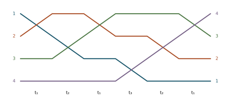
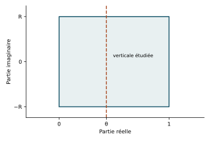

# ENS Paris-Saclay et Rennes — Cycle master mathématiques 2021 · Corrigé guidé

*Corrigé rédigé par IA, non officiel. Signalez toute erreur.*

**Rédaction** · GPT-6.2 Astra Ultra · vitesse non renseignée

**Révision** · GPT-6.2 Astra Ultra · vitesse non renseignée · 26 novembre 2026

**Le mot le plus long et un théorème d’interpolation.** L’épreuve dure cinq heures et ses deux parties ont le même poids. Le produit de permutations est la composition et le crochet de dualité de la partie analyse est bilinéaire.

## Algèbre I. Unicité de la signature

### Question A.I.1

> [!INDICATION]
> Décomposer une involution en cycles disjoints.

#### Solution

Une transposition échange deux points et fixe tous les autres, donc son carré est l’identité et elle est d’ordre 2. Plus généralement un élément d’ordre 2 est un produit non vide de transpositions disjointes : ses cycles ont longueur 1 ou 2. Pour $n\ge4$, $(1\,2)(3\,4)$ fournit un autre exemple. Pour $n=2$ ou 3, il n’y en a pas d’autre.

### Question A.I.2

> [!INDICATION]
> Suivre les deux points échangés après le changement de noms.

#### Solution

Si $t=(i\,j)$, alors $wtw^{-1}$ échange $w(i)$ et $w(j)$ et fixe les autres points. Ainsi $wtw^{-1}=(w(i)\,w(j))$ est une transposition.

### Question A.I.3

> [!INDICATION]
> Prolonger une bijection sur deux points à une permutation.

#### Solution

Pour $t=(i\,j)$ et $t'=(a\,b)$, choisissons $w(i)=a$, $w(j)=b$ et envoyons bijectivement les $n-2$ autres points sur le complément de $\{a,b\}$. Par I.2, $wtw^{-1}=t'$.

### Question A.I.4

> [!INDICATION]
> Conjuguer dans le groupe cible commutatif.

#### Solution

Comme $t'=wtw^{-1}$, $f(t')=f(w)f(t)f(w)^{-1}=f(t)$ puisque $G$ est abélien.

### Question A.I.5

> [!INDICATION]
> Utiliser l’ensemble générateur rappelé dans le préambule.

#### Solution

Tout $w$ est produit d’un nombre $m$ de transpositions. L’image de chacune est $a$, donc $f(w)=a^m\in\langle a\rangle$. Comme $a$ appartient déjà à l’image, on a même $f(S_n)=\langle a\rangle$.

### Question A.I.6

> [!INDICATION]
> Exclure que l’image de chaque générateur soit neutre.

#### Solution

On a $a^2=f(t^2)=e$. Si $a=e$, I.5 imposerait $f(S_n)=\{e\}$, contrairement à l’hypothèse. L’ordre de $a$ vaut 2 et l’image est $\{e,a\}$. L’unique isomorphisme $\theta$ vers $\{+1,-1\}$ envoie $e$ sur $+1$ et $a$ sur $-1$.

### Question A.I.7

> [!INDICATION]
> Comparer les deux morphismes sur les générateurs.

#### Solution

Les morphismes $\theta\circ f$ et $\epsilon$ prennent tous deux la valeur $-1$ sur chaque transposition. Comme celles-ci engendrent $S_n$, les deux morphismes sont égaux.

## Algèbre II. Longueur en transpositions adjacentes

### Question A.II.1.a

> [!INDICATION]
> Utiliser la formule de conjugaison avec la transposition des deux dernières positions.

#### Solution

Pour $j\ge2$ et $|i-j|>1$, la permutation $t_{j-1}=(j-1\;j)$ échange $j-1$ et $j$ et fixe $i$. Par I.2 et $t_{j-1}^{-1}=t_{j-1}$, on a $t_{j-1}t_{i,j-1}t_{j-1}=t_{i,j}$. Tel qu’imprimé, le domaine autorise $j=1$, pour lequel $t_0$ n’est pas défini. Pour la récurrence suivante, on ordonne les indices $i<j$ et la même identité vaut jusqu’à $j=n$.

### Question A.II.1.b

> [!INDICATION]
> Réduire l’écart des deux indices jusqu’à une transposition voisine.

#### Solution

Pour $j=i+1$ on a déjà $t_{i,j}=t_i$. Pour $j\ge i+2$, II.1.a exprime $t_{i,j}$ à partir de $t_{i,j-1}$ et $t_{j-1}$. Une récurrence sur $j-i$ donne toutes les transpositions dans le groupe engendré par les $t_i$. Elles engendrent $S_n$, donc les $t_i$ aussi.

### Question A.II.1.c

> [!INDICATION]
> Comparer les supports des deux échanges.

#### Solution

Si $|i-j|>1$, les ensembles $\{i,i+1\}$ et $\{j,j+1\}$ sont disjoints. Chaque transposition fixe les deux points déplacés par l’autre. Par conséquent $t_it_j=t_jt_i$.

### Question A.II.1.d

> [!INDICATION]
> Interpréter chacune des expressions comme une conjugaison.

#### Solution

Par I.2, $t_it_{i+1}t_i=(i\;i+2)$ et $t_{i+1}t_it_{i+1}=(i\;i+2)$. Les deux produits échangent les positions extrêmes et fixent celle du milieu.

### Question A.II.2.a

> [!INDICATION]
> Appliquer le bon ordre des entiers aux longueurs des mots disponibles.

#### Solution

Pour chaque $w$, l’ensemble des longueurs de ses écritures en $t_i$ est une partie non vide de $\mathbb N$ par II.1.b. Il possède un plus petit élément $\ell(w)$. Le mot vide représente l’identité et aucun autre élément.

### Question A.II.2.b

> [!INDICATION]
> Identifier les mots réduits formés d’une seule lettre.

#### Solution

Les éléments de longueur 1 sont exactement les $t_i$, $1\le i<n$. Chacun a une écriture de longueur 1 et est distinct de l’identité.

### Question A.II.2.c

> [!INDICATION]
> Classer les produits de deux lettres distinctes selon la distance de leurs indices.

#### Solution

Ce sont les $t_it_j$ avec $i\ne j$. Pour $|i-j|>1$, ce sont les produits de deux transpositions adjacentes disjointes ; pour $|i-j|=1$, ce sont les deux sens d’un cycle de longueur 3 sur trois indices consécutifs. Ces produits sont distincts de l’identité et de signature positive, donc ne peuvent être de longueur 1. Si $i=j$ on trouve l’identité. Pour $n=2$ la liste est vide.

### Question A.II.2.d

> [!INDICATION]
> Combiner l’écriture de longueur trois avec la parité et le support.

#### Solution

La question II.1.d donne $t_{i,i+2}=t_it_{i+1}t_i$. Sa signature est négative, donc toute écriture a longueur impaire. Une seule lettre ne convient pas puisque les points échangés ne sont pas voisins. Ainsi $\ell(t_{i,i+2})=3$.

### Question A.II.3.a

> [!INDICATION]
> Inverser un mot, concaténer deux mots et appliquer la majoration à des produits comportant un inverse.

#### Solution

Renverser une écriture de $w$ fournit une écriture de $w^{-1}$ de même longueur, car $t_i^{-1}=t_i$. Par symétrie $\ell(w)=\ell(w^{-1})$. Concaténer deux mots minimaux donne $\ell(ww')\le\ell(w)+\ell(w')$. En appliquant cette inégalité à $w=(ww')(w')^{-1}$ puis à $w'=w^{-1}(ww')$, on obtient $\ell(ww')\ge|\ell(w)-\ell(w')|$. Pour la majoration marquée, $w'=1$ donne l’égalité ; $w=w'=t_1$ donne $0<2$. Pour la minoration, $w'=1$ donne aussi l’égalité ; $w=t_1,w'=t_2$ avec $n\ge3$ donne $2>0$.

### Question A.II.3.b

> [!INDICATION]
> Prendre pour deuxième élément un générateur de longueur 1.

#### Solution

II.3.a avec $w'=t_i$ donne $\ell(wt_i)\le\ell(w)+1$ et $\ell(wt_i)\ge|\ell(w)-1|\ge\ell(w)-1$.

### Question A.II.3.c

> [!INDICATION]
> Comparer les signatures pour éliminer une variation nulle.

#### Solution

Un mot réduit de longueur $r$ est un produit de $r$ transpositions, donc $\epsilon(w)=(-1)^r$. Comme $\epsilon(wt_i)=-\epsilon(w)$, les deux longueurs sont de parités opposées. Avec II.3.b, leur différence vaut $+1$ ou $-1$.

### Question A.II.3.d

> [!INDICATION]
> Passer aux inverses pour la borne à gauche, puis tester un mot de deux lettres.

#### Solution

Par II.3.a et II.3.c, $\ell(t_iw)=\ell(w^{-1}t_i)$ diffère de $\ell(w^{-1})=\ell(w)$ de 1 en valeur absolue. Les deux multiplications ne donnent pas nécessairement la même longueur : pour $n\ge3$, $w=t_1t_2$ et $i=1$, $t_1w=t_2$ a longueur 1 tandis que $wt_1=(1\,3)$ a longueur 3.

### Question A.II.4.a

> [!INDICATION]
> Effacer les deux dernières occurrences du même générateur.

#### Solution

Si une écriture réduite de $w$ se termine par $t_i$, la multiplication à droite par $t_i$ efface cette lettre, donc $\ell(wt_i)\le\ell(w)-1$. La borne inférieure de II.3.b donne l’égalité.

### Question A.II.4.b

> [!INDICATION]
> Reconstruire w à partir d’une écriture minimale du produit.

#### Solution

Si $\ell(wt_i)=\ell(w)-1$, prenons un mot réduit pour $wt_i$ puis ajoutons $t_i$ à droite. On obtient un mot pour $w$ de longueur $\ell(w)$ ; il est donc réduit et se termine par $t_i$.

## Algèbre III. Inversions et permutation la plus longue

### Question A.III.1

> [!INDICATION]
> Regrouper les paires impliquant une troisième position avant de compter la paire adjacente.

#### Solution

La multiplication à droite par $t_i$ échange les entrées $a=w(i)$ et $b=w(i+1)$ de la liste des images. Les paires ne touchant ni $i$ ni $i+1$ sont inchangées. Pour toute position extérieure, les contributions des deux comparaisons avec $a,b$ sont simplement permutées et leur total reste fixe. Seule la paire $(i,i+1)$ change de statut. Donc $I(wt_i)=I(w)-1$ si $a>b$, et $I(w)+1$ si $a<b$.

### Question A.III.2

> [!INDICATION]
> Partir de l’identité et compter combien d’inversions une lettre peut créer.

#### Solution

L’identité a zéro inversion. À chaque nouvelle lettre, le nombre d’inversions augmente d’au plus 1. En parcourant un mot réduit pour $w$ de sa première à sa dernière lettre, on obtient $I(w)\le\ell(w)$.

### Question A.III.3

> [!INDICATION]
> Caractériser la permutation dont la liste des images est croissante.

#### Solution

Si $w(i)<w(i+1)$ pour tout $i$, sa liste d’images est la liste croissante de $1,\ldots,n$, donc $w=1$. Pour $w\ne1$, une descente adjacente existe ; en l’échangeant, III.1 fait tomber le nombre d’inversions de 1.

### Question A.III.4

> [!INDICATION]
> Utiliser la descente et une récurrence sur le nombre d’inversions.

#### Solution

Si $I(w)=0$, $w$ est croissante et vaut l’identité, de longueur 0. Sinon, prenons $i$ comme en III.3. Par récurrence $\ell(wt_i)=I(w)-1$. Comme $w=(wt_i)t_i$, $\ell(w)\le I(w)$ ; l’autre inégalité est III.2. Ainsi $\ell(w)=I(w)$ pour tout $w$.

### Question A.III.5

> [!INDICATION]
> Déterminer quand chacune des paires de positions est une inversion.

#### Solution

Il existe $\binom n2$ paires de positions. Elles sont toutes des inversions exactement lorsque $w(1)>w(2)>\cdots>w(n)$. La liste des images est strictement décroissante pour une unique permutation, et celle-ci réalise la borne de longueur $\binom n2$.

### Question A.III.6

> [!INDICATION]
> Déplacer chaque nouvelle valeur vers la gauche de toutes les précédentes.

#### Solution

On a $w_0(i)=n+1-i$ et $\ell(w_0)=n(n-1)/2$. Un mot réduit est
$$w_0=(t_1)(t_2t_1)(t_3t_2t_1)\cdots(t_{n-1}t_{n-2}\cdots t_1).$$
En multipliant l’identité à droite par ces lettres dans l’ordre, le bloc $t_j\cdots t_1$ amène la valeur $j+1$ tout à gauche du préfixe déjà renversé $j,j-1,\ldots,1$. Le produit renverse donc la liste et contient $1+\cdots+(n-1)$ lettres, le minimum attendu.

## Analyse I. Interpolation des normes de fonctions

### Question B.I.1

> [!INDICATION]
> Appliquer Hölder aux deux puissances dont le produit est la puissance r.

#### Solution

Pour $0<\theta<1$, posons $u=r_0/[(1-\theta)r]$ et $v=r_1/(\theta r)$. Alors $u,v>1$ et $1/u+1/v=1$. Appliquons Hölder à $|f|^{(1-\theta)r}|f|^{\theta r}$ : son intégrale est au plus $\|f\|_{r_0}^{(1-\theta)r}\|f\|_{r_1}^{\theta r}$. Prendre la racine $r$-ième établit l’appartenance à $L^r$ et l’inégalité. Pour $\theta=0$ ou 1, il s’agit d’une égalité.

## Analyse II. Théorème des trois droites de Hadamard

### Question B.II.1.a

> [!INDICATION]
> Utiliser les majorants du produit sur ses deux bords propres et normaliser ce produit.

#### Solution

Posons $H=F_1F_2$, holomorphe dans la bande, continu et borné sur sa fermeture. La simple multiplication des deux estimations pour $F_1,F_2$ ne donne que les constantes $M_j(F_1)M_j(F_2)$, potentiellement plus grandes que $M_j(H)$. Pour obtenir les constantes correctes, prenons $a_j=M_j(H)+\delta$ avec $\delta>0$ et considérons
$$G_n(z)=H(z)a_0^{z-1}a_1^{-z}\exp((z^2-1)/n).$$
Sur chaque bord vertical, $|G_n|\le1$. Sur les horizontales $\operatorname{Im}z=\pm R$, le dernier facteur a module au plus $e^{-R^2/n}$ et les autres sont bornés indépendamment de $R$ ; pour $R$ grand, $|G_n|\le1$ aussi. Le maximum sur chaque grand rectangle donne $|G_n|\le1$ dans la bande. Pour $z=\theta+iy$ fixé, faire tendre $n$ vers l’infini puis $\delta$ vers zéro donne $|H(z)|\le M_0(H)^{1-\theta}M_1(H)^\theta$ à l’intérieur. Les deux extrémités sont immédiates. Ceci établit directement le résultat pour le produit.

Par exemple, $F_1(z)=e^{z^2}$ et $F_2(z)=e^{(z-i)^2}$ atteignent leurs maxima sur la droite $\operatorname{Re}z=j$ à des hauteurs respectives $0$ et $1$. Le produit a son maximum à la hauteur $1/2$ et $M_j(F_1F_2)=e^{2j^2-1/2}$, strictement inférieur à $M_j(F_1)M_j(F_2)=e^{2j^2}$ pour $j=0,1$.

### Question B.II.1.b

> [!INDICATION]
> Calculer le module sur chaque verticale.

#### Solution

Pour $F(z)=\alpha e^{\beta z}$ avec $\alpha,\beta$ réels, $|F(x+iy)|=|\alpha|e^{\beta x}$. Pour $\alpha\ne0$, $M_0=|\alpha|$ et $M_1=|\alpha|e^\beta$, donc le membre de droite vaut exactement $|\alpha|e^{\beta\theta}$. Si $\alpha=0$, la fonction n’appartient pas à la classe à suprema non nuls mais l’inégalité est immédiate.

### Question B.II.2.a

> [!INDICATION]
> Évaluer la partie réelle du carré dans la bande fermée.

#### Solution

Chaque $F_n(z)=F(z)e^{(z^2-1)/n}$ est holomorphe sur la bande ouverte et continue sur sa fermeture. Pour $z=x+iy$, $0\le x\le1$, le facteur exponentiel a module $e^{(x^2-y^2-1)/n}\le e^{-y^2/n}$. Comme $F$ est bornée et que $|z|\to\infty$ dans la bande impose $|y|\to\infty$, $F_n(z)\to0$ uniformément en $x$ à chaque extrémité.

### Question B.II.2.b

> [!INDICATION]
> Choisir un rectangle assez haut puis faire disparaître le facteur auxiliaire.

#### Solution

Sur les verticales $x=0,1$, la normalisation $M_0=M_1=1$ donne $|F_n|\le1$. Sur les horizontales $y=\pm R$, II.2.a donne aussi $|F_n|\le1$ pour $R$ assez grand. Le principe du maximum sur le rectangle donne la même borne en tout point intérieur. Tout point de la bande appartient à un tel rectangle, donc $|F_n(z)|\le1$ partout. En faisant $n\to\infty$ à $z$ fixé, on obtient $|F(z)|\le1$. C’est l’inégalité dans le cas normalisé.

### Question B.II.3

> [!INDICATION]
> Multiplier par une exponentielle dont le module corrige exactement les deux valeurs de bord.

#### Solution

Écrivons $m_j=M_j(F)>0$. La fonction $G(z)=F(z)m_0^{z-1}m_1^{-z}$ est bornée et continue sur la bande fermée, holomorphe à l’intérieur. Le facteur multiplicatif a sur chaque bord le module constant $1/m_j$, donc $M_0(G)=M_1(G)=1$. Par II.2.b, $|G|\le1$. À $z=\theta+iy$, cela donne $|F(z)|\le m_0^{1-\theta}m_1^\theta$ ; la borne est indépendante de $y$.

## Analyse III. Interpolation des opérateurs

### Question B.III.1

> [!INDICATION]
> Interpoler d’abord l’appartenance de l’image aux espaces de Lebesgue.

#### Solution

Pour $f\in E$, les deux images coïncident presque partout, donc $Tf$ appartient à $L^{q_0}\cap L^{q_1}$. Par I.1, $Tf\in L^q$. La restriction de $T_0$ est linéaire, donc on obtient bien $T:E\to L^q$.

### Question B.III.2

> [!INDICATION]
> Choisir la phase qui rend le produit bilinéaire réel et positif.

#### Solution

La dualité du sujet est bilinéaire, $\langle h,g\rangle=\int hg$. Hölder majore le supremum par $\|h\|_q$. Si $h\ne0$, prenons $g=\overline h|h|^{q-2}/\|h\|_q^{q-1}$ aux points où $h\ne0$, et 0 ailleurs. Alors $(q-1)q'=q$ donne $\|g\|_{q'}=1$, et $\int hg=\|h\|_q$. Si $h=0$, les deux quantités sont nulles.

### Question B.III.3.a

> [!INDICATION]
> Rapprocher par des fonctions étagées dominées avant de normaliser.

#### Solution

Le rappel fournit $u_n\in\mathcal E_c$ tels que $u_n\to f$ simplement et $|u_n|\le|f|$. Par convergence dominée, $\|u_n-f\|_r\to0$, donc $\|u_n\|_r\to1$. Retranchons un préfixe fini et renumérotons de sorte que $\|u_n\|_r\ge1/2$. Alors $f_n=u_n/\|u_n\|_r$ est étagée à support compact, de norme 1, avec $|f_n|\le2|f|$. De plus $\|f_n-f\|_r\le |1-\|u_n\|_r|+\|u_n-f\|_r\to0$, et la convergence simple subsiste.

### Question B.III.3.b

> [!INDICATION]
> Approcher dans les deux normes de départ avant de passer à la norme interpolée d’arrivée.

#### Solution

Soit $S$ le supremum restreint aux deux fonctions tests du sujet. III.2 donne déjà $S\le\|T\|_{E,L^q}$. Pour l’autre sens, fixons $f\in E$ avec $\|f\|_p=1$. La construction de III.3.a donne $f_n\in\mathcal E_c$, normalisées en $L^p$, convergeant simplement vers $f$ et dominées par $2|f|$. Par convergence dominée, $f_n\to f$ aussi dans $L^{p_0}$ et $L^{p_1}$. La continuité des deux opérateurs aux extrémités donne $Tf_n\to Tf$ en $L^{q_0}$ et $L^{q_1}$, puis en $L^q$ par I.1. Pour $g\in L^{q'}$ unitaire, prenons de même des $g_n\in\mathcal E_c$ unitaires qui convergent vers $g$ en $L^{q'}$. Hölder donne $\langle Tf_n,g_n\rangle\to\langle Tf,g\rangle$. Le module de chaque terme est au plus $S$, donc $\|Tf\|_q\le S$ par III.2. Le supremum sur $f$ donne l’égalité, sans supposer à ce stade que $T$ est continu pour la norme de $E$.

### Question B.III.4.a

> [!INDICATION]
> Prendre des ensembles de niveau disjoints et conserver la phase de chaque valeur non nulle.

#### Solution

Quitte à raffiner les partitions, prenons pour $A_i,B_j$ les ensembles de niveaux disjoints associés aux valeurs non nulles $\alpha_i,\beta_j$. Avec $u_i=\alpha_i/|\alpha_i|$ et $v_j=\beta_j/|\beta_j|$,
$$\varphi_z=\sum_i u_i\exp((p/p(z))\log|\alpha_i|)\,1_{A_i},\qquad
\psi_z=\sum_j v_j\exp((q'/q'(z))\log|\beta_j|)\,1_{B_j}.$$
Les deux fonctions sont nulles en dehors de leurs supports respectifs. Elles sont étagées à support compact, y compris lorsque les exposants sont complexes.

### Question B.III.4.b

> [!INDICATION]
> Développer la dualité bilinéaire en une somme finie d’exponentielles.

#### Solution

Les fonctions étagées à support compact appartiennent à tous les $L^s$ considérés et chaque $\langle T1_{A_i},1_{B_j}\rangle$ est fini par Hölder. Par bilinéarité, $F$ est la somme finie, pour $i,j$, de cette constante multipliée par $u_iv_j\exp((p/p(z))\log|\alpha_i|+(q'/q'(z))\log|\beta_j|)$. Les deux exposants $1/p(z)$ et $1/q'(z)$ sont affines en $z$ à coefficients réels, donc chaque terme est de la forme $C e^{bz}$ avec $b$ réel. Il s’agit d’une fonction entière, continue et bornée sur la bande fermée puisque $|e^{b(x+iy)}|=e^{bx}$ avec $0\le x\le1$.

### Question B.III.4.c

> [!INDICATION]
> Évaluer les puissances aux exposants interpolés.

#### Solution

On a $p(\theta)=p$ et $q'(\theta)=q'$ car $1/q'=1-1/q=(1-\theta)/q_0'+\theta/q_1'$. Les deux rapports de puissances valent 1. Ainsi $\varphi_\theta=f$, $\psi_\theta=g$ et $F(\theta)=\langle Tf,g\rangle$.

### Question B.III.5

> [!INDICATION]
> Évaluer les normes des fonctions déformées sur les deux bords, uniformément en hauteur.

#### Solution

Pour $j=0,1$ et $y\in\mathbb R$, $|\varphi_{j+iy}|=|f|^{p/p_j}$ et $|\psi_{j+iy}|=|g|^{q'/q_j'}$. La normalisation donne $\|\varphi_{j+iy}\|_{p_j}=\|\psi_{j+iy}\|_{q_j'}=1$. Par Hölder et la norme de $T_j$, $|F(j+iy)|\le M_j$. Le raisonnement des trois droites appliqué avec les majorants $M_j>0$ (normaliser comme en II.3, puis utiliser II.2 avec des bornes au plus 1) donne $|\langle Tf,g\rangle|\le M_0^{1-\theta}M_1^\theta$. Ceci couvre aussi un supremum de bord nul de $F$. Par III.3.b, $\|T\|_{E,L^q}\le M_0^{1-\theta}M_1^\theta$. En particulier $T$ est continu pour la norme $L^p$ sur $E$.

### Question B.III.6

> [!INDICATION]
> Prolonger par densité dans un espace d’arrivée complet.

#### Solution

Les fonctions étagées à support compact sont denses dans $L^p$ d’après III.3.a par normalisation, et appartiennent à $E$. Pour chaque $f\in L^p$, choisissons $f_n\in E$ avec $f_n\to f$ en $L^p$. Par III.5, $(Tf_n)$ est de Cauchy dans l’espace de Banach $L^q$. Sa limite définit $\widetilde Tf$ et est indépendante de la suite, par la même inégalité appliquée à la différence de deux approximations. L’application est linéaire, coïncide avec $T$ sur $E$ et vérifie par passage à la limite $\|\widetilde Tf\|_q\le M_0^{1-\theta}M_1^\theta\|f\|_p$. Tout prolongement continu coïncide sur un sous-espace dense avec celui-ci, donc il est unique.
