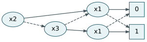
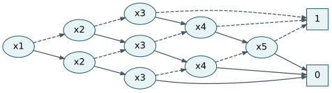
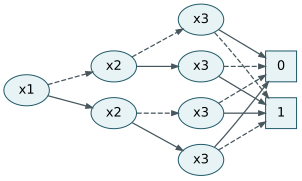
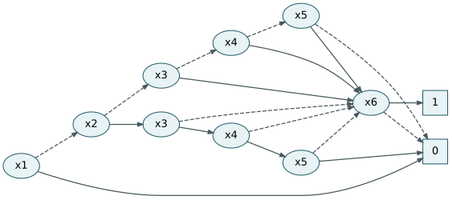
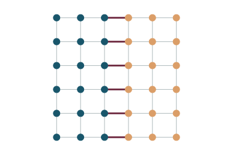

# ENS MP — Informatique-mathématiques 2021 · Corrigé brut

*Corrigé rédigé par IA, non officiel. Signalez toute erreur.*

**Rédaction** · GPT-6.2 Astra Ultra · vitesse non renseignée

**Révision** · GPT-6.2 Astra Ultra · vitesse non renseignée · 26 novembre 2026

**Représentation des fonctions booléennes par diagrammes de décision.** La taille compte les sommets de décision et, dans la dernière partie, les sommets de choix non déterministe. Les terminaux ne sont pas comptés. Dans les quatre diagrammes de décision, une arête pointillée vaut 0 et une arête pleine vaut 1.

## I. Fonctions et formules booléennes

### Question I.1.a

La formule se simplifie en $x_1\land(\neg x_4\lor (x_2\land x_3))$. La table ci-dessous fixe les trois premières variables en ligne et la dernière en colonne.

| $x_1x_2x_3$ | $x_4=0$ | $x_4=1$ |
|---|---:|---:|
| 000 | 0 | 0 |
| 001 | 0 | 0 |
| 010 | 0 | 0 |
| 011 | 0 | 0 |
| 100 | 1 | 0 |
| 101 | 1 | 0 |
| 110 | 1 | 0 |
| 111 | 1 | 1 |

### Question I.1.b

Dans l’ordre $(x_1,x_2,x_3,x_4)$, les assignations satisfaisantes sont $1000,1010,1100,1110,1111$.

### Question I.2

La conjonction $\phi_\tau=\bigwedge_{\tau(x)=1}x\ \land\bigwedge_{\tau(x)=0}\neg x$ vaut 1 sur $\tau$. Toute autre assignation diffère en au moins une coordonnée et rend son littéral faux. Elle représente donc l’indicatrice demandée. Sur un ensemble vide de variables, la conjonction vide vaut 1.

### Question I.3.a

La formule $\phi_f=\bigvee_{\tau:f(\tau)=1}\phi_\tau$ vaut 1 sur une assignation $\sigma$ exactement lorsqu’un terme est vrai, donc lorsque $f(\sigma)=1$. En l’absence de solutions, choisir la constante 0.

### Question I.3.b

Chaque minterme a $n$ occurrences. Il y en a $|f^{-1}(1)|\le2^n$, soit au plus $n2^n$ occurrences au total. Chaque variable apparaît au plus $2^n$ fois.

## II. Arbres et diagrammes ordonnés

### Question II.1

Seul (b) est un DDBO, par exemple avec $x<y<z<t$. Dans (a), certains chemins imposent $y<z$ et d’autres $z<y$. Dans (c), une branche teste deux fois $x$. Dans (d), l’ellipse inférieure étiquetée $t$ n’a aucune arête sortante, et son étiquette n’est pas une valeur terminale.

### Question II.2.a

L’unique ordre possible est $x_2<x_3<x_1$. Il est imposé par les chemins de longueur trois et convient aussi au chemin qui saute $x_3$.

### Question II.2.b

Si $x_2=1$, on accepte pour $x_1=0$, indépendamment de $x_3$. Si $x_2=0$, on accepte pour $x_1=x_3$. Dans l’ordre $(x_1,x_2,x_3)$, les quatre solutions sont $010,011,000,101$.

### Question II.2.c

Fusionner les tests supérieur et médian sur $x_1$, qui calculent tous deux $\neg x_1$. Le test inférieur calcule $x_1$. Les deux autres décisions sont la racine $x_2$ et le test $x_3$ lorsque $x_2=0$. Cette identification conserve le terminal de chaque parcours et donne quatre décisions.

### Question II.3

À la variable $x_i$, gardons le nombre $r$ de zéros encore nécessaires. Le 0 conduit à $(i+1,r-1)$, le 1 à $(i+1,r)$. Si $r=0$ la sortie est 1, et si $r>6-i$ la sortie est 0. On démarre à $(1,3)$. Deux préfixes ayant le même état peuvent partager toute la suite du diagramme.

### Question II.4

Par récurrence sur $|X|$, une constante sur zéro variable est représentée par son terminal. Sinon, pour la plus petite variable $x$, les restrictions $f_{x=0}$ et $f_{x=1}$ admettent deux arbres sur l’ordre restant. Placer des copies disjointes sous une racine $x$ et relier ses arêtes 0 et 1 à leurs racines respectives. Le premier bit sélectionne la bonne restriction. Les décisions ont au plus un prédécesseur et chaque chemin suit l’ordre indiqué.

### Question II.5.a

L’arbre complet teste successivement $x_1,x_2,x_3$. Ses feuilles de gauche à droite, pour les mots de $000$ à $111$, valent $1,0,0,1,0,1,1,0$. Les terminaux de même valeur peuvent être partagés.

### Question II.5.b

Les variables testées sur le chemin sont distinctes. On peut donc prolonger leurs valeurs, données par les arêtes, en une assignation complète. Si $x$ n’était pas testée, changer sa valeur conserverait le même chemin et la même sortie, alors que le poids change de parité. C’est impossible.

### Question II.5.c

Pour $n=|X|$, tout chemin racine-terminal porte exactement $n$ tests par II.5.b et par l’ordre strict. Tous les sommets aux profondeurs $0,\ldots,n-1$ sont des décisions avec deux branches. Leurs descendants de décision ne fusionnent pas, puisque leur degré entrant est au plus un. On compte $\sum_{j=0}^{n-1}2^j=2^n-1$ décisions.

### Question II.5.d

À la première variable on part d’un seul sommet de parité paire. Aux $n-1$ niveaux suivants, deux états au plus représentent les parités déjà lues. Une arête 0 conserve la parité et une arête 1 l’inverse. Après le dernier bit, la parité paire conduit au terminal 1 et l’autre au terminal 0. Pour $n\ge1$ il y a au plus $1+2(n-1)=2n-1$ décisions, quel que soit l’ordre. Si $X=\varnothing$, la fonction vraie a taille zéro et la borne littérale $-1$ doit être remplacée par zéro.

## III. Automates finis et tranches de longueur fixée

### Question III.1.a

Prenons un état initial $i$, un puits refusant et des états $(u,v,b)$ où $u,v\in\{0,1,2\}$ comptent les zéros et uns déjà lus, plafonnés à deux, et $b$ est le dernier bit. De $i$, 1 mène au puits et 0 à $(1,0,0)$. D’un triplet, une lettre $c$ mène à $(\min(2,u+[c=0]),\min(2,v+[c=1]),c)$. Le puits boucle sur les deux lettres. L’unique triplet final est $(2,2,1)$. L’invariant des compteurs établi par récurrence donne exactement les quatre conditions du langage.

### Question III.1.b

La condition équivaut à $x_1=0$, $x_6=1$ et à la présence simultanée d’un 0 et d’un 1 dans $x_2x_3x_4x_5$. Le diagramme lit les bits par indices croissants. Dès que cette condition centrale est acquise, il passe directement au test de $x_6$.

### Question III.2.a

Pour $n$ impair, la tranche est vide, donc le terminal 0 suffit. Pour $n=2k\ge2$, seul $0^k1^k$ est possible. Une chaîne de $n$ décisions teste les bits dans l’ordre, envoie toute discordance vers 0 et se termine en 1 si tous les bits coïncident. Sa taille vaut $n$.

### Question III.2.b

Pour $1\le i<j$, le suffixe $1^i$ fait accepter $0^i1^i$ mais refuser $0^j1^i$. Les états atteints après $0^i$ et $0^j$ sont donc distincts dans tout automate déterministe correct. Une infinité d’états serait nécessaire.

### Question III.3.a

Restreindre aux états accessibles conserve les transitions, puisque le successeur d’un accessible est accessible. Les états depuis lesquels aucun mot ne mène à un final constituent un ensemble stable par les transitions et disjoint des finaux. S’il est non vide, le remplacer par un seul état non final bouclant sur toutes les lettres et rediriger vers lui toute transition qui y entrait. L’initial devient sa classe si nécessaire. Par récurrence sur la lecture, le nouvel état atteint est l’image de l’ancien et son statut final est préservé.

### Question III.3.b

Comme le précise le jury, la définition de boucle exige un mot **non vide** $w$. Avec $w=\varepsilon$, tout état accessible non puits donne une boucle, même pour le langage fini $\{\varepsilon\}$. Après correction, si $q$ est atteint par $u$, boucle par $w$ et peut rejoindre un final par $v$, tous les $uw^jv$ sont acceptés et de longueurs distinctes. Réciproquement, un langage infini sur un alphabet fini contient un mot accepté de longueur au moins $|Q|$. Son parcours répète un état après un segment non vide. Cet état est accessible et son suffixe mène à un final, donc c’est une boucle.

### Question III.4.a

Prenons une racine, des états $(j,q)$ pour $1\le j<n$ et $q\in Q$, un final unique $t$ et un puits $p$. On simule $A$ en avançant d’une couche à chaque bit, à partir de son initial. À la lecture du $n$-ième bit, on va en $t$ si l’état simulé devient final, en $p$ sinon. Les deux lettres mènent de $t$ en $p$ et bouclent en $p$. Cela définit également le cas $n=1$, sans couches intermédiaires. Retirer les inaccessibles et réunir les puits selon III.3.a. Tout état non puits est atteint exclusivement à sa profondeur $0,j$ ou $n$ et le langage obtenu est $L_n$.

Cela donne au plus $(n-1)|Q|+3\le n|Q|+1$ si $|Q|\ge2$. La borne imprimée admet un contre-exemple pour $|Q|=1$. Si l’unique état est final, $L_n=\{0,1\}^n$ requiert au moins $n+2$ états. En effet les préfixes $0^0,\ldots,0^n,0^{n+1}$ sont distingués deux à deux en complétant le plus court jusqu’à la longueur $n$. La borne uniforme $n|Q|+2$ est toujours valable.

### Question III.4.b

Dérouler la simulation de $A$ sur $n$ niveaux de décision, en donnant la variable $x_{j+1}$ aux états accessibles à la profondeur $j<n$. L’arête $b$ mène à la copie du successeur après lecture de $b$ au niveau suivant, ou à son terminal de sortie après le dernier bit. Si les deux successeurs d’une décision sont identiques, court-circuiter cette décision en remontant des derniers niveaux à la racine. Le diagramme respecte $\mathrm{Id}_n$, et chaque assignation reproduit le parcours voulu. La racine et les $n-1$ couches suivantes comptent au plus $1+(n-1)|Q|\le n|Q|$ décisions. La difficulté d’une unité pour l’automate complet en III.4.a disparaît.

### Question III.5

La longueur de chaque bloc est $k$. Un automate binaire conserve un état $(q,u)$, où $q$ est celui de $A$ après les blocs achevés, et $u$ un préfixe propre d’un code autorisé. Son initial est $(i,\varepsilon)$ et ses finaux sont les $(q,\varepsilon)$ avec $q\in F$. Un bit prolonge $u$. Un préfixe impossible mène à un puits. Un bloc complet codant $a_j$ mène à $(\delta(q,a_j),\varepsilon)$. Cette lecture déterministe montre que $L'$ est régulier.

Pour la borne uniforme en $m$ même lorsque $k$ n’est pas minimal, fixons maintenant la longueur $n$. Si $k\nmid n$, le terminal 0 suffit. Sinon, à la profondeur $h$ du déroulement, la longueur de $u$ est imposée par $h\bmod k$. Pour une longueur de préfixe donnée, il y a au plus $m$ préfixes autorisés, chacun provenant de l’un des $m$ codes. Le puits peut directement devenir le terminal 0. On obtient donc au plus $m|Q|$ décisions par niveau, et $n m|Q|$ en tout. Cette dernière estimation évite de confondre le nombre d’états de l’automate sur toutes les longueurs avec la largeur d’un seul niveau.

## IV. Opérations sur les diagrammes

### Question IV.1.a

Depuis $v$, suivre l’unique arête compatible jusqu’au terminal définit une seule trajectoire finie, par déterminisme et acyclicité. Tout chemin compatible de $v$ à $w$ en est un préfixe et $w$ n’apparaît qu’une fois sur cette trajectoire. Il existe donc au plus un tel chemin, y compris si $v=w$.

### Question IV.1.b

Écrivons $P=(v_1,\ldots,v_j)$ et $B=\{\ell(v_i):i<j\}$. L’assignation est compatible exactement si chaque variable de $B$ prend la valeur de l’arête correspondante. Ces variables sont distinctes par l’ordre, et les autres sont libres. Le nombre exact est $2^{|X|-|B|}$. Si $v_j$ est terminal, $B=X_P$ et on retrouve l’expression imprimée. Si $v_j$ est une décision, $B=X_P\setminus\{\ell(v_j)\}$ et il faut un facteur deux supplémentaire, comme l’indique le jury.

### Question IV.2.a

Pour $v=w$, le chemin de longueur zéro donne la constante 1. Si $w$ est inaccessible depuis $v$, prendre la constante 0. Sinon, partir d’une racine $v$, conserver les décisions sur des chemins de $v$ à $w$ strictement avant $w$, faire de $w$ un terminal 1 et envoyer toute arête quittant cette région vers un terminal 0. Supprimer les nœuds inutiles et court-circuiter toute décision de successeurs identiques. Les variables conservées sont dans $Z^{v,w}$ par l’ordre strict. On lit uniquement les décisions **avant** $w$, conformément au domaine annoncé. La construction accepte exactement les affectations qui atteignent $w$.

La taille est au plus $|G|$. Si « inférieure » est compris au sens strict, le cas d’une unique décision $x$, avec $v$ à la racine et $w$ son terminal 1, fournit un contre-exemple. La fonction $x$ nécessite une décision, tout comme $G$.

### Question IV.2.b

Notons $j(u)=\pi(\ell(u))$ pour une décision, $j(u)=|X|+1$ pour un terminal, et $C(u)=|f_{u,t_1}^{-1}(1)|$. Aux terminaux posons $C(t_1)=1$ et $C(t)=0$ pour un autre terminal. Alors
$$C(v)=2^{j(v_0)-j(v)-1}C(v_0)+2^{j(v_1)-j(v)-1}C(v_1).$$
Les deux cas portant sur le bit en $v$ sont disjoints. Pour chacun, les bits strictement entre les rangs de $v$ et du fils sont libres, et le reste doit mener du fils à $t_1$. Le rang conventionnel du terminal compte aussi les bits libres de fin. La formule se calcule des feuilles à la racine. Pour compter les solutions sur tout $X$, multiplier le résultat de la racine par $2^{j(\mathrm{racine})-1}$.

### Question IV.3

Échanger les étiquettes 0 et 1 de tous les terminaux. Chaque assignation suit son unique chemin initial inchangé et aboutit à la valeur complémentaire. L’ordre et le nombre de décisions sont conservés.

### Question IV.4

La borne exacte imprimée est fausse avec la taille définie en décisions. Prenons $G=x_1$ et $G'=x_2$ avec $x_1<x_2$. Les deux tailles valent 1, mais $x_1\land x_2$ dépend de deux variables et requiert deux décisions.

Voici la construction du produit asynchrone. Mémoriser chaque paire de décisions $(u,v)$ rencontrée à partir des racines. Tester la plus petite de leurs deux variables selon $\pi$. Pour le bit choisi, avancer dans le ou les diagrammes qui testent cette variable, garder l’autre position, puis traiter la nouvelle paire. Une composante terminale 0 donne le terminal 0. Une composante 1 laisse simplement le sous-diagramme de l’autre composante. Si les deux fils ainsi produits coïncident, court-circuiter le test. Le prochain rang minimal augmente strictement. Par récurrence décroissante sur les rangs, chaque résultat calcule la conjonction des deux fonctions résiduelles. Pour $s=|G|,t=|G'|$, il y a au plus $st$ décisions de couples et $s+t$ décisions de sous-diagrammes résiduels. La borne $st+s+t$ est donc valable, et donne $O(st)$ lorsque $s,t\ge1$.

## V. Bornes inférieures pour les diagrammes ordonnés

### Question V.1.a

Il existe $2^n$ assignations et deux choix par sortie, soit $2^{2^n}$ fonctions distinctes.

### Question V.1.b

Numérotons les $K$ sommets de 1 à $K$. Les arêtes 0 et 1 sont décrites par deux matrices de $K^2$ bits, et chaque sommet reçoit une étiquette parmi $n+2$. Ainsi $2^{2K^2}(n+2)^K$ descriptions suffisent. Certaines sont invalides ou décrivent des diagrammes isomorphes. La racine est déterminée par son degré entrant nul. Cette surénumération majore donc aussi les classes à isomorphisme près.

### Question V.1.c

On peut toujours fusionner les terminaux portant le même bit, en supprimant à rebours les décisions dont les deux fils deviennent identiques. Un diagramme de taille $s$ existe alors avec au plus $s+2$ sommets. Prenons $K_n=\lfloor 2^{n/3}\rfloor$. Les diagrammes d’au plus $K_n$ sommets sont au plus $(K_n+1)2^{2K_n^2}(n+2)^{K_n}$. Le logarithme en base 2 de cette quantité vaut $O(2^{2n/3}+2^{n/3}\log(n+2))=o(2^n)$. Pour tout $n$ assez grand, tous les diagrammes comptés ensemble représentent donc moins que les $2^{2^n}$ fonctions. Choisissons, pour chaque $n$, la première table lexicographique non représentable parmi eux, et une fonction quelconque pour les petits $n$. Sa taille minimale dépasse $K_n-2$, quel que soit l’ordre choisi. Cette suite échappe à tout polynôme en $n$.

### Question V.2.a

À $\tau$ associons la fonction résiduelle $F_\tau(\sigma)=f(\tau\cup\sigma)$. La relation définie est l’égalité de ces fonctions, donc elle est réflexive, symétrique et transitive.

### Question V.2.b

Les deux chemins aboutissent à $v$, en n’interrogeant avant $v$ que des variables de $Z$. Toute complétion par $\sigma$ suit donc nécessairement ces préfixes respectifs jusqu’à $v$. Ensuite les décisions portent sur $X\setminus Z$ et les deux complétions donnent la même trajectoire déterministe, donc la même sortie. Ainsi $F_{\tau_1}=F_{\tau_2}$.

### Question V.2.c

Pour une assignation de $Z$, suivre les décisions tant qu’elles testent une variable de $Z$. S’arrêter au premier terminal ou à la première décision hors de $Z$. Deux préfixes qui s’arrêtent au même sommet donnent la même résiduelle. Le nombre $c$ des classes est donc au plus le nombre $b$ de sommets d’arrêt distincts. Si $a$ décisions sont atteintes avant cet arrêt, le sous-graphe ainsi tronqué est connexe depuis la racine, possède $a+b$ sommets et au plus $2a$ arêtes. Donc $a+b-1\le2a$ et $a\ge b-1$. L’hypothèse de V.2.b donne au moins une décision étiquetée par $x$ dans $D$, hors de ces $a$ décisions. Ainsi $|D|\ge a+1\ge b\ge c$.

Pour une coupure arbitraire sans hypothèse d’une décision après le préfixe, le même raisonnement donne toujours $|D|\ge c-1$. Cette nuance inclut les fonctions constantes et les préfixes qui déterminent déjà toute la sortie.

### Question V.3

Prendre l’ordre ligne par ligne, de gauche à droite. Au nœud $m_{ij}$, la lecture de 0 abandonne la ligne et mène au début de la suivante (ou à 0 après la dernière ligne). La lecture de 1 passe à la colonne suivante, et mène à 1 après la dernière colonne. On démarre en $m_{11}$. Chaque ligne atteinte est ainsi testée jusqu’à son premier zéro ou son succès complet. Le diagramme a au plus $n^2$ décisions et respecte l’ordre indiqué, donc $\alpha=1$ convient.

### Question V.4

Posons $m=\lceil n^2/2\rceil$. Si toutes les lignes rencontrant $Z$ étaient mélangées, leur nombre serait au moins $\lceil m/n\rceil\ge n/2$, contrairement à l’hypothèse. Il existe donc une ligne entièrement dans $Z$. De même, en l’absence d’une ligne entièrement hors de $Z$, les éléments du complément sont couverts par les seules lignes mélangées. Pour $n\ge2$, il en faudrait au moins $\lceil\lfloor n^2/2\rfloor/n\rceil=\lceil n/2\rceil$, contradiction. Toute colonne rencontre les deux lignes monochromes et est mélangée. Pour $n=1$, la conclusion « au moins zéro » est immédiate.

### Question V.5

La coupure voulue est le préfixe $Z=\pi^{-1}(\{1,\ldots,\lceil n^2/2\rceil\})$, et non l’image réciproque du seul entier central. Posons $k=\lfloor n/2\rfloor$. Par V.4, il y a $k$ lignes mélangées, ou, après transposition, $k$ colonnes mélangées. Traitons les lignes, choisies distinctes. Dans la partie $Z$ de chaque ligne sélectionnée, mettons partout le bit qui code cette ligne. Dans les autres lignes, mettons 0 sur $Z$. On a construit un préfixe par vecteur de $k$ bits.

Pour distinguer deux vecteurs, choisir une ligne sélectionnée $i$ où ils diffèrent. Dans le complément de $Z$, mettre 1 exactement sur la ligne $i$, et 0 ailleurs. Les autres lignes sélectionnées ont chacune au moins un zéro hors de $Z$. Toutes les lignes non sélectionnées restent nulles et, pour $n\ge2$, il en existe au moins une, qui empêche toute colonne pleine. La ligne $i$ est entièrement à 1 exactement lorsque son bit préfixe vaut 1. Les deux résiduelles sont donc distinctes. Pour $n=1$ la borne 1 est immédiate. Ainsi il y a au moins $2^k$ classes pour tout ordre. Pour $n\ge2$, toute case $m_{ij}$ est essentielle : mettre à 1 les autres cases de la ligne $i$ et à 0 celles des autres lignes. La sortie vaut alors exactement $m_{ij}$. En particulier, la première variable après $Z$ étiquette une décision de tout diagramme représentant la fonction. La borne de V.2.c s’applique donc à cette coupure et donne au moins $2^k$ décisions, quantité qui croît plus vite que tout polynôme en $n^2$.

## VI. Lecture unique et rectangles

### Question VI.1.a

(a) et (b) sont des DDLU déterministes. Dans (a), les deux ordres possibles de $y$ et $z$ se produisent sur des branches différentes, mais aucune branche ne répète une variable. (c) répète $x$ sur un chemin, et (d) possède toujours le sommet $t$ sans successeur dont l’étiquette n’est pas terminale.

### Question VI.1.b

Sur un chemin de DDBO les rangs des décisions croissent strictement, donc deux décisions de ce chemin ont des variables différentes. Il n’y a aucun sommet de choix non déterministe. Cela donne les deux propriétés d’un DDLU déterministe.

### Question VI.2.a

Placer une racine $s$. La branche 0 mène au diagramme ligne par ligne de V.3. La branche 1 mène à son transposé qui lit colonne par colonne. La racine sélectionne exactement le terme voulu, et chaque trajet ne lit aucune variable deux fois. Le nombre de décisions est au plus $1+2n^2\le3n^2$ pour $n\ge1$.

### Question VI.2.b

Un sommet initial étiqueté $\lor$ a deux arêtes de choix, toutes deux étiquetées 1. L’une mène au diagramme de ligne, l’autre à celui de colonne. Une assignation a un trajet accepté exactement si l’un des deux diagrammes l’accepte. La lecture demeure unique sur chaque trajet et la taille est au plus $1+2n^2$.

### Question VI.3

Intervertir les étiquettes terminales conserve chaque trajet. Pour toute assignation, l’unique parcours aboutit donc au complément de l’ancienne sortie. Le diagramme reste déterministe à lecture unique et conserve sa taille.

### Question VI.4

Depuis une racine $\lor$, choisir une arête $\{x,y\}$. Dans sa branche, tester successivement $x$ puis $y$ et accepter précisément quand les deux sont nuls. Une valeur 1 termine cette branche en 0. Comme $x\ne y$, chaque chemin est à lecture unique. Il existe une branche acceptante exactement si l’ensemble des sommets à 1 ne couvre pas toutes les arêtes. La taille est $1+2|A|$ au plus, ou zéro avec le terminal 0 lorsque $A$ est vide.

### Question VI.5

Fixons $i$. S’il existait une assignation du rectangle avec $x_i=0$ et une autre avec $y_i=0$, le recollement de la partie $X$ de la première et de la partie $Y$ de la seconde serait accepté par le rectangle. Il laisserait l’arête $\{x_i,y_i\}$ découverte, contradiction. Un des deux sommets est donc constamment à 1 sur le rectangle. Choisir un tel sommet pour chacune des $k$ arêtes. L’appariement les rend distincts et fournit un ensemble $S_1$ commun à toutes les assignations. Le rectangle vide vérifie également la conclusion.

### Question VI.6.a

Les affectations de $T(S_0,S_1\setminus\{x\})$ se répartissent en deux ensembles disjoints. Celles qui ont $x=1$ forment $T(S_0,S_1)$, celles qui ont $x=0$ forment $T(S_0\cup\{x\},S_1\setminus\{x\})$. L’addition de leurs cardinaux donne l’égalité. Ici les assignations portent sur les sommets $S$ du graphe.

### Question VI.6.b

L’injectivité vaut toujours. À partir de l’image, rétablir $x=1$, restaurer les anciens bits des voisins par leur ensemble transmis et laisser les autres bits inchangés. La nouvelle assignation est une couverture puisque les arêtes incidentes à $x$ ont leur autre bout à 1, et ailleurs aucun bit n’a baissé.

L’assertion sur l’ensemble d’arrivée est fausse si $S_0$ contient un voisin de $x$. Sur l’unique arête $\{x,y\}$, prendre $S_0=\{y\}$ et $S_1=\{x\}$. La couverture $(x,y)=(1,0)$ est envoyée sur $(0,1)$, qui viole $y=0$. La conclusion annoncée est vraie dès que $S_0\cap N_x=\varnothing$, en particulier pour $S_0=\varnothing$, seul cas nécessaire dans la suite.

### Question VI.6.c

Pour $U\subseteq S$, notons $C(U)=|T(\varnothing,U)|$ et prenons $x\in U$. Par VI.6.b avec $S_0=\varnothing$, les couvertures comptées par $C(U)$ sont au plus $2^{d(x)}$ fois celles de $T(\{x\},U\setminus\{x\})$. D’après (a),
$$C(U\setminus\{x\})\ge (1+2^{-d(H)})C(U).$$
Itérer jusqu’à l’ensemble vide donne $C(S_1)\le(1+2^{-d(H)})^{-|S_1|}|g_H^{-1}(1)|$. Les conditions de non-vacuité du préambule sont levées ici conformément à la question, les ensembles $T$ ayant un sens inchangé.

### Question VI.7.a

Les définitions imprimées incluent $v$ aux deux extrémités. Si $v$ est une décision étiquetée $x$, alors $x$ appartient aux deux ensembles en prenant des chemins qui passent par $v$, même dans le diagramme d’une seule variable. Il faut compter **avant** $v$ les variables déjà testées, et **à partir de** $v$ celles qui peuvent encore l’être. On lit également $y=\ell(w)$ dans la définition de $Y_v$. Avec cette convention, si une variable appartenait aux deux ensembles, on pourrait juxtaposer un chemin au préfixe qui la teste avec un chemin au suffixe qui la teste encore. L’acyclicité garantit un chemin et la lecture unique exclut cette répétition. Donc $X_v\cap Y_v=\varnothing$.

### Question VI.7.b

Tout chemin accepté passant par $v$ est accepté par $G$, donc $r_v^{-1}(1)\subseteq f_G^{-1}(1)$. Prenons deux tels chemins témoins pour $\tau,\tau'$. Le préfixe du premier jusqu’à $v$ n’utilise pour ses tests que $X_v\subseteq X$, le suffixe du second à partir de $v$ que $Y_v\subseteq Y$. Les choix $\lor$ sont libres. Leur concaténation est un chemin acceptant compatible avec $\tau|_X\cup\tau'|_Y$. C’est la propriété de rectangle.

### Question VI.7.c

Au sens littéral, la borne $p\le |G|$ est fausse. Le terminal 1 seul représente la fonction vraie avec taille zéro, tandis qu’une union de zéro rectangle est vide. De plus, dans un diagramme à lecture unique général, $|X_v|$ est une **union** de variables sur plusieurs préfixes. Sur une seule arête, ce nombre peut augmenter de plus de un. Le simple choix du « sommet au milieu » demande donc une justification. Voici une borne générale démontrée, qui permettra même de retrouver la borne numérique de VI.8.b pour les grilles non triviales.

Posons $N=|S|$, $h=\lceil N/2\rceil$ et $s=|G|$. Fusionnons les terminaux de même valeur et éliminons à rebours les décisions devenues inutiles. Il reste au plus $s+2$ sommets. Pour chaque trajet acceptant, les ensembles $X_v$ croissent le long de ce trajet. Si un sommet a $|X_v|=h$, tous les parcours acceptés via ce sommet forment un rectangle équilibré par (b), car $|Y_v|\le N-h$. Si le trajet termine avec $|X_t|<h$, son terminal $t$ a $Y_t=\varnothing$ et fournit de même un rectangle.

Dans le cas restant, choisir la première arête $u\to v$ telle que $|X_u|<h<|X_v|$. Les variables de tous les préfixes empruntant cette arête, test en $u$ inclus, sont dans un ensemble de taille au plus $|X_u|+1\le h$. Celles des suffixes à partir de $v$ sont dans $Y_v$, de taille au plus $N-|X_v|<N-h$. Ces deux ensembles sont disjoints par recollement et lecture unique. On peut donc les compléter en une partition de tailles $h,N-h$. Les parcours acceptants via **cette arête** forment un rectangle sur cette partition, en recollant comme en (b). Choisir tous les rectangles de sommets et d’arêtes ainsi obtenus couvre exactement les assignations acceptées, avec
$$p\le |V|+|E|\le (s+2)^2.$$
Dans un diagramme uniformisé où tout trajet franchit un sommet intérieur de préfixe de taille $h$, les seuls rectangles de ces sommets suffisent et donnent la borne linéaire attendue. La preuve suivante travaille avec la borne générale ci-dessus.

### Question VI.8.a

Si au moins $k=\lfloor n/2\rfloor$ lignes sont mélangées, choisir dans chacune une paire de cases consécutives de couleurs différentes. Une telle paire existe sur toute ligne contenant les deux couleurs. Les arêtes choisies sont disjointes puisque leurs lignes sont distinctes. Sinon V.4 donne au moins $k$ colonnes mélangées, et le même raisonnement s’applique verticalement. Orienter chaque paire de $X$ vers $S_n\setminus X$ donne la liste demandée.

### Question VI.8.b

Sous la borne linéaire attendue en VI.7.c, le calcul est direct. Par (a) et VI.5 chaque rectangle force $k=\lfloor n/2\rfloor$ sommets à 1, donc, par VI.6.c et $d(H_n)\le4$, couvre une fraction au plus $(17/16)^{-k}$ des solutions. Il faut au moins $(17/16)^k$ rectangles. Voici une preuve indépendante de l’hypothèse linéaire pour le modèle général de l’énoncé.

**Appariement renforcé.** Pour $n\ge2$, le graphe des arêtes traversant toute coupe équilibrée a un appariement de taille $m\ge 2n/3$. En effet, il est biparti. Un appariement maximum de taille $m$ admet une couverture de ses arêtes traversantes par $m$ sommets (théorème de König). Rappel de la preuve de cette égalité : depuis les sommets libres du côté gauche, suivre les arêtes hors appariement vers la droite et les arêtes appariées vers la gauche. Les sommets gauches non atteints et droits atteints couvrent toutes les arêtes et contiennent exactement un sommet de chaque arête appariée, sans sommet libre, faute de chemin augmentant. Si $m<n$, après leur retrait, il reste des lignes et des colonnes intactes. Leur union est connexe et compte au moins $n^2-m^2$ sommets, seules les intersections d’une ligne touchée et d’une colonne touchée pouvant manquer. Sans arête traversante restante, cette union est dans un seul côté, donc $n^2-m^2\le\lceil n^2/2\rceil$. Ainsi $m\ge\sqrt{\lfloor n^2/2\rfloor}\ge2n/3$ pour $n\ge2$. Si $m\ge n$, la conclusion était immédiate.

**Pondération.** Donnons à une couverture le poids $\lambda^{z}$, où $z$ est son nombre de zéros et $\lambda=1/3$. L’injection de VI.6.b s’applique lorsque l’on force seulement des 1. Pour une couverture obtenue avec $x=0$, un antécédent est déterminé par l’ensemble $J$ de voisins qui étaient à 0. Le poids de cet antécédent divisé par le poids de l’image est $\lambda^{|J|-1}$. La somme de ces rapports est au plus $(1+\lambda)^4/\lambda$. Le poids total avec $x$ forcé à 1 est donc au plus la fraction $A^{-1}$ du poids obtenu en le libérant, avec
$$A=1+\frac{\lambda}{(1+\lambda)^4}=\frac{283}{256}.$$
Chaque rectangle force au moins $m$ sommets par VI.5. Par itération, son poids est au plus $A^{-m}$ du poids total des couvertures. La comparaison avec les au plus $(s+2)^2$ rectangles de VI.7.c donne donc $s+2\ge A^{m/2}\ge A^{n/3}$.

**Borne numérique.** Posons $B=17/16$. On a $A^2>B^3$, $A^{33}>26$ et $B^{50}<21$, par élévation à des puissances entières. Ainsi $A^{100/3}>B^{50}+2$ et le rapport $A^{n/3}/B^{n/2}$ croît. On en déduit $A^{n/3}-2\ge B^{n/2}$ pour $n\ge100$. Pour $2\le n<100$, chaque sommet de la grille est une variable essentielle : imposer 0 à un seul voisin et 1 aux autres sommets rend la couverture dépendante du sommet étudié. Donc $s\ge n^2$, qui dépasse $B^{\lfloor n/2\rfloor}$ (pour $5\le n<100$, utiliser $B^{50}<21<25$, et vérifier directement $n=2,3,4$). La borne demandée est donc acquise pour toute grille $n\ge2$. Pour $n=1$, le graphe n’a aucune arête, la fonction est vraie de taille zéro et la borne littérale 1 a cette exception.

Enfin $B^{\lfloor n/2\rfloor}$ croît plus vite que tout polynôme en $n^2$. Les fonctions $g_{H_n}$ n’ont pas de DDLU de taille polynomiale, tandis que leurs compléments en ont par VI.4, car la grille a $2n(n-1)$ arêtes.
