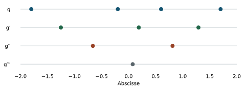
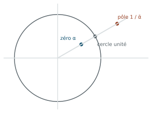
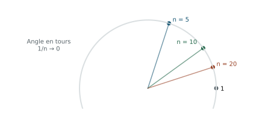
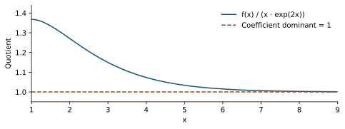
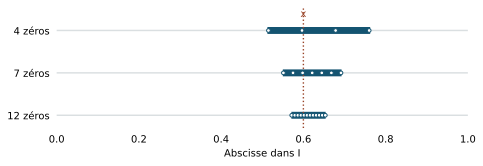
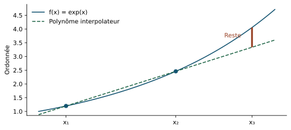
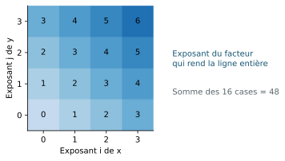
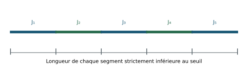

# ENS MP — Mathématiques C 2021 · Corrigé guidé

*Corrigé rédigé par IA, non officiel. Signalez toute erreur.*

**Rédaction** · modèle exact non renseigné (famille GPT-6) · effort non renseigné · vitesse non renseignée

**Révision (tour 1)** · GPT-6.2 Astra Ultra · vitesse non renseignée

**Révision** · GPT-6.2 Astra Ultra · vitesse non renseignée · 26 novembre 2026

## Présentation du sujet

L’épreuve inter-ENS du 16 avril 2021 dure quatre heures. Les questions 2 à 13 classent des fractions rationnelles à partir de leurs valeurs sur le cercle puis sur les racines de l’unité. Les questions 14 à 29 bornent le nombre de points d’un réseau sur un graphe transcendant. Ces deux parties sont indépendantes. Les 29 questions de l’énoncé correspondent à 39 réponses avec leurs subdivisions. [Sujet officiel](https://www.ens.psl.eu/sites/default/files/2021_mp_sujet_mathc.pdf) · [Rapport du jury](https://www.ens.psl.eu/sites/default/files/21_mp_rap_emathc.pdf)

## Question préliminaire

Rolle transforme une information sur les zéros en une information sur les dérivées successives.

### Question 1

> [!JURY]
> Le rapport demande une hypothèse de récurrence portant sur des zéros distincts. Les intervalles ouverts de Rolle expliquent ce point.

> [!INDICATION]
> Prendre seulement le nombre de zéros dont on a besoin et les ordonner.

> [!INDICATION]
> Entre deux zéros successifs, Rolle produit un zéro strictement intérieur. Combien en reste-t-il à l'étape suivante ?

#### Solution

Choisissons $n$ zéros distincts $t_1<\cdots<t_n$ de $g$. Sur chacun des $n-1$ segments $[t_i,t_{i+1}]$, la fonction est continue, dérivable à l'intérieur et prend la même valeur aux extrémités. Le théorème de Rolle fournit un zéro de $g'$ dans chaque intervalle ouvert $]t_i,t_{i+1}[$. Ces zéros sont distincts. Si $g^{(k)}$ possède au moins $n-k$ zéros pour $k<n-1$, le même raisonnement appliqué à ces zéros ordonnés en donne au moins $n-k-1$ pour $g^{(k+1)}$. La récurrence donne toutes les inégalités demandées.

## I. Fractions rationnelles et rationalité

Combien faut-il de mesures exactes sur un sous-corps pour y retrouver les coefficients d’une fraction ?

### Question 2a

> [!INDICATION]
> Compter les coefficients disponibles dans le couple de polynômes.

> [!INDICATION]
> Comparer ce nombre au nombre de contraintes, même si des contraintes se répètent.

#### Solution

Sur $K$, l'espace de départ a pour dimension $(p+1)+(q+1)=d+1$ et l'espace d'arrivée pour dimension $d$. L'application est linéaire par linéarité des évaluations. Son rang vaut au plus $d$, donc son noyau a dimension au moins un.

### Question 2b

> [!JURY]
> Le jury signale l’oubli fréquent de la non-nullité du dénominateur reconstruit.

> [!INDICATION]
> Choisir les ordonnées évaluées par la fraction dans la question 2a.

> [!INDICATION]
> Écarter le cas du dénominateur nul puis comparer nombre de zéros et degré du produit croisé.

#### Solution

Prenons $y_i=F(x_i)$ et un élément $(U,V)$ non nul du noyau. Comme $U(x_i)=y_iV(x_i)$ et $P(x_i)=y_iQ(x_i)$, on a $P(x_i)V(x_i)=Q(x_i)U(x_i)$, même si la présentation choisie admet un facteur commun. Si $V=0$, les $d>p$ zéros distincts de $U$ imposeraient $U=0$. Ainsi $V\ne0$. Le polynôme $PV-QU$, de degré au plus $p+q=d-1$, s'annule aux $d$ abscisses distinctes. Il est nul. L'égalité $F=U/V$ a donc lieu dans $\mathbb C(X)$ et prouve $F\in K(X)$.

### Question 2c

> [!INDICATION]
> Il suffit d'un nombre fini de données pour 2b. De quels degrés dépend ce nombre ?

> [!INDICATION]
> Des valeurs distinctes donnent nécessairement des antécédents distincts.

#### Solution

Fixons une écriture de $F$ et les bornes de degrés $p,q$ correspondantes. Parmi les valeurs de $F(K\setminus\mathcal P(F))\cap K$, choisissons-en $d=p+q+1$ distinctes et, pour chacune, un antécédent appartenant à $K\setminus\mathcal P(F)$. Ces antécédents sont distincts, donc la question 2b s'applique.

## I. Intersections avec le cercle unité

Sur le cercle, l’inversion est une conjugaison. Leur composition donne une identité de fractions rationnelles.

### Question 3a

On écrit $\mathbb U=\{z\in\mathbb C:|z|=1\}$ et $G(X)=\overline F(1/X)$, où la barre conjugue les coefficients de la fraction.

> [!INDICATION]
> Sur le cercle, exprimer l'inverse d'un point à l'aide de son conjugué.

> [!INDICATION]
> Prendre une présentation réduite pour pouvoir évaluer le conjugué sans ambiguïté.

#### Solution

Pour une écriture irréductible de $F$, conjuguer ses coefficients puis évaluer en $\bar z$ donne le conjugué de son évaluation en $z$. Or $1/z=\bar z$ sur $\mathbb U$, si bien que $G(z)=\overline{F(z)}$ dès que $z$ n'est pas pôle de $F$. Ainsi $F(z)G(z)=|F(z)|^2$, et ce produit vaut un exactement lorsque $F(z)\in\mathbb U$.

### Question 3b

> [!INDICATION]
> Une fraction non nulle peut-elle avoir une infinité de zéros ?

> [!INDICATION]
> Pour la réciproque, retirer les pôles du cercle puis utiliser 3a.

#### Solution

Si $F$ est spéciale, $FG-1$ possède une infinité de zéros. Le numérateur de sa forme réduite est donc le polynôme nul. Réciproquement, l'identité $FG=1$ entraîne par 3a que tout point du cercle hors des pôles a son image sur le cercle. Il reste une infinité de tels points puisque les pôles sont en nombre fini.

### Question 4

> [!INDICATION]
> Écrire le numérateur au point du cercle sous la forme du produit de ce point et d'un second facteur.

> [!INDICATION]
> Pour un paramètre sur le cercle, simplifier avant de chercher les pôles.

#### Solution

Le facteur est $B_\alpha(X)=(X-\alpha)/(1-\bar\alpha X)$. Pour $|z|=1$, $|z-\alpha|=|z|\,|1-\alpha\bar z|=|1-\bar\alpha z|$. Ainsi $|B_\alpha(z)|=1$ partout sur le cercle où le quotient est défini et $B_\alpha$ est spéciale. Pour $\alpha=0$, $B_0=X$. Pour $|\alpha|=1$, $1-\bar\alpha X=-\bar\alpha(X-\alpha)$, donc, après simplification, $B_\alpha=-\alpha$, même en $X=\alpha$.

### Question 5a

> [!INDICATION]
> Regarder ce que devient un facteur linéaire par conjugaison puis inversion.

> [!INDICATION]
> Dans le produit identiquement égal à un, une multiplicité positive s'équilibre par une multiplicité opposée.

#### Solution

Pour $\alpha\ne0$, le changement de variable $X\mapsto1/X$ est inversible localement en $\alpha$ et sa dérivée y est non nulle. En conjuguant les coefficients puis en faisant ce changement de variable, l'ordre de $G$ en $\alpha$ est l'ordre de $F$ en $1/\bar\alpha$. L'ordre est positif en un zéro, négatif en un pôle, nul ailleurs. Comme $FG=1$, ces deux ordres de $F$ sont opposés. En particulier, $F(\alpha)=0$ exactement lorsque $1/\bar\alpha$ est un pôle, avec la même multiplicité.

### Question 5b

> [!INDICATION]
> Quelles racines un polynôme spécial peut-il avoir dès lors qu'il n'a aucun pôle fini ?

> [!INDICATION]
> Évaluer le module du coefficient restant sur le cercle.

#### Solution

Un polynôme ne possède aucun pôle fini. D'après 5a, il ne peut donc avoir de racine non nulle. Une fraction spéciale est non nulle. Le théorème de d'Alembert–Gauss donne $F=cX^d$, avec $d\ge0$, y compris $d=0$. En un point du cercle d'image de module un on obtient $|c|=1$.

### Question 5c

> [!JURY]
> Le rapport recommande de compter séparément les racines hors de l’origine. Dans la preuve par les ordres, la puissance entière restante traite à la fois zéros et pôles à l’origine.

> [!INDICATION]
> Construire le produit des facteurs élémentaires à partir des zéros non nuls, en conservant les multiplicités.

> [!INDICATION]
> Après division, examiner les racines du numérateur et du dénominateur. La question 4 permet aussi de représenter la constante.

#### Solution

Pour chaque zéro non nul $\alpha$ de $F$ répété selon sa multiplicité, introduisons le facteur $B_\alpha$. Un tel zéro est hors du cercle, car sur le cercle $1/\bar\alpha=\alpha$ et 5a en ferait aussi un pôle. Le facteur a un zéro simple en $\alpha$ et un pôle simple en $1/\bar\alpha$. Tous les pôles finis non nuls de $F$ se présentent de cette façon par la relation des ordres de 5a. Le quotient de $F$ par le produit de ces facteurs n'a donc ni zéro ni pôle dans $\mathbb C^*$. Les polynômes de son écriture réduite sont des monômes, si bien que le quotient vaut $cX^d$ pour un $d\in\mathbb Z$. Sur le cercle, hors d'un nombre fini de points, $F$ et chaque facteur ont module un, donc $|c|=1$. Enfin $c=B_{-c}$ par 4. En ajoutant au besoin ce facteur constant, on obtient la forme annoncée.

## I. Racines de l’unité

La rigidité vient du contrôle simultané de l’angle des images et du dénominateur arithmétique de cet angle.

### Question 6

On note $\Lambda$ le groupe des racines de l’unité et $\zeta_n=e^{2\pi i/n}$. De 6 à 12, $F(1)=1$ et les valeurs $F(\zeta_{n_j})$ sont des racines de l’unité pour une suite strictement croissante d’entiers $n_j$.

> [!INDICATION]
> Écrire une racine de l'unité à l'aide d'une fraction de tour.

> [!INDICATION]
> Les représentants de son argument normalisé diffèrent d'un entier. Vérifier le rôle des deux extrémités du demi-intervalle.

#### Solution

Puisque $w=F(\zeta_{n_j})$ est une racine de l'unité, il s'écrit $e^{2\pi i m/k}$ avec $k\ge1$ et $m\in\mathbb Z$. Deux réels ont la même exponentielle $e^{2\pi i t}$ si et seulement si leur différence est entière. Parmi les translatés entiers de $m/k$, un seul appartient à $]-1/2,1/2]$. Ce représentant est rationnel et donne l'unique $q_j$.

### Question 7

> [!INDICATION]
> Localiser les valeurs d'adhérence dans un segment fermé.

> [!INDICATION]
> À laquelle des valeurs de ce segment peut correspondre une exponentielle égale à un ?

#### Solution

La suite $n_j$ tend vers l'infini, donc $\zeta_{n_j}\to1$. La fraction $F$ est continue en $1$, où sa valeur est $1$. Tout point d'accumulation $q$ de $(q_j)$ dans le compact $[-1/2,1/2]$ vérifie donc $e^{2\pi i q}=1$. Le seul entier de ce segment est $0$. La suite étant bornée, cette unicité de la valeur d'adhérence donne $q_j\to0$.

### Question 8a

> [!INDICATION]
> Développer le point du cercle au premier ordre en l'inverse de son indice.

> [!INDICATION]
> Développer ensuite le polynôme au voisinage de son zéro en un.

#### Solution

On a $\zeta_n-1=2\pi i/n+O(n^{-2})$ et $P(z)=P'(1)(z-1)+O(|z-1|^2)$ au voisinage de $1$. Ainsi $nP(\zeta_n)\to2\pi i P'(1)$.

### Question 8b

> [!INDICATION]
> Soustraire le dénominateur au numérateur pour former un polynôme nul en un.

> [!INDICATION]
> Prolonger le quotient de l'accroissement de l'exponentielle par son argument au point zéro.

#### Solution

Écrivons $F=P/Q$ avec $Q(1)\ne0$. Comme $(P-Q)(1)=0$, la question 8a appliquée à $P-Q$ donne
$$n_j\bigl(F(\zeta_{n_j})-1\bigr)\longrightarrow2\pi i\,\frac{P'(1)-Q'(1)}{Q(1)}=2\pi i F'(1).$$
La fonction $h(t)=(e^{2\pi i t}-1)/(2\pi i t)$ se prolonge par $h(0)=1$. D'après 7, $h(q_j)\to1$. En écrivant $F(\zeta_{n_j})-1=2\pi i q_j h(q_j)$, on obtient $n_jq_j\to F'(1)$, y compris si certains $q_j$ s'annulent. Cette limite est réelle.

Avec $F(X)=X^{-2}$, le représentant de l’argument de $F(\zeta_n)$ est $q=-2/n$ pour $n\ge5$. Le produit $nq=-2$ donne exactement $F'(1)$. Dans le plan complexe, $n(F(\zeta_n)-1)=n(e^{-4\pi i/n}-1)$ tend vers $-4\pi i$, ce qui vérifie également le facteur $2\pi i$.

### Question 9

> [!INDICATION]
> Que devient une suite convergente à valeurs entières ?

> [!INDICATION]
> Élever la fraction à la puissance donnée et identifier une puissance de l'indéterminée. Examiner ensuite l'ordre en zéro.

#### Solution

La suite d'entiers $(c n_j q_j)$ converge, donc vaut un entier fixe $k$ à partir d'un certain rang. Pour ces indices, $F(\zeta_{n_j})^c=e^{2\pi i k/n_j}=\zeta_{n_j}^{\,k}$. Les $\zeta_{n_j}$ donnent une infinité de points distincts, d'où l'identité de fractions $F^c=X^k$. En prenant l'ordre en zéro on trouve $c\,\operatorname{ord}_0 F=k$. Ainsi $d=k/c$ est entier, même si $k<0$. La fraction $H=F/X^d$ vérifie $H^c=1$. La factorisation de $T^c-1$ sur $\mathbb C$ et l'intégrité du corps $\mathbb C(X)$ imposent $H$ constante, racine $c$-ième de l'unité. Comme $H(1)=1$, $F=X^d$.

### Question 10

> [!INDICATION]
> Pour employer 2b, combien de couples abscisse-ordonnée faut-il réellement ?

> [!INDICATION]
> Trouver une seule racine de l'unité dont toutes ces coordonnées soient des puissances.

#### Solution

Fixons une présentation $F=P/Q$. Prenons $D>\deg P+\deg Q$ couples distincts en abscisse parmi $(\zeta_{n_j},F(\zeta_{n_j}))$. Chacune de leurs $2D$ coordonnées est une racine de l'unité. Soit $p$ le PPCM de leurs ordres. Toutes sont des puissances de $\zeta_p$ et appartiennent à $K=\mathbb Q(\zeta_p)$. On applique 2b à $\deg P+\deg Q+1$ de ces couples et l'on trouve $F\in K(X)$.

### Question 11a

> [!JURY]
> Le jury demande de vérifier la coprimalité des exposants avant d’invoquer Bézout.

> [!INDICATION]
> Écrire les deux racines comme puissances de la racine primitive d'ordre PPCM.

> [!INDICATION]
> Pour appliquer Bézout aux exposants, prendre un premier divisant le second et comparer ses exposants dans les deux ordres.

#### Solution

Quitte à changer les deux signes, supposons $v>0$ et posons $\ell=\operatorname{ppcm}(v,N)$. Comme $\zeta=\zeta_\ell^{u\ell/v}$ et $\zeta_N=\zeta_\ell^{\ell/N}$, il suffit de vérifier que $u\ell/v$ et $\ell/N$ sont premiers entre eux. Si un premier $s$ divise $\ell/N$, son exposant dans $v$ est strictement supérieur à celui dans $N$ et coïncide avec celui dans $\ell$. Il ne divise donc ni $\ell/v$ ni $u$, car $u$ et $v$ sont premiers entre eux. Bézout fournit maintenant $a(u\ell/v)+b(\ell/N)=1$, d'où $\zeta_\ell=\zeta^a\zeta_N^b$.

### Question 11b

> [!INDICATION]
> L'expression de 11a donne une inclusion de corps. Qu'apprend-elle sur leurs dimensions ?

> [!INDICATION]
> Dans le passage d'un entier à un multiple, calculer les facteurs multiplicatifs de l'indicatrice, selon que le premier est nouveau ou déjà présent.

#### Solution

Puisque $\zeta\in\mathbb Q(\zeta_N)$, la question 11a entraîne $\mathbb Q(\zeta_\ell)\subseteq\mathbb Q(\zeta_N)$. Le théorème 1 donne $\varphi(\ell)\le\varphi(N)$. Comme $N\mid\ell$, augmenter l'exposant d'un premier $s$ déjà présent multiplie l'indicatrice par une puissance strictement positive de $s$. Ajouter un nouveau premier à l'exposant $e$ la multiplie par $s^{e-1}(s-1)$. Tous ces facteurs sont au moins un. L'inégalité impose qu'ils vaillent un, ce qui permet uniquement l'ajout éventuel du premier $2$ à l'exposant $1$. Ainsi $\ell=N$ ou $\ell=2N$. Comme $v\mid\ell$, on a $2Nq\in\mathbb Z$. Le facteur deux est parfois nécessaire. Pour $N=3$, la racine primitive sixième $-\zeta_3^2=e^{2\pi i/6}$ appartient à $\mathbb Q(\zeta_3)$. Alors $Nq=1/2$ tandis que $2Nq=1$.

### Question 12

> [!INDICATION]
> Mettre simultanément la racine évaluée et les coefficients de la fraction dans le même corps cyclotomique.

> [!INDICATION]
> Le PPCM des deux ordres divise leur produit. Seul un multiplicateur indépendant de l'indice peut servir en 9.

#### Solution

Avec $p$ de la question 10, fixons $N_j=\operatorname{ppcm}(p,n_j)$. Les coefficients d'une écriture réduite de $F$ sur $\mathbb Q(\zeta_p)$ ainsi que $\zeta_{n_j}$ appartiennent à $\mathbb Q(\zeta_{N_j})$. Le dénominateur ne s'annule pas au point considéré, donc $F(\zeta_{n_j})$ appartient à ce corps. Par 11b, $2N_jq_j\in\mathbb Z$. Comme $N_j\mid pn_j$, l'entier fixe $c=2p$ convient à la question 9, qui donne $F=X^d$.

### Question 13

> [!INDICATION]
> Que se passerait-il pour le module des images approchant un pôle situé en un ?

> [!INDICATION]
> Ramener la valeur en un à l'unité par division, puis vérifier la réciproque sur toutes les racines.

#### Solution

Si $F(\Lambda\setminus\mathcal P(F))\subseteq\Lambda$, les racines de l'unité s'accumulent en $1$ et, le long de celles qui évitent les pôles, les valeurs ont module un. Un pôle en $1$ forcerait leurs modules à tendre vers l'infini. Ainsi $F(1)=\omega\in\Lambda$. La fraction $F/\omega$ vaut un en $1$ et envoie encore les racines de l'unité de son domaine dans $\Lambda$. Il suffit de prendre les $n_j$ successifs assez grands pour éviter les pôles. La question 12 donne $F=\omega X^d$ avec $d\in\mathbb Z$. Réciproquement tout produit d'une racine de l'unité et d'une puissance entière d'une racine de l'unité est encore une racine de l'unité. Toutes ces fractions conviennent.

Le cercle et les racines de l’unité donnent des conditions différentes. Le facteur $B_{1/2}$ de la question 4 conserve le cercle. Pourtant $B_{1/2}(i)=(-4+3i)/5$ n’est pas une racine de l’unité. En effet, pour $w=B_{1/2}(i)$, $t=w+w^{-1}=-8/5$. Les polynômes $S_0=2$, $S_1=X$, $S_{k+1}=XS_k-S_{k-1}$ vérifient $S_k(t)=w^k+w^{-k}$ et sont unitaires à coefficients entiers pour $k\ge1$. Si $w^k=1$, le rationnel $-8/5$ serait racine du polynôme unitaire entier $S_k-2$. Or une racine rationnelle d’un tel polynôme est entière : en substituant une fraction irréductible $a/b$ et en multipliant par $b^k$, on obtient $b\mid a^k$.

## II. Courbes et fonctions transcendantes

La définition de transcendance du sujet exclut la platitude de toute relation polynomiale. Elle fournit une borne uniforme sur un segment compact.

### Question 14

> [!INDICATION]
> Identifier le rayon de convergence.

> [!INDICATION]
> Retrouver le coefficient de rang fixé grâce à une seule dérivée évaluée à l'origine.

#### Solution

Le rayon de convergence de la série entière est infini puisqu'elle converge en tout réel. Le théorème de dérivation terme à terme des séries entières assure que sa somme est $C^\infty$ sur $\mathbb R$ et que $f^{(k)}(0)=k!a_k$ pour chaque $k\ge0$. Si $f$ est plate en zéro, chaque coefficient $a_k$ est donc nul.

### Question 15a

> [!INDICATION]
> Quelle exponentielle domine quand la variable tend vers l'infini ?

> [!INDICATION]
> Dans ce terme, isoler ensuite le monôme de plus haut degré.

#### Solution

Posons $a=\alpha_n$ et $N=\deg P_n$. On divise $f(x)$ par $x^N e^{a x}$ pour $x>0$. Le dernier terme tend vers le coefficient dominant de $P_n$, qui est non nul. Pour $i<n$, le facteur $e^{-(\alpha_n-\alpha_i)x}$ l'emporte sur toute puissance de $x$, donc le terme correspondant tend vers zéro. La limite étant non nulle, $f$ ne peut être identiquement nulle.

### Question 15b

> [!INDICATION]
> Translater l'éventuel point de platitude à l'origine.

> [!INDICATION]
> Jusqu'où converge la série entière obtenue après cette translation ?

#### Solution

En tout point $x_0$, la fonction $t\mapsto f(x_0+t)$ est une somme finie de produits de polynômes en $t$ et de séries exponentielles de rayon infini. Elle est donc donnée sur toute la droite par une série entière en $t$. Si $f$ était plate en $x_0$, la question 14 rendrait tous les coefficients de cette série nuls. Cela donnerait $f(x_0+t)=0$ pour tout réel $t$, en contradiction avec 15a.

### Question 16

> [!INDICATION]
> Substituer le produit polynôme-exponentielle dans une relation hypothétique.

> [!INDICATION]
> Identifier exactement les termes à coefficients non nuls puis ordonner les exposants réels.

#### Solution

Pour des polynômes $Q_0,\ldots,Q_d$ non tous nuls, on a
$$\sum_{i=0}^d Q_i(x)f(x)^i=\sum_{i=0}^d Q_i(x)P(x)^i e^{i\alpha x}.$$
Ici $i$ est l'indice entier de la somme. Comme $P\ne0$, chaque $Q_i\ne0$ produit un polynôme non nul. Puisque $\alpha\ne0$, les exposants réels $i\alpha$ des termes conservés sont distincts. Après les avoir ordonnés, 15b exclut tout point de platitude sur la droite, donc aussi sur $I$. Les dérivées aux extrémités éventuelles sont celles de la restriction. C'est précisément la transcendance demandée.

### Question 17

Dans la suite, $I$ est un segment non trivial. Une $d$-courbe est le lieu des zéros d’un polynôme non nul dont le degré en chaque variable est au plus $d-1$.

> [!INDICATION]
> Regrouper les termes d'un élément de l'espace selon les puissances de la fonction.

> [!INDICATION]
> Traduire la non-nullité de la fonction en condition utilisable sur les coefficients polynomiaux.

#### Solution

Une fonction $g\in V$ s'écrit $g(x)=\sum_{j=0}^{d-1}Q_j(x) f(x)^j$, avec des polynômes de degré au plus $d-1$. Si $g$ n'est pas identiquement nulle, les $Q_j$ ne peuvent être tous nuls. La transcendance de $f$ exclut que cette combinaison soit plate, en tout point de $I$. Pour $d=1$, on peut compléter la somme par un coefficient nul devant $f$.

### Question 18

> [!INDICATION]
> Évaluer l'équation d'une courbe sur le graphe et mobiliser la transcendance.

> [!INDICATION]
> Partager le segment en cases. Combien de zéros l'une des cases doit-elle renfermer ?

#### Solution

Soit $H_r(X,Y)$ un polynôme non nul définissant $C_r$, de degrés en $X$ et en $Y$ au plus $d-1$. Alors $g(x)=H_r(x,f(x))$ appartient à $V$. Par transcendance, il n'est plat en aucun point, donc il n'est pas identiquement nul. Ses zéros correspondent bijectivement aux points de $\Gamma(f)\cap C_r$, grâce à l'abscisse. Il en possède donc au moins $r^2$. Pour toute fonction vérifiant cette dernière condition, partageons $I$ en $r$ segments égaux. Affectons chaque zéro situé à une frontière à un seul des segments qui le contiennent. L'un des segments contient au moins $r$ des $r^2$ zéros choisis et a longueur $\ell(I)/r$.

### Question 19

> [!INDICATION]
> Écrire dans la base la fonction qui possédait de nombreux zéros.

> [!INDICATION]
> Quelle multiplication scalaire conserve tous les zéros et impose la normalisation ?

#### Solution

Pour chaque $r$, la question 18 fournit une fonction non nulle $g=\sum b_i g_i$ et un segment $K_r$ contenant au moins $r$ de ses zéros. Le nombre $L=\sum |b_i|$ est strictement positif. Posons $a_r=(b_i/L)_i$. Alors $a_r\in S_n$ et $G_{a_r}=g/L$ a exactement les mêmes zéros. Enfin $\ell(K_r)\le\ell(I)/r\to0$.

### Question 20

> [!INDICATION]
> Présenter la contrainte sur les coefficients comme la préimage d'un fermé.

> [!INDICATION]
> Pour extraire simultanément les valeurs limites, choisir un produit de deux compacts.

#### Solution

L'application $a\mapsto\sum |a_i|$ est continue, donc $S_n$ est fermé. Il est borné puisque chaque $|a_i|$ vaut au plus $1$. Il est compact en dimension finie. Le produit $S_n\times I$ est compact lui aussi. De la suite $(a_r,\min K_r)$ on peut donc extraire une sous-suite $(a_{r_s},\min K_{r_s})$ convergeant vers $(a,x)\in S_n\times I$, avec $r_s$ strictement croissant.

### Question 21

> [!JURY]
> Le rapport insiste sur l’ordre des quantificateurs. On fixe un ordre de dérivation puis on fait tendre l’indice de la sous-suite vers l’infini.

> [!INDICATION]
> Fixer l'ordre de dérivation avant de faire parcourir la sous-suite.

> [!INDICATION]
> Où se trouvent les zéros fournis par Rolle ? Passer à la limite terme par terme dans la base finie.

#### Solution

Fixons $k\ge0$. Pour $s$ assez grand, $r_s\ge k+1$. Choisissons $y_s\in K_{r_s}$ où $G_{a_{r_s}}^{(k)}$ s'annule, grâce à 1 pour $k>0$ et à 19 pour $k=0$. Les extrémités gauches tendent vers $x$ et les longueurs vers zéro, donc $y_s\to x$. Par continuité de chaque $g_i^{(k)}$ et convergence des coefficients,
$$0=\sum_{i=1}^n(a_{r_s})_i g_i^{(k)}(y_s)\longrightarrow\sum_{i=1}^na_i g_i^{(k)}(x)=G_a^{(k)}(x).$$
Ce raisonnement vaut pour tout $k$, si bien que $G_a$ est plate en $x$. Or $a\in S_n$ est non nul et les $g_i$ sont libres, donc $G_a$ n'est pas identiquement nulle. La contradiction avec 17 exclut des nombres d'intersections arbitrairement grands et prouve la borne uniforme $c_1$ du théorème 2.

## II. Une inégalité pour les déterminants

L’interpolation de Lagrange extrait, colonne après colonne, tous les facteurs qui mesurent les écarts entre les points.

### Question 22a

> [!INDICATION]
> Fabriquer une fonction auxiliaire nulle aux premiers points et au dernier.

> [!INDICATION]
> La dérivée d'ordre maximal du polynôme unitaire est une constante précise.

#### Solution

Posons $W(t)=\prod_{i=1}^{n-1}(t-x_i)$, si bien que $\beta=W(x_n)\ne0$. La fonction $h(t)=\beta f(t)-f(x_n)W(t)$ s'annule aux $n$ abscisses distinctes. D'après 1, $h^{(n-1)}(y)=0$ pour un $y\in I$. Or $W$ est unitaire de degré $n-1$, donc $W^{(n-1)}=(n-1)!$. Il vient $f(x_n)=\beta f^{(n-1)}(y)/(n-1)!$.

### Question 22b

> [!INDICATION]
> Quel polynôme de degré au plus deux de moins que le nombre total de points coïncide avec la fonction aux premiers nœuds ?

> [!INDICATION]
> Soustraire cet interpolateur et appliquer 22a au reste.

#### Solution

Soit $L$ le polynôme de Lagrange interpolant $f$ aux $n-1$ premiers points. Avec $L_i(t)=\prod_{j<n,\,j\ne i}(t-x_j)/(x_i-x_j)$, on a $L(t)=\sum_{i<n}f(x_i)L_i(t)$. Le degré de $L$ est au plus $n-2$, donc sa dérivée d'ordre $n-1$ est nulle. La question 22a appliquée à $f-L$ donne
$$f(x_n)-\sum_{i<n}f(x_i)L_i(x_n)=\frac{\beta}{(n-1)!}f^{(n-1)}(y)$$
pour un $y\in I$. En remplaçant $L_i(x_n)$ par son produit, on retrouve la formule demandée.

### Question 23

> [!INDICATION]
> Dans l'interpolation, les coefficients devant les premières valeurs dépendent-ils de la fonction ?

> [!INDICATION]
> Faire une même opération sur la dernière colonne puis extraire un facteur commun.

#### Solution

Dans le déterminant de $A$, remplaçons la dernière colonne par $C_n-\sum_{i<n}L_i(x_n)C_i$. Cette opération préserve le déterminant. La question 22b appliquée à chaque fonction $f_j$ donne pour l'entrée de ligne $j$ de cette colonne $\beta f_j^{(n-1)}(y_j)/(n-1)!$, pour un point $y_j\in I$ pouvant dépendre de la ligne. En extrayant le facteur commun $\beta/(n-1)!$ de la dernière colonne on obtient l'identité demandée.

### Question 24

> [!INDICATION]
> Après 23, développer le déterminant selon la dernière colonne.

> [!INDICATION]
> Quel groupe de facteurs du produit des écarts manque encore à chacun des mineurs ?

#### Solution

Prouvons l'estimation pour toutes les familles de $n$ fonctions par récurrence sur $n$. Pour $n=1$, le produit vide vaut $1$ et la norme uniforme de $f_1$ est finie sur le compact $I$. Au rang $n$, développons le déterminant de 23 selon sa dernière colonne. Le mineur de la ligne $j$ porte sur les $n-1$ premiers points et les $n-1$ fonctions restantes. Par récurrence son module est au plus $C_j\prod_{1\le i<k<n}|x_k-x_i|$, avec $C_j$ indépendant des points. Le coefficient de ce mineur est borné en module par $\|f_j^{(n-1)}\|_\infty$. Il reste le facteur $|\beta|=\prod_{i<n}|x_n-x_i|$ provenant de 23. On obtient le théorème 3, par exemple avec $c_2=1+\sum_j C_j\|f_j^{(n-1)}\|_\infty/(n-1)!$.

## II. Intersections avec un réseau

Le déterminant possède une majoration géométrique et, s’il est non nul, une minoration arithmétique. On en déduit une courbe auxiliaire à petite échelle.

### Question 25

> [!INDICATION]
> Traduire l'annulation du polynôme en un point par un produit scalaire.

> [!INDICATION]
> Quelle est la dimension de l'espace des coefficients orthogonaux à toutes les colonnes ?

#### Solution

Écrivons $a$ le vecteur des $d^2$ coefficients d'un polynôme $H(X,Y)=\sum_{0\le i,j<d}a_{i+dj+1}X^iY^j$. Il passe par tous les points au sens où $H(P_k)=0$ pour tout $k$ exactement si $B^{\mathsf T}a=0$. Ces points sont donc sur une même $d$-courbe exactement si $\ker B^{\mathsf T}$ contient un vecteur non nul, soit, par le rang, si $\operatorname{rang} B<d^2$.

### Question 26

> [!INDICATION]
> Nommer les fonctions d'une variable dont les évaluations forment les lignes.

> [!INDICATION]
> Combien de paires trouve-t-on parmi les abscisses de tous les points ?

#### Solution

Deux points distincts d'un graphe ont des abscisses distinctes. Les lignes de $B$ évaluent aux abscisses $x_k$ les $d^2$ fonctions lisses $t\mapsto t^i f(t)^j$. Le théorème 3 majore donc $|\det B|$ par $c_2\prod_{k<m}|x_k-x_m|$. En posant $D=\max_{k<m}|x_k-x_m|$ et $h=d^2(d^2-1)/2$, ce produit est au plus $D^h$. On peut prendre $c=1+c_2>1$.

### Question 27a

> [!INDICATION]
> Pour une ligne d'exposants fixés, quel entier élimine tous les dénominateurs ?

> [!INDICATION]
> Les exposants des facteurs se somment sur le carré des indices.

#### Solution

Écrivons $P_k=(u_k/n,v_k/n)$ avec $u_k,v_k$ entiers. Multiplier chaque ligne $(i,j)$ par $n^{i+j}$ remplace toutes ses entrées par les entiers $u_k^iv_k^j$. Le déterminant de la matrice obtenue est donc entier. Le facteur total vaut $n^E$, où
$$E=\sum_{0\le i,j<d}(i+j)=2d\frac{d(d-1)}2=d^2(d-1).$$
On a bien $n^{d^2(d-1)}\det B\in\mathbb Z$. Pour vérifier l’exposant, prenons $d=2$ et les quatre points $(0,0),(1/n,0),(2/n,1/n),(3/n,1/n)$. Sur les lignes $1,x,y,xy$, les multiplicateurs sont $1,n,n,n^2$. La matrice entière obtenue est
$$\begin{pmatrix}1&1&1&1\\0&1&2&3\\0&0&1&1\\0&0&2&3\end{pmatrix},$$
de déterminant $1$. Avant multiplication, le déterminant vaut exactement $n^{-4}$. Cette vérification de dénominateurs utilise seulement l’appartenance au réseau.

### Question 27b

> [!INDICATION]
> Quelle valeur minimale en module peut prendre un déterminant non nul d'après 27a ?

> [!INDICATION]
> Comparer les bornes puis simplifier le quotient des exposants.

#### Solution

Si les $d^2$ points n'appartiennent pas à une même $d$-courbe, leur déterminant est non nul d'après 25. Par 27a son module est au moins $n^{-E}$. En combinant avec 26, on a $D\ge c^{-1/h}n^{-E/h}$. Comme $E/h=2/(d+1)$ et que $c>1$, $h\ge1$, on a en particulier $D\ge c^{-1}n^{-2/(d+1)}$.

### Question 28

> [!INDICATION]
> Examiner toutes les familles de taille carrée extraites des points du segment.

> [!INDICATION]
> L'annulation de tous les mineurs maximaux fournit un seul noyau pour l'ensemble des colonnes.

#### Solution

Il n'y a qu'un nombre fini de points considérés, puisque leurs abscisses figurent dans le segment $J$ et dans $n^{-1}\mathbb Z$, à raison d'un point du graphe par abscisse. S'il y en a moins de $d^2$, la matrice de toutes les colonnes a rang $<d^2$. S'il y en a au moins $d^2$, toute sélection de $d^2$ colonnes a son déterminant nul par contraposée de 27b, car son diamètre horizontal est strictement inférieur au seuil. Dans les deux cas, le rang de la matrice de tous les points est $<d^2$. La question 25 donne une seule $d$-courbe contenant tous ces points. Si l'ensemble est vide, toute $d$-courbe convient.

### Question 29

> [!INDICATION]
> Recouvrir le segment par des morceaux strictement plus courts que le seuil.

> [!INDICATION]
> Utiliser successivement les bornes 28 et 21, puis absorber la constante et comparer les exposants.

#### Solution

Posons $\delta=c^{-1}n^{-2/(d+1)}$ et $m=\lfloor\ell(I)/\delta\rfloor+1$. Les $m$ segments égaux qui couvrent $I$ ont chacun une longueur strictement inférieure à $\delta$. D'après 28, les points du réseau sur le graphe dans chaque segment appartiennent à une $d$-courbe. Le théorème 2 borne leur nombre par $c_1$, uniformément en cette courbe. Les recouvrements aux extrémités ne gênent pas une majoration. Par suite
$$\left|\Gamma(f)\cap n^{-1}\mathbb Z^2\right|\le c_1m\le c_1\bigl(1+c\ell(I)n^{2/(d+1)}\bigr)\le c_1(1+c\ell(I))n^\varepsilon.$$
Le dernier passage utilise $n\ge1$ et le choix initial $2/(d+1)<\varepsilon$. Les constantes $c,c_1$ dépendent de $I,f,d$, et $d$ dépend de $\varepsilon$, mais aucune ne dépend de $n$.

## Bilan

Une fraction rationnelle qui envoie les racines de l’unité dans les racines de l’unité est un monôme à coefficient racine de l’unité. Pour une fonction transcendante, le mécanisme change. Sur un segment suffisamment court, les contraintes arithmétiques imposent à tous les points de dénominateur donné de satisfaire une relation polynomiale auxiliaire. La borne uniforme sur les intersections avec cette courbe donne la majoration finale pour tout exposant strictement positif.
