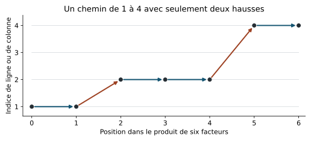
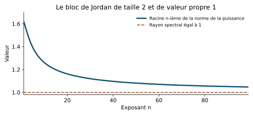
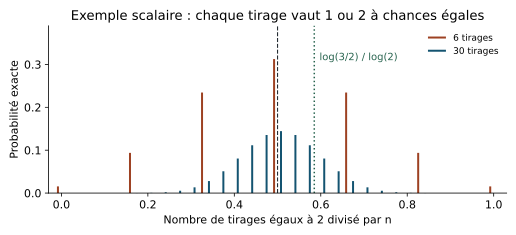
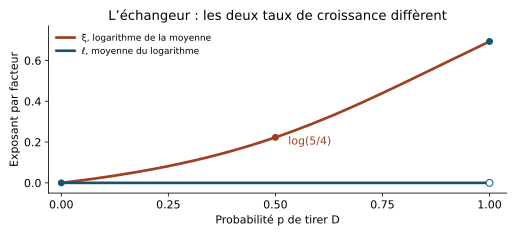
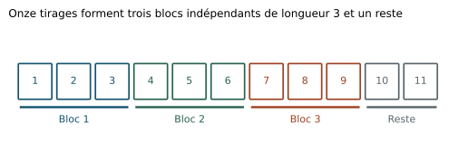
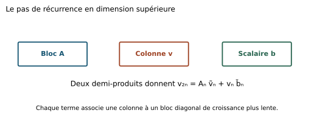

# ENS MP — Mathématiques D 2021 · Corrigé guidé

*Corrigé rédigé par IA, non officiel. Signalez toute erreur.*

**Rédaction** · modèle exact non renseigné (famille GPT-6) · effort non renseigné · vitesse non renseignée

**Révision (tour 1)** · GPT-6.2 Astra Ultra · vitesse non renseignée

**Révision (tour 2)** · GPT-6.2 Astra Ultra · vitesse non renseignée · 26 novembre 2026

## Présentation du sujet

Le sujet de six heures du 15 avril 2021 établit une version en probabilité du théorème de Furstenberg–Kesten. Pour suivre la preuve principale, on peut relier la question préliminaire aux parties II et IV. La partie I fournit les bornes spectrales, tandis que la partie III permet de calculer explicitement les deux exposants dans des modèles où la structure des matrices est connue. L’épreuve comprend 40 réponses élémentaires avec les subdivisions. [Sujet officiel](https://www.ens.psl.eu/sites/default/files/21_mp_sujet_mathd.pdf) · [Rapport du jury](https://www.ens.psl.eu/sites/default/files/21_mp_rap_emathd.pdf)

On note $\Psi_n=M^{(n)}\cdots M^{(1)}$ et $\|\cdot\|_{\rm op}$ la norme opérateur induite par la norme euclidienne sur $\mathbb C^d$. Les tirages sont indépendants, de même loi et de support fini contenu dans les matrices inversibles. On convient que $\log0=-\infty$ lorsque des puissances ou des coefficients peuvent s’annuler.

### Question 0

> [!JURY]
> Le jury attend que le recours à la loi faible soit accompagné d’une justification de l’intégrabilité ou du moment d’ordre deux. Le support fini dans les scalaires non nuls assure ici les deux.

> [!INDICATION]
> Quelle opération rend une somme à partir d’un produit ?

> [!INDICATION]
> Vérifier l’existence du moment d’ordre deux avant d’appeler la loi faible.

#### Solution

En dimension un, le logarithme d'un produit de valeurs absolues est une somme. Ainsi $n^{-1}\log|\Psi_n|=n^{-1}\sum_{t=1}^n\log|Z^{(t)}|$. Les termes sont indépendants, de même loi et bornés car le support est fini et ne contient pas zéro. Leur variance est finie. La loi faible des grands nombres donne la convergence en probabilité vers $\mathbb E\log|Z^{(1)}|$.

## Partie I — Puissances d’une matrice et théorème de Gelfand

La triangularisation réduit la croissance à un dénombrement de chemins puis à une perte polynomiale. Cayley–Hamilton donne un deuxième contrôle du rayon spectral.

### Question I.1

> [!INDICATION]
> Commencer par un vecteur unitaire, en laissant ouverte la possibilité que Bx soit nul.

> [!INDICATION]
> Une fois l’inégalité obtenue pour chaque vecteur, prendre le supremum.

#### Solution

Pour tout vecteur $y$, on a $\|Ay\|\leq\|A\|_{\rm op}\|y\|$, par homogénéité si $y\ne0$, directement si $y=0$. Pour tout $x$ unitaire, on obtient $\|ABx\|\leq\|A\|_{\rm op}\|Bx\|\leq\|A\|_{\rm op}\|B\|_{\rm op}$. Le supremum en $x$ donne la sous-multiplicativité.

### Question I.2

> [!INDICATION]
> Le rayon spectral est un module. Quelle valeur propre réalise ce module ?

> [!INDICATION]
> Évaluer la puissance sur un vecteur propre unitaire bien choisi.

#### Solution

Choisissons une valeur propre $\lambda$ de module maximal et un vecteur propre unitaire $v$ associé. Alors $A^nv=\lambda^nv$, d'où $\rho(A)^n=\|A^nv\|\leq\|A^n\|_{\rm op}$. Le nombre réel $\rho(A)$ n'a pas besoin d'être lui-même valeur propre.

### Question I.3a

> [!INDICATION]
> Écrire un terme de la formule du produit matriciel à l’aide des indices successifs.

> [!INDICATION]
> Chaque hausse entière consomme une partie du gain total entre les indices de départ et d’arrivée.

#### Solution

Le produit matriciel exprime $(A^n)_{ij}$ comme la somme des produits $a_{k_0k_1}\cdots a_{k_{n-1}k_n}$ pour $k_0=i$, $k_n=j$. Si un indice descend, un facteur situé sous la diagonale est nul. Il reste donc les chaînes $i=k_0\leq k_1\leq\cdots\leq k_n=j$. Chaque hausse stricte fait gagner au moins une unité et le gain total vaut $j-i\leq d-1$. En posant $i_t=k_{t-1}, j_t=k_t$, on retrouve exactement les conditions définissant $E_n(i,j)$.

### Question I.3b

> [!INDICATION]
> À chaque étape, ajouter le numéro de cette étape à l’indice courant.

> [!INDICATION]
> La chaîne devenue strictement croissante est déterminée par le choix de ses valeurs intérieures.

#### Solution

À une chaîne associons $u_t=k_t-i+t$. C'est une suite strictement croissante, de $u_0=0$ à $u_n=n+j-i$. Inversement $k_t=i+u_t-t$ redonne la chaîne initiale. Il suffit de choisir les $n-1$ entiers intermédiaires dans $\{1,\ldots,n+j-i-1\}$ car leur ordre croissant est imposé. Donc
$$|E_n(i,j)|=\binom{n-1+j-i}{n-1}=\binom{n-1+j-i}{j-i}.$$

### Question I.3c

> [!INDICATION]
> Séparer les produits selon leur nombre de facteurs strictement au-dessus de la diagonale.

> [!INDICATION]
> Traiter la diagonale nulle avant de diviser par le rayon spectral.

#### Solution

Si $\rho(A)=0$, une matrice triangulaire supérieure à diagonale nulle vérifie $A^d=0$ : il faudrait $d$ hausses strictes pour obtenir un produit non nul. La majoration vaut donc pour $n\geq d$. Si $\rho=\rho(A)>0$, posons $H=\max(1,\max_{ij}|a_{ij}|/\rho)$. Un chemin avec $h$ hausses strictes comporte $n-h$ facteurs diagonaux de module au plus $\rho$. Son poids est majoré par $\rho^nH^h\leq\rho^nH^{d-1}$. Pour chaque $0\leq j-i\leq d-1$, le nombre de chemins de I.3b est un polynôme en $n$ de degré $j-i$, donc majoré par $C_d n^{d-1}$ pour $n\geq1$. La somme donne $|(A^n)_{ij}|\leq C_A n^{d-1}\rho^n$.

### Question I.4

> [!INDICATION]
> Choisir une base dans laquelle la matrice est triangulaire et encadrer sa puissance dans la base de départ.

> [!INDICATION]
> Quel est l’effet d’un facteur polynomial lorsqu’on prend le logarithme puis qu’on divise par n ?

#### Solution

Sur $\mathbb C$, écrivons $A=PTP^{-1}$ avec $T$ triangulaire supérieure. Les spectres de $A$ et $T$ sont identiques. Pour toute matrice $B$, $\|B\|_{\rm op}\leq d\max_{ij}|b_{ij}|$ par Cauchy–Schwarz appliqué ligne par ligne. Si $\rho>0$, les questions précédentes donnent pour $n\geq d$
$$\rho^n\leq\|A^n\|_{\rm op}\leq\|P\|_{\rm op}\|P^{-1}\|_{\rm op}\, dC_T n^{d-1}\rho^n.$$
Le logarithme du préfacteur polynomial divisé par $n$ tend vers zéro, donc $n^{-1}\log\|A^n\|_{\rm op}\to\log\rho$. Si $\rho=0$, $T^d=0$ et $A^n=0$ pour $n\geq d$. La limite vaut $-\infty$ avec $\log0=-\infty$.

### Question I.5

> [!INDICATION]
> Écrire les deux constantes positives de l’équivalence des normes.

> [!INDICATION]
> Avant de logarithmer, faire une place au cas où une puissance est nulle.

#### Solution

En dimension finie, il existe $0<c\leq C$ tels que $c\|B\|_{\rm op}\leq N(B)\leq C\|B\|_{\rm op}$ pour toute matrice $B$. Pour $A^n\ne0$, les logarithmes des deux normes divisés par $n$ diffèrent d'une quantité entre $(\log c)/n$ et $(\log C)/n$. On conclut par I.4. Si $A$ est nilpotente, les deux normes sont nulles à partir du même rang et les deux limites logarithmiques valent $-\infty$.

### Question I.6a

> [!INDICATION]
> Majorer les coefficients du polynôme caractéristique par les fonctions symétriques des modules des valeurs propres.

> [!INDICATION]
> Factoriser une seule puissance du rayon spectral dans chaque terme.

#### Solution

Si $\chi_A(X)=X^d+\sum_{k=1}^d c_k X^{d-k}$, $c_k$ est au signe près la somme des produits de $k$ valeurs propres parmi $d$, comptées avec multiplicité. Ainsi $|c_k|\leq\binom dk\rho(A)^k$. Cayley–Hamilton et l'inégalité triangulaire donnent
$$\|A^d\|_{\rm op}\leq\sum_{k=1}^d\binom dk\rho(A)^k\|A^{d-k}\|_{\rm op}.$$
Comme $\rho(A)\leq\|A\|_{\rm op}$ et $\|A^{d-k}\|_{\rm op}\leq\|A\|_{\rm op}^{d-k}$, on obtient $(2^d-1)\rho(A)\|A\|_{\rm op}^{d-1}$ pour majorant. Le terme $k=d$ utilise $A^0=I$.

### Question I.6b

> [!JURY]
> Le rapport de la session confirme que cette question devait exclure les matrices nilpotentes. Il compte également parmi les erreurs relevées la confusion entre un rayon spectral et une valeur propre.

> [!INDICATION]
> Vérifier sur une matrice nilpotente que le quotient est défini.

> [!INDICATION]
> Appliquer Cayley–Hamilton à la puissance, puis Gelfand séparément au numérateur et au dénominateur.

#### Solution

Le rapport du jury confirme la restriction nécessaire : $A$ doit être **non nilpotente** pour que le quotient soit défini pour tout $n$. Par exemple, une matrice de Jordan nilpotente de taille deux est non nulle mais son carré est nul. Sous la restriction corrigée, les puissances de $A$ ont une norme strictement positive. En triangularisant, on lit que $\rho(A^n)=\rho(A)^n$. I.6a appliquée à $A^n$ et I.2 donnent
$$\frac{\|A^{nd}\|_{\rm op}}{(2^d-1)\|A^n\|_{\rm op}^{d-1}}\leq\rho(A)^n\leq\|A^n\|_{\rm op}.$$
Le logarithme du quotient, divisé par $n$, tend d'après I.4 vers $d\log\rho(A)-(d-1)\log\rho(A)=\log\rho(A)$. La racine $n$-ième du quotient tend donc vers $\rho(A)$.

### Question I.6c

> [!INDICATION]
> Quels membres de l’encadrement précédent sont continus en la matrice pour n fixé ?

> [!INDICATION]
> Commencer par la semi-continuité supérieure. Au voisinage d’une matrice de rayon positif, exploiter aussi le minorant.

#### Solution

Posons $U_n(B)=\|B^n\|_{\rm op}^{1/n}$. Ce sont des fonctions continues qui majorent $\rho(B)$ et tendent vers $\rho(B)$ pour chaque $B$. Cela donne $\limsup_{B\to A}\rho(B)\leq U_n(A)$ pour tout $n$, puis $\limsup_{B\to A}\rho(B)\leq\rho(A)$. Si $\rho(A)=0$, la positivité suffit pour conclure. Sinon, pour $n$ fixé, $A^n\ne0$ et donc $B^n\ne0$ dans un voisinage de $A$. La racine $n$-ième du quotient de I.6b y définit une fonction continue $L_n(B)$. Elle minore $\rho(B)$ par I.6a appliquée à $B^n$, même pour un $B$ nilpotent tant que $B^n\ne0$. Ainsi $\liminf_{B\to A}\rho(B)\geq L_n(A)$ pour tout $n$. Le passage $n\to\infty$ donne la minoration réciproque et la continuité.

## Partie II — Exposants de Lyapunov et sous-additivité

Un découpage déterministe prépare le découpage de la suite des tirages. L’ordre dans lequel on prend le logarithme et l’espérance produit deux exposants distincts.

### Question II.1a

> [!JURY]
> Le jury indique avoir récompensé les candidats ayant relevé l’erreur de l’énoncé. Le contre-exemple, puis la majoration corrigée, permettent de poursuivre sans admettre une assertion fausse.

> [!INDICATION]
> Tester la formule avec des termes tous strictement négatifs.

> [!INDICATION]
> Si n = qk + r, remplacer q par (n−r)/k sans perdre le terme de reste.

#### Solution

L'inégalité imprimée est fausse, comme le signale le jury. La suite additive $u_n=-n$ donne, pour $k_0=n=2$, l'inégalité impossible $-1\leq-1-1/2$. Voici la majoration qui sert à la suite. Convenons que $u_0=0$ et écrivons $n=qk+r$, $0\leq r<k$. La sous-additivité itérée donne $u_n\leq q u_k+u_r$ si $q\geq1$ (pour $q=0$, $u_n=u_r$). Lorsque $u_k$ est fini, on en tire
$$\frac{u_n}{n}\leq\frac{u_k}{k}+\frac{C_k}{n},\qquad C_k=\max_{0\leq r<k}\left(u_r-\frac{r}{k}u_k\right).$$
Le terme $r=0$ garantit $C_k\geq0$. Le correctif $-ru_k/k$ est indispensable quand $u_k<0$.

### Question II.1b

> [!INDICATION]
> Que se passe-t-il dès qu’un terme est égal à moins l’infini ?

> [!INDICATION]
> Fixer le diviseur avant de passer à la limite supérieure, puis prendre l’infimum.

#### Solution

Si $u_m=-\infty$, alors $u_{m+j}\leq u_m+u_j=-\infty$ pour $j\geq1$, et la conclusion est immédiate. Sinon, notons $L=\inf_{k\geq1}u_k/k$, éventuellement $-\infty$. Par définition $u_n/n\geq L$. Pour tout $k$ fixé, II.1a corrigée donne $\limsup_n u_n/n\leq u_k/k$. Prenons l'infimum sur $k$. Si $L$ est réel, les limites inférieure et supérieure valent $L$. Si $L=-\infty$, le majorant asymptotique peut être choisi aussi négatif que voulu. Dans les deux cas $u_n/n\to L$.

### Question II.2a

> [!INDICATION]
> La borne supérieure porte sur un produit de facteurs pris dans un ensemble fini.

> [!INDICATION]
> Pour la borne inférieure, introduire le produit inverse.

#### Solution

Posons $\beta=\max_{s\in S}\|s\|_{\rm op}$ et $\alpha=1/\max_{s\in S}\|s^{-1}\|_{\rm op}>0$. Le support fini est formé de matrices inversibles. La sous-multiplicativité donne $\|\Psi_n\|_{\rm op}\leq\beta^n$ et $\|\Psi_n^{-1}\|_{\rm op}\leq\alpha^{-n}$. Puisque $1=\|I\|_{\rm op}\leq\|\Psi_n\|_{\rm op}\|\Psi_n^{-1}\|_{\rm op}$, la minoration $\alpha^n\leq\|\Psi_n\|_{\rm op}$ suit.

### Question II.2b

> [!INDICATION]
> Couper la liste des tirages en deux familles disjointes et identifier la loi de chaque bloc.

> [!INDICATION]
> À quel endroit précis l’indépendance est-elle nécessaire pour factoriser une espérance ?

#### Solution

Découpons $\Psi_{m+n}=B_m\Psi_n$ avec $B_m=M^{(m+n)}\cdots M^{(n+1)}$. Les deux blocs dépendent de familles disjointes de tirages indépendants. De plus, leurs lois sont celles de $\Psi_m$ et $\Psi_n$ puisque les listes de tirages sont de même loi produit que les listes initiales. La majoration de la norme du produit donne par logarithme, puis espérance,
$$\mathbb E\log\|\Psi_{m+n}\|_{\rm op}\leq\mathbb E\log\|\Psi_m\|_{\rm op}+\mathbb E\log\|\Psi_n\|_{\rm op}.$$
En prenant d'abord l'espérance des normes, l'indépendance factorise $\mathbb E[\|B_m\|_{\rm op}\|\Psi_n\|_{\rm op}]$. Le logarithme donne la sous-additivité de $\log\mathbb E\|\Psi_n\|_{\rm op}$. Tous les termes sont finis par II.2a.

### Question II.2c

> [!INDICATION]
> Appliquer le lemme de Fekete aux deux suites déjà trouvées.

> [!INDICATION]
> Vérifier que les deux infimums sont finis.

#### Solution

Le lemme de Fekete s'applique aux deux suites. Leurs termes divisés par $n$ appartiennent à $[\log\alpha,\log\beta]$, par II.2a. Leurs limites, respectivement $\ell(\mu)$ et $\xi(\mu)$, sont donc réelles dans cet intervalle. Chacune est l'infimum des termes de la suite normalisée correspondante.

### Question II.3a

> [!INDICATION]
> Comparer le logarithme d’une moyenne à la moyenne du logarithme.

> [!INDICATION]
> Prendre deux multiples positifs de l’identité pour obtenir un écart qui subsiste après division par n.

#### Solution

La concavité de $\log$ donne $\mathbb E\log\|\Psi_n\|_{\rm op}\leq\log\mathbb E\|\Psi_n\|_{\rm op}$. Diviser par $n$ puis passer à la limite donne $\ell\leq\xi$. Pour obtenir une inégalité stricte à la limite, prenons $M=ZI_d$ où $Z=1$ ou $2$ avec probabilités $1/2$. Les produits sont scalaires, donc $\ell=(\log2)/2$ et $\xi=\log(3/2)$. On a $\sqrt2<3/2$. La stricte inégalité de Jensen pour un seul $n$ n'aurait pas suffi.

### Question II.3b

> [!INDICATION]
> Comparer la moyenne géométrique des modules des valeurs propres à leur maximum.

> [!INDICATION]
> Le déterminant d’un produit est un produit de scalaires. Dans quelle étape factorise-t-on son espérance ?

#### Solution

Le produit des modules des $d$ valeurs propres de $B$ vaut $|\det B|$, d'où $|\det B|^{1/d}\leq\rho(B)\leq\|B\|_{\rm op}$. Pour $B=\Psi_n$, le déterminant est multiplicatif. En prenant l'espérance du logarithme, on obtient $n\mathbb E\log|\det M^{(1)}|^{1/d}\leq\mathbb E\log\|\Psi_n\|_{\rm op}$. En prenant auparavant l'espérance du produit, l'indépendance donne $(\mathbb E|\det M^{(1)}|^{1/d})^n\leq\mathbb E\|\Psi_n\|_{\rm op}$. Diviser les expressions logarithmiques par $n$ et passer à la limite donne les deux minorations demandées.

### Question II.3c.i

> [!INDICATION]
> Écrire l’encadrement de la nouvelle norme par des multiples constants de l’ancienne.

> [!INDICATION]
> Traiter séparément la moyenne des logarithmes et le logarithme de la moyenne.

#### Solution

Pour $N(B)=\sum_{ij}|b_{ij}|$, l'équivalence des normes donne $c\|B\|_{\rm op}\leq N(B)\leq C\|B\|_{\rm op}$ avec $c,C>0$. Dans l'espérance du logarithme, puis dans le logarithme de l'espérance, remplacer la norme par $N$ modifie la quantité d'un terme compris entre $\log c$ et $\log C$. Ces constantes disparaissent après division par $n$, d'où les mêmes limites $\ell$ et $\xi$.

### Question II.3c.ii

> [!INDICATION]
> Pour une matrice à coefficients positifs, la somme des modules est une expression linéaire.

> [!INDICATION]
> Pourquoi la moyenne d’un produit de ces matrices indépendantes est-elle le produit des moyennes ?

#### Solution

Pour des matrices à coefficients réels positifs ou nuls, les produits ont aussi leurs coefficients positifs ou nuls. Donc $\mathbb E N(\Psi_n)=N(\mathbb E\Psi_n)$ par linéarité de la somme. Si $A,B$ sont indépendantes, $\mathbb E[(AB)_{ij}]=\sum_k\mathbb Ea_{ik}\,\mathbb Eb_{kj}$, soit $\mathbb E[AB]=(\mathbb EA)(\mathbb EB)$. Par itération, $\mathbb E\Psi_n=(\mathbb E M^{(1)})^n$. I.5 et II.3c.i donnent alors $\xi=\log\rho(\mathbb EM^{(1)})$.

### Question II.3c.iii

> [!INDICATION]
> Appliquer l’inégalité triangulaire dans le calcul de chaque coefficient du produit.

> [!INDICATION]
> La multiplication par des matrices positives préserve la comparaison coefficient par coefficient.

#### Solution

Le module pris coefficient par coefficient vérifie $|AB|\leq |A|\,|B|$ au sens coefficient par coefficient, grâce à l'inégalité triangulaire. La multiplication par des matrices à entrées positives ou nulles préserve cet ordre. On obtient $|\Psi_n|\leq|M^{(n)}|\cdots|M^{(1)}|$. En sommant, puis en prenant l'espérance comme en II.3c.ii,
$$\mathbb E N(\Psi_n)\leq N\big((\mathbb E|M^{(1)}|)^n\big).$$
I.5 et le passage au taux exponentiel donnent $\xi\leq\log\rho(\mathbb E|M^{(1)}|)$.

## Partie III — Matrices diagonales, matrices commutantes et échangeur

Les premiers exemples donnent des calculs exacts coordonnée par coordonnée. Un quart de tour suffit ensuite à modifier profondément la croissance typique.

### Question III.1a

> [!INDICATION]
> La norme d’une matrice diagonale est le plus grand module sur sa diagonale.

> [!INDICATION]
> Commencer par une coordonnée fixée avant de maximiser.

#### Solution

Posons $Z_{t,k}=|M^{(t)}_{kk}|$, et $P_{n,k}=\prod_{t=1}^n Z_{t,k}>0$. La norme opérateur de la matrice diagonale $\Psi_n$ est $\max_k P_{n,k}$, puisque cette borne est atteinte sur un vecteur de base. Pour chaque $k$, comparer au terme $P_{n,k}$ donne d'une part $\mathbb E\log\|\Psi_n\|_{\rm op}\geq n\mathbb E\log Z_{1,k}$, d'autre part $\mathbb E\|\Psi_n\|_{\rm op}\geq(\mathbb E Z_{1,k})^n$ par indépendance en $t$. Les minorations de $\ell$ et $\xi$ s'obtiennent en prenant le maximum des taux correspondants sur $k$.

### Question III.1b

> [!INDICATION]
> Comparer le maximum des produits diagonaux à leur somme.

> [!INDICATION]
> La dimension d reste fixe lorsque la longueur du produit augmente.

#### Solution

Si $m=\max_k\mathbb E Z_{1,k}$, alors $m^n\leq\mathbb E\|\Psi_n\|_{\rm op}\leq\sum_{k=1}^d\mathbb E P_{n,k}\leq d m^n$. D'où $\xi=\log m=\max_k\log\mathbb E Z_{1,k}$. Il suffit de comparer le maximum à la somme, sans intervertir espérance et maximum.

### Question III.1c

> [!INDICATION]
> Appliquer la loi faible au logarithme de chaque produit diagonal.

> [!INDICATION]
> Contrôler simultanément les d coordonnées, puis utiliser la bornitude pour revenir à l’espérance.

#### Solution

Pour tout $k$, $Y_{n,k}=n^{-1}\sum_t\log Z_{t,k}$ converge en probabilité vers $m_k=\mathbb E\log Z_{1,k}$ par la loi faible. Les $\log Z_{t,k}$ sont bornés car les matrices sont diagonales inversibles et le support est fini. Comme $d$ est fixé, l'inégalité de l'union donne la convergence en probabilité de $\max_k|Y_{n,k}-m_k|$ vers zéro. Ainsi $X_n=n^{-1}\log\|\Psi_n\|_{\rm op}=\max_kY_{n,k}$ converge en probabilité vers $m_*=\max_km_k$. Les $X_n$ sont bornés uniformément par II.2a, donc pour tout $\varepsilon>0$, $\mathbb E|X_n-m_*|\leq\varepsilon+C\mathbb P(|X_n-m_*|>\varepsilon)$ avec $C$ fixe. On obtient $\ell=m_*$.

### Question III.2a

> [!INDICATION]
> Pourquoi un espace propre d’une matrice est-il stable par toute matrice qui commute avec elle ?

> [!INDICATION]
> Construire une droite stable commune puis raisonner dans le quotient.

#### Solution

Une famille finie commutante sur un espace complexe de dimension positive possède un vecteur propre commun. Pour le voir, prenons un espace propre non nul de la première matrice. Les autres le laissent stable. Prenons à l'intérieur un espace propre non nul de la restriction de la deuxième, et ainsi de suite. Le sous-espace final contient un vecteur propre de chacune. La droite qu'il engendre est commune et stable. Les applications induites sur le quotient par cette droite commutent encore. Une récurrence sur la dimension construit un drapeau complet de sous-espaces stables, donc une base $\mathcal B$ dans laquelle toutes les matrices sont triangulaires supérieures.

### Question III.2b

> [!INDICATION]
> Les diagonales d’un produit triangulaire ont la même formule que dans le cas diagonal.

> [!INDICATION]
> Dans la nouvelle base, quelle est la diagonale de la matrice moyenne des modules ?

#### Solution

Le changement de base fixe modifie les normes d'un facteur borné entre deux constantes positives réciproques. Les exposants restent donc les mêmes. Dans la base triangulaire, la diagonale de $\Psi_n$ est donnée par les produits des diagonales des facteurs. Leur module est majoré par la norme opérateur dans cette base. L'argument de III.1a donne $\ell\geq\max_k\mathbb E\log|M^{(1)}_{kk}|$ et $\xi\geq\max_k\log\mathbb E|M^{(1)}_{kk}|$. Pour la borne inverse sur $\xi$, II.3c.iii s'applique dans cette base. La matrice $\mathbb E|M^{(1)}|$ y est triangulaire supérieure de diagonale $\mathbb E|M^{(1)}_{kk}|$, donc son rayon spectral est le maximum de ces nombres. Ainsi $\xi=\max_k\log\mathbb E|M^{(1)}_{kk}|$.

### Question III.3a

> [!INDICATION]
> Que produit le quart de tour si tous les tirages lui sont égaux ?

> [!INDICATION]
> Comparer avec le produit déterministe de matrices diagonales.

#### Solution

Pour $p=0$, chaque tirage est le quart de tour $R$, unitaire. Toutes ses puissances ont norme $1$, donc $\ell(\mu_0)=\xi(\mu_0)=0$. Pour $p=1$, $D^n=\operatorname{diag}(2^n,2^{-n})$, d'où $\ell(\mu_1)=\xi(\mu_1)=\log2$.

### Question III.3b

> [!JURY]
> Le rapport insiste sur la justification de la norme du produit. Pour des colonnes quelconques, la plus grande norme de colonne ne suffit pas à donner la norme opérateur.

> [!INDICATION]
> Suivre à la fois l’axe et la longueur de la première colonne.

> [!INDICATION]
> Pourquoi la plus grande longueur des colonnes donne-t-elle la norme dans cet exemple précis ?

#### Solution

Un produit de $D$ et $R$ envoie chacun des deux axes de coordonnées sur un axe de coordonnées, et conserve leur orthogonalité. Le vecteur issu de $e_1$ est porté par le premier axe si le nombre de quarts de tour déjà effectués est pair et par le second sinon. À l'étape $t$, $R$ échange les axes sans modifier les longueurs, alors que $D$ multiplie celle du premier vecteur par $2^{\chi_t}$ et celle du second par $2^{-\chi_t}$, où $\chi_t$ est la variable à trois valeurs de l'énoncé. Après $n$ étapes, en posant $H_n=\sum_{t=1}^n\chi_t$, les longueurs sont $2^{H_n}$ et $2^{-H_n}$. Pour $x=x_1e_1+x_2e_2$, l'orthogonalité donne $\|\Psi_nx\|^2=|x_1|^2 2^{2H_n}+|x_2|^2 2^{-2H_n}$. Le maximum sur la sphère unité est donc $\|\Psi_n\|_{\rm op}=2^{|H_n|}$.

### Question III.3c

> [!INDICATION]
> Coder un quart de tour par −1 et la matrice diagonale par +1.

> [!INDICATION]
> Dans le produit de deux signes cumulés, que deviennent les signes antérieurs au premier instant ?

#### Solution

Écrivons $B_t=\mathbf1_{\{M^{(t)}=D\}}$ et $T_t=2B_t-1$. Les $T_t$ sont indépendantes, de moyenne $a=2p-1$, et le signe cumulé $\prod_{s<t}T_s$ est la parité des tirages de $R$. Ainsi $\chi_t=B_t\prod_{s<t}T_s$ et $\mathbb E\chi_t=p a^{t-1}$. Pour $i<j$, les facteurs $T_s$ avec $s<i$ disparaissent dans le produit car $T_s^2=1$. Avec $B_iT_i=B_i$,
$$\chi_i\chi_j=B_iB_j\prod_{i<s<j}T_s,\qquad \mathbb E(\chi_i\chi_j)=p^2a^{j-i-1}.$$
Le produit vide vaut $1$, y compris au cas $p=1/2$ pour deux indices voisins.

### Question III.3d

> [!INDICATION]
> Développer le carré et regrouper les termes par écart entre les deux indices.

> [!INDICATION]
> Sommer une série géométrique de raison strictement inférieure à 1 en module.

#### Solution

On a $\mathbb E\chi_i^2=p$. Pour $0<p<1$, $|a|<1$. En développant le carré et en majorant les termes croisés en valeur absolue, on obtient
$$0\leq\mathbb E[(H_n/n)^2]\leq\frac{np+2p^2\sum_{h=1}^{n-1}(n-h)|a|^{h-1}}{n^2}\leq\frac1n\left(p+\frac{2p^2}{1-|a|}\right).$$
La limite est nulle. Le carré porte ici sur la variable avant la prise d'espérance. On peut contrôler la constante au premier ordre sans valeurs absolues. Avec $h=j-i$, la formule exacte est
$$\frac{\mathbb E H_n^2}{n}=p+2p^2\sum_{h=1}^{n-1}(1-h/n)a^{h-1}.$$
À $p$ fixé dans $]0,1[$, les termes prolongés par zéro pour $h\ge n$ sont dominés par la série sommable $|a|^{h-1}$. La limite est donc $p+2p^2/(1-a)=p/(1-p)$. Pour $p=1/2$, seuls les indices consécutifs contribuent et la formule donne exactement $\mathbb E H_n^2=n-1/2$.

On peut sommer exactement le moment d’ordre deux pour $0<p<1$. Avec $a=2p-1$,
$$\sum_{h=1}^{n-1}(n-h)a^{h-1}=\frac{n}{1-a}-\frac{1-a^n}{(1-a)^2}.$$
Cette identité suit en sommant les $n-1$ sommes géométriques de longueurs $1,\ldots,n-1$. La formule de III.3c donne alors
$$\mathbb E(H_n^2)=\frac{np}{1-p}-\frac{p^2}{2(1-p)^2}(1-a^n).$$
Le second terme est borné en $n$ pour $p$ fixé, même lorsque $a<0$. On retrouve la limite et le cas particulier $p=1/2$.

### Question III.3e

> [!INDICATION]
> Quel est le logarithme de la norme en fonction de la somme des signes ?

> [!INDICATION]
> Passer du moment quadratique au moment absolu par Cauchy–Schwarz.

#### Solution

Par III.3b et Cauchy–Schwarz,
$$0\leq\frac1n\mathbb E\log\|\Psi_n\|_{\rm op}=(\log2)\,\mathbb E|H_n/n|\leq(\log2)\sqrt{\mathbb E[(H_n/n)^2]}\longrightarrow0.$$
Ainsi $\ell(\mu_p)=0$ pour $0<p<1$.

### Question III.3f

> [!INDICATION]
> Combien de produits non nuls peuvent intervenir dans une entrée d’une matrice monomiale fois une autre ?

> [!INDICATION]
> Séparer le passage au module de la factorisation des espérances.

#### Solution

Chaque facteur est une matrice monomiale signée, avec un seul coefficient non nul par ligne et par colonne. Pour deux telles matrices, chaque coefficient du produit est obtenu par **au plus un** terme non nul, donc $|AB|=|A|\,|B|$ coefficient par coefficient. Par itération, puis indépendance des tirages et linéarité de la somme sur les coefficients positifs,
$$\mathbb E N(\Psi_n)=N\!\left((\mathbb E|M^{(1)}|)^n\right).$$
Le signe négatif dans le quart de tour disparaît au passage au module.

### Question III.3g

> [!INDICATION]
> Écrire la moyenne des matrices de modules et calculer sa trace et son déterminant.

> [!INDICATION]
> Choisir la racine de plus grand module, puis prendre son logarithme.

#### Solution

La matrice des moyennes des modules est
$$K=p|D|+(1-p)|R|=\begin{pmatrix}2p&1-p\\1-p&p/2\end{pmatrix}.$$
Ses valeurs propres sont $(5p\pm\sqrt{25p^2-32p+16})/4$. En effet, sa trace est $5p/2$ et son déterminant $2p-1$. La plus grande valeur propre est positive et son module domine celui de l'autre car la trace est positive. III.3f, II.3c.i et Gelfand donnent
$$\xi(\mu_p)=\log\rho(K)=\log\!\left(\frac{5p+\sqrt{25p^2-32p+16}}{4}\right).$$
Par exemple $p=1/2$ donne $\xi=\log(5/4)>0$, alors que la croissance typique de III.3e est nulle. Plus généralement, le polynôme caractéristique de $K$ prend la valeur $1-5p/2+(2p-1)=-p/2$ en $1$. Sa plus grande racine est donc strictement supérieure à $1$ pour $0<p<1$, d’où $\xi(\mu_p)>0$ sur tout cet intervalle. Lorsque $p$ tend vers $1$ par valeurs inférieures, $\xi(\mu_p)$ tend vers $\log2$. En revanche $\ell(\mu_p)=0$ jusqu’au bord, puis $\ell(\mu_1)=\log2$. Le point isolé du schéma correspond exactement à la disparition des échanges.

## Partie IV — Le théorème de Furstenberg–Kesten

Des blocs indépendants contrôlent les grandes déviations vers le haut à écart fixé. La convergence des espérances et la bornitude permettent ensuite de contrôler les écarts vers le bas.

### Question IV.1

> [!INDICATION]
> Découper une liste ordonnée de tirages en blocs consécutifs de longueur k.

> [!INDICATION]
> Identifier la loi du reste et prévoir le produit vide.

#### Solution

Fixons $k=k_0$ et écrivons $n=qk+r$, $0\leq r<k$. Posons $Q_j=M^{(jk)}\cdots M^{((j-1)k+1)}$ pour $1\leq j\leq q$, et $Q_r'=M^{(n)}\cdots M^{(qk+1)}$, égal à $I$ si $r=0$. Alors $\Psi_n=Q_r' Q_q\cdots Q_1$. Les listes de tirages sont disjointes, donc ces matrices sont indépendantes. Les $Q_j$ ont la loi de $\Psi_k$ et $Q_r'$ celle de $\Psi_r$ avec $\Psi_0=I$. La sous-multiplicativité borne la norme du produit par le produit de leurs normes, sans permuter les matrices elles-mêmes.

### Question IV.2

> [!INDICATION]
> Choisir la longueur de bloc en utilisant la représentation de l’exposant comme un infimum.

> [!INDICATION]
> Une fois k fixé, combien de termes contient le reste, indépendamment de n ?

#### Solution

Pour $\varepsilon>0$, II.2c permet de choisir $k$ tel que $k^{-1}\mathbb E\log\|\Psi_k\|_{\rm op}<\ell+\varepsilon/2$. Prenons les logarithmes de IV.1 et divisons par $n$. La somme des $q$ logarithmes divisée par $q$ converge en probabilité vers $\mathbb E\log\|\Psi_k\|_{\rm op}$ par la loi faible, car ces variables sont i.i.d. bornées. Comme $q/n\to1/k$, la contribution des blocs entiers converge vers un nombre strictement inférieur à $\ell+\varepsilon$. Le reste vérifie $|\log\|Q'_r\|_{\rm op}|\leq k\max(|\log\alpha|,|\log\beta|)$ et devient négligeable après division par $n$. Par conséquent $\mathbb P(n^{-1}\log\|\Psi_n\|_{\rm op}>\ell+\varepsilon)\to0$.

### Question IV.3

> [!INDICATION]
> La queue supérieure contrôle la partie positive de l’écart à la limite.

> [!INDICATION]
> Comment la convergence de la moyenne force-t-elle la partie négative à disparaître ?

#### Solution

Posons $Y_n=X_n-\ell$, $Y_n^+=\max(Y_n,0)$ et $Y_n^-=\max(-Y_n,0)$. Pour tout $\eta>0$,
$$0\leq\mathbb EY_n^+\leq\eta+(b-a)\mathbb P(Y_n>\eta).$$
La seconde hypothèse donne $\limsup \mathbb EY_n^+\leq\eta$ pour tout $\eta$, donc $\mathbb EY_n^+\to0$. Or $\mathbb EY_n\to0$ et $Y_n=Y_n^+-Y_n^-$, d'où $\mathbb EY_n^-\to0$. Ainsi $\mathbb E|Y_n|\to0$ et Markov donne $\mathbb P(|X_n-\ell|>\varepsilon)\leq\mathbb E|Y_n|/\varepsilon\to0$.

### Question IV.4

> [!INDICATION]
> Pour la variable choisie, retrouver dans les questions précédentes chacune des trois hypothèses de IV.3.

> [!INDICATION]
> Vérifier que la variable porte sur la norme du produit.

#### Solution

Appliquons IV.3 à $X_n=n^{-1}\log\|\Psi_n\|_{\rm op}$. Les bornes $\log\alpha\leq X_n\leq\log\beta$ sont celles de II.2a, la convergence de l'espérance vers $\ell(\mu)$ est II.2c et le contrôle de la queue supérieure est IV.2. On a donc bien $X_n\to\ell(\mu)$ en probabilité. L’argument IV.3 donne également $\mathbb E|n^{-1}\log\|\Psi_n\|_{\rm op}-\ell(\mu)|\to0$. Il utilise les bornes déterministes indépendantes de $n$ obtenues grâce au support fini et à l’inversibilité.

### Question IV.5a

> [!INDICATION]
> Comparer la norme de la matrice au maximum des modules de ses trois coefficients.

> [!INDICATION]
> Choisir un seuil exponentiel strictement entre le taux diagonal maximal et le taux supposé du produit.

#### Solution

Dans la base triangulaire en dimension deux, les coordonnées diagonales sont des produits de scalaires non nuls. Leurs taux $n^{-1}\log|X_{ii}^{(n)}|$ convergent en probabilité vers $m_i=\mathbb E\log|M_{ii}^{(1)}|$ par la loi faible. Notons $m=\max(m_1,m_2)$ et supposons $m<\ell$. Le maximum $T_n$ des trois modules d'entrées satisfait $T_n\leq\|\Psi_n\|_{\rm op}\leq2T_n$ dans cette base (un changement de base ajoute seulement une constante au logarithme). Donc $n^{-1}\log T_n\to\ell$ en probabilité par IV.4. Choisissons $a$ avec $m<a<\ell$. Avec une probabilité tendant vers un, les éléments diagonaux sont inférieurs à $e^{na}$ et $T_n$ est supérieur à $e^{na}$. Sur cet événement, le maximum vient de $|X_{12}^{(n)}|$. Son taux converge donc aussi vers $\ell$ en probabilité, avec $\log0=-\infty$ si nécessaire.

### Question IV.5b

> [!INDICATION]
> Écrire le coefficient hors diagonale d’un produit de deux blocs indépendants de longueur n.

> [!INDICATION]
> Chaque terme de cette somme contient un facteur au taux diagonal. Normaliser cette fois par 2n.

#### Solution

Découpons le produit de longueur $2n$ en deux produits de longueur $n$. Le coefficient $(1,2)$ est la somme des deux termes imprimés. Pour tout $\delta>0$, avec une probabilité qui tend vers un, les deux blocs ont leurs coefficients diagonaux majorés par $e^{n(m+\delta)}$ et leurs coefficients hors diagonale majorés par $e^{n(\ell+\delta)}$. Cela résulte des convergences précédentes et d'une union finie d'événements. Alors
$$|X_{12}^{(2n)}|\leq2e^{n(m+\ell+2\delta)}.$$
Choisissons $\delta<(\ell-m)/4$. Le logarithme du membre droit divisé par $2n$ tend vers $(m+\ell)/2+\delta<\ell$. La convergence en probabilité de IV.5a appliquée à la sous-suite $2n$ donne une contradiction. Avec III.2b, il vient $\ell=m$ en dimension deux.

### Question IV.5c

> [!INDICATION]
> Isoler le dernier coefficient diagonal et le bloc triangulaire de taille d−1.

> [!INDICATION]
> Remplacer le coefficient hors diagonale par une colonne et utiliser l’inégalité triangulaire pour sa norme.

#### Solution

On raisonne par récurrence sur $d$. Le résultat est immédiat en dimension un. Dans une base triangulaire commune et en dimension $d$, écrivons le produit sous la forme $\begin{pmatrix}A_n&v_n\\0&b_n\end{pmatrix}$, avec $A_n$ de taille $d-1$. Les blocs supérieurs gauches des facteurs sont eux-mêmes inversibles, commutent et ont un support fini. Par IV.4 et l'hypothèse de récurrence, le taux de $\|A_n\|_{\rm op}$ converge en probabilité vers $\max_{i<d}m_i$. Celui de $|b_n|$ converge vers $m_d$ par la loi faible. La norme du bloc entier est encadrée entre le maximum des trois normes de blocs et trois fois ce maximum. Si $\ell>m=\max_{i\leq d}m_i$, le même argument de séparation qu'en IV.5a impose $n^{-1}\log\|v_n\|\to\ell$ en probabilité. Pour deux demi-produits, $v_{2n}=A_n\widetilde v_n+v_n\widetilde b_n$ en loi, où les matrices tildées viennent de l'autre demi-produit. La borne de IV.5b s'applique à la norme de cette somme et donne la même contradiction. On en déduit $\ell\leq m$, puis l'égalité avec la minoration de III.2b.

Une autre démonstration éclaire le rôle de la commutation. Notons $S_1,\ldots,S_h$ les matrices du support. On décompose successivement l’espace selon les sous-espaces propres généralisés de $S_1$, puis de $S_2$ sur chacun des précédents, et ainsi de suite. Chacune de ces décompositions est préservée par les autres matrices, puisqu’elles commutent. Dans un bloc final $E$, les restrictions sont de la forme $S_j=\lambda_{j,E}(I+N_{j,E})$ avec $\lambda_{j,E}\ne0$. Dans une base triangulaire commune les $N_{j,E}$ sont strictement triangulaires, donc tout produit de $d$ d’entre eux est nul.

S’il y a $n_j$ tirages de type $j$ parmi $n$, le produit sur $E$ est $\prod_j\lambda_{j,E}^{n_j}$ fois une matrice unipotente. Cette dernière a norme au moins $1$ par son rayon spectral. Sa norme est au plus $\sum_{r=0}^{d-1}\binom nr C^r$ en développant le produit, pour $C=\max_{j,E}\|N_{j,E}\|$. Le logarithme de ce facteur, divisé par $n$, tend donc uniformément vers zéro. Par la loi faible des grands nombres, $n_j/n$ tend en probabilité vers la probabilité du tirage $S_j$. Prendre le maximum sur les blocs, en nombre fini, donne exactement $\max_i\mathbb E\log|M^{(1)}_{ii}|$ dans la base triangulaire.

## Bilan

Le rayon spectral commande les puissances déterministes. Pour des produits indépendants, la sous-additivité donne deux limites définies par des espérances. Le découpage en blocs identifie celle qui décrit, en probabilité, un produit typique. L’échangeur fournit un exemple où la moyenne des normes grandit exponentiellement alors que la norme typique a un taux exponentiel nul.
