# ENS Ulm — PC, Chimie B 2021 · Corrigé guidé

*Corrigé rédigé par IA, non officiel.*

**Rédaction** · GPT-6.2 Astra Ultra · vitesse non renseignée

**Couverture.** Les 99 questions sont traitées. Les expressions du taux effectif et les limites du modèle de fil sont démontrées. Les questions sur le duplex nu sont interprétées dans le cadre physicochimique de l’énoncé. Les deux synthèses sont analysées sur les figures 3 à 8.

## Dissociation des polyélectrolytes

### Question 1 — L'eau comme solvant des ions

> [!INDICATION]
> Distinguer la création des charges de l'éloignement des deux ions qu'elles portent.

#### Solution

L'eau est polaire. Ses molécules stabilisent par solvatation les charges créées lors d'une ionisation et participent, par exemple, à un transfert de proton. Sa permittivité relative élevée réduit l'attraction coulombienne entre ions opposés et permet leur dissociation en ions solvatés distincts.

### Question 2 — Sites ionisables

> [!INDICATION]
> Nommer séparément le groupement acide non dissocié et le sel organique.

#### Solution

Le PAA porte un **acide carboxylique** $\mathrm{-CO_2H}$ sur chaque motif. Le PSSNa porte un **sulfonate de sodium** $\mathrm{-SO_3^-Na^+}$ attaché au noyau phényle.

### Question 3 — Chaînes après dissociation

> [!INDICATION]
> Le polymère porte la charge fixe et l'eau contient les contre-ions mobiles.

#### Solution

Dans la limite d'une dissociation totale, le PAA devient $\mathrm{[-CH_2-CH(CO_2^-)-]_N}$ associé à $N$ ions $\mathrm{H_3O^+}$ solvatés. Le PSSNa donne $\mathrm{[-CH_2-CH(p{-}C_6H_4SO_3^-)-]_N}$ et $N$ ions $\mathrm{Na^+}$ solvatés. Chaque ensemble est globalement électroneutre.

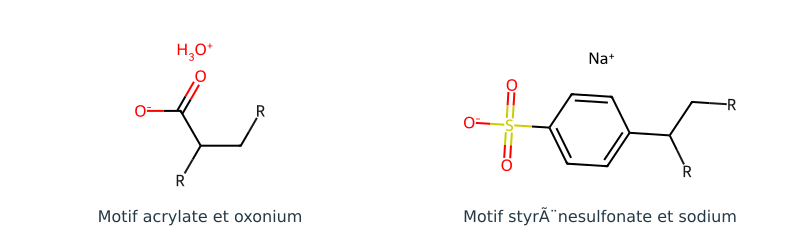

### Question 4 — Nombres de charge du PSSNa

> [!INDICATION]
> Les nombres de charge sont des entiers sans dimension. Compter combien d'unités sont chargées.

#### Solution

Toutes les unités sulfonates dissocient leur contre-ion dans le modèle. On a $f=1$, $Z_1=-1$ pour l'unité de la chaîne et $Z_2=+1$ pour le sodium.

### Question 5 — Fraction de sites dissociés

> [!INDICATION]
> Écrire la loi d'action de masse de AH, puis diviser les deux formes par la concentration totale en sites.

#### Solution

Avec les activités des solutés assimilées à $c_i/c^\circ$ en solution suffisamment diluée et celle de l'eau voisine de 1, $K_a=a_{\mathrm{H_3O^+}}a_{\mathrm{A^-}}/a_{\mathrm{AH}}$. L'hypothèse de sites identiques indépendants donne $f/(1-f)=10^{\mathrm{pH}-\mathrm pK_a}$. Ainsi $f=[1+10^{\mathrm pK_a-\mathrm{pH}}]^{-1}$. Les répulsions entre sites chargés sont négligées à cette étape.

### Question 6 — Application au PAA

> [!INDICATION]
> L'annexe fournit pKa = 4,9. Comparer l'écart au pKa avant de calculer.

#### Solution

On trouve successivement $f(2)\simeq0{,}00126$, $f(5)\simeq0{,}557$ et $f(7)\simeq0{,}992$. Le taux passe d'environ 0,13 % à plus de 99 % entre les deux extrêmes.

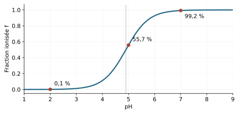

### Question 7 — De la pelote à la chaîne étirée

> [!INDICATION]
> Interpréter ce que deviennent les interactions entre sites voisins lorsque le nombre de carboxylates augmente.

#### Solution

À bas pH, la majorité des sites sont neutres et la chaîne peut adopter une pelote compacte. Lorsque le pH monte, les répulsions entre carboxylates favorisent une extension. L'augmentation du volume hydrodynamique peut servir à épaissir une solution selon son pH, ou à moduler le gonflement d'un gel réticulé.

## Mesurer le taux de charge

### Question 8 — Composition et taux de charge

> [!INDICATION]
> Ne compter au numérateur que les motifs qui donnent une charge fixe.

#### Solution

Avec $N=n_S+n_{SSNa}$, la fraction chimique chargée est $f=n_{SSNa}/(n_S+n_{SSNa})$.

### Question 9 — Dénombrer par RMN

> [!INDICATION]
> Comparer les protons portés par les phényles monosubstitués et disubstitués. Chercher un groupe dont l'intégrale renseigne sur le nombre de motifs.

#### Solution

Un motif styrène porte cinq H aromatiques, un motif sulfoné en porte quatre, dont les déplacements changent avec le substituant. Si les enveloppes sont résolues, leurs intégrales valent $5n_S$ et $4n_{SSNa}$ à un facteur commun près. Une normalisation par les trois H aliphatiques de squelette par unité est aussi possible. La distribution des séquences, les environnements conformationnels multiples et les temps de relaxation d'une macromolécule élargissent les raies et compliquent la séparation.

### Question 10 — Potentiel de membrane

> [!INDICATION]
> Imposer l'égalité des potentiels électrochimiques du sodium des deux côtés. Définir le sens de la tension mesurée.

#### Solution

En posant $\Delta E_m=\phi_{int}-\phi_{ext}$, l'égalité de $\mu^\circ+RT\ln a_{\rm Na}+F\phi$ de part et d'autre donne $\Delta E_m=(RT/F)\ln(a_{Na}^{ext}/a_{Na}^{int})$. Échanger les bornes change le signe. Le préfacteur d'un logarithme décimal est $2{,}303RT/F$ pour cet ion monovalent.

### Question 11 — Sensibilité à f

> [!INDICATION]
> Relier l'activité externe au nombre d'unités sulfonées, à concentration totale en motifs fixée.

#### Solution

Si tous les sodium sont libres et que le coefficient d'activité externe $\gamma$ reste constant, $a_{Na}^{ext}=\gamma f c_m/c^\circ$. Alors $\Delta E_m=\alpha+\beta\log_{10} f$, avec $\beta=2{,}303RT/F$ et $\alpha=\beta\log_{10}[\gamma c_m/(c^\circ a_{Na}^{int})]$. L'étalonnage réel inclut les potentiels constants des électrodes.

### Question 12 — Précision et activité libre

> [!INDICATION]
> À température ambiante, comparer un facteur dix sur f et une erreur d'un millivolt.

#### Solution

La pente vaut environ 59 mV par décade à 25 °C. Une incertitude $\delta E$ donne $\delta f/f\simeq F\delta E/(RT)$, soit près de 4 % pour 1 mV seul. L'électrode mesure l'activité des contre-ions **libres**. Interférences, activité non idéale ou condensation rendent délicate l'identification de cette mesure au taux chimique f.

### Question 13 — Analyse élémentaire du sodium

> [!INDICATION]
> Chaque motif comporte huit C, mais seul le motif chargé apporte un Na.

#### Solution

En divisant les masses des éléments, $w_{Na}/w_C=fM_{Na}/(8M_C)$. Donc $f=(8M_C/M_{Na})(w_{Na}/w_C)\simeq4{,}18\,w_{Na}/w_C$.

### Question 14 — Oxygène sans eau de solvatation

> [!INDICATION]
> Les trois oxygènes du sulfonate sont les seuls oxygènes du modèle sec.

#### Solution

On prévoit $w_O/w_C=3fM_O/(8M_C)$. Avec les masses usuelles, $f=2w_O/w_C$.

### Question 15 — Bilan de l'eau associée

> [!INDICATION]
> Écrire le nombre moyen d'oxygènes d'un motif comme une moyenne pondérée sur ses deux espèces.

#### Solution

Le motif moyen contient $3f+x(1-f)+yf=x+(3+y-x)f$ oxygènes pour huit carbones. Il en résulte $6w_O/w_C=x+(3+y-x)f$, soit $f=[6w_O/w_C-x]/(3+y-x)$.

### Question 16 — Nombre de molécules d'eau par motif

> [!INDICATION]
> La droite observée passe par l'origine. Identifier son ordonnée puis sa pente dans l'équation précédente.

#### Solution

La loi $f\simeq1{,}2\, w_O/w_C$ donne $6w_O/w_C=5f$. En identifiant la constante et le coefficient de $f$, $x\simeq0$ et $y\simeq2$. La formule moyenne du copolymère est $\mathrm{(C_8H_8)_{n_S}(C_8H_7SO_3Na\cdot2H_2O)_{n_{SSNa}}}$. L'eau mesurée est principalement associée aux motifs ioniques.

### Question 17 — Solubilité du copolymère

> [!INDICATION]
> Comparer l'affinité du styrène et du sulfonate pour l'eau.

#### Solution

À longueur de chaîne comparable, davantage de motifs sulfonés signifient davantage de charges hydratées. La solubilité aqueuse augmente généralement avec $f$ dans les conditions considérées, tandis qu'une chaîne riche en styrène présente un caractère hydrophobe marqué.

### Question 18 — Adsorption à une interface

> [!INDICATION]
> Chercher comment une chaîne statistique peut simultanément exposer ses parties hydrophiles et hydrophobes.

#### Solution

Le copolymère soluble est amphiphile. Les unités sulfonées restent au contact de l'eau et les groupes aromatiques peu polaires peuvent se placer vers l'air ou l'huile. Cette répartition abaisse l'énergie interfaciale et permet, par exemple, de stabiliser une émulsion huile-dans-eau.

## Longueur de Bjerrum et condensation

### Question 19 — Énergie coulombienne

> [!INDICATION]
> Fixer l'énergie à zéro à l'infini et conserver le signe du produit des valences.

#### Solution

Dans un milieu homogène de permittivité absolue $\varepsilon$, $U_{elec}=Z_1Z_2e^2/(4\pi\varepsilon r)$. Des ions de signes opposés ont une énergie d'interaction négative.

### Question 20 — Longueur de Bjerrum

> [!INDICATION]
> Mettre l'énergie de Coulomb sous la forme demandée en divisant par l'énergie thermique.

#### Solution

La longueur est $\ell_B=e^2/(4\pi\varepsilon k_BT)$ et $U_{elec}=Z_1Z_2(\ell_B/r)k_BT$. Le quotient d'une énergie multipliée par une longueur par une énergie a la dimension d'une longueur.

### Question 21 — Compétition avec l'agitation thermique

> [!INDICATION]
> Comparer r avec la distance pour laquelle le rapport des deux énergies vaut un.

#### Solution

Pour les ions monovalents, $|U_{elec}|/(k_BT)=\ell_B/r$. Cette valeur est supérieure à 1 si $r<\ell_B$, égale à 1 pour $r=\ell_B$ et inférieure à 1 si $r>\ell_B$.

### Question 22 — Signification physique de la longueur

> [!INDICATION]
> Formuler la comparaison comme une échelle de distance, en gardant en tête la nature statistique de l'agitation.

#### Solution

La longueur de Bjerrum est la séparation à laquelle l'énergie coulombienne de deux charges élémentaires vaut en valeur absolue l'énergie thermique. À plus courte distance, l'interaction électrique résiste davantage à l'agitation thermique. Il s'agit d'une échelle de comparaison énergétique.

### Question 23 — Généralisation des valences

> [!INDICATION]
> Dans l'égalité des énergies, quelle grandeur multiplie déjà la longueur de Bjerrum ?

#### Solution

Pour des ions de nombres de charge quelconques, $|U_{elec}|=k_BT$ à $r=L_{car}=|Z_1Z_2|\ell_B$. Une valence plus élevée étend le domaine où l'interaction électrique domine.

### Question 24 — Ordres de grandeur

> [!INDICATION]
> Comparer 0,7 nm à la distance entre motifs, puis à la longueur ou à la taille de la chaîne entière.

#### Solution

Dans l'eau à 25 °C, 0,7 nm représente quelques distances monomériques (typiquement quelques dixièmes de nanomètre) et une faible fraction de la taille d'une longue macromolécule. Les charges voisines peuvent donc fortement interagir et attirer des contre-ions à l'échelle locale. L'énergie entre deux charges isolées éloignées de plusieurs dizaines de nanomètres est faible devant $k_BT$.

### Question 25 — Distance chimique entre charges

> [!INDICATION]
> Répartir le nombre de charges fixes sur la longueur de contour.

#### Solution

La chaîne porte $fN$ unités chargées sur une longueur $Na$. La distance moyenne correspondante est $d=Na/(fN)=a/f$ pour $f>0$. Elle diverge lorsque $f$ tend vers zéro.

### Question 26 — Distance après neutralisation

> [!INDICATION]
> Reprendre le même dénombrement avec les unités effectivement chargées.

#### Solution

Comme il reste $f_{eff}N$ unités effectivement chargées, $d_{eff}=a/f_{eff}$ ou $f_{eff}=a/d_{eff}$.

### Question 27 — Deux régimes d'Oosawa

> [!INDICATION]
> Dans le premier régime tous les contre-ions sont libres. Dans le second, la distance effective atteint la valeur limite prescrite.

#### Solution

Pour $f<a/\ell_B$, on a $d>\ell_B$, donc $f_{eff}=f$. Pour $f\geq a/\ell_B$, $d_{eff}=\ell_B$ et $f_{eff}=a/\ell_B$. Ainsi $f_{eff}=\min(f,a/\ell_B)$. Après le seuil, ajouter des motifs chargés augmente la condensation sans accroître la charge effective dans ce modèle.

### Question 28 — Graphe de saturation

> [!INDICATION]
> Calculer l'abscisse de l'intersection entre la droite de pente un et le plateau.

#### Solution

Pour le PS-PSSNa, $a/\ell_B\simeq0{,}25/0{,}70\simeq0{,}36$. Le graphe suit la diagonale de l'origine à $(0{,}36;0{,}36)$, puis reste horizontal à $f_{eff}\simeq0{,}36$ jusqu'à $f=1$.

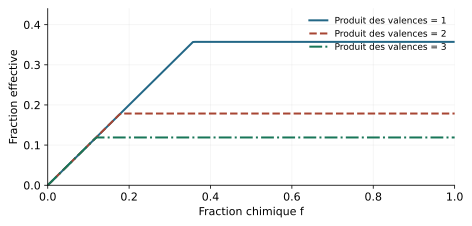

### Question 29 — Trois compositions au-delà du seuil

> [!INDICATION]
> Comparer les compositions au seuil, puis soustraire la fraction effective de la fraction chimique.

#### Solution

Les trois chaînes, de même N, ont le même $f_{eff}\simeq0{,}36$ et la même charge effective dans le modèle. Le nombre de charges fixes total augmente dans l'ordre 50, 75, 90 %. Les fractions de motifs neutralisées $f-f_{eff}$ valent respectivement environ 0,14, 0,39 et 0,54. La composition chimique et la proportion de segments hydrophobes demeurent donc différentes.

### Question 30 — Effet des multivalences

> [!INDICATION]
> Remplacer la distance d'équilibre des interactions d'ions monovalents par celle de Q23.

#### Solution

Le seuil devient $f_{crit}=a/(|Z_1Z_2|\ell_B)$ et $f_{eff}=\min(f,f_{crit})$. Lorsque $f_{crit}>1$, aucun plateau n'est atteint dans la gamme des compositions. Des nombres de charge plus grands renforcent l'attraction, favorisent la condensation à plus faible fraction chimique et abaissent le plateau.

## Distribution des contre-ions autour du fil

### Question 31 — Charge linéique

> [!INDICATION]
> Diviser la charge totale des N motifs par leur longueur de contour.

#### Solution

La densité linéique chimique est $\lambda=fNZ_1e/(Na)=fZ_1e/a$. Son signe suit celui des charges de la chaîne et son unité est C·m⁻¹.

### Question 32 — Champ d'un fil infini

> [!INDICATION]
> Choisir une surface de Gauss sur laquelle le champ est radial et de norme constante.

#### Solution

L'invariance par translation le long du fil et par rotation autour de lui donne $\mathbf E=E(r)\mathbf e_r$. Le flux à travers un cylindre coaxial de longueur L est $2\pi rL E(r)$. Sa charge enfermée vaut $\lambda L$. Donc $\mathbf E=\lambda\mathbf e_r/(2\pi\varepsilon r)$, dirigé vers le fil lorsqu'il est chargé négativement.

### Question 33 — Potentiel cylindrique

> [!INDICATION]
> Intégrer le champ avec le signe moins de la définition du potentiel et employer la distance de référence.

#### Solution

La condition $\phi(r_0)=0$ conduit à $\phi(r)=-[\lambda/(2\pi\varepsilon)]\ln(r/r_0)$. Le logarithme porte sur le rapport de deux longueurs.

### Question 34 — Énergie potentielle d'un contre-ion

> [!INDICATION]
> Multiplier le potentiel par la charge signée du contre-ion. Pour des charges opposées, le produit des valences est négatif.

#### Solution

On obtient $E_p=-(2fZ_1Z_2\ell_B/a)k_BT\ln(r/r_0)$. Pour un contre-ion, $Z_1Z_2<0$ et l'énergie s'écrit $E_p=2\xi k_BT\ln(r/r_0)$ avec $\xi=f|Z_1Z_2|\ell_B/a$. Elle diminue à l'approche du fil.

### Question 35 — Compter les ions dans une couronne

> [!INDICATION]
> À la loi de Boltzmann, multiplier le volume annulaire par unité de longueur. Le facteur radial modifie l'exposant.

#### Solution

La densité volumique est proportionnelle à $(r/r_0)^{-2\xi}$. Une couronne cylindrique de rayon x et d'épaisseur $\mathrm dx$ présente le volume $2\pi x\,\mathrm dx$ par unité de longueur. Ainsi $n(r)=K_2\int_0^r x^{1-2\xi}\,\mathrm dx$, avec $K_2>0$ absorbant $2\pi$, $r_0$ et la normalisation.

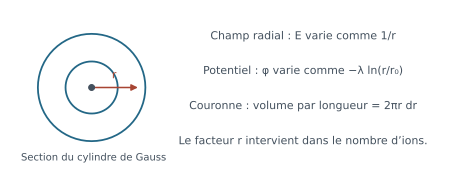

### Question 36 — Critère d'intégrabilité

> [!INDICATION]
> Pour une intégrale de puissance au voisinage de zéro, l'exposant doit être strictement supérieur à −1.

#### Solution

L'intégrale entre 0 et r converge si $1-2\xi>-1$, donc si $\xi<1$. Le seuil est $f_{crit}=a/(|Z_1Z_2|\ell_B)$. Au seuil exact l'intégrande varie comme $1/x$ et la divergence est logarithmique.

### Question 37 — Sous le seuil

> [!INDICATION]
> Écrire la primitive et déterminer le signe de la puissance de r.

#### Solution

Pour $f<f_{crit}$, $n(r)=K_2r^{2-2\xi}/(2-2\xi)$ et sa limite en zéro est nulle. Un cylindre de rayon arbitrairement petit ne retient donc pas une population finie de contre-ions dans ce modèle.

### Question 38 — Au seuil et au-delà

> [!INDICATION]
> Distinguer la divergence logarithmique au seuil de la divergence en puissance au-dessus.

#### Solution

À $\xi=1$, l'intégrale de $1/x$ diverge à sa borne inférieure. À $\xi>1$, la puissance $1-2\xi$ est inférieure à $-1$ et la divergence est encore plus forte. L'intégrale idéale définie à partir du fil de rayon nul diverge pour tout $r>0$.

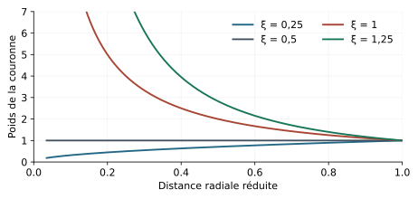

### Question 39 — Interprétation de la singularité

> [!INDICATION]
> Un contre-ion et une chaîne réels ont une taille finie. Que signale le défaut de normalisation du modèle ponctuel ?

#### Solution

Le poids statistique devient dominé par les positions de très petit rayon. Une taille de cœur finie et la neutralisation partielle limitent l'accumulation réelle. La singularité signale la condensation de contre-ions près du fil et la nécessité d'employer une charge effective.

### Question 40 — Charge après condensation

> [!INDICATION]
> Une condensation supplémentaire a-t-elle encore la même origine lorsque la charge effective atteint le seuil ?

#### Solution

L'accumulation neutralise une partie de la charge linéique. Elle ramène le paramètre effectif à la valeur marginale $\xi_{eff}=1$, donc $f_{eff}=f_{crit}$ pour une chaîne initialement au-dessus du seuil. Cette valeur est celle du modèle de saturation.

### Question 41 — Accord des deux descriptions

> [!INDICATION]
> Rassembler les domaines dans une seule expression en conservant le seuil multivalent.

#### Solution

On retrouve $f_{eff}=f$ pour $0\leq f<f_{crit}$ et $f_{eff}=a/(|Z_1Z_2|\ell_B)$ pour $f_{crit}\leq f\leq1$. L'approche statistique fournit la même pente initiale et le même plateau que le bilan énergétique de Q30.

### Question 42 — Exemple d'un duplex en solution

> [!INDICATION]
> Avec les conventions du sujet, prendre une paire de bases comme unité chimiquement chargée.

#### Solution

Ici $f=1$, $|Z_1|=2$, $|Z_2|=1$ et $a=0{,}34$ nm. Le seuil vaut $0{,}34/(2\times0{,}70)\simeq0{,}243$. Comme $f>f_{crit}$, $f_{eff}\simeq0{,}24$ dans le modèle.

### Question 43 — Contre-ions localisés en moyenne

> [!INDICATION]
> Le calcul de Q42 porte sur des unités qui ont deux charges élémentaires. Compter la charge neutralisée avant de compter les ions monovalents.

#### Solution

Pour $10^6$ paires de bases, les charges fixes représentent $2\,10^6$ charges élémentaires. La fraction neutralisée est environ $1-0{,}243=0{,}757$. On prévoit $2\,10^6\times0{,}757\simeq1{,}51\,10^6$ contre-ions localisés en moyenne. Cette estimation de modèle correspond à une population échangeable avec la solution.

## Déterminer la charge effective par cryoscopie

### Question 44 — Particules osmotiquement indépendantes

> [!INDICATION]
> Un ion lié compte-t-il comme une particule mobile distincte du macro-ion ?

#### Solution

Les solutés sont les chaînes, chacune accompagnée de ses contre-ions condensés, et les contre-ions restés libres. Une chaîne avec ses ions localisés compte comme une seule particule pour la propriété colligative étudiée.

### Question 45 — Concentration particulaire totale

> [!INDICATION]
> La concentration donnée est celle des motifs. Revenir au nombre de chaînes et au nombre d'ions mobiles.

#### Solution

La concentration des chaînes est $C_p=c_m/N$. Pour les nombres de charge monovalents retenus ici, la concentration des contre-ions libres est $c_m f_{eff}$. Par conséquent $C_s=c_m(f_{eff}+1/N)$.

### Question 46 — Grande longueur de chaîne

> [!INDICATION]
> Former le rapport des contributions des chaînes et des contre-ions.

#### Solution

Lorsque $N f_{eff}\gg1$, la contribution $c_m/N$ est faible devant $c_m f_{eff}$ et $C_s\simeq c_m f_{eff}$. Les contre-ions libres dominent alors la mesure. Une chaîne très peu chargée peut faire échouer cette approximation même si N est assez grand.

### Question 47 — État standard de l'eau liquide

> [!INDICATION]
> Dans la formule du potentiel chimique d'un mélange idéal, placer la fraction molaire de l'eau à l'unité.

#### Solution

Le terme $\mu^\circ_{\rm eau(l)}$ est le potentiel chimique de l'eau pure liquide à la température considérée et à la pression standard (ou à celle du système dans la convention de corps pur, à correction de pression près). Il dépend de la température. Le terme $RT\ln x_{\rm eau}$ est l'écart dû au mélange dans ce modèle.

### Question 48 — Condition d'équilibre de fusion

> [!INDICATION]
> Égaliser le potentiel chimique du solvant en solution et celui de la glace pure. Utiliser l'eau pure comme référence d'intégration.

#### Solution

À la fusion, $\mu^\circ_l+RT\ln x_{\rm eau}=\mu^\circ_s$, donc $\ln x_{\rm eau}=-\Delta_{fus}G^\circ/(RT)$. Gibbs–Helmholtz donne $\mathrm d\ln x_{\rm eau}/\mathrm dT=\Delta_{fus}H^\circ/(RT^2)$. La condition de référence est $x_{\rm eau}=1$ à $T^*$, température de fusion de l'eau pure à la même pression. L'intégration entre $(1,T^*)$ et $(x_{\rm eau},T_F)$ donne exactement les deux intégrales demandées.

### Question 49 — Fraction molaire en solutés

> [!INDICATION]
> À enthalpie de fusion constante, intégrer en 1/T², puis employer le développement de l'exponentielle.

#### Solution

Posons $u=(\Delta_{fus}H^\circ/R)(1/T_F-1/T^*)>0$. On a $x_{\rm eau}=e^{-u}$ et $x_s=1-e^{-u}$. Pour un mélange dilué, $x_s\simeq u\simeq\Delta_{fus}H^\circ(T^*-T_F)/(R T^{*2})$. La température du mélange est inférieure à celle de l'eau pure.

### Question 50 — Concentration et abaissement du point de fusion

> [!INDICATION]
> Relier la fraction molaire en soluté et la concentration de l'eau pure dans une solution très diluée.

#### Solution

À faible $x_s$, $C_s\simeq(\rho_{\rm eau}/M_{\rm eau})x_s$. Il vient $C_s\simeq[\rho_{\rm eau}\Delta_{fus}H^\circ/(M_{\rm eau}R T^{*2})](T^*-T_F)$. Avec $\rho$ en g·L⁻¹ et M en g·mol⁻¹, la concentration est obtenue en mol·L⁻¹.

### Question 51 — Facteur cryoscopique du modèle

> [!INDICATION]
> Associer Q46 à Q50 et vérifier les dimensions du facteur.

#### Solution

On obtient $f_{eff}\simeq\alpha(T^*-T_F)/c_m$, avec $\alpha=(\rho_{\rm eau}/M_{\rm eau})\Delta_{fus}H^\circ/(RT^{*2})$. Numériquement, $\alpha\simeq55{,}5\times6000/(8{,}314\times273{,}15^2)\simeq0{,}54\ \mathrm{mol\,L^{-1}\,K^{-1}}$.

### Question 52 — Mesure sur un polyélectrolyte synthétique

> [!INDICATION]
> Quelles contributions étrangères au nombre des contre-ions mobiles modifieraient le point de fusion ?

#### Solution

Mesurer sur une même installation la fusion de l'eau de référence et celle de solutions du polymère de $c_m$ connu, en relevant le palier à la remontée en température. La pente de $T^*-T_F$ contre $c_m$ vaut $f_{eff}/\alpha$ si $f_{eff}$ reste constant dans la gamme. Il faut une solution assez diluée pour l'idéalité, un écart mesurable, l'absence de sels adventices, des ions monovalents, une glace de solvant pur et $Nf_{eff}\gg1$. Un témoin et plusieurs concentrations permettent d'éprouver la linéarité et de distinguer une impureté saline.

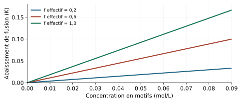

## Le duplex en solution dans le modèle documentaire

### Question 53 — Taux de neutralisation d'un duplex nu

> [!INDICATION]
> Dans le modèle du sujet, le taux chimique vaut un. Exprimer la fraction d'unités neutralisée à partir de celle qui reste chargée.

#### Solution

Pour un contre-ion de nombre de charge positif Z, $f_{eff}=a/(2Z\ell_B)\simeq0{,}24/Z$. Le taux de neutralisation est $\theta=(f-f_{eff})/f=1-0{,}24/Z=(Z-0{,}24)/Z$. Cette relation concerne un duplex libre en solution dans le modèle de l'épreuve.

### Question 54 — Valence et état du duplex

> [!INDICATION]
> Évaluer la formule de Q53 pour les trois premières valences, puis appliquer le critère documentaire.

#### Solution

Les valeurs théoriques sont environ 0,76, 0,88 et 0,92 pour Z égal à 1, 2 et 3. Au seuil de 0,89 indiqué dans le document, les exemples sodium et magnésium correspondent à la branche dépliée, tandis qu'un contre-ion trivalent correspond à la branche compacte. Un contre-ion plus chargé neutralise davantage les répulsions du duplex.

### Question 55 — État initial dans le modèle

> [!INDICATION]
> Attribuer au sodium son nombre de charge, puis appliquer la valeur précédente.

#### Solution

Avec le sodium seul, $Z=1$ et $\theta\simeq0{,}76<0{,}89$. Le document prévoit un duplex déplié en solution diluée.

### Question 56 — Charge du complexe compétiteur

> [!INDICATION]
> L'ammoniac coordonné est un ligand neutre. Vérifier l'électroneutralité du sel par ses trois chlorures.

#### Solution

Le cation complexe est $\mathrm{[Co(NH_3)_6]^{3+}}$ et son nombre de charge vaut $Z=3$. Les chlorures sont des anions et ne constituent pas les contre-ions de la chaîne anionique.

### Question 57 — Bornes de l'échange

> [!INDICATION]
> Considérer les cas limites où un seul type de cation détermine la neutralisation.

#### Solution

Sans échange on garde la limite sodium $\theta\simeq0{,}76$. Si tous les contre-ions qui gouvernent l'équilibre sont du type trivalent, la limite du modèle devient $\theta\simeq0{,}92$. La proportion d'échange à une composition intermédiaire ne découle pas de ces deux valeurs seules.

### Question 58 — Variation entre les deux limites

> [!INDICATION]
> Raisonner par compétition de populations, en conservant les limites de Q57.

#### Solution

La part du cation trivalent dans la population liée augmente avec son activité relative. La neutralisation attendue croît entre les deux limites 0,76 et 0,92 puis sature. Le document ne fournit pas de loi linéaire ni d'isotherme quantitative pour l'intervalle intermédiaire.

### Question 59 — Existence d'un seuil de concentration

> [!INDICATION]
> Comparer la neutralisation critique aux deux valeurs de Q57. L'argument nécessite une variation continue et monotone.

#### Solution

Comme $0{,}76<0{,}89<0{,}92$, la courbe croissante de neutralisation rencontre le seuil de 0,89 pour une concentration critique. Au-dessus, le modèle classe le duplex dans l'état compact. La seule connaissance des bornes ne permet pas de chiffrer cette concentration.

### Question 60 — Entropie d'échange

> [!INDICATION]
> Faire le bilan des petites particules libres si un cation trivalent remplace trois monovalents.

#### Solution

Dans ce bilan idéalisé, fixer un contre-ion trivalent et libérer trois monovalents augmente de deux le nombre de particules mobiles. L'entropie de dispersion favorise donc l'échange. Le terme $-T\Delta S$ devient plus favorable quand T augmente. La conclusion qualitative du sujet suppose cette contribution dominante. Pour prévoir rigoureusement la variation d'une constante d'équilibre, l'enthalpie d'échange serait aussi nécessaire.

### Question 61 — Déplacement du seuil thermique

> [!INDICATION]
> Appliquer l'hypothèse entropique du document à la quantité de cations compétitifs nécessaire pour atteindre le même état.

#### Solution

Avec $T_2>T_1$ et un échange favorisé à chaud dans l'interprétation du sujet, le seuil est atteint à plus faible concentration à $T_2$. On prévoit donc $C_{crit}^{(2)}<C_{crit}^{(1)}$.

### Question 62 — Deux états à concentration fixe

> [!INDICATION]
> Placer la concentration choisie entre les deux seuils sur un axe horizontal.

#### Solution

Pour $C_{crit}^{(2)}<C<C_{crit}^{(1)}$, le modèle donne l'état déplié à $T_1$ et compact à $T_2$. Si les transformations restent réversibles et que chaque état atteint l'équilibre, l'alternance de température entraîne une alternance de conformation.

### Question 63 — Analogie de phase

> [!INDICATION]
> Comparer la densité des deux états, puis identifier où se situe le gain d'entropie.

#### Solution

L'état compact évoque la phase liquide plus dense et l'état déplié évoque la phase gazeuse. Ici le chauffage peut favoriser l'état compact, à l'inverse de l'analogie usuelle liquide–gaz. Le gain de liberté des petits ions libérés peut compenser la perte d'entropie conformationnelle du duplex.

### Question 64 — Effet de la valence deux

> [!INDICATION]
> Une concentration critique définie pour une espèce peut-elle être appliquée telle quelle à une autre valence ?

#### Solution

Le complexe de cobalt(II) porte deux charges positives. Même dans la limite dominée par lui, $\theta=1-0{,}24/2\simeq0{,}88$, légèrement en dessous du seuil documentaire. La valeur critique établie pour le complexe trivalent ne se transpose donc pas à ce cas.

### Question 65 — Interprétation redox de l'observation

> [!INDICATION]
> L'annexe distingue le couple des ions cobalt libres et celui des complexes de l'ammoniac. Combiner Nernst et les constantes de dissociation.

#### Solution

L'espèce qui modifie la valence du cobalt est le permanganate oxydant. Le potentiel du couple complexé vaut $E^\circ_c=E^\circ_{3+/2+}+0{,}059\log_{10}(K_{d,III}/K_{d,II})\simeq1{,}92+0{,}059\log_{10}(1{,}5\,10^{-31})\simeq0{,}10\ \mathrm V$. La forte stabilisation du cobalt(III) complexé rend possible l'oxydation observée dans l'interprétation du sujet. La nouvelle charge trivalente permet le changement d'état. Le caractère monovalent du sel de potassium ne décrit donc pas le changement de spéciation de son partenaire.

### Question 66 — Rôle du grand excès de sel

> [!INDICATION]
> Distinguer la réaction d'oxydation initiale et la compétition ionique une fois le cobalt oxydé.

#### Solution

Dans le modèle d'échange, l'excès de sel apporte une forte population de $\mathrm{K^+}$ monovalents. Leur activité élevée peut concurrencer les complexes trivalents sur le duplex. La neutralisation repasse sous le seuil et rend compte du retour à l'état déplié. Cette explication documentaire présuppose que le duplex reste chimiquement intact.

## Synthèse de l’aromadandrène

### Question 67 — Addition sur l'isopropényle

> [!INDICATION]
> Comparer le carbocation qui résulte de chacune des deux orientations de protonation de la double liaison externe.

#### Solution

La liaison π du groupe $\mathrm{R{-}C(CH_3){=}CH_2}$ capte H du bromure d'hydrogène et la liaison H–Br donne son doublet à Br. La protonation du carbone terminal forme $\mathrm{R{-}C^+(CH_3)_2}$, carbocation tertiaire. L'attaque de $\mathrm{Br^-}$ donne $\mathrm{R{-}C(Br)(CH_3)_2}$, composé 1. L'alcène du système α,β-insaturé reste présent.

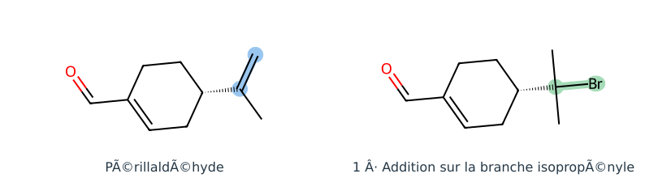

### Question 68 — Nucléophile en position gamma

> [!INDICATION]
> Numéroter la chaîne conjuguée à partir du formyle. Sur quel méthylène une déprotonation peut-elle donner un diénolate ?

#### Solution

Le tert-butanolate est ici une base. Il prélève sur le méthylène du cycle en position γ du formyle un H allylique. En notant A le carbone du formyle puis α, β, γ les carbones suivants, les formes limites de 2 placent la charge sur γ, sur α après déplacement de la liaison π, ou sur O dans le diénolate $\mathrm{{}^-O{-}A{=}C_\alpha{-}C_\beta{=}C_\gamma}$. La délocalisation sur le système conjugué stabilise cet anion. Le substituant tert-bromé reste attaché au carbone voisin de γ.

### Question 69 — Formation du petit cycle

> [!INDICATION]
> Identifier le carbone γ nucléophile et le centre tertiaire qui peut perdre le bromure. Compter les sommets du cycle ainsi fermé.

#### Solution

L'ionisation de C–Br est favorisée par le caractère tertiaire du carbone porteur. Une représentation limite fait partir $\mathrm{Br^-}$, puis le carbone γ du diénolate capture le centre cationique situé sur la branche voisine. Une liaison $\mathrm{C_\gamma{-}C(CH_3)_2}$ ferme le cyclopropane fusionné et rétablit le système énaldéhyde de 3. Une substitution bimoléculaire par attaque arrière sur le carbone tertiaire serait défavorisée.

### Question 70 — Méthylénation du formyle

> [!INDICATION]
> Repérer dans le produit le carbone qui provient du sel de phosphonium.

#### Solution

C'est une oléfination de Wittig. La base donne l'ylure $\mathrm{Ph_3P{=}CH_2}$, qui transforme le formyle de 3 en fragment vinyle avec formation de $\mathrm{Ph_3P{=}O}$. Le diène conjugué de 4 est ainsi constitué.

### Question 71 — Deux configurations non représentées

> [!INDICATION]
> Garder la configuration préexistante du bicyclique. On peut changer la face de la cycloaddition et l'orientation du formyle.

#### Solution

Pour la connectivité représentée, les deux produits 5 et 5′ ont le H de jonction en coin plein. Les deux autres diastéréoisomères portent le H de jonction en coin hachuré, et le formyle voisin respectivement en coin plein ou en coin hachuré. Les centres du cyclopropane de départ conservent leur configuration. On obtient donc quatre combinaisons de faces, sans introduire de nouvelles connectivités.

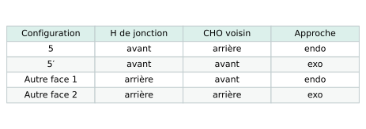

### Question 72 — Attribution endo et exo

> [!INDICATION]
> Replacer le carbonyle du diénophile par rapport au système π du diène dans la géométrie d'approche.

#### Solution

Dans 5, l'orientation du groupe formyle correspond à une approche sous le système π du diène, dite **endo**. Dans 5′, le formyle a été orienté vers l'extérieur, **exo**. Sur la face d'attaque commune aux deux produits dessinés, CHO est hachuré dans 5 et en coin plein dans 5′.

### Question 73 — Sélection de la face et de l'orientation

> [!INDICATION]
> Résoudre deux choix distincts, la face disponible sur le diène et la disposition du carbonyle dans le complexe d'approche.

#### Solution

Le relief du bicyclique et de son cyclopropane diméthylé encombre une face du diène. L'approche sur la face la plus accessible donne la jonction montrée pour 5 et 5′. À face identique, la disposition endo permet des interactions orbitalaires secondaires entre le système π du diène et le système π accepteur du carbonyle de l'acroléine. Sous contrôle cinétique cela favorise 5, sans supprimer complètement 5′.

### Question 74 — Réduction de l'aldéhyde

> [!INDICATION]
> Le carbone de l'aldéhyde conserve sa liaison au squelette. Vérifier ce que devient la double liaison du cycle.

#### Solution

6 reprend le squelette et les configurations de 5, avec $\mathrm{-CH_2OH}$ à la place du $\mathrm{-CHO}$ hachuré. L'hydrure réduit l'aldéhyde en alcool primaire et conserve la double liaison C=C isolée.

### Question 75 — Transformer l'alcool en mésylate

> [!INDICATION]
> Faire partir une flèche d'un doublet de l'oxygène vers le soufre électrophile. La liaison au carbone du squelette est conservée.

#### Solution

En notant R le squelette de 5 avec l'attache du substituant hachurée, $\mathrm{6=RCH_2OH}$ et $\mathrm{7=RCH_2O{-}S(=O)_2CH_3}$. L'alcool attaque le soufre du chlorure de mésyle. Le départ de chlorure et la déprotonation de l'oxygène par la triéthylamine donnent le mésylate neutre. Le carbone asymétrique du squelette ne subit aucune substitution dans cette étape.

### Question 76 — Pourquoi activer l'alcool ?

> [!INDICATION]
> Comparer les groupes susceptibles de quitter le carbone primaire sous l'action de l'hydrure.

#### Solution

Sur 6, l'hydrure peut déprotoner l'alcool et le groupe hydroxyle est un mauvais nucléofuge. Dans 7, le mésylate est un bon groupe partant grâce à la délocalisation de sa charge. L'attaque de l'hydrure au carbone primaire remplace alors $\mathrm{-CH_2OMs}$ par $\mathrm{-CH_3}$ et donne 8.

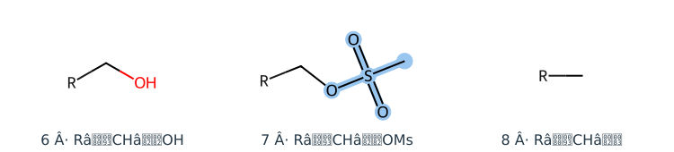

### Question 77 — Cycle formel de dihydroxylation

> [!INDICATION]
> Suivre les deux liaisons C–O formées sur la même face et distinguer le bilan du métal de celui de l'alcène.

#### Solution

Dans une représentation formelle du cycle, l'espèce d'osmium(VIII) s'additionne de façon concertée sur l'alcène et donne un ester osmate cyclique d'osmium(VI). L'hydrolyse des liaisons O–Os libère le diol syn et la forme réduite du catalyseur. Le cooxydant NMO accepte les équivalents de réduction et rétablit le degré VIII, tandis qu'il donne la N-méthylmorpholine. Le métal parcourt donc la boucle VIII → VI → VIII. Les deux liaisons C–O proviennent de la même face de l'alcène.

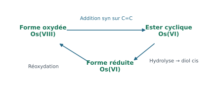

### Question 78 — Face de dihydroxylation

> [!INDICATION]
> Repérer sur 8 la face du méthyle voisin, puis imposer une addition syn de deux oxygènes.

#### Solution

La face de l'alcène voisine du méthyle hachuré et de la partie encombrée du tricycle est moins accessible. L'approche de l'autre face donne les deux OH en coins pleins dans 9. Les OH sont cis l'un à l'autre et se trouvent sur la face opposée au méthyle hachuré.

### Question 79 — Quel alcool se tosyle ?

> [!INDICATION]
> Comparer les nombres de substituants carbonés et l'accès au doublet de chaque oxygène.

#### Solution

Le OH du carbone de jonction est tertiaire et encombré, tandis que son voisin est un alcool secondaire plus accessible. C'est ce dernier oxygène qui est tosylé dans 10. La réaction sur O conserve le sens du lien C–O et le OH de jonction reste en place.

## Melokhanine E et spirocycle

### Question 80 — Centres de configuration de la melokhanine E

> [!INDICATION]
> Sur le dessin final, compter le carbone central voisin de N et C=O, le CH de jonction et le carbone porteur de l'éthyle. Écarter les azotes susceptibles d'inversion.

#### Solution

La structure dessinée comporte trois carbones stéréogènes. A est le carbone tétrasubstitué directement lié au N amidique et voisin de la cétone. B est le CH de jonction en coin plein et C la jonction portant l'éthyle en coin plein. Pour A, les priorités sont N amidique, carbone carbonylé, B, puis méthylène de la chaîne supérieure. La dernière liaison s'éloigne et donne **A(R)**. Pour C, B précède le chemin $\mathrm{CH_2{-}C(=O)}$, puis le chemin carboné du cycle azoté, puis l'éthyle. L'éthyle vient vers l'observateur et l'inversion du sens apparent donne **C(R)**. B est également R sur l'image choisie. C est quaternaire au sens strict de quatre voisins carbones. Les indications relatives représentent également l'énantiomère aux trois descripteurs inversés lorsqu'aucune configuration absolue n'est imposée.

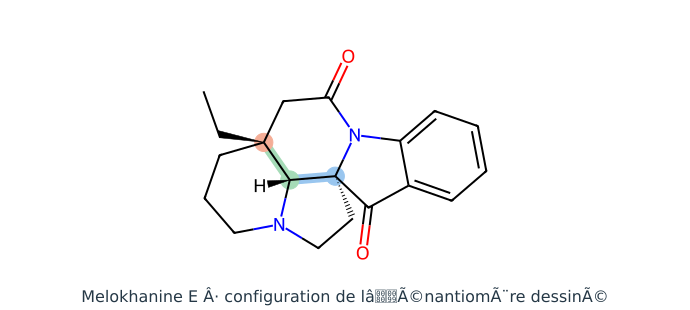

### Question 81 — Rôle du carbonate

> [!INDICATION]
> Une amine nucléophile protonée est beaucoup moins disponible. Identifier l'acide libéré par la substitution.

#### Solution

Le carbonate neutralise l'acidité de l'acide anthranilique et le proton libéré lors de l'alkylation de l'amine. Il maintient une fraction suffisante d'amine libre nucléophile et piège l'équivalent de HBr. La neutralisation finale redonne la fonction acide de 15.

### Question 82 — Structure de l'amine substituée

> [!INDICATION]
> Dans une SN2, remplacer le brome sur son propre carbone et vérifier la formule brute.

#### Solution

Le N de l'acide 2-aminobenzoïque se lie au carbone α de la γ-butyrolactone, initialement porteur de Br. Le produit 15 est l'acide 2-[(2-oxotétrahydrofurane-3-yl)amino]benzoïque, ou, en écriture de cycle, $\mathrm{o{-}HO_2CC_6H_4NH{-}CH(CH_2CH_2O{-}){-}C(=O)}$ avec fermeture de la lactone de l'oxygène terminal au carbonyle. Sa formule est $\mathrm{C_{11}H_{11}NO_4}$. Le carbone substitué s'inverse si l'on suit un énantiomère déterminé du bromure.

### Question 83 — Deux rôles de l'anhydride acétique

> [!INDICATION]
> Rendre compte à la fois du substituant porté par N dans 16 et de la fermeture du cycle autour de la cétone.

#### Solution

L'anhydride acétique fournit le groupe acétyle de l'azote et active la fonction carboxylique ortho, notamment sous forme d'anhydride mixte. Une acylation intramoléculaire au carbone énolisable de la lactone ferme le cycle à cinq chaînons de 16. L'activation et l'élimination d'acétate rendent possible la formation de la cétone.

### Question 84 — Identifier le produit de décarboxylation

> [!INDICATION]
> Le carbone spiro du produit 11 et ses deux CH₂ doivent déjà se retrouver après perte de CO₂. Vérifier l'acétyle restant.

#### Solution

17 est le **dérivé N-acétylé de 11**. Il conserve la cétone de l'indolin-3-one, porte un cyclopropane spiro adjacent et le substituant $\mathrm{N{-}C(=O)CH_3}$. Sa formule est $\mathrm{C_{12}H_{11}NO_2}$.

### Question 85 — Décarboxylation et fermeture du cyclopropane

> [!INDICATION]
> La lactone peut d'abord être ouverte par rupture de sa liaison alkyle–oxygène. Suivre le chlorure depuis l'attaque initiale jusqu'à son expulsion.

#### Solution

Le chlorure attaque le méthylène primaire lié à l'oxygène de la lactone de 16. L'ouverture SN2 forme un carboxylate et un fragment $\mathrm{-CH_2CH_2Cl}$ attaché au carbone central. La décarboxylation libère $\mathrm{CO_2}$ et donne un énolate stabilisé par la cétone adjacente. Sa forme carbonée attaque intramoléculairement le carbone terminal porteur de Cl. Le départ de chlorure referme le cyclopropane et livre 17. Ce déroulement de type Krapcho distingue l'ouverture, la décarboxylation et la substitution cyclisante.

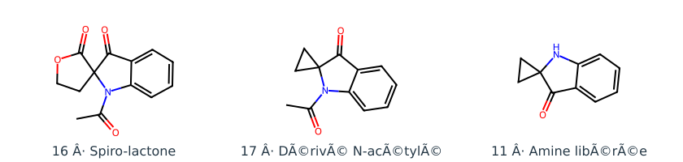

### Question 86 — Libérer l'azote de 11

> [!INDICATION]
> Identifier quel carbonyle peut subir une substitution nucléophile avec rupture d'une liaison à N.

#### Solution

Il s'agit de l'hydrolyse basique du groupe N-acétyle. L'hydroxyde s'additionne au carbonyle de cet amide. Après transferts de protons et retour de l'oxygène vers le carbonyle, la rupture de la liaison acyle–N libère l'azote de 11. La déprotonation de l'acide acétique en acétate et la formation du groupement NH favorisent le bilan. Le carbonyle cétonique du squelette et le cyclopropane sont conservés.

### Question 87 — Attribuer les sept signaux du spirocycle

> [!INDICATION]
> Numéroter l'arène de C4, voisin de la cétone, à C7, voisin de N. Séparer protons aromatiques, NH et quatre protons cyclopropaniques.

#### Solution

Le doublet à 7,63 ppm s'attribue à H4 proche de la cétone, le multiplet 7,46–7,41 à H6, le doublet à 6,97 à H7 proche de N et le multiplet 6,90–6,85 à H5. Les deux protons aux extrémités ont chacun un voisin ortho dominant. Le singulet à 5,12 ppm (1 H) correspond à NH. Les deux multiplets à 1,54–1,50 et 1,45–1,41 ppm intègrent chacun pour deux H du cyclopropane. Les deux CH₂ sont équivalents par symétrie, mais les deux H de chaque CH₂ voient des faces différentes du cycle spiro. Les données 1D seules ne fixent pas laquelle des deux faces correspond au premier multiplet.

## Fragment bicyclique de la melokhanine

### Question 88 — Coproducteur de la protection Boc

> [!INDICATION]
> Suivre la moitié du dicarbonate qui ne reste pas portée par l'azote.

#### Solution

Le groupe tert-butylcarbonate partant se décarboxyle en tert-butanolate. Sa protonation fournit le **tert-butanol**, $\mathrm{(CH_3)_3COH}$, en plus de l'équivalent de $\mathrm{CO_2}$. L'autre partie du dicarbonate fournit le carbamate N-Boc de 19.

### Question 89 — Réduction jusqu'à l'hémiaminal

> [!INDICATION]
> Il faut conserver le groupe Boc et s'arrêter avant la réduction complète du carbonyle de lactame.

#### Solution

Une réduction partielle contrôlée par le DIBAL-H, en quantité voisine d'un équivalent à basse température dans le toluène, suivie d'une hydrolyse, convient à la formation du lactamol 20. Le transfert d'hydrure sur le carbonyle endocyclique donne l'hémiaminal. Un réducteur trop énergique ou un excès compromettrait l'arrêt à ce stade ainsi que la conservation du carbamate.

### Question 90 — Déshydratation du lactamol

> [!INDICATION]
> Identifier le H en beta disponible du côté du carbone porteur de l'éthyle et ménager la protection Boc.

#### Solution

On peut activer OH en mésylate avec chlorure de mésyle et triéthylamine dans le dichlorométhane à froid, puis permettre l'élimination avec une base telle que DBU et réchauffer modérément. L'élimination entre le carbone du lactamol et son voisin éthylé forme l'énécarbamate 21. Le choix de conditions peu acides vise à conserver N-Boc.

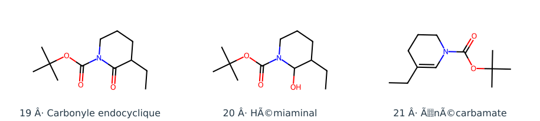

### Question 91 — Degré d'oxydation du cuivre

> [!INDICATION]
> Déterminer la charge d'un ligand triflate et appliquer l'électroneutralité au complexe 22 de la figure 6.

#### Solution

Le ligand $\mathrm{OSO_2CF_3^-}$ est le triflate, monoanionique. Le complexe représenté $\mathrm{Cu(OTf)}$ est neutre. Le cuivre est donc au degré **+I**.

### Question 92 — Formes de Lewis du diazoester

> [!INDICATION]
> Le motif diazo comporte deux N liés en chaîne. Compter les octets et les charges avant de choisir une géométrie.

#### Solution

Deux formes limites sont $\mathrm{EtO_2C{-}CH{=}N^+{=}N^-}$ et $\mathrm{EtO_2C{-}C^-H{-}N^+{\equiv}N}$. Dans la première, le N terminal porte deux doublets, dans la seconde il en porte un et le carbone diazo porte un doublet. Le N central est positif et ne porte aucun doublet dans ces deux écritures. Les deux domaines de liaison autour de lui imposent un axe C–N–N approximativement linéaire. Chaque oxygène neutre de l'ester porte deux doublets.

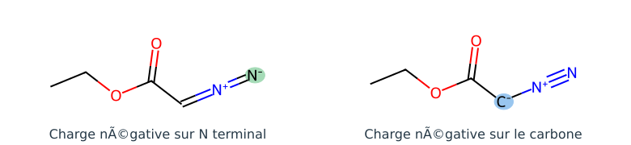

### Question 93 — Relation entre les cyclopropanes

> [!INDICATION]
> Comparer la configuration du seul sommet qui change entre les deux dessins en conservant les autres configurations relatives.

#### Solution

24 et 24′ diffèrent par la face du substituant ester au sommet du cyclopropane qui porte $\mathrm{CO_2Et}$. Les jonctions du bicyclique conservent leur configuration relative. Ce sont deux diastéréoisomères, épimères à ce sommet. Chacun est obtenu comme racémate.

### Question 94 — Stéréoconvergence lors de l'hydrolyse

> [!INDICATION]
> Une simple hydrolyse de l'ester conserverait la configuration au carbone voisin. Chercher le proton qui permet l'épimérisation.

#### Solution

L'hydrogène du carbone portant $\mathrm{CO_2Et}$ est en alpha de l'ester. Une énolisation réversible avant la saponification complète permet l'interconversion des deux configurations puis leur reprotonation. L'hydrolyse fixe le produit sous forme carboxylate et l'acidification donne la configuration représentée pour 12. L'explication suppose une épimérisation dans les conditions basiques et une préférence pour le diastéréoisomère observé. 12 demeure un racémate de cette configuration relative.

## Couplage et ouverture du cyclopropane

### Question 95 — Couplage entre 11 et 12

> [!INDICATION]
> Retrouver dans 25 la liaison nouvelle entre le N de 11 et le carbone carboxylique de 12.

#### Solution

On peut activer l'acide 12 par un réactif de couplage tel qu'EDCI, en présence d'un activateur comme le NHS dans un solvant compatible à température ambiante, puis ajouter l'amine 11 et une base organique. L'azote de 11 attaque le carbonyle activé, l'intermédiaire tétraédrique élimine le groupe partant et forme l'amide 25. Ces conditions conservent l'azote Boc-protégé du fragment 12 et la cétone du fragment 11.

### Question 96 — Nature des orbitales vacantes

> [!INDICATION]
> Sur les surfaces de la figure 8, distinguer les lobes centrés sur les H et ceux qui s'étendent vers l'extérieur du squelette carboné.

#### Solution

L'orbitale vacante montrée pour le cyclohexane comporte des amplitudes sur les C et sur les H, avec une participation marquée des orbitales 1s des H au système antiliant des liaisons C–H. Pour le cyclopropane, les grands lobes s'organisent surtout sur les carbones, à l'extérieur du triangle. Ils correspondent essentiellement à des combinaisons de composantes 2p des carbones, à caractère antiliant entre carbones. La contribution des H y est beaucoup moins apparente.

### Question 97 — Écart énergétique et réactivité

> [!INDICATION]
> Comparer les deux valeurs fournies à une même énergie de l'orbitale occupée donneuse du nucléophile.

#### Solution

La basse vacante du cyclopropane est à 3,141 eV contre 3,656 eV pour celle du cyclohexane. L'écart avec la haute occupée du même nucléophile est réduit d'environ 0,515 eV pour le petit cycle, ce qui favorise l'interaction donneur–accepteur, à recouvrement adapté. Les lobes accessibles des carbones et la relaxation de la contrainte de cycle favorisent aussi l'ouverture. Les nombres donnés sont des énergies orbitalaires et non des énergies d'activation.

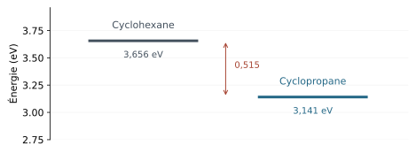

### Question 98 — Affaiblissement d'une liaison C–C

> [!INDICATION]
> Observer le signe relatif des lobes sur les deux carbones de la liaison rompue.

#### Solution

De part et d'autre de la liaison C–C concernée, les lobes de la vacante ont des phases opposées. Le transfert de densité depuis le nucléophile dans cette orbitale antiliante diminue l'ordre de liaison. L'attaque d'un carbone peut ainsi s'accompagner de l'ouverture du cycle.

### Question 99 — De l'intermédiaire A à l'énolate B

> [!INDICATION]
> Repérer dans B l'iodure en bout de chaîne et l'oxygène lié à Mg. La coordination précède l'ouverture.

#### Solution

Le doublet du carbonyle indolinonique de A coordonne d'abord le centre magnésium de l'acide de Lewis. Un iodure attaque ensuite un carbone méthylénique du cyclopropane spiro. Le doublet de la liaison C–C rompue forme une liaison π entre l'ancien centre spiro et le carbone du carbonyle activé, tandis que le doublet π C=O se reporte sur O lié au magnésium. On obtient l'énolate O–MgI de B et le bras $\mathrm{-CH_2CH_2I}$. L'imine dessinée sur l'autre fragment subsiste à cette étape.
