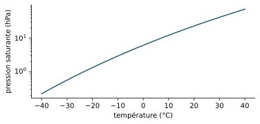
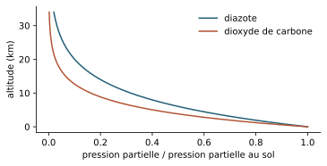
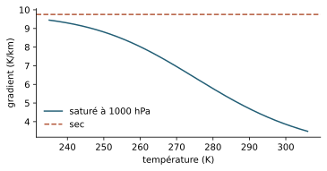
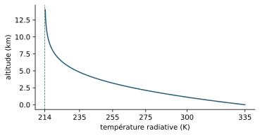
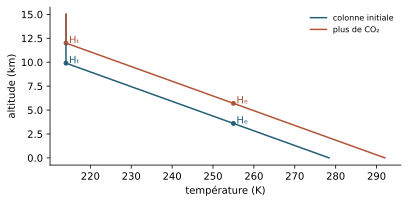
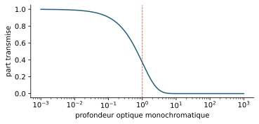

# ENS Ulm PC 2021 — Physique C · Corrigé brut

*Corrigé rédigé par IA, non officiel. Signalez toute erreur.*

**Lecture du rapport du jury** · GPT-6.2 Astra Ultra · vitesse non renseignée

**Rédaction** · GPT-6.2 Astra Ultra · vitesse non renseignée

## L’eau dans l’atmosphère

## Saturation de l’eau

### Question 1 — Équilibre d’une transition

Au cours d’une vaporisation réversible à la température commune $T$ et à pression constante, la chaleur massique reçue vaut $L=h_v-h_l=T(s_v-s_l)$. D’où $h_v-Ts_v=h_l-Ts_l$, soit $\zeta_v=\zeta_l$. Cette égalité concerne les deux phases chacune à l’équilibre.

### Question 2 — Différentielle de Gibbs

Dans une phase homogène, $du=Tds-pdv$. De $h=u+pv$ on tire $dh=Tds+vdp$. Par conséquent $d\zeta=d(h-Ts)=vdp-sdT$ pour cette phase, avec toutes les grandeurs rapportées à l’unité de masse.

### Question 3 — Pente de coexistence

Sur la courbe d’équilibre, les variations des deux $\zeta$ restent égales. Ainsi $(v_v-v_l)de_s=(s_v-s_l)dT$, d’où $de_s/dT=L/[T(v_v-v_l)]$. La pente est positive pour la vaporisation.

### Question 4 — Variation de la chaleur latente

En assimilant les enthalpies à des fonctions de $T$ à capacités presque constantes, $L(T)=L(T_m)+(c_{p,v}-c_{p,l})(T-T_m)$. Sur 80 K, la variation est $(1859-4185)\times80\simeq-1{,}9\times10^5\,\mathrm{J/kg}$, soit environ 8 % de $2{,}44\times10^6\,\mathrm{J/kg}$ et moins de 4 % de part et d’autre de $T_m$. L’approximation d’un $L$ constant convient pour les estimations visées.

### Question 5 — Forme intégrée de Clausius–Clapeyron

Négligeons $v_l$ devant $v_v$ et assimilons la vapeur à un gaz parfait, $v_v=RT/(M_e e_s)$. Pour $L$ constant, $d\ln e_s=(M_eL/R)dT/T^2$. En posant $e_m=e_s(T_m)$, on obtient $e_s=e_m\exp[(M_eL/R)(1/T_m-1/T)]$. Les températures de cette formule sont absolues.

### Question 6 — Lecture de la courbe

La figure 3, d’ordonnée logarithmique, passe d’environ $0{,}2\,\mathrm{hPa}$ à $-40\,^{\circ}\mathrm C$ à $70\,\mathrm{hPa}$ à $40\,^{\circ}\mathrm C$. Son allure presque rectiligne dans ces axes traduit une croissance voisine d’une exponentielle sur cet intervalle.

## Composition et équilibre vertical

### Question 7 — Gravité presque constante

Le document 3.1, lignes 27 à 33, place 99 % de la masse atmosphérique sous 30 km. Le rayon terrestre est environ $6400\,\mathrm{km}$, donc la variation relative de $g\propto(R_T+z)^{-2}$ est de l’ordre de $2z/R_T$, soit à peine 1 % à 30 km.

### Question 8 — Équilibre d’un constituant

Dans le modèle d’espèces indépendantes, le poids et le gradient de pression partielle du diazote se compensent. Avec $z$ ascendant, $dp_{N_2}/dz=-\rho_{N_2}g$ et, pour le gaz parfait, $\rho_{N_2}=M_{N_2}p_{N_2}/(RT_0)$.

### Question 9 — Hauteur du diazote

À température constante, l’équation séparée s’intègre en $p_{N_2}(z)=p_{N_2}(0)e^{-z/H_N}$ avec $H_N=RT_0/(M_{N_2}g)$. Pour 288 K et $28\,\mathrm{g/mol}$ on trouve $8{,}7\,\mathrm{km}$, environ $9\,\mathrm{km}$.

### Question 10 — Hauteur du dioxyde de carbone

De même $p_C(z)=p_C(0)e^{-z/H_C}$ avec $H_C=RT_0/(0{,}044g)\simeq5{,}5\,\mathrm{km}$. À température égale le constituant plus lourd a une hauteur d’échelle plus petite dans ce modèle sans brassage.

### Question 11 — Densité atmosphérique standard

Le tableau 1 donne 78 % en volume de diazote, ce qui justifie la comparaison au modèle de Q9. La figure 4c passe d’environ $1{,}2\,\mathrm{kg/m^3}$ au sol à environ $0{,}4\,\mathrm{kg/m^3}$ à 10 km. Le modèle de hauteur $8{,}7\,\mathrm{km}$ donne $1{,}2e^{-10/8{,}7}\simeq0{,}38\,\mathrm{kg/m^3}$. L’ordre de grandeur de la décroissance est reproduit malgré la variation réelle de température.

### Question 12 — Concentration relative du carbone

La figure 6 montre environ 372 ppm à 15 km et 363 ppm à 30 km, une baisse de quelques pour cent. Or dans le modèle $p_C/p_N\propto e^{-z(1/H_C-1/H_N)}$. Sur 15 km, on prédirait un facteur proche de $0{,}37$, soit une chute de plus de moitié. La séparation hydrostatique de gaz indépendants omet les mouvements et le brassage turbulent qui maintiennent une composition assez homogène. Le document 3.1, lignes 35 à 46, décrit ces mouvements.

### Question 13 — Eau et ozone

La figure 4d montre une chute rapide de la teneur en vapeur lorsque l’air ascendant refroidit. La pression saturante chute fortement (figure 3), l’eau condense et peut précipiter. L’ozone possède des sources et des puits photochimiques dépendant notamment des ultraviolets, d’où son maximum en altitude (figure 4e et document 3.1, lignes 13 à 19). Le brassage seul ne fixe pas leur concentration.

### Question 14 — Masse molaire de l’air sec

La grandeur annoncée à $29\,\mathrm{g/mol}$ est la masse molaire, comme le confirme le rapport du jury. La composition des principaux gaz secs varie peu dans la basse et la moyenne atmosphère (document 3.1, lignes 13 à 16). Ainsi $M_d=\sum x_jM_j\simeq0{,}781\times28+0{,}209\times32+0{,}0093\times40\simeq29\,\mathrm{g/mol}$. La masse volumique, elle, diminue comme le montre la figure 4c.

## Convection sèche et saturée

### Question 15 — Enthalpie généralisée

Dans l’atmosphère isentropique $ds=0$ et $dh=vdp$. L’hydrostatique donne $dp=-\rho gdz$, donc $dh=-gdz$. La somme $h^*=h+gz$ est constante avec l’altitude.

### Question 16 — Gradient sec

Pour un gaz parfait sec $dh=c_p dT$, donc $\Gamma_d=-dT/dz=g/c_p\simeq9{,}8\,\mathrm{K/km}$, soit environ 10. La figure 4a passe d’environ 288 K au sol à 216 K vers 11 km, soit $6{,}5\,\mathrm{K/km}$ dans la troposphère. Le profil de l’atmosphère standard y est moins raide.

### Question 17 — Temps d’ajustement d’une parcelle

Pour une parcelle de taille $\ell=10\,\mathrm m$, la pression s’équilibre sur $\ell/c_{\rm son}\simeq0{,}03\,\mathrm s$. La conduction de chaleur requiert $\ell^2/\kappa\simeq5\times10^6\,\mathrm s$. Un mouvement à $10\,\mathrm{m/s}$ parcourt la taille de la parcelle en une seconde (doc. 3.1, lignes 44 à 46), entre ces deux durées. La pression s’ajuste ainsi rapidement tandis que la diffusion thermique reste négligeable dans ce modèle.

### Question 18 — Densité d’une parcelle sèche

Les échanges thermiques sont négligeables et le mouvement s’effectue à pression presque équilibrée, sans dissipation dans le modèle. La transformation est donc adiabatique réversible et isentropique. Pour le gaz parfait de $\gamma$ constant, $T\rho^{1-\gamma}$ se conserve. Il en résulte $\rho_p(z_f)=\rho_p(z_i)[T_p(z_f)/T_p(z_i)]^{1/(\gamma-1)}$.

### Question 19 — Stabilité sèche

La résultante des forces de pression est la poussée d’Archimède. Avec le poids, la force verticale est $gV(\rho_{\rm env}-\rho_p)$. Après une petite montée, $T_p=T_i-\Gamma_d dz$ et $T_{\rm env}=T_i-\Gamma dz$. À même pression, si $\Gamma<\Gamma_d$, la parcelle est plus froide et plus dense, donc rappelée vers le bas. Le signe opposé donne l’instabilité. C’est le mécanisme décrit au document 3.2, lignes 14 à 18.

### Question 20 — Atmosphère standard et critère sec

La figure 4a donne $\Gamma\simeq6{,}5\,\mathrm{K/km}$ dans la troposphère et un gradient nul puis négatif dans la stratosphère. Tous restent inférieurs aux près de $10\,\mathrm{K/km}$ de Q16. Le profil standard est donc stable par rapport à ces déplacements secs.

### Question 21 — Enthalpie du mélange

Par additivité de l’enthalpie dans le modèle, $h=(1-q_e)h_d+q_vh_v+q_lh_l$, soit $h=h_d+q_e(h_l-h_d)+q_vL$. La dernière écriture utilise $q_e=q_v+q_l$ et $L=h_v-h_l$.

### Question 22 — Enthalpie humide approchée

Pour une parcelle fermée $q_e$ est constant. À une constante additive près et avec $L$ presque constant (Q4), $h+gz=[c_p+q_e(c_{p,l}-c_p)]T+Lq_v+gz$. Le document 3.4 donne 0,5 à 5 % d’eau en volume pour la vapeur, soit typiquement quelques pour cent en masse. Même à 40 °C, la figure 3 donne $e_s\sim70\,\mathrm{hPa}$ contre environ 1000 hPa au sol, soit une fraction massique de vapeur de l’ordre de 0,04. Pour une parcelle diluée peu chargée en eau liquide, la correction à $c_p$ est de l’ordre de quelques à une dizaine de pour cent. On retient $h^{*,m}\simeq c_pT+Lq_v+gz$.

### Question 23 — Gradient et condensation

Le long d’une parcelle saturée fermée en ascension isentropique, la conservation de l’enthalpie généralisée donne $c_p\,dT/dz+L\,dq_v/dz+g=0$. Donc $\Gamma=-dT/dz=(g+L\,dq_v/dz)/c_p$. La dérivée porte sur la teneur réellement suivie par la parcelle.

### Question 24 — Comparaison humide–sèche

Dans la troposphère saturée considérée, l’ascension refroidit l’air et une partie de sa vapeur se condense, donc $dq_v/dz<0$ et $\Gamma_s<g/c_p=\Gamma_d$. La chaleur libérée par la condensation réduit le refroidissement par détente.

### Question 25 — Variables de l’humidité saturante

La fraction saturante est une fonction de la température et de la pression. Sa dérivée le long du profil vaut $dq_s/dz=(\partial q_s/\partial T)_p\,dT/dz+(\partial q_s/\partial p)_T\,dp/dz$. Le deuxième terme intervient même si la saturation est localement imposée par $T$.

### Question 26 — Forme explicite de la dérivée

Pour une vapeur diluée, $q_s\simeq (R_d/R_v)e_s/p$ par les lois des gaz parfaits. Alors $d\ln q_s/dz=[L/(R_vT^2)]dT/dz-(1/p)dp/dz$. L’hydrostatique $dp/dz\simeq-pg/(R_dT)$ donne $dq_s/dz=[Lq_s/(R_vT^2)]dT/dz+gq_s/(R_dT)$.

### Question 27 — Gradient saturé

Insérons Q26 dans $c_pT'+Lq_s'+g=0$. Les termes donnent $[c_p+L^2q_s/(R_vT^2)]T'=-g[1+Lq_s/(R_dT)]$. On obtient $\Gamma_s=(g/c_p)[1+Lq_s/(R_dT)]/[1+L^2q_s/(c_pR_vT^2)]$. Pour $q_s$ négligeable, la limite sèche est retrouvée.

### Question 28 — Correction dominante

À 288 K, $R_vc_pT/(R_dL)\simeq462\times1006\times288/(287\times2{,}44\times10^6)\simeq0{,}19$. C’est le rapport du terme humide additionnel du numérateur à celui du dénominateur. Le second varie donc plus fortement et gouverne l’abaissement du gradient lorsque la teneur en vapeur augmente.

### Question 29 — Variation avec la température

À pression fixée $q_s$ croît presque exponentiellement sur l’intervalle étudié (figure 3). Cette croissance l’emporte sur les puissances modérées de $T$ dans les corrections. Le dénominateur de Q27 augmente davantage et $\Gamma_s$ diminue, comme sur la figure 7 à 1000 hPa, d’environ 9 K/km vers 245 K à près de 3 K/km vers 315 K. À basse température, $q_s\to0$ et $\Gamma_s\to g/c_p\simeq10\,\mathrm{K/km}$.

### Question 30 — Critère de convection saturée

Après une petite montée, la parcelle saturée refroidit à la pente $\Gamma_s$. À pression égale, si $\Gamma<\Gamma_s$ elle est plus froide et redescend. L’atmosphère est stable pour $\Gamma<\Gamma_s$, neutre à l’égalité et instable pour $\Gamma>\Gamma_s$, dans les approximations de masse volumique du modèle.

### Question 31 — Comparaison au profil standard

Près du sol, la figure 7 vers 288 K et 1000 hPa donne environ 5 K/km, au-dessous des 6,5 K/km de la figure 4a. Un air saturé y serait instable alors qu’un air sec serait stable. Plus haut, l’air plus froid contient moins d’eau et le gradient saturé s’approche de 9 à 10 K/km. Le critère doit donc être appliqué localement avec le profil de température et l’humidité réelle (figure 5).

## Spectres et équilibre radiatif

### Question 32 — Spectre thermique terrestre

La loi de Wien (données 1.4) donne $\lambda_m=2{,}898\times10^{-3}/288\simeq10\,\mu\mathrm m$. Selon l’intervalle de 98 % fourni sous la figure 2, l’essentiel du rayonnement se trouve de $0{,}5\lambda_m$ à $8\lambda_m$, soit environ 5 à $80\,\mu\mathrm m$, dans l’infrarouge.

### Question 33 — Spectre solaire incident

La figure 8 montre un maximum vers $0{,}5\,\mu\mathrm m$, contre $10\,\mu\mathrm m$ pour la surface terrestre. La majeure partie de l’énergie solaire arrive en visible et en proche infrarouge. La séparation des deux domaines justifie de traiter approximativement les courtes longueurs d’onde incidentes et les grandes longueurs d’onde terrestres dans des bilans distincts.

### Question 34 — Extinction d’un faisceau

On rencontre la même dépendance dans la loi de Beer–Lambert pour une solution absorbante. Une tranche mince enlève une fraction proportionnelle à la concentration et à la longueur parcourue. L’intégration dans un milieu homogène donne une décroissance exponentielle.

### Question 35 — Transfert dans la direction verticale

En montant de $z$ à $z+dz$, le faisceau perd $I_\lambda k_\lambda\rho dz$ et gagne $A_\lambda k_\lambda\rho dz$. Ainsi $dI_\lambda=(A_\lambda-I_\lambda)k_\lambda\rho dz$. Comme $d\tau_\lambda=-k_\lambda\rho dz$, $dI_\lambda/d\tau_\lambda=I_\lambda-A_\lambda$.

### Question 36 — Trajets obliques

Un rayon incliné parcourt dans la même couche une distance $dz/\cos\theta$ supérieure à $dz$. La moyenne sur l’hémisphère correspond donc à une profondeur optique effective plus grande, d’où $\zeta>1$.

### Question 37 — Flux descendant

La propagation descendante se fait vers les $\tau$ croissants. Avec $D_\lambda$ défini positif vers le bas, $dD_\lambda/d\tau=B_\lambda-D_\lambda$. L’absorption diminue le flux dans son propre sens de parcours.

### Question 38 — Flux net et somme

Dans le modèle gris, $U_L'=U_L-B$ et $D_L'=B-D_L$, prime en $\tau$. On a assimilé l’émission intégrée au-delà de $5\,\mu\mathrm m$ à $B=\sigma T^4$ à la précision de Q32. La soustraction donne $(U_L-D_L)'=U_L+D_L-2B$, l’addition donne $(U_L+D_L)'=U_L-D_L$.

### Question 39 — Équilibre radiatif local

Si une tranche ne gagne ni ne perd d’énergie radiative, le flux net sortant par le haut est celui qui y entre par le bas. Ainsi $d(U_L-D_L)/dz=0$. Le flux net est aussi constant en profondeur optique là où le changement de variable est régulier.

### Question 40 — Condition en haut

Au sommet il n’y a pratiquement pas de flux thermique infrarouge descendant d’origine spatiale dans la bande terrestre. La figure 8 place le maximum solaire dans le visible, vers 500 nm. On pose donc $D_L(0)=0$, ce qui laisse un flux net de $U_{Lt}$.

### Question 41 — Solution des deux flux

Notons $S=U_L+D_L$ et $F_n=U_L-D_L$. On a $S'=F_n=U_{Lt}$ constant, donc $S''=0$ et $S=U_{Lt}(1+\tau)$ par la condition au sommet. Il vient $U_L=U_{Lt}(1+\tau/2)$, $D_L=U_{Lt}\tau/2$ et, de $F_n'=0$, $B=U_{Lt}(1+\tau)/2$.

### Question 42 — Hauteur de l’absorbeur effectif

La profondeur optique au-dessus de $z$ est l’intégrale de la masse d’absorbeur restante. Une densité approximativement exponentielle lui transmet donc sa hauteur d’échelle. Le tableau 2 donne 60 % de contribution effective de l’eau. La figure 4d indique une diminution d’environ un ordre de grandeur dans les premiers 5 km, ce qui correspond à $H\sim5/\ln10\simeq2\,\mathrm{km}$. L’échelle est plus petite que celle de tout l’air à cause de la condensation.

### Question 43 — Température radiative

Dans Q41, remplaçons $B$ par $\sigma T^4$ et $\tau$ par $\tau_0e^{-z/H_a}$. On obtient $\sigma T^4=(U_{Lt}/2)(1+\tau_0e^{-z/H_a})$. Ce profil décroît avec l’altitude et tend vers une limite finie au sommet.

### Question 44 — Bilan de toute la Terre

À l’équilibre global, l’énergie solaire absorbée $(1-\alpha)F\pi R_T^2$ est égale à l’émission thermique sortant de toute la surface $4\pi R_T^2 U_{Lt}$. L’équilibre local des couches et l’absence de stockage global justifient cette égalité. Ainsi $U_{Lt}=1360(1-0{,}3)/4=238\simeq2{,}4\times10^2\,\mathrm{W/m^2}$ à deux chiffres significatifs.

### Question 45 — Température sommitale

Pour $\tau=0$, $\sigma T_t^4=U_{Lt}/2$. Avec $U_{Lt}=238\,\mathrm{W/m^2}$, $T_t=(238/(2\sigma))^{1/4}\simeq214\,\mathrm K$, soit $2{,}1\times10^2\,\mathrm K$ à deux chiffres significatifs.

### Question 46 — Conditions radiatives à basse altitude

À $z=0$, $T(0)=T_t(1+5)^{1/4}\simeq335\,\mathrm K$. La dérivée logarithmique donne $-dT/dz=(T/(4H_a))\tau/(1+\tau)$. Au sol, on obtient environ $35\,\mathrm{K/km}$. Ce gradient élevé est celui de l’équilibre radiatif seul.

### Question 47 — Tracé vertical

Le tracé représente $T(z)=T_t[1+5e^{-z/(2\,\mathrm{km})}]^{1/4}$. Il part d’environ 335 K, passe par environ 278 K à 2 km et 234 K à 5 km, puis se rapproche de 214 K. Sa pente en valeur absolue devient faible en altitude.

### Question 48 — Température effective d’émission

De $\sigma T_e^4=U_{Lt}=2\sigma T_t^4$, $T_e=2^{1/4}T_t\simeq255\,\mathrm K$, soit $2{,}6\times10^2\,\mathrm K$ en utilisant le flux arrondi à $240\,\mathrm{W/m^2}$ (environ $2{,}5\times10^2\,\mathrm K$ si l’on arrondit à partir de 238). L’émission sortante provient de plusieurs altitudes, y compris des couches plus chaudes que le sommet. Dans le modèle gris la température $T_e$ correspond à $\tau=1$.

## Équilibre radiatif-convectif

### Question 49 — Instabilité du profil radiatif

La pente radiative de surface est d’environ 35 K/km, contre quelques K/km à saturation (figure 7 et Q27). Une parcelle saturée soulevée reste donc plus chaude que l’environnement et monte davantage. Le profil radiatif est instable au moins dans les basses couches ; dans les hautes couches sa pente tend vers zéro et la stabilité est rétablie.

### Question 50 — Durée convective

Le document 3.1 donne des ascendances de l’ordre de $10\,\mathrm{m/s}$ aux lignes 44 à 46 et une épaisseur troposphérique d’environ 10 km aux lignes 8 à 12. Un mouvement rapide parcourt cette distance en $10^4/10\sim10^3\,\mathrm s$, de l’ordre de quelques dizaines de minutes.

### Question 51 — Durée radiative indicative

Une baisse de plusieurs kelvins pendant une nuit claire, par exemple 5 K en 10 heures, donne un taux caractéristique $|\dot T|\sim0{,}5\,\mathrm{K/h}$. En rapportant cette valeur à $T_0\simeq288\,\mathrm K$, $T_0/|\dot T|\sim600\,\mathrm h$, soit quelques semaines ou $10^6$ à $10^7\,\mathrm s$. Cette extrapolation donne une échelle indicative fondée sur l’hypothèse demandée.

### Question 52 — Ajustement par la convection

Dans la région instable, le brassage convectif agit en $\sim10^3\,\mathrm s$ contre plusieurs jours à semaines pour l’ajustement radiatif estimé. Les échanges convectifs ramènent donc d’abord le profil vers la neutralité humide. Le rayonnement impose simultanément la sortie énergétique globale, ce qui contribue à fixer la hauteur de la tropopause.

### Question 53 — Rapport aux deux bornes

À la surface noire $U_L(0\text{ en }z)=B(0\text{ en }z)$, car elle émet comme un corps noir. Au sommet optiquement mince, Q41 donne $B/U_L\simeq1/2$. La loi empirique $B/U_L=1-z/(2H_t)$ restitue ces deux valeurs à $z=0$ et $z=H_t$.

### Question 54 — Dérivée en profondeur optique

L’équation montante donne $d\ln U_L/d\tau=1-B/U_L$. En remplaçant ce rapport par (23), $d\ln U_L/d\tau=z/(2H_t)$ dans la troposphère du modèle.

### Question 55 — Dérivée verticale

En composant avec $d\tau/dz=-\tau_0 e^{-z/H_a}/H_a$, on trouve $d\ln U_L/dz=-\tau_0z e^{-z/H_a}/(2H_tH_a)$. Le signe indique une diminution du flux montant au fur et à mesure de l’ascension.

### Question 56 — Intégration jusqu’à la tropopause

Pour $X=H_t/H_a$, $\int_0^{H_t}ze^{-z/H_a}\,dz=H_a^2[1-(1+X)e^{-X}]$. L’intégration de Q55 donne $\ln[U_L(H_t)/U_L(0)]=-\tau_0H_a[1-(1+X)e^{-X}]/(2H_t)$. Pour $H_t\gg H_a$, le crochet tend vers 1, ce qui donne le résultat demandé.

### Question 57 — Flux à la tropopause

Le modèle est isotherme au-dessus, $T(H_t)=T_t$. L’expression de Q53 donne alors $U_L(H_t)=2B(H_t)=2\sigma T_t^4\simeq U_{Lt}$, l’atmosphère supérieure étant optiquement peu épaisse.

### Question 58 — Fermeture au sol

La surface noire à la température d’air $T_s=T_t+\Gamma H_t$ émet $U_L(0)=\sigma T_s^4$. D’où $\ln[U_L(H_t)/U_L(0)]=\ln2-4\ln(1+\Gamma H_t/T_t)\simeq\ln2-4\Gamma H_t/T_t$. L’approximation est un développement au premier ordre en $\Gamma H_t/T_t$.

### Question 59 — Hauteur du raccord

En identifiant les deux logarithmes, $8\Gamma H_t^2-2T_t\ln2\,H_t-\tau_0H_aT_t=0$. Avec $C=2\ln2$, la racine positive est $H_t=[CT_t+\sqrt{C^2T_t^2+32\Gamma\tau_0H_aT_t}]/(16\Gamma)$. La racine négative ne définit pas une hauteur physique.

### Question 60 — Ordre de grandeur de la tropopause

Avec $T_t\simeq214\,\mathrm K$, $\tau_0=5$, $H_a=2\,\mathrm{km}$ et $\Gamma=6{,}5\,\mathrm{K/km}$, on trouve environ $9{,}9\,\mathrm{km}$, soit $10\,\mathrm{km}$. Le document 3.1, lignes 8 à 12, situe la tropopause vers 10 km aux latitudes tempérées, de 7 km aux pôles à près de 20 km vers l’équateur. L’estimation convient à un modèle moyen.

### Question 61 — Eau injectée et carbone émis

Le tableau 3 indique un temps d’ajustement d’environ 10 jours pour l’eau, régulé par les précipitations, contre plusieurs décennies pour le dioxyde de carbone. Une injection d’eau dans la troposphère se dissipe donc rapidement, alors que l’augmentation durable du carbone change l’opacité à long terme. La vapeur d’eau réagit aussi à la température par la saturation.

### Question 62 — Déplacement du niveau d’émission

À albédo inchangé, $U_{Lt}$ et $T_e$ restent fixés par le bilan solaire. Davantage de dioxyde de carbone accroît $\tau_0$ et déplace vers le haut la couche de profondeur optique d’ordre un. Q59 donne également un $H_t$ plus élevé. Le gradient restant fixé, la droite troposphérique doit partir d’une température de sol plus élevée pour atteindre $T_e$ à ce nouveau $H_e$, puis $T_t$ à $H_t$. Dans la représentation à gradient constant, $H_e=H_t-(T_e-T_t)/\Gamma$.

## Absorption spectrale et modèle numérique

### Question 63 — Épaisseurs optiques spectrales

La colonne d’air vaut $p_s/g\sim10^4\,\mathrm{kg/m^2}$, donc celle de dioxyde de carbone $450\times10^{-6}p_s/g\sim4{,}5\,\mathrm{kg/m^2}$. La légende de la figure 4 donne $14{,}4\,\mathrm{kg/m^2}$ pour l’eau. Pour chaque espèce $\tau_\lambda\sim k_\lambda$ fois sa colonne. Autour de $650\,\mathrm{cm^{-1}}$, la figure 11 donne des valeurs grises de $10^2$ à $10^3\,\mathrm{m^2/kg}$ dans la forte bande du carbone, soit une opacité de plusieurs centaines à plusieurs milliers. Vers $900\,\mathrm{cm^{-1}}$, le carbone absorbe très peu et l’eau donne typiquement $k_\lambda\sim10^{-2}$ à quelques $10^{-2}\,\mathrm{m^2/kg}$ dans la fenêtre entre les raies, donc $\tau\sim0{,}1$ à quelques dixièmes. Les lectures précises fluctuent suivant la raie. Le premier domaine est opaque et le second laisse échapper une forte part du rayonnement du sol.

### Question 64 — Température de brillance et altitude

Sur la figure 10 vers $650\,\mathrm{cm^{-1}}$, le fond de bande se situe près des courbes de corps noir à environ 220–230 K. La figure 4a situe ces températures près de la haute troposphère ou de la tropopause, de l’ordre de 10 km, avec une altitude non univoque pour les raies stratosphériques. Vers $900\,\mathrm{cm^{-1}}$, la radiance se rapproche des courbes à 280–300 K, donc de la surface ou des très basses couches. Ces lectures correspondent respectivement à la bande opaque et à la fenêtre peu absorbante de Q63.

### Question 65 — Trois régimes de longueurs d’onde

Dans une fenêtre où l’opacité du carbone reste négligeable, doubler sa concentration modifie peu l’émission sortante. Dans les ailes des bandes où sa profondeur optique est intermédiaire et concurrence l’eau, l’altitude d’émission monte dans une troposphère plus froide, le flux sortant initial diminue et le réchauffement rétablit le bilan. C’est le mécanisme de Q62. Au centre d’une bande déjà très opaque, l’émission provient des hautes couches et son changement dépend de leur gradient, faible ou inversé près de la tropopause et dans la stratosphère. Une forte opacité au centre laisse ainsi les ailes contribuer au forçage ; les bandes déjà dominées par l’eau y sont moins sensibles.

### Question 66 — Solution formelle du transfert

L’équation descendante s’écrit $(e^\tau D_\lambda)'=e^\tau B_\lambda$. Avec $D_\lambda(0)=0$, on trouve $D_\lambda(\tau)=\int_0^\tau B_\lambda(s)e^{-(\tau-s)}ds$, ce qui est (29) puisque $\partial_s\mathcal T(\tau-s)=e^{-(\tau-s)}$. De même $(e^{-\tau}U_\lambda)'=-e^{-\tau}B_\lambda$. La condition de surface noire $U_\lambda(\tau_0)=B_\lambda(\tau_0)$ conduit à $U_\lambda(\tau)=B_\lambda(\tau_0)e^{-(\tau_0-\tau)}+\int_\tau^{\tau_0}B_\lambda(s)e^{-(s-\tau)}ds$. Dans l’écriture dérivée de cette dernière intégrale, le noyau est $-\partial_s\mathcal T(s-\tau)$ ; son argument varie avec le point d’émission $s$. C’est le rôle de la variable d’intégration dans (30).

### Question 67 — Colonne d’eau comme coordonnée

Notons $u=\int_0^z\rho_vdz'$, $u_t$ sa valeur au sommet, $B_\lambda(v)=B_\lambda(T(v))$ et $\mathcal T_\lambda(s)=e^{-k_\lambda s}$ pour une colonne positive $s$. Pour $\lambda\ge\lambda^*$, la contribution descendante est $D_L=\int_{\lambda^*}^\infty\int_{u_t}^{u}B_\lambda(v)\partial_v\mathcal T_\lambda(v-u)\,dv\,d\lambda$. Le passage de $u_t$ à $u$ compense la dérivée négative. La montée donne $U_L=\int_{\lambda^*}^\infty[B_\lambda(0)\mathcal T_\lambda(u)+\int_0^u B_\lambda(v)\partial_v\mathcal T_\lambda(u-v)\,dv]d\lambda$. Le premier terme est l’émission du sol transmise à travers la colonne.

### Question 68 — Émissivité intégrée

Posons $E(s,T)=\sigma T^4\epsilon(s,T)$ et $B_L(T)=\int_{\lambda^*}^\infty B_\lambda(T)d\lambda\simeq\sigma T^4$. La définition (33) implique $\partial_sE=\int B_\lambda(T)k_\lambda e^{-k_\lambda s}d\lambda$ à température fixée. Les deux flux deviennent
$$
D_L(u)=\int_u^{u_t}\partial_s E(v-u,T(v))\,dv,\qquad
U_L(u)=B_L(T(0))-E(u,T(0))+\int_0^u\partial_s E(u-v,T(v))\,dv .
$$
Ici $\partial_s$ agit sur le premier argument. Deux colonnes égales d’un même gaz ont la même transmittance dans ce modèle. La coordonnée de colonne permet donc de tabuler l’émissivité globale et son noyau sans répéter le calcul sur toutes les raies à chaque couche.

### Question 69 — Lecture de l’émissivité de l’eau

La figure 12 porte une abscisse logarithmique en $\mathrm{g/cm^2}$. L’émissivité monte depuis quelques pour cent vers $10^{-4}$ jusqu’à environ 60 % à 1 et tend vers 100 % aux très grandes colonnes. Les tracés à $-40$ et $20\,^{\circ}\mathrm C$ sont proches à colonne donnée. Les bandes fortes deviennent opaques avant les bandes plus transparentes.

### Question 70 — Évolution locale de température

En une dimension $DT/Dt=\partial_tT+w\partial_zT$. Une parcelle saturée sans chauffage radiatif suit $DT/Dt=-w\Gamma_s$. La puissance radiative volumique reçue est $\partial_z(D_L-U_L)$. Dans la fermeture thermique adoptée, $\rho c_p DT/Dt=-\rho c_pw\Gamma_s+\partial_z(D_L-U_L)$. En remplaçant $\partial_zT=-\Gamma$, on retrouve $\rho c_p\partial_tT=\rho c_pw(\Gamma-\Gamma_s)+\partial_z(D_L-U_L)$. Le signe cohérent avec Q16 et Q24 est $\Gamma=-\partial_zT$.

### Question 71 — Zones radiatives et ajustement énergétique

Hors convection $w=0$, donc $\partial_tT=\partial_z(D_L-U_L)/(\rho c_p)$, nul à l’équilibre local. Durant la redistribution convective, on impose le gradient humide en conservant l’énergie du sol et de l’ensemble des couches concernées. Pour une colonne limitée à $H$, de capacité surfacique du sol $C_s$ et de flux solaire absorbé $F_{\rm abs}$, le bilan global s’écrit $d[C_sT_s+\int_0^H\rho e_{\rm col}\,dz]/dt=F_{\rm abs}-(U_L-D_L)(H)$ si le flux solaire est déposé au sol, et sans autre échange aux bornes. L’énergie $e_{\rm col}$ inclut les contributions thermiques retenues, notamment la chaleur latente en cas de changement d’état. Pour le seul pas de redistribution à flux externes gelés, la variation totale est zéro.

### Question 72 — Itération sur dix-huit niveaux

Initialiser les températures de la surface et des 18 niveaux à une valeur uniforme. Pour les colonnes d’absorbeurs données, tabuler les transmissions entre interfaces. À chaque pas, calculer l’émission de chaque niveau à sa température courante, faire monter les flux à partir de la surface noire et descendre les flux à partir de la condition sans infrarouge entrant au sommet. Mettre à jour l’énergie de chaque couche par la différence des flux nets à ses faces et celle du sol par son propre bilan incluant le flux solaire absorbé. Identifier les couches instables contiguës, ajuster leur profil au gradient saturé et déterminer le niveau de température de la zone par conservation de son énergie, avec le sol si la zone le touche. Employer un pas assez court pour résoudre la relaxation. Répéter jusqu’à stabilisation des températures, disparition des gradients instables et égalité, à la précision choisie, des flux sortant et solaire absorbé. Les différences de flux internes doivent s’annuler dans la somme de colonne.

### Question 73 — Humidité relative et saisons

La figure 5 compare l’été et l’hiver. À proximité du sol, les humidités relatives restent souvent entre 65 et 80 % ; vers 30° de latitude et 4 à 5 km, on lit des valeurs plus faibles, de l’ordre de 35 à 45 % aux deux saisons. Les distributions gardent donc des structures voisines alors que la température et la quantité de vapeur saturante changent fortement. Une humidité relative approximativement maintenue rend mieux ce comportement qu’une masse de vapeur imposée identique.

### Question 74 — Rétroaction de la vapeur d’eau

À humidité relative conservée, le réchauffement augmente la pression saturante et donc la teneur en vapeur. Cette vapeur est elle-même un gaz à effet de serre majeur (tableau 2). Sa variation renforce le réchauffement initial dû au carbone. À concentration de vapeur fixée, cette rétroaction est supprimée. Les résultats de 1967 donnés par le sujet, $2{,}36\,\mathrm K$ contre $1{,}33\,\mathrm K$, vont dans le sens attendu.
