# ENS de Lyon — PC, Physique-chimie 2021 · Corrigé brut

*Corrigé rédigé par IA, non officiel.*

**Rédaction (tour 1)** · GPT-6.2 Astra Ultra · vitesse non renseignée

**Couverture partielle.** Les 36 questions de physique sont traitées intégralement. En chimie, 35 questions sont traitées intégralement. C29 explique le rôle du groupe mésylate et C30 la nature acétal du groupe MOM. Les deux mécanismes ciblés de fin de préparation ne sont pas développés.

## Physique. Un aimant en mouvement devant une spire

### Question P1 — Champ d'un dipôle vu de côté

Le centre A est à droite de la spire. Comme $\mathbf M=-M\mathbf e_x$, le pôle nord est du côté gauche de l'aimant. À l'extérieur, les lignes sortent du pôle nord, se recourbent et reviennent au pôle sud. Sur l'axe à gauche de l'aimant, le champ est dirigé vers les x négatifs. Les intersections de la spire sont $y=+a$ (P) et $y=-a$.

### Question P2 — Sens du courant à l'approche

À l'approche du dipôle, le flux extérieur orienté par $+\mathbf e_x$ devient plus négatif. Faraday–Lenz donne une f.é.m. positive. Dans l'hypothèse résistive, $i>0$. Vu depuis les x positifs, le courant est antihoraire. Au sommet P du dessin $(x,y)$, il va suivant $+\mathbf e_z$, donc **sort de la feuille**.

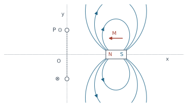

### Question P3 — Force de Laplace au sommet

En P, $\mathrm d\boldsymbol\ell$ est orienté selon $+\mathbf e_z$ et $\mathrm d\mathbf F=i\,\mathrm d\boldsymbol\ell\times\mathbf B_a$. On trouve une composante axiale $-iB_y\,\mathrm d\ell$ vers la gauche et une composante radiale $iB_x\,\mathrm d\ell$. Pour $s>0$, $B_y>0$. Loin du plan de la spire $B_x<0$ en P et la composante locale est centripète. Elle change de signe si l'aimant s'approche suffisamment. Les composantes radiales s'annulent en résultante par symétrie mais sollicitent mécaniquement la spire. La résultante axiale est dirigée vers $-x$ et le couple total est nul. Le support maintient la spire fixe.

### Question P4 — Courant au franchissement

Le courant part d'une valeur presque nulle, présente un lobe positif à l'approche et s'annule à $s=0$ où le flux est extrémal. Après franchissement, il présente un lobe négatif puis tend vers zéro. La décélération empêche d'imposer une antisymétrie temporelle exacte.

### Question P5 — Force exercée sur la spire

La composante $F_{a/s}$ est **négative** à l'approche et à l'éloignement pour $v<0$. Elle présente deux lobes négatifs séparés par un zéro en $s=0$, et tend vers zéro loin de la spire. La force sur l'aimant est opposée et freine son mouvement dans les deux cas.

### Question P6 — Vitesse de l'aimant

La vitesse part de $v_0<0$ et augmente vers une valeur finale $v_f$ telle que $v_0<v_f<0$ dans le scénario d'un franchissement suivi d'un éloignement. Sa pente est positive dans chacun des deux épisodes de freinage et s'annule au passage en O. Le mouvement se raccorde en continu à deux régimes de vitesse presque constante.

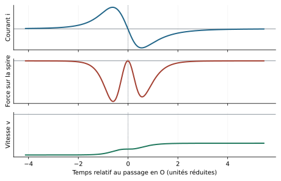

### Question P7 — Retourner l'aimant

Retourner le moment inverse le champ et le flux, donc le courant à tout instant. Dans la force, le courant et le champ changent simultanément de signe. Les courbes de la force et de la vitesse sont par conséquent inchangées pour la même condition initiale.

### Question P8 — Bilan de puissance

La force sur le support fixe ne travaille pas. En régime résistif, la puissance perdue par l'aimant est $\mathrm d(mv^2/2)/\mathrm dt=-Ri^2$. En gardant l'inductance, le bilan devient $\mathrm d(mv^2/2+Li^2/2)/\mathrm dt=-Ri^2$. L'intégrale de la dissipation entre les deux régions éloignées donne $m(v_0^2-v_f^2)/2=\int Ri^2\,\mathrm dt$.

## Flux, courant et force

### Question P9 — Champ exprimé avec le diamètre

La sphère a pour volume $\pi D^3/6$, donc $M=B^*\pi D^3/(6\mu_0)$. L'angle $\varphi$ de la figure est compté entre $-\mathbf e_x$ et $\mathbf e_r$, donnant $\mathbf M\cdot\mathbf e_r=M\cos\varphi$. Le champ s'écrit $\mathbf B_a=(B^* D^3/24r^3)(3\cos\varphi\,\mathbf e_r+\mathbf e_x)$.

### Question P10 — Flux extérieur

Avec $M$ la norme du moment, le potentiel vecteur du dipôle sur la spire a pour composante tangentielle $A_\theta=-\mu_0Ma/[4\pi(a^2+s^2)^{3/2}]$ dans le sens positif. Par Stokes, $\phi=2\pi a A_\theta=-\mu_0Ma^2/[2(a^2+s^2)^{3/2}]$. On obtient $F(X)=(1+X^2)^{-3/2}$ et $\phi_0=-\mu_0M/(2a)=-\pi B^*D^3/(12a)$. Au centre la valeur est la limite du flux du dipôle de part et d'autre.

### Question P11 — Domaine du régime résistif

Le circuit vérifie $L\dot i+Ri=-\dot\phi$. Si $i$ varie sur $\tau_i$, le rapport des deux termes de gauche est de l'ordre de $L/(R\tau_i)$. Il faut donc $L/R\ll\tau_i$.

### Question P12 — Constante du courant induit

Comme $Ri=-\dot\phi$, $i=(3\phi_0/R)X\dot X/(1+X^2)^{5/2}$. Ainsi $K_1=3\phi_0/R<0$. À l'approche, $X>0$ et $\dot X<0$, d'où le courant positif de P2.

### Question P13 — Force axiale sur la spire

Le champ radial à la spire vaut $B_\rho=3\mu_0M a s/[4\pi(a^2+s^2)^{5/2}]$. Avec $F_{a/s}=-2\pi a i B_\rho$, il vient $F_{a/s}=K_2 Xi/(1+X^2)^{5/2}$, où $K_2=-3\mu_0M/(2a^2)=3\phi_0/a=-\pi B^*D^3/(4a^2)$. La résultante est orientée suivant x.

### Question P14 — Force en fonction du mouvement

On obtient $K=K_1K_2=9\phi_0^2/(aR)=\pi^2 B^{*2}D^6/(16a^3R)>0$ et $F_{a/s}=K X^2\dot X/(1+X^2)^5$. À X fixé la force est proportionnelle à la vitesse, à $B^{*2}$ et à $D^6$, et inversement à la résistance. En remplaçant $\dot X$ par $v/a$, la dépendance géométrique explicite devient $a^{-4}$ à X et v fixés. La force s'annule au centre et loin de la spire. À vitesse donnée, son module est maximal pour $|X|=1/2$. Son signe suit v.

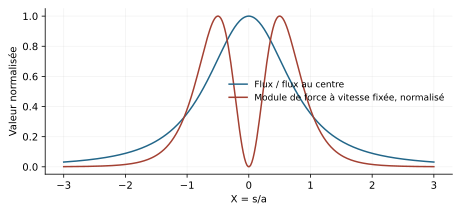

### Question P15 — Calcul réciproque sur le dipôle

Sur l'axe, $B_s=(\mu_0i/2a)(1+X^2)^{-3/2}$. Avec $M_x=-M$, $F_{s/a}=-M\partial_s B_s=3\mu_0MiX/[2a^2(1+X^2)^{5/2}]=-F_{a/s}$. Le résultat concorde avec la force entière calculée en P13, sans dériver la dépendance temporelle de i avec la position.

### Question P16 — Champ propre et inductance

Un courant, même quasi stationnaire, produit un champ propre et exerce une force sur le dipôle. L'approximation résistive néglige la tension $L\dot i$ devant $Ri$ dans le calcul de i. Elle laisse subsister le champ de la spire et la force qui en résulte. Les deux calculs sont cohérents.

## Le bloc conducteur et les échelles caractéristiques

### Question P17 — Modèle d'un demi-espace de cuivre

Pour $|X|\gg1$, le facteur $X^2/(1+X^2)^5$ décroît comme $|X|^{-8}$. Les anneaux axialement éloignés contribuent peu, et le champ du dipôle décroît aussi radialement. Un bloc d'épaisseur et de largeur grandes devant les distances qui dominent l'interaction peut donc être assimilé à un demi-espace près du centre de sa face.

### Question P18 — Lignes de courant dans le bloc

Les courants de Foucault empruntent des cercles coaxiaux contenus dans des plans perpendiculaires à x. La variation du flux axisymétrique crée une circulation azimutale du champ électrique. La loi d'Ohm locale donne des lignes de courant de même direction, avec une intensité dépendant du rayon et de la profondeur.

### Question P19 — Comparer le bloc et la boucle unique

Le bloc offre un grand ensemble de chemins conducteurs et les contributions de freinage de ses anneaux s'ajoutent. À géométrie et matériau comparables pour la boucle de référence, on attend un freinage plus efficace qu'avec une seule spire mince. Une comparaison chiffrée exigerait les dimensions et la résistance de cette spire.

### Question P20 — Dimensions de B et de la conductivité

De $F=qvB$, on tire $[B]=M T^{-1}Q^{-1}$. De $j=\sigma E$, avec $[j]=QL^{-2}T^{-1}$ et $[E]=MLT^{-2}Q^{-1}$, vient $[\sigma]=M^{-1}L^{-3}TQ^2$.

### Question P21 — Le groupe sans dimension W

Les deux termes $m|v_0|$ et $\sigma B^{*2}D^4$ ont la dimension $MLT^{-1}$, d'où $[W]=1$. Les rapports $\delta^*/D$ et $\tau^*|v_0|/D$ sont également sans dimension. Les fonctions $\Phi$ et $\Psi$ prennent donc des valeurs sans dimension.

### Question P22 — Limite de l'analyse dimensionnelle

Toute fonction de W reste sans dimension. Les dimensions imposent les facteurs $D$ et $D/|v_0|$, mais elles ne fixent ni la forme ni les coefficients des fonctions. L'équation du mouvement, un modèle d'induction ou des mesures doivent les préciser.

### Question P23 — Échelles lues sur les courbes

On lit initialement $v\simeq-0{,}37\ \mathrm{m\,s^{-1}}$. La position décroît presque linéairement puis tend vers 6 mm. Si l'on prend l'intervalle de 10 à 90 % de la perte de vitesse, il s'étend environ de 0,08 à 0,13 s. On obtient $\delta t\sim5\,10^{-2}\ \mathrm s$ et, en lisant les positions d'environ 15 et 6–7 mm, $\delta s\sim9\ \mathrm{mm}$. Une définition plus large donne un temps de l'ordre de 0,1 s. L'arrêt est atteint sans inversion du mouvement ni contact du centre avec le plan.

### Question P24 — Couplage des anneaux de courant

Chaque anneau crée un champ dont le flux traverse les anneaux voisins. Ces inductances mutuelles, ainsi que le champ propre de chaque anneau, modifient le champ total. Il faut donc estimer l'écrantage du champ imposé avant de superposer des spires traitées comme indépendantes.

### Question P25 — Longueur d'écrantage

La diffusivité magnétique vaut $1/(\mu_0\sigma)$. Pour une durée $\tau_B$, la profondeur de diffusion est de l'ordre de $\delta_B\sim\sqrt{\tau_B/(\mu_0\sigma)}$. En régime harmonique, si $\tau_B=1/\omega$, la profondeur de peau conventionnelle vaut $\sqrt{2\tau_B/(\mu_0\sigma)}$.

### Question P26 — Écrantage numérique

Avec $\tau_B\sim0{,}05\ \mathrm s$ et $\mu_0\sigma\simeq75\ \mathrm{s\,m^{-2}}$, $\delta_B\sim2{,}6\ \mathrm{cm}$, ou près de 3,6 cm avec la convention harmonique. C'est plusieurs fois la distance active de l'ordre du centimètre. Négliger en première approximation l'écrantage entre anneaux est cohérent à cette précision.

## Intégration sur le cuivre et portrait de phase

### Question P27 — Force élémentaire dans le demi-espace

Pour un anneau de rayon a à une distance axiale $u\geq s$ du centre magnétique, la section élémentaire vaut $\mathrm da\,\mathrm du$. L'équation (8) donne $\mathrm d^2F_{a/b}=Gv\,a^3u^2(a^2+u^2)^{-5}\,\mathrm da\,\mathrm du$. L'intégration portera sur $a\geq0$ et $u\geq s$.

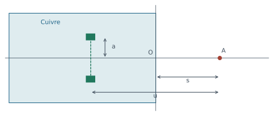

### Question P28 — Intégration des forces

Avec $a=ux$, l'intégrale en a du facteur géométrique vaut $u^{-4}I_1=u^{-4}/24$. L'intégrale sur $u\in[s,\infty[$ vaut $1/(72s^3)$. Ainsi $F_{a/b}=Gv/(72s^3)$ et **$\alpha=1/72$**. Le signe est celui de v, conformément à la force sur le conducteur.

### Question P29 — Équation du mouvement près du bloc

Avec $Q=\alpha G/(2m)$, $m\ddot s=-\alpha G\dot s/s^3$, soit $\ddot s=-2Q\dot s/s^3$. Tant que $\dot s<0$, l'accélération est positive.

### Question P30 — Intégrale première

Comme $\mathrm d(Q/s^2)/\mathrm dt=-2Q\dot s/s^3$, $A(s,v)=v-Q/s^2=v_0-Q/s_0^2$. On obtient $v(s)=v_0+Q(1/s^2-1/s_0^2)$.

### Question P31 — Sens du portrait de phase

La trajectoire va vers la gauche et vers le haut, d'un plateau voisin de $v_0$ à un arrêt en $s_\infty=[s_0^{-2}+|v_0|/Q]^{-1/2}$. La phase initiale à vitesse presque constante et à grande distance implique $Q/s_0^2\ll|v_0|$, approximation conservée ensuite. La ligne $v=0$ est atteinte asymptotiquement dans le modèle.

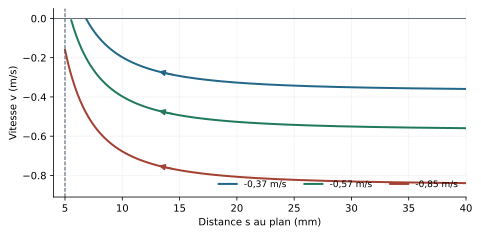

### Question P32 — Vitesse critique avant collision

Le premier contact serait à $s=D/2$. En négligeant $Q/s_0^2$, imposer $v(D/2)=0$ donne $v_{0c}=-4Q/D^2$. Pour $v_0>v_{0c}$, le module initial est plus faible et l'aimant s'arrête avant le contact. À la valeur limite, il s'en approche asymptotiquement. Le terme exact de départ ajouterait $Q/s_0^2$ à $v_{0c}$.

### Question P33 — Expression matérielle de la vitesse limite

Avec $G=\pi\sigma(B^*D^3)^2/32$, on trouve $|v_{0c}|=\pi\sigma B^{*2}D^4/(1152m)$. À m fixé, l'augmentation de la conductivité, du champ ou du diamètre renforce le freinage et augmente la vitesse qui peut être arrêtée. L'augmentation de masse à paramètres magnétiques constants a l'effet inverse. La fonction cherchée est $\Omega(W)=\pi/(1152W)$.

### Question P34 — Valeur critique théorique

Avec $\sigma=6\,10^7\ \mathrm{S\,m^{-1}}$, $B^*=1{,}3\ \mathrm T$, $D=10^{-2}\ \mathrm m$ et $m=4\,10^{-3}\ \mathrm{kg}$, le modèle donne $|v_{0c}|\simeq0{,}69\ \mathrm{m\,s^{-1}}$.

### Question P35 — Encadrement expérimental

Les essais à environ 0,37 et 0,57 m·s⁻¹ se terminent à vitesse nulle avant ou tout près du contact. À environ 0,85 m·s⁻¹, la vitesse reste négative au voisinage de 5 mm. Le seuil expérimental est donc de l'ordre de **0,6 à 0,8 m·s⁻¹**, encadré grossièrement par 0,57 et 0,85. Le calcul à 0,69 m·s⁻¹ est compatible avec cette lecture.

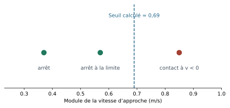

### Question P36 — Distance, temps et convention de lecture

À résolution du graphe, les trois freinages deviennent marqués dans la même zone de l'ordre du centimètre au voisinage du bloc. Un écart **absolu** donné au plateau est atteint à une abscisse voisine, puisque $v-v_0\simeq Q/s^2$. Cette lecture suggère une distance faiblement dépendante de $|v_0|$, donc $\Phi$ approximativement constante sur ces trois essais. Pour parcourir un même intervalle de position hors de l'arrêt asymptotique, il y a moins de points à vitesse initiale élevée. Un temps caractéristique d'ordre $\delta^*/|v_0|$ diminue alors, compatible avec $\Psi$ à peu près constante. Si l'on choisit au contraire un **même pourcentage** de la vitesse initiale perdu, la formule analytique prévoit $s\propto |v_0|^{-1/2}$ et un temps $\propto |v_0|^{-3/2}$, soit $\Phi,\Psi\propto W^{-1/2}$. Ces trois tracés ne suffisent pas à établir une loi universelle sans convention de mesure.

## Chimie. Structure et thermochimie des graisses

### Question C1 — Familles d'acides gras

Un acide gras est un acide carboxylique à chaîne aliphatique généralement longue. Un acide saturé n'a aucune double liaison C=C. Un monoinsaturé en porte une et un polyinsaturé plusieurs. Le qualificatif trans décrit la géométrie d'une double liaison dont les deux portions de chaîne sont de part et d'autre. Sur les doubles liaisons internes ordinaires d'acides gras, elle correspond à la géométrie E. La configuration cis introduit un coude plus prononcé dans la chaîne. Le triglycéride alimentaire est le triester du glycérol par trois résidus d'acides gras.

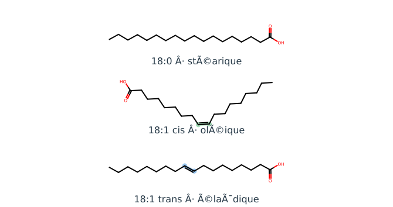

### Question C2 — Fusion et empilement

Allonger une chaîne saturée accroît les contacts dispersifs de London et stabilise le cristal. La série laurique, myristique, palmitique, stéarique passe d'environ 44 à 70 °C. À 18 carbones, les valeurs descendent de 70 °C pour le saturé à 16, −5 et −11 °C pour une, deux et trois insaturations cis. Les coudes gênent l'empilement régulier. Une liaison trans permet en général un meilleur empilement qu'une liaison cis de même position. Les liaisons hydrogène entre carboxyles contribuent également à la cohésion.

### Question C3 — Étalonnage calorimétrique

À volume constant, le premier principe donne $\Delta U_{ensemble}=0$. Avec une même capacité thermique effective C pour les deux essais, $\Delta_{comb}U+C\Delta\Theta=0$ et $\Delta_{comb}U_{et}+C(\Delta\Theta)_{et}=0$. Les variations de combustion **totales** vérifient donc $\Delta_{comb}U/\Delta_{comb}U_{et}=\Delta\Theta/(\Delta\Theta)_{et}$. Pour des grandeurs massiques, multiplier chaque énergie massique par la masse correspondante. L'étalon calibre la cuve, l'eau et les accessoires réunis.

### Question C4 — État physique de l'eau

La présence d'eau liquide impose l'équilibre liquide–vapeur de l'eau dès l'état initial et à la fin. L'eau formée par combustion est comptée, à une faible correction de vapeur près, comme liquide. Cela rend le bilan énergétique reproductible et évite d'attribuer à la combustion une vaporisation variable.

### Question C5 — Écart entre énergie interne et enthalpie

Le bilan est $\mathrm{C_{16}H_{32}O_2+23O_2\to16CO_2+16H_2O(l)}$. Ainsi $\Delta n_g=-7$ et $\Delta_cH-\Delta_cU=-7RT\simeq-17\ \mathrm{kJ\,mol^{-1}}$, soit $-0{,}068\ \mathrm{kJ\,g^{-1}}$. L'étalonnage donne $|\Delta_cu|\simeq26{,}5(1{,}01/0{,}82)(2{,}10/2{,}00)=34\ \mathrm{kJ\,g^{-1}}$. Le correctif d'état pour l'étalon benzoïque, de $\Delta n_g=-1/2$ par mole, est lui aussi négligeable à cette précision. Confondre u et h introduit ici environ 0,2 %. La chaleur libérée est de l'ordre de 34 kJ·g⁻¹, inférieure d'environ 8 % à la valeur nutritionnelle générique 37.

### Question C6 — Acide gras de formule générale

L'acide est $\mathrm{C_nH_{2n-2\Delta}O_2}$, de masse molaire $14n+32-2\Delta$ g·mol⁻¹. Sa combustion consomme $(3n-\Delta-2)/2$ moles de $\mathrm{O_2}$ et donne n $\mathrm{CO_2}$ et $(n-\Delta)$ eaux. Dans l'acide on compte une O–H, $(2n-2\Delta-1)$ C–H, $(n-1-\Delta)$ C–C simples, $\Delta$ C=C, une C–O et une C=O. En appliquant les énergies de liaison de l'annexe, l'estimation massique est $\Delta_ch\simeq(-601n+117\Delta+359)/(14n+32-2\Delta)$ kJ·g⁻¹. Pour $n=16,\Delta=0$, elle donne −36,2 kJ·g⁻¹, et pour $n=18,\Delta=1$, −36,7 kJ·g⁻¹. Les énergies moyennes négligent les corrections de phase et les environnements locaux. La faible variation dans cette gamme explique la valeur pratique commune.

## Contrôle de qualité et indice d’iode

### Question C7 — Configuration des halogènes

L'état de valence des halogènes est $ns^2np^5$. Le chlore est $[\mathrm{Ne}]3s^2 3p^5$ et l'iode $[\mathrm{Kr}]4d^{10}5s^25p^5$. Le fluor suit $[\mathrm{He}]2s^22p^5$ et le brome $[\mathrm{Ar}]3d^{10}4s^24p^5$. Le remplissage suit l'ordre de Klechkowski, l'exclusion de Pauli et la règle de Hund dans les trois orbitales p dégénérées.

### Question C8 — Orbitales de valence de ICl

Le chlore est plus électronégatif et ses orbitales atomiques de valence se trouvent globalement plus bas que celles de I. Les orbitales s forment $\sigma_s$ et $\sigma_s^*$. Les $p_z$ forment $\sigma_p$ et $\sigma_p^*$ par recouvrement axial, $p_x,p_y$ deux $\pi_p$ et deux $\pi_p^*$ dégénérées par recouvrement latéral. Une OM liante a des lobes de même phase dans la région de recouvrement. Une antiliante y possède un nœud supplémentaire. Dans le modèle sans mélange s–p, l'ordre usuel est $\sigma_s<\sigma_s^*<\sigma_p<\pi_p<\pi_p^*<\sigma_p^*$. Les quatorze électrons remplissent tous les niveaux sauf $\sigma_p^*$, d'où un ordre de liaison $(8-6)/2=1$. La basse vacante antiliante possède un fort caractère porté par I.

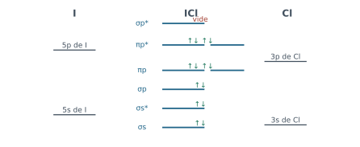

### Question C9 — Lewis et polarisation de liaison

Le schéma de Lewis est I–Cl, chaque halogène portant trois doublets libres et une charge formelle nulle. Il est compatible avec l'ordre de liaison un et le diamagnétisme déduits des OM. La liaison est polarisée $\mathrm{I^{\delta+}{-}Cl^{\delta-}}$. L'approche orbitalaire précise en outre la nature des orbitales réactives.

### Question C10 — Addition sur un alcène

L'interaction $\pi_{alcène}\to\sigma^*_{ICl}$ coûte $-1{,}9-(-10{,}6)=8{,}7$ eV, contre $1{,}4-(-11{,}2)=12{,}6$ eV dans l'autre sens. L'alcène attaque donc I, la liaison I–Cl se rompt vers Cl et un iodonium ponté peut se former. Le chlorure ouvre ce pont par l'autre face. L'éthylène conduit au composé neutre $\mathrm{ICH_2CH_2Cl}$, l'addition étant anti dans le modèle d'ouverture du pont.

### Question C11 — Nature du dosage

Le bilan est $\mathrm{I_3^-+2S_2O_3^{2-}\to3I^-+S_4O_6^{2-}}$. Le titrage du triiodure est direct et rédox, détecté par la disparition de la coloration du complexe amidon–iode. Pour les doubles liaisons de l'huile, c'est un dosage indirect en retour de l'excès de réactif de Wijs.

### Question C12 — Soustraction de l'essai blanc

Le blanc contient $c_{thio}V_B/2$ de réactif homologué en diiode, l'essai avec huile en conserve $c_{thio}V_A/2$. La quantité fixée vaut donc $n_{I_2}=c_{thio}(V_B-V_A)/2$ avec les volumes en litres. La concentration exacte de la solution de Wijs commune aux deux expériences disparaît.

### Question C13 — Indice d'iode numérique

Le blanc et l'essai diffèrent de 12,1 mL, d'où $n_{I_2}=0{,}10\times0{,}0121/2\simeq6{,}05\,10^{-4}\ \mathrm{mol}$. La masse équivalente est 0,154 g. Pour 0,254 g d'huile, l'indice vaut **environ 60 g de I₂ pour 100 g d'huile**.

### Question C14 — Faisceau de courbes courant–potentiel

Le **faisceau 3** convient. À $V=0$, la courbe a a le plus fort courant cathodique du triiodure et le plus petit courant anodique d'iodure. À $V=V_{ft}/2$, b est intermédiaire. À $V=V_{ft}$ et au-delà, c et d sont superposées, hors effet de dilution négligé. Tout le triiodure a été réduit et l'excès de thiosulfate reste électro-inactif dans la fenêtre considérée. Le petit courant anodique initial provient de l'iodure déjà présent.

### Question C15 — Trois lectures du point d'équivalence

**a) Courbe 1.** Le courant sur le palier anodique suit la quantité d'iodure, qui augmente jusqu'à l'équivalence puis se stabilise. **b) Courbe 2.** À courant imposé faible, le couple réversible iode/iodure peut porter les deux courants avec une faible différence de potentiel tant que les deux formes sont disponibles. Après épuisement de l'oxydant, il faut atteindre une autre réaction cathodique, ce qui crée une marche de tension. **c) Courbe 6.** À faible différence de potentiel imposée, le courant est limité par la forme minoritaire du couple. Il augmente puis diminue à mesure que le triiodure devient limitant et s'annule à son épuisement. Le faible iodure initial peut donner un petit courant de départ non résolu par le schéma.

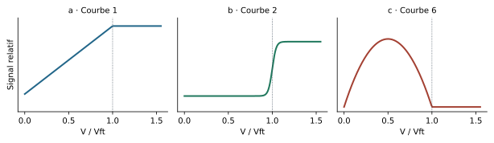

### Question C16 — Précision des repérages

La disparition de la teinte de l'amidon est sensible mais dépend de l'observateur, du pas d'ajout et de la persistance de la couleur. En a, l'intersection de la droite croissante et du plateau est affectée par le bruit et la dilution. En b, une marche de tension franche permet un repérage par son milieu ou sa pente maximale. En c, on extrapole le courant décroissant vers le courant résiduel, très lisible si le bruit de fond est faible. L'automatisation rend ces trois mesures reproductibles. Il faudrait le bruit et le pas de titrage pour en classer quantitativement les incertitudes.

## Transformations des fonctions organiques et spectroscopie

### Question C17 — Transestérification du triglycéride

Le triglycéride de la figure s'échange avec du méthanol en excès. Une transestérification, par exemple catalysée par l'acide para-toluènesulfonique au reflux du méthanol, donne trois esters méthyliques 2 et un glycérol par triglycéride. Pour chaque fonction, le carbonyle est protoné, le méthanol s'additionne, les transferts de protons rendent le groupe glycéryle partant puis le carbonyle se reforme. La déprotonation régénère le catalyseur.

### Question C18 — Fragments de la coupure oxydante

L'ester $\mathrm{CH_3(CH_2)_7CH{=}CH(CH_2)_{11}CO_2Me}$ fournit le nonanal $\mathrm{CH_3(CH_2)_7CHO}$ et l'ester-aldéhyde $\mathrm{OHC(CH_2)_{11}CO_2Me}$ (3 et 4, sans ordre imposé par la figure). L'étape 1 est la cycloaddition syn qui forme un ester osmate cyclique. L'osmium de l'espèce 2 cerclée vaut +VI (deux oxo et un diolate). L'étape 3 est une hydrolyse, donnant le diol et l'espèce 4 cerclée $\mathrm{H_2OsO_4}$ à +VI. L'étape 5 est une réoxydation formelle vers +VIII. Le diol vicinal est parallèlement clivé en deux carbonyles.

### Question C19 — Réduction en diol

Le fragment utile est l'ester-aldéhyde $\mathrm{OHC(CH_2)_{11}CO_2Me}$. Une réduction des deux fonctions par un donneur d'hydrure apte à réduire les esters donne $\mathrm{HOCH_2(CH_2)_{11}CH_2OH}$. Le carbonyle de l'aldéhyde accepte un hydrure. Celui de l'ester, activé par coordination, subit une première addition, le retour du carbonyle avec élimination de méthanolate puis une deuxième addition sur l'aldéhyde transitoire. La protonation des alcoolates donne les deux alcools.

### Question C20 — Acylation d'un oxygène

Bz représente le benzoyle $\mathrm{PhCO{-}}$. Un oxygène du diol attaque le carbone du chlorure de benzoyle. L'intermédiaire tétraédrique expulse le chlorure, puis la triéthylamine déprotone l'ester protoné et piège l'équivalent de HCl. Le monoester 6 conserve l'autre OH. Les deux extrémités du diol de départ sont équivalentes.

### Question C21 — Variation des degrés d'oxydation

Dans un alcool primaire $\mathrm{RCH_2OH}$, le carbone porteur de O vaut −I. Dans l'aldéhyde $\mathrm{RCHO}$ il vaut +I. La demi-équation est $\mathrm{RCH_2OH\to RCHO+2H^++2e^-}$. L'alcool 6 est le réducteur et le chrome(VI) du PCC accepte les électrons. La fonction ester à l'autre extrémité est conservée.

### Question C22 — Fonction nitrone et bilan de condensation

L'azote de l'hydroxylamine N-substituée s'additionne au carbonyle et une carbinolamine se forme après transfert de proton. Une déshydratation, accompagnée de la redistribution des doublets, donne la nitrone $\mathrm{RCH{=}N^+(R')O^-}$. Le bilan formel élimine une molécule d'eau. Le tamis moléculaire adsorbe l'eau et déplace l'équilibre vers le produit de condensation. Les réactifs fournis n'imposent aucune catalyse par un acide fort ajouté.

### Question C23 — Origine de la liaison C2–C3 du fragment indépendant

Une disconnexion du fragment 9 sépare $\mathrm{CH_2{=}CH{-}}$ d'un aldéhyde chiral $\mathrm{CH_3CH(OTBS)CHO}$. Un nucléophile vinylique, par exemple $\mathrm{CH_2{=}CHMgBr}$ en éther anhydre à froid, suivi d'une hydrolyse douce, réalise l'addition au carbonyle et fournit l'alcool allylique. Le centre déjà présent est conservé. La configuration du centre nouvellement créé dépend de la diastéréosélection ou de la séparation des produits.

### Question C24 — Attribuer les neuf signaux de 9

A (5,74 ppm, ddd) est H2, qui couple aux deux H1 et à H3. B (5,20, dt) est le H1 trans à H2 ($J=17$ Hz), C (5,11, dt) l'autre H1, cis à H2 ($J=10$ Hz). Le petit couplage proche de 1,5 Hz provient notamment du couplage géminal. D (3,94, m) est H3 porté par CHOH. E (3,55, qd) est H4 porté par CHOTBS, couplé aux trois H5 (6 Hz) et à H3 (4 Hz). F (2,25, singulet large) est OH. G (1,00, d, 3 H) est le méthyle H5. H (0,82, s, 9 H) et I (0,00, s, 6 H) sont respectivement les trois méthyles du tert-butyle et les deux méthyles liés au silicium.

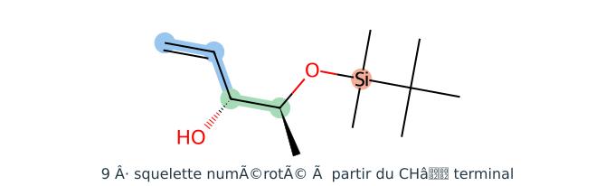

### Question C25 — Configurations du cycle de 10a

Au carbone C3 porteur de la longue chaîne, N a la première priorité. Les deux carbones voisins initialement $\mathrm{CH_2}$ se départagent au rang suivant, le chemin de C4 rencontrant C5 lié à O avant le chemin alkyle. L'ordre est N, C4, chaîne, H. La chaîne est hachurée et H vient vers l'observateur, donnant **C3(R)**. Au carbone C5, O est premier, le carbone externe CHOH de liste (O,C,H) précède C4 de liste (C,H,H), et H est dernier. H hachuré s'éloigne, d'où **C5(S)**.

### Question C26 — Régiosélectivité par orbitales frontières

L'écart HO de l'alcène → BV du dipôle est $0{,}40-(-9{,}98)=10{,}38$ eV, légèrement plus faible que l'autre écart $1{,}35-(-9{,}45)=10{,}80$ eV. Les coefficients et les phases des orbitales doivent aussi permettre deux recouvrements constructifs. L'appariement privilégié associe le carbone de la nitrone au carbone terminal de l'alcène et son oxygène au carbone interne. La figure indique un seul enchaînement parmi les produits isolés. Le seul écart de niveaux n'établirait pas cette orientation.

### Question C27 — Proportions et barrières de réaction

Les deux faces des partenaires ne sont pas équivalentes dans l'environnement chiral du fragment 9. Les approches donnant les quatre configurations ont donc des états de transition diastéréoisomères d'énergies différentes. À contrôle cinétique et facteurs préexponentiels comparables, $\Delta\Delta G_j^\ddagger=RT\ln(p_a/p_j)$. Au reflux du toluène (environ 384 K), les écarts par rapport à la voie a sont environ 1,6 kJ·mol⁻¹ pour b, 4,7 pour c et 11 pour d. Les états finaux sont chacun séparés du même niveau des réactifs par une barrière croissante a, b, c, d. Les quatre nombres du sujet sont des rendements qui totalisent 58 %. Leurs rapports permettent cette comparaison sans imposer une somme de 100 %.

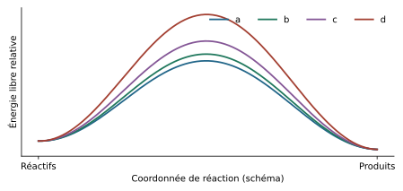

### Question C28 — Reconnaître le groupe méthoxyméthyle

Une protection MOM forme le motif acétal $\mathrm{RO{-}CH_2{-}OMe}$. La liaison nouvelle unit O de l'alcool au carbone porteur du chlorure. Le mécanisme limite SN1 est favorisé par la stabilisation mésomère de l’oxocarbenium. La substitution peut ainsi avoir un caractère dissociatif marqué parce que le doublet de l'oxygène voisin stabilise un oxocarbenium. Dans le dichlorométhane peu ionisant, une substitution directe sur ce carbone primaire reste également concevable. Les réactifs et la structure seuls ne mesurent pas une loi de vitesse. La base encombrée piège le proton libéré.

### Question C29 — Rôle du groupe mésylate

Le groupe méthanesulfonyle transforme un alcool en ester sulfonique de formule générale $\mathrm{R{-}O{-}S(=O)_2CH_3}$. Le méthanesulfonate est un meilleur nucléofuge que l'hydroxyde parce que sa charge est délocalisée sur plusieurs oxygènes. Le rapport du jury signale également que la réactivité du fluorure de tétrabutylammonium n'était pas au programme. Cette réponse porte sur la justification du groupe partant. Le mécanisme ciblé de formation de 12 reste hors de la couverture.

### Question C30 — Nature du groupe de protection

Dans un éther MOM, $\mathrm{R{-}O{-}CH_2{-}OCH_3}$, le méthylène appartient à un acétal. Sa protonation sur un oxygène peut conduire à un oxocarbenium stabilisé par mésomérie, ce qui explique la sensibilité à l'acide relevée par le jury. Cette réponse identifie le principe fonctionnel. Le mécanisme final propre à la préparation ciblée demeure hors de la couverture.

## Cinétique de la peinture à l’huile

### Question C31 — Réactivité des espèces radicalaires

Un radical possède un électron non apparié. Il peut additionner $\mathrm{O_2}$, arracher un H à une liaison C–H ou se recombiner avec un autre radical. Les radicaux R• et ROO• sont rapidement consommés au cours de la chaîne et restent généralement à très faible concentration devant l'huile.

### Question C32 — Bilan de propagation

Les étapes 2 et 3 associent un radical à une espèce stable abondante, dioxygène ou chaîne RH. L'initiation photochimique est un événement rare et la terminaison requiert deux radicaux dilués. Si une chaîne comporte beaucoup de propagations par amorçage, la somme dominante des étapes 2 et 3 est $\mathrm{RH+O_2\to ROOH}$. Les voies d'amorçage et de terminaison contrôlent néanmoins la concentration en porteurs.

### Question C33 — Évolution du film pictural

À l'application, des triglycérides insaturés mobiles forment un liquide qui mouille les pigments. Aux temps courts, oxygénation des chaînes, formation d'hydroperoxydes et premières liaisons entre chaînes augmentent la viscosité. Aux temps longs, les chaînes sont en partie reliées en un réseau tridimensionnel. La mobilité diminue et un film solide retient les pigments.

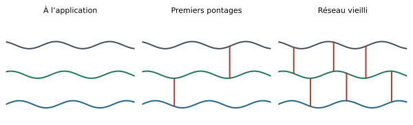

### Question C34 — Lecture des essais de traction

À déformation donnée, la contrainte croît nettement avec l'âge, par exemple près de 0,04 de déformation. La pente initiale et donc la raideur augmentent, tandis que les plus vieux échantillons s'étendent moins avant la fin de leurs courbes. Le film devient un solide polymérique réticulé de plus en plus rigide et moins ductile. Les pontages entre chaînes restreignent leurs mouvements et rendent le vieillissement susceptible d'accroître la fragilité.

### Question C35 — États quasi stationnaires

Après un court transitoire, les concentrations des porteurs évoluent lentement par rapport à leurs grands flux de formation et de consommation. Posons $v_1=I$ constant, $v_2=k_2[R^\bullet][O_2]$, $v_3=k_3[ROO^\bullet][RH]$ et $v_4=k_4[ROO^\bullet]^2$. L'AEQS donne $0\simeq I-v_2+v_3$ et $0\simeq v_2-v_3-2v_4$. Il en résulte $[ROO^\bullet]\simeq\sqrt{I/(2k_4)}$ et $[R^\bullet]\simeq(I+v_3)/(k_2[O_2])$. L'atome H• n'a aucun puits explicité dans le schéma tronqué. On ne peut pas lui appliquer une AEQS fermée ici.

### Question C36 — Vitesse de disparition de RH

Les étapes 1 et 3 consomment RH, d'où $-\mathrm d[RH]/\mathrm dt=I+k_3[RH]\sqrt{I/(2k_4)}$. En régime de chaîne longue, le second terme domine et la disparition est approximativement du premier ordre en RH à flux d'initiation fixe.

### Question C37 — Facteurs et limites cinétiques

Une illumination accrue augmente le flux d'initiation I. La contribution de propagation augmente comme $\sqrt I$ dans ce modèle. Un $k_3$ plus grand accélère la consommation et une terminaison plus efficace la ralentit. L'absence explicite de $[O_2]$ suppose une oxygénation suffisante pour rendre sa capture rapide. Diffusion de l'oxygène dans le film croissant, épuisement des doubles liaisons, variations de température, scission des hydroperoxydes et changements de mobilité dus à la réticulation limitent l'extrapolation de cette loi à tout le vieillissement.
