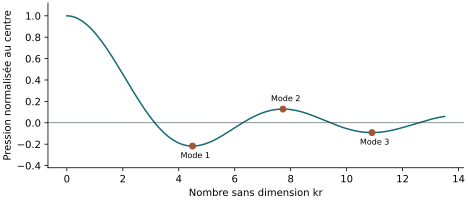
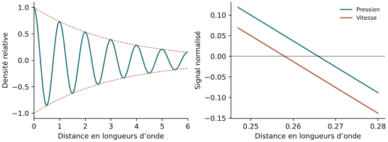
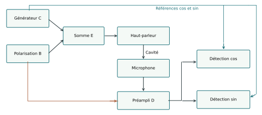
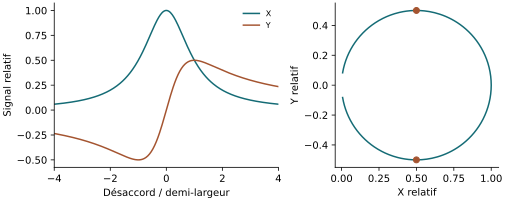
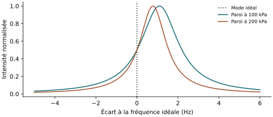

# ENS de Paris (Ulm) PSI 2021 — Physique U · Corrigé guidé

*Corrigé rédigé par IA, non officiel. Signalez toute erreur.*

**Lecture du rapport du jury** · GPT-6.2 Astra Ultra · vitesse non renseignée

**Rédaction** · GPT-6.2 Astra Ultra · vitesse non renseignée

## Détermination de la constante de Boltzmann par spectroscopie acoustique

## 1 et 2. Équilibre et célérité acoustique

### Question 1 — Gaz parfait à l’équilibre

**Indication.** Exprimer le nombre d’atomes par unité de volume.

Pour une masse atomique $m$, la densité numérique vaut $\rho_0/m$. Ainsi $P_0=(\rho_0/m)k_BT_0$.

### Question 2 — Surpression et déplacement

**Indication.** Comparer les positions déplacées des deux faces d’une petite tranche de gaz.

La tranche initiale de longueur $dx$ prend la longueur $dx+u(x+dx)-u(x)$. La variation relative de volume est $\partial_xu$. Par définition de la compressibilité isentropique, $p=-\partial_xu/\chi_S$ à l’ordre linéaire. Une compression donne une surpression positive.

### Question 3 — Équation de la quantité de mouvement

**Indication.** Quelle est la différence des forces de pression entre les deux faces ?

La force résultante est $-S\partial_x p\,dx$. La masse initiale $\rho_0 Sdx$ est constante. La deuxième loi de Newton donne $\rho_0\partial_tv=-\partial_xp$ au premier ordre.

### Question 4 — Propagation des déplacements

**Indication.** Éliminer la pression à l’aide de la relation de compression.

Avec $v=\partial_tu$, $\rho_0\partial_t^2u=\partial_x^2u/\chi_S$. Il s’agit de l’équation d’onde de d’Alembert.

### Question 5 — Célérité

**Indication.** Identifier le coefficient devant la dérivée temporelle seconde.

$c=1/\sqrt{\rho_0\chi_S}$. Une plus forte compressibilité diminue la célérité à densité fixée.

### Question 6 — Célérité dans l’argon

**Indication.** Différencier la loi de Laplace à entropie constante.

$PV^\gamma=\mathrm{constante}$ donne $\chi_S=1/(\gamma P_0)$. Il suit $c=\sqrt{\gamma P_0/\rho_0}=\sqrt{\gamma k_BT_0/m}$. Avec $m\simeq40m_u$ et $T_0\simeq300\,\mathrm K$, $c\simeq3{,}2\,10^2\,\mathrm{m/s}$.

### Question 7 — Intérêt d’un gaz monoatomique

**Indication.** Quelles formes d’énergie interne sont accessibles à température ambiante ?

Les trois degrés de liberté de translation donnent $C_V=3R/2$ et $\gamma=5/3$ pour le gaz parfait monoatomique. Ce facteur est connu sans devoir modéliser l’excitation de rotations ou de vibrations moléculaires.

## 3. Résonances des cavités rigides

### Question 8 — Modes d’un intervalle fermé

**Indication.** Imposer deux nœuds de vitesse.

Des parois immobiles d’impédance infinie imposent $v(0)=v(L)=0$. La partie spatiale est proportionnelle à $\sin(kx)$ et $kL=n\pi$, donc $\omega_n=n\pi c/L$, pour les entiers $n\ge1$.

### Question 9 — Premier mode d’un tube

**Indication.** Une demi-longueur d’onde tient entre les deux parois.

$f_1=c/(2L)\sim1{,}6\,\mathrm{kHz}$ et $\omega_1=2\pi f_1\sim10^4\,\mathrm{rad/s}$ pour $L=0{,}10\,\mathrm m$.

### Question 10 — Onde à symétrie sphérique

**Indication.** Éliminer les dérivées angulaires du laplacien.

$\partial_r^2p+(2/r)\partial_r p=c^{-2}\partial_t^2p$. Pour $r>0$, en multipliant par $r$, $\partial_r^2(rp)=c^{-2}\partial_t^2(rp)$.

### Question 11 — Solutions harmoniques

**Indication.** Quelle grandeur satisfait une équation plane à une dimension ?

La grandeur $rp$ vérifie l’équation de d’Alembert. À pulsation fixée ses deux solutions sont $e^{\pm ikr-i\omega t}$ avec $k=\omega/c$. Ainsi $p_\pm=e^{\pm ikr-i\omega t}/r$.

### Question 12 — Propagation radiale

**Indication.** Suivre une surface de phase constante.

Pour $p_+$, $kr-\omega t$ constant décrit une sphère croissante, onde sortante. Pour $p_-$, la phase constante se déplace vers le centre, onde convergente.

### Question 13 — Vitesses des ondes sphériques

**Indication.** Appliquer l’équation d’Euler sans négliger la dérivée de $1/r$.

La convention temporelle est $e^{-i\omega t}$. Ainsi $v_{r,\pm}=(\partial_r p_\pm)/(i\omega\rho_0)=p_\pm[\pm 1+i/(kr)]/(\rho_0 c)$. Le terme en $1/(kr)$ intervient dans le champ proche.

### Question 14 — Flux acoustique moyen

**Indication.** Moyenner les grandeurs réelles par le produit d’une amplitude et du conjugué de l’autre.

Le flux sortant est $4\pi r^2\mathrm{Re}(pv_r^*)/2$. Les termes d’interférence dans la partie propagative sont imaginaires et le terme réactif en $i/(kr)$ n’apporte aucune puissance moyenne. Il reste $2\pi(|a_+|^2-|a_-|^2)/(\rho_0c)$. Une petite boule sans source ni puits ne crée aucune énergie sur une période, donc $|a_+|=|a_-|$.

### Question 15 — Régularité au centre

**Indication.** Garder le terme le plus divergent dans la vitesse totale.

Au voisinage de zéro, $v_r\sim i(a_++a_-)e^{-i\omega t}/(\rho_0\omega r^2)$. La régularité impose $a_-=-a_+$, ce qui fixe également la phase. La pression devient proportionnelle à $\sin(kr)/r$, finie à l’origine.

### Question 16 — Condition propre de la sphère

**Indication.** La vitesse normale à la paroi est proportionnelle au gradient radial de la pression.

Posons $f(x)=\sin x/x$, $x=kr$. La pression est proportionnelle à $f(kr)$. La condition $v_r(R_c)=0$ donne $f'(x_n)=0$ avec $x_n=\omega_nR_c/c$.

### Question 17 — Localisation des racines

**Indication.** Entre deux zéros consécutifs du sinus cardinal, combien d’extrema apparaissent ?

Pour $x>0$, $f'(x)=(x\cos x-\sin x)/x^2$. Le numérateur $H$ a pour dérivée $-x\sin x$, de signe constant entre $n\pi$ et $(n+1)\pi$. Ses signes sont opposés en $n\pi$ et $(n+1/2)\pi$, donc exactement une racine $n\pi<x_n<(n+1/2)\pi$ pour tout $n\ge1$. La racine à zéro représente un mode statique.

### Question 18 — Équation de la tangente

**Indication.** Diviser la condition propre par le cosinus lorsque celui-ci est non nul.

$\tan x_n=x_n$. Sur la branche considérée, la tangente doit atteindre une valeur qui tend vers l’infini. Le croisement se rapproche par la gauche de l’asymptote $a_n=(n+1/2)\pi$, donc $x_n-n\pi\to\pi/2$.

### Question 19 — Première correction asymptotique

**Indication.** Poser $x_n=a_n-\delta_n$ et développer la cotangente de l’écart.

$a_n-\delta_n=\cot\delta_n=1/\delta_n+O(\delta_n)$, d’où $\delta_n=1/a_n+O(a_n^{-3})$. Ainsi $C_1=\pi$, $C_0=\pi/2$ et $C_{-1}=-1/\pi$ dans le développement demandé.

### Question 20 — Algorithme garanti

**Indication.** Une fonction continue de signes opposés aux extrémités évite les pôles de la tangente.

Encadrer la racine de $H(x)=x\cos x-\sin x$ dans $[n\pi,(n+1/2)\pi]$. Calculer le milieu et conserver la moitié où $H$ change de signe, jusqu’à une largeur moindre que la tolérance. Le milieu final donne la racine avec une erreur inférieure à la demi-largeur. Par exemple $x_1\simeq4{,}493$.

## 4. Cavité dissipative

### Question 21 — Propagation avec relaxation

**Indication.** Éliminer successivement vitesse et pression entre conservation de la masse et dynamique.

Posons $\rho'=\rho-\rho_0$. À l’ordre un, $\partial_t\rho'+\rho_0\partial_xv=0$ et $\rho_0\partial_tv=-\partial_xp$. Alors $\partial_t^2\rho'=\partial_x^2p$. En substituant $p=c^2(\rho'+\tau_r\partial_t\rho')$, on trouve $\Delta\rho+\tau_r\partial_t\Delta\rho=c^{-2}\partial_t^2\rho$.

### Question 22 — Nombre d’onde complexe

**Indication.** Chaque dérivée temporelle introduit $-i\omega$.

$k^2(1-i\omega\tau_r)=\omega^2/c^2$. Au premier ordre $k_\pm=\pm(\omega/c)(1+i\omega\tau_r/2)$. Le signe positif décrit une atténuation en allant vers les $x$ positifs.

### Question 23 — Deux échelles spatiales

**Indication.** Identifier séparément la phase et le module de l’exponentielle.

Posons $k_0=\omega/c$, $\ell=2c/(\omega^2\tau_r)$ et $\lambda_a=2\pi/k_0$. À $t=0$, $\rho'=R_0e^{-x/\ell}\cos(k_0x)$. Pour $\omega\tau_r=0{,}1$, la longueur d’amortissement vaut $\ell/\lambda_a=1/(\pi\omega\tau_r)\simeq3{,}2$.

### Question 24 — Pression, vitesse et impédance

**Indication.** Utiliser l’équation d’état pour la pression et la continuité pour la vitesse.

$p=c^2(1-i\omega\tau_r)\rho'$ et $v=\omega\rho'/(\rho_0 k)=\pm(c/\rho_0)(1-i\omega\tau_r/2)\rho'$. Donc $p/v=\pm\rho_0 c(1-i\omega\tau_r/2)$ à cet ordre. On note $Z$ l’impédance pour l’onde allant vers $+x$.

### Question 25 — Décalage entre pression et vitesse

**Indication.** Comparer leurs arguments à même position et même instant.

En normalisant les amplitudes positives, $p\propto e^{-x/\ell}\cos(k_0x-\omega t-\omega\tau_r)$ et $v\propto e^{-x/\ell}\cos(k_0x-\omega t-\omega\tau_r/2)$. Les zéros et les crêtes sont donc décalés. À temps fixé, le décalage spatial de la pression vers $+x$ est d’environ $(\omega\tau_r/2)/k_0$.

### Question 26 — Réflexion sur la paroi rigide

**Indication.** Le signe de la vitesse change avec le sens de propagation à pression donnée.

À $x=L$, $v=(a_+e^{ikL}-a_-e^{-ikL})/Z=0$. Donc $a_-=a_+e^{2ikL}$, ce facteur incluant l’atténuation de l’aller-retour.

### Question 27 — Somme des allers-retours

**Indication.** Écrire la condition d’injection au niveau de la membrane.

$a_+=p_0+a_-$ donne $a_+=p_0/(1-e^{2ikL})$. Chaque aller-retour rajoute au champ un terme ayant le même facteur complexe.

### Question 28 — Résonance en excitation de vitesse

**Indication.** Appliquer la condition $v(0)=v_0$ et exprimer le dénominateur en module carré.

$p_0=Zv_0$ et $|a_+|^2=|Z|^2v_0^2/[(1-q)^2+4q\sin^2(k_0L)]$, avec $q=\exp[-2\,\mathrm{Im}(k)L]$. Pour des pertes et un numérateur variant lentement sur un pic, les maxima sont centrés à l’ordre retenu sur $k_0L=n\pi$. Un déplacement d’ordre supérieur peut subsister quand l’atténuation dépend de la fréquence.

### Question 29 — Profil de Lorentz

**Indication.** Développer le sinus près d’un mode et figer le facteur d’atténuation sur le pic.

Le facteur d’amplitude d’un aller-retour est $q=e^{-\omega^2\tau_r L/c}$, soit $\sqrt\eta$ si $\eta$ désigne le facteur d’intensité imprimé. Près de $\omega_n$, le dénominateur devient $(1-q)^2+4q[L(\omega-\omega_n)/c]^2$. Donc $I=I_{\max}/[1+((\omega-\omega_n)/\Delta\omega)^2]$ avec $\Delta\omega=c(1-q)/(2L\sqrt q)\simeq\omega_n^2\tau_r/2$. Il s’agit de la demi-largeur à mi-hauteur de l’intensité.

### Question 30 — Phase au voisinage de la résonance

**Indication.** À la membrane, additionner les deux ondes de pression.

$p(0)=Zv_0(1+qe^{i\varphi})/(1-qe^{i\varphi})$, où $\varphi=2L(\omega-\omega_n)/c$. Près du pic le numérateur est presque réel à la phase de $Z$ près. Ainsi $\arg p\simeq\arg Z+\arctan[(\omega-\omega_n)/\Delta\omega]$ en convention $e^{-i\omega t}$, pour la phase complexe, au premier ordre dominant dans la largeur.

## 5. Mesurer température, rayon et fréquence

### Question 31 — Propagation des incertitudes

**Indication.** Isoler la célérité à partir de la racine sphérique mesurée.

$k_B=m(\omega_nR_c/x_n)^2/(\gamma T_0)$. Pour un seul paramètre incertain à la fois, il faut $u_r(\omega_n)<5\,10^{-7}$, $u_r(R_c)<5\,10^{-7}$ ou $u_r(T_0)<10^{-6}$ selon le paramètre. Le facteur deux vient du carré. Avec plusieurs sources il faut établir un budget commun.

### Question 32 — Fil de platine

**Indication.** Calculer sa section avant d’exprimer la résistance.

$R_T=4\rho_{\rm el}L/(\pi D^2)$. Pour $D=80\,\mu\mathrm m$ et $R_T=25\,\Omega$, $L=R_T\pi D^2/(4\rho_{\rm el})\simeq1{,}2\,\mathrm m$ avec la résistivité tabulée à 20 °C.

### Question 33 — Résolution ohmique

**Indication.** La géométrie du fil est traitée comme constante.

$dR_T/dT=\alpha R_T\simeq0{,}098\,\Omega/\mathrm K$. Une variation de $100\,\mu\mathrm K$ donne environ $9{,}8\,\mu\Omega$. Il faut une résolution meilleure qu’une dizaine de micro-ohms, soit $4\,10^{-7}$ en relatif.

### Question 34 — Référence à 273,16 kelvins

**Indication.** Quel état de l’eau permet de reproduire cette température ?

C’est le voisinage du point triple de l’eau, où glace, liquide et vapeur coexistent. Avant la redéfinition de 2019 sa température fixait le kelvin. Le SI actuel fixe $k_B$.

### Question 35 — Éloignement maximal du point d’étalonnage

**Indication.** L’incertitude sur la pente ne produit d’erreur que proportionnellement à l’excursion.

Dans l’approximation linéaire, $\Delta T=(R_T/R_{\rm ref}-1)/\alpha$. La contribution de l’incertitude sur $\alpha$ vaut $0{,}01|\Delta T|$. Elle reste sous $100\,\mu\mathrm K$ pour $|\Delta T|<0{,}010\,\mathrm K$, soit environ dix millikelvins de part et d’autre de la référence.

### Question 36 — Choix du platine

**Indication.** Comparer aussi stabilité, inertie chimique et encombrement.

Le platine a une résistivité relativement élevée avec un coefficient thermique exploitable. Il permet un fil compact pour 25 ohms. Sa stabilité chimique et la reproductibilité de sa caractéristique favorisent l’étalonnage fin. L’étain a des chiffres comparables dans la table mais une stabilité et une plage pratique moins favorables.

### Question 37 — Primaire à secondaire ouvert

**Indication.** Comment se transforme une impédance infinie ?

Pour le transformateur idéal, un voltmètre d’impédance infinie laisse le secondaire en circuit ouvert. Le courant secondaire est nul et, en négligeant le courant magnétisant, le primaire présente une impédance infinie.

### Question 38 — Tension de déséquilibre

**Indication.** Comparer le point intermédiaire des résistances avec la tension secondaire.

En prenant la borne basse comme référence, la sonde porte $U_E R_T/(R_S+R_T)$ et le secondaire fournit $mU_E R_S/(R_S+R_T)$ pour $m=U_{\rm sec}/U_{\rm prim}$. Si $U_S$ est comptée de la jonction résistive vers la borne haute du secondaire, $U_S=U_E(mR_S-R_T)/(R_S+R_T)$.

### Question 39 — Équilibre du pont alternatif

**Indication.** Annuler le numérateur de la tension de déséquilibre.

$R_T=mR_S$. L’amplitude du générateur disparaît de la condition de zéro.

### Question 40 — Intérêt d’une mesure de zéro

**Indication.** Quelles calibrations deviennent secondaires au point d’équilibre ?

Seule la détection d’un zéro de tension est requise. L’échelle exacte du voltmètre et l’amplitude de la source interviennent peu, tandis que le rapport de spires et la résistance étalon sont connus très précisément.

### Question 41 — Incertitude de rapport

**Indication.** Réutiliser la pente relative de la sonde.

À $R_S$ fixé, $u_r(R_T)=u_r(m)=10^{-7}$. Cela donne $u(T)=u_r(R_T)/\alpha\simeq2{,}6\,10^{-5}\,\mathrm K$, soit une trentaine de microkelvins.

### Question 42 — Mesure alternative

**Indication.** Quelles tensions parasites sont indépendantes du sens du courant ?

Les forces thermoélectriques de contact et les dérives continues sont rejetées par la détection à la fréquence d’excitation. Le rapport de transformateur se règle précisément, sans exiger une résistance variable aussi stable, et une détection synchrone limite la bande de bruit.

### Question 43 — Mesure électromagnétique du rayon

**Indication.** Comparer l’échelle d’une cavité centimétrique à la longueur d’onde d’une onde radio.

Exciter des modes micro-ondes identifiés de la sphère conductrice. Pour une racine électromagnétique connue $y_j$, $f_j=c_{\rm EM}y_j/(2\pi R_c)$, donc la mesure de $f_j$ donne $R_c$. À $R_c=5\,\mathrm{cm}$, $c_{\rm EM}/(2\pi R_c)\sim1\,\mathrm{GHz}$ et les premiers modes sont à quelques GHz. Corriger la permittivité du gaz et les effets des parois pour viser quelques dizaines de nanomètres.

### Question 44 — Énergie d’un transducteur

**Indication.** Séparer l’énergie mécanique de l’énergie stockée dans le champ électrique.

$E=\kappa d^2/2+C(D)U^2/2=\kappa d^2/2+Q^2D/(2\epsilon S)$ avec $D=D_r+d$. Pour calculer une force en dérivant l’énergie stockée, il faut spécifier si la charge ou la tension est imposée.

### Question 45 — Force sur la membrane

**Indication.** Dériver à charge fixée, puis remplacer la charge par $CU$.

$F_D=-\partial_D[Q^2D/(2\epsilon S)]_Q=-Q^2/(2\epsilon S)=-\epsilon S U^2/(2D^2)$. Elle attire la membrane vers la plaque. À tension imposée, le générateur fournit du travail ; le potentiel effectif de la partie électrique est $-CU^2/2$.

### Question 46 — Réponse quasi statique à la tension

**Indication.** Linéariser la force électrostatique à la fois en tension et en distance.

Le bilan est $\kappa d=-\epsilon SU^2/(2D^2)$. Avec $C_0\simeq\epsilon S/D_0$, sa variation donne $(\kappa-C_0U_0^2/D_0^2)x=-(C_0U_0/D_0)u$. Pour $|d_0|\ll D_0$, $x\simeq-C_0U_0u/(\kappa D_0)$. La réponse suit l’équilibre pour $\omega\ll\sqrt{(\kappa-C_0U_0^2/D_0^2)/M}\simeq\omega_0$ et une raideur effective positive.

### Question 47 — Amplitude et vitesse à 4 kHz

**Indication.** Déduire la raideur de la masse surfacique et de la fréquence mécanique.

$\kappa=M_S\pi r^2\omega_0^2\simeq1{,}8\,10^5\,\mathrm{N/m}$. Avec la capacité effective donnée $C_0=6{,}1\,\mathrm{pF}$, $|x|\sim2\,10^{-10}\,\mathrm m$ et $|v|=2\pi f|x|\sim6\,10^{-6}\,\mathrm{m/s}$. La géométrie de plaques pleines donne une capacité de 18 pF et des valeurs trois fois plus élevées. Cette différence reflète le caractère approché du modèle.

### Question 48 — Pourquoi polariser la membrane ?

**Indication.** Développer le carré de la tension.

$U^2=U_0^2+2U_0u+u^2$. La polarisation fait apparaître une force linéaire à la fréquence de $u$. Sans polarisation, un sinus donnerait surtout une composante continue et une autre à la fréquence double.

### Question 49 — Limitation de la polarisation

**Indication.** Que devient le rappel effectif si la tension est augmentée ?

La force attractive et son gradient augmentent, ce qui réduit la raideur effective. Une tension trop élevée provoque un collage de la membrane contre la plaque, et peut aussi entraîner un claquage du diélectrique.

### Question 50 — Microphone isolé

**Indication.** Quelle grandeur électrique reste constante quand le circuit est ouvert ?

$Q=CU$ est fixe et $1/C=D/(\epsilon S)$. Donc $U/U_0=D/D_0$ et $u=U_0x/D_0$ au premier ordre. Un écartement augmente la tension.

### Question 51 — Circuit de couplage du microphone

**Indication.** Linéariser la charge puis écrire la loi des nœuds sur les deux bornes du condensateur de liaison.

Posons $s=-i\omega$, $U_x=U_0x/D_0$, et $u_m$ la tension alternative du microphone. Sa charge variable est $C_0(u_m-U_x)$. Les nœuds donnent $u_m/R_1+sC_0(u_m-U_x)+sC_1(u_m-U_i)=0$ et $U_i/R_2+sC_1(U_i-u_m)=0$. En éliminant $u_m$, $U_i/U_x=s^2 R_1R_2 C_0C_1/[1+s(R_2C_1+R_1C_0+R_1C_1)+s^2R_1R_2C_0C_1]$. Le gain de l’amplificateur agit ensuite sur $U_i$.

### Question 52 — Validité du gain à charge constante

**Indication.** Comparer le module du transfert à un aux fréquences acoustiques mesurées.

Pour $R_1=1\,\mathrm{G}\Omega$, $R_2=100\,\mathrm{M}\Omega$, $C_0=6{,}1\,\mathrm{pF}$ et $C_1=12\,\mathrm{pF}$, à 4 kHz le terme linéaire du dénominateur vaut environ $0{,}10$ fois le quadratique en module. Le gain en amplitude avoisine $0{,}995$ et se rapproche encore de 1 aux modes plus élevés. La réponse de la question 50 est alors une bonne approximation.

### Question 53 — Déplacement sous une onde de pression

**Indication.** La force nette due à la surpression agit sur l’aire de la membrane.

En choisissant $p>0$ du côté qui pousse la membrane vers la plaque, $M\ddot x+\kappa_{\rm eff}x=-Sp$. Ainsi $x=-Sp/(\kappa_{\rm eff}-M\omega^2)$ et, loin sous la résonance mécanique, $x\simeq-Sp/\kappa$. Un choix opposé de face d’incidence inverse le signe.

### Question 54 — Sensibilité en réception

**Indication.** Enchaîner la réponse en déplacement et la conversion en tension.

La sensibilité intrinsèque en module est $|u/p|\simeq U_0S/(D_0\kappa)=U_0/(D_0M_S\omega_0^2)\simeq1{,}5\,\mathrm{mV/Pa}$. L’amplificateur de gain 20 porterait cette valeur à environ $30\,\mathrm{mV/Pa}$. La donnée constructeur à utiliser pour le microphone nu est $4{,}3\,\mathrm{mV/Pa}$.

### Question 55 — Détection synchrone

**Indication.** Séparer le mélange avec la référence et l’extraction de la composante lente.

Le premier circuit multiplie le signal par une référence cohérente, le second est un passe-bas ou moyenneur. Avec la convention explicite de l’équation 17, $V=X\cos\omega t-Y\sin\omega t$. Alors $\langle V\cos\omega t\rangle=X/2$ et $\langle V\sin\omega t\rangle=-Y/2$. Le signe et le facteur deux se rétablissent par étalonnage.

### Question 56 — Chaîne de mesure à deux quadratures

**Indication.** Tracer les voies du signal, de la polarisation et des deux références.

Une sortie du générateur C fournit l’excitation alternative au T de polarisation E. L’alimentation B fournit sa composante continue et la polarisation du préamplificateur D. La sortie de E excite le haut-parleur ; l’onde de cavité agit sur le microphone, dont la sortie entre dans D. La sortie de D dessert les deux voies A en parallèle, référencées l’une au cosinus de C et l’autre au sinus, avec la convention de signe de Q55.

### Question 57 — Quadratures du pic

**Indication.** Inverser un nombre complexe au voisinage d’un petit dénominateur.

À la phase de référence près, prenons $p_0$ réel et $\varepsilon=1-\eta\ll1$. Le dénominateur de l’équation 16 devient $\varepsilon-i\eta\varphi\simeq\varepsilon-i\varphi$. Ainsi $X=p_0\varepsilon/(\varepsilon^2+\varphi^2)$ et $Y=p_0\varphi/(\varepsilon^2+\varphi^2)$ pour la représentation complexe de cette équation. La référence de détection fixe le signe mesuré.

### Question 58 — Profils de résonance

**Indication.** Comparer la parité des deux fonctions de désaccord.

Avec $t=\varphi/\varepsilon$, $X/X_{\max}=1/(1+t^2)$ est paire et maximale au centre, $Y/X_{\max}=t/(1+t^2)$ est impaire et traverse zéro au centre. Ses extrema sont à $t=\pm1$. Le tracé utilise un gain commun aux deux voies.

### Question 59 — Avantage de l’information de phase

**Indication.** Comparer les pentes au centre du pic.

La pente de l’amplitude ou de $X$ s’annule au sommet, tandis que $Y$ traverse zéro avec une pente non nulle. Une petite variation de fréquence devient ainsi détectable au premier ordre. La référence cohérente et le filtrage réduisent aussi le bruit hors bande.

### Question 60 — Rotation du lieu complexe

**Indication.** Quelle transformation subissent deux quadratures sous un même retard de phase ?

Multiplier par $e^{i\phi_0}$ tourne le cercle sans en changer la forme. Un déphasage à peu près constant sur la largeur du pic peut venir des transducteurs, du câblage, des filtres ou du choix de phase entre générateur et référence.

### Question 61 — Fréquence lue sur le cercle

**Indication.** La rotation préserve la distance à l’origine.

Le point de résonance est le plus éloigné de l’origine sur la droite origine-centre. Le centre lu vaut environ $(-1{,}4,-2{,}4)$, d’où un point résonnant proche de $(-2{,}8,-4{,}8)$. Sur les deux courbes de la figure 5 cela correspond à environ $10\,701{,}7\,\mathrm{Hz}$, avec une incertitude de lecture de l’ordre de $0{,}1\,\mathrm{Hz}$. Prendre le minimum de $Y$ seul déplacerait le résultat.

### Question 62 — Largeur expérimentale

**Indication.** Utiliser la moitié de la puissance ou le module divisé par racine de deux.

Former $X(f)^2+Y(f)^2$, dont la valeur maximale est proche de 31 en unités du graphe. La demi-hauteur est proche de 15,5. Les deux passages se lisent vers $10\,701{,}0$ et $10\,702{,}5\,\mathrm{Hz}$. La largeur totale vaut environ $1{,}5\,\mathrm{Hz}$, ou une demi-largeur proche de $0{,}75\,\mathrm{Hz}$.

## 6. Effets systématiques

### Question 63 — Son dans un mélange idéal

**Indication.** Additionner les capacités molaires avec des poids molaires.

À composition fixée $\bar C_{P,V}=\sum_i x_i\bar C_{P,V,i}$ par additivité. Donc $\gamma_{\rm mix}=\bar C_P/\bar C_V$ et $m_{\rm mix}=\sum_i x_i m_i$. En reprenant $c^2=\gamma_{\rm mix}P_0/\rho_0$, on trouve $c^2=\gamma_{\rm mix}k_BT/m_{\rm mix}$.

### Question 64 — Indice adiabatique perturbé

**Indication.** La différence des capacités molaires du mélange vaut toujours R.

Avec $D=\bar C_V/R=(1-\varepsilon)/(\gamma_1-1)+\varepsilon/(\gamma_2-1)$, $\gamma_{\rm mix}=1+1/D$. Au premier ordre, $\gamma_{\rm mix}=\gamma_1+\varepsilon(\gamma_1-1)(\gamma_2-\gamma_1)/(\gamma_2-1)$.

### Question 65 — Traces de vapeur d’eau

**Indication.** Inclure simultanément le changement de masse moyenne et celui de l’indice adiabatique.

$\delta c/c=\tfrac12[\delta\gamma/\gamma_1-\varepsilon(m_2/m_1-1)]$. Avec $\gamma_1=5/3$, $\gamma_2=1{,}33$, $m_2/m_1\simeq18/40$, on obtient environ $+0{,}07\varepsilon$. À la limite indiquée cela fait environ $+4\,10^{-8}$ sur $c$. Les deux effets, de signes opposés, se compensent partiellement.

### Question 66 — Analyse isotopique

**Indication.** Exprimer la masse comme quotient en fonction des deux rapports mesurés.

Avec $r_i=x_i/x_{36}$ pour $i=38,40$, $m_{\rm mix}=(m_{36}+r_{38}m_{38}+r_{40}m_{40})/(1+r_{38}+r_{40})$. Ainsi $d\ln m_{\rm mix}=\sum_{i=38,40}x_i(m_i/m_{\rm mix}-1)d\ln r_i$. Les contributions en valeur absolue valent environ $1{,}9\,10^{-7}$ pour le rapport 38/36 et $5{,}6\,10^{-7}$ pour 40/36. Si elles sont indépendantes, l’incertitude combinée est $5{,}9\,10^{-7}$ ; des corrélations exigeraient un terme de covariance.

### Question 67 — Équation d’état linéarisée

**Indication.** Différencier le produit pression-volume de la tranche fermée.

$\delta(PV)/(P_0 V_0)=p/P_0+\delta V/V_0=\tau/T_0$. Comme $\delta V/V_0=\partial_xu$, $p/P_0-\tau/T_0+\partial_xu=0$.

### Question 68 — Entropie massique acoustique

**Indication.** Écrire l’identité thermodynamique pour l’enthalpie massique d’un gaz parfait.

$dh=Tds+dP/\rho$ et $dh=c_P dT$. Autour de l’équilibre, l’écart d’entropie massique est $s=c_P\tau/T_0-p/(\rho_0T_0)$.

### Question 69 — Équation d’entropie et conduction

**Indication.** Faire le bilan du flux de Fourier dans une tranche.

Le chauffage par unité de volume vaut $-\partial_x(-\lambda\partial_x\tau)=\lambda\partial_x^2\tau$. À l’ordre un, la production interne d’entropie, quadratique en gradient, est négligeable. D’où $\rho_0T_0\partial_t s=\lambda\partial_x^2\tau$.

### Question 70 — Longueur thermo-acoustique

**Indication.** Introduire la diffusivité thermique avant de diviser par la célérité.

En insérant Q68 dans Q69 puis en divisant par $\rho_0c_Pc$, on obtient $c^{-1}\partial_t\tau-l_h\partial_x^2\tau=(c\rho_0c_P)^{-1}\partial_t p$, avec $l_h=D_T/c$ et $D_T=\lambda/(\rho_0c_P)$. À $10^5\,\mathrm{Pa}$ et $273\,\mathrm K$, $\rho_0\simeq1{,}8\,\mathrm{kg/m^3}$ et $c_P\simeq520\,\mathrm{J/(kg\,K)}$. Ainsi $l_h\simeq6\,10^{-8}\,\mathrm m$.

### Question 71 — Dispersion thermo-acoustique

**Indication.** Éliminer déplacement et température pour une onde de nombre d’onde encore inconnu.

Posons $y=k_a^2/k_0^2$ avec $k_0=\omega/c$. Euler donne $\partial_xu=-k_a^2p/(\rho_0\omega^2)$, donc Q67 donne $\tau/T_0=(\gamma-y)p/(\rho_0c^2)$. Q70 fournit $\tau(1+ik_0l_h y)=p/(\rho_0c_P)$. Comme $c^2/(c_PT_0)=\gamma-1$, il vient $(\gamma-y)(1+ik_0l_h y)=\gamma-1$. Au premier ordre $y=1+i(\gamma-1)k_0l_h$.

### Question 72 — Temps de relaxation équivalent

**Indication.** Comparer les deux relations de dispersion au même ordre.

Dans Q22, $k^2=k_0^2(1+i\omega\tau_r)$. Ainsi $\tau_r=(\gamma-1)l_h/c\simeq1{,}4\,10^{-10}\,\mathrm s$. Ce terme représente les pertes thermiques dans le volume.

### Question 73 — Couche thermique de paroi

**Indication.** Comparer le temps de diffusion thermique sur son épaisseur à une période acoustique.

Une température harmonique diffuse sur $\delta_h=\sqrt{2D_T/\omega}$ (à un facteur d’ordre un près par analyse d’échelle). Pour $f\sim4\,\mathrm{kHz}$, $\delta_h\sim4\,10^{-5}\,\mathrm m$, soit quelques dizaines de micromètres.

### Question 74 — Perturbation du premier mode sphérique

**Indication.** Employer la pression sphérique régulière et la condition d’impédance au mur, puis développer près d’une racine de sa dérivée.

Écrivons $p\propto j(x)=\sin x/x$ et définissons $Z_a=p/v_r$ à la paroi, $v_r$ orientée vers l’extérieur. Avec $e^{-i\omega t}$, $j'(x)/j(x)=i\rho_0c/Z_a$. En $x_n$, $j'=0$ et $j''=-j$ par l’équation radiale, d’où $\delta x=-i\rho_0c/Z_a$. Avec la phase de l’impédance imprimée, $\delta x=(1-i)A$, $A=(\gamma-1)\sqrt{k_nl_h/2}$, $k_n=x_n/R_c$. Le déplacement de fréquence vaut $\delta f=(c/(2\pi R_c))A$, et la demi-largeur due au mur a la même valeur en Hz. À température fixée, $l_h\propto1/P_0$, d’où une correction en $P_0^{-1/2}$. À 100 kPa, pour $x_1=4{,}493$ et $R_c=5\,\mathrm{cm}$, son module est d’environ $1\,\mathrm{Hz}$ sur un mode à $4{,}4\,\mathrm{kHz}$. La partie imaginaire négative assure l’amortissement temporel.

### Question 75 — Mesurer le déplacement du pic

**Indication.** Une modification du centre et une augmentation de largeur ne sont pas la même observable.

Tracer la puissance relative en fonction de la fréquence et ajuster une lorentzienne pour obtenir son centre et sa demi-largeur. Répéter à plusieurs pressions : la composante due à la couche thermique varie comme $P_0^{-1/2}$, alors que le premier effet de gaz réel varie comme $P_0$. Un ajustement incluant les deux lois sépare les décalages. Si les pertes thermiques de paroi dominent, leur demi-largeur donne aussi le module du déplacement de Q74.

### Question 76 — Célérité pour un gaz de van der Waals

**Indication.** Combiner la relation de Reech avec la dérivée isotherme de l’équation d’état.

$c^2=\gamma/(\rho\chi_T)=-(\gamma\bar V^2/M)(\partial P/\partial\bar V)_T$, où $M$ est la masse molaire. En dérivant $P=RT/(\bar V-b)-a/\bar V^2$, on obtient $c^2=(\gamma/M)[RT\bar V^2/(\bar V-b)^2-2a/\bar V]$.

### Question 77 — Correction de gaz réel à faible pression

**Indication.** Pour le premier terme non idéal, remplacer $1/\bar V$ par son approximation parfaite.

On trouve $c^2=(\gamma RT/M)[1+2(b-a/(RT))P/(RT)+O(P^2)]$ dans le modèle où $\gamma$ est pris à sa valeur utilisée en Q76. En unités SI, $a=0{,}14\,\mathrm{Pa\,m^6/mol^2}$ et $b=3{,}2\,10^{-5}\,\mathrm{m^3/mol}$. À $273\,\mathrm K$ et $100\,\mathrm{kPa}$, la correction relative sur $c^2$ vaut environ $-2{,}6\,10^{-3}$ (moitié sur $c$). Elle dépasse l’objectif métrologique, d’où l’intérêt des mesures à plusieurs pressions pour extraire la limite de gaz parfait.
