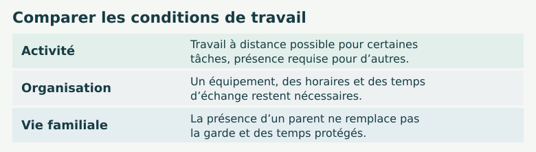

# X-ENS · MP-PC-PSI · Allemand 2021 — Corrigé brut

*Corrigé rédigé par IA, non officiel. Signalez toute erreur.*

**Rédaction** · GPT-6.2 Astra Ultra · vitesse non renseignée

Garde XEULCR, filières MP, PC et PSI. Les deux exercices se rédigent en allemand en quatre heures. A demande une synthèse des quatre documents, sans commentaire personnel, avec un titre et 600 à 675 mots. B demande un texte d’opinion de 500 à 600 mots qui répond aux arguments de l’éditorial.

## A. Synthèse de documents

**Ein Arbeitsplatz ist mehr als eine Internetverbindung**

In einem Interview der Deutschen Welle beschreibt der Arbeitsmarktforscher Hilmar Schneider, wie die Pandemie viele Unternehmen zu einem ungeplanten Versuch mit dem Homeoffice zwang. Zwei weitere Beiträge desselben Senders prüfen, ob daraus ein Recht auf Arbeit von zu Hause entstehen könnte und warum Reiseunternehmen inzwischen sogar das Arbeiten am Strand anbieten. Bettina Bextes Zeichnung einer Mitarbeiterin im Kundendienst zeigt die Kehrseite des Versprechens. Ob die neue Beweglichkeit den Beschäftigten zugutekommt, entscheidet sich an der Art der Arbeit, an ihrer betrieblichen Organisation und an den Verhältnissen am jeweils anderen Ende der Leitung.

Im Frühjahr 2020 mussten Beschäftigte und Vorgesetzte in kurzer Zeit Fähigkeiten erwerben, für deren Erprobung es vorher wenig Anlass gegeben hatte. Wer inzwischen eine Videokonferenz einberufen und auf gemeinsame Dokumente zugreifen kann, ist für manche Aufgaben nicht länger auf das Büro angewiesen. Nach Schneider dürfte diese Erfahrung auch nach dem Ende der akuten Krise fortwirken. Allerdings lässt sich der große Anteil der Dienstleistungen an der Beschäftigung nicht einfach in einen entsprechenden Anteil von Heimarbeitsplätzen umrechnen. Manche Dienste verlangen gerade den direkten Kontakt. Auch im Büro werden bei zufälligen Begegnungen Fragen gelöst, für die niemand eigens eine Besprechung ansetzen würde. Technische Erreichbarkeit und gute Zusammenarbeit sind daher verschiedene Voraussetzungen.

Der Vorschlag von Bundesarbeitsminister Hubertus Heil, einen Anspruch auf 24 Tage Homeoffice im Jahr einzuführen, macht diese Unterscheidung politisch bedeutsam. Beschäftigte könnten Wege und Zeit sparen. Wer einen Teil der Woche zu Hause arbeitet, braucht dort aber eine angemessene Ausstattung und im Unternehmen weiterhin einen Platz. Die mögliche Ersparnis bei den Büroflächen muss also gegen zusätzliche Kosten abgewogen werden. Auch für die Verteilung der Familienarbeit ist der Effekt offen. Arbeiten beide Eltern teilweise zu Hause, können sie Wege leichter abstimmen. Fehlt jedoch eine verlässliche Betreuung, bleiben zwei Tätigkeiten gleichzeitig zu erledigen, für die vorher unterschiedliche Menschen und Orte vorgesehen waren.

Die Karikatur führt genau diesen Unterschied vor. Am Telefon begrüßt Susanne einen Kunden so freundlich, als säße sie allein im Servicecenter. Tatsächlich bedient sie gleichzeitig den Computer, versorgt ein Kind und balanciert vor dem Herd. Ein weiteres Kind und das Haustier sind ebenfalls in der Küche beschäftigt. Was der Anrufer als reibungslosen Dienst erlebt, verlangt auf ihrer Seite eine kaum mögliche Teilung der Aufmerksamkeit. Der räumliche Gewinn ist unter solchen Bedingungen keine Garantie für einen zeitlichen. Die Zeichnung ergänzt damit die Diskussion um Gleichberechtigung: Anwesend zu sein bedeutet noch nicht, über die eigene Zeit verfügen zu können.

Die Reisebranche verspricht eine entgegengesetzte Erfahrung. Ferienanlagen bieten während der Pandemie ruhige Zimmer mit Arbeitsausstattung, stabiler Verbindung und je nach Bedarf weiterer Unterstützung an. Nach Feierabend lockt der Strand. Für die von ausbleibenden Gästen getroffenen Veranstalter entsteht eine neue Einnahmemöglichkeit, für manche Beschäftigte eine vorübergehende Alternative zur eigenen Wohnung. Doch Arbeitsmarktforscher Florian Kunze verweist auf die Fähigkeit, die Rolle zwischen Arbeit und Freizeit tatsächlich zu wechseln. In einer Untersuchung unter 700 Befragten stimmten 77 Prozent einer verbesserten Vereinbarkeit zu, zugleich fühlten sich 36 Prozent einsamer als am gewohnten Arbeitsplatz. Beide Erfahrungen können bei derselben Person zusammenkommen. Eine andere Aussicht aus dem Fenster löst das soziale Problem nicht automatisch.

Auch die Art, wie die Beschäftigten zum neuen Arbeitsort gelangen, spielt eine Rolle. Die Menschen im Frühjahr hatten häufig gar keine Wahl. Wer dagegen bewusst für einige Wochen einen Arbeitsplatz in einer Ferienanlage bucht, hat schon vor der Abreise andere Voraussetzungen.

Damit erscheint das Homeoffice weder als bloße Notlösung noch als einheitliche Zukunft aller Berufe. Der erzwungene Versuch hat gezeigt, dass mehr Tätigkeiten ortsunabhängig möglich sind, als viele Betriebe angenommen hatten. Er hat zugleich sichtbar gemacht, welche Leistungen bisher der gemeinsame Arbeitsort und die Einrichtungen der Kinderbetreuung übernommen haben. Wenn der Arbeitsort wählbar wird, bleibt zu klären, wer Ausstattung, Ansprechbarkeit und geschützte Arbeitszeit gewährleistet. Erst diese Bedingungen entscheiden, ob das Versprechen von mehr Freiheit im Alltag eingelöst werden kann.

*623 Wörter.*

## B. Texte d’opinion

Martin Menz vergleicht ein Unternehmen mit einer Fußballmannschaft, deren Spieler nicht auf Dauer getrennt voneinander trainieren können. Das Bild leuchtet ein: Ein Doppelpass lässt sich schwer gegen die eigene Hauswand üben. Aber auch eine Mannschaft verbringt nicht jede Stunde mit einem Trainingsspiel. Welche gemeinsame Arbeit persönlichen Kontakt braucht und welche in Ruhe besser gelingt, ist für mich die eigentliche Frage. Menz macht auf einen Verlust aufmerksam, zieht aus ihm aber einen zu allgemeinen Schluss.

Am überzeugendsten finde ich sein Argument der ungeplanten Begegnung. Eine neue Mitarbeiterin kann im Büro sehen, dass ein erfahrener Kollege vor dem Abschicken eines Angebots noch einmal bei der Werkstatt anruft. In keinem Handbuch steht unbedingt, warum diese Rückfrage wichtig ist. Zu Hause bekommt sie möglicherweise nur die fertige Datei und übersieht, was sie noch lernen müsste. Auch Spannungen in einem Team werden oft zuerst in einer Pause bemerkbar, bevor sie sich in einer Sitzung vernünftig ansprechen lassen. Eine regelmäßige Gelegenheit, einander ohne Tagesordnung zu begegnen, ist deshalb keine teure Nebensache.

Andererseits erlebt nicht jeder das gemeinsame Büro als Ort ununterbrochener Zusammenarbeit. Ein Mitarbeiter soll einen komplizierten Vertrag lesen, während im selben Raum mehrere Menschen telefonieren. Ein Nachmittag zu Hause kann es ihm erlauben, die offenen Fragen gründlicher vorzubereiten. In der nächsten Besprechung profitiert das ganze Team davon. Entscheidend ist, dass die anderen wissen, wann und auf welchem Weg sie ihn erreichen können. Eine Stunde konzentrierter Einzelarbeit lässt sich ebenso verbindlich verabreden wie eine Stunde gemeinsamer Beratung. Die räumliche Anwesenheit ist in beiden Fällen nur ein Mittel zu einem bestimmten Zweck.

Auch die Tür zum Büro, die Menz als klare Grenze zwischen Beruf und Privatleben lobt, schließt nicht für alle im selben Moment. Wer nach einem langen Rückweg sein Kind erst kurz vor dem Schlafengehen sieht und danach dienstliche Nachrichten beantwortet, hat die Arbeit räumlich verlassen, zeitlich aber kaum hinter sich gelassen. Umgekehrt kann in einer kleinen Wohnung ohne Schreibtisch jeder Arbeitstag bis ins Abendessen hineinreichen. Eine Regel, die Wahlfreiheit verspricht, müsste daher sicherstellen, dass ein ausgestatteter Arbeitsplatz im Betrieb verfügbar bleibt und zu Hause niemand rund um die Uhr reagieren muss.

Ein sinnvoller Versuch wäre für mich, Teams ihre Woche nach Aufgaben planen zu lassen. Neue Kollegen sollten verlässlich jemanden antreffen, der sie einarbeitet. Gemeinsame Entscheidungen und schwierige Gespräche bekommen einen festen Ort; für andere Tätigkeiten kann jeder begründet einen ruhigen Arbeitsplatz wählen. Nach einigen Wochen ließe sich erfragen, wer Informationen verpasst, wie lange Rückfragen offenbleiben und ob ungelöste Aufgaben in den Feierabend rutschen. Damit hätten Beschäftigte und Vorgesetzte mehr in der Hand als ihren Eindruck davon, wie voll der Parkplatz ist.

Dabei sollte eine Teilzeitkraft ebenso mitreden können wie ein erfahrener Abteilungsleiter. Sonst fallen die gemeinsamen Tage womöglich ausgerechnet auf ihre freien Tage, und die vermeintlich flexible Lösung schafft eine weitere Hürde für ihre Beteiligung.

Menz verdient Zustimmung, wenn er daran erinnert, dass ein Team nicht allein durch das Teilen eines Kalenders entsteht. Doch gerade wer Zusammenarbeit ernst nimmt, sollte auch nach den Bedingungen fragen, unter denen sich jeder darauf vorbereiten kann. Die Zukunft liegt für mich in einer gemeinsamen Entscheidung über Nähe und Abstand. Ihr Maßstab ist die Qualität der Arbeit und der Beziehungen, die sie tragen.

*524 Wörter.*

La garde et le rapport concernent les filières MP, PC et PSI.

[Cahier d’allemand, A1–A3 p. 2–7, dessin p. 8, B p. 9–10](https://banques-ecoles.fr/cms/wp-content/uploads/2021/07/2021_MPPC_sujet_All.pdf) · [Rapport de l’écrit, p. 1–2](https://banques-ecoles.fr/cms/wp-content/uploads/2021/10/21_MPPC_rapport_eAll.pdf)
