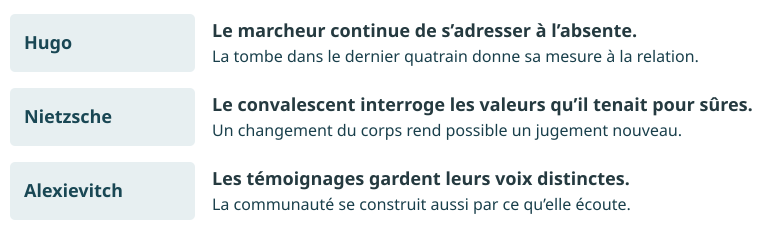

# X-ENS · MP-PC-PSI · Composition française 2021 — corrigé brut

*Corrigé rédigé par IA, non officiel. Signalez toute erreur.*

**Rédaction** · GPT-6.2 Astra Ultra · vitesse non renseignée · 25 novembre 2026

## Sujet et œuvres

Dans *Description de l’homme*, Hans Blumenberg appelle l’homme « un être risqué qui peut se rater », puis « l’animal qui vit malgré tout ». Il faut commenter et discuter sa formule avec *La Supplication* de Svetlana Alexievitch, les livres IV et V des *Contemplations* de Victor Hugo, la préface à la seconde édition et le livre IV du *Gai Savoir* de Friedrich Nietzsche.

## Dissertation

Dans « Demain, dès l’aube… », Victor Hugo parle comme un homme attendu à un rendez-vous. La marche a son heure, son itinéraire, sa destinataire. La tombe ne paraît que dans les derniers vers. Nous pourrions dire que le père a continué de vivre après la disparition de sa fille. Cela n’expliquerait encore presque rien de ce que le poème nous a fait éprouver. La fidélité à quelqu’un qui ne peut plus répondre donne à la journée du vivant une forme qu’aucune nécessité biologique ne lui prescrivait. Hans Blumenberg s’étonne lui aussi de l’existence d’un animal dont la vie ne semble jamais aller entièrement de soi. Il qualifie l’homme d’« être risqué qui peut se rater » et d’« incarnation de l’improbable ». Dans le premier mouvement, l’être humain apparaît comme un pari dont il n’a pas décidé le lancement ; aussitôt, le pronom réfléchi en fait aussi l’agent possible de son propre inaccomplissement. Que doit-il donc maintenir ou faire advenir en lui pour que sa simple existence puisse compter comme une réussite improbable ? Les œuvres de Hugo, de Nietzsche et d’Alexievitch obligent à distinguer la précarité du vivant, le risque de manquer à autrui et la chance d’inventer une manière humaine de vivre avec ce qui est arrivé.

### Une existence que rien ne garantit à l’avance

Avant toute décision, un être humain s’éprouve à travers un corps, un lieu, des liens auxquels il n’a pas choisi de devoir sa vie. Le livre d’Alexievitch en donne une expérience particulièrement déroutante. Après la catastrophe de Tchernobyl, les habitants peuvent retrouver autour d’eux des arbres, des fruits, des maisons qui semblent avoir conservé toutes leurs qualités familières. Le danger échappe aux sens qui leur permettaient de se conduire jusque-là. Les ordres d’évacuation modifient le statut d’objets dont l’apparence demeure la même. Un monde où rien ne paraît manquer peut donc avoir perdu certaines des conditions qui permettaient à des hommes d’y vivre ensemble. La possibilité d’habiter humainement un lieu n’était pas une propriété certaine de l’espèce, acquise une fois pour toutes. Elle tenait entre autres à un accord précaire entre ce que le corps perçoit, ce que les autres savent et le crédit qu’on peut accorder à leur parole.

La préface du *Gai Savoir* rend la même précarité perceptible dans l’activité que l’on croirait la mieux soustraite aux vicissitudes du corps, celle qui consiste à penser. Nietzsche revient à son propre livre après une période de maladie. La convalescence change son rapport aux questions qu’il posait. Une conviction que l’on croyait fonder sur des raisons impersonnelles peut avoir emprunté son ton ou son évidence à un état de fatigue, à la douleur ou au besoin de repos. De même le retour de forces que l’on n’avait aucun droit de tenir pour acquises donne au monde une nouveauté inattendue. Le corps qui nous expose à l’incertitude est la condition même de cette surprise intellectuelle. La formule de Blumenberg relie heureusement une détermination abstraite, l’improbable, au mot concret d’incarnation. La moindre de nos certitudes a eu besoin qu’un vivant se trouve là pour la former et pour l’éprouver.

Le deuil dont *Pauca meae* porte la trace fait apparaître une fragilité d’un autre ordre. Il serait injuste d’imputer à celui qui reste une quelconque défaillance parce qu’une vie aimée a pris fin. Ce qui tremble est le sentiment même que l’existence suivra un cours sur lequel on peut raisonnablement compter. Dans « Oh ! je fus comme fou dans le premier moment », des perceptions ordinaires, un bruit, l’impression d’un retour, font revenir l’attente là où les faits l’ont anéantie. Le rapport du père au temps était constitué par l’existence de sa fille bien plus avant qu’il n’en avait conscience. Le perdre montre que la personne est faite, jusque dans ses habitudes perceptives, d’autres vies dont elle ne dispose pas. Si l’homme est « risqué », sa fragilité tient aussi à la richesse de ces attaches. Une espèce dont la vie demande de la confiance, des souvenirs communs et l’anticipation de lendemains s’expose à autre chose qu’au seul arrêt de fonctions vitales.

### Ce qui compte comme un échec humain

L’adjectif « risqué » ne suffit pourtant pas à expliquer « se rater ». Il faut que l’être dont l’existence reste incertaine prenne une part de responsabilité dans ce qu’il devient. Que serait, dans *La Supplication*, ce deuxième risque ? À mesure que des paroles particulières se font entendre, on comprend qu’une collectivité peut rester opérationnelle tout en devenant incapable de reconnaître l’expérience de ses membres. Les récits de guerre et d’héroïsme disponibles rendent certains gestes immédiatement intelligibles. Ils rendent plus difficile à dire ce qui, dans un désastre invisible, dans la vie des enfants ou dans l’angoisse d’un proche, n’a pas de place dans ce vocabulaire. Une société peut distribuer des rôles héroïques et laisser quelqu’un seul avec ce qu’il a vécu. Le manquement humain consiste ici à avoir déjà une réponse honorable pour l’action de tous et aucune oreille pour l’existence de chacun.

Chez Nietzsche, le danger intérieur se présente à celui qui se satisfait d’un jugement sur soi depuis longtemps disponible. L’aphorisme 290 envisage de donner du style à son caractère. Les traits qui nous composent n’ont pas tous été choisis. Il est possible de se contenter de les déclarer réussis ou manqués d’après une échelle héritée. Il est aussi possible de les faire entrer, y compris ceux qui nous déplaisent, dans une composition qui exige du temps et du travail. Le risque de « se rater » devient alors paradoxal. Un homme peut remplir sans accroc le programme que les autres attendaient de lui et ne jamais avoir cherché quelle forme il pouvait donner à sa propre existence. Cette pensée oblige toutefois à se méfier du mot réussite. Qui serait en droit d’appliquer le programme d’une telle composition au deuil d’un père ou au témoignage d’une veuve de Tchernobyl ? Une possibilité offerte à celui qui juge sa vie se changerait en injustice si un observateur s’en servait pour juger celle des autres.

Hugo fait voir ce déplacement du jugement dans « Le Mendiant », au livre V des *Contemplations*. Un homme entre avec un manteau usé que le narrateur fait sécher au feu. À travers les trous du tissu, la lumière donne au regard du poète l’image d’un ciel étoilé. Rien de matériel n’a été réparé par cette vision, et l’image serait indécente si elle suffisait au spectateur pour trouver belle la misère. La scène comprend d’abord l’entrée dans la maison et le geste d’accueil. Le changement dans la manière de voir se produit au contact d’une personne à qui l’on a déjà fait une place. Être humain exige ici que la capacité de donner un sens au monde se laisse instruire par la présence d’un autre vivant. Une belle interprétation qui dispenserait du geste premier aurait manqué l’essentiel.

### Donner un avenir à ce qui a eu lieu

L’animal qui vit « malgré tout » ne dispose donc pas d’une vertu cachée qui rendrait son succès automatique. La formule conserve sa portée si le « malgré » ne se change pas en « grâce à ». Le deuil n’est pas envoyé à Hugo pour faire naître un livre, et la catastrophe n’a pas besoin du témoignage futur pour recevoir après coup une justification. Qu’une œuvre en sorte reste une possibilité nouvelle et contingente. Lorsque le marcheur de « Demain, dès l’aube… » annonce à la deuxième personne sa visite du lendemain, il ne prétend pas que la mort serait illusoire. La fin du poème nous oblige à tenir ensemble le caractère irréversible de la perte et la possibilité de s’adresser encore à l’absente. Le rendez-vous a une réalité humaine qui dépend des actes du vivant. Rien n’imposait qu’il prenne cette forme.

L’épreuve proposée au livre IV du *Gai Savoir* donne à cette possibilité sa formulation la plus rude. À l’aphorisme 341, un démon annonce à un homme que sa vie exacte doit revenir jusque dans ses plus petits détails. Le texte laisse ouvertes deux réactions opposées. Comment accueillir une telle parole ? On ne se débarrasse d’aucun malheur et rien de ce qui pèse ne devient plus léger par décret. Ce qui peut changer est le rapport que le vivant entretient avec la totalité de ce qu’il a vécu. L’*amor fati* auquel aspire déjà l’aphorisme 276 prend le sens d’une tâche personnelle, jamais d’un ordre adressé à ceux qui souffrent de tout accepter. L’improbable tient à la possibilité d’une affirmation là où une simple répétition des circonstances semblait exclure toute nouveauté.

Alexievitch déplace enfin l’accent de l’effort individuel vers les conditions de sa transmission. Son livre ne parle pas à la place de tous dans une seule langue d’autorité. La suite des monologues et des chœurs maintient distinctes les façons dont les personnes nomment leur épreuve ou échouent à la nommer. Une communauté vivante pourrait vouloir effacer ces paroles discordantes au nom de la nécessité de continuer. Le livre fait le pari inverse. La possibilité d’une vie humaine après la catastrophe dépend aussi de ce qu’il restera une oreille pour une voix singulière. Aucune personne ne se donne seule cette possibilité. Il y faut celle qui se souvient, celle qui recueille, et un destinataire à venir qui n’est assuré par aucun événement de la nature.

L’homme apparaît alors comme un être en qui les conditions biologiques de la vie rendent possible quelque chose qu’elles ne suffisent pas à produire. Une fidélité, une manière nouvelle de former son jugement, une parole que des inconnus prendront la peine d’écouter peuvent faire advenir cette humanité. Elles restent susceptibles de manquer, même dans une société qui continue de fonctionner. Admirer que l’homme vive « malgré tout » prend un sens précis si l’on préserve cette incertitude. Nous vivons aussi de ce que certains ont fait pour d’autres sans qu’aucune loi de la vie garantisse qu’ils le feraient.

## Repère de lecture

## Sources

Le sujet XEULCR, commun à MP, PC et PSI, donne la citation et le corpus p. 2. Le rapport de cinq pages porte les trois filières. Aux p. 2–4, il distingue risque constitutif et goût du danger, échec d’une entreprise et possibilité de manquer sa propre humanité. Il souligne l’enjeu de l’espèce dans « l’incarnation de l’improbable ».

[Sujet](https://banques-ecoles.fr/cms/wp-content/uploads/2021/07/2021_MPPC_sujet_Fr.pdf) · [Rapport](https://banques-ecoles.fr/cms/wp-content/uploads/2021/12/21_MPPC_rapport_eFra.pdf)
