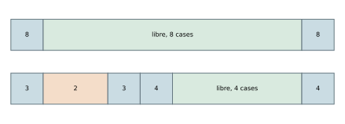
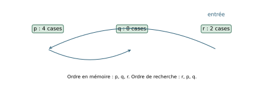

# X-ENS MP-PC-PSI · Informatique B 2021 · Corrigé brut

*Corrigé rédigé par IA, non officiel. Signalez toute erreur.*

**Rédaction** · GPT-6.2 Astra Ultra · vitesse non renseignée · 24 novembre 2026

## I · Allocation séquentielle

### Question 1 · Initialiser les données

On écrit le même caractère dans les $n$ cases. La fonction commune à toutes les parties utilise le service d'écriture de l'énoncé, sans créer de liste. Elle prend $\Theta(n)$ en temps et $O(1)$ en espace auxiliaire.

```python
def initialiser(p, n, c):
    for i in range(n):
        ecrire(p, i, c)
```

### Question 2 · Premier indice disponible

Comme la zone des données commence à l'indice 1, la première portion doit commencer en 1. La liste est déjà remplie de zéros.

```python
def demarrage():
    mem[0] = 1
```

### Question 3 · Réserver à la suite

La réservation est possible si $p+n\le N$, où $N$ désigne la taille totale de la mémoire. On avance la prochaine adresse de $n$ seulement en cas de succès, ce qui préserve toutes les données précédentes. Un échec coûte $\Theta(1)$ et un succès $\Theta(n)$. La recherche de place est indépendante de $N$.

```python
def reserver(n, c):
    p = mem[0]
    if p + n > TAILLE_MEM:
        return None
    initialiser(p, n, c)
    mem[0] = p + n
    return p
```

## II · Blocs fixes

### Question 4 · Placer le premier bloc fixe

Le pointeur fourni désigne la première case de données de la portion. Le premier en-tête est dans la case 1, et les premières données commencent donc en 2.

```python
def demarrage():
    ecrire_prochain(2)
```

### Question 5 · Recycler un bloc avant d'en créer un

Pour une taille de bloc $B$, la case d'en-tête du bloc $p$ est $p-1$ et sa dernière case $p+B-2$. La croissance est autorisée lorsque $p+B-1\le N$. Les blocs examinés avant $p$ sont tous réservés, donc le premier bloc libre est prioritaire. S'il y a $b$ blocs déjà créés, la recherche prend $O(b+1)$ et l'initialisation $O(n)$, soit $O(1+N/B+n)$, ou $O(N+n)$ pour $B$ fixé. Une demande dépassant la capacité utile $B-1$ échoue immédiatement.

```python
def reserver(n, c):
    if n + 1 > TAILLE_BLOC:
        return None
    fin = lire_prochain()
    p = 2
    while p < fin and est_reservee(p):
        p += TAILLE_BLOC
    if p == fin:
        if p + TAILLE_BLOC - 1 > TAILLE_MEM:
            return None
        ecrire_prochain(p + TAILLE_BLOC)
    marque_reservee(p)
    initialiser(p, n, c)
    return p
```

### Question 6 · Libérer un bloc fixe

L'indice fourni désigne une portion effectivement réservée. Son changement d'état suffit à la rendre réutilisable en $O(1)$, puisque Q5 réinitialisera les données au prochain usage.

```python
def liberer(p):
    marque_libre(p)
```

## III · Balises de bord

### Question 7 · Lire une balise de bord

Une taille utile $t$ est paire. L'en-tête et le pied contiennent le même mot $t+b$, avec $b=1$ pour une portion réservée et $b=0$ pour une portion libre. La fonction de test lit la parité en $p-1$. Celle de marquage écrit $t+1$ en $p-1$ et $p+t$. La taille se récupère par $2\lfloor(t+b)/2\rfloor$. Le pied de la portion précédente se trouve en $p-2$, ce qui donne son état sans parcourir la mémoire.

### Question 8 · Installer les deux sentinelles

Ici le prologue a pour adresse 2, avec balises en 1 et 2. L'épilogue initial a pour adresse 4, avec balises en 3 et 4. Les deux portent la taille 0 et le bit réservé. La case 0 mémorise l'adresse de l'épilogue.

```python
def demarrage():
    e = PROLOGUE + 2
    marque_reservee(PROLOGUE, 0)
    marque_reservee(e, 0)
    ecrire_position_epilogue(e)
```

### Question 9 · Réserver avec des tailles variables

On parcourt les portions physiques par pas $t+2$ jusqu'à l'épilogue. Un bloc libre suffisant fournit soit deux blocs, soit un bloc réservé unique. Un reliquat nécessite au moins quatre cases, car sa charge utile paire vaut au moins deux et deux balises l'encadrent. Si la différence est seulement deux, on conserve toute la taille physique pour la réservation. Au besoin, l'ancienne sentinelle finale devient la nouvelle portion. La balise la plus à droite du nouvel épilogue doit rester à un indice strictement inférieur à $N$. La recherche prend $O(b)$ pour $b$ portions, l'écriture prend $O(n)$ et le majorant global est $O(1+N+n)$. L'espace auxiliaire est constant.

```python
def etendre(taille):
    p = lire_position_epilogue()
    nouvel_epilogue = p + taille + 2
    if nouvel_epilogue >= TAILLE_MEM:
        return None
    marque_reservee(p, taille)
    marque_reservee(nouvel_epilogue, 0)
    ecrire_position_epilogue(nouvel_epilogue)
    return p

def reserver(n, c):
    taille = n + n % 2
    p = PROLOGUE + 2
    e = lire_position_epilogue()
    while p < e:
        t = lire_taille(p)
        if est_libre(p) and t >= taille:
            if t - taille >= 4:
                marque_reservee(p, taille)
                marque_libre(p + taille + 2, t - taille - 2)
            else:
                marque_reservee(p, t)
            initialiser(p, n, c)
            return p
        p += t + 2
    p = etendre(taille)
    if p is not None:
        initialiser(p, n, c)
    return p
```



### Question 10 · Fusionner les portions physiquement voisines

Seuls les voisins immédiats de la portion libérée peuvent rejoindre celle-ci. Chaque fusion récupère les deux balises internes entre portions, d'où le $+2$. Les deux voisins extérieurs d'un bloc libre étant réservés avant l'appel, il y a au plus deux fusions et aucun autre bloc à parcourir. Les sentinelles réservées donnent une réponse définie aux deux tests aux extrémités, même pour la première et la dernière portion. Le coût est $\Theta(1)$.

```python
def liberer(p):
    t = lire_taille(p)
    droite = p + t + 2
    if est_libre(droite):
        t += lire_taille(droite) + 2
    if precedent_est_libre(p):
        gauche = lire_taille_precedent(p)
        p -= gauche + 2
        t += gauche + 2
    marque_libre(p, t)
```

## IV · Chaîne explicite des portions libres

### Question 11 · Insérer en tête de la chaîne libre

La nouvelle tête a zéro pour prédécesseur. Quand la chaîne était vide, son successeur est aussi zéro. Dans tous les cas, l'entrée est finalement $p$. Le nombre d'accès est borné.

```python
def ajoute_en_entree_de_chaine(p):
    tete = lire_entree_chaine()
    ecrire_predecesseur(p, 0)
    ecrire_successeur(p, tete)
    if tete != 0:
        ecrire_predecesseur(tete, p)
    ecrire_entree_chaine(p)
```

### Question 12 · Retirer un élément de la chaîne

Le prédécesseur reçoit le successeur de $p$, ou l'entrée est déplacée si $p$ était en tête. Le successeur existant reçoit symétriquement le prédécesseur. Pour un singleton, l'entrée redevient zéro. Le coût est $\Theta(1)$.

```python
def supprime_dans_chaine(p):
    avant = lire_predecesseur(p)
    apres = lire_successeur(p)
    if avant == 0:
        ecrire_entree_chaine(apres)
    else:
        ecrire_successeur(avant, apres)
    if apres != 0:
        ecrire_predecesseur(apres, avant)
```

### Question 13 · Initialiser avec une chaîne explicite

Le prologue est en 3 et l'épilogue en 5. Les cases 0 et 1 contiennent respectivement l'adresse de l'épilogue et zéro, valeur de l'entrée d'une chaîne vide. Les sentinelles sont marquées réservées comme en Q8.

```python
def demarrage():
    ecrire_entree_chaine(0)
    e = PROLOGUE + 2
    marque_reservee(PROLOGUE, 0)
    marque_reservee(e, 0)
    ecrire_position_epilogue(e)
```

### Question 14 · Réserver via la chaîne libre

La recherche visite les portions libres dans l'ordre de leur chaîne et retient la première qui convient. Un reliquat admissible rejoint la tête de chaîne. Sinon, la réservation consomme le bloc complet ou, à défaut de bloc suffisant, réutilise la fonction d'extension de Q9. Si $f$ est le nombre de portions libres, le coût est $O(1+f+n)$ en cas de succès et $O(1+f)$ en cas d'échec. Le nombre de portions réservées n'entre plus dans le coût de recherche, et $f=O(N)$ dans le pire cas.

```python
def reserver(n, c):
    taille = n + n % 2
    p = lire_entree_chaine()
    while p != 0 and lire_taille(p) < taille:
        p = lire_successeur(p)
    if p == 0:
        p = etendre(taille)
        if p is None:
            return None
    else:
        t = lire_taille(p)
        supprime_dans_chaine(p)
        if t - taille >= 4:
            reste = p + taille + 2
            marque_reservee(p, taille)
            marque_libre(reste, t - taille - 2)
            ajoute_en_entree_de_chaine(reste)
        else:
            marque_reservee(p, t)
    initialiser(p, n, c)
    return p
```



### Question 15 · Libérer en maintenant la chaîne

On retire chacun des voisins physiques libres de la chaîne avant d'y inscrire la portion fusionnée, qui devient l'unique représentation libre de cette zone. Ses données disposent d'au moins deux cases pour porter les liens. Au plus deux suppressions, deux fusions et une insertion suffisent, soit $\Theta(1)$ quelle que soit la taille de la mémoire. Les opérations des quatre parties supposent le contrat de bon usage donné dans l'introduction du sujet.

```python
def liberer(p):
    t = lire_taille(p)
    droite = p + t + 2
    if est_libre(droite):
        supprime_dans_chaine(droite)
        t += lire_taille(droite) + 2
    if precedent_est_libre(p):
        gt = lire_taille_precedent(p)
        gauche = p - gt - 2
        supprime_dans_chaine(gauche)
        p = gauche
        t += gt + 2
    marque_libre(p, t)
    ajoute_en_entree_de_chaine(p)
```
