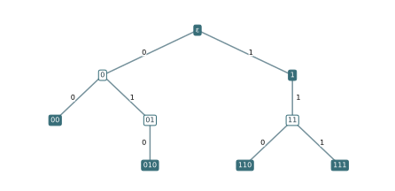
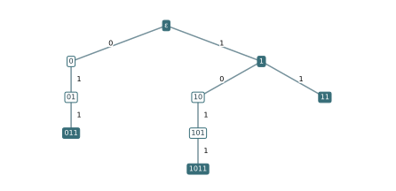
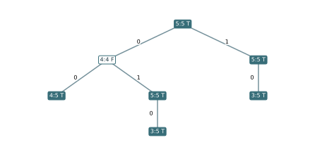
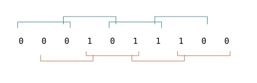

# X-ENS MP · Informatique A 2021 · Corrigé brut

*Corrigé rédigé par IA, non officiel. Signalez toute erreur.*

**Rédaction** · GPT-6.2 Astra Ultra · vitesse non renseignée · 24 novembre 2026

## Partie 1 · Arbres de mots

### Question 1 · Lire et construire un arbre de mots

La figure 1 donne $\mathcal M(a_2)=\{00,1,101\}$. Dans l’arbre demandé, les seuls nœuds sont les préfixes des six mots, et seuls les six mots sont marqués. La racine porte T pour $\varepsilon$, le nœud 1 porte T tout en ayant un enfant 11. Le schéma donne l’arbre entier, avec 0 à gauche et 1 à droite.



### Question 2 · Existence et unicité de l’arbre réduit

Pour $M=\varnothing$, seul $V$ convient. Tout arbre fini non vide réduit possède une feuille marquée et représente donc au moins un mot. Pour $M\ne\varnothing$, poser $M_c=\{u:cu\in M\}$ pour $c\in\{0,1\}$. L’arbre est nécessairement $N(\varepsilon\in M,A(M_0),A(M_1))$. Les sous-problèmes non vides ont une longueur maximale strictement moindre, et les vides sont déjà traités. La construction termine et son arbre est réduit. Si les deux sous-arbres sont vides, $M=\{\varepsilon\}$ et la racine est marquée. La même récurrence prouve l’unicité.

### Question 3 · Des zéros puis des uns

Les types du sujet sont rappelés ici pour rendre les fonctions exécutables.
```ocaml
type mot = int array
type am = V | N of bool * am * am

let zeros_puis_uns n =
  let rec uns k =
    if k = 0 then N (true, V, V)
    else N (false, V, uns (k - 1))
  in
  let rec libre k =
    if k = 0 then N (true, V, V)
    else N (false, libre (k - 1), uns (k - 1))
  in
  libre n
```
Une branche gauche conserve le choix du moment où commencer les uns. Une branche droite le fixe. Toutes les feuilles sont marquées à la profondeur $n$.

### Question 4 · Compter exactement k uns

```ocaml
let rec k_uns k n =
  if k < 0 || k > n then V
  else if n = 0 then N (true, V, V)
  else N (k = 0, k_uns k (n - 1), k_uns (k - 1) (n - 1))
```
La racine accepte le mot vide exactement pour $k=0$. À gauche le nombre d’uns encore requis ne change pas, à droite il diminue d’une unité. Quand $k\le n$ il existe au moins un mot, donc aucune feuille non marquée n’est construite.

### Question 5 · Cardinal du langage

```ocaml
let rec compter = function
  | V -> 0
  | N (b, gauche, droite) ->
      (if b then 1 else 0) + compter gauche + compter droite
```
Les mots des deux sous-arbres ont des premières lettres différentes. La contribution de la racine correspond au mot vide.

### Question 6 · Reconnaître un mot

```ocaml
let chercher arbre m =
  let n = Array.length m in
  let rec visite a i =
    match a with
    | V -> false
    | N (b, gauche, droite) ->
        if i = n then b
        else visite (if m.(i) = 0 then gauche else droite) (i + 1)
  in
  visite arbre 0
```
À l’épuisement du mot, le booléen du nœud décide. La présence d’un simple préfixe ne suffit pas.

### Question 7 · Énumérer sans recopier les préfixes à chaque descente

```ocaml
let enumerer a =
  let rec visite t inverse acc =
    match t with
    | V -> acc
    | N (b, gauche, droite) ->
        let suite =
          if b then Array.of_list (List.rev inverse) :: acc else acc
        in
        let avec_droite = visite droite (1 :: inverse) suite in
        visite gauche (0 :: inverse) avec_droite
  in
  visite a [] []
```
Chaque nœud est visité une fois. La persistance des listes rend la descente constante par arête. Pour un mot marqué, le renversement et la conversion coûtent sa longueur plus une constante. Chaque nœud est le préfixe d’un mot marqué, ainsi $n(a)\le1+\sum_{u\in\mathcal M(a)}|u|$. Le temps est $O(1+\sum |u|)$, y compris pour le mot vide seul.

### Question 8 · Insérer dans un arbre persistant

```ocaml
let ajouter a m =
  let n = Array.length m in
  let rec insere t i =
    let b, g, d =
      match t with V -> false, V, V | N (b, g, d) -> b, g, d
    in
    if i = n then N (true, g, d)
    else if m.(i) = 0 then N (b, insere g (i + 1), d)
    else N (b, g, insere d (i + 1))
  in
  insere a 0
```
Les branches sœurs sont partagées avec l’ancien arbre. La dernière position est marquée même si le mot était déjà présent.

## Partie 2 · Arbres des suffixes

### Question 9 · Arbre des suffixes de 1011

Les suffixes sont $\varepsilon,1,11,011,1011$. Les nœuds non marqués sont $0,01,10,101$. Avec la racine vide et ces huit mots non vides, l’arbre possède neuf nœuds. Le dessin distingue les cinq marques.



### Question 10 · Retrouver le mot depuis l’arbre de ses suffixes

La hauteur compte les nœuds depuis la racine, d’où $h(AS(m))=|m|+1$. Le code explore l’arbre et maintient un chemin maximal sans recopier de tableau lors de la mise à jour.
```ocaml
let retrouver_mot a =
  let maximum = ref (-1) and meilleur = ref [] in
  let rec visite t longueur inverse =
    match t with
    | V -> ()
    | N (b, g, d) ->
        if b && longueur > !maximum then
          (maximum := longueur; meilleur := inverse);
        visite g (longueur + 1) (0 :: inverse);
        visite d (longueur + 1) (1 :: inverse)
  in
  visite a 0 [];
  Array.of_list (List.rev !meilleur)
```
Chaque appel non vide coûte $O(1)$, et une seule conversion finale est nécessaire. Le temps est $O(n(AS(m)))$.

### Question 11 · Bornes sur les facteurs distincts

Le nœud atteint par un préfixe de suffixe correspond exactement au facteur lu, une seule fois car le chemin du trie est déterminé par ses bits. Il y a au moins $\ell+1$ nœuds, tous les préfixes du mot, et au plus $1+\ell(\ell+1)/2$ car il existe autant de positions de début et de fin pour des facteurs non vides. Le mot $0^\ell$ atteint la borne inférieure. Prenons $m=0^a1^b$ avec $a=\lfloor\ell/2\rfloor$ et $b=\lceil\ell/2\rceil$. Il contient tous les $0^i1^j$ pour $1\le i\le a,1\le j\le b$, ainsi que $a+b$ facteurs purs non vides et le mot vide. Le total $1+\ell+ab$ vaut au moins $\ell^2/4$. On peut choisir $C=1/4$.

## Partie 3 · Arbres des facteurs

### Question 12 · Décoder les trois arbres compacts

Pour $m=01001$, $S(m)=\{\varepsilon,1,01,001,1001,01001\}$. Dans $a_5$, les marques donnent $\{\varepsilon,1,001,1001,01001\}$. L’arbre satisfait la condition locale de réduction mais il manque le suffixe 01. Dans $a_6$, l’ajout du nœud marqué 01 permet d’obtenir exactement $S(m)$. C’est un arbre des facteurs réduit. Dans $a_7$, le nœud correspondant à 1001 n’est pas marqué et son enfant gauche lit encore $0$ puis $m[4..5[=1$. Ainsi $\mathcal M(a_7)=\{\varepsilon,1,01,001,01001,100101\}$. Ce n’est pas l’ensemble des suffixes et son nœud non marqué à enfant unique enfreint la réduction.

### Question 13 · Combien de nœuds après compression ?

Lorsque les deux lettres apparaissent, la racine porte $\varepsilon$, est marquée, et a deux enfants. Les $\ell$ autres suffixes marquent exactement $\ell$ autres nœuds. Chaque nœud ayant au plus un enfant est marqué par réduction. Il y en a donc au plus $\ell$. Si $L,U,B$ comptent les feuilles, les nœuds à un enfant et les bifurcations, le comptage des arêtes donne $U+2B=L+U+B-1$, soit $B=L-1$. D’où $L+U+B\le2\ell-1$.
Pour $\ell\ge2$, le mot $0^{\ell-1}1$ a $\ell$ suffixes non vides, chacun terminé par son unique 1. Aucun n’est préfixe d’un autre. Tous deviennent des feuilles, et aucune chaîne unaire ne subsiste dans l’arbre réduit. Il y a $2\ell-1$ nœuds. Pour $\ell=1$, la condition « les deux lettres apparaissent » est impossible. Un mot constant a $\ell+1$ nœuds, soit deux à cette longueur. Cela précise l’exception dans « pour tout $\ell>0$ ».

### Question 14 · Nombre de facteurs depuis les tranches

```ocaml
type af = V | N of int * int * bool * af * af

let rec nb_facteurs = function
  | V -> 0
  | N (p, q, _, g, d) ->
      q - p + 1 + nb_facteurs g + nb_facteurs d
```
Chaque nœud compact représente $q-p+1$ préfixes distincts. Pour la racine, le premier est le mot vide. Pour les autres nœuds, le premier contient déjà le bit de l’arête entrante. Les segments issus de nœuds différents ne se recouvrent pas.

### Question 15 · Longueur du préfixe commun

```ocaml
let plpc m1 p q m2 i j =
  let k = ref 0 in
  while p + !k < q && i + !k < j && m1.(p + !k) = m2.(i + !k) do
    incr k
  done;
  !k
```
La boucle coûte $O(1+k)$, où $k$ est la valeur renvoyée. Une tranche vide donne immédiatement zéro.

### Question 16 · Reconnaître un facteur dans l’arbre compact

Pour les fonctions dépendant de $m$, le code utilise une fonction extérieure qui fixe le mot global autorisé dans l’énoncé. Après application à $m$, la fonction restante prend exactement les arguments demandés.
```ocaml
let facteur_du_mot m =
  let facteur a f =
    let n = Array.length f in
    let rec descendre t i =
      match t with
      | V -> false
      | N (p, q, _, g, d) ->
          let k = plpc m p q f i n in
          if i + k = n then true
          else if p + k < q then false
          else descendre (if f.(i + k) = 0 then g else d) (i + k + 1)
    in
    descendre a 0
  in facteur
```
Pour un mot fixé, la liaison `let facteur = facteur_du_mot m` donne la signature demandée. Tout facteur est un préfixe de suffixe. Une fin à l’intérieur d’une tranche est donc admise. S’il reste une lettre après une tranche complète, elle choisit et consomme l’arête suivante. Le coût cumulé est $O(1+|f|)$ car chaque nouvelle descente a consommé au moins le bit de branchement.

### Question 17 · Énumérer chaque facteur une fois

```ocaml
let facteurs_du_mot m =
  let rec visite t inverse acc =
    match t with
    | V -> acc
    | N (p, q, _, g, d) ->
        let rec tranche j chemin sorties =
          let mot = Array.of_list (List.rev chemin) in
          let sorties = mot :: sorties in
          if j = q then
            let apres = visite d (1 :: chemin) sorties in
            visite g (0 :: chemin) apres
          else tranche (j + 1) (m.(j) :: chemin) sorties
        in
        tranche p inverse acc
  in
  fun a -> visite a [] []
```
Pour le mot fixé, on pose `let facteurs = facteurs_du_mot m`. Le préfixe d’entrée contient le bit d’arête sauf à la racine. La boucle matérialise précisément les $q-p+1$ préfixes comptés en Q14. Chaque mot de $F(m)$ possède un seul chemin dans le trie décompressé. Le coût total est $O(1+\sum_{f\in F(m)}|f|)$, conversions incluses.

### Question 18 · Construire l’arbre de 01001

On note `p:qT` ou `p:qF` le nœud de tranche $[p,q[$, et `nœud(g,d)` ses enfants gauche et droit. Un point est un arbre vide. Les enfants vides d’une feuille sont omis. Voici toutes les étapes, en conservant les indices de la procédure du sujet.

| Suffixe ajouté | Arbre obtenu |
| --- | --- |
| $\varepsilon$ | `5:5T` |
| 1 | `5:5T(·,5:5T)` |
| 01 | `5:5T(4:5T,5:5T)` |
| 001 | `5:5T(4:4F(4:5T,5:5T),5:5T)` |
| 1001 | `5:5T(4:4F(4:5T,5:5T),5:5T(3:5T,·))` |
| 01001 | `5:5T(4:4F(4:5T,5:5T(3:5T,·)),5:5T(3:5T,·))` |

L’insertion de 001 scinde l’ancienne tranche $[4,5[$. Dans la dernière étape, 01 reste marqué et reçoit une suite commençant par 0. Le dessin reprend ce dernier état.



### Question 19 · Compléter les deux cas d’insertion

Dans **CAS 1** le fragment suivant construit le nœud scindé. La branche de l’ancien suffixe existe toujours. Celle du nouveau suffixe est vide lorsqu’il s’arrête exactement à la coupure.
```ocaml
let ancien = N (p + k + 1, q, b, a0, a1) in
let termine = i + k = n in
let nouveau =
  if termine then V else N (i + k + 1, n, true, V, V)
in
if m.(p + k) = 0 then N (p, p + k, termine, ancien, nouveau)
else N (p, p + k, termine, nouveau, ancien)
```
Dans **CAS 2**, conserver la tranche et soit poser la marque, soit descendre.
```ocaml
if i + k = n then N (p, q, true, a0, a1)
else if m.(i + k) = 0 then
  N (p, q, b, ajouter_suffixe (i + k + 1) a0, a1)
else
  N (p, q, b, a0, ajouter_suffixe (i + k + 1) a1)
```

## Partie 4 · Plus long facteur répété

### Question 20 · Plus long facteur répété par paires de départs

```ocaml
let plfr1 m =
  let n = Array.length m and best = ref 0 in
  for i = 0 to n - 1 do
    for j = i + 1 to n - 1 do
      best := max !best (plpc m i n m j n)
    done
  done;
  !best
```
Le maximum des préfixes communs aux paires de suffixes distincts est le résultat. Le coût est $O(n^3)$. Un mot d’une seule lettre donne zéro.

### Question 21 · Programmation dynamique par extrémités

On a $c(i,0)=c(0,j)=0$. Si les dernières lettres diffèrent, $c(i,j)=0$ ; sinon $c(i,j)=1+c(i-1,j-1)$. Les entrées à extrémités distinctes suffisent.
```ocaml
let plfr2 m =
  let n = Array.length m in
  let c = Array.make_matrix (n + 1) (n + 1) 0 in
  let best = ref 0 in
  for i = 1 to n do
    for j = i + 1 to n do
      if m.(i - 1) = m.(j - 1) then
        c.(i).(j) <- 1 + c.(i - 1).(j - 1);
      best := max !best c.(i).(j)
    done
  done;
  !best
```
L’entrée diagonale comparerait un facteur avec lui-même et donnerait à tort $n$. Le temps et la taille de la table sont $O(n^2)$.

### Question 22 · Lire la répétition maximale dans l’arbre compact

```ocaml
let plfr3 a =
  let rec visite profondeur t =
    match t with
    | V | N (_, _, _, V, V) -> 0
    | N (p, q, _, g, d) ->
        let ici = profondeur + q - p + 1 in
        max ici (max (visite ici g) (visite ici d))
  in
  visite (-1) a
```
Un nœud à deux enfants est préfixe de deux suffixes distincts. Un nœud interne à un enfant est marqué par réduction, donc il est à la fois suffixe et préfixe d’un suffixe plus long. Chaque préfixe répété peut être prolongé au moins jusqu’à un tel nœud de profondeur maximale. La racine n’ayant aucune arête entrante, l’initialisation à $-1$ corrige le $+1$ de la formule générale. Un parcours coûte $O(n(a))=O(1+|m|)$ d’après Q13, pour l’arbre déjà construit.

## Partie 5 · Nombre maximal de facteurs distincts

### Question 23 · Majorant à chaque longueur

Il existe seulement $2^k$ mots binaires de longueur $k$. Dans $m$, un tel facteur possède un début parmi $0,\ldots,\ell-k$, soit $\ell-k+1$ positions. Par conséquent $f_k(m)\le\min(2^k,\ell-k+1)$. Pour $k=0$, le seul facteur distinct est $\varepsilon$.

### Question 24 · Saturer simultanément les majorants

Pour $k\ge1$, le nombre de fenêtres de longueur $k$ est à la fois $\ell-k+1$ et $2^k$, d’où $\ell=2^k+k-1$. Pour $j\le k$, chaque mot de longueur $j$ est préfixe d’un mot de longueur $k$, qui apparaît, donc $f_j=2^j$. Pour $j\ge k$, deux occurrences égales de longueur $j$ commenceraient par deux occurrences égales de longueur $k$, impossible à des positions différentes. Ainsi $f_j=\ell-j+1$. Ces deux formules atteignent chacun des majorants de Q23, donc leur somme atteint le maximum global parmi tous les mots de longueur $\ell$.

### Question 25 · Extraire un cycle orienté

Partir d’un sommet ayant une arête sortante et suivre les arêtes. Tout sommet atteint possède un degré entrant positif donc un degré sortant positif. La finitude impose la répétition d’un sommet. Le segment entre deux apparitions, à la première répétition, est un cycle orienté simple. En enlever les arêtes diminue d’une unité les degrés entrant et sortant de chacun de ses sommets, y compris pour une boucle. Les autres degrés restent inchangés. Le graphe résiduel reste équilibré, quoique sa forte connexité puisse disparaître.

### Question 26 · Critère du cycle eulérien

Si un cycle parcourt toutes les arêtes une seule fois, chaque arrivée est appariée à un départ, d’où l’équilibre des degrés. Réciproquement, partir d’un sommet actif et suivre des arêtes encore inutilisées jusqu’à ne plus pouvoir avancer. L’équilibre impose de s’arrêter au point de départ, seul sommet où l’on a pu prendre une sortie de plus que les arrivées utilisées. On obtient un circuit fermé. Si une arête manque, la forte connexité initiale garantit qu’un sommet du circuit est incident à une arête inutilisée. En effet, sur un chemin allant du circuit vers l’origine de l’arête manquante, la première arête quittant ses sommets est inutilisée. L’équilibre du résidu fournit une sortie en un sommet commun. Construire depuis ce sommet un nouveau circuit dans le résidu et l’insérer dans le premier. Le nombre d’arêtes inutilisées décroît, assurant la terminaison. Le graphe sans arête réduit à un sommet admet le circuit vide si telle est la convention.

### Question 27 · Un mot de de Bruijn linéarisé

Chaque sommet de $G_k$ reçoit deux arêtes étiquetées par l’ajout initial de 0 ou 1 et émet deux arêtes par l’ajout final de 0 ou 1. Pour atteindre un mot cible de longueur $k-1$, ajouter successivement ses lettres à droite et supprimer à chaque fois la lettre de gauche. Après $k-1$ pas la fenêtre est la cible. Q26 fournit donc un cycle eulérien. Écrire les $k-1$ lettres du sommet initial puis, dans l’ordre, le dernier bit de chaque arête du circuit. Les $2^k$ fenêtres de longueur $k$ du mot obtenu correspondent, une à une, aux $2^k$ arêtes étiquetées. Chaque $k$-mot apparaît exactement une fois et la longueur vaut $2^k+k-1$. Pour $k=1$, le sommet vide porte deux boucles distinguées par leur bit et le mot 01 convient. Si l’on interprète les arêtes comme de simples couples de sommets, ce cas se traite directement. Pour $k=0$, le seul mot où le facteur vide a exactement une position est $\varepsilon$.


