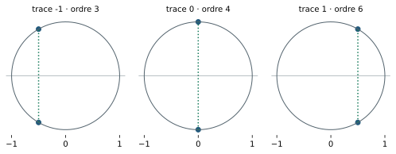
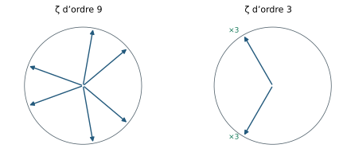
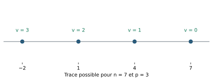
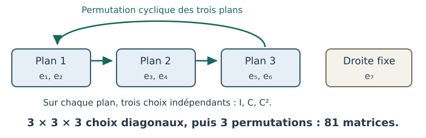

# X-ENS MP — Mathématiques A 2021 · Corrigé brut

*Corrigé rédigé par IA, non officiel. Signalez toute erreur.*

**Rédaction** · modèle exact non renseigné (famille GPT-6) · effort non renseigné · vitesse non renseignée

**Révision** · modèle exact non renseigné (famille GPT-6) · effort non renseigné · vitesse non renseignée

**Révision (tour 2)** · GPT-6.2 Astra Ultra · vitesse non renseignée

**Révision (tour 3)** · GPT-6.2 Astra Ultra · vitesse non renseignée · 26 novembre 2026

## Présentation du sujet

L’épreuve du 12 avril 2021 dure quatre heures. Elle étudie les sous-groupes finis de matrices entières inversibles sur les entiers. Elle aboutit à une borne sur leur cardinal qui dépend de la dimension et à une meilleure borne pour les groupes de cardinal une puissance première. [Sujet officiel](https://banques-ecoles.fr/cms/wp-content/uploads/2021/07/2021_MP_sujet_MathA.pdf)

## Préliminaires

### Question P.1

Si $z^d=1$ pour un entier $d\ge1$, alors $|z|^d=1$. L’unique réel positif ayant cette puissance égale à un est $1$, donc $|z|=1$.

### Question P.2

L’égalité $g^d=I_n$ fait de $X^d-1$ un polynôme annulateur. Ses racines complexes sont simples : une racine commune avec $dX^{d-1}$ serait nulle, or $0^d-1=-1$. Il est scindé à racines simples sur $\mathbb C$, donc $g$ est diagonalisable et chacune de ses valeurs propres est une racine $d$-ième de l’unité.

### Question P.3a

Les multiples positifs de $q$ au plus égaux à $m$ sont $q,2q,\ldots,\lfloor m/q\rfloor q$. Il y en a $\lfloor m/q\rfloor$, et ce nombre vaut zéro si $m<q$.

### Question P.3b

Pour $q$ premier, chaque entier $k$ de $1$ à $m$ contribue une unité à $v_q(m!)$ pour chaque puissance $q^i$, $i\ge1$, qui le divise. En comptant d’abord par puissance et en utilisant 3a,
$$v_q(m!)=\sum_{i\ge1}\#\{1\le k\le m:q^i\mid k\}=\sum_{i\ge1}\left\lfloor\frac m{q^i}\right\rfloor.$$
La somme est finie puisque tous les termes avec $q^i>m$ sont nuls. Pour $m=0$ elle vaut aussi zéro.

## I — Éléments d’ordre fini

### Question I.1

La trace est la somme des deux valeurs propres comptées avec multiplicité. D’après les préliminaires 1 et 2, celles-ci ont module un. L’inégalité triangulaire donne $|\operatorname{Tr}g|\le2$.

### Question I.2

Une racine de l’unité réelle vaut $1$ ou $-1$. Comme $g$ est diagonalisable, $g^2=I_2$ ; l’ordre vaut $1$ si les deux valeurs propres sont $1$, et $2$ dès que $-1$ figure au spectre. Les matrices $I_2$ et $-I_2$ réalisent ces deux possibilités.

### Question I.3

Le polynôme caractéristique a des coefficients entiers, donc ses deux racines non réelles sont conjuguées. Leur produit est $|z|^2=1$ et la trace $2\Re z$ est un entier strictement entre $-2$ et $2$, car $z\ne\pm1$. Le polynôme $X^2-(\operatorname{Tr}g)X+1$ vaut ainsi $X^2+X+1$, $X^2+1$ ou $X^2-X+1$.

### Question I.4

Les trois polynômes précédents ont respectivement pour racines les racines primitives d’ordres $3$, $4$ et $6$, comme le montrent les factorisations de $X^3-1$, $X^4-1$ et $X^3+1$. Une matrice diagonalisable a pour ordre le PPCM des ordres de ses valeurs propres. Avec la question 2 on trouve $d\in\{1,2,3,4,6\}$. Les trois cas non réels sont réalisés, si on le souhaite, par les matrices $\bigl(\begin{smallmatrix}0&-1\\1&t\end{smallmatrix}\bigr)$ pour $t=-1,0,1$.

### Question I.5

Dans $P=\prod_{j=1}^n(X-z_j)$, le coefficient de $X^i$ est la somme, au signe $(-1)^{n-i}$ près, des produits de $n-i$ racines prises à des indices distincts. Il y a $\binom n{n-i}=\binom ni$ termes, chacun de module au plus $\alpha^{n-i}$. L’inégalité triangulaire fournit la borne.

### Question I.6

Chaque $\chi_g$ est unitaire de degré $n$ à coefficients entiers. Pour $g$ d’ordre fini, toutes ses racines sont de module un. La question 5 donne pour son coefficient d’indice $i$ un entier de l’intervalle $[-\binom ni,\binom ni]$. Le produit, sur les $n$ indices, des nombres finis de choix reste fini.

### Question I.7

La réunion des racines de tous les polynômes caractéristiques effectivement obtenus en 6 est un ensemble fini de racines de l’unité. Soit $D$ le PPCM de leurs ordres. Pour toute matrice d’ordre fini, chacune des valeurs propres élevée à $D$ vaut un. La diagonalisabilité de la matrice donne $g^D=I_n$. Son ordre divise donc $D$ et il n’y a qu’un nombre fini de possibilités.

## II — Sous-groupes finis

### Question II.1a

Si $g=S\operatorname{diag}(\zeta_j)S^{-1}$, alors $A=(g-I_n)/m$ est diagonalisée par la même base et a pour valeurs propres $(\zeta_j-1)/m$. Chacune a pour module au plus $2/m<1$ puisque $m\ge3$. Le seuil est exact : pour $m=2$, $g=-I_n$ vérifie $g\equiv I_n\pmod2$ avec $g\ne I_n$ et $A=-I_n$. Ses puissances gardent une valeur propre de module un.

### Question II.1b

Les puissances de chaque valeur propre de $A$ tendent vers zéro. Conjuguer les puissances de la matrice diagonale montre donc que $A^k$ tend coefficient par coefficient vers zéro. Or $A$, et donc $A^k$, est à coefficients entiers. Pour $k$ assez grand, tous les $n^2$ coefficients sont simultanément de module strictement inférieur à un, donc nuls.

### Question II.1c

La nilpotence impose que toutes les valeurs propres de $A$ soient nulles. Comme $A$ est aussi diagonalisable d’après 1a, elle est nulle. D’où $g=I_n+mA=I_n$.

### Question II.2a

La réduction des coefficients respecte les produits et envoie les inverses entiers sur des inverses modulo $m$. Si $g,h\in G$ ont la même réduction, $h^{-1}g$ est congru à $I_n$ modulo $m$. Cet élément appartient à un groupe fini et a donc un ordre fini. La question 1c appliquée à $h^{-1}g$ donne $g=h$, d’où l’injectivité.

### Question II.2b

Choisir $m=3$. Il existe exactement $3^{n^2}$ matrices $n\times n$ modulo trois puisque leurs $n^2$ coefficients ont chacun trois choix. L’injection de 2a donne $|G|\le3^{n^2}$.

## III — Traces des éléments d’un p-sous-groupe

### Question III.1a

Pour $1\le k\le\ell-1$, $k\binom\ell k=\ell\binom{\ell-1}{k-1}$. Comme $k$ et le premier $\ell$ sont premiers entre eux, le lemme de Gauss donne $\ell\mid\binom\ell k$.

### Question III.1b

L’hypothèse $xy=yx$ autorise la formule du binôme, même dans un anneau non commutatif. Les deux termes extrêmes sont $x^\ell$ et $y^\ell$. Tous les coefficients intermédiaires sont multiples de $\ell$ d’après 1a, donc leur somme appartient à $\ell R$.

### Question III.2

Réduisons les coefficients dans $R/I$. Les images de $A+B$ et de $A$ sont égales. La formule du déterminant comme somme signée de produits commute à cette réduction. On obtient l’égalité des deux déterminants modulo $I$, soit $\det(A+B)-\det A\in I$.

### Question III.3

Écrivons $P=\sum a_i X^i$. Par 1b, appliquée successivement aux monômes dans l’anneau commutatif $(\mathbb Z/\ell\mathbb Z)[X]$, $P(X)^\ell\equiv\sum a_i^\ell X^{i\ell}$. Le petit théorème de Fermat donne $a_i^\ell\equiv a_i\pmod\ell$, même si $\ell\mid a_i$. Le membre droit est donc $P(X^\ell)$ modulo $\ell$.

### Question III.4a

Les matrices $XI_n$ et $-M$ commutent dans $M_n(\mathbb Z[X])$. La question 1b donne $(XI_n-M)^\ell\equiv X^\ell I_n+(-1)^\ell M^\ell$ modulo $\ell$. Pour $\ell$ impair on a $(-1)^\ell=-1$ ; pour $\ell=2$, $1\equiv-1\pmod 2$. Dans les deux cas chaque coefficient de la différence demandée est divisible par $\ell$, ce qui définit $A$ sur $\mathbb Z[X]$.

### Question III.4b

Prendre le déterminant des deux matrices congrues en 4a et appliquer 2 avec l’idéal $\ell\mathbb Z[X]$. Par multiplicativité, le premier déterminant vaut $\chi_M(X)^\ell$, et le second $\det(X^\ell I_n-M^\ell)=\chi_{M^\ell}(X^\ell)$. Leur différence appartient à l’idéal.

### Question III.4c

Appliquer 3 à $P=\chi_M$ puis 4b : $\chi_{M^\ell}(X^\ell)\equiv\chi_M(X^\ell)\pmod\ell$. Dans chacun de ces polynômes, le coefficient de $X^{\ell(n-1)}$ est l’opposé de la trace de la matrice correspondante. La comparaison donne $\operatorname{Tr}(M^\ell)\equiv\operatorname{Tr}M\pmod\ell$.

### Question III.5

L’ordre de $g$ divise $p^r=|G|$. Appliquer la congruence de 4c, avec $\ell=p$, à $g,g^p,\ldots,g^{p^{r-1}}$. Toutes les traces sont congrues à celle de $g^{p^r}=I_n$, donc à $n$ modulo $p$.

### Question III.6

Les traces entières de $g$ et $g^\ell$ ont chacune pour module au plus $n$ par l’inégalité triangulaire appliquée aux valeurs propres de module un. Leur différence, multiple de $\ell$ par 4c, a donc un module au plus $2n<\ell$. Ce multiple est nécessairement nul.

### Question III.7a

Soit $q\le2n$ un nombre premier. Si $q$ ne divise pas $k$, il figure dans le produit définissant $m$ et $m\equiv k\not\equiv0\pmod q$. Si $q\mid k$, alors $q\ne p$ puisque $p\nmid k$ et $q$ ne figure pas dans ce produit. L’additif $p^r\prod\ell$ est donc premier à $q$, ce qui interdit encore $q\mid m$. Ainsi tous les facteurs premiers de $m$ dépassent $2n$. Par exemple, pour $n=2$, prenons le groupe d’ordre $3$ engendré par la matrice de trace $-1$ construite en I.4. Avec $p=3$, $r=1$ et $k=2$, les petits premiers sont $2,3$ et seul $3$ intervient dans le produit. On obtient $m=2+3\cdot3=11>2n$. Dans ce groupe, $g^{11}=g^2$ car $g^3=I_2$ et les exposants diffèrent de $9$.

### Question III.7b

Comme $m\equiv k\pmod{p^r}$ et $g^{p^r}=I_n$, on a $g^k=g^m$. Décomposer $m$ en facteurs premiers. Chacun est supérieur à $2n$ d’après 7a ; élever un élément de $G$ à l’un de ces facteurs conserve sa trace par 6. Une application successive donne $\operatorname{Tr}(g^k)=\operatorname{Tr}(g^m)=\operatorname{Tr}g$.

### Question III.8a

Tout $k$ entre $1$ et $p^r-1$ non divisible par $p$ s’écrit de façon unique $k=ps+t$ par division euclidienne, avec $1\le t\le p-1$ et $0\le s\le p^{r-1}-1$. Réciproquement, tout nombre de cette forme appartient à $J_r$. L’union proposée est même disjointe et $|J_r|=p^{r-1}(p-1)$.

### Question III.8b

La décomposition de 8a donne
$$\sum_{j\in J_r}\zeta^j=\left(\sum_{s=0}^{p^{r-1}-1}(\zeta^p)^s\right)\left(\sum_{t=1}^{p-1}\zeta^t\right).$$
Si $\zeta=1$, on obtient $p^{r-1}(p-1)$. Si son ordre est $p$, le premier facteur vaut $p^{r-1}$ et le second $-1$ par somme géométrique. Si son ordre divise $p^r$ et dépasse $p$, $\zeta^p\ne1$ et $(\zeta^p)^{p^{r-1}}=1$ ; le premier facteur est nul.

### Question III.9

Sommons $\operatorname{Tr}(g^j)$ pour $j\in J_r$. La question 7b donne $p^{r-1}(p-1)\operatorname{Tr}g$. En diagonalisant $g$, chaque valeur propre $\zeta$ contribue la somme de 8b. Les $n_0$ valeurs propres égales à un contribuent $n_0p^{r-1}(p-1)$, les $n_1$ valeurs propres d’ordre $p$ contribuent $-n_1p^{r-1}$ et les autres rien. Après division,
$$\operatorname{Tr}g=n_0-\frac{n_1}{p-1}.$$

### Question III.10

D’après 5, $v=(n-\operatorname{Tr}g)/p$ est entier. Il est positif ou nul car $\operatorname{Tr}g\le n$. La question 9 donne $\operatorname{Tr}g\ge-n/(p-1)$ puisque $n_0\ge0$ et $n_1\le n$. Il en résulte $v\le(n+n/(p-1))/p=n/(p-1)$. Ainsi $\operatorname{Tr}g=n-pv$ avec $0\le v\le\lfloor n/(p-1)\rfloor$.

## IV — Cardinaux des p-sous-groupes

### Question IV.1a

Posons $W=\{x\in\mathbb C^n:\forall g\in G,\ gx=x\}$. Pour $h\in G$, la multiplication $g\mapsto hg$ permute les éléments du groupe, donc $hf=f$. Ainsi $\operatorname{Im} f\subset W$. Réciproquement, si $x\in W$, chaque terme de la moyenne définissant $f(x)$ est égal à $x$, donc $f(x)=x$. Cela donne $\operatorname{Im}f=W$, et en appliquant cette identité à tout $f(x)\in W$ on obtient $f^2=f$. Il s’agit bien d’un projecteur sur $W$.

### Question IV.1b

Un projecteur est diagonalisable avec des valeurs propres parmi $0,1$ et sa trace est son rang entier. Par linéarité, $\sum_{g\in G}\operatorname{Tr}g=|G|\operatorname{Tr}f=|G|\dim W$ est un entier divisible par $|G|$.

### Question IV.2i

Les blocs diagonaux de $g\otimes h$ sont les $g_{ii}h$. Additionner leurs traces donne $\operatorname{Tr}(g\otimes h)=\sum_i g_{ii}\operatorname{Tr}h=(\operatorname{Tr}g)(\operatorname{Tr}h)$.

### Question IV.2ii

Le bloc en position $(i,j)$ du produit $(g\otimes h)(g'\otimes h')$ vaut $\sum_k(g_{ik}h)(g'_{kj}h')=(gg')_{ij}\,hh'$. C’est le bloc correspondant de $(gg')\otimes(hh')$.

### Question IV.2iii

En prenant $g'=g^{-1}$ et $h'=h^{-1}$ dans ii, on obtient $(g\otimes h)(g^{-1}\otimes h^{-1})=I_n\otimes I_k=I_{nk}$. Le produit dans l’ordre inverse donne aussi $I_{nk}$. Le produit tensoriel est donc inversible et son inverse est celui annoncé.

### Question IV.3a

Si $\gamma'$ est hors de l’image de $\varphi$, sa fibre est vide. Sinon, choisir $\gamma$ dans cette fibre. Pour $x\in\Gamma$, l’égalité $\varphi(x)=\gamma'$ équivaut à $\varphi(\gamma^{-1}x)=e'$, soit $\gamma^{-1}x\in H$. La fibre est exactement $\gamma H$.

### Question IV.3b

Toute fibre non vide a $|H|$ éléments par la bijection $h\mapsto\gamma h$. Comme les fibres partitionnent $\Gamma$ et sont indexées, lorsqu’elles sont non vides, par $\varphi(\Gamma)$, on trouve $|\Gamma|=|\varphi(\Gamma)|\,|H|$.

### Question IV.4a

Par récurrence sur $s$, 2ii montre que $(gh)^{(s)}=g^{(s)}h^{(s)}$. L’identité se conserve et 2iii garantit l’inversibilité, donc $\varphi_s$ est un morphisme. La formule de 2i donne de même $\operatorname{Tr}(g^{(s)})=(\operatorname{Tr}g)^s$. En regroupant les termes selon les fibres du morphisme restreint à $G$, toutes de taille $|G\cap\ker\varphi_s|$ par 3a, on obtient
$$\sum_{g\in G}(\operatorname{Tr}g)^s=|G\cap\ker\varphi_s|\sum_{h\in\varphi_s(G)}\operatorname{Tr}h.$$

### Question IV.4b

Le groupe $\varphi_s(G)$ est un sous-groupe fini de $\mathrm{GL}_{n^s}(\mathbb C)$. Par 1b, la somme de ses traces est un multiple entier de $|\varphi_s(G)|$. Or $|G\cap\ker\varphi_s|\cdot|\varphi_s(G)|=|G|$ par 3b. La somme des puissances considérée est donc un multiple entier de $|G|$. Pour $s=0$, on a directement $\sum_{g\in G}1=|G|$. Le facteur de taille des fibres peut être indispensable. Pour $G=\{I_n,-I_n\}$ et $s=2$, les deux matrices ont la même image $I_{n^2}$. La somme des carrés des traces initiales vaut bien $2n^2$ et la somme des traces dans l’image vaut $n^2$.

### Question IV.5a

Comme $P\in\mathbb Z[X]$, la question 4b appliquée à chaque monôme (et la remarque sur le terme constant) montre que $|G|$ divise $\sum_{g\in G}P(\operatorname{Tr}g)$. D’après III.10, les traces autres que $n$ sont des racines de $P$. Si $\operatorname{Tr}g=n$, les $n$ valeurs propres de module un ont toutes partie réelle au plus un et leur somme a partie réelle $n$. Elles valent donc toutes un. La diagonalisabilité impose alors $g=I_n$. La somme vaut exactement $P(n)$ et $|G|\mid P(n)$. Si $a=0$, le produit vide vaut un et le raisonnement exclut tout sous-groupe non trivial.

### Question IV.5b

On a $P(n)=\prod_{j=1}^a(n-(n-pj))=p^a a!$. Comme $p^r\mid P(n)$, prendre la valuation en $p$ donne $r\le a+v_p(a!)$.

Pour $n=7$ et $p=3$, la borne donne $r\le3+v_3(3!)=4$. Elle est atteinte. Soit $C=\bigl(\begin{smallmatrix}0&-1\\1&-1\end{smallmatrix}\bigr)$, de polynôme caractéristique $X^2+X+1$ et d’ordre trois. Dans trois plans de coordonnées indépendants, les matrices $\operatorname{diag}(C^i,C^j,C^k,1)$ forment un sous-groupe $D$ d’ordre $27$, avec $0\le i,j,k<3$. Soit $T$ la matrice qui permute cycliquement les trois plans en respectant leurs bases et fixe le septième vecteur. Elle normalise $D$ en permutant ses trois exposants. Ni $T$ ni $T^2$ ne préserve chaque plan, donc les trois classes $D,DT,DT^2$ sont disjointes. Leur réunion est le groupe engendré par $D$ et $T$, de cardinal $81$. Les quatre traces de III.10 se lisent déjà sur $D$ : chaque bloc $C$ ou $C^2$ remplace une trace $2$ par $-1$, ce qui enlève trois.

### Question IV.6a

La formule des préliminaires donne $v_p(a!)\le\sum_{j\ge1}a/p^j=a/(p-1)$. Ainsi $r\le pa/(p-1)$. Or $a=\lfloor n/(p-1)\rfloor\le n/(p-1)$ ; il vient $r\le pn/(p-1)^2$.

### Question IV.6b

Il suffit de majorer $\log |G|=r\log p$ par $n\log4$. Pour $x\ge2$, posons $H(x)=x\log x/(x-1)^2$. Sa dérivée a le signe de $(x-1)-(x+1)\log x$. Comme $\log x=\int_1^x\mathrm dt/t\ge(x-1)/x$ pour $x\ge1$, ce numérateur est strictement négatif pour $x>1$. Ainsi $H(p)\le H(2)=2\log2=\log4$. En utilisant 6a, on trouve $\log|G|\le nH(p)\le n\log4$, d’où $|G|\le4^n$.
