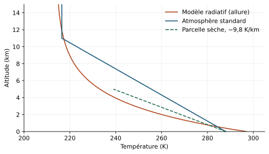
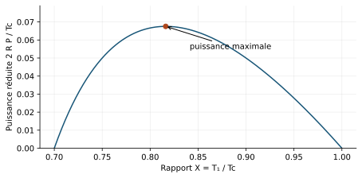
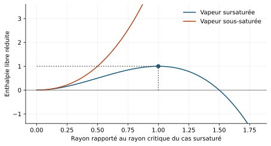

# X-ENS MP 2021 — Physique · Corrigé brut

*Corrigé rédigé par IA, non officiel. Signalez toute erreur.*

**Lecture du rapport du jury** · GPT-6.2 Astra Ultra · vitesse non renseignée

**Rédaction** · GPT-6.2 Astra Ultra · vitesse non renseignée

## Thermodynamique de l’atmosphère

## I — Structure verticale de l’atmosphère

### Question 1 — Température radiative de la surface

Chaque mètre carré absorbe $I$ et émet $sT_0^4$. L’équilibre impose $T_0=(I/s)^{1/4}=2{,}5\times10^2\,\mathrm K$, soit environ $-23\,^\circ\mathrm C$ à la précision du calcul. La surface réelle est en moyenne plus chaude, autour de $288\,\mathrm K$.

### Question 2 — Couche absorbante et effet de serre

Au-dessus de la couche, le seul flux sortant vers l’espace est $sT_a^4=I$. La couche reçoit du sol $sT_0^4$ et rayonne par ses deux faces, donc $sT_0^4=2sT_a^4$. On trouve $T_a=2{,}5\times10^2\,\mathrm K$ et $T_0=2^{1/4}T_a\simeq3{,}0\times10^2\,\mathrm K$. Le flux infrarouge descendant réchauffe le sol. Cet effet de serre élève sa température d’équilibre, ici légèrement au-dessus de la moyenne terrestre.

### Question 3 — Masse molaire de l’air

Les fractions molaires de l’air sec sont environ $78\,\%$ de diazote et $21\,\%$ de dioxygène. En arrondissant à $0{,}8$ et $0{,}2$ pour négliger les autres espèces, $M=0{,}8\times28+0{,}2\times32\simeq29\,\mathrm{g\,mol^{-1}}$.

### Question 4 — Profil isentropique

Une tranche d’épaisseur $dz$ et de section $A$ reçoit la résultante de pression $-A\,dP$ et le poids $-\rho Ag\,dz$ sur l’axe vertical ascendant. D’où $dP/dz=-\rho g=-PMg/(RT)$. L’isentropie donne $C_p\,dT/T=R\,dP/P$, en utilisant $1-1/\gamma=R/C_p$. On obtient $C_p\,dT/dz=-Mg$, puis $T(z)=T_0-Mgz/C_p$ sur le domaine où ce modèle est physique.

### Question 5 — Gradient sec

Pour un gaz parfait diatomique aux températures considérées, $C_v=5R/2$ et $C_p=7R/2\simeq29\,\mathrm{J\,mol^{-1}K^{-1}}$. Ainsi $\Gamma_s=-0{,}029\times9{,}8/29\simeq-1\times10^{-2}\,\mathrm{K\,m^{-1}}$, soit environ $-10\,\mathrm{K\,km^{-1}}$.

### Question 6 — Parcelle déplacée adiabatiquement

L’évolution est réversible et adiabatique. Pour cette parcelle, $\ln(T_f/T_i)=(R/C_p)\ln(P_f/P_i)$, donc $T_f=T_i(P_f/P_i)^{R/C_p}$. Une ascension diminue la pression et refroidit la parcelle.

### Question 7 — Rappel ou amplification

Après un petit déplacement vers le haut, parcelle et milieu ont la même pression. Puisque $\rho=PM/(RT)$, le poids dépasse la poussée d’Archimède si $T_f<T(z_i+dz)$. La force $Vg(\rho_{\rm ext}-\rho_{\rm parc})$ est alors dirigée vers le bas et l’atmosphère est stable. Si $T_f>T(z_i+dz)$, la poussée l’emporte et l’ascension s’amplifie. Pour une perturbation vers le bas, la stabilité exige de même une force opposée au déplacement.

### Question 8 — Stabilité marginale

Au premier ordre $T_f-T_i=(R/C_p)(T_i/P_i)(dP/dz)_i\,dz=-(Mg/C_p)\,dz$. La neutralité exige $T_f=T(z_i)+\Gamma\,dz$, donc $\Gamma=\Gamma_s=-Mg/C_p$. Un profil ambiant plus raide, $\Gamma<\Gamma_s$, laisse une parcelle soulevée plus chaude que son voisinage. Le profil isentropique de la question 4 marque ainsi le seuil.

### Question 9 — Lecture du profil radiatif

Le graphique place $T$ en abscisse. Entre le sol et environ $2\,\mathrm{km}$, on lit une chute d’environ $40$ à $45\,\mathrm K$, soit $\Gamma\simeq-2\times10^1\,\mathrm{K\,km^{-1}}$. Au-dessus de $10\,\mathrm{km}$, la température change d’à peine un kelvin sur plusieurs kilomètres. Les premières couches sont instables, les hautes couches stables. La tangente traverse la pente de référence $-10\,\mathrm{K\,km^{-1}}$ vers $4\,\mathrm{km}$, avec l’incertitude d’une lecture graphique.

### Question 10 — Troposphère et stratosphère

Le profil standard passe d’environ $288$ à $216\,\mathrm K$ entre $0$ et $11\,\mathrm{km}$, soit environ $-6{,}5\,\mathrm{K\,km^{-1}}$. C’est la troposphère, où le brassage convectif réduit la forte décroissance radiative des basses couches. Vers $11\,\mathrm{km}$ se situe la tropopause. La basse stratosphère représentée au-dessus est presque isotherme et stable suivant le critère sec. Les deux figures du sujet utilisent des échelles différentes.

### Question 11 — Ascension d’une parcelle saturée

Lors de la détente, le refroidissement peut réduire la pression de vapeur saturante assez pour qu’une partie de l’eau condense. L’enthalpie libérée atténue le refroidissement. Dans un profil neutre pour l’air sec, la parcelle humide devient alors plus chaude et plus légère que le milieu à la même pression. Si l’effet de la condensation l’emporte, la poussée entretient son ascension. Les gouttelettes en suspension forment un nuage.

### Question 12 — Petite fraction molaire

Le nombre $n_a$ reste constant. La dérivation donne $dx_v=n_a\,dn_v/(n_a+n_v)^2$. Pour $n_v\ll n_a$, on obtient $dx_v\simeq dn_v/n_a$. Une condensation correspond à $dn_v<0$.

### Question 13 — Équation du gradient humide

Posons $L=\Delta_{\rm vap}H>0$. Le gaz reçoit $dH_{\rm cond}=-L\,dn_v$. Dans l’approximation de l’énoncé, $T\,dS/n_a=C_p\,dT-RT\,dP/P=-L\,dx_v$. L’hydrostatique fournit $-RT\,dP/P=Mg\,dz$. En divisant par $dz$ on trouve
$$
C_p\frac{dT}{dz}+Mg=-L\frac{dx_v}{dz}.
$$
Pendant la condensation, le membre de droite est positif, ce qui réduit la valeur absolue du gradient de refroidissement.

### Question 14 — Gradient moyen sur dix kilomètres

Intégrons de $0$ à $h$. Puisque $x_v(h)=0$ et $x_v(0)=x_v^{(i)}$, $C_p[T(h)-T(0)]+Mgh=Lx_v^{(i)}$. Le gradient moyen vaut donc $\Gamma_h=-Mg/C_p+Lx_v^{(i)}/(C_ph)$.

### Question 15 — Valeur tropicale

Le terme latent apporte $4{,}1\times10^4\times0{,}04/(29\times10^4)\simeq5{,}7\times10^{-3}\,\mathrm{K\,m^{-1}}$. Avec le gradient sec non arrondi, $\Gamma_h\simeq-4\,\mathrm{K\,km^{-1}}$. Le profil standard, autour de $-6{,}5\,\mathrm{K\,km^{-1}}$, est intermédiaire entre cette situation tropicale très humide et le modèle sec.

### Question 16 — Circulation de Hadley

En moyenne annuelle, les rayons solaires arrivent plus près de la normale à l’équateur. À puissance incidente donnée, ils éclairent une surface moins grande. La surface tropicale chaude fournit de l’eau par évaporation. L’air équatorial humide s’élève, se refroidit, condense et donne de fortes pluies. En altitude, l’air s’écoule vers les subtropiques et redescend vers $30^\circ$ de latitude. La compression le réchauffe et diminue son humidité relative. Le retour au sol vers l’équateur ferme la cellule dans chaque hémisphère.

### Question 17 — Enthalpies libres molaires

Pour chaque phase pure $j$, $G_m=U_m+PV_m-TS_m$ conduit à $dG_{j,m}=V_{j,m}\,dP-S_{j,m}\,dT$. Évaluer cette relation pour $j=l$ et $j=v$ donne les deux différentielles. L’additivité des phases fournit $G=(n-n_v)G_{l,m}+n_vG_{v,m}$, en joules pour l’ensemble considéré.

### Question 18 — Équilibre entre deux phases

À $T,P,n$ fixés, $dG=(G_{v,m}-G_{l,m})\,dn_v$. Quand les deux phases coexistent, un transfert infinitésimal est possible dans les deux sens. Le minimum de $G$ impose donc $G_{v,m}=G_{l,m}$.

### Question 19 — Relation de Clapeyron

Sur toute la courbe $P=P_{\rm sat}(T)$, les deux enthalpies libres molaires sont égales. En retranchant cette égalité à celle du point voisin, $(V_{v,m}-V_{l,m})dP_{\rm sat}=(S_{v,m}-S_{l,m})dT$. Or à l’équilibre $T\Delta S_m=\Delta_{\rm vap}H=L$. Ainsi $dP_{\rm sat}/dT=L/[T(V_{v,m}-V_{l,m})]>0$, car la vapeur occupe le plus grand volume.

### Question 20 — Pression de vapeur saturante

Avec $V_{v,m}\gg V_{l,m}$ et $V_{v,m}=RT/P_{\rm sat}$, la relation précédente devient $d\ln P_{\rm sat}=L\,dT/(RT^2)$. Pour $L$ constant, $\ln[P_{\rm sat}(T)/P_{\rm sat}(T_0)]=(L/R)(1/T_0-1/T)$. La constante $C=L/R$ a la dimension d’une température.

### Question 21 — Thermomètre isotopique des glaces

Les deux formes d’eau ont des courbes de saturation distinctes. L’eau lourde en oxygène 18 passe moins aisément en vapeur et se condense préférentiellement. Au cours du transport et des précipitations successives, la vapeur restante s’appauvrit en oxygène 18. Un refroidissement plus marqué accentue en général cet appauvrissement dans la neige polaire. Les couches de glace datées conservent ces rapports isotopiques. Un étalonnage tenant compte notamment de l’origine des masses d’air permet de les relier aux températures passées.

## II — La troposphère vue comme une machine thermique

### Question 22 — Borne de Carnot

Notons $Q_c>0$ et $Q_f<0$ les chaleurs reçues du chaud et du froid. Sur un cycle $W+Q_c+Q_f=0$, donc $\xi=-W/Q_c=1+Q_f/Q_c$. Le bilan d’entropie du fluide donne $Q_c/T_c+Q_f/T_f=-S_{\rm créée}\leq0$. Ainsi $\xi\leq1-T_f/T_c=\xi_c$, avec égalité pour un cycle entièrement réversible.

### Question 23 — Sens des échanges

Un moteur reçoit $Q_1>0$, rejette $Q_2<0$ et fournit un travail, donc $W<0$. Le transfert par chaque résistance exige $T_c>T_1$ et $T_2>T_f$. Le cycle moteur exige également $T_1>T_2$. Au total $T_c>T_1>T_2>T_f$.

### Question 24 — Chaleurs échangées

Le débit de chaleur entrant dans le fluide vaut $(T_{\rm thermostat}-T_{\rm fluide})/R$ pendant chaque contact. Il reste constant pendant $\tau$. On obtient $Q_1=\tau(T_c-T_1)/R$ et $Q_2=\tau(T_f-T_2)/R$.

### Question 25 — Puissance mécanique

Les deux isothermes durent chacune $\tau$, les deux adiabatiques ont une durée négligeable. Ainsi $\mathcal P=-W/(2\tau)=(Q_1+Q_2)/(2\tau)=(T_c-T_1+T_f-T_2)/(2R)$.

### Question 26 — Entropie du fluide

À la frontière du système $F$, les échanges s’effectuent à $T_1,T_2$. Sur le cycle $0=Q_1/T_1+Q_2/T_2+S_{\rm créée,F}$. Après substitution, $T_c/T_1+T_f/T_2\leq2$. Le fluide réversible intérieurement vérifie l’égalité, même si les contacts avec les thermostats produisent de l’entropie.

### Question 27 — Réduction à une variable

Avec $X=T_1/T_c$, $\eta=T_f/T_c$, l’égalité donne $T_2=T_fX/(2X-1)$. En reportant dans la puissance puis en factorisant,
$$
\mathcal P=\frac{T_c}{2R}f(X,\eta),\qquad f(X,\eta)=(1-X)\left(1-\frac{\eta}{2X-1}\right).
$$

### Question 28 — Domaine moteur

L’expression $T_f/T_2=2-1/X$ est strictement positive. Comme $X>0$, il vient $X>1/2$. De plus $T_1>T_2$ exige $2X-1>\eta$, et $Q_1>0$ impose $X<1$. Le domaine moteur est $(1+\eta)/2<X<1$.

### Question 29 — Maximum de puissance

La dérivée de $f$ à $\eta$ fixé est $-1+\eta/(2X-1)^2$. La racine physique est $X_+=(1+\sqrt\eta)/2$ puisque $2X-1>0$. Elle est dans le domaine moteur dès que $0<\eta<1$. La dérivée seconde vaut $-4\eta/(2X-1)^3<0$. En remplaçant, $\mathcal P_{\max}=T_c(1-\sqrt\eta)^2/(4R)$.

### Question 30 — Rendement à puissance maximale

La réversibilité interne impose $Q_2/Q_1=-T_2/T_1$. Donc $\xi=1-T_2/T_1=1-\eta/(2X-1)$. Au maximum, $\xi_+=1-\sqrt\eta$. Pour $0<\eta<1$, $\sqrt\eta>\eta$, d’où $\xi_+<1-\eta=\xi_c$.

### Question 31 — Entropie créée dans les contacts

Le fluide, les deux résistances et les thermostats forment un système qui échange seulement du travail avec l’extérieur. Le fluide et les résistances reviennent à leur état initial. L’entropie créée par cycle est donc la variation des thermostats, $-Q_1/T_c-Q_2/T_f$. Au maximum, en notant $a=\sqrt\eta$, $T_1=T_c(1+a)/2$ et $T_2=T_c a(1+a)/2$. Ainsi $Q_1=\tau T_c(1-a)/(2R)$, $Q_2=-aQ_1$. Il vient
$$
\dot S=\frac{-Q_1/T_c-Q_2/T_f}{2\tau}=\frac{(1-\sqrt\eta)^2}{4R\sqrt\eta}.
$$
Cette grandeur positive en $\mathrm{W\,K^{-1}}$ provient des deux conductions sous différence finie de température.

### Question 32 — Puissance des vents

Les indices de température dans la phrase précédant la question sont permutés par rapport aux définitions du cycle. Le sol à $290\,\mathrm K$ joue le rôle chaud et le sommet à $220\,\mathrm K$ le rôle froid. Alors $\xi_+=1-\sqrt{220/290}\simeq0{,}13$. Le flux $I$ est déjà moyenné sur toute la Terre, d’où $\mathcal P_{\rm vents}=\xi_+\,4\pi R_\oplus^2 I\simeq1{,}5\times10^{16}\,\mathrm W$ avant arrondi, soit $1\times10^{16}\,\mathrm W$ à un chiffre significatif (valeur calculée $1{,}46\times10^{16}$).

### Question 33 — Vitesse caractéristique

En régime statistiquement stationnaire $D=\mathcal P_{\rm vents}$. Pour une couche mince $M\simeq4\pi R_\oplus^2h\rho$, donc
$$
U=\left(\frac{\xi_+ I}{0{,}05\rho}\right)^{1/3}\simeq8\,\mathrm{m\,s^{-1}}.
$$
C’est environ $30\,\mathrm{km\,h^{-1}}$, un ordre de grandeur plausible pour des vents courants. Il s’agit d’une vitesse caractéristique de ce modèle global.

## III — Nucléation et formation des nuages

### Question 34 — Saturation au-dessus d’une interface plane

À la coexistence macroscopique, le transfert réversible d’une mole d’eau laisse $G$ inchangé. Il impose $\mu_l(T)=\mu_v(T,P_{\rm sat}(T))$ dans l’approximation du sujet pour le liquide.

### Question 35 — Variation de l’enthalpie libre

À pression et température fixées, le mélange contribue $\mu_l\,dn_l+\mu_v\,dn_v$. La surface ajoute $\sigma\,dA$ puisque $\sigma$ est constant. La conservation de l’eau donne $dn_v=-dn_l$, d’où $dG=(\mu_l-\mu_v)dn_l+\sigma\,dA$.

### Question 36 — Goutte sphérique

Notons $v_l=M_{\rm H_2O}/\rho_0$ le volume molaire du liquide. Pour une sphère $n_l=4\pi r^3/(3v_l)$ et $A=4\pi r^2$. On trouve
$$
dG=\left[8\pi\sigma r+\frac{4\pi r^2}{v_l}(\mu_l-\mu_v)\right]dr .
$$

### Question 37 — Paysage d’énergie libre

À potentiels fixés, posons $\Delta\mu=\mu_v-\mu_l$ et choisissons $G(0)=0$. L’intégration fournit $G(r)=4\pi\sigma r^2-4\pi\Delta\mu\,r^3/(3v_l)$. Pour $\Delta\mu<0$, les deux termes sont positifs et $G$ croît. Pour $\Delta\mu>0$, l’aire domine près de zéro, puis le terme de volume domine. La courbe passe par un maximum avant de décroître.

### Question 38 — Rayon critique et barrière

Si $\Delta\mu\leq0$, une goutte finie abaisse $G$ en s’évaporant. Pour $\Delta\mu>0$, $dG/dr=4\pi r(2\sigma-r\Delta\mu/v_l)$. Le maximum se situe à $r_c=2\sigma v_l/\Delta\mu$. Une goutte plus petite s’évapore, une plus grosse croît. Au maximum exact l’équilibre est instable. La barrière par germe est
$$
E_a=G(r_c)-G(0)=\frac{4\pi}{3}\sigma r_c^2
=\frac{16\pi\sigma^3 v_l^2}{3(\Delta\mu)^2}.
$$

### Question 39 — Rôle de la sursaturation

La forme idéale du potentiel chimique et l’égalité à saturation donnent $\mu_v(T,P_v)-\mu_l(T)=RT\ln(P_v/P_{\rm sat})=RT\ln\chi$. Pour $\chi>1$,
$$
r_c=\frac{2\sigma M_{\rm H_2O}}{\rho_0RT\ln\chi}.
$$
Le rayon critique diverge quand la vapeur approche de la saturation par excès.

### Question 40 — Vitesse d’apparition de gouttelettes

Le coût $E_a$ concerne une goutte entière. Le facteur thermique pertinent est donc $k_BT$. À température donnée, à un préfacteur près,
$$
J(\chi)\propto\exp\!\left[-\frac{16\pi\sigma^3v_l^2}{3k_BT(RT)^2(\ln\chi)^2}\right].
$$
Tout près de $\chi=1$ la barrière est très élevée. Une hausse de la sursaturation l’abaisse et le taux de nucléation augmente très rapidement.

### Question 41 — Poche liquide dans un cône

La hauteur du cône vaut $r/\tan\theta$, son volume $\pi r^3/(3\tan\theta)$. Seul le disque de base présente l’interface liquide–gaz de coût $\sigma A$ dans le modèle choisi. Avec $A=\pi r^2$,
$$
dG=\left[2\pi\sigma r-\frac{\pi\Delta\mu}{v_l\tan\theta}r^2\right]dr.
$$

### Question 42 — Seuil du germe conique

Pour $\Delta\mu>0$, la racine positive est $r_{c,\theta}=2\sigma v_l\tan\theta/\Delta\mu$. Le potentiel relatif vaut $\pi\sigma r^2-\pi\Delta\mu r^3/(3v_l\tan\theta)$, d’où
$$
E_{a,\theta}=\frac{\pi\sigma}{3}r_{c,\theta}^2=\frac{4\pi\sigma^3v_l^2\tan^2\theta}{3(\Delta\mu)^2}.
$$
C’est un maximum. En dessous la poche se résorbe, au-dessus elle s’étend. Pour $\Delta\mu\leq0$, aucun rayon positif ne déclenche une croissance spontanée.

### Question 43 — Particules et nuages

Le rapport des barrières vaut $E_{a,\theta}/E_a=\tan^2\theta/4$. Pour les cavités assez étroites, $\tan\theta<2$, une fluctuation moins coûteuse suffit. Le facteur de Boltzmann favorise alors fortement la nucléation sur ces sites, même à faible sursaturation. La multiplication des gouttelettes sur les particules en suspension favorise le nuage. La condition angulaire et l’omission de l’énergie solide–liquide appartiennent au modèle étudié.
