# X-ENS — PC, Chimie A 2021 · Corrigé guidé

*Corrigé rédigé par IA, non officiel.*

**Rédaction** · GPT-6.2 Astra Ultra · vitesse non renseignée

Les 79 questions sont traitées dans leur ordre d’origine. Les bilans, les transferts électroniques et les valeurs lues sur les figures sont distingués des hypothèses de calcul.

## A.I. Synthèse de la tétracyclone

### A.I.1 — Insertion du magnésium

> [!INDICATION]
> Repérer la liaison carbone–halogène et conserver le cycle à six carbones.

#### Solution

En notant Ph le groupe phényle, B est le bromure de phénylmagnésium $\mathrm{Ph{-}MgBr}$. Le magnésium s'intercale formellement dans la liaison C–Br. Le carbone lié à Mg porte une charge partielle négative.

### A.I.2 — Choix du milieu

> [!INDICATION]
> Chercher à la fois un site donneur de doublet et l'absence d'hydrogène acide.

#### Solution

Un doublet de l'oxygène de l'éther diéthylique coordonne le magnésium, acide de Lewis, et contribue à la solvatation de l'organomagnésien. L'éther est aprotique. L'eau consommerait B par protonation de son carbone nucléophile, selon $\mathrm{PhMgBr+H_2O\to PhH+MgBrOH}$.

### A.I.3 — Carboxylation

> [!INDICATION]
> Le réactif carboné du schéma 1 est le dioxyde de carbone. Suivre son carbone jusqu'à l'hydrolyse.

#### Solution

B s'additionne sur le carbone électrophile de $\mathrm{CO_2}$. Le benzoate de magnésium bromure obtenu est protoné lors de l'hydrolyse acide. C est **l'acide benzoïque**, $\mathrm{PhCO_2H}$. Son groupe carboxyle contient le carbone supplémentaire.

### A.I.4 — De l'acide à l'aldéhyde

> [!INDICATION]
> Comparer les degrés d'oxydation du carbone fonctionnel dans un acide, un aldéhyde et un alcool.

#### Solution

La transformation de C en benzaldéhyde D est une réduction partielle. Le carbone passe de $+\mathrm{III}$ à $+\mathrm I$. Une réduction plus poussée donne l'alcool benzylique $\mathrm{PhCH_2OH}$, dans lequel ce carbone est à $-\mathrm I$.

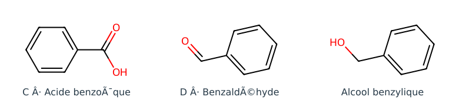

### A.I.5 — Lecture des sept actes

> [!INDICATION]
> Dans le schéma 2, une flèche entre un doublet et un proton décrit un transfert acide–base. Numéroter séparément les créations de liaisons C–C.

#### Solution

Dans le sens de formation de E, les actes sont (1) addition nucléophile sur l'aldéhyde, (2) protonation de l'alcoolate par l'eau, (3) déprotonation sur le carbone de la cyanhydrine, (4) addition du nucléophile carboné sur le carbonyle d'une seconde molécule de D, (5) protonation du nouvel alcoolate, (6) déprotonation de l'alcool porté par le premier carbone, puis (7) élimination du groupe partant avec reformation du carbonyle. E est la benzoïne, $\mathrm{PhCO{-}CH(OH)Ph}$.

### A.I.6 — Acidité du proton en alpha

> [!INDICATION]
> Dessiner la base conjuguée en plaçant sa charge successivement sur le carbone benzylique et sur l'azote.

#### Solution

Le groupe cyano attire la densité électronique par effet inductif. Après déprotonation, le doublet du carbone adjacent peut aussi former une liaison $\mathrm{C=C}$ et déplacer un doublet de la triple liaison sur N. Les formes $\mathrm{PhC^-(OH){-}C{\equiv}N}$ et $\mathrm{PhC(OH)=C=N^-}$ rendent compte de cette stabilisation mésomère. La conjugaison avec le phényle contribue aussi à la stabilisation.

### A.I.7 — Inversion de polarité

> [!INDICATION]
> Comparer le caractère électrophile du benzaldéhyde au caractère du premier carbone dans l'acte 4.

#### Solution

L'ion cyanure agit comme catalyseur nucléophile. Fixé au début et restitué à l'acte 7, il rend possible une inversion de polarité du premier carbone carbonylé. Celui-ci joue le rôle d'un équivalent d'anion acyle et forme la liaison C–C avec un second aldéhyde.

### A.I.8 — Bilan électronique de la benzoïne

> [!INDICATION]
> La fonction déjà cétonique est conservée. Équilibrer la seconde fonction par deux protons et deux électrons.

#### Solution

L'alcool secondaire de E est oxydé en cétone. F est le benzile, $\mathrm{PhCO{-}COPh}$. La demi-équation d'oxydation est $\mathrm{E\to F+2H^++2e^-}$. Le schéma 1 ne désigne aucun oxydant pour cette flèche. Si l'on écrit par exemple un bilan formel avec le dioxygène comme accepteur, il vient $\mathrm{2E+O_2\to 2F+2H_2O}$. L'identité expérimentale de l'accepteur ne se déduit pas de la seule structure de F.

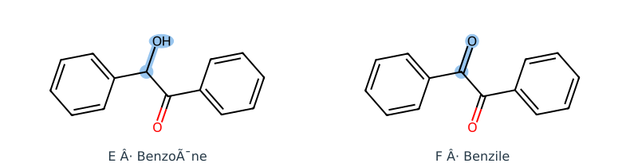

### A.I.9 — Activation du premier acide

> [!INDICATION]
> Comparer les acidités de COOH et de CH₂, puis repérer les deux carbones carbonylés équivalents de l'anhydride.

#### Solution

L'acétate agit comme base en prélevant le proton carboxylique de $\mathrm{PhCH_2COOH}$. Le phénylacétate attaque par son oxygène un carbone acyle de l'anhydride acétique. L'intermédiaire tétraédrique redonne un carbonyle et libère un acétate. H est l'anhydride mixte $\mathrm{PhCH_2CO{-}O{-}COCH_3}$, de formule $\mathrm{C_{10}H_{10}O_3}$.

### A.I.10 — Pourquoi employer l'acétate

> [!INDICATION]
> Une base peut également être nucléophile. Examiner le devenir de l'anhydride à son contact.

#### Solution

L'acétate permet l'équilibre acido-basique avec G et appartient déjà au système anhydride/acétate. L'hydroxyde attaquerait un carbonyle de l'anhydride acétique ou de H et conduirait à leur hydrolyse en carboxylates. La quantité d'agent acylant disponible diminuerait.

### A.I.11 — Former la liaison entre les deux fragments

> [!INDICATION]
> Dans I, conserver le carboxyle de G jusqu'à la décarboxylation. Le carbone en alpha de G forme la nouvelle liaison.

#### Solution

Une écriture formelle de la condensation fait intervenir la forme énolique de G. Son carbone en alpha attaque le carbone du groupe $\mathrm{PhCH_2CO}$ de H. Le doublet π du carbonyle de H se déplace sur O. Le retour de ce doublet vers le carbonyle expulse l'acétate. Des transferts de protons rétablissent le carboxyle. I est l'acide β-cétonique $\mathrm{HOOC{-}CH(Ph){-}CO{-}CH_2Ph}$. L'acylation piège la faible proportion de forme énolique du milieu. Une déprotonation quantitative du méthylène par l'acétate serait incompatible avec les acidités.

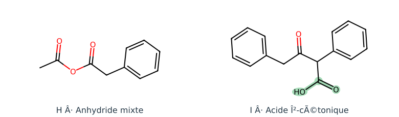

### A.I.12 — Deux tautomères après décarboxylation

> [!INDICATION]
> Trouver la chaîne à trois carbones du produit et déplacer le proton porté par l'oxygène de l'énol.

#### Solution

J, $\mathrm{PhCH_2COCH_2Ph}$, est la **1,3-diphénylpropan-2-one**. La décarboxylation du β-cétoacide livre directement l'énol $\mathrm{PhCH=C(OH)CH_2Ph}$, J′. Un transfert de proton et le déplacement d'une liaison π établissent l'équilibre de tautomérie céto-énolique. Les deux extrémités de J sont équivalentes.

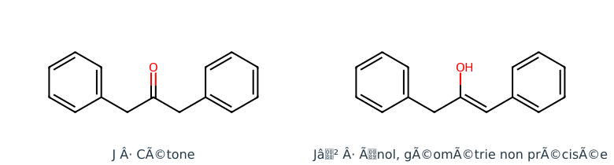

### A.I.13 — Fermer le cycle à cinq carbones

> [!INDICATION]
> Numéroter les cinq futurs sommets en suivant la chaîne de J puis les deux carbones carbonylés de F. Vérifier de quelle molécule provient l'oxygène final.

#### Solution

Un hydroxyde enlève un H en alpha de J. Le carbone de l'énolate attaque un carbonyle de F, dont la liaison π s'ouvre sur O. La protonation donne une β-hydroxycétone. Une déprotonation du même carbone en alpha, suivie de l'élimination de l'hydroxyle selon un mécanisme E1cb, produit le premier alcène conjugué. L'autre méthylène en alpha de J fournit ensuite un énolate. Son carbone attaque le second carbonyle du fragment F et ferme un cycle à cinq. Protonation de l'alcoolate puis seconde déshydratation basique donnent K. Le bilan est $\mathrm{F+J\to K+2H_2O}$. Les deux oxygènes de F sont éliminés et le carbonyle de J subsiste.

### A.I.14 — Planéité de la tétracyclone

> [!INDICATION]
> Distinguer la géométrie locale des carbones trigonaux et la rotation des groupes phényle.

#### Solution

Le noyau cyclopentadiénone conjugué se rapproche d'un plan. Les quatre phényles portés par des carbones voisins formés de centres trigonaux peuvent pivoter autour des liaisons simples qui les rattachent au noyau. Les répulsions entre hydrogènes ortho des phényles adjacents favorisent leur torsion. L'ensemble de K est donc **non plan**.

### A.I.15 — Attribution des absorptions

> [!INDICATION]
> Chercher la fonction commune qui se trouve dans chacun des trois composés et consulter l'intervalle des nombres d'onde.

#### Solution

Il s'agit des élongations de la liaison $\mathrm{C=O}$ de cétone. Le benzile F possède deux carbonyles, dont les vibrations peuvent se coupler. J et K n'en portent chacun qu'un. Dans K, le signal étudié à $1710\ \mathrm{cm^{-1}}$ est celui du carbonyle.

### A.I.16 — Force de liaison et conjugaison

> [!INDICATION]
> À isotopes identiques, que reste-t-il de variable dans la loi de Hooke ? Comparer l'environnement immédiat des carbonyles.

#### Solution

À masse réduite voisine, une fréquence plus basse traduit une constante de force effective plus faible. Les carbonyles du benzile sont conjugués aux phényles voisins et leurs vibrations sont couplées, d'où deux modes à 1677 et 1662 cm⁻¹. Dans J les groupes $\mathrm{CH_2}$ interrompent la conjugaison avec les phényles et la bande se trouve à 1720 cm⁻¹. K présente un carbonyle conjugué dans un cycle à cinq chaînons, où intervient aussi la contrainte angulaire. Sa bande à 1710 cm⁻¹ est intermédiaire. Attribuer l'écart de F aux seules masses atomiques serait impossible.

### A.I.17 — Substitution isotopique

> [!INDICATION]
> À raideur constante, le rapport des nombres d'onde fait intervenir la racine carrée du rapport inverse des masses réduites.

#### Solution

Pour les isotopes de masses molaires $M_{16}$ et $M_{18}$, le rapport demandé vaut
$$
\frac{\bar\nu_{16}}{\bar\nu_{18}}=\sqrt{\frac{\mu_{18}}{\mu_{16}}}=\sqrt{\frac{M_{18}(M_C+M_{16})}{M_{16}(M_C+M_{18})}}=\sqrt{\frac{21}{20}}\simeq1{,}025 .
$$
Le carbone est pris comme carbone 12. L'isotope lourd abaisse le nombre d'onde.

### A.I.18 — Séparation des deux bandes

> [!INDICATION]
> Transformer le rapport sans dimension en un écart en cm⁻¹ avant de le comparer à la résolution.

#### Solution

On attend $\bar\nu_{18}\simeq1720/1{,}025\simeq1678\ \mathrm{cm^{-1}}$. L'écart d'environ **42 cm⁻¹** excède largement la résolution de 1 cm⁻¹. Un échantillon suffisamment enrichi doit donc révéler une bande déplacée.

### A.I.19 — Tracer l'origine d'un oxygène

> [!INDICATION]
> Refaire le bilan des deux condensations en étoilant l'oxygène de J.

#### Solution

Le marquage permet de tester l'origine de l'oxygène carbonylé de K. Le mécanisme de A.I.13 prédit que l'oxygène marqué de J demeure dans K. Un déplacement isotopique de la bande de carbonyle de K étaye cette filiation, sous réserve de contrôler les échanges d'oxygène avec le milieu.

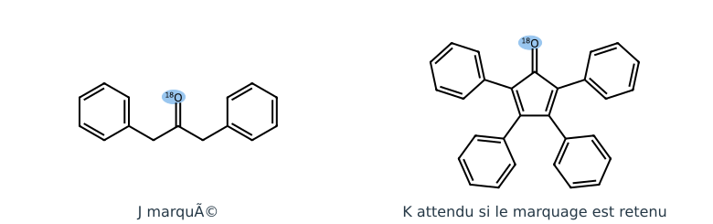

## A.II. Hexa-péri-hexabenzocoronène

### A.II.1 — Oléfination du benzaldéhyde

> [!INDICATION]
> Dans le stilbène, identifier le fragment CHPh à ajouter au carbone de l'aldéhyde.

#### Solution

Le benzylidènetriphénylphosphorane convient à une oléfination de Wittig. Le bilan moléculaire est $\mathrm{PhCHO+Ph_3P{=}CHPh\to PhCH{=}CHPh+Ph_3P{=}O}$. La combinaison des deux fragments donne les deux géométries de l'alcène.

### A.II.2 — Géométrie des stilbènes

> [!INDICATION]
> Sur chaque carbone de la double liaison, le groupe phényle est prioritaire sur H.

#### Solution

L porte les phényles de côtés opposés de la double liaison et correspond au stilbène $(E)$. L′ les porte du même côté et correspond au stilbène $(Z)$. Ce sont deux diastéréoisomères géométriques.

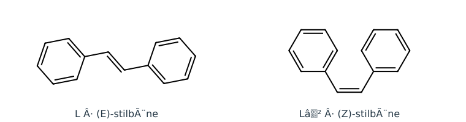

### A.II.3 — Identifier le synthon N

> [!INDICATION]
> Compter les deux éliminations possibles à partir du dibromure vicinal.

#### Solution

Deux éliminations de HBr sur $\mathrm{PhCHBr{-}CHBrPh}$ donnent le diphénylacétylène $\mathrm{Ph{-}C{\equiv}C{-}Ph}$. La fonction alcyne concorde avec l'attribution proposée vers 2120 cm⁻¹. L'élongation d'un alcyne interne très symétrique peut être faible en infrarouge.

### A.II.4 — Partenaires de la cycloaddition

> [!INDICATION]
> Isoler quatre électrons π contigus sur le cycle de K et deux électrons π dans N.

#### Solution

K est le diène conjugué bloqué dans une disposition s-cis. N est le diénophile. Une des deux liaisons π de l'alcyne participe à la cycloaddition de Diels–Alder $[4+2]$.

### A.II.5 — Structure du composé ponté

> [!INDICATION]
> Dessiner un hexagone en numérotant ses sommets de 1 à 6. Le carbonyle de K reste relié aux extrémités du diène.

#### Solution

L'adduit est une bicyclo[2.2.1]hepta-2,5-dièn-7-one portant un phényle sur chacun des six carbones périphériques. Avec la numérotation du dessin, les têtes de pont C1 et C4 sont liées au carbone C7 du pont carbonyle. Les doubles liaisons restantes sont C2=C3 et C5=C6. Les liaisons nouvelles de cycloaddition sont C1–C6 et C4–C5.

### A.II.6 — Répartition des électrons au départ du pont

> [!INDICATION]
> Faire apparaître trois doubles liaisons dans l'hexagone, puis compléter l'octet des deux atomes de CO.

#### Solution

Une extrusion chélétrope rompt simultanément les liaisons du pont. Dans la numérotation du dessin, le doublet de C7–C1 forme C1=C2, le doublet π de C2=C3 forme C3=C4 et le doublet de C4–C7 arrive comme doublet libre sur C7. C5=C6 reste en place. Un doublet libre de O complète la triple liaison de $\mathrm{{}^{-}{:}C{\equiv}O{:}^{+}}$. Le cycle périphérique devient l'hexaphénylbenzène O. Les quatre déplacements électroniques du dessin conservent la charge totale.

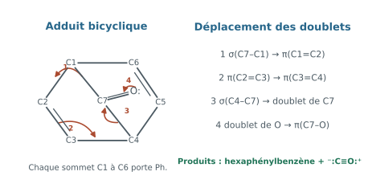

### A.II.7 — Fusion des six cycles

> [!INDICATION]
> Compter les nouvelles liaisons entre carbones ortho de phényles voisins. Pour chaque liaison, deux C–H disparaissent.

#### Solution

La cyclodéshydrogénation est une oxydation. Six nouvelles liaisons C–C relient les six paires de phényles voisins. La demi-équation est $\mathrm{C_{42}H_{30}\to C_{42}H_{18}+12H^++12e^-}$. Le composé de départ cède ainsi douze électrons.

### A.II.8 — Deux orientations sur le triyne

> [!INDICATION]
> Les triples liaisons extrêmes se déduisent l'une de l'autre par symétrie. Comparer chacune d'elles à la liaison centrale.

#### Solution

Notons $\mathrm{Ar}[X,Y]$ un benzène dont quatre sommets consécutifs portent Ph et dont les deux sommets restants, voisins, portent X et Y. Sur une liaison extrême du triyne, le produit est $\mathrm{Ar}[R^j,{-}C{\equiv}C{-}C{\equiv}C{-}R^j]$. Sur la liaison centrale il est $\mathrm{Ar}[{-}C{\equiv}C{-}R^j,{-}C{\equiv}C{-}R^j]$. Ces deux connectivités correspondent à Q et Q′ à permutation des étiquettes près.

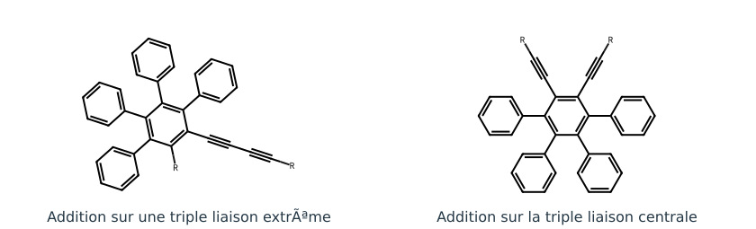

### A.II.9 — Influence de l'encombrement

> [!INDICATION]
> Comparer les substituants immédiatement voisins de la triple liaison attaquée.

#### Solution

Les groupes triisopropylsilyle encombrent directement chacune des deux triples liaisons extrêmes. La liaison centrale, bordée de fragments éthynyles linéaires, offre un accès plus dégagé à la tétracyclone. On attend majoritairement le produit central $\mathrm{Ar}[{-}C{\equiv}C{-}Si(iPr)_3,{-}C{\equiv}C{-}Si(iPr)_3]$.

## A.III. Catalyse par le complexe de Shvo

### A.III.1 — Bilan du précurseur carbonylé

> [!INDICATION]
> Équilibrer Ru et CO, puis compter les électrons que peut céder chaque méthanol en devenant méthanal.

#### Solution

Les ligands CO sont neutres et les Ru du produit ont le degré formel zéro. Chaque Ru(III) gagne trois électrons. Chaque méthanol fournit deux électrons en donnant du méthanal. Les plus petits coefficients entiers sont donc
$$
\mathrm{6RuCl_3+24CO+9CH_3OH\longrightarrow 2Ru_3(CO)_{12}+9HCHO+18HCl}.
$$
Les dix-huit chlorures et les trente-six hydrogènes sont ainsi équilibrés.

### A.III.2 — Bilan du cycle

> [!INDICATION]
> Additionner les deux transformations du monomère et éliminer les formes du catalyseur.

#### Solution

Le bilan est $\mathrm{PhCHO+H_2\to PhCH_2OH}$. Le carbone de l'aldéhyde et son oxygène reçoivent chacun un des deux atomes d'hydrogène. Les formes du ruthénium se compensent dans la somme.

### A.III.3 — Rôle du dimère

> [!INDICATION]
> Suivre les espèces dont le chemin fermé du schéma 9 reproduit l'état de départ.

#### Solution

Le dimère [2-Ru] est un **précurseur et un réservoir** des monomères catalytiques. Sa dissociation fournit la forme donneuse d'hydrogène et la forme insaturée. Une fois ces monomères disponibles, chacun peut effectuer de nombreux tours avant l'association en dimère.

### A.III.4 — Transfert à six centres

> [!INDICATION]
> Orienter le carbone du carbonyle vers Ru–H et l'oxygène du substrat vers le proton du ligand.

#### Solution

Dans la forme active A = [1-Ru(H₂)], la liaison Ru–H transfère formellement un hydrure au carbone de $\mathrm{PhCHO}$. L'oxygène de l'aldéhyde accepte le proton de la fonction OH du ligand. Le doublet du carbonyle est repoussé vers cet oxygène, tandis que le ligand retrouve son motif carbonylé. Le transfert concerté à travers un arrangement cyclique à six centres produit $\mathrm{PhCH_2OH}$ et régénère U = [1-Ru].

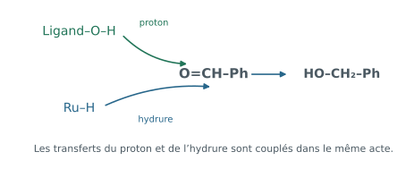

### A.III.5 — Deux hydrogènes complémentaires

> [!INDICATION]
> Attribuer les polarités locales avant de décider quel atome de l'aldéhyde reçoit chaque hydrogène.

#### Solution

L'hydrogène hydridique de Ru–H apporte une paire d'électrons au carbone électrophile et forme C–H. L'hydrogène protique de O–H est accepté par l'oxygène et forme O–H. Ces réactivités opposées permettent la réduction concertée du carbonyle.

### A.III.6 — Activation du dihydrogène

> [!INDICATION]
> Relier la polarisation des deux H à celle de la liaison C=O.

#### Solution

L'addition de $\mathrm{H_2}$ sur l'ensemble métal–ligand fournit un hydrure et un proton déjà placés pour le transfert sur C=O. La voie catalysée a une barrière d'activation plus basse que l'addition directe de $\mathrm{H_2}$ à l'aldéhyde. Le catalyseur accélère la réaction sans changer sa constante d'équilibre.

### A.III.7 — Le propan-2-ol dans le schéma 8

> [!INDICATION]
> Le produit organique qui accompagne le dimère est l'acétone. Identifier les deux liaisons de l'alcool qui ont perdu H.

#### Solution

Le propan-2-ol est un donneur d'hydrogène et donc un réducteur. Comme l'indique l'acétone formée, il cède un équivalent d'hydrure depuis le carbone secondaire et un proton depuis OH. Il contribue ainsi aux deux types d'hydrogène du dimère, pont Ru–H–Ru et proton du pont oxygéné. Utilisé en quantité suffisante, l'alcool peut également servir de milieu réactionnel.

### A.III.8 — Attribution du spectre proton

> [!INDICATION]
> Utiliser d'abord l'intégrale du proton formyle, puis les rapports 2:1:2 et les voisins aromatiques.

#### Solution

D′ à 10,01 ppm est le proton aldéhydique (1 H, singulet apparent). Les protons ortho H2 et H6, les plus déblindés par CHO, donnent C′ vers 7,87 ppm (2 H, doublet apparent, un grand couplage ortho chacun). Les H3 et H5 méta donnent A′ vers 7,52 ppm (2 H, deux grands couplages voisins de même ordre). Le proton para H4 donne B′ vers 7,62 ppm (1 H), d'abord interprété comme un triplet à cause de ses deux voisins ortho équivalents. La symétrie du benzaldéhyde fixe les équivalences H2/H6 et H3/H5.

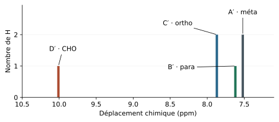

### A.III.9 — Pourquoi un triplet de triplets ?

> [!INDICATION]
> Depuis le proton para, repérer deux groupes distincts de deux protons équivalents chacun.

#### Solution

H4 se couple à H3 et H5 par un grand $^3J$ ortho. Chacune des trois raies est subdivisée par le couplage plus faible $^4J$ méta à H2 et H6. Les deux constantes différentes engendrent un triplet de triplets, dont certaines raies se recouvrent. Ce découpage décrit le motif dominant d'un système aromatique réel plus complexe.

### A.III.10 — Signal pour suivre l'avancement

> [!INDICATION]
> Chercher une zone isolée propre au réactif et un signal de deux H propre à l'alcool.

#### Solution

On suit l'intégrale D′ à 10,01 ppm, qui décroît avec $[\mathrm{PhCHO}]$. Le produit présente notamment un nouveau signal du $\mathrm{CH_2OH}$ benzylique autour de 4,5–4,7 ppm (2 H, souvent singulet lorsque OH échange). Un signal OH échangeable dépend de la concentration et du solvant. Les multiplets aromatiques des deux molécules se chevauchent.

### A.III.11 — Relier les constantes microscopiques

> [!INDICATION]
> Multiplier les constantes de dissociation et d'hydrogénation écrites dans le sens direct du schéma.

#### Solution

Dans la convention de concentration du sujet, les deux étapes réversibles donnent $K_1=k_1/k_{-1}$ et $K_2=k_2/k_{-2}$. La réaction somme est $\mathrm{[2\! -\!Ru]+H_2\rightleftharpoons 2[1\! -\!Ru(H_2)]}$, d'où $K=k_1k_2/(k_{-1}k_{-2})$. Ainsi $k_2/k_{-1}=Kk_{-2}/k_1=1{,}9\times3{,}01\,10^{-5}/(3{,}80\,10^{-4})\simeq0{,}151$. Les deux constantes du rapport ont les mêmes dimensions.

### A.III.12 — Lire les deux échelles de concentration

> [!INDICATION]
> Lire les complexes sur l'axe de droite. Comparer séparément le régime initial et la fin du tracé.

#### Solution

Au début, le dimère reste voisin de 3,8 mmol·L⁻¹ et la forme hydrogénée est à peine détectable. Le transfert à l'aldéhyde consomme celle-ci à mesure qu'elle est formée. Puis le dimère diminue et le monomère hydrogéné s'accumule à mesure que le substrat s'épuise. Vers 70 min on lit environ 1,6 mmol·L⁻¹ de dimère et 4,3 mmol·L⁻¹ de monomère hydrogéné. Le bilan en atomes de Ru comporte **deux** Ru par dimère. La figure seule ne permet pas d'assimiler les concentrations des deux monomères.

### A.III.13 — Concentration initiale de la forme active

> [!INDICATION]
> L'étape 3 est bimoléculaire en aldéhyde et en monomère hydrogéné. Utiliser les concentrations en mol·L⁻¹.

#### Solution

La loi de l'acte élémentaire est $v_3=k_3[\mathrm{PhCHO}][\mathrm{1\! -\!Ru(H_2)}]$. Il vient $[\mathrm{1\! -\!Ru(H_2)}]_0=(3{,}4\,10^{-4})/(40\times0{,}965)=8{,}8\,10^{-6}\ \mathrm{mol\,L^{-1}}$, soit environ **8,8 µmol·L⁻¹**. Cette valeur non nulle est petite devant l'échelle graphique des complexes.

### A.III.14 — Flux initial de dissociation

> [!INDICATION]
> Compter les événements de dissociation de dimères par unité de temps et de volume.

#### Solution

Le flux direct de dissociation est $v_1=k_1[\mathrm{2\! -\!Ru}]_0=3{,}80\,10^{-4}\times3{,}8\,10^{-3}=1{,}44\,10^{-6}\ \mathrm{mol\,L^{-1}\,s^{-1}}$. Ce flux compte les événements directs. La pente nette du dimère contiendrait aussi le flux d'association inverse.

### A.III.15 — Tours par dissociation

> [!INDICATION]
> Comparer deux flux mesurés avec les mêmes unités, en plaçant les événements à compter au numérateur.

#### Solution

Un tour correspond à une molécule d'aldéhyde réduite. Le quotient des flux initiaux donne $N=v_3/v_1\simeq3{,}4\,10^{-4}/(1{,}44\,10^{-6})\simeq236$ tours par dissociation de dimère. C'est le rapport demandé pour l'ensemble des monomères issus d'une dissociation. Il explique la consommation appréciable d'aldéhyde alors que la concentration du réservoir varie peu initialement.

### A.III.16 — Ordres partiels et domaine de temps

> [!INDICATION]
> Tester la première partie de la courbe logarithmique. Pour H₂, choisir une mesure comparant plusieurs pressions avec le même état initial du catalyseur.

#### Solution

Au début, le graphe de $\ln([\mathrm{PhCHO}]/c^\circ)$ est voisin d'une droite. Si $[\mathrm{H_2}]$ et la population catalytique active restent pratiquement constantes sur ce domaine, $-\mathrm d[\mathrm{PhCHO}]/\mathrm dt=k_{\rm app}[\mathrm{PhCHO}]$. L'ordre apparent en aldéhyde est **un**. La pente initiale vaut environ $-v_3/C_0=-3{,}5\,10^{-4}\ \mathrm{s^{-1}}$, soit $-0{,}021\ \mathrm{min^{-1}}$. La courbure tardive accompagne l'évolution de la spéciation du ruthénium. Pour H₂, mesurer les vitesses initiales à plusieurs pressions avec la même température, la même concentration d'aldéhyde et le même état initial du catalyseur. La pente de $\ln v_0$ contre $\ln [\mathrm{H_2}]$ donne l'ordre apparent. On peut employer $\ln P_{\mathrm{H_2}}$ si la concentration dissoute est proportionnelle à la pression dans la gamme considérée.

## A.IV. Membranes échangeuses de protons

### A.IV.1 — Retrouver le comonomère

> [!INDICATION]
> Sur les nouveaux cycles, repérer les deux carbones contigus venus de l'alcyne. Réunir ces fragments en tenant compte des liaisons aux motifs voisins.

#### Solution

U est le **1,4-diéthynylbenzène**, $\mathrm{HC{\equiv}C{-}p\! -C_6H_4{-}C{\equiv}CH}$. Les deux alcynes terminaux assurent la bifonctionnalité. Chacun fournit un couple de carbones voisins d'un nouveau noyau benzénique après cycloaddition puis extrusion. Le noyau para-phénylène de U lie deux unités successives.

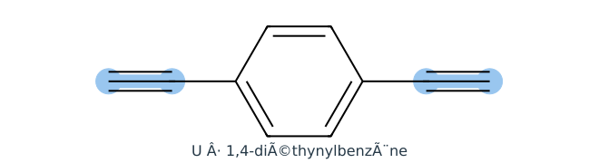

### A.IV.2 — Capacité massique théorique

> [!INDICATION]
> Compter les groupes sulfonés sur le motif entier de W, en haut et en bas du dessin.

#### Solution

Le motif porte quatre groupes sulfoniques. À raison d'un proton par site, $\mathrm{CEI}_{th}=4/1080=3{,}70\,10^{-3}\ \mathrm{mol\,g^{-1}}$, soit **3,70 mmol·g⁻¹**.

### A.IV.3 — Relation du titrage

> [!INDICATION]
> Exprimer le nombre de moles de base à l'équivalence, puis choisir comme dénominateur la masse avant hydratation.

#### Solution

L'échange libère un proton par site acide accessible et la neutralisation consomme un hydroxyde par proton. À l'équivalence, $n_{\mathrm{H^+}}=C_bV_{\rm eq}$, d'où $\mathrm{CEI}_{exp}=C_bV_{\rm eq}/m_{sec}$, en mol·g⁻¹ pour $V_{\rm eq}$ en litres et $m_{sec}$ en grammes.

### A.IV.4 — Capacité mesurée

> [!INDICATION]
> Convertir 100 µm en cm avant de multiplier par l'aire du carré. Comparer le résultat à A.IV.2.

#### Solution

Le volume sec est $2\times2\times0{,}0100=0{,}0400\ \mathrm{cm^3}$. Sa masse vaut $0{,}0500\ \mathrm g$. On titre $0{,}0100\times0{,}0170=1{,}70\,10^{-4}\ \mathrm{mol}$. Ainsi $\mathrm{CEI}_{exp}=3{,}40\ \mathrm{mmol\,g^{-1}}$, soit environ **92 %** de la valeur théorique. Quelques sites peuvent être inaccessibles à l'échange ou à la mise en forme. Le seul dosage ne distingue pas cette possibilité d'un écart sur la masse sèche ou la fonctionnalisation.

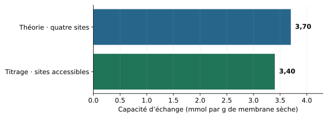

### A.IV.5 — Échange préalable en solution saline

> [!INDICATION]
> Écrire un équilibre dans lequel les ions sodium se fixent à la place des protons.

#### Solution

L'excès de sodium déplace $\mathrm{R{-}SO_3H+Na^+\rightleftharpoons R{-}SO_3^-Na^++H^+}$ vers la droite. La durée d'immersion laisse diffuser les ions jusqu'aux sites intérieurs. Le titrage porte alors sur les protons libérés dans la solution.

### A.IV.6 — Effet de l'humidité

> [!INDICATION]
> Relier la forte acidité des fonctions sulfoniques à la mobilité des porteurs de charge.

#### Solution

L'eau hydrate et dissocie les sites sulfoniques. Les domaines hydratés fournissent un réseau continu où les charges protoniques se déplacent par diffusion d'espèces hydratées et par relais de liaisons hydrogène. La hausse de la conductivité avec l'humidité sur la figure 7 concorde avec ce mécanisme.

### A.IV.7 — Concentration en sites dans la membrane gonflée

> [!INDICATION]
> Le nombre de sites reste fixé par la masse sèche alors que le volume est celui de la membrane en fonctionnement.

#### Solution

Si $g=V_{hum}/V_{sec}$, la concentration volumique vaut $c_{sites}=\mathrm{CEI}_{exp}\rho_{sec}/g$. Avec $g=2$, on trouve $3{,}40\ \mathrm{mmol\,g^{-1}}\times1{,}25\ \mathrm{g\,cm^{-3}}/2=2{,}125\ \mathrm{mmol\,cm^{-3}}$, soit **2,13 mol·L⁻¹**. La CEI théorique donnerait environ 2,31 mol·L⁻¹.

### A.IV.8 — Choisir la grandeur adaptée au transport

> [!INDICATION]
> Examiner deux membranes de même masse sèche et de même nombre de sites dont l'une gonfle davantage.

#### Solution

À masse sèche et CEI massique identiques, la membrane la plus gonflée possède moins de sites par unité de volume traversé. La concentration volumique est directement reliée à la densité de porteurs en fonctionnement. Leur mobilité et la continuité des domaines hydratés interviennent également dans la conductivité.

### A.IV.9 — Comparer MW et NR211

> [!INDICATION]
> Lire les deux courbes au même pourcentage d'humidité. Examiner séparément capacité de stockage et flux de charge.

#### Solution

À 30 °C vers 40 % d'humidité, les conductivités sont proches, de l'ordre de 10 mS·cm⁻¹. À forte humidité, MW devient la plus conductrice. Vers 95 % on lit environ **106 mS·cm⁻¹ pour MW** et **72 mS·cm⁻¹ pour NR211**. Les 3,40 mmol·g⁻¹ mesurés sur MW sont élevés par rapport au repère commercial donné pour le Nafion (supérieur à 0,9 mmol·g⁻¹, valeur exacte non fournie). MW associe ainsi de nombreux sites et une bonne conduction hydratée. Avec le gonflement supposé en A.IV.7, sa conductivité molaire rapportée aux sites serait environ $0{,}106/(2{,}125\,10^{-3})=50\ \mathrm{S\,cm^2\,mol^{-1}}$.

## B. Séparation électrochimique du cuivre, de l’indium et du gallium

### B.1 — État fondamental du cuivre

> [!INDICATION]
> Le cuivre a 29 électrons. Comparer les occupations 3d et 4s voisines en énergie.

#### Solution

La règle de remplissage de Klechkowski prévoit $[\mathrm{Ar}]\,4s^2 3d^9$. L'état fondamental expérimental est $[\mathrm{Ar}]\,3d^{10}4s^1$. Les sous-couches 3d et 4s sont proches en énergie et la configuration comportant la sous-couche 3d complète possède l'énergie totale la plus basse pour le cuivre.

### B.2 — Ionisations successives

> [!INDICATION]
> Pour passer aux cations, commencer par l'électron externe 4s.

#### Solution

La première ionisation retire l'électron 4s et donne $\mathrm{Cu^+}:[\mathrm{Ar}]\,3d^{10}$. La suivante retire un électron 3d et donne $\mathrm{Cu^{2+}}:[\mathrm{Ar}]\,3d^9$.

### B.3 — Masse molaire du cuivre naturel

> [!INDICATION]
> Une masse molaire de l'élément naturel traduit la composition isotopique du prélèvement.

#### Solution

La valeur 63,546 g·mol⁻¹ est la moyenne $M=\sum_i x_iM_i$ des masses molaires isotopiques, pondérées par les abondances, notamment celles de cuivre 63 et cuivre 65. Le nombre de masse de chaque nucléide est entier. Sa masse atomique exprimée en unités de masse atomique diffère elle-même légèrement de ce nombre à cause, entre autres, de l'énergie de liaison nucléaire.

### B.4 — Lewis et géométrie du perchlorate

> [!INDICATION]
> Compter les électrons de valence avant de chercher une écriture limitant les charges formelles.

#### Solution

Il y a $7+4\times6+1=32$ électrons de valence. Une forme de Lewis est $\mathrm{[O{=}Cl(=O)(=O){-}O^-]}$, avec deux doublets sur chaque oxygène doublement lié et trois sur l'oxygène simplement lié. Quatre formes équivalentes placent la charge sur chacun des oxygènes à tour de rôle. Le chlore a quatre directions de liaison sans doublet non liant dans cette écriture, soit $AX_4$. L'environnement est tétraédrique, avec quatre liaisons équivalentes dans l'hybride.

### B.5 — Stabilité du cuivre(I) libre

> [!INDICATION]
> Associer la réduction la plus favorable à l'oxydation de l'autre couple.

#### Solution

La réaction $\mathrm{2Cu^+\to Cu^{2+}+Cu(s)}$ est une dismutation. Sa force électromotrice standard vaut $0{,}52-0{,}17=0{,}35\ \mathrm V$. Un électron est transféré par avancement, d'où $\log_{10}K\simeq0{,}35/0{,}06\simeq5{,}8$. En milieu perchlorate non complexant, l'ion Cu(I) libre dismute donc fortement.

### B.6 — Rapidité sur électrode de cuivre

> [!INDICATION]
> Regarder autour du courant nul la séparation entre le départ de la réduction et celui de l'oxydation.

#### Solution

La courbe en tirets présente un passage raide autour de $E_{eq}\simeq0{,}31\ \mathrm{V/ENH}$. Une faible variation de potentiel de part et d'autre de l'équilibre suffit à produire un courant important. Le couple $\mathrm{Cu^{2+}/Cu}$ est électrochimiquement rapide sur le cuivre dans ces conditions. La rapidité décrit ici la cinétique du transfert interfacial.

### B.7 — Branches de la courbe en tirets

> [!INDICATION]
> Parcourir les potentiels décroissants depuis la branche anodique et attribuer chaque nouveau courant cathodique.

#### Solution

Au-dessus de l'équilibre, le courant positif traduit $\mathrm{Cu(s)\to Cu^{2+}+2e^-}$. Du côté cathodique, $\mathrm{Cu^{2+}+2e^-\to Cu(s)}$ donne une vague puis un palier limité par l'arrivée des ions. Aux potentiels très négatifs s'ajoute la réduction du milieu protique, $\mathrm{2H^++2e^-\to H_2}$. À l'équilibre entre métal et ions, le courant résultant est nul.

### B.8 — Concentration par le potentiel d'équilibre

> [!INDICATION]
> Prendre la valeur 0,31 V de la courbe en tirets et le nombre de deux électrons.

#### Solution

Pour le métal pur et avec des activités assimilées aux concentrations réduites, $E=0{,}34+(0{,}06/2)\log_{10}([\mathrm{Cu^{2+}}]/c^\circ)$. À 0,31 V, le logarithme vaut $-1$. La concentration modèle est donc **0,10 mol·L⁻¹**.

### B.9 — Absence de palier anodique

> [!INDICATION]
> Identifier la phase qui contient le réactif de l'oxydation.

#### Solution

Le cuivre métallique réactif constitue l'électrode elle-même. Son arrivée à l'interface ne dépend pas de la diffusion d'un soluté depuis le volume de solution. La dissolution anodique du métal ne présente donc pas le palier de diffusion observé pour la réduction de $\mathrm{Cu^{2+}}$.

### B.10 — Signes et porteurs de charge

> [!INDICATION]
> Commencer par la borne qui fournit les électrons au lieu de la réduction. Le dépôt indique cette électrode sur le dessin.

#### Solution

À droite sur le dessin de l'énoncé, la cathode qui reçoit le dépôt est au pôle négatif du générateur. L'anode de gauche est au pôle positif. Dans les fils, les électrons vont du pôle négatif à la cathode et de l'anode au pôle positif. Le courant conventionnel va en sens inverse dans chaque fil et de l'anode vers la cathode à travers la solution. Dans l'électrolyte, les cations migrent vers la cathode et les anions vers l'anode. La charge y est transportée par les ions.

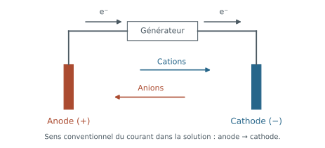

### B.11 — Travail électrique et thermodynamique

> [!INDICATION]
> Employer les enthalpies libres de formation des ions. Celles des éléments dans leur état standard sont nulles.

#### Solution

Pour le bilan donné, $\Delta_rG^\circ=0+0-(-69{,}81-131{,}2)=+201{,}01\ \mathrm{kJ\,mol^{-1}}$. La constante est $K=\exp[-201010/(RT)]$ à 298 K et elle est très inférieure à un. En conditions standard, le sens choisi exige un apport de travail électrique.

### B.12 — Potentiel standard du cuivre complexé

> [!INDICATION]
> Pour une transformation forcée, garder le signe de la différence entre potentiel de réduction cathodique et potentiel de réduction anodique.

#### Solution

On écrit $\Delta_rG^\circ=-2F\left[E^\circ(\mathrm{CuCl^+/Cu})-E^\circ(\mathrm{Cl_2/Cl^-})\right]$. Avec les valeurs données, $E^\circ(\mathrm{CuCl^+/Cu})=1{,}36-201010/(2F)\simeq0{,}35\ \mathrm{V/ENH}$ pour $F\simeq10^5\ \mathrm{C\,mol^{-1}}$. La valeur plus précise de F donnerait environ 0,32 V. Le calcul demandé part des énergies de formation du sujet.

### B.13 — Une ou deux vagues de réduction

> [!INDICATION]
> Comparer le sort de Cu(I) sous forme libre puis complexée par le chlorure.

#### Solution

L'ion Cu(I) libre dismute en milieu perchlorate. On observe donc globalement un transfert de deux électrons entre Cu(II) et Cu(s). En milieu chlorure, la coordination stabilise $\mathrm{CuCl_2^-}$. Le premier transfert de Cu(II) à Cu(I), puis celui de Cu(I) au métal, deviennent distincts et produisent deux vagues.

### B.14 — Les deux étapes cathodiques du cuivre

> [!INDICATION]
> Équilibrer les deux demi-équations avec un électron chacune en tenant compte des chlorures coordonnés.

#### Solution

Les deux vagues de cuivre ont été franchies au potentiel considéré. Elles correspondent à $\mathrm{CuCl^++Cl^-+e^-\to CuCl_2^-}$ puis $\mathrm{CuCl_2^-+e^-\to Cu(s)+2Cl^-}$. Le bilan cathodique est $\mathrm{CuCl^++2e^-\to Cu(s)+Cl^-}$. La figure n'indique pas de vague importante du solvant à ce potentiel sur le carbone vitreux.

### B.15 — Bilans des oxydations concurrentes

> [!INDICATION]
> Écrire les demi-équations en plaçant les électrons du côté des produits. En milieu aqueux acide, le solvant peut aussi être oxydé.

#### Solution

Les deux demi-équations anodiques envisageables sont $\mathrm{2Cl^-\to Cl_2+2e^-}$ et $\mathrm{2H_2O\to O_2+4H^++4e^-}$. Les potentiels standards renseignent sur la thermodynamique. La répartition des courants dépend également des cinétiques interfaciales.

### B.16 — Fonctions de l'électrolyte

> [!INDICATION]
> Distinguer les espèces métalliques majoritaires et le transport du courant dans la solution.

#### Solution

Les chlorures imposent la spéciation des métaux en chlorocomplexes, ce qui modifie leurs potentiels et permet la séparation étudiée. L'acidité limite l'hydrolyse et la précipitation d'hydroxydes. La forte concentration d'ions augmente aussi la conductivité de la solution, réduit la chute ohmique et fournit un électrolyte-support.

### B.17 — Réductions avant séparation du cuivre

> [!INDICATION]
> À la valeur indiquée, suivre sur la figure 9 les vagues déjà traversées en allant vers les potentiels décroissants.

#### Solution

Dans le mélange initial, les étapes $\mathrm{CuCl^++Cl^-+e^-\to CuCl_2^-}$ et $\mathrm{CuCl_2^-+e^-\to Cu+2Cl^-}$ s'ajoutent à $\mathrm{InCl_4^-+3e^-\to In(s)+4Cl^-}$. Le plateau est déjà atteint pour l'indium. La réduction du gallium est fortement retardée et la grande vague du solvant n'est visible qu'à des potentiels encore plus négatifs. Si le cuivre a été retiré au préalable, seul le dépôt d'indium subsiste parmi ces réductions métalliques.

### B.18 — Lire les hauteurs de vague

> [!INDICATION]
> Soustraire les plateaux adjacents. La contribution d'un ion est reliée au produit de sa concentration par son nombre d'électrons.

#### Solution

Sur la figure 9, chaque vague monoélectronique du cuivre accroît la valeur absolue du courant d'environ un carreau. La vague de l'indium l'accroît d'environ trois carreaux. Pour les mêmes conditions de diffusion, $\Delta |I|_{\rm In}/\Delta |I|_{\rm Cu,1}=3c_{\rm In}/c_{\rm Cu}\simeq3$. Donc $c_{\rm In}\simeq c_{\rm Cu}\simeq0{,}10\ \mathrm{mol\,L^{-1}}$. Prendre la hauteur totale du dernier plateau attribuerait à tort le courant du cuivre à l'indium.

### B.19 — Extinction du courant

> [!INDICATION]
> Lire la fin de la courbe, puis identifier quelles espèces restent réductibles au potentiel fixé.

#### Solution

À mesure que le cuivre se dépose, la solution s'appauvrit en cuivre dissous. Vers 4–5 h, sa concentration et donc son courant de diffusion deviennent négligeables. Au potentiel retenu, l'indium et le gallium n'apportent pratiquement aucun courant. La surface dendritique peut contribuer à la hausse initiale de la valeur absolue du courant.

### B.20 — Rendement faradique

> [!INDICATION]
> Convertir la masse de cuivre en quantité de matière et celle-ci en charge ayant servi au dépôt.

#### Solution

Le rendement faradique est la fraction de la charge totale ayant assuré le dépôt récupéré, $\eta_F=Q_{\rm Cu}/Q= nFm_{\rm Cu}/(M_{\rm Cu}Q)$, avec $n=2$ et $Q=\int |I|\,\mathrm dt$. La donnée arrondie $F\simeq10^5$ donne $2\times10^5\times0{,}29/(63{,}546\times1000)\simeq0{,}91$, conforme aux 91 % annoncés avec ces arrondis.

### B.21 — Fraction d'indium récupérée

> [!INDICATION]
> Le dénominateur est cette fois la masse d'indium présente initialement. La charge intégrée n'est pas fournie.

#### Solution

L'indium initial correspond à $c_0V_0=0{,}10\times0{,}050=5{,}0\,10^{-3}\ \mathrm{mol}$. Avec $M_{\rm In}\simeq114{,}8\ \mathrm{g\,mol^{-1}}$, la masse maximale est environ 0,57 g. Le rendement de récupération vaut $m_{\rm In}/(c_0V_0M_{\rm In})\simeq0{,}46/0{,}57\simeq0{,}81$, soit environ **80 %**. Une partie du dépôt granuleux peut se détacher ou de l'indium peut rester dissous. Cette mesure de masse seule ne départage pas ces causes.

### B.22 — Courbes à mi-avancement et en fin d'électrolyse

> [!INDICATION]
> Multiplier les deux contributions du cuivre par la fraction restante. Garder la même hauteur pour la vague propre à l'indium.

#### Solution

À volume et transport supposés constants, le courant de diffusion de chaque vague monoélectronique du cuivre est multiplié par $1-x$. En unités de la hauteur initiale d'une vague Cu, les valeurs absolues des plateaux successifs sont $1,2,5$ pour $x=0$, puis $0{,}5,1,4$ pour $x=0{,}5$, enfin $0,0,3$ pour $x=1$. L'accroissement associé à l'indium reste égal à trois. Les vagues du cuivre disparaissent à la fin et la contribution du solvant subsiste aux potentiels très négatifs.

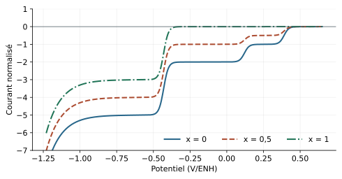

### B.23 — Réduction du gallium libre ou complexé

> [!INDICATION]
> L'annexe donne deux ligands SCN⁻ par gallium. Déterminer la charge totale du complexe avant de l'équilibrer.

#### Solution

Les demi-équations sont $\mathrm{Ga^{3+}+3e^-\to Ga(s)}$ et $\mathrm{[Ga(SCN)_2]^++3e^-\to Ga(s)+2SCN^-}$. Le complexe est monochargé car le gallium(III) a fixé deux ligands monovalents.

### B.24 — Potentiel standard du complexe

> [!INDICATION]
> Combiner la dissociation du complexe, de constante inverse de β₂, avec la réduction du gallium libre.

#### Solution

Pour le complexe, $E^\circ_{c}=E^\circ_{\mathrm{Ga^{3+}/Ga}}-(0{,}06/3)\log_{10}\beta_2$. Ainsi $E^\circ_{c}=-0{,}55-0{,}02\times5{,}60=\mathbf{-0{,}662\ V/ENH}$. On retrouve la même expression en introduisant $a_{\mathrm{Ga^{3+}}}=a_c/(\beta_2 a_{\mathrm{SCN^-}}^2)$ dans l'équation de Nernst.

### B.25 — Fenêtre cathodique du gallium

> [!INDICATION]
> Lire l'entrée sur le palier en tirets sur la figure 11, puis repérer le départ du mur cathodique du solvant.

#### Solution

Pour obtenir un courant de dépôt appréciable en présence de thiocyanate, le potentiel cathodique doit être plus négatif qu'environ $-0{,}73\ \mathrm{V/ENH}$, dans le domaine du palier. Un point vers $-0{,}85\ \mathrm{V/ENH}$ convient sur le tracé. L'extrémité très négative, vers $-1{,}2\ \mathrm V$ et au-delà, comporte une augmentation du courant liée au milieu.

### B.26 — Effet du thiocyanate

> [!INDICATION]
> Comparer les déplacements du potentiel standard calculé et de la vague réellement mesurée.

#### Solution

La vague de dépôt passe d'environ $-1{,}0$ à $-0{,}73\ \mathrm{V/ENH}$ lorsque le thiocyanate est ajouté. Le dépôt devient donc possible à un potentiel moins négatif, mieux séparé de la réduction du milieu. Comme la complexation abaisse le potentiel standard thermodynamique du couple, le déplacement expérimental dans l'autre sens traduit l'amélioration de la cinétique interfaciale et une surtension cathodique effective plus faible.

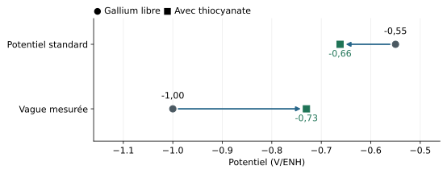
