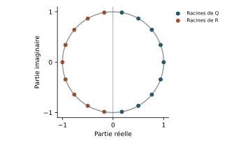
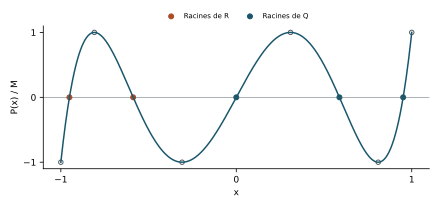

# X-ENS PC — Mathématiques 2021 · Corrigé guidé

*Corrigé rédigé par IA, non officiel. Signalez toute erreur.*

**Rédaction** · GPT-6.2 Astra Ultra · vitesse non renseignée

La composition du 12 avril 2021 établit une borne pour le produit des normes de deux polynômes. Elle calcule une constante universelle sur le disque unité, puis une constante dépendant des degrés sur un segment. Les quatre parties suivent les 44 numéros du sujet. [Sujet officiel](https://banques-ecoles.fr/cms/wp-content/uploads/2021/07/2021_PC_sujet_Math.pdf) · [Rapport du jury](https://banques-ecoles.fr/cms/wp-content/uploads/2021/10/21_PC_rap_eMath.pdf)

## I. Norme uniforme sur un compact infini

### Question 1.1

> [!INDICATION]
> Appliquer le théorème des bornes atteintes.

#### Solution

L’ensemble $K$ fermé borné de $\mathbb C\simeq\mathbb R^2$ est compact et non vide puisqu’il est infini. La fonction continue $z\mapsto |P(z)|$ y atteint un maximum réel fini. C’est $\|P\|_K$.

### Question 1.2

> [!INDICATION]
> Exploiter l’infinité de K pour la séparation de la norme.

#### Solution

La positivité et l’homogénéité $\|cP\|_K=|c|\|P\|_K$ suivent du module. De $|P(z)+Q(z)|\le \|P\|_K+\|Q\|_K$ pour chaque $z\in K$ on tire l’inégalité triangulaire. Si $\|P\|_K=0$, le polynôme s’annule sur l’ensemble infini $K$. Un polynôme non nul ayant un nombre fini de racines, $P=0$. Réciproquement le polynôme nul est de norme nulle.

### Question 1.3

> [!INDICATION]
> Majorer le produit point par point.

#### Solution

Pour chaque $z\in K$, $|Q(z)R(z)|\le\|Q\|_K\|R\|_K$. Le passage au supremum donne $\|QR\|_K\le\|Q\|_K\|R\|_K$.

### Question 1.4

> [!INDICATION]
> Choisir un maximiseur du module du produit.

#### Solution

Soit $z_0$ tel que $|Q(z_0)R(z_0)|=\|QR\|_K$. Les deux normes des facteurs sont strictement positives par 1.2. Si l’inégalité de 1.3 est une égalité, les quotients $|Q(z_0)|/\|Q\|_K$ et $|R(z_0)|/\|R\|_K$, compris entre zéro et un, ont produit un. Ils valent tous les deux un.

### Question 1.5

> [!INDICATION]
> Construire deux facteurs linéaires dont les points de maximum ne peuvent coïncider.

#### Solution

Choisissons $a\ne b$ dans $K$, $d=b-a$ et $A=\max_{K}|z|$. Pour $t>0$, prenons $Q=X-td$, $R=X+td$, permis car $n,m\ge1$. Si $z\in K$ maximise les deux modules, on a $|z-td|^2\ge|a-td|^2$ et $|z+td|^2\ge|b+td|^2$. En additionnant, $2|z|^2\ge|a|^2+|b|^2+2t|d|^2$, impossible pour $t$ assez grand puisque $|z|\le A$. Il n’existe alors aucun maximiseur commun. Par 1.4 le quotient est strictement supérieur à un. Son supremum $C^K_{n,m}$ l’est donc aussi.

### Question 1.6

> [!INDICATION]
> Travailler sur le produit des sphères unités en dimension finie.

#### Solution

La somme des deux normes est une norme sur $V$ par 1.2. Les conditions $\|Q\|_K=\|R\|_K=1$ définissent une partie fermée bornée de cet espace de dimension finie. L’ensemble $E$ est donc compact, et non vide (les constantes un conviennent). Sur $E$, la différence de deux produits est majorée par $\|Q-Q'\|_K\|R\|_K+\|Q'\|_K\|R-R'\|_K$ en norme. Cela prouve la continuité de $(Q,R)\mapsto\|QR\|_K$. Elle atteint son infimum sur $E$ en un couple $(Q_0,R_0)$.

### Question 1.7

> [!INDICATION]
> Utiliser l’invariance du quotient par la mise à l’échelle séparée des facteurs.

#### Solution

En divisant chaque polynôme non nul par sa norme, on obtient un couple de $E$ sans changer le quotient. Sur $E$, celui-ci vaut $1/\|QR\|_K$. Le minimum de 1.6 est strictement positif, car ses deux facteurs sont non nuls et $\mathbb C[X]$ est intègre. L’inverse du minimum est donc un maximum fini égal à $C^K_{n,m}$. Divisons $Q_0,R_0$ par leurs coefficients dominants respectifs. Les polynômes unitaires obtenus réalisent toujours ce maximum.

## II. Mesure de Mahler

### Question 2.8

> [!INDICATION]
> Factoriser le polynôme et examiner une racine sur le cercle.

#### Solution

Une racine $w$ hors du cercle fournit une fonction $\log|e^{i\theta}-w|$ continue sur le segment. Si $w=e^{i\theta_0}$, alors $|e^{i\theta}-w|=2|\sin((\theta-\theta_0)/2)|\sim|\theta-\theta_0|$ en chacun des angles concernés. Le logarithme diffère donc de $\log|\theta-\theta_0|$ par un terme borné, et le module de ce logarithme est intégrable localement, aussi aux extrémités. La factorisation de d’Alembert–Gauss donne $\log|Q(e^{i\theta})|$ comme somme finie de tels termes et d’une constante. Cela prouve la convergence absolue au sens demandé.

### Question 2.9

> [!INDICATION]
> Trouver un arc de cercle sur lequel l’intégrande est strictement positif.

#### Solution

Le polynôme non nul ne s’annule qu’en un nombre fini de points. Il existe un angle où $|Q(e^{i\theta})|>0$ et, par continuité, un intervalle de longueur positive où son module reste minoré par une constante positive. L’intégrale normalisée de sa puissance $p>0$ est donc strictement positive.

### Question 2.10

> [!INDICATION]
> Contrôler les puissances pour p dans un segment puis faire tendre p vers zéro.

#### Solution

Notons $A(\theta)=|Q(e^{i\theta})|$ et $L=\max A$. Sur $0<p\le b$, on a $A^p\le\max(1,L^b)$. La convergence dominée donne la continuité en tout $p>0$. Quand $p\downarrow0$, $A^p\to1$ sauf aux finitement nombreux zéros de $A$, donc $M_p(Q)\to1$. Comme $M_p(Q)>0$, $\varphi(p)=\log M_p(Q)$ est continue et tend vers sa valeur assignée $\varphi(0)=0$.

### Question 2.11

> [!INDICATION]
> Justifier la dérivation locale de la puissance en son paramètre.

#### Solution

Pour $p$ dans un compact $[a,b]\subset]0,\infty[$, la dérivée de $A^p$ est $A^p\log A$ lorsque $A>0$ et zéro aux zéros. Cette extension est continue, car $u^a|\log u|\to0$ en zéro. Elle est uniformément bornée pour $0\le A\le L$ et $a\le p\le b$, d’où dérivation sous le signe intégral. La règle de dérivation du logarithme donne
$$\varphi'(p)=\frac{\int_0^{2\pi} A^p\log A\,d\theta}{\int_0^{2\pi} A^p\,d\theta}.$$

### Question 2.12

> [!INDICATION]
> Dominer le logarithme près des zéros puis appliquer les accroissements finis en p.

#### Solution

Pour $0<p\le1$, $|A^p\log A|\le\max(1,L)|\log A|$ hors des zéros, majorant intégrable par 2.8. Par convergence dominée et 2.10, $\varphi'(p)\to(2\pi)^{-1}\int\log A=\log M(Q)$. Le théorème des accroissements finis entre $0$ et $p$ est applicable par continuité au bord et dérivabilité à l’intérieur. Il donne $\varphi(p)/p\to\log M(Q)$. En exponentiant, $M_p(Q)^{1/p}\to M(Q)$.

### Question 2.13

> [!INDICATION]
> Intégrer la série géométrique sur un rayon intérieur au disque.

#### Solution

Pour $0\le\rho\le r<1$, $F(\rho)=\log|1-\rho e^{i\theta}|$ a pour dérivée $\operatorname{Re}[-e^{i\theta}/(1-\rho e^{i\theta})]$. La série géométrique du dénominateur converge uniformément sur $[0,r]$. Son intégration terme à terme et $F(0)=0$ donnent pour $z=re^{i\theta}$,
$$\log|1-z|=-\operatorname{Re}\sum_{n\ge1}z^n/n.$$

### Question 2.14

> [!INDICATION]
> Moyenner les modes trigonométriques non constants.

#### Solution

Pour $|z|<1$, $|e^{i\theta}-z|=|1-ze^{-i\theta}|$. D’après 2.13, la série de son logarithme est normalement convergente en $\theta$ car $\sum |z|^n/n<\infty$. Chaque mode $e^{-in\theta}$, $n\ge1$, a moyenne nulle. La moyenne du logarithme est donc nulle et $M(X-z)=1$. Si $z\ne0$, factorisons $|e^{i\theta}-z^{-1}|=|z|^{-1}|1-ze^{i\theta}|$. Le même calcul donne $M(X-z^{-1})=|z|^{-1}$.

### Question 2.15

> [!INDICATION]
> Passer au bord avec une domination indépendante du rayon.

#### Solution

Écrivons $z=e^{i\psi}$. Pour $0\le r<1$, $|e^{i\theta}-rz|=|e^{i(\theta-\psi)}-r|$ est au moins $|\sin(\theta-\psi)|$ et au plus deux. Ainsi $|\log|e^{i\theta}-rz||\le\log2+|\log|\sin(\theta-\psi)||$ hors des zéros du sinus. Ce majorant est intégrable par le comportement logarithmique aux zéros simples. La convergence dominée pour $r\uparrow1$ identifie la moyenne du logarithme limite à zéro par 2.14. Ainsi $M(X-z)=1$ pour $|z|=1$.

### Question 2.16

> [!INDICATION]
> Prendre le logarithme de la factorisation complète.

#### Solution

Les intégrales convergent absolument et la somme est finie. Par addition des logarithmes puis exponentiation, $M(Q)=|\lambda|\prod_{j=1}^nM(X-\alpha_j)$. Les questions 2.14–2.15 couvrent l’intérieur, l’extérieur et le bord du disque et donnent
$$M(Q)=|\lambda|\prod_{j=1}^n\max(1,|\alpha_j|).$$
Pour un polynôme constant non nul, le produit est vide.

## III. Inégalité sur le disque unité

### Question 3.17

> [!INDICATION]
> Intégrer le développement polynomial autour du centre.

#### Solution

Développons exactement $P(z+re^{i\theta})=\sum_{j=0}^dP^{(j)}(z)r^je^{ij\theta}/j!$. Les modes de rang $j\ge1$ ont une intégrale nulle sur une période et le terme constant est $P(z)$. La moyenne vaut donc $P(z)$ pour tout $r\in\mathbb R$.

### Question 3.18

> [!INDICATION]
> Si un maximum est intérieur, appliquer la moyenne sur un petit cercle centré en lui.

#### Solution

Un maximum de $|P|$ est atteint sur le disque compact. Si un tel point $z$ est intérieur, prenons un petit cercle de rayon strictement positif autour de $z$ contenu dans le disque. Si $M=|P(z)|=0$, $P$ est identiquement nul sur le disque. Sinon multiplions $P$ par une constante de module un afin que $P(z)=M$. La partie réelle de $P$ sur ce cercle est partout au plus $M$ et a moyenne $M$ par 3.17. Par continuité elle vaut $M$ partout, et puisque $|P|\le M$, le polynôme y vaut lui-même $M$. Le polynôme $P-M$ ayant une infinité de zéros est nul. Ainsi tout polynôme non constant atteint son maximum sur le bord, et les constantes y ont également la même norme.

### Question 3.19

> [!INDICATION]
> À l’extérieur du disque, appliquer la borne intérieure au polynôme réciproque.

#### Solution

Pour $|z|\le1$ c’est 3.18. Pour $|z|>1$, $T(X)=X^dP(1/X)$ est un polynôme, et $\|T\|_{\partial D}=\|P\|_{\partial D}$ puisque l’inversion permute le cercle. On obtient $|P(z)|=|z|^d|T(1/z)|\le|z|^d\|P\|_{\partial D}$. Les deux cas donnent $|P(z)|\le\|P\|_{\partial D}\max(1,|z|)^d$.

### Question 3.20

> [!INDICATION]
> Choisir un point de maximum par facteur sur le cercle.

#### Solution

Par 3.18 et compacité du cercle, il existe $u,v\in\partial D$ tels que $|Q(u)|=\|Q\|_D$ et $|R(v)|=\|R\|_D$. Dans la factorisation, chaque racine $\alpha_i$ de $Q$ fournit $|u-\alpha_i|$ et chaque racine de $R$ fournit $|v-\alpha_i|$. En remplaçant chaque distance par le maximum des deux, on obtient la majoration demandée après multiplication par $|\lambda|$.

### Question 3.21

> [!INDICATION]
> Factoriser directement le polynôme transformé pour tenir compte aussi des racines égales à u.

#### Solution

Notons $d=n+m$. Le produit est polynomial même au point $X=1$, car
$$S(X)=\lambda\prod_{j=1}^d\big((u-\alpha_j)X-(v-\alpha_j)\big).$$
Pour un facteur linéaire $AX-B$ non identiquement nul, $M(AX-B)=\max(|A|,|B|)$ par 2.16, valable aussi pour $A=0$. Si $u=v$, alors $Q(u)R(u)\ne0$ car les deux normes sont positives, donc aucun facteur ne s’annule identiquement. Pour $u\ne v$ c’est également impossible. La multiplicativité de la mesure et 3.20 donnent l’inégalité annoncée.

### Question 3.22

> [!INDICATION]
> Contrôler le polynôme en l’argument de la transformation fractionnaire.

#### Solution

Pour $z=e^{i\theta}\ne1$, 3.19 donne
$$|S(z)|\le\|P\|_D\max(|z-1|,|uz-v|)^d
=\|P\|_D\max(|z-1|,|z-w|)^d,$$
puisque $|u|=1$ et $w=v/u$. Le logarithme du maximum est intégrable. Si $w\ne1$, le maximum est continu strictement positif sur le cercle. Si $w=1$, c’est le logarithme d’un facteur linéaire, traité en 2.8. On prend la moyenne des logarithmes hors des finitement nombreux zéros de $S$, puis l’exponentielle. Cela donne la majoration de $M(S)$ demandée.

### Question 3.23

> [!INDICATION]
> Comparer la longueur de l’union de deux arcs à celle obtenue pour des points opposés.

#### Solution

Pour $0<t<2$, les points du cercle à distance $>t$ d’un point donné forment un arc centré au point antipodal. Sa longueur $L(t)$ ne dépend pas de son centre. Pour la fonction $A_w(z)=\max(|z-1|,|z-w|)$, l’ensemble $A_w>t$ est donc réunion de deux arcs de même longueur et sa longueur est au plus $\min(2\pi,2L(t))$. Pour $w=-1$, les arcs sont centrés en des points opposés et atteignent cette borne. En effet ils sont disjoints à leurs extrémités près si $L(t)\le\pi$ et couvrent le cercle à leurs extrémités près sinon.

Pour $0<\delta<1$, écrivons $\log\max(A_w,\delta)=\log\delta+\int_\delta^2\mathbf1_{A_w>t}\,dt/t$. L’intégration en $\theta$ et la comparaison des longueurs montrent que sa moyenne est au plus celle de la version $w=-1$. En faisant $\delta\downarrow0$, les moyennes convergent vers celles de $\log A_w$ par 3.22 et domination. Ainsi l’intégrale de 3.22 est au plus $I$ et 3.21 donne $\|Q\|_D\|R\|_D\le C^{n+m}\|QR\|_D$.

### Question 3.24

> [!INDICATION]
> Ramener l’intégrale à un quadrant et régulariser le développement du logarithme.

#### Solution

Par symétrie, $I=4\int_0^{\pi/2}\log|1+e^{i\theta}|\,d\theta$. Sur ce quadrant, $1\le|1+re^{i\theta}|\le2$ pour $0\le r\le1$, donc la limite $r\uparrow1$ passe sous l’intégrale. Pour $r<1$, 2.13 donne une série normalement convergente. Son intégrale est
$$\sum_{j\ge1}\frac{(-1)^{j-1}r^j}{j^2}\sin(j\pi/2).$$
La série est dominée par $\sum j^{-2}$ et seuls les indices impairs $j=2k+1$ contribuent, avec $\sin(j\pi/2)=(-1)^k$. Ainsi $I=4\sum_{k\ge0}(-1)^k/(2k+1)^2$.

### Question 3.25

> [!INDICATION]
> Encadrer la constante par deux sommes partielles consécutives.

#### Solution

Les termes de la série alternée décroissent en module vers zéro. La somme jusqu’à $k=5$ est une borne inférieure et celle jusqu’à $k=6$ une borne supérieure. En exponentiant après multiplication par $2/\pi$, les évaluations fournies placent $C$ strictement entre $1{,}785$ et $1{,}795$. L’arrondi au centième est donc $1{,}79$.

### Question 3.26

> [!INDICATION]
> Évaluer les deux facteurs aux extrémités opposées puis reconnaître une somme de Riemann.

#### Solution

On a $Q_kR_k=X^k-1$ de norme deux sur le disque, atteinte en une racine $k$-ième de $-1$. Pour les racines de $U$, $|-1-\zeta|$ est le plus grand des deux modules $|\zeta\pm1|$. Pour celles de $V$, c’est $|1-\zeta|$. En évaluant $Q_k$ en $-1$ et $R_k$ en $1$, le quotient est donc au moins $\frac12\prod_{\zeta^k=1}\max(|\zeta-1|,|\zeta+1|)$. Le logarithme de la racine $k$-ième de cette borne est une somme de Riemann de la fonction continue $\log\max(|e^{i\theta}-1|,|e^{i\theta}+1|)$, moins $\log2/k$. Sa limite est $I/(2\pi)=\log C$. Toute constante universelle $\lambda$ est positive (tester un facteur de degré un et l’autre constant), et doit donc vérifier $\lambda\ge C$. Par 3.23, $C$ convient, y compris si un facteur est constant puisque $C>1$. C’est l’infimum voulu.

## IV. Constante optimale sur un segment

### Question 4.27

> [!INDICATION]
> Transporter les polynômes par l’application affine qui envoie c et d sur a et b.

#### Solution

Posons $h(x)=a+(b-a)(x-c)/(d-c)$, bijection affine de $J$ sur $I$ envoyant $c$ sur $a$ et $d$ sur $b$, même lorsque $d<c$. Prenons $C=A\circ h$ et $D=B\circ h$. Les degrés sont conservés et les trois normes se transportent par bijectivité de $h$, tandis que $C(c)=A(a)$ et $D(d)=B(b)$.

### Question 4.28

> [!INDICATION]
> Transporter tous les couples dans les deux directions.

#### Solution

Par 4.27, chaque quotient sur $I$ s’obtient sur $J$ pour les mêmes plafonds de degrés. On a donc $C^I_{n,m}\le C^J_{n,m}$. La bijection inverse donne l’autre inégalité. La constante est indépendante du segment.

### Question 4.29

> [!INDICATION]
> Comparer le quotient extrémal à sa valeur après restriction.

#### Solution

Sur $J$, le numérateur ne change pas et le dénominateur ne peut qu’être plus petit. Le quotient sur $J$ est donc au moins $C_{n,m}$. Par 4.28 il est au plus cette même constante, donc les quotients coïncident. Le numérateur étant non nul, $\|Q_0R_0\|_J=\|Q_0R_0\|_I$.

### Question 4.30

> [!INDICATION]
> Prendre pour segment celui qui relie un maximiseur de chaque facteur.

#### Solution

Choisissons $c,d\in I$ tels que $|Q_0(c)|=\|Q_0\|_I$ et $|R_0(d)|=\|R_0\|_I$. Si $c=d$, le quotient vaudrait un, contredisant $C_{n,m}>1$. Sur le segment d’extrémités $c,d$, les deux normes sont conservées et 4.29 conserve celle du produit. Reparamétrons ce segment par $x\in[-1,1]$ en envoyant $-1$ sur $c$ et $1$ sur $d$. Les polynômes obtenus ont le quotient maximal et atteignent leurs maxima aux extrémités prescrites. La division de chaque facteur par son coefficient dominant donne les unitaires $Q_1,R_1$ et conserve ces propriétés.

### Question 4.31

> [!INDICATION]
> Utiliser que les puissances de X sont de module un aux deux extrémités.

#### Solution

Avec $Q_2=X^{n-n_1}Q_1$, $R_2=X^{m-m_1}R_1$, le module de chaque facteur diminue ou reste stable sur $I$ et ne change pas à son extrémité de maximum. Les normes des deux facteurs sont donc conservées. La norme du produit ne peut augmenter. Le quotient, au moins égal à $C_{n,m}$, ne peut la dépasser par définition. Les degrés valent maintenant $n,m$ et les polynômes sont unitaires. La nouvelle paire est donc bonne.

### Question 4.32

> [!INDICATION]
> Comparer les distances à la racine initiale et à la nouvelle racine réelle.

#### Solution

Posons $w'=-1+|w+1|$. Pour $x\in[-1,1]$, $|x-w'|=|(x+1)-|w+1||\le|(x+1)-(w+1)|=|x-w|$ par l’inégalité triangulaire inverse, car $x+1\ge0$. L’égalité a lieu à $x=-1$. Ainsi $S_2=(X-w')S$ a la même valeur absolue en $-1$ et une norme inchangée, alors que $\|S_2R_2\|_I\le\|Q_2R_2\|_I$. Par l’argument de 4.31, l’extrémalité est conservée. Les degrés, la monicité et les deux extrémités restent convenables.

### Question 4.33

> [!INDICATION]
> Répéter le remplacement sur les racines encore hors de la demi-droite.

#### Solution

Chaque opération de 4.32 remplace une seule racine par $-1+|w+1|\in[-1,\infty[$, sans modifier les autres. Après au plus $n$ opérations, toutes les racines du facteur unitaire $Q_3$ sont sur cette demi-droite et la paire $(Q_3,R_2)$ reste bonne et extrémale.

### Question 4.34

> [!INDICATION]
> Comparer le facteur de rechange au facteur initial en normalisant par leur rapport à gauche.

#### Solution

Pour une racine réelle $w>1$, remplaçons $X-w$ par $X-1$. Le rapport des modules sur $I$ vaut $h(x)=(1-x)/(w-x)$, fonction décroissante car $h'(x)=(1-w)/(w-x)^2<0$. Sa valeur maximale est $c=2/(w+1)$ en $-1$. Le nouveau facteur $S_3=Q_3(X)(X-1)/(X-w)$ a donc norme exactement $c\|Q_3\|_I$, atteinte en $-1$, et le produit avec $R_2$ a norme au plus $c\|Q_3R_2\|_I$. Le quotient ne peut dépasser le maximum, donc la nouvelle paire est encore bonne extrémale. Répéter l’opération pour chaque racine $>1$ donne $Q_4$ à racines dans $I$.

### Question 4.35

> [!INDICATION]
> Échanger les facteurs et renverser l’orientation du segment.

#### Solution

Le changement $x\mapsto-x$ échange les extrémités et préserve les normes. Après échange des facteurs et multiplication par les signes rendant les polynômes unitaires, on peut appliquer 4.32–4.34 au facteur provenant de $R_2$. Le facteur provenant de $Q_4$ n’est pas modifié par ces remplacements. En revenant à l’orientation initiale, les racines de $R_4$ et de $Q_4$ sont dans $I$ et la paire est très bonne.

### Question 4.36

> [!INDICATION]
> Échanger une racine mal placée de chaque facteur en gardant le même produit.

#### Solution

S’il existait une racine $a$ de $Q$ et une racine $b$ de $R$ avec $a<b$, échangeons ces deux racines. Le produit $P$ reste exactement le même. Dans la valeur $|Q(-1)R(1)|$, les deux contributions $(1+a)(1-b)$ sont remplacées par $(1+b)(1-a)$. La différence est $2(b-a)>0$ et tous les autres facteurs sont strictement positifs, puisque les normes initiales sont non nulles. Le nouveau quotient de normes serait alors strictement supérieur à $C_{n,m}$. Ainsi chaque racine de $Q$ est au moins chaque racine de $R$. Comme les facteurs sont unitaires, $R=\prod_{k=1}^m(X-x_k)$ et $Q=\prod_{k=m+1}^{n+m}(X-x_k)$, y compris en présence d’égalités.

### Question 4.37

> [!INDICATION]
> Comparer les distances de chaque racine à un point situé à gauche du segment.

#### Solution

Pour toute racine $a\in[-1,1]$ de $Q$ et tout $x<-1$, $|x-a|=a-x>a+1=|-1-a|$. Toutes les contributions de $Q(-1)$ sont strictement positives et $n\ge1$. En les multipliant, on trouve $|Q(x)|>|Q(-1)|$.

### Question 4.38

> [!INDICATION]
> Agrandir légèrement le segment à gauche si le produit y est sous son maximum.

#### Solution

Supposons $|P(-1)|<M=\|P\|_I$. Par continuité, il existe $\delta>0$ tel que $|P(x)|<M$ sur $[-1-\delta,-1]$, donc $\|P\|_{I_\delta}=M$. En revanche 4.37 donne $\|Q\|_{I_\delta}>\|Q\|_I$ et $\|R\|_{I_\delta}\ge\|R\|_I$. Le nouveau quotient est strictement supérieur à $C_{n,m}$, en contradiction avec 4.28. Donc $|P(-1)|=M$. En renversant l’intervalle et les facteurs on obtient aussi $|P(1)|=M$. En particulier, comme $M>0$, toutes les racines sont maintenant strictement dans $]-1,1[$.

### Question 4.39

> [!INDICATION]
> Abaisser le produit de deux facteurs par une petite fonction affine nulle en −1.

#### Solution

Posons $a=x_k,b=x_{k+1}$ et $S=(X-a)(X-b)$, avec $-1<a\le b<1$. Pour $\varepsilon>0$, prenons $T=S-h(X+1)$, $h>0$. Alors $S-T$ a degré un, $T(-1)=S(-1)$ et $\|S-T\|_I\le2h$. Sur la partie compacte de $I$ extérieure à $]a-\varepsilon,b+\varepsilon[$, si elle n’est pas vide, $S$ a un minimum strictement positif. En prenant $2h$ inférieur à ce minimum et à $\varepsilon$, on a $0<T(x)<S(x)$ sur cette partie dès que $x>-1$. Cela établit les trois conditions.

Supposons maintenant qu’aucun maximum du module de $P$ ne se trouve entre $a$ et $b$. Aux points $a,b$, $P$ s’annule. Par compacité et continuité, un petit voisinage fermé $J$ de $[a,b]$ contenu dans $]-1,1[$ vérifie $|P|\le M-\eta$ pour $\eta>0$. Écrivons $Q=SU$, choisissons $\varepsilon$ assez petit pour que $[a-\varepsilon,b+\varepsilon]\subset J$, puis $h$ assez petit pour que $2h\|UR\|_I<\eta$. Sur $J$, $|TUR|<M$. Sur le complément, $|TUR|\le|P|$, avec stricte diminution en $1$ où $P(1)\ne0$. En $-1$, la valeur est conservée, donc $\|TUR\|_I=M$.

Comme $TU(-1)=Q(-1)$, le quotient pour $(TU,R)$ est au moins $C_{n,m}$ et doit lui être égal. Ceci impose que $TU$ atteigne sa norme en $-1$. Le polynôme $T$ unitaire a ses deux racines dans $I$ pour $h$ assez petit. En effet $T(-1)>0$, $T(a)<0$, $T(b)<0$ et $T(1)>0$, ce qui donne une racine dans $]-1,a[$ et une dans $]b,1[$, même lorsque $a=b$. La nouvelle paire est donc très bonne. Par 4.38 et sa version à droite, son produit doit avoir en $1$ le module $M$, en contradiction avec la diminution stricte. Il existe bien un point demandé dans $]a,b[$.

### Question 4.40

> [!INDICATION]
> Écarter légèrement les deux racines situées de part et d’autre de la coupure des facteurs.

#### Solution

Posons $a=x_m$ (racine de $R$), $b=x_{m+1}$ (racine de $Q$). Supposons qu’aucun maximum de $|P|$ ne soit situé dans $]a,b[$. Comme en 4.39, un voisinage fermé $J$ de $[a,b]$, contenu dans $]-1,1[$, possède une marge $|P|\le M-\eta$. Remplaçons dans $R$ la racine $a$ par $a-h$, et dans $Q$ la racine $b$ par $b+h$. Pour $h>0$ assez petit, les deux restent dans $I$. Le produit des deux facteurs modifiés est
$$(X-a+h)(X-b-h)=(X-a)(X-b)-h(b-a)-h^2.$$
Hors de l’intérieur de $J$, $(X-a)(X-b)$ possède un minimum strictement positif. Pour $h$ assez petit, le produit de rechange y reste positif et diminue. Sur $J$, le nouveau produit total reste de module $<M$ par convergence uniforme vers $P$ quand $h\downarrow0$. Le dénominateur du quotient ne dépasse donc pas $M$. Mais les valeurs $|Q(-1)|$ et $|R(1)|$ augmentent toutes deux strictement, car les contributions passent de $1+b$ à $1+b+h$ et de $1-a$ à $1-a+h$. Le quotient dépasserait $C_{n,m}$. La contradiction établit le maximum entre les deux racines, même si l’on avait initialement envisagé $a=b$.

### Question 4.41

> [!INDICATION]
> Compter les zéros avec leur multiplicité aux points d’alternance.

#### Solution

Écrivons $d=n+m$. Les questions 4.39–4.40 et leur version pour les racines de $R$ donnent un point $y_j$ dans chacun des $d-1$ intervalles consécutifs avec $|P(y_j)|=M$. Ainsi les $d$ racines $x_j$ sont distinctes. Le polynôme unitaire $P$ est réel et ses valeurs en $y_j$ sont $\pm M\ne0$. Chaque $y_j$ est un extremum local, donc $P'(y_j)=0$. Ces $d-1$ zéros épuisent le degré de $P'$ et $P'=d\prod_{j=1}^{d-1}(X-y_j)$. Le polynôme $M^2-P^2$ est nul en $-1,1$ par 4.38 et a au moins un zéro double en chaque $y_j$. Ces multiplicités totalisent $2d$. En comparant les degrés et le coefficient dominant $-1$, on obtient
$$M^2-P^2=(1-X^2)\prod_{j=1}^{d-1}(X-y_j)^2=\frac{1-X^2}{d^2}(P')^2.$$

### Question 4.42

> [!INDICATION]
> Dériver l’identité polynomiale puis simplifier son facteur commun.

#### Solution

En dérivant 4.41 et en multipliant par $d^2/2$, on trouve $-d^2PP'=-X(P')^2+(1-X^2)P'P''$. Comme $P'$ n’est pas le polynôme nul et que $\mathbb R[X]$ est intègre, on simplifie par $P'$ et l’on obtient $(1-X^2)P''-XP'+d^2P=0$.

### Question 4.43

> [!INDICATION]
> Transformer l’équation en une équation harmonique en l’angle.

#### Solution

Posons $f(y)=P(\cos y)$. On a $f''(y)=\sin^2 y\,P''(\cos y)-\cos y\,P'(\cos y)=-d^2f(y)$ par 4.42. De plus $f'(0)=0$, et $f(0)=P(1)=M$ puisque $P$ est unitaire à racines toutes strictement inférieures à un. L’unique solution est $f(y)=M\cos(dy)$. En prenant $y=\arccos x$, on obtient la formule sur $[-1,1]$.

### Question 4.44

> [!INDICATION]
> Séparer les racines du polynôme de Tchebychev dans l’ordre donné en 4.36.

#### Solution

Le polynôme $T_d$ défini par $T_d(\cos y)=\cos(dy)$ a coefficient dominant $2^{d-1}$ pour $d\ge1$, comme le montre $T_0=1$, $T_1=X$, $T_{j+1}=2XT_j-T_{j-1}$. Comme $P=MT_d$ est unitaire, $M=2^{1-d}$. Ses racines en ordre décroissant sont $c_k=\cos((2k-1)\pi/(2d))$, $1\le k\le d$, avec $c_{d+1-k}=-c_k$. Par 4.36, les $n$ plus grandes sont celles de $Q$, les $m$ plus petites celles de $R$. Ainsi $|Q(-1)|=\prod_{k=1}^{n}(1+c_k)$ et $|R(1)|=\prod_{k=1}^{m}(1+c_k)$. En divisant par $M$,
$$C_{n,m}=2^{n+m-1}\prod_{k=1}^{n}\left(1+\cos\frac{(2k-1)\pi}{2(n+m)}\right)\prod_{k=1}^{m}\left(1+\cos\frac{(2k-1)\pi}{2(n+m)}\right).$$

