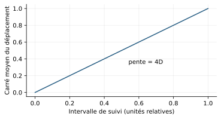
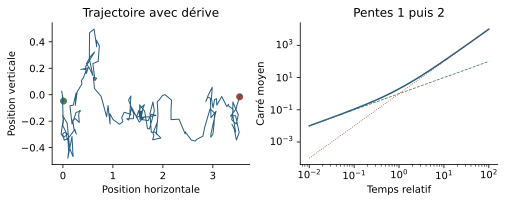
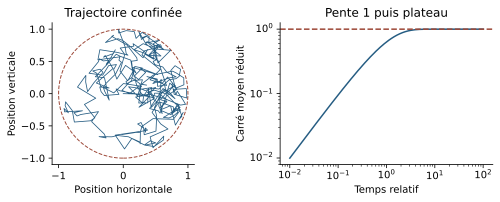
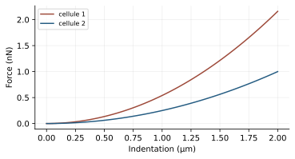
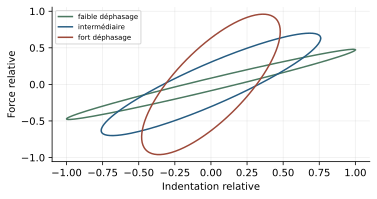
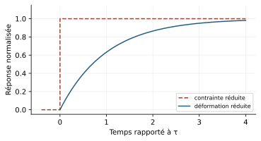
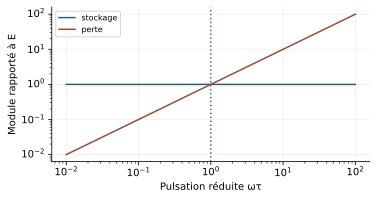

# X, ESPCI et ENS PC 2021 — Physique B · Corrigé guidé

*Corrigé rédigé par IA, non officiel. Signalez toute erreur.*

**Lecture du rapport du jury** · GPT-6.2 Astra Ultra · vitesse non renseignée

**Rédaction** · GPT-6.2 Astra Ultra · vitesse non renseignée

## Mécanique de la cellule

## Échelles de l’écoulement cytoplasmique

### Question 1 — Reynolds intracellulaire

**Indication.** Convertir le micromètre par seconde en mètres par seconde avant de comparer les deux termes.

L’accélération convective est d’ordre $u^2/L$ et le terme visqueux par unité de masse d’ordre $\nu_c u/L^2$. Leur rapport est $\mathrm{Re}=uL/\nu_c=(10^{-7})(10^{-5})/10^{-3}=10^{-9}$. La convection de quantité de mouvement est négligeable à cette échelle.

### Question 2 — Durée du transitoire

**Indication.** Distinguer l’équation qui décrit le transitoire de l’approximation faite à l’échelle d’une mesure.

Égaler $\rho_cu/\tau$ et $\eta_cu/L^2$ donne $\tau=L^2/\nu_c=10^{-7}\,\mathrm s$. Un transitoire visqueux traverse donc l’échelle cellulaire bien avant une milliseconde. Pour décrire sa relaxation il faut conserver les deux termes comparés. Aux durées effectivement résolues, le rapport inertie locale sur viscosité est $\tau/t_{\rm obs}\lesssim10^{-4}$ et le transitoire a déjà relaxé. La comparaison justifie cette séparation des régimes.

### Question 3 — Diffusion de l’impulsion

**Indication.** La viscosité cinématique a les unités d’un coefficient de diffusion.

Sous les hypothèses données de pression et de forces extérieures négligeables, après retrait du terme convectif il reste $\partial_t\mathbf v=\nu_c\Delta\mathbf v$. C’est une équation de diffusion de la quantité de mouvement, la masse volumique étant constante. En durée $t$, cette diffusion s’étend sur une longueur d’ordre $\sqrt{\nu_c t}$.

## Diffusion, marche au hasard et mouvement brownien

### Question 4 — Libre parcours entre collisions

**Indication.** Compter les centres possibles à l’intérieur du volume balayé avant la prochaine collision.

Dans le modèle, $\ell\simeq v\tau_{\rm col}$. Un centre de particule parcourant $\ell$ balaye un cylindre de section de collision $\sigma_{\rm eff}=4\pi r_p^2$. Il rencontre de l’ordre d’un autre centre dans ce volume, soit $n\sigma_{\rm eff}\ell\sim1$. La correction donnée pour l’agitation relative fixe $\ell=1/(\sqrt2\,n\sigma_{\rm eff})$.

### Question 5 — Déséquilibre des flux

**Indication.** Développer les deux densités autour de la même abscisse et garder leurs signes.

Le volume balayé pendant $dt$ est $Svdt$ à chaque face. Ainsi $dN_e=Svn(x-\ell)dt$, $dN_s=Svn(x+\ell)dt$. La différence divisée par $Sdt$ est $v[n(x-\ell)-n(x+\ell)]\simeq-2v\ell\,dn/dx$, lorsqu’on développe à l’ordre un en $\ell$. Le signe dirige le transport vers les densités moindres.

### Question 6 — Loi de Fick

**Indication.** Contrôler que le résultat s’exprime en mètres carrés par seconde.

La pondération par les six sens équivalents du modèle donne $\Phi_N=\Phi_{N,+x}/6=-(v\ell/3)\partial_x n$. L’identification à la loi de Fick $\Phi_N=-D\partial_xn$ fournit $D=v\ell/3$.

### Question 7 — Agitation thermique et transport

**Indication.** La vitesse quadratique moyenne contient les trois composantes.

Avec $mv^2/2=3k_BT/2$ et $\ell=v\tau_{\rm col}$, la formule précédente devient $D=v^2\tau_{\rm col}/3=(k_BT/m)\tau_{\rm col}$. Une durée plus longue entre collisions prolonge le transport dans une même direction.

### Question 8 — Carré d’un pas

**Indication.** Il s’agit d’une somme vectorielle, donc son carré fait apparaître un produit scalaire.

La relation de Chasles donne $\overrightarrow{AP}_{i+1}=\overrightarrow{AP}_i+\mathbf d_i$. Le produit scalaire de cette égalité par elle-même donne $AP_{i+1}^2=AP_i^2+d_i^2+2\mathbf d_i\cdot\overrightarrow{AP}_i$.

### Question 9 — Moyenne sur les directions

**Indication.** Préciser pourquoi une direction et sa direction opposée sont équiprobables.

La nouvelle direction est indépendante du chemin déjà parcouru et isotrope. Ainsi $\langle\cos\theta_i\rangle=0$ et le terme croisé s’annule en moyenne. Par définition dans cette partie, chacune des trois composantes du pas a un carré moyen $\ell^2$, donc $\langle d_i^2\rangle=3\ell^2$. On obtient $\langle AP_{i+1}^2\rangle=\langle AP_i^2\rangle+3\ell^2$.

### Question 10 — Après plusieurs pas

**Indication.** Additionner les accroissements des carrés moyens.

La récurrence de Q9 part de $AP_0=0$. En la sommant pour $i=0$ à $N-1$, on trouve $\langle|\boldsymbol\delta|^2\rangle=3N\ell^2$. Le déplacement moyen vectoriel est pourtant nul par isotropie.

### Question 11 — Temps de marche

**Indication.** Remplacer le nombre de pas par le nombre moyen d’intervalles écoulés.

Chaque pas correspond à un intervalle moyen $\tau_{\rm col}$. Le temps moyen de $N$ pas vaut donc $t=N\tau_{\rm col}$. Il en résulte $\langle|\boldsymbol\delta|^2\rangle=(3\ell^2/\tau_{\rm col})t$.

### Question 12 — Coefficient de la marche

**Indication.** Comparer aussi la signification du symbole du libre parcours dans les deux constructions.

En trois dimensions $\langle|\boldsymbol\delta|^2\rangle=6Dt$ donne $D=\ell^2/(2\tau_{\rm col})$. Q6 donnait $v\ell/3\simeq\ell^2/(3\tau_{\rm col})$. Les dépendances et l’ordre de grandeur coïncident. Les facteurs numériques dépendent du modèle statistique et de la convention sur le pas, carré moyen d’une composante ici, parcours moyen microscopique en Q4.

### Question 13 — Équipartition suivant un axe

**Indication.** Compter une seule coordonnée cartésienne.

Un degré de liberté quadratique porte en moyenne $k_BT/2$. Ainsi $m\langle\dot x^2\rangle/2=k_BT/2$, soit $\langle\dot x^2\rangle=k_BT/m$. Le facteur trois de l’énergie cinétique spatiale n’intervient pas pour cette composante.

### Question 14 — Corrélation position-vitesse

**Indication.** Dériver le produit $x\dot x$ afin de faire intervenir l’équipartition.

Notons $\zeta=6\pi\eta r_p$. L’équation de Langevin est $m\ddot x=-\zeta\dot x+f_x$. Multiplions par $x$ et moyennons. Comme $f_x$ est centré et indépendant de $x$, $\langle xf_x\rangle=0$. Avec $Y=\langle x\dot x\rangle$, $\dot Y=\langle\dot x^2\rangle+\langle x\ddot x\rangle$ et donc $m\dot Y+\zeta Y=k_BT$.

### Question 15 — Valeur stationnaire

**Indication.** Identifier la constante de temps du premier ordre avant d’écrire le régime permanent.

La solution est $Y=k_BT/\zeta+[Y(0)-k_BT/\zeta]e^{-t/\tau}$ avec $\tau=m/\zeta$. Après plusieurs $\tau$, la mémoire de la préparation est négligeable, et $\langle x\dot x\rangle=k_BT/(6\pi\eta r_p)$. Cette limite concerne la corrélation, alors que le carré moyen de position continue à croître.

### Question 16 — Relation de Stokes–Einstein

**Indication.** N’appliquer la loi linéaire qu’à des temps assez longs devant la relaxation inertielle.

La dérivée de $\langle x^2\rangle$ est $2Y$. Pour $x(0)=0$, $Y(0)=0$ et l’intégrale exacte est $2(k_BT/\zeta)[t-\tau(1-e^{-t/\tau})]$. Pour $t\gg\tau$, elle équivaut à $2Dt$ avec $D=k_BT/(6\pi\eta r_p)$. Une particule plus grosse diffuse donc plus lentement à température et viscosité données.

## Microrhéologie passive en deux dimensions

### Question 17 — Mesure dans le plan d’observation

**Indication.** Compter les deux coordonnées visibles avant d’extraire $D$.

L’image ne mesure que $x$ et $y$. Pour une diffusion isotrope, la somme des deux variances vaut $\delta^2(t)=4Dt$. La courbe moyenne sur des déplacements comparables est une droite issue de l’origine, de pente $s=4D$. On obtient $\eta_c=k_BT/(6\pi R_bD)=2k_BT/(3\pi R_bs)$. Il faut moyenner les trajectoires ou les intervalles disponibles pour estimer la pente.

### Question 18 — Déplacement d’une image à la suivante

**Indication.** La quantité exprimée en pixels doit être élevée au carré pour la loi de diffusion.

Le sujet donne $0,2$ pixel, une longueur. On l’interprète comme l’écart quadratique moyen $\sqrt{\delta^2}$. Cela donne $0,010\,\mu\mathrm m=10^{-8}\,\mathrm m$ pour $\Delta t=1/6\,\mathrm s$. Alors $D=10^{-16}/(4/6)=1,5\,10^{-16}\,\mathrm{m^2\,s^{-1}}$. Pour $R_b=10^{-6}\,\mathrm m$ et $T=310\,\mathrm K$, la relation d’Einstein donne $\eta_c\simeq1,5\,\mathrm{Pa\,s}$, cohérent avec l’ordre de grandeur annoncé.

### Question 19 — Diffusion entraînée

**Indication.** La dérive apparaît dans le premier moment, la diffusion dans la variance autour de la trajectoire moyenne.

Dans le plan écrivons $\Delta\mathbf r=\mathbf v_{\rm mot}t+\boldsymbol\xi$ avec $\langle\boldsymbol\xi\rangle=0$ et $\langle|\boldsymbol\xi|^2\rangle=4Dt$. Le terme croisé s’annule, donnant $\delta^2=4Dt+v_{\rm mot}^2t^2$. À $t\ll4D/v_{\rm mot}^2$, la courbe log-log a une pente un. Au-delà la pente tend vers deux. La trajectoire irrégulière montre une orientation moyenne.

### Question 20 — Diffusion confinée

**Indication.** Calculer la pente initiale et la limite à long temps indépendamment.

Le modèle est $\delta^2=\alpha R_{\rm cage}^2[1-e^{-4Dt/R_{\rm cage}^2}]$. Au temps court il donne $4\alpha Dt$, d’où $\alpha=1$ si $D$ est le coefficient plan mesuré sans cage. Au temps long, le carré moyen sature à $\alpha R_{\rm cage}^2$. La trajectoire explore alors les mêmes environs. En log-log, la pente passe de un à zéro vers $t\sim R_{\rm cage}^2/(4D)$.

## Traction, cisaillement et torsion

### Question 21 — Cylindre incompressible

**Indication.** Différencier le volume en conservant ses deux facteurs géométriques.

Pour $V=\pi r^2L$, la variation relative linéarisée vaut $\Delta V/V_0=2\Delta r/r_0+\Delta L/L_0$. À volume constant, $\Delta r/r_0=-\Delta L/(2L_0)$. Le coefficient de Poisson vaut donc $\nu=1/2$.

### Question 22 — Module de Young

**Indication.** La déformation est un rapport de longueurs.

La loi $\sigma=E\varepsilon$ relie une contrainte, force divisée par surface, à une déformation sans dimension. Ainsi $[E]=M L^{-1}T^{-2}$, et le module se mesure en pascals.

### Question 23 — Volume en traction

**Indication.** Remplacer les deux variations relatives par le même allongement longitudinal.

Pour un matériau compressible, $\Delta r/r_0=-\nu\varepsilon_\parallel$ et $\Delta L/L_0=\varepsilon_\parallel=\sigma/E$. L’expression de Q21 donne donc $\Delta V/V_0=(1-2\nu)\sigma/E$. La limite $\nu=1/2$ restitue l’incompressibilité.

### Question 24 — Cisaillement simple

**Indication.** Utiliser la déformation de cisaillement du parallélépipède, puis la loi de Hooke.

Le déplacement tangentiel correspond à $\varepsilon=\Delta x/L=\tan\theta\simeq\theta$ pour $|\theta|\ll1$. Avec $\sigma=F/S=G\varepsilon$, on a $G\simeq F/(S\theta)$. L’angle doit être exprimé en radians.

### Question 25 — Déformation d’un rayon

**Indication.** L’arc décrit dépend de la distance à l’axe.

Lorsqu’on tourne la face supérieure de $\varphi$, un point situé à $r$ se déplace de $r\varphi$ selon la tangente. La face inférieure est fixe à la distance $L$. Le cisaillement local vaut donc $\varepsilon(r)=r\varphi/L$ à petite rotation.

### Question 26 — Effort local en torsion

**Indication.** Passer d’une contrainte à une force avec l’aire de l’élément.

La contrainte orthoradiale vaut $G\varepsilon=Gr\varphi/L$. Sur un élément $dS$ la norme de la force vaut $dF=Gr|\varphi|dS/L$. Dans le sens positif appliqué, on peut écrire $d\mathbf F=(Gr\varphi/L)dS\,\mathbf e_\varphi$.

### Question 27 — Constante de torsion

**Indication.** Le second facteur de rayon provient du bras de levier avant même d’écrire l’élément d’aire.

Pour le couple appliqué, $dM_z=r\,dF=(G\varphi/L)r^2dS$. Sur le disque $dS=rdrd\theta$, donc $M_z=(G\varphi/L)2\pi\int_0^Rr^3dr=\pi GR^4\varphi/(2L)$. La constante est $C=\pi GR^4/(2L)$ en newtons mètres par radian. Le couple de rappel a le signe opposé.

## Indentation et réponse harmonique

### Question 28 — Mesure de la force d’indentation

**Indication.** Identifier les deux positions mesurées, puis écrire l’équilibre mécanique de la pointe.

Après repérage du premier contact, le déplacement commandé du support est $z$ et celui de la pointe est $\delta$, positifs vers le bas. La flexion mesurée est $\zeta=z-\delta$. La réflexion du faisceau repérée sur la photodiode, une fois étalonnée, donne cette flexion. Le levier exerce sur la pointe la force $k_{\rm AFM}\zeta$. À l’équilibre quasi statique la réaction de la cellule la compense, donc la force appliquée à la cellule vaut $F=k_{\rm AFM}(z-\delta)$.

### Question 29 — Deux cellules sur la figure 10

**Indication.** Déterminer un module à partir de la force et du carré de la profondeur, en convertissant séparément chaque unité.

À indentation égale, la courbe 2 exige moins de force. C’est donc la cellule 2 qui se déforme le plus à charge donnée. À l’extrémité droite du graphe, vers $\delta=2\,\mu\mathrm m$, on lit environ $2$ à $2,2\,\mathrm{nN}$ pour 1 et $1\,\mathrm{nN}$ pour 2. Avec $C=0,5$ et $E^*=F/(C\delta^2)$, il vient $E_1^*\sim1\,\mathrm{kPa}$ et $E_2^*\sim0,5\,\mathrm{kPa}$. Les points proches de la première mise en contact sont moins précis.

### Question 30 — Cycle de charge et de retrait

**Indication.** Repérer le sens de parcours des deux branches et identifier la dimension de l’aire comprise entre elles.

La force mesurée au retrait est inférieure à celle de l’aller pour une même profondeur. Une cellule purement élastique et réversible suivrait la même courbe à l’aller et au retour. L’aire $\oint F\,d\delta$ représente un travail perdu sur le cycle. La viscosité donne une explication puisque le terme résistant dépend du sens de $\dot\delta$. L’adhérence de la pointe peut aussi contribuer aux petites forces négatives. Le régime quasi statique néglige l’inertie sans éliminer ces phénomènes.

### Question 31 — Raideur au point de fonctionnement

**Indication.** Dériver la loi de contact au point moyen.

Par développement à l’ordre un de $F=CE^*\delta^2$ en $\delta_0$, on trouve $F-F_0=2CE^*\delta_0(\delta-\delta_0)+O((\delta-\delta_0)^2)$. La pente dynamique locale augmente avec l’enfoncement moyen.

### Question 32 — Module de cisaillement à partir de la pente

**Indication.** Factoriser $1-\nu^2$ avant de passer du module de Young au module de cisaillement.

On a $E^*=E/(1-\nu^2)=2G/(1-\nu)$. En remplaçant dans Q31, on obtient $G=(1-\nu)(F-F_0)/[4C\delta_0(\delta-\delta_0)]$ au premier ordre. La relation porte sur la pente ou sur des amplitudes harmoniques, ce qui évite une division instantanée lorsque l’incrément s’annule.

### Question 33 — Raideur et dissipation en régime harmonique

**Indication.** Remplacer une multiplication par $i\omega$ par une dérivation temporelle.

Pour $Z=F_1e^{i\phi}/\delta_1$, la force réelle s’écrit $F-F_0=\Re Z\,(\delta-\delta_0)+(\Im Z/\omega)\dot\delta$. Le premier coefficient décrit une raideur, le second un frottement visqueux effectif. Parce que $Z$ est un multiple réel positif de $G$, $G'$ est le module de stockage et $G''$ le module de perte. Le déphasage de la force sur l’indentation vaut $\phi=\arg(G'+iG'')$, donc $\tan\phi=G''/G'$. À $\phi=0$, la force est en phase avec le déplacement. À $\phi=\pi/2$, elle est en phase avec sa vitesse et le travail du cycle est dissipé.

### Question 34 — Lecture des ellipses d’indentation

**Indication.** Comparer séparément la pente de la ligne médiane et la séparation verticale des branches pour une même indentation.

Deux signaux sinusoïdaux de même fréquence et déphasés dessinent une ellipse. En posant $X=(\delta-\delta_0)/\delta_1$, on obtient $[(F-F_0)/F_1-X\cos\phi]^2=(1-X^2)\sin^2\phi$. La ligne médiane a pour pente $\Re Z$ et la demi-largeur verticale à $X=0$ vaut $F_1|\sin\phi|$. Sur la figure 11, de $0,1$ à $100\,\mathrm{Hz}$, le grand axe se redresse, la force croît pour une oscillation d’indentation qui se réduit, et les branches s’écartent nettement en force. Le rapport force/déplacement et la composante dissipative augmentent. L’orientation du grand axe dépend aussi des échelles des axes, tandis que l’aire du cycle donne le travail dissipé.

## Énergie de déformation et modèle de Kelvin-Voigt

### Question 35 — Fluage élastique

**Indication.** La loi du ressort ne contient aucune dérivée temporelle.

Pour le solide idéal, $\sigma=E\varepsilon$ à chaque instant. À l’application de l’échelon, $\varepsilon$ passe immédiatement de zéro à $\sigma_0/E$ et garde cette valeur tant que la contrainte est maintenue.

### Question 36 — Fluage newtonien

**Indication.** La viscosité relie la contrainte à la pente de la courbe de fluage.

La loi $\eta\dot\varepsilon=\sigma_0$ impose un taux de déformation constant. En intégrant depuis la déformation nulle, $\varepsilon(t)=\sigma_0t/\eta$ pour $t>0$. La déformation augmente sans plateau dans ce modèle.

### Question 37 — Modules de référence

**Indication.** Le déphasage se lit sur l’argument du rapport contrainte sur déformation.

Pour le solide, le rapport des amplitudes complexes vaut $G=E$. Ainsi $G'=E$, $G''=0$, $G_0=E$ et $\phi=0$. Pour le fluide, $G=i\omega\eta$ puisque la dérivation multiplie par $i\omega$. Ainsi $G'=0$, $G''=\omega\eta$, $G_0=\omega\eta$, $\phi=\pi/2$ à pulsation positive.

### Question 38 — Travail par unité de volume

**Indication.** Former le produit force-déplacement avant de le diviser par le volume.

Prenons un bloc de section $S$ et de hauteur $L$. La force $F=\sigma S$ provoque un déplacement élémentaire $L\,d\varepsilon$ dans son sens. Son travail divisé par $SL$ vaut $\delta w=\sigma\,d\varepsilon$. La grandeur obtenue s’exprime en $\mathrm{J\,m^{-3}}$.

### Question 39 — Décomposition du travail

**Indication.** Multiplier la contrainte par la dérivée de la déformation, en gardant le signe de la dérivée du cosinus.

On a $d\varepsilon=-\omega\varepsilon_0\sin(\omega t)dt$. En développant $\cos(\omega t+\phi)=\cos(\omega t)\cos\phi-\sin(\omega t)\sin\phi$, il vient $\delta w_1=-\omega\sigma_0\varepsilon_0\cos\phi\cos(\omega t)\sin(\omega t)dt$ et $\delta w_2=\omega\sigma_0\varepsilon_0\sin\phi\sin^2(\omega t)dt$. Le premier peut changer de signe dans le cycle.

### Question 40 — Énergie perdue sur un cycle

**Indication.** L’aire orientée de la boucle contrainte-déformation a les dimensions de cette énergie par unité de volume.

Sur une période, le terme en cosinus fois sinus s’intègre à zéro et la moyenne de $\sin^2$ vaut $1/2$. Donc $w_T=\pi\sigma_0\varepsilon_0\sin\phi=\pi G''\varepsilon_0^2$. Pour un solide de Hooke le résultat est nul. Pour le fluide il vaut $\pi\eta\omega\varepsilon_0^2$. Dans un matériau passif en régime périodique, l’énergie stockée retrouve son niveau initial et le travail net correspond à la dissipation.

### Question 41 — Énergie rendue pendant le premier quart

**Indication.** Repérer la valeur de la déformation au début et à la fin du quart de période.

Entre $0$ et $T/4$, $\int_0^{\pi/2}\sin u\cos u\,du=1/2$. Il vient $w_{1,T/4}=-(\sigma_0\varepsilon_0/2)\cos\phi=-G'\varepsilon_0^2/2$. Pour le solide c’est $-E\varepsilon_0^2/2$, pour le fluide c’est zéro. Le signe indique qu’en revenant de sa déformation maximale à zéro, l’élément de stockage rend cette énergie.

### Question 42 — Facteur de perte

**Indication.** Le premier quart du cycle est une phase de restitution pour la composante élastique.

Le quotient de Q40 et Q41 donne $\tan\phi=-w_T/(2\pi w_{1,T/4})=w_T/(2\pi|w_{1,T/4}|)$. À un facteur $2\pi$ près, cette tangente compare l’énergie dissipée en un cycle à l’énergie élastique maximale emmagasinée. Elle est nulle pour le solide idéal et tend vers l’infini dans la limite purement visqueuse.

### Question 43 — Ressort et amortisseur en parallèle

**Indication.** Suivre d’abord les déplacements des deux extrémités communes.

Les deux éléments ont les mêmes extrémités. Ils subissent donc la même déformation $\varepsilon_{\rm KV}=\varepsilon_{\rm el}=\varepsilon_{\rm visc}$. Les efforts portés par les deux branches s’additionnent, d’où $\sigma_{\rm KV}=\sigma_{\rm el}+\sigma_{\rm visc}$ dans le modèle rhéologique.

### Question 44 — Loi du modèle de Kelvin-Voigt

**Indication.** Le rapport de la viscosité à un module est un temps.

La branche élastique porte $E\varepsilon$ et la branche visqueuse porte $\eta\dot\varepsilon$. Par somme, $\sigma=E\varepsilon+\eta\dot\varepsilon=E(\varepsilon+\tau\dot\varepsilon)$ avec $\tau=\eta/E$ en secondes. Cette durée caractérise notamment le retard de la déformation en fluage.

### Question 45 — Réponse à un échelon

**Indication.** Séparer le plateau de la réponse transitoire de l’équation du premier ordre.

Pour $t>0$, $\tau\dot\varepsilon+\varepsilon=\sigma_0/E$. En imposant $\varepsilon(0)=0$, on trouve $\varepsilon=(\sigma_0/E)(1-e^{-t/\tau})$. La contrainte saute instantanément et reste constante. La déformation part de zéro avec la pente $\sigma_0/\eta$ puis s’approche du plateau $\sigma_0/E$.

### Question 46 — Module complexe

**Indication.** Les deux termes de la somme se placent sur les axes réel et imaginaire.

En régime harmonique, la loi devient $\underline\sigma=E(1+i\omega\tau)\underline\varepsilon$. Ainsi $G_{\rm KV}'=E$, $G_{\rm KV}''=E\omega\tau=\eta\omega$ et $\phi_{\rm KV}=\arctan(\omega\tau)$. Le module vaut $E\sqrt{1+\omega^2\tau^2}$.

### Question 47 — Fréquence de transition

**Indication.** Comparer les deux modules à la pulsation où ils sont égaux.

La courbe de stockage est horizontale à $E$, celle de perte est une droite passant par l’origine de pente $\eta$. Les courbes se croisent en $\omega_c=E/\eta=1/\tau$. Si $\omega\tau\ll1$, le stockage domine et la contrainte suit la déformation. Si $\omega\tau\gg1$, la perte domine et la contrainte suit surtout sa vitesse. Ce sont respectivement les réponses de longue et de courte échelle temporelle.

### Question 48 — Comparaison avec les mesures cellulaires

**Indication.** Pour séparer une variation de phase d’une variation d’amplitude, comparer la force aux vrais extrema de l’indentation, puis à indentation moyenne.

Le modèle rend compte d’ellipses de dissipation croissante lorsque la fréquence augmente. Il prédit toutefois $G'=E$ constant et $G''\propto\omega$. Une épreuve de cette prédiction consiste à comparer les pentes médianes $\Re Z$ et les largeurs ramenées aux amplitudes réelles $\delta_1$ à chaque fréquence. Sur la figure 11 la réponse en phase se raidit aussi, alors que le modèle à paramètres constants conserverait sa pente médiane à indentation moyenne fixée. En outre, la croissance des largeurs mesurées sur trois décades ne suit pas simplement une loi linéaire en fréquence rapportée à l’amplitude. Le modèle représente la coexistence du stockage et des pertes, mais ne décrit que qualitativement les courbes cellulaires sur toute la bande.
