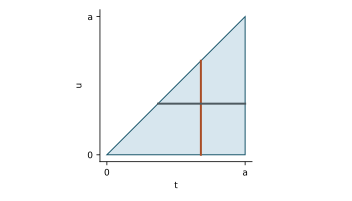
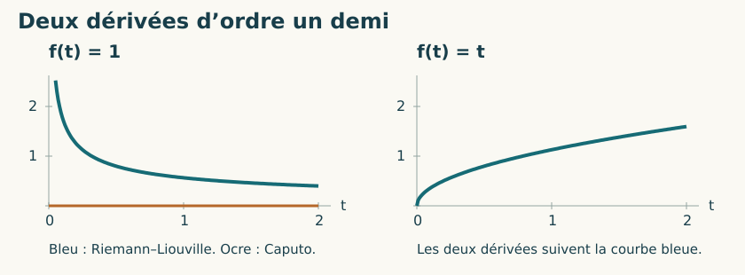

# X-ENS PSI — Mathématiques 2021 · Corrigé brut

*Corrigé rédigé par IA, non officiel. Signalez toute erreur.*

**Rédaction** · GPT-6.2 Astra Ultra · vitesse non renseignée

**Révision (tour 1)** · GPT-6.2 Astra Ultra · vitesse non renseignée · 26 novembre 2026

La garde nomme les Écoles normales supérieures et l’École polytechnique. Épreuve PSI du lundi 12 avril 2021, de 8 h à 12 h, sans document ni calculatrice. Le sujet compte huit pages. Le préambule autorise les résultats des préliminaires pour les fonctions continues sur la demi-droite ouverte et intégrables en zéro. Les pages 3 à 8 contiennent les 47 questions et sous-questions traitées ici.

La composition du 12 avril 2021 construit les intégrales fractionnaires puis les deux dérivées de Riemann–Liouville et de Caputo. Les 47 réponses suivent les préliminaires et les parties A à C jusqu’à l’équation de relaxation. [Sujet officiel](https://ens-paris-saclay.fr/sites/default/files/CONCOURS/ANNALES_1C/1C_PSI/2021_Sujet_1A_PSI_Maths.pdf) · [Rapport du jury](https://ens-paris-saclay.fr/sites/default/files/CONCOURS/ANNALES_1C/1C_PSI/2021_Rapport_Ecrit_PSI_Maths.pdf)

## Préliminaires. Gamma, intégration sur un triangle et transformée de Laplace

### Question 1a

Pour $x>0$, $e^{-t}t^{x-1}\sim t^{x-1}$ quand $t\downarrow0$, et cet équivalent est intégrable car $x-1>-1$. À l’infini, $e^{-t/2}t^{x-1}$ reste borné, donc l’intégrande est majoré par $Ce^{-t/2}$. L’intégrale converge absolument et $\Gamma(x)>0$.

### Question 1b

Pour $x>0$, $t^xe^{-t}$ tend vers zéro aux deux extrémités. L’intégration par parties donne $\Gamma(x+1)=[-t^xe^{-t}]_0^\infty+x\int_0^\infty t^{x-1}e^{-t}dt=x\Gamma(x)$. Comme $\Gamma(1)=1$, une récurrence donne $\Gamma(n)=(n-1)!$ pour $n\ge1$.

### Question 2a.i

Soit $\omega$ un module de continuité uniforme de $f$ sur le carré. À $t$ fixé et pour $t+\eta\in[0,a]$, $h(\eta)\le t\omega(|\eta|)\to0$. Cela vaut aussi aux bords avec une limite unilatérale.

### Question 2a.ii

Posons $K(t)=\int_0^t f(t,u)du$. En ajoutant et retranchant $\int_0^tf(t+\eta,u)du$, on obtient $|K(t+\eta)-K(t)|\le h(\eta)+|\eta|\max|f|$. La première partie tend vers zéro par 2a.i et la seconde par bornitude sur le carré. Ainsi $K$ est continue sur $[0,a]$.

### Question 2a.iii

Comme $F(x)=\int_0^xK(t)dt$ avec $K$ continue, $F'(x)=K(x)=\int_0^x f(x,u)du$, avec les dérivées unilatérales au bord.

### Question 2b.i

Pour $\beta$ fixé, $u\mapsto\int_u^\beta f(t,u)dt$ est continue par la même séparation des variations de borne et de paramètre qu’en 2a.ii. Le théorème fondamental donne $\partial_\alpha h(\alpha,\beta)=\int_\alpha^\beta f(t,\alpha)dt$, avec intégrale orientée si $\beta<\alpha$.

### Question 2b.ii

Pour chaque $u$, la dérivée en $\beta$ de $\int_u^\beta f(t,u)dt$ est $f(\beta,u)$. Elle est continue et uniformément bornée sur le carré compact, ce qui autorise la dérivation sous l’intégrale extérieure. Ainsi $\partial_\beta h(\alpha,\beta)=\int_0^\alpha f(\beta,u)du$.

Pour $\eta\ne0$ avec $\beta+\eta\in[0,a]$, le quotient différentiel intérieur est la moyenne de $f(t,u)$ entre $\beta$ et $\beta+\eta$. Son écart à $f(\beta,u)$ est majoré par $\omega(|\eta|)$, uniformément en $u$. Après intégration sur $[0,\alpha]$, l’erreur est au plus $\alpha\omega(|\eta|)$, même si $\eta<0$. Ce calcul fournit directement la dérivée et ses versions unilatérales aux bords.

### Question 2b.iii

Les expressions de 2b.i–ii sont continues en $(\alpha,\beta)$ par continuité uniforme sur le carré et continuité des bornes. Comme $G(x)=h(x,x)$, la règle de la chaîne donne $G'(x)=\partial_\alpha h(x,x)+\partial_\beta h(x,x)=0+\int_0^x f(x,u)du$.

### Question 2c

Les questions 2a.iii et 2b.iii donnent $F'=G'$. De plus $F(0)=G(0)=0$. Il suit $F(a)=G(a)$, soit les deux intégrales itérées de (E2) sur $0\le u\le t\le a$.

### Question 3a

Pour $x\ge0$, en prenant $t=xu$, $(f*g)(x)=x\int_0^1 f(x(1-u))g(xu)du$. Sur tout $x\in[0,A]$, l’intégrande est continue sur un compact de paramètres et uniformément bornée. L’intégrale est donc continue en $x$, y compris en zéro où le produit par $x$ donne zéro.

### Question 3b

Le changement de variable $u=x-t$ donne $\int_0^x f(x-t)g(t)dt=\int_0^x g(x-u)f(u)du$. Ceci établit $f*g=g*f$.

### Question 3c

Pour des fonctions continues, on peut permuter sur le triangle compact les intégrales de
$$(f*(g*h))(x)=\int_0^x\int_0^t f(x-t)g(t-u)h(u)\,du\,dt.$$
À $u$ fixé, $u\le t\le x$ ; le changement $v=t-u$ donne l’intégrale $\int_0^{x-u}f(x-u-v)g(v)dv=(f*g)(x-u)$. Puis on intègre $h(u)$, ce qui donne $((f*g)*h)(x)$.

### Question 4a

Si $|f(t)|\le Me^{rt}$, alors pour $s>r$, $|e^{-st}f(t)|\le Me^{-(s-r)t}$ dont l’intégrale vaut $M/(s-r)$. La transformée est donc absolument convergente pour tout $s$ assez grand.

### Question 4b

Prenons $s$ supérieur aux exposants de croissance de $f,f'$. On a $\int_0^T e^{-st}f'(t)dt=e^{-sT}f(T)-f(0)+s\int_0^Te^{-st}f(t)dt$. Le terme à $T$ tend vers zéro et les deux intégrales convergent absolument par 4a. Ainsi $L(f')(s)=sL(f)(s)-f(0)$.

### Question 4c

En augmentant l’exposant au besoin, supposons $|f(t)|\le Ae^{rt}$ et $|g(t)|\le Be^{rt}$. Alors $|(f*g)(x)|\le ABxe^{rx}\le AB e^{(r+1)x}$ pour $x\ge0$. La convolution est d’ordre exponentiel.

### Question 4d

Pour $s>r+1$ avec les bornes de 4c, l’intégrale de la valeur absolue sur le triangle infini est au plus $AB\int_0^\infty t e^{-(s-r)t}dt<\infty$. Par (E2), on intègre d’abord en $t$ de $u$ à l’infini. Le changement $v=t-u$ sépare $e^{-st}f(t-u)g(u)=e^{-sv}f(v)e^{-su}g(u)$. On obtient donc $L(f*g)(s)=L(f)(s)L(g)(s)$.

Sur le domaine tronqué $u+v\le T$, l’indicatrice croît vers celle du quadrant. L’intégrale de la valeur absolue sur ce quadrant est bornée par $AB/(s-r)^2$. On peut donc passer à la limite dans les intégrales signées et factoriser les deux intégrales à une variable. En particulier, $s>r$ suffit pour ce calcul.

### Question 5a

La différence $h=f-g$ reste continue d’ordre exponentiel et $L$ est linéaire sur un domaine commun $s$ assez grand, par convergence absolue. L’égalité de deux transformées équivaut à $L(h)=0$. Il suffit donc d’identifier le noyau.

### Question 5b

Les moments nuls impliquent $\int_a^b P(x)f(x)dx=0$ pour tout polynôme. Prenons $P_j\to f$ uniformément. Alors $|\int_a^b(f-P_j)f|\le(b-a)\|f-P_j\|_\infty\|f\|_\infty\to0$, donc $\int_a^b f^2=0$. Sur un segment de longueur positive, la continuité et la positivité de $f^2$ imposent $f=0$ en chaque point.

Si les valeurs autorisées de $a,b$ comprennent $a=b$, la conclusion ponctuelle exige une précision. Toute intégrale sur un singleton est nulle, même pour la fonction constante égale à un. La preuve d’injectivité en 5c utilise bien le segment non dégénéré $[0,1]$.

### Question 5c

Supposons $L(f)(s)=0$ pour $s\ge s_0$ et $|f(t)|\le Me^{rt}$. Choisissons un entier $k>r$ avec $k+1\ge s_0$. Posons $h(y)=y^kf(-\log y)$ pour $0<y\le1$ et $h(0)=0$. La borne $|h(y)|\le My^{k-r}$ assure sa continuité en zéro. Pour tout entier $n\ge0$, le changement $y=e^{-t}$ donne $\int_0^1 y^nh(y)dy=L(f)(n+k+1)=0$. Par 5b, $h=0$, donc $f(t)=0$ en tout $t\ge0$. Ceci prouve l’injectivité.

Le facteur $y^k$ traite un vrai problème au bord. Pour $f(t)=e^{rt}$ avec $r>0$, la fonction $f(-\log y)=y^{-r}$ ne se prolonge pas en zéro. Avec $k>r$, le produit se prolonge, et décaler tous les moments par le même entier ne change pas leur annulation.

## A. Intégration fractionnaire

### Question 6

Pour $I^2f$, permutons $\int_0^xdt\int_0^t f(u)du$ pour obtenir $\int_0^x(x-u)f(u)du$. Plus généralement la formule vaut pour $n=1$. Appliquons l’hypothèse au rang $n$ à $If$ et permutons sur $0\le u\le t\le x$. Le noyau résultant est $\int_u^x(x-t)^{n-1}dt/(n-1)!=(x-u)^n/n!$. L’intégrabilité de $|f|$ à l’origine et la bornitude sur les intervalles compacts éloignés de zéro justifient ces permutations. D’où $I^nf=\int_0^x(x-u)^{n-1}f(u)du/(n-1)!$.

### Question 7a

Sur $t>0$, $D^m\Phi_\alpha=\Phi_{\alpha-m}$. Pour $\alpha$ non entier, chaque dérivation remplace $t^{\alpha-1}/\Gamma(\alpha)$ par $t^{\alpha-2}/\Gamma(\alpha-1)$. Pour un entier positif, on dérive le polynôme $t^{\alpha-1}/(\alpha-1)!$ jusqu’à annulation ; la convention $\Phi_j=0$ aux entiers $j\le0$ donne le même résultat. Les entiers initialement non positifs donnent déjà la fonction nulle.

### Question 7b

Pour $\alpha,\beta>0$, les deux singularités de l’intégrande ont des exposants supérieurs à $-1$. Le changement $t=xu$ donne $(\Phi_\alpha*\Phi_\beta)(x)=x^{\alpha+\beta-1}B(\alpha,\beta)/[\Gamma(\alpha)\Gamma(\beta)]$. La formule (E1) donne exactement $\Phi_{\alpha+\beta}(x)$.

### Question 7c

Pour $s>0$, $u=st$ donne $L(\Phi_\alpha)(s)=s^{-\alpha}\int_0^\infty e^{-u}u^{\alpha-1}du/\Gamma(\alpha)=s^{-\alpha}$. La convergence absolue suit de 1a.

### Question 8a

Pour $\alpha,\beta>0$, l’associativité et 7b donnent $J^\alpha(J^\beta f)=(\Phi_\alpha*\Phi_\beta)*f=J^{\alpha+\beta}f$. La permutation des intégrales est justifiée en appliquant le même calcul aux noyaux positifs et à $|f|$ : la majorante finale $J^{\alpha+\beta}|f|(x)$ est finie par intégrabilité de $f$ près de zéro et bornitude locale près de $x>0$. Si l’un des ordres est nul, la formule vient de $J^0=\mathrm{Id}$.

On peut aussi fixer $0<u<x$ et intégrer $(x-t)^{\alpha-1}(t-u)^{\beta-1}$ pour $u<t<x$. En posant $t=u+(x-u)v$, cette intégrale vaut $(x-u)^{\alpha+\beta-1}B(\alpha,\beta)$. Cette majorante intégrée contre $|f(u)|$ est finie en séparant $[0,x/2]$ et $[x/2,x]$. La singularité au sommet du triangle et celle de $f$ à l’origine ont ainsi été traitées séparément.

### Question 8b

Pour $s>0$ assez grand, $\int e^{-st}|f(t)|dt$ est finie, en utilisant l’intégrabilité locale près de zéro et l’ordre exponentiel à l’infini. Le noyau $\Phi_\alpha$ est positif et sa transformée vaut $s^{-\alpha}$. L’intégrale double des valeurs absolues est donc le produit fini de ces deux intégrales, après le changement triangulaire de 4d. Ainsi $L(J^\alpha f)(s)=s^{-\alpha}L(f)(s)$.

### Question 8c

Par définition de $J^\alpha$ et par 7b, $J^\alpha\Phi_\gamma=\Phi_\alpha*\Phi_\gamma=\Phi_{\gamma+\alpha}$ pour $\alpha,\gamma>0$.

### Question 8d

Si $J^\alpha f=0$, la question 8b donne $s^{-\alpha}L(f)(s)=0$ pour tout $s$ assez grand. Le facteur est non nul et l’injectivité de 5c, dans le cadre admis au préambule, donne $f=0$. La réciproque suit de la linéarité de l’intégrale.

Un argument local donne la même conclusion. Prendre un entier $n>\alpha$, appliquer $J^{n-\alpha}$ aux deux membres de $J^\alpha f=0$, puis dériver $n$ fois l’égalité $J^nf=0$ sur $]0,+\infty[$. Cet argument permet aussi de reprendre 10d sans imposer que les intégrales intermédiaires soient bornées en zéro.

## B. Dérivées de Riemann–Liouville et de Caputo

### Question 9

Pour $n=1$, $J^1 Df=f-f(0)$ par le théorème fondamental. En supposant l’identité au rang $n$ et en l’appliquant à $f'$, une intégration supplémentaire donne $J^{n+1}D^{n+1}f=f-f(0)-\sum_{j=0}^{n-1}f^{(j+1)}(0)x^{j+1}/(j+1)!$. Ainsi
$$J^nD^nf(x)=f(x)-\sum_{k=0}^{n-1}f^{(k)}(0)x^k/k!.$$
Cette écriture utilise les traces en zéro et la validité du théorème fondamental aux intégrations successives, en particulier pour $f\in C^n([0,x])$. Pour $n=0$ on retrouve l’identité avec une somme vide.

### Question 10a

Avec $m=\lceil\alpha\rceil$, $D^\alpha J^\alpha=D^m J^{m-\alpha}J^\alpha=D^mJ^m=\mathrm{Id}$ par 8a et le théorème fondamental. Ceci vaut aussi pour $\alpha=m$ avec $J^0=\mathrm{Id}$.

### Question 10b

Comme $1=\Phi_1$, $J^{m-\alpha}1=\Phi_{1+m-\alpha}$, y compris si $m=\alpha$. Par 7a, $D^\alpha1=\Phi_{1-\alpha}$. Si $\alpha$ est entier positif, la convention donne zéro, conformément à la dérivation ordinaire. Sinon, $D^\alpha1(t)=t^{-\alpha}/\Gamma(1-\alpha)$ est non nul pour $t>0$.

### Question 10c

On a $J^{m-\alpha}\Phi_\gamma=\Phi_{\gamma+m-\alpha}$ pour $\gamma>0$, par 8c ou par l’identité en ordre zéro. La question 7a donne $D^\alpha\Phi_\gamma=\Phi_{\gamma-\alpha}$. Les indices entiers non positifs sont compris avec la convention nulle.

### Question 10d

Si $D^\alpha f=0$, alors $P=J^{m-\alpha}f$ a une dérivée d’ordre $m$ nulle sur la demi-droite. Il est donc combinaison des $\Phi_1,\ldots,\Phi_m$, base des polynômes de degré au plus $m-1$. Les fonctions $\Phi_{\alpha-j+1}$ avec $1\le j\le m$ ont un indice strictement positif, et $J^{m-\alpha}\Phi_{\alpha-j+1}=\Phi_{m-j+1}$. On peut donc choisir une combinaison $g$ de ces fonctions telle que $J^{m-\alpha}g=P$. L’injectivité de $J^{m-\alpha}$ par 8d, ou son identité si $m=\alpha$, donne $f=g$. Cela équivaut à $f(x)=\sum_{j=1}^m c_jx^{\alpha-j}$ car les facteurs gamma sont finis et non nuls. Réciproquement, 10c envoie chaque noyau sur $\Phi_{1-j}=0$. Toutes les puissances obtenues sont localement intégrables en zéro puisque $\alpha-m>-1$.

Les $m$ générateurs sont indépendants. Multiplier une relation entre les $x^{\alpha-j}$ par $x^{m-\alpha}$ donne un polynôme nul sur $]0,+\infty[$, donc tous ses coefficients sont nuls. Lorsque $\alpha=m$, on retrouve exactement le noyau de la dérivée ordinaire d’ordre $m$.

### Question 11a

Pour $f=\Phi_{1/2}$, 10c donne $D^{1/2}f=\Phi_0=0$, donc $(D^{1/2}D^{1/2})f=0$. En revanche $Df=\Phi_{-1/2}=t^{-3/2}/\Gamma(-1/2)\ne0$ pour $t>0$. Le terme perdu au premier passage interdit la loi des exposants sur cette fonction.

### Question 11b

Pour $g=\Phi_{3/2}$, $D^{3/2}g=\Phi_0=0$, donc $D^{1/2}D^{3/2}g=0$. En sens inverse, $D^{1/2}g=\Phi_1$, puis $D^{3/2}\Phi_1=\Phi_{-1/2}$. Enfin $D^2g=\Phi_{-1/2}$ par 7a. Ici l’un des deux ordres de composition donne la dérivée totale, l’autre s’annule.

### Question 11c

Pour $0<t<R$, écrivons $f(t)=\sum_{n\ge0}c_n\Phi_{\lambda+n+1}(t)$, avec $c_n=\alpha_n\Gamma(\lambda+n+1)/n!$. L’hypothèse $\beta<\lambda+1$ assure $\lambda+n+1-\beta>0$. Par 10c, on peut donc appliquer successivement $D^\beta$ puis $D^\alpha$ à chaque noyau. On obtient $\Phi_{\lambda+n+1-\alpha-\beta}$, comme en appliquant directement $D^{\alpha+\beta}$, avec la convention nulle éventuelle au dernier passage.

Justifions ces opérations sur la somme. Pour $\mu>-1$, $H$ analytique dans $|t|<R$ et $\delta>0$, la substitution $u=t v$ donne
$$J^\delta(t^\mu H(t))=\frac{t^{\mu+\delta}}{\Gamma(\delta)}
\int_0^1(1-v)^{\delta-1}v^\mu H(tv)\,dv.$$
Sur $0\le t\le r<R$, la série de $H(tv)$ converge absolument et uniformément et le poids est intégrable. L’intégrale s’effectue donc terme à terme en préservant un facteur analytique de rayon au moins $R$. Les dérivations entières suivantes sont légitimes sur les compacts de $]0,R[$ par les propriétés des séries entières et la règle du produit. Après la première opération l’exposant de base $\lambda-\beta>-1$ permet de recommencer. Pour un ordre nul, on utilise l’identité. La formule est ainsi prouvée pour $0<t<R$ et vaut en zéro lorsque les deux membres y ont une valeur définie par prolongement. La notation de l’énoncé inclut zéro même si, par exemple pour $\lambda<0$ et $H(0)\ne0$, la fonction initiale y diverge.

Par exemple, pour $\lambda=0$, $\eta=1$, $\beta=1/2$ et $\alpha=1$, le résultat est $\Phi_{-1/2}(t)$. Il diverge en zéro alors même que la fonction de départ y est continue. Le prolongement de l’égalité à zéro doit donc porter sur le résultat de la dérivation aussi bien que sur la fonction de départ.

### Question 12a

Si $\alpha=m$, $D_*^\alpha f=f^{(m)}=0$ et le résultat est immédiat. Sinon $0<m-\alpha<1$ et $J^{m-\alpha}f^{(m)}=0$. Composons avec $J^{1-m+\alpha}$, d’ordre positif. Par 8a on obtient $J^1 f^{(m)}=0$. En dérivant, $f^{(m)}=0$ sur la demi-droite, donc $f$ est un polynôme de degré au plus $m-1$. Cet argument est local et ne demande aucune croissance exponentielle de $f$.

### Question 12b

Écrivons $f=f(0)\Phi_1+J^1f'$. Alors $J^\alpha f=f(0)\Phi_{\alpha+1}+J^{1+\alpha}f'=f(0)\Phi_{\alpha+1}+J^1(J^\alpha f')$. En dérivant pour $x>0$, on obtient $D J^\alpha f=f(0)\Phi_\alpha+J^\alpha Df$. La continuité locale de $J^\alpha f'$ suit de la représentation après changement de variable et de la domination par $(1-v)^{\alpha-1}$ sur chaque compact.

### Question 12c

Par 9, $f=\sum_{k=0}^{m-1}f^{(k)}(0)\Phi_{k+1}+J^mf^{(m)}$. Appliquons $D^\alpha$. La question 10c transforme le polynôme terme à terme en $\sum f^{(k)}(0)\Phi_{k+1-\alpha}$. Sur le reste, $D^\alpha J^m=D^mJ^{2m-\alpha}=D^m J^mJ^{m-\alpha}=J^{m-\alpha}$ par 8a. Cela donne
$$D^\alpha f(x)=D_*^\alpha f(x)+\sum_{k=0}^{m-1} f^{(k)}(0)\frac{x^{k-\alpha}}{\Gamma(k+1-\alpha)}.$$

Pour $0<\alpha<1$, la somme comporte seulement $f(0)\Phi_{1-\alpha}$. À l’ordre $1/2$, la relation donne pour $f=1$ une courbe $1/\sqrt{\pi t}$ et une dérivée de Caputo identiquement nulle. Pour $f(t)=t$, la donnée initiale s’annule et les deux dérivées valent $2\sqrt{t/\pi}$.

### Question 12d

Par 10c, $D^\alpha(x^k/k!)=\Phi_{k+1-\alpha}$. Par linéarité, soustraire $\sum_{k=0}^{m-1}f^{(k)}(0)x^k/k!$ avant d’appliquer $D^\alpha$ annule tous les termes supplémentaires de 12c. Il reste $D_*^\alpha f$.

## C. Équation d’Abel et relaxation fractionnaire

### Question 13a

L’équation d’Abel est $J^\alpha g=f$. La question 10a impose donc à toute solution $g(t)=D^\alpha f(t)=D(J^{1-\alpha}f)(t)$ pour $t>0$. Lorsque $f$ est $C^1$, 12b rend ce résultat explicite en $g=f(0)\Phi_{1-\alpha}+J^{1-\alpha}f'$. La substitution donne bien $J^\alpha g=f(0)\Phi_1+J^1f'=f$ dans ce cas.

La valeur du second membre en zéro mérite d’être distinguée de sa trace à droite. Pour $f=1$ et $0<\alpha<1$, la solution sur $t>0$ est $g(t)=\Phi_{1-\alpha}(t)$. Elle est intégrable à l’origine et peut y diverger. En intégrant pour $t>0$, l’identité bêta donne $J^\alpha g(t)=1$, ce qui détermine sa limite à droite. Donner arbitrairement une valeur finie à $g(0)$ ne résout aucune condition supplémentaire.

### Question 13b

Si $g$ est d’ordre exponentiel, pour $s$ assez grand on a $L(f)(s)=L(J^\alpha g)(s)=s^{-\alpha}L(g)(s)$ par 8b. Ainsi $L(g)(s)=s^\alpha L(f)(s)$.

### Question 14a

Comme $\Gamma(1)=1$, $E_0(\theta)=\sum_{k\ge0}\theta^k=1/(1-\theta)$ pour $|\theta|<1$. Comme $\Gamma(1+k)=k!$, $E_1(\theta)=e^\theta$. Enfin $E_2(-\theta^2)=\sum_{k\ge0}(-1)^k\theta^{2k}/(2k)!=\cos\theta$ pour tout réel $\theta$.

### Question 14b

Pour $\alpha>0$, posons $y=\alpha k>0$. Sur $[y,y+1]$, $e^{-t}t^y\ge e^{-y-1}y^y$, donc $\Gamma(1+\alpha k)\ge e^{-\alpha k-1}(\alpha k)^{\alpha k}$. Sa racine $k$-ième tend vers l’infini. Les coefficients inverses ont donc une racine $k$-ième tendant vers zéro et le rayon de $E_\alpha$ est infini. Pour $\alpha=0$, il vaut un d’après 14a.

### Question 14c

Pour $\alpha>0$, $e_\alpha(t)=\sum_{j\ge0}(-1)^j t^{\alpha j}/\Gamma(1+\alpha j)$. Pour $s>1$, 7c donne
$$\sum_{j\ge0}\int_0^\infty e^{-st}\frac{t^{\alpha j}}{\Gamma(1+\alpha j)}dt
=\sum_{j\ge0}s^{-1-\alpha j}<\infty.$$
On peut intégrer terme à terme. La série géométrique alternée donne $L(e_\alpha)(s)=s^{-1}/(1+s^{-\alpha})=s^{\alpha-1}/(s^\alpha+1)$.

Le bord $\alpha=0$ dans la définition imprimée demanderait $E_0(-1)$ pour $t>0$. La série en cette valeur diverge. Si l’on choisit son prolongement rationnel de 14a, on obtient $e_0(t)=1/2$, dont la transformée $1/(2s)$ coïncide avec la formule prolongée. Les questions 15–16 utilisent un ordre strictement positif.

### Question 14d

Pour $k\ge0$, $u_k=J^k e_\alpha$. Le calcul absolu de 14c assure l’intégrabilité avec poids $e^{-st}$ pour $s>1$. La convolution par $\Phi_k$ pour $k\ge1$ multiplie la transformée par $s^{-k}$, et $k=0$ laisse la fonction inchangée. Ainsi
$$L(u_k)(s)=\frac{s^{\alpha-k-1}}{s^\alpha+1}.$$

Pour rendre visible le terme intégrable dominant, lorsque $k\ge1$ on peut majorer $|u_k(t)|$ par $J^k|e_\alpha|(t)$. Après multiplication par $e^{-st}$ et intégration, l’intégrale de cette majorante vaut $s^{-k}\int_0^\infty e^{-sv}|e_\alpha(v)|\,dv<\infty$ pour $s>1$.

### Question 15

Pour $m-1<\alpha\le m$, on a $J^\alpha D_*^\alpha u=J^\alpha J^{m-\alpha}D^m u=J^mD^mu$. D’après 9, ce dernier vaut $u(t)-\sum_{k=0}^{m-1}u^{(k)}(0)t^k/k!$. Appliquer $J^\alpha$ à l’équation $D_*^\alpha u=-u$ donne donc $u(t)=\sum_{k=0}^{m-1} c_k t^k/k!-J^\alpha u(t)$, où $c_k=u^{(k)}(0)$ sont les données initiales.

### Question 16

Si $u$ est d’ordre exponentiel, 7c et 8b appliquées à 15 donnent, pour $s$ assez grand,
$$L(u)(s)=\sum_{k=0}^{m-1}\frac{c_k}{s^{k+1}}-s^{-\alpha}L(u)(s).$$
En divisant par $1+s^{-\alpha}$, $L(u)=\sum_{k=0}^{m-1}c_k s^{\alpha-k-1}/(s^\alpha+1)=\sum_k c_k L(u_k)$ par 14d. Les $u_k$ sont d’ordre exponentiel, comme $e_\alpha$ et ses primitives. L’injectivité donne $u(t)=\sum_{k=0}^{m-1}c_k u_k(t)$. Par exemple $\alpha=1$ donne la solution $c_0 e^{-t}$ et $\alpha=2$ donne $c_0\cos t+c_1\sin t$, en accord avec les deux équations ordinaires.

Les traces peuvent se relire sur la formule obtenue. En intégrant la série de $e_\alpha$ sur les compacts, on a $u_k(t)=\sum_{j\ge0}(-1)^jt^{k+\alpha j}/\Gamma(1+k+\alpha j)$. Le terme $j=0$ vaut $t^k/k!$. Les autres exposants sont au moins $k+\alpha>m-1$, si bien que leurs dérivées jusqu’à l’ordre $m-1$ tendent vers zéro à droite. Les $m$ coefficients retrouvés sont donc exactement les $m$ conditions initiales. Pour vérifier l’équation, $J^\alpha u_k=\Phi_{k+1}-u_k$ résulte du même décalage de série. En retranchant le polynôme initial, puis en appliquant 10a et 12d, on retrouve la relation de Caputo pour $t>0$.
