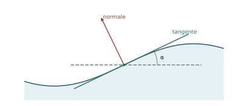
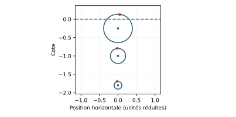
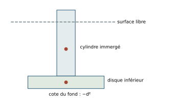
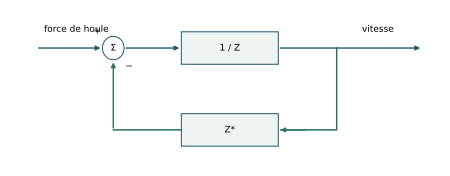
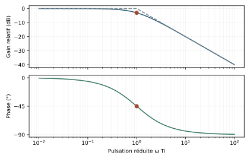

# X-ENS PSI · Modélisation 2021 · Corrigé guidé

*Corrigé rédigé par IA, non officiel. Signalez toute erreur.*

**Rédaction** · GPT-6.2 Astra Ultra · vitesse non renseignée · 24 novembre 2026

**Révision** · GPT-6.2 Astra Ultra · vitesse non renseignée · 26 novembre 2026

## Repères

La figure 6 fixe la hauteur de crête à partir du niveau moyen. Les équations de mouvement utilisent deux déplacements verticaux absolus et un déplacement relatif. Garder le même sens positif en transportant les moments et quand on ferme les deux boucles de retour. Les contrôles de limites se font en eau profonde, à pulsation nulle et à haute fréquence.

## Partie 2 · Étude de la houle

### Question 1 · Choisir un littoral

**Indication.** Croiser la ressource cartographiée avec la distance de raccordement.

#### Solution

La carte donne des kW par mètre de crête. L'ouest de l'Irlande et de l'Écosse, le sud du Chili, le sud de l'Australie et la Nouvelle-Zélande offrent des façades exposées aux houles océaniques et des possibilités de raccordement à terre. Les maxima de l'océan Austral, souvent très loin des villes, ne suffisent pas à désigner un site. On cherche une profondeur permettant la propagation libre en amont du déferlement, à distance raisonnable du réseau.

### Question 2 · Surface libre

**Indication.** Identifier l'amplitude sur la figure 6, puis choisir un signe de phase compatible avec le potentiel donné.

#### Solution

Avec $k=2\pi/\lambda$, $\omega=2\pi/T$ et $s=kx-\omega t$, on prend $\eta=a\cos s$. Une phase constante avance à $\omega/k$ vers les $x$ croissants. À $t=0$, $x=\lambda/4$ donne $\cos(\pi/2)=0$. La figure 6 mesure $a$ depuis la ligne moyenne, donc la distance crête-creux est $2a$. Le zéro seul laisserait aussi choisir le signe opposé, la phase du potentiel de Q11 fixe le signe retenu.

### Question 3 · Masse du fluide

**Indication.** Partir du bilan de masse sur un petit volume fixe.

#### Solution

La forme locale est $\partial_t\rho+\nabla\cdot(\rho\mathbf v_f)=0$. L'eau de masse volumique constante vérifie donc $\nabla\cdot\mathbf v_f=\partial_xu+\partial_zw=0$.

### Question 4 · Potentiel harmonique

**Indication.** Distinguer la condition qui fournit le potentiel de celle qui donne son équation.

#### Solution

Dans un domaine simplement connexe, $\nabla\times\mathbf v_f=0$ rend la circulation indépendante du chemin. On définit $\phi(M)-\phi(P)=\int_P^M\mathbf v_f\cdot d\boldsymbol\ell$, d'où $\mathbf v_f=\nabla\phi$. En électrostatique, $\nabla\times\mathbf E=0$ mène de même à $\mathbf E=-\nabla V$. La divergence nulle de Q3 impose $\Delta\phi=0$, comme $\Delta V=0$ dans une région sans charge.

### Question 5 · Tangente et normale

**Indication.** La pente est une tangente trigonométrique. Orienter la normale du liquide vers l'air.

#### Solution

Sur une petite longueur horizontale $dx$, la surface monte de $d\eta=\eta_x dx$. Donc $\tan\alpha=\eta_x$, et $\alpha\simeq\eta_x$ pour $ka\ll1$. La tangente unitaire vaut $\cos\alpha\,\mathbf e_x+\sin\alpha\,\mathbf e_z$. Une rotation d'un quart de tour donne $\mathbf n=-\sin\alpha\,\mathbf e_x+\cos\alpha\,\mathbf e_z\simeq\mathbf e_z-\alpha\mathbf e_x$.

### Question 6 · Condition cinématique

**Indication.** Suivre la surface matérielle définie par la fonction $z-\eta(x,t)$.

#### Solution

Sa dérivée particulaire est nulle, soit $w=\eta_t+u\eta_x$ sur $z=\eta$. Le produit $u\eta_x$ est d'ordre deux. Avec $w=\phi_z$, il reste $\eta_t=\phi_z(x,\eta,t)$ au premier ordre. On peut également évaluer la dérivée en $z=0$ à cette précision.

### Question 7 · Fond imperméable

**Indication.** Projeter la vitesse sur la normale au fond.

#### Solution

Au fond fixe et horizontal, $w(x,-d,t)=\partial_z\phi(x,-d,t)=0$. La composante horizontale peut subsister dans le modèle de fluide parfait.

### Question 8 · Profil en profondeur

**Indication.** Insérer la forme séparée dans l'équation de Laplace.

#### Solution

Pour $\phi=\varphi(z)\sin s$, $\Delta\phi=(\varphi''-k^2\varphi)\sin s=0$ à toute phase. Les exponentielles $e^{kz},e^{-kz}$ forment une base, ou de façon équivalente $\varphi=A\cosh(kz)+B\sinh(kz)$.

### Question 9 · Dispersion à profondeur finie

**Indication.** Éliminer l'amplitude entre les deux conditions de surface.

#### Solution

La condition de fond impose $\varphi=C\cosh[k(z+d)]$. À la surface moyenne, la condition cinématique donne $\varphi'(0)=a\omega$ et la pression atmosphérique impose $\omega\varphi(0)=ga$. En divisant, $\varphi'(0)/\varphi(0)=\omega^2/g=k\tanh(kd)$, soit $\omega^2=gk\tanh(kd)$ pour l'onde d'amplitude non nulle.

### Question 10 · Limite de grande profondeur

**Indication.** Repérer le paramètre sans dimension de la profondeur.

#### Solution

Si $d\gg\lambda$, $kd=2\pi d/\lambda\gg1$, et $\tanh(kd)\to1$. Donc $\omega^2=gk$.

### Question 11 · Champ de vitesse

**Indication.** Dériver le potentiel selon chaque coordonnée séparément.

#### Solution

$u=a\omega e^{kz}\cos s$ et $w=a\omega e^{kz}\sin s$. Ainsi $\mathbf v_f=a\omega e^{kz}(\cos s\,\mathbf e_x+\sin s\,\mathbf e_z)$. L'amplitude décroît sous la surface puisque $z<0$.

### Question 12 · Trajectoire d'une particule

**Indication.** Évaluer la vitesse à la position initiale avant d'intégrer. Garder les constantes initiales.

#### Solution

Posons $b=ae^{kz_0}$, $s_0=kx_0$, $s_t=s_0-\omega t$. L'écart de position est d'ordre $a$, donc sa prise en compte dans un champ déjà d'ordre $a$ corrigerait la vitesse à l'ordre deux. En intégrant $\dot x_1=b\omega\cos s_t$, $\dot z_1=b\omega\sin s_t$, on trouve

$$
x_1=b(\sin s_0-\sin s_t),\qquad z_1=b(\cos s_t-\cos s_0).
$$

Au premier ordre la trajectoire est le cercle $(x-x_c)^2+(z-z_c)^2=b^2$ centré en $(x_c,z_c)=(x_0+b\sin s_0,z_0-b\cos s_0)$. Ce centre diffère en général du point initial. Le rayon décroît comme $e^{kz_0}$.

### Question 13 · Travail de pression

**Indication.** Choisir la puissance transmise de gauche à droite à travers une coupe de normale $+\mathbf e_x$.

#### Solution

Le fluide en amont exerce une force $p\,dS\,\mathbf e_x$ vers l'aval. La puissance transmise vaut $dP_f=pu\,dS=-\rho(gz+\partial_t\phi)u\,dS$, avec $dS=1\,\mathrm m\,dz$. Par mètre de crête, on intègre donc $pu\,dz$.

### Question 14 · Flux moyen en eau profonde

**Indication.** Conserver le premier ordre non nul de la puissance, qui est quadratique en amplitude.

#### Solution

Dans l'intégrale sur $(-\infty,0)$, le terme hydrostatique $-\rho gz\,u$ a une moyenne temporelle nulle. Remplacer $\eta$ par 0 change l'intégrale seulement à l'ordre trois en $a$ (dans la tranche superficielle, $z=O(a)$, $p=O(a)$ et $u=O(a)$). Or $-\phi_t=(a\omega^2/k)e^{kz}\cos s$. Avec $\langle\cos^2s\rangle=1/2$,

$$
P_W=\frac{\rho a^2\omega^3}{2k}\int_{-\infty}^{0}e^{2kz}dz
=\frac{\rho a^2\omega^3}{4k^2}.
$$

### Question 15 · Puissance et période

**Indication.** Substituer d'abord $k$ puis $\omega$.

#### Solution

En remplaçant $k$ par $\omega^2/g$, on trouve $P_W=\rho a^2g^2/(4\omega)=\rho a^2g^2T/(8\pi)$, en $\mathrm{W\,m^{-1}}$.

### Question 16 · Effet de la fréquence

**Indication.** Préciser la grandeur tenue fixe dans chaque comparaison.

#### Solution

À amplitude de surface fixée, $P_W\propto 1/f$. L'énergie surfacique moyenne $\rho ga^2/2$ est transportée à la vitesse de groupe $g/(2\omega)$. Les règles changent avec le type d'onde. Sur une corde tendue de célérité constante, à amplitude de déplacement fixée, $\langle P\rangle\propto\omega^2$. Pour une onde électromagnétique plane dans le vide à amplitude du champ électrique fixée, le flux moyen est indépendant de la fréquence.

### Question 17 · Ordre de grandeur près des côtes

**Indication.** Garder l'unité de largeur dans l'application numérique.

#### Solution

Avec $a=1\,\mathrm m$, $T=8\,\mathrm s$, $g=10\,\mathrm{m\,s^{-2}}$, $\rho=1000\,\mathrm{kg\,m^{-3}}$, on obtient $P_W=100000/\pi\simeq31{,}8\,\mathrm{kW\,m^{-1}}$. Les classes de plusieurs dizaines de kW/m de la figure 5 sur la façade atlantique sont cohérentes avec cette estimation. Il s'agit de la ressource incidente par largeur de crête.

## Partie 3 · Modèle dynamique du système

### Question 18 · Géométrie des deux corps

**Indication.** Écrire la fermeture vectorielle avant de négliger les produits de petits déplacements.

#### Solution

$\overrightarrow{H_0G_F}=x_e\mathbf e_x+z_e\mathbf e_z+(c+z)\mathbf e_{z1}-c\mathbf e_z$, avec $\mathbf e_{z1}=\sin\theta\,\mathbf e_x+\cos\theta\,\mathbf e_z$. Ainsi $x_f=x_e+(c+z)\sin\theta\simeq x_e+c\theta$ et $z_f=z_e+(c+z)\cos\theta-c\simeq z_e+z$. Le terme $z\theta$ est du deuxième ordre.

### Question 19 · Résultante du fluide

**Indication.** Définir le sens de la normale et la surface d'intégration.

#### Solution

Si $\mathbf n_s$ sort du flotteur vers l'eau, la traction exercée par l'eau est $-p\mathbf n_s$ et $\mathbf F_{\rm eau\to F}=-\int_{S_{\rm mouillée}}p\mathbf n_s\,dS$. La pression relative élimine la contribution atmosphérique uniforme au bilan du solide. Avec la normale sortant du liquide, le signe de l'intégrande s'inverse.

### Question 20 · Poussée d'Archimède

**Indication.** Remplacer fictivement le volume immergé par de l'eau au repos.

#### Solution

La poussée d'Archimède est opposée au poids du volume d'eau déplacé, $\mathbf F_{hs\to E}=-\rho V\mathbf g=\rho gV\mathbf e_z$. Sa droite d'action passe par le centre de carène.

### Question 21 · Perte de volume immergé

**Indication.** Associer à chaque élément de la flottaison une colonne de hauteur signée.

#### Solution

En déplaçant l'embase, une tranche $h_M\,dS$ émerge si $h_M>0$, ou s'immerge si $h_M<0$. Son intégrale est la variation signée de volume émergé, donc $V=V_0-\int h_M\,dS$. La projection de la surface inclinée ne change pas le calcul à l'ordre un.

### Question 22 · Hauteur du point de flottaison

**Indication.** Le déplacement vertical d'un point situé en $x>0$ est négatif pour un petit tangage positif.

#### Solution

À l'équilibre $\overrightarrow{OM_0}=r_M\cos\alpha\,\mathbf e_x+r_M\sin\alpha\,\mathbf e_y+c\mathbf e_z$. Le mouvement donne $\boldsymbol\epsilon(M_0)=x_e\mathbf e_x+z_e\mathbf e_z+\theta\mathbf e_y\times\overrightarrow{OM_0}$. Comme $\mathbf e_y\times\mathbf e_x=-\mathbf e_z$, sa composante verticale est $h_M=z_e-\theta r_M\cos\alpha$.

### Question 23 · Rappel vertical de l'embase

**Indication.** Identifier le terme dont l'intégrale est nulle par symétrie d'un disque.

#### Solution

Sur le disque de rayon $r$, $\int h_M\,dS=\pi r^2z_e-\theta\int_0^r r_M^2dr_M\int_0^{2\pi}\cos\alpha\,d\alpha=\pi r^2z_e$. Ainsi $\mathbf F_{hs\to E}=\rho g(V_0-\pi r^2z_e)\mathbf e_z$.

### Question 24 · Rappel vertical du flotteur

**Indication.** La section à la flottaison est une couronne.

#### Solution

Pour $S_F=\pi(R^2-r^2)$, le volume d'équilibre est $V_F^0=S_Fd_F$. La poussée est donc $\mathbf F_{hs\to F}=\rho g(V_F^0-S_Fz_f)\mathbf e_z$, avec $z_f=z_e+z$ au premier ordre.

### Question 25 · Centres de carène et de masse

**Indication.** Prendre la surface libre pour origine, le haut pour sens positif et découper sans compter deux fois le plateau.

#### Solution

Posons $h_p=h_{Ep}$, $d=d_E$ et $D=d-h_p$. L'eau déplacée est un cylindre de section $S_c=\pi r^2$ et hauteur $D$, au-dessus d'un disque de section $S_p=\pi R_p^2$ et hauteur $h_p$. Ainsi $V_0=S_cD+S_ph_p$ et

$$
Z_{B_0}^{(E)}=\frac{S_cD(-D/2)+S_ph_p(-d+h_p/2)}{V_0},\qquad Z_G^{(E)}=-c.
$$

Pour retrouver la cote de $O=G_E$ par un barycentre matériel, décomposons l’embase en une colonne pleine de hauteur $h_{Ec}+h_p$ et un plateau annulaire de hauteur $h_p$. Soient $m_c$ et $m_p$ leurs masses. En mesurant depuis le fond, puis en retranchant le tirant d’eau, on obtient

$$Z_G^{(E)}=-d+\frac{m_c(h_{Ec}+h_p)+m_p h_p}{2(m_c+m_p)}=-c.$$

Pour des matériaux de masses volumiques $\rho_c$ et $\rho_p$, les masses sont $m_c=\rho_c\pi r^2(h_{Ec}+h_p)$ et $m_p=\rho_p\pi(R_p^2-r^2)h_p$. Pour une même masse volumique, celle-ci se simplifie dans le quotient.

### Question 26 · Barycentre du volume restant

**Indication.** Évaluer les moments statiques par rapport au même point.

#### Solution

Le volume déplacé dans la configuration actuelle est le volume rigide $V_0$ de centre $B_1$ auquel on soustrait la tranche signée $\Delta V$ de centre $B_2$. On obtient

$$
\overrightarrow{G_E C}=\frac{V_0\overrightarrow{G_E B_1}-\Delta V\overrightarrow{G_E B_2}}{V_0-\Delta V}.
$$

### Question 27 · Rotation du centre de carène initial

**Indication.** Le vecteur reliant deux points matériels tourne avec l'embase.

#### Solution

Écrivons $\ell=Z_{B_0}^{(E)}-Z_G^{(E)}$. Le vecteur vaut $\ell\mathbf e_{z1}=\ell(\sin\theta\,\mathbf e_x+\cos\theta\,\mathbf e_z)\simeq\ell(\theta\mathbf e_x+\mathbf e_z)$.

### Question 28 · Moment hydrostatique

**Indication.** Former le produit $\Delta V\overrightarrow{G_EB_2}$ avant de linéariser.

#### Solution

Le moment de la poussée verticale a pour composante $M_y=-\rho g[V_0(G_EB_1)_x-\Delta V(G_EB_2)_x]$. Or $\Delta V=\pi r^2z_e$ et $\Delta V(G_EB_2)_x\simeq\pi r^2z_e c\theta-\pi r^4\theta/4\simeq-\pi r^4\theta/4$. Ainsi

$$
\mathbf M_{G_E,hs\to E}=-\rho g\big[V_0\ell+\pi r^4/4\big]\theta\,\mathbf e_y.
$$

La forme intégrale $\int_{A_0}x(z_e-\theta x)dS=-\theta\pi r^4/4$ reste valable pour $z_e=0$, même lorsque la représentation intermédiaire de $B_2$ devient singulière.

### Question 29 · Sens de la raideur hydrostatique

**Indication.** Soustraire la valeur d'équilibre pour comparer avec un ressort.

#### Solution

Une montée $z_e$ fait varier la force de $-\rho g\pi r^2z_e$. C'est la loi d'un ressort vertical de raideur $\rho g\pi r^2$ en N/m. De même le couple de Q28 vaut $-K_\theta\theta$, en N·m pour un angle en radians. Un coefficient $K_\theta>0$ assure le rappel en tangage.

### Question 30 · Matrices centrales d'inertie

**Indication.** Choisir un repère lié à chaque solide dont le dernier axe est l'axe de révolution.

#### Solution

Pour $i=E,F$, dans la base principale $(\mathbf e_{x1},\mathbf e_y,\mathbf e_{z1})$ et au centre $G_i$, $[\mathbf I_{G_i}]=\operatorname{diag}(I_{y,i},I_{y,i},I_{z,i})$. Les produits d'inertie sont nuls par symétrie, et les deux moments transversaux égaux par révolution.

### Question 31 · Moment transversal de la couronne

**Indication.** Soustraire un cylindre de même densité que le cylindre extérieur.

#### Solution

Si $m_+$ et $m_-$ sont les masses des cylindres fictifs de rayons $R$ et $r$, $m_+-m_-=m_F$ et $m_+/R^2=m_-/r^2$. La différence des moments centraux, les deux cylindres ayant le même centre, donne

$$
I_{y,F}=\frac{m_+R^2-m_-r^2}{4}+\frac{(m_+-m_-)h_F^2}{12}
=m_F\left(\frac{R^2+r^2}{4}+\frac{h_F^2}{12}\right).
$$

### Question 32 · Torseur dynamique au centre de l'embase

**Indication.** Transporter le moment dynamique du flotteur grâce à son accélération absolue.

#### Solution

Écrivons $m=m_E+m_F$ et $J=I_{y,E}+I_{y,F}+m_Fc^2$, avec les inerties centrales de l'annexe. Les accélérations des centres suivent Q18. La résultante dynamique est

$$
\mathbf R_d=(m\ddot x_e+m_Fc\ddot\theta)\mathbf e_x+
(m\ddot z_e+m_F\ddot z)\mathbf e_z.
$$

À $G_E$, le moment dynamique du flotteur ajoute à $I_{y,F}\ddot\theta\mathbf e_y$ le terme $c\mathbf e_z\times m_F\mathbf a_{G_F}$ à l'ordre un. Le moment total est donc $\boldsymbol\delta_{G_E}=(m_Fc\ddot x_e+J\ddot\theta)\mathbf e_y$. L'annexe définit bien $I_{y,E}$ en $G_E$, et le déport $G_EG_F$ à l'équilibre est $c$ (appelé $d$ dans les premières lignes de la page 12).

### Question 33 · Équilibre dynamique de l'ensemble

**Indication.** Inventorier les efforts extérieurs avant de projeter.

#### Solution

Dans le référentiel galiléen, au point $G_E$, le torseur dynamique de Q32 est égal à la somme des torseurs des deux poids, des deux poussées hydrostatiques et des quatre actions hydrodynamiques (incidente et diffractée sur chaque corps, puis radiation sur chaque corps). Les réactions de la glissière se compensent sur l'ensemble, de même que les deux efforts du récupérateur. Le poids de l'embase passe par $G_E$. Le poids du flotteur y a pour moment $+m_Fgc\theta\mathbf e_y$, car $(G_EG_F)_x\simeq c\theta$. Les projections non triviales sont les résultantes sur $x,z$ et le moment sur $y$.

### Question 34 · Équation supplémentaire

**Indication.** Isoler un seul corps et éliminer la réaction inconnue de sa glissière idéale.

#### Solution

Appliquer au flotteur seul le théorème de la résultante dynamique dans le référentiel galiléen et projeter sur l'axe de glissement $\mathbf e_{z1}$. La glissière parfaite ne transmet aucune force sur cet axe. Au premier ordre, la projection dynamique et les forces verticales coïncident avec leurs projections sur $\mathbf e_z$.

### Question 35 · Quatre équations linéarisées

**Indication.** Nommer les sommes de forces et moments pour conserver l'origine des différents termes.

#### Solution

Posons $S_E=\pi r^2$, $S_F=\pi(R^2-r^2)$, $V_E^0=V_0$, $F_q^\Sigma=\sum_{i=1}^4F_{iq}$ ($q=x,z$), $M^\Sigma=\sum_{i=1}^4 M_i$. Notons $C_E,C_F$ les coefficients des moments hydrostatiques en $G_E$ inscrits aux pages 9 et 10, de sorte que leur somme soit $-(C_E+C_F)\theta$. Les trois équations d'ensemble et celle du flotteur sont

$$
\begin{aligned}
m\ddot x_e+m_Fc\ddot\theta&=F_x^\Sigma,\\
m\ddot z_e+m_F\ddot z&=F_z^\Sigma+\rho g(V_E^0+V_F^0)-mg
-\rho g[(S_E+S_F)z_e+S_F z],\\
m_Fc\ddot x_e+J\ddot\theta&=M^\Sigma-(C_E+C_F-m_Fgc)\theta,\\
m_F(\ddot z_e+\ddot z)&=F_{2z}+F_{4z}+F_u+\rho gV_F^0-m_F g-\rho g S_F(z_e+z).
\end{aligned}
$$

La dernière ligne conserve l'action du récupérateur sur le flotteur. Dans la deuxième ligne, $S_E+S_F=\pi R^2$.

### Question 36 · Élimination des termes constants

**Indication.** Soustraire les équations évaluées au repos.

#### Solution

Sans houle ni précharge du récupérateur, $m_F=\rho V_F^0$ et $m_E=\rho V_E^0$. Si un effort statique est présent, on travaille avec les écarts à sa valeur d'équilibre. En posant $k_{55}=C_E+C_F-m_Fgc$ selon les moments fournis en $G_E$, le système réduit est

$$
\begin{aligned}
m\ddot x_e+m_Fc\ddot\theta &=F_x^\Sigma,\\
m\ddot z_e+m_F\ddot z+\rho g[(S_E+S_F)z_e+S_F z]&=F_z^\Sigma,\\
m_Fc\ddot x_e+J\ddot\theta+k_{55}\theta&=M^\Sigma,\\
m_F(\ddot z_e+\ddot z)+\rho g S_F(z_e+z)&=F_{2z}+F_{4z}+F_u.
\end{aligned}
$$

Il existe une ambiguïté de point de réduction à la page 10. Le coefficient du flotteur y est écrit avec $Z_{B_0}^{(F)}-Z_G^{(F)}$, bras mesuré depuis $G_F$, mais le moment est étiqueté en $G_E$. Notons $C_F^{(G_F)}=\rho g[(Z_{B_0}^{(F)}-Z_G^{(F)})V_F^0+\pi(R^4-r^4)/4]$ le coefficient calculé au centre du flotteur. Le transport en $G_E$ ajoute $(\overrightarrow{G_EG_F}\times\mathbf F_{hs\to F})_y=-c\theta\rho gV_F^0$. Ainsi $C_F=C_F^{(G_F)}+c\rho gV_F^0$ en $G_E$. En eau calme sans précharge, le poids du flotteur compense le terme transporté et la raideur cohérente vaut $k_{55}=C_E+C_F^{(G_F)}$.

### Question 37 · Découplage du pilonnement

**Indication.** Classer les coordonnées présentes dans chaque ligne du système de la page 12.

#### Solution

Les lignes 2 et 4 ne contiennent que $\widehat Z_e,\widehat Z$ et les efforts verticaux. Les lignes 1 et 3 ne contiennent que $\widehat X_e,\widehat\Theta$ avec forces horizontales et moments. Une permutation des lignes et des colonnes donne deux blocs indépendants de taille deux. Le pilonnement des deux corps reste couplé à l'intérieur de son propre bloc. La ligne donnant $\widehat F_{4z}$ en bas de la page 11 imprime $\widehat X_e$ devant $a_{41}\omega-b_{41}$. Le système donné page 12 utilise $\widehat Z_e$ dans cette composante verticale, conformément au découplage demandé.

### Question 38 · Impédance en vitesse

**Indication.** Écrire $V=j\omega X$ avec la convention temporelle choisie.

#### Solution

À $\omega\ne0$, on divise la matrice de l'équation (6) par $j\omega$. Il vient

$$
H=B+j\omega(M+A)+\frac{K}{j\omega},\qquad
HV=\binom{\widehat F_{1z}-\widehat F_u}{\widehat F_{2z}+\widehat F_u}.
$$

Le changement entre variables absolues suit $z=z_f-z_e$ d'après Q18. La ligne qui précède (6) imprime l'opposé, sans modifier le passage de (6) à (7).

### Question 39 · Lire la réponse en fréquence

**Indication.** Le pignon est entraîné par la vitesse relative. Lire la courbe de vitesse puis convertir la pulsation en hertz.

#### Solution

Près de zéro, les deux amplitudes de position rapportées à la houle tendent vers 1. Les deux corps suivent lentement la surface, leurs vitesses tendent vers zéro, et la récupération est faible. L'embase présente une résonance étroite à basse pulsation (environ $0{,}25\,\mathrm{rad\,s^{-1}}$), puis bouge très peu. Le flotteur présente un pic de vitesse d'environ $2{,}3\,\mathrm{(m/s)/m}$ d’amplitude de houle vers $\omega\simeq1{,}7\,\mathrm{rad\,s^{-1}}$. À ce pic, la vitesse de l'embase est négligeable et la vitesse relative est grande. La fréquence favorable est donc $f\simeq1{,}7/(2\pi)\simeq0{,}27\,\mathrm{Hz}$, soit une période proche de $3{,}7\,\mathrm s$. Aux hautes fréquences les deux réponses s'éteignent. Le maximum exact de puissance sous charge dépend aussi de la commande et des phases.

## Partie 4 · Récupération optimale de l’énergie

### Question 40 · Parseval et conjugaison

**Indication.** Pour un signal réel, conjuguer l'intégrale qui définit la transformée.

#### Solution

Si $v$ est réel, $\breve v(-\omega)=\breve v(\omega)^*$. Appliquons alors la formule de Parseval **donnée dans l'énoncé** à $E_u=\int(F_h-F)V_r\,dt$. Avec $C=1/(2\pi)$, elle conduit à

$$
E_u=C\int_{-\infty}^{\infty}(\breve F_h-\breve F)\breve V_r^*\,d\omega.
$$

Il existe une incohérence de normalisation à la page 13. Le facteur $C=1/(2\pi)$ est celui de la transformée directe sans préfacteur. Avec la définition unitaire $1/\sqrt{2\pi}$ également imprimée, Parseval donne $C=1$. On conserve dans Q41 à Q45 le $C$ de la formule demandée. La commande optimale est indépendante de cette convention.

### Question 41 · Spectre positif

**Indication.** Ramener l'intégrale sur les fréquences négatives à une intégrale sur les positives.

#### Solution

Dans la partie négative, poser $\nu=-\omega$. Les produits y deviennent les conjugués de ceux pris en $\nu>0$. En omettant les brèves et en écrivant $V=\breve V_r$, on obtient

$$
E_u=C\int_0^\infty(F_hV^*+F_h^*V-FV^*-F^*V)\,d\omega
=2C\int_0^\infty\Re[(F_h-F)V^*]\,d\omega .
$$

### Question 42 · Réécriture de l'intégrande

**Indication.** Remplacer $F$ par $F_h+F_u$ et utiliser $D>0$.

#### Solution

L'intégrande de Q41, hors $C$, est $-(F_u V^*+F_u^*V)$. Pour $\alpha=|F_h|^2+2D(F_u V^*+F_u^*V)$, il vaut exactement $(|F_h|^2-\alpha)/(2D)$. Il vient $E_u=C\int_0^\infty[|F_h|^2/(2D)-\alpha/(2D)]d\omega$. La positivité de $D$ permettra la maximisation.

### Question 43 · Identifier un module carré

**Indication.** Remplacer $F_u$ par $ZV-F_h$ et utiliser $Z+Z^*=2D$.

#### Solution

Soit $Z=D+j(\omega M-K/\omega)$, d'où $F=ZV$. Alors $Z^*V+F_u=2DV-F_h$, et

$$
|2DV-F_h|^2=|F_h|^2+4D^2|V|^2-2D(F_hV^*+F_h^*V).
$$

Comme $F_uV^*+F_u^*V=2D|V|^2-F_hV^*-F_h^*V$, le membre de droite est $\alpha$. Ainsi $\alpha=|Z^*V+F_u|^2\ge0$.

### Question 44 · Effort optimal

**Indication.** Annuler le module carré à chaque pulsation pour atteindre la borne.

#### Solution

Si $D>0$, $E_u\le C\int_0^\infty |F_h|^2/(2D)\,d\omega$. L'égalité est atteinte, dans ce modèle sans contrainte d'effort ni de course, pour $F_u=-Z^*V$. Alors $ZV=F_h-Z^*V$, d'où $V=F_h/(2D)$ et $F_u=-Z^*F_h/(2D)$. La vitesse optimale est en phase avec l'excitation, la partie réactive de l'impédance est compensée.

### Question 45 · Boucle optimale

**Indication.** Distinguer le signal du retour de l'effort réellement appliqué par le récupérateur.

#### Solution

Le sommateur reçoit $F_h$ sur son entrée positive et $Z^*V$ sur son entrée négative. Le bloc direct est $1/Z$, le seul bloc de retour est $Z^*$. On a donc $V=(F_h-Z^*V)/Z$ et le transfert fermé vaut $1/(Z+Z^*)=1/(2D)$. L'effort physique appliqué au flotteur est $F_u=-Z^*V$.

## Partie 5 · Mesure du courant

### Question 46 · Conservation du flux magnétique

**Indication.** Traverser l'interface entre le tore et la lame sensible.

#### Solution

La composante normale de $\mathbf B$ est continue. En négligeant les fuites et l'épanouissement du champ, le flux est le même dans le tore et dans le capteur de section $S$, d'où $B_tS=B_cS$ et $B_t=B_c$ en valeurs algébriques orientées.

### Question 47 · Excitation dans le fer

**Indication.** Distinguer excitation et induction lorsque la perméabilité est très grande.

#### Solution

Pour une induction finie, $H_t=B_t/\mu_t\to0$ lorsque $\mu_t\to\infty$. Le tore idéal ne consomme donc pas de force magnétomotrice.

### Question 48 · Flux produit par les deux courants

**Indication.** Orienter le contour d'Ampère selon le flux positif du primaire.

#### Solution

Avec les sens de la figure 13, $H_t(L-e)+H_ce=N_e I_e-N_s I_s$. Comme $H_t=0$ et $B_c=\mu_c H_c$, on obtient $\Phi=B_cS=(\mu_c S/e)(N_eI_e-N_sI_s)$.

### Question 49 · Blocs du capteur

**Indication.** Lire la grandeur d'entrée et la grandeur de sortie de chaque bloc de la figure 14.

#### Solution

Le circuit magnétique donne $H_1=\Phi/(N_eI_e-N_sI_s)=\mu_cS/e$. La conversion flux-induction donne $H_2=B_c/\Phi=1/S$. La maille électrique $V_4=(R_s+R_m+L_sp)I_s$ à conditions initiales nulles donne $H_5=1/(R_s+R_m+L_sp)$. Les deux résistances en série interviennent.

### Question 50 · Transfert fermé de courant

**Indication.** Éliminer successivement le champ, la tension et la force magnétomotrice de retour.

#### Solution

Posons $A=\mu_c K_3K_4/e$ et $R_\Sigma=R_s+R_m$. Il vient $(R_\Sigma+L_sp)I_s=A(N_eI_e-N_sI_s)$. Par conséquent,

$$
H(p)=\frac{N_e A}{R_\Sigma+N_s A+L_s p}
=\frac{K_i}{1+T_i p},\quad K_i=\frac{N_e A}{R_\Sigma+N_s A},\quad T_i=\frac{L_s}{R_\Sigma+N_s A}.
$$

### Question 51 · Bande de mesure

**Indication.** Tracer d'abord les asymptotes puis placer le point de cassure.

#### Solution

Pour $K_i>0$, le gain en dB est $20\log_{10}K_i-10\log_{10}[1+(\omega T_i)^2]$, la phase $-\arctan(\omega T_i)$. Le gain a un plateau puis une pente de $-20$ dB/décade, et la phase passe de $0$ à $-90^\circ$. À $\omega_c=1/T_i$, perte de $3{,}01$ dB, phase de $-45^\circ$. Pour reproduire le courant à un facteur d'échelle constant avec un faible déphasage, employer $\omega T_i\ll1$. Ici $\omega_c=5\times10^5\,\mathrm{rad\,s^{-1}}$.

Avec $K_i=4\times10^{-4}$, le plateau est à $20\log_{10}K_i\simeq-67{,}96$ dB et le point de coupure à $-70{,}97$ dB. La fréquence associée est $f_c=\omega_c/(2\pi)\simeq79{,}6$ kHz.

### Question 52 · Tension pour cent ampères

**Indication.** Appliquer le gain de courant avant la loi d'Ohm.

#### Solution

À basse fréquence, $I_s=4\times10^{-4}\times100=0{,}040\,\mathrm A$, et $V_s=200\times0{,}040=8{,}0\,\mathrm V$ avec les conventions adoptées. Les valeurs efficaces se transmettent de même si 100 A désigne un courant efficace.

### Question 53 · Courant maximal avant saturation

**Indication.** Le seuil magnétique porte sur une valeur crête. Conserver le déphasage du courant de compensation.

#### Solution

Pour un courant sinusoïdal, $\underline B=(\mu_c/e)(N_e-N_sH(j\omega))\underline I_e$. L'amplitude du champ vaut donc $\sqrt2(\mu_c/e)|N_e-N_sH(j\omega)| I_{e,\rm eff}$. En utilisant Q50,

$$
I_{e,\rm eff}^{\max}=\frac{e B_{\max}}{\sqrt2\mu_cN_e}
\sqrt{\frac{(R_\Sigma+N_s A)^2+(\omega L_s)^2}{R_\Sigma^2+(\omega L_s)^2}}.
$$

À haute fréquence la boucle ne compense plus, et la limite tend vers $e B_{\max}/(\sqrt2\mu_cN_e)$.

### Question 54 · Sensibilité au gain de Hall

**Indication.** Différencier le transfert fermé, et pas uniquement le gain de la chaîne directe.

#### Solution

Le coefficient $A$ est proportionnel à $K_3$. Ainsi la sensibilité relative vaut

$$
\frac{dH/H}{dK_3/K_3}=\frac{R_\Sigma+L_sp}{R_\Sigma+N_sA+L_sp}.
$$

En régime statique, $dK_i/K_i=[R_\Sigma/(R_\Sigma+N_s A)]dK_3/K_3$. Une variation de $\pm10\%$ de $K_3$ produit donc une variation de gain atténuée mais non nulle. Le pôle varie également puisque $T_i=L_s/(R_\Sigma+N_sA)$.

Pour une variation finie $\delta=\Delta K_3/K_3$, remplaçons $A$ par $(1+\delta)A$ dans le gain statique, puis retranchons le gain initial. On trouve exactement $\Delta K_i/K_i=\delta R_\Sigma/[R_\Sigma+(1+\delta)N_sA]$. Les écarts associés à $\delta=+0{,}10$ et à $\delta=-0{,}10$ sont donc de signes opposés et de modules légèrement différents.

### Question 55 · Correcteur électronique

**Indication.** Lire d'abord le potentiel commun aux deux entrées de chaque amplificateur idéal.

#### Solution

Au premier étage, $v_+=R_2V_c/(R_1+R_2)$ et le gain non inverseur depuis $v_+$ est $1+R_2/R_1$ (l'autre $R_1$ rejoint la masse). Ainsi $v_1=(R_2/R_1)V_c$. Au second étage l'entrée positive, sans courant, est à $v_1$. Son réseau négatif est constitué de $R_3$ vers la masse et $1/(pC_4)$ vers la sortie. Par conséquent,

$$
H_4(p)=\frac{R_2}{R_1}\left(1+\frac{1}{R_3C_4p}\right).
$$

Il s'agit d'un correcteur proportionnel-intégral. La résistance en série avec l'entrée positive du second étage ne produit aucune chute de tension idéale.

### Question 56 · Robustesse en basse fréquence

**Indication.** Repérer le gain de boucle créé par le terme intégral.

#### Solution

Posons $G(p)=\mu_c K_3 H_4(p)/[e(R_\Sigma+L_sp)]$. Alors $I_s/I_e=N_e G/(1+N_sG)$. L'intégrateur rend $|N_sG|$ infini à fréquence nulle. Pour une boucle stable en régime linéaire, $I_s/I_e\to N_e/N_s$, indépendant de $K_3$. À fréquence finie, le rejet reste bon tant que $|1+N_sG(j\omega)|\gg1$ sur la bande du courant mesuré et pour toute la plage de températures. La sensibilité vaut $1/(1+N_sG)$.

## Partie 6 · Conclusion

### Question 57 · Portée du modèle

**Indication.** Relier chaque résultat aux hypothèses qui ont permis de l'établir et proposer un contrôle expérimental adapté.

#### Solution

L'onde régulière, irrotationnelle et peu cambrée conduit à la dispersion et à environ $32\,\mathrm{kW/m}$ pour la houle donnée. Les équations rigides linéarisées séparent le pilonnement du couple cavalement–tangage. Les réponses en vitesse favorisent une excitation voisine de $0{,}27\,\mathrm{Hz}$. L'adaptation conjuguée de l'impédance donne la récupération théorique maximale. Enfin, la compensation de flux avec correcteur PI rend le rapport de courant peu sensible au gain Hall dans la bande de boucle.
Une mer irrégulière impose un spectre d'excitation et, près du fond, la dispersion à profondeur finie. Les grandes amplitudes, la viscosité, l'amarrage et les mouvements hors du plan demandent d'autres termes ou un modèle tridimensionnel, à identifier sur bassin puis en mer. Pour une commande réalisable, imposer limites de course, d'effort et de puissance, pertes de conversion et disponibilité de l'information sur la houle. Vérifier enfin la bande passante et la saturation sur banc, à plusieurs températures et amplitudes de courant, avant de comparer l'énergie électrique nette à l'énergie incidente.
