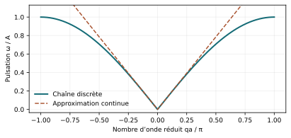
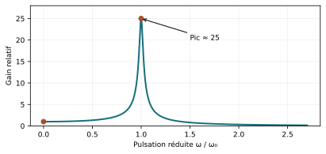
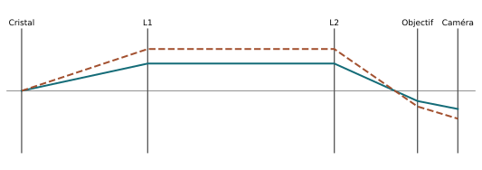
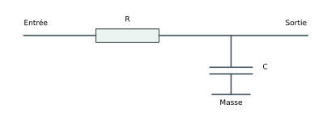

# X–ENS PSI 2021 — Physique (XCR) · Corrigé guidé

*Corrigé rédigé par IA, non officiel. Signalez toute erreur.*

**Lecture du rapport du jury** · GPT-6.2 Astra Ultra · vitesse non renseignée

**Rédaction** · GPT-6.2 Astra Ultra · vitesse non renseignée

## Autour de la modulation acousto-optique

## I. Résonance de l’émetteur et propagation

### Question 1 — Réponse fréquentielle

**Indication.** Chercher les deux fréquences au niveau du maximum divisé par $\sqrt2$.

Le maximum du rapport d’amplitudes, environ $0{,}35$, se situe vers $f_p=39{,}8\ \mathrm{kHz}$. La courbe présente une bande passante autour de cette fréquence. À $0{,}35/\sqrt2\simeq0{,}25$, on lit environ $39{,}1$ et $40{,}7\ \mathrm{kHz}$, donc $\Delta f\simeq1{,}6\ \mathrm{kHz}$ et $Q=f_p/\Delta f\simeq25$. Ce sont des lectures interpolées de la figure 2.

### Question 2 — Domaine ultrasonore

**Indication.** Comparer la fréquence du maximum à la limite supérieure de l’audition.

L’oreille humaine perçoit approximativement de $20\ \mathrm{Hz}$ à $20\ \mathrm{kHz}$, selon l’âge et la personne. L’émetteur centré autour de $40\ \mathrm{kHz}$ émet donc des ultrasons.

### Question 3 — Linéarisation des lois du fluide

**Indication.** Conserver chaque perturbation au premier ordre et évaluer les coefficients à l’équilibre.

Dans Euler, l’accélération convective et le produit $\mu\partial_t\mathbf v$ sont du second ordre. Il reste $\rho_0\partial_t\mathbf v=-\nabla p$. La continuité donne $\partial_t\mu+\rho_0\nabla\cdot\mathbf v=0$. À entropie constante la loi d’état se linéarise en $\mu=\rho_0\chi_Sp$.

### Question 4 — Équation pour la surpression

**Indication.** Prendre la divergence d’Euler et dériver la continuité en temps.

On obtient $\rho_0\partial_t\nabla\cdot\mathbf v=-\Delta p$ et $\partial_t^2\mu=-\rho_0\partial_t\nabla\cdot\mathbf v=\Delta p$. Ainsi $\Delta p-\rho_0\chi_S\partial_t^2p=0$, avec $c_a=1/\sqrt{\rho_0\chi_S}$.

### Question 5 — Célérité mesurée

**Indication.** Lire le décalage entre débuts d’enveloppe, sans compter les périodes de la porteuse.

La figure 3 donne environ $2{,}5$ grandes divisions de $200\ \mu\mathrm s$, soit $\Delta t\simeq0{,}50\ \mathrm{ms}$. Le parcours supplémentaire de $0{,}17\ \mathrm m$ donne $c\simeq340\ \mathrm{m\,s^{-1}}$. La prédiction $1/\sqrt{1{,}20\times7{,}00\times10^{-6}}\simeq345\ \mathrm{m\,s^{-1}}$ est compatible avec l’incertitude de lecture.

### Question 6 — Chaîne discrète

**Indication.** Écrire les allongements des deux liaisons voisines avec leurs orientations.

La liaison de droite exerce $K(u_{n+1}-u_n)$, celle de gauche $-K(u_n-u_{n-1})$. On obtient $m\ddot u_n=K(u_{n+1}+u_{n-1}-2u_n)$ pour un atome intérieur.

### Question 7 — Limite du milieu continu

**Indication.** Développer les déplacements voisins en $x\pm a$ jusqu’à l’ordre deux.

La somme centrée $u(x+a)+u(x-a)-2u(x)$ vaut $a^2\partial_x^2u+O(a^4)$. Pour une variation lente à l’échelle de $a$, $\partial_t^2u=c_s^2\partial_x^2u$ avec $c_s=a\sqrt{K/m}$.

### Question 8 — Dispersion discrète

**Indication.** Remplacer chaque voisin par l’onde locale multipliée par $e^{\pm iqa}$.

Le modèle donne $-m\omega^2=K(e^{iqa}+e^{-iqa}-2)=-4K\sin^2(qa/2)$. Pour une pulsation positive, $\omega=A|\sin(qa/2)|$, où $A=2\sqrt{K/m}$. La valeur absolue est nécessaire pour les deux signes de $q$.

### Question 9 — Modes périodiques

**Indication.** Après un tour de la chaîne, l’onde doit avoir retrouvé sa phase.

La condition $u_{N+1}=u_1$ impose $e^{iqNa}=1$, donc $q=2\pi p/(Na)$ avec $p\in\mathbb Z$. L’espacement est $q_0=2\pi/(Na)=2\pi/L$ pour une chaîne périodique de longueur $Na$.

### Question 10 — Première zone de Brillouin

**Indication.** Comparer les phases de deux ondes sur les seuls sites atomiques.

Si $q'=q+2\pi h/a$, le rapport de leurs phases en $na$ vaut $e^{2i\pi hn}=1$. Elles décrivent le même déplacement discret. Une période en $q$ suffit, par exemple $[-\pi/a,\pi/a[$, en évitant de compter deux fois les bords.

### Question 11 — Branche acoustique

**Indication.** Tracer la valeur absolue du sinus sur la première zone.

La courbe est paire, nulle en $q=0$, croissante de zéro à $A$ sur $[0,\pi/a]$. Elle a un point anguleux au centre car on représente la pulsation positive, et des tangentes horizontales aux deux bords.

### Question 12 — Critère de linéarité

**Indication.** Estimer le premier terme négligé dans le sinus.

Pour $z=qa/2$, l’erreur relative de $\sin z\simeq z$ est environ $z^2/6$. Une tolérance $\varepsilon$ requiert donc approximativement $(qa)^2/24<\varepsilon$. Au voisinage du centre $|q|a\ll1$, soit une longueur d’onde grande devant le pas. On retrouve la limite continue et $\omega\simeq a\sqrt{K/m}\,|q|=c_s|q|$. La pente positive est la célérité acoustique.

### Question 13 — Analogie avec le phonon

**Indication.** Chercher un quantum dont la pulsation est proportionnelle au module du vecteur d’onde.

Le photon, quantum du champ électromagnétique, vérifie $\omega=c|\mathbf k|$ dans le vide. Le phonon acoustique possède une dispersion linéaire seulement aux grandes longueurs d’onde de ce modèle.

## II. Transducteur piézoélectrique

### Question 14 — Loi de Gauss

**Indication.** Intégrer la divergence sur un volume muni d’une normale sortante.

Maxwell–Gauss donne $\nabla\cdot\mathbf E=\rho/\epsilon_0$ pour la densité totale. Le théorème de Green–Ostrogradski donne alors $\oint_{\partial V}\mathbf E\cdot d\mathbf S=\int_V\rho\,dV/\epsilon_0=Q_{\rm int}/\epsilon_0$.

### Question 15 — Charges libres et déplacement

**Indication.** Insérer $\rho_{\rm liée}=-\nabla\cdot\mathbf P$ dans la loi de Gauss.

Avec $\mathbf D=\epsilon_0\mathbf E+\mathbf P$, on obtient $\nabla\cdot\mathbf D=\rho_{\rm libre}$. Son flux sortant à travers une surface fermée vaut donc la charge libre enfermée. Les charges liées sont déjà prises en compte dans $\mathbf P$.

### Question 16 — Champ par zones et capacité

**Indication.** Utiliser les invariances du condensateur puis le saut de la composante normale à chaque plaque.

(a) Dans l’approximation des plans infinis, les translations parallèles aux plaques et les plans de symétrie imposent $\mathbf D=D_x(x)\mathbf e_x$. Hors des plaques aucune charge libre volumique, donc $dD_x/dx=0$ par zone. La zone III est $x>L$, comme le précise le jury. (b) Les champs des feuillets de charges opposées se compensent à l’extérieur, sans champ appliqué supplémentaire. (c) En traversant la plaque de charge $-Q$, le saut vaut $-Q/S$. Donc $\mathbf D_{\rm int}=-(Q/S)\mathbf e_x$. (d) Avec $\epsilon=\epsilon_0\epsilon_r$, $U=-\int_0^L E_xdx=QL/(\epsilon S)$, soit $C=\epsilon S/L$.

### Question 17 — Barycentres de la maille

**Indication.** Les trois ions de chaque signe ont des charges de même module.

Chaque barycentre est le centre de gravité du triangle des trois sommets de même signe. Les deux sont sur l’axe horizontal de la maille déformée. Pour le dessin de la figure 6, le barycentre positif est légèrement à gauche du négatif. Le dipôle est $3e(\mathbf r_+-\mathbf r_-)$, de module $p_{\rm hex}=3e d_{\pm}$.

### Question 18 — Équation électrique du cristal

**Indication.** La charge libre fixe toujours $D_x$, tandis que la polarisation comporte un terme mécanique.

En posant $\epsilon=\epsilon_0\epsilon_r$, la loi donnée conduit à $D_x=\epsilon E_x+\epsilon\gamma\xi/L=-Q/S$. Ainsi $U=-LE_x=QL/(\epsilon S)+\gamma\xi=Q/C+\gamma\xi$ au premier ordre de la description.

### Question 19 — Équation du mouvement

**Indication.** La force de maintien statique est opposée à la force de rappel.

La force interne de rappel vaut $-(\gamma Q+k\xi)\mathbf e_x$, puisqu’une force extérieure $+(\gamma Q+k\xi)\mathbf e_x$ maintiendrait cet état. Une fois le maintien supprimé, on ajoute la force dissipative $-\alpha\dot\xi\mathbf e_x$. La dynamique donne $m\ddot\xi+\alpha\dot\xi+k\xi+\gamma Q=0$.

### Question 20 — Transfert électromécanique

**Indication.** Éliminer $Q$ par $Q=C(U-\gamma\xi)$ avant de passer aux amplitudes complexes.

Posons $k'=k-\gamma^2 C>0$. Il vient $m\ddot\xi+\alpha\dot\xi+k'\xi=-\gamma CU$. Ainsi $H=H_0/[1-(\omega/\omega_0)^2+i\omega/(Q_{\rm elm}\omega_0)]$ avec $H_0=-\gamma C/k'$, $\omega_0=\sqrt{k'/m}$ et $Q_{\rm elm}=m\omega_0/\alpha$.

### Question 21 — Pic du déplacement

**Indication.** Minimiser le carré du dénominateur par rapport à $x^2$, où $x=\omega/\omega_0$.

Le module vaut $|H_0|/\sqrt{(1-x^2)^2+x^2/Q_{\rm elm}^2}$. La dérivée du dénominateur carré par rapport à $x^2$ s’annule pour $x^2=1-1/(2Q_{\rm elm}^2)$. Il existe un maximum à pulsation positive $\omega_m=\omega_0\sqrt{1-1/(2Q_{\rm elm}^2)}$ si $Q_{\rm elm}>1/\sqrt2$.

### Question 22 — Résonance aiguë

**Indication.** Distinguer la réponse statique, le sommet et la queue inertielle.

Si $Q_{\rm elm}\gg1$, $\omega_m\simeq\omega_0$ et $|H(\omega_m)|\simeq Q_{\rm elm}|H_0|$. À très basse fréquence $|H|\to|H_0|$. À haute fréquence $|H|\simeq|H_0|(\omega_0/\omega)^2\to0$. C’est une réponse en déplacement à plateau statique et pic étroit.

### Question 23 — Confrontation au transducteur mesuré

**Indication.** Comparer d’abord le voisinage du pic et identifier la grandeur réellement mesurée.

La figure 2 présente le pic étroit attendu près de $40\ \mathrm{kHz}$. Le $Q\simeq25$ mesuré rend l’écart relatif entre $\omega_m$ et $\omega_0$ de l’ordre de $1/(4Q^2)\simeq4\times10^{-4}$. L’expérience mesure une pression acoustique tandis que le modèle décrit le déplacement. On compare surtout la position et la largeur du pic, la figure ne mesurant pas la limite statique.

### Question 24 — Impédance du circuit équivalent

**Indication.** Mettre la branche série en parallèle avec $C_0$ et regrouper les deux réactances.

Posons $Z_m=R_m+i(\omega L_m-1/(\omega C_m))$. On a $Z_{AB}=(i\omega C_0)^{-1}Z_m/[Z_m+1/(i\omega C_0)]$. En posant $\omega_r^2=1/(L_m C_m)$, $\omega_a^2=(1/C_m+1/C_0)/L_m$ et $Q_j=L_m\omega_j/R_m$, on obtient $Z_{AB}=(i\omega C_0)^{-1}(1+iQ_r X_r)/(1+iQ_a X_a)$ avec $X_j=\omega/\omega_j-\omega_j/\omega$. Son module est $\sqrt{(1+Q_r^2 X_r^2)/(1+Q_a^2 X_a^2)}/(\omega C_0)$.

### Question 25 — Impédance aux résonances

**Indication.** Localiser les zéros de $X_j$ dans chacun des deux facteurs réels.

Chaque facteur $\sqrt{1+Q_j^2X_j^2}$ atteint son minimum 1 à $\omega_j$. Le numérateur minimal place un creux près de $\omega_r$ et le dénominateur minimal un pic près de $\omega_a>\omega_r$. Ce repérage vaut pour des résonances distinctes et peu amorties. La variation des autres facteurs peut décaler légèrement les extrema exacts.

### Question 26 — Courant du transducteur

**Indication.** À tension fixée le module du courant vaut $|U|/|Z_{AB}|$.

Au creux d’impédance de la résonance série, le courant absorbé augmente et le couplage au mode mécanique produit un pic d’émission. Au pic d’impédance, le courant fourni présente un minimum par compensation des courants des branches. C’est l’antirésonance électrique du transducteur.

### Question 27 — Impédance calculée mécaniquement

**Indication.** Éliminer $\xi$ et utiliser $I=i\omega Q$ dans la convention récepteur.

Posons $A=k-m\omega^2+i\alpha\omega$. La mécanique donne $\xi=-\gamma Q/A$ et l’équation électrique $U=(A-C\gamma^2)Q/(CA)$. Ainsi $Z_S=(i\omega C)^{-1}(k'-m\omega^2+i\alpha\omega)/(k-m\omega^2+i\alpha\omega)$. En divisant les deux polynômes par $i\alpha\omega$, on retrouve la forme de la question 24 avec $\omega_r^2=k'/m$, $\omega_a^2=k/m$, $Q_j=m\omega_j/\alpha$.

### Question 28 — Valeurs des éléments équivalents

**Indication.** Identifier d’abord $C_0$ puis la différence $\omega_a^2-\omega_r^2$.

Le préfacteur fixe $C_0=C$. L’identité $1/(C_0L_m)=\omega_a^2-\omega_r^2=\gamma^2 C/m$ donne $L_m=m/(\gamma^2 C^2)$. On en tire $C_m=1/(L_m\omega_r^2)=\gamma^2 C^2/k'$ et $R_m=L_m\alpha/m=\alpha/(\gamma^2C^2)$.

### Question 29 — Dissipation équivalente

**Indication.** Examiner quel composant reçoit une puissance moyenne positive.

La résistance $R_m$ dissipe de la puissance par effet Joule dans la représentation électrique. Elle est proportionnelle au coefficient mécanique $\alpha$ qui dissipe $\alpha\dot\xi^2$. Si $\alpha=0$, $R_m=0$ et les deux modèles deviennent conservatifs.

## III. Diffraction et analyse spectrale

### Question 30 — Dispersion de la lumière

**Indication.** Appliquer l’équation d’onde du vide à une onde plane.

Une onde électromagnétique dans le vide vérifie $\omega^2=c^2k^2$. Pour le module positif, $k=\omega/c=2\pi/\lambda$.

### Question 31 — Énergie du photon émergent

**Indication.** La situation décrite correspond à l’absorption d’un phonon.

La conservation d’énergie impose $\hbar\omega'=\hbar\omega+\hbar\Omega$, donc $\omega'=\omega+\Omega$. Le photon émergent est décalé vers les hautes fréquences.

### Question 32 — Limite du spectromètre optique

**Indication.** Comparer la fréquence acoustique à $c/\lambda$ et convertir l’écart en longueur d’onde.

À $600\ \mathrm{nm}$, la lumière est orange et $\nu=5\times10^{14}\ \mathrm{Hz}$. Pour $F=2\times10^8\ \mathrm{Hz}$, $F/\nu=4\times10^{-7}$. Ainsi $|\lambda'-\lambda|\simeq\lambda F/\nu=2{,}4\times10^{-4}\ \mathrm{nm}$, bien en dessous du nanomètre. Le spectromètre ne peut en déduire $F$ ni $\Lambda=c_s/F=50\ \mu\mathrm m$.

### Question 33 — Échange de quantité de mouvement

**Indication.** Projeter le triangle des vecteurs d’onde sur les deux axes de la figure 10.

La conservation s’écrit $\hbar\mathbf k_i+\hbar\mathbf q=\hbar\mathbf k_f$. Dans la construction orthogonale du sujet, les projections donnent $q=k_f\sin\theta$ et $k_i=k_f\cos\theta$.

### Question 34 — Déviation angulaire

**Indication.** Dans la projection transverse, relier $q$ à la longueur d’onde acoustique.

Comme $q=2\pi F/c_s$, $\sin\theta=q/k_f=F\lambda'/c_s\simeq F\lambda/c_s$. La substitution de $\lambda$ se justifie par l’écart relatif de $4\times10^{-7}$ en question 32. Numériquement $\sin\theta\simeq0{,}012$.

### Question 35 — Interprétation comme diffraction

**Indication.** Utiliser $\Lambda=c_s/F$ et la faible valeur du sinus.

Au premier ordre en angle $\theta\simeq\lambda/\Lambda\simeq0{,}012\ \mathrm{rad}$. La modulation d’indice créée par l’onde sonore constitue un réseau mobile qui diffracte la lumière et en décale la fréquence. La construction à incidence normale est une description de premier ordre de la déviation transverse. Une description exacte à deux vecteurs optiques impose aussi l’accord de phase longitudinal, dépendant de l’angle d’incidence dans le cristal.

### Question 36 — Construction des rayons

**Indication.** Suivre un rayon issu du cristal, situé dans le plan focal objet de L1.

Un rayon quittant l’axe sous l’angle $\theta$ atteint L1 à la hauteur $f_1\theta$. Il en sort horizontal puis rencontre L2 à la même hauteur. Celle-ci le dirige vers son foyer image et la pente devient $-f_1\theta/f_2$. L’objectif transforme cette pente en position dans son plan focal image. Les deux rayons sont tracés ci-dessous.

### Question 37 — Position du point de détection

**Indication.** La hauteur dans le plan focal dépend de l’angle avant l’objectif.

En valeur algébrique $y_{C_1}=-f_{\rm obj}(f_1/f_2)\theta_1$. La distance demandée vaut donc $F'_{\rm obj}C_1=f_{\rm obj}f_1|\theta_1|/f_2$.

### Question 38 — Résolution en longueur d’onde acoustique

**Indication.** Différencier l’angle $\lambda/\Lambda$ puis imposer un pixel entre les impacts.

Au premier ordre $|\theta_1-\theta_2|\simeq\lambda\Delta\Lambda/\Lambda_0^2$. Exiger $\Delta y\ge d_{\rm pixel}$ donne $\Delta\Lambda_{\min}\simeq d_{\rm pixel}\Lambda_0^2 f_2/(\lambda f_{\rm obj}f_1)$. Pour $\Lambda_0=50\ \mu\mathrm m$, on trouve environ $10\ \mu\mathrm m$. Un $f_1$ ou $f_{\rm obj}$ plus grand, ou un $f_2$ plus petit, augmente la séparation, dans les limites d’ouverture et du champ disponible.

### Question 39 — Pulsations des deux bras

**Indication.** Repérer quel faisceau traverse effectivement le cristal sur la figure 12.

Le bras supérieur de référence $s_1$ conserve $\omega_1=\omega$. Le bras traversant le cristal, $s_2$, porte $\omega_2=\omega+\Omega$ pour le processus d’absorption choisi.

### Question 40 — Superposition des champs

**Indication.** Vérifier quelle grandeur obéit à une équation linéaire.

Les deux champs solutions de l’équation d’onde linéaire se superposent. Dans l’approximation scalaire et pour des polarisations compatibles, $s_{\rm tot}=s_1+s_2$. L’intensité est ensuite calculée par le carré de cette somme, qui conserve le terme d’interférence.

### Question 41 — Battement photodétecté

**Indication.** Comparer le temps de réponse aux périodes optique et acoustique.

Le carré de $s_0[\cos\omega t+\cos((\omega+\Omega)t)]$ contient une constante, un terme en $\cos\Omega t$ et des termes voisins de $2\omega$. Les $10\ \mathrm{ps}$ de la photodiode moyennent les oscillations optiques (période voisine de $2\ \mathrm{fs}$) tout en suivant le battement de période voisine de $5\ \mathrm{ns}$. Il reste $u(t)\propto s_0^2[1+\cos(\Omega t)]$. La période du battement donne $\Omega$.

### Question 42 — Mélange électronique

**Indication.** Développer le produit de deux cosinus après suppression de la composante continue.

La partie alternative a $\omega_{\rm alt}=\Omega$. Le multiplieur donne $U_m=(K u_{{\rm alt},0}u_{{\rm ref},0}/2)[\cos((\Omega-\omega_{\rm ref})t)+\cos((\Omega+\omega_{\rm ref})t)]$. L’amplitude est partagée entre les deux bandes latérales.

### Question 43 — Choix de l’oscillateur de référence

**Indication.** Calculer les plages de fréquence somme et différence.

Une référence à $200\ \mathrm{MHz}$ translate la bande $200$–$230\ \mathrm{MHz}$ vers $0$–$30\ \mathrm{MHz}$, sous la bande passante de $100\ \mathrm{MHz}$ de l’oscilloscope. Les sommes tombent entre $400$ et $430\ \mathrm{MHz}$ et sont facilement distinguées des différences.

### Question 44 — Filtre passif

**Indication.** Prélever la sortie d’une cellule RC aux bornes du condensateur.

Placer une résistance $R$ entre la sortie du multiplieur et le nœud de mesure, puis un condensateur $C_f$ de ce nœud à la masse. La sortie est la tension du condensateur et $H=1/(1+i\omega RC_f)$. Par exemple $R=100\ \Omega$ et $C_f=33\ \mathrm{pF}$ donnent $f_c\simeq48\ \mathrm{MHz}$, entre les deux bandes. Le gain est environ $0{,}85$ à $30\ \mathrm{MHz}$ et $0{,}12$ à $400\ \mathrm{MHz}$ dans le modèle idéal.

### Question 45 — Outil spectral

**Indication.** Les fréquences présentes sont des raies de la tension mesurée.

Échantillonner le signal avec une fréquence supérieure à deux fois la fréquence maximale utile, sur une durée assez longue pour séparer les pics. Une transformée de Fourier discrète calculée par FFT donne le module du spectre. Le pas fréquentiel est approximativement l’inverse de la durée d’acquisition.

### Question 46 — Retour aux fréquences du cristal

**Indication.** Lire les trois pics de la figure 15 puis annuler la translation du mélangeur.

On lit environ $1$, $3$ et $11\ \mathrm{MHz}$ dans la bande différence. Comme toutes les fréquences initiales sont supérieures ou égales à la référence de $200\ \mathrm{MHz}$, les fréquences acoustiques sont respectivement $201$, $203$ et $211\ \mathrm{MHz}$.

### Question 47 — Autre emploi du modulateur

**Indication.** L’angle du faisceau diffracté dépend de la fréquence de l’onde sonore.

En faisant varier électroniquement la fréquence acoustique, on change la période du réseau d’indice et donc l’angle de diffraction. Un déflecteur acousto-optique peut ainsi balayer un faisceau sur un échantillon en microscopie sans déplacer de miroir.
