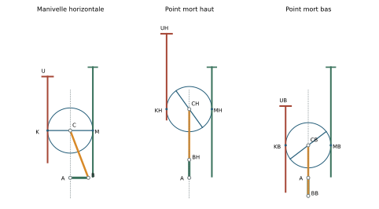
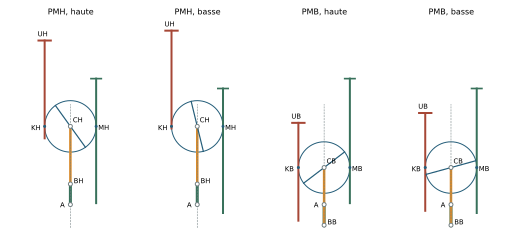
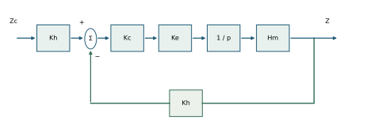
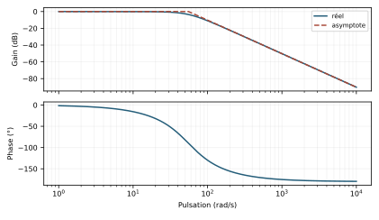
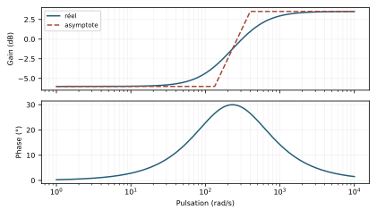
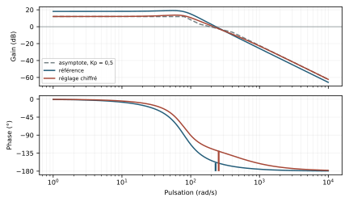

# X-ENS PSI · Sciences industrielles 2021 · Corrigé brut

*Corrigé rédigé par IA, non officiel. Signalez toute erreur.*

**Rédaction** · GPT-6.2 Astra Ultra · vitesse non renseignée · 24 novembre 2026

## Partie 2 · Modulation de la course

### Question 1 · Course conventionnelle

Le maneton $B$ est à l'altitude $+a'$ au PMH, à $-a'$ au PMB. La bielle de longueur $b'$ est verticale dans ces deux configurations et $z_C=b'\pm a'$. La course du piston vaut $C_{\rm conv}=2a'$.

### Question 2 · Cylindrée et taux géométrique

Avec $S=\pi D^2/4$, $V_{\rm conv}=2a'S$. La tête est à $a'+b'+\delta$ au-dessus de $A$ au PMH. Le volume mort vaut $V_m=V_{\rm coloré}+S[L_{\rm tot}-(a'+b'+\delta)]$, et $\tau_{\rm conv}=1+V_{\rm conv}/V_m$.

### Question 3 · Valeurs du moteur de référence

$S=16\pi\,\mathrm{cm^2}$, la course est $8\,\mathrm{cm}$ et la hauteur libre résiduelle $182-40-120-20=2\,\mathrm{mm}$. Donc $V_{\rm conv}=128\pi\simeq402{,}1\,\mathrm{cm^3}$, $V_m=33{,}6+3{,}2\pi\simeq43{,}65\,\mathrm{cm^3}$ et $\tau_{\rm conv}\simeq10{,}21$.

### Question 4 · Construction du point mort haut

Sur l'axe vertical de $A$, placer $B_H$ à la cote $a$ et $C_H$ à la cote $a+b$. À la cote de $C_H$, les contacts instantanés se trouvent en $K_H$ à gauche et $M_H$ à droite, à distance horizontale $r_7$ du centre. La crémaillère droite est fixe. Pour une montée du centre de $s$, la roue tourne d'un angle de module $s/r_7$ dans le sens horaire sur la vue de côté. Le diamètre matériel initialement horizontal doit donc être tourné sur le tracé.

### Question 5 · Montée de la tête motrice

Les vitesses verticales sur le diamètre vérifient $v_K+v_M=2v_C$. Avec $v_M=0$, $\Delta z_U=2\Delta z_C$. Si le dessin de référence est pris, comme le dit son texte, exactement à mi-course, $UU_H=2a$. Dans la construction géométrique exacte de la figure 12, la manivelle de référence est horizontale et la bielle inclinée, donc $z_{C0}=\sqrt{b^2-a^2}$ et $UU_H=2[b+a-\sqrt{b^2-a^2}]$. Les deux lectures donnent la même course totale. Pour porter $U_H$ sur DR1, employer le double du déplacement effectivement construit pour $C$.

### Question 6 · Construction du point mort bas

Placer $B_B$ en $(0,-a)$, $C_B$ en $(0,b-a)$, puis $K_B,M_B$ à cette dernière cote et aux abscisses $-r_7,+r_7$. Le diamètre matériel tourne en sens inverse du cas PMH, et le piston descend de deux fois la descente du centre. Depuis la mi-course nominale $UU_B=2a$. Depuis la référence horizontale exacte, $UU_B=2[\sqrt{b^2-a^2}-(b-a)]$. Le sommet $U_B$ se place de cette distance sous $U$.

### Question 7 · Course du dispositif à roue

La course de $C$ est $(b+a)-(b-a)=2a$. La crémaillère motrice la parcourt au double, donc $C_{\rm VCRi}=4a$.

### Question 8 · Excentration équivalente

$4a=2a'$ impose $a=a'/2$, soit $20\,\mathrm{mm}$ dans la comparaison numérique.

### Question 9 · Forme du vilebrequin

Avec une excentration divisée par deux, les manetons se rapprochent de l'axe des tourillons. Les joues et les masses d'équilibrage peuvent s'inscrire dans une enveloppe radiale plus petite. C'est le profil plus compact qu'on observe sur la figure 13.

### Question 10 · Opérateurs d'inertie

Au centre d'inertie du vilebrequin équilibré, on prend $y_3$ suivant l'axe des paliers et le plan $y_3z_3$ comme plan des déports de manetons. La symétrie de ce plan annule $I_{xy}$ et $I_{xz}$. La disposition par paires symétriques des manetons et contrepoids autour du milieu annule aussi $I_{yz}$ dans l'idéalisation du dessin. Chaque matrice centrale est donc diagonale, $\operatorname{diag}(A,B,C)$ dans $B_3$. Un vilebrequin à manetons excentrés n'est pas exactement un solide de révolution. Des détails d'extrémité ou de perçage exigeraient un calcul sur le modèle volumique.

### Question 11 · Ordres de grandeur des inerties

À longueur voisine, les moments transversaux $A,C$ dépendent beaucoup de la répartition longitudinale de matière et sont du même ordre entre eux. Le moment axial $B=\int(x_3^2+z_3^2)dm$ diminue lorsque les masses excentrées sont rapprochées de l'axe. Les valeurs exactes de $A,C$ et leurs rapports entre moteurs exigent les masses et cotes réelles. Le raccourcissement radial ne divise pas automatiquement tout $B$ par quatre.

### Question 12 · Conséquences mécaniques

Pour un couple disponible donné, un plus petit $I_y$ accélère plus vite le vilebrequin ($\dot\omega=C/I_y$). À masse de maneton et régime donnés, l'effort centrifuge $m a\omega^2$ et les sollicitations de balourd associées diminuent. La forme plus compacte augmente également le recouvrement possible entre tourillon et maneton.

### Question 13 · Reconstituer DR2

Dans chacun des deux cadres de droite du DR2, recopier $A,B,C$ du cadre voisin. Tracer la roue de centre $C$. Les points de tangence géométriques $K,M$ restent aux mêmes cotes que $C$. Si la commande descend de $h$, la rotation de la roue autour de $C$ entraîne l'autre crémaillère de $h$ vers le haut. Porter $U_H$ ou $U_B$ de $h$ au-dessus du sommet homologue de la configuration « commande haute ». Tourner aussi le diamètre matériel dans le sens horaire quand la crémaillère droite descend. Le croquis compare le même PMH ou le même PMB avant et après réglage.

### Question 14 · Loi de déplacement au PMH

En général $v_1+v_5=2v_C$. Au même PMH, la cote de $C$ est fixée, donc $\Delta z_{U,H}=-\Delta z_5$. Le piston moteur monte d'un millimètre lorsque le piston de commande descend d'un millimètre.

### Question 15 · Influence sur le volume mort

$\Delta V_m=-S\Delta z_{U,H}=S\Delta z_5$. Une commande vers le haut augmente le volume mort et diminue le taux, une commande vers le bas produit l'effet inverse.

### Question 16 · Réglage au PMB

Au PMB, $z_C=b-a$ est indépendant de la position de la commande. La même relation donne $\Delta z_{U,B}=-\Delta z_5$. Les deux altitudes extrêmes sont translatées du même montant.

### Question 17 · Effet sur la course

Le décalage $-\Delta z_5$ disparaît de la différence $z_{U,H}-z_{U,B}$. La course et donc la cylindrée géométrique balayée restent constantes. Le réglage porte ici sur le volume mort.

### Question 18 · Plage de compression

À section $S=16\pi\,\mathrm{cm^2}$, le volume balayé vaut $402{,}1\,\mathrm{cm^3}$. Avec la géométrie simplifiée où la zone colorée représente $30\,\mathrm{cm^3}$ au-dessus du plan de référence, les hauteurs de jeu extrêmes sont $1$ et $1+9=10\,\mathrm{mm}$. Les volumes morts correspondants sont $35{,}0$ et $80{,}3\,\mathrm{cm^3}$, donc $\tau_{\max}\simeq12{,}5$ et $\tau_{\min}\simeq6{,}0$. La borne basse de l'exigence 1.2 est atteinte à l'arrondi, le plan coté ne démontre pas la borne 15. Les valeurs 15:1 et 6:1 utilisées dans la dernière partie sont des données de commande.

## Partie 3 · Sous-ensemble de combustion

### Question 19 · Guidage transversal

Le tenon central du rouleau entre dans une rainure verticale et empêche sa dérive latérale selon $y_0$ tout en autorisant le roulement. La piste à profil sphérique de la roue se centre dans la forme complémentaire et permet de petits défauts d'orientation. Les dents fines du rouleau assurent, elles, la synchronisation et la répétabilité de l'engrènement.

### Question 20 · Résultante des gaz

$F_{Uz}=p_r\pi d^2/4$ et la force exercée sur le piston est $-F_{Uz}\mathbf e_z$. Le centre de pression se trouve sur l'axe du disque en $U$.

### Question 21 · Matrice d'inertie du piston

En choisissant les axes centraux principaux du piston, la matrice en $G_P$ est diagonale. La symétrie droite-gauche suivant la largeur impose en particulier les deux produits comportant $y$ nuls. L'écriture de la figure 22 adopte également $x_1,z_1$ comme directions principales dans le plan d'étude, ce qui néglige ou annule le produit $xz$. Aucune égalité des trois moments n'est requise. La translation pure rend dans tous les cas le moment dynamique central nul.

### Question 22 · Effort transversal à la jupe

Le piston a une translation verticale. Les bilans sont $F_{Qx}=-F_{Jx}-F_{Kx}$, $F_{Kz}+F_{Qz}-F_{Uz}=m_p\ddot\lambda_1$. Le moment en $G_P$ suivant $y$ est nul. En écrivant chaque moment comme $(z-z_G)F_x-(x-x_G)F_z$, il vient

$$
F_{Jx}=\frac{(z_K-z_Q)F_{Kx}-(x_K-x_G)F_{Kz}-(x_Q-x_G)F_{Qz}+(d/2-x_G)F_{Uz}}{z_Q-z_J}.
$$

Cette forme fait apparaître explicitement les bras de levier et le terme de pression donné en Q20.

### Question 23 · Alignement des résultantes principales

Avec $x_K=x_G=d/2$, la force des gaz et la composante verticale en $K$ passent par la verticale du centre d'inertie. L'effort latéral parasite à la jupe est ainsi réduit. Comme $x_Q=x_K-L$, il reste $F_{Jx}=[(z_K-z_Q)F_{Kx}+L F_{Qz}]/(z_Q-z_J)$.

### Question 24 · Niveaux de contact voisins

Avec l'approximation indiquée $z_Q\simeq z_K$, le terme en $F_{Kx}$ disparaît et $F_{Jx}=L F_{Qz}/(z_Q-z_J)$. Le dénominateur est algébrique, ici négatif.

### Question 25 · Roulement sur la platine

Avec $\boldsymbol\Omega=\dot\beta\mathbf e_y$ et $\overrightarrow{O_2I}=-R_s\mathbf e_x$, $\mathbf v_I=(\dot\lambda_2+R_s\dot\beta)\mathbf e_z=0$. Ainsi $\dot\lambda_2=-R_s\dot\beta$ pour le sens de rotation de la figure 23.

### Question 26 · Roulement sur le piston

$\mathbf v_Q=(\dot\lambda_2-R_s\dot\beta)\mathbf e_z=\dot\lambda_1\mathbf e_z$, d'où $\dot\lambda_1=-2R_s\dot\beta$ par Q25.

### Question 27 · Vitesses liées

Les deux relations donnent $\dot\lambda_1=2\dot\lambda_2$. Le point du rouleau en contact avec la crémaillère mobile va deux fois plus vite que son centre.

### Question 28 · Effort tangentiel au contact moteur

$E_c=(m_r+B_r/R_s^2)\dot\lambda_2^2/2$. En $I$ la puissance est nulle. En $Q$ le piston exerce $-F_{Qz}\mathbf e_z$ sur le rouleau et la vitesse vaut $2\dot\lambda_2\mathbf e_z$. Le théorème de l'énergie cinétique donne $F_{Qz}=-(m_r+B_r/R_s^2)\ddot\lambda_2/2$, prolongé par continuité aux instants de vitesse nulle.

### Question 29 · Relation accélération–effort à la jupe

On obtient $F_{Jx}=-L(m_r+B_r/R_s^2)\ddot\lambda_2/[2(z_Q-z_J)]$. Le rouleau introduit un effort proportionnel à l'accélération et à une masse effective.

### Question 30 · Valeur de l'effort à la jupe

$B_r=6000\,\mathrm{g\,mm^2}=6\times10^{-6}\,\mathrm{kg\,m^2}$, $R_s=0{,}010\,\mathrm m$, donc $m_r+B_r/R_s^2=0{,}16\,\mathrm{kg}$. Pour $|\ddot\lambda_2|=1000g\simeq9810\,\mathrm{m\,s^{-2}}$, $|F_{Qz}|\simeq785\,\mathrm N$. La fourchette $|z_Q-z_J|=80$ à $120\,\mathrm{mm}$ donne environ $59$ à $39\,\mathrm N$ pour $|F_{Jx}|$.

### Question 31 · Modèle de Coulomb

Pour un contact unilatéral, la réaction normale $N$ est positive en compression. En adhérence, la réaction tangentielle satisfait $\|\mathbf T\|\le\mu_s N$, sa direction s'adaptant à l'équilibre. En glissement, $\mathbf T=-\mu_d N\mathbf v_{\rm gl}/\|\mathbf v_{\rm gl}\|$ pour l'effort sur le solide dont on a défini la vitesse relative. La puissance dissipée vaut $\mu_d N\|\mathbf v_{\rm gl}\|$.

### Question 32 · Pertinence du contact sans frottement

Avec quelques dizaines de newtons normaux dans le modèle simplifié, le frottement de jupe est de l'ordre de $\mu |F_{Jx}|$, très inférieur aux efforts de combustion qui atteignent plusieurs dizaines de kN. Sa négligence est cohérente pour ce bilan dynamique. Un calcul détaillé des pertes demanderait aussi les contacts des segments, le lubrifiant et les valeurs réelles de charge.

### Question 33 · Effort utile transmis

À cylindrées et régimes comparables, le travail du cycle doit se transmettre au vilebrequin. La composante $F_{Kz}$ travaille avec la vitesse verticale du piston. La figure 24 montre un maximum de l'ordre de 50 kN, comparable à l'effort vertical du moteur conventionnel. Elle confirme la continuité du transfert de puissance utile en dépit du changement de cinématique.

### Question 34 · Forme de l'effort latéral

Les relations Q24–Q29 la rendent de faible amplitude, alternative avec le signe de l'accélération, et croissante avec le régime puisque l'accélération inertielle varie comme le carré de la vitesse de rotation. Deux tours du vilebrequin donnent deux oscillations principales. Le fort pic de combustion près de $400^\circ$ apparaît surtout dans l'effort axial.

### Question 35 · Charge transversale sur le rouleau

L'action de denture, inclinée par l'angle de pression, comporte une composante transversale. Le vérin presseur ajoute une précharge qui maintient les pièces en contact. La reprise de ces efforts par le rouleau, alors que $F_{Jx}$ reste petit, explique des $F_{Qx}$ de plusieurs dizaines de kN près de la combustion.

### Question 36 · Effet de cette charge sur le rendement

Dans un roulement idéal sans glissement, la puissance dissipée par la paire de forces de contact est nulle, même pour un grand $F_{Qx}$. En réalité, déformations de contact, hystérésis, lubrification et petits glissements engendrent des pertes qui croissent avec la charge. Le roulement évite l'essentiel du frottement de glissement que subirait une jupe fortement chargée.

## Partie 4 · Isostatisme et vérin presseur

### Question 37 · Mobilités internes

La bielle 2 peut tourner autour de la droite de ses deux rotules $BC$. Le piston presseur 8 peut tourner autour de son axe $x_0$ dans son guidage cylindrique, sans modifier le contact ponctuel $N$. Ces deux mobilités s'ajoutent à l'unique mobilité motrice.

### Question 38 · Graphe des liaisons

Les sommets sont $0,1,2,3,5,6,7,8$. Les arêtes simples sont $0$–$3$ pivot $A$ d'axe $y_0$, $3$–$2$ rotule $B$, $2$–$7$ rotule $C$, $1$–$0$ sphère-cylindre $J$ d'axe $z_0$, $5$–$0$ rotule $E$ (réglage bloqué), $8$–$0$ pivot glissant $H$ d'axe $x_0$, $5$–$8$ sphère-plan $N$ de normale $x_0$.

| Couples de sommets | Contacts de la figure 25 |
|---|---|
| $0$–$6$ et $1$–$6$ | En $I_1,Q_1$ contacts linéaires rectilignes de ligne $y_0$, normale $x_0$. En $I_2,Q_2$ contacts ponctuels de normale $y_0$. En $I_3,Q_3$ linéaires rectilignes de ligne $y_0$, normale $z_0$. |
| $1$–$7$ et $5$–$7$ | En $K_1,K_2$ et $M_1,M_2$ contacts ponctuels de normale $z_0$ dans la représentation simplifiée. En $K_3,M_3$ contacts sphère-cylindre d'axe $z_0$. |

Les normales peuvent être orientées dans l'un ou l'autre sens pour la seule description géométrique.

### Question 39 · Nombre de cycles

Le graphe connexe possède huit sommets et $7+4\times3=19$ arêtes. Son nombre cyclomatique vaut $\gamma=19-8+1=12$.

### Question 40 · Degré d'hyperstatisme

Les sept arêtes simples apportent $5+3+3+2+3+4+1=21$ inconnues d'action. Les groupes $I,Q$ ajoutent chacun $2+1+2=5$, les groupes $K,M$ chacun $1+1+2=4$. Ainsi $N_s=39$. Avec $m=1+2=3$, $h=N_s-6(8-1)+m=0$. Le modèle spatial de la figure 25 respecte l'exigence 1.3.1.1 d'isostatisme.

### Question 41 · Fonction du vérin presseur

Le vérin exerce une poussée réglée qui ferme les contacts de la chaîne. Sa translation permet d'absorber jeux, déformations et dispersions de fabrication. Un appui direct fixe ajouterait une contrainte géométrique à la boucle, avec risque de coincement ou de perte de contact. Le vérin conserve la précharge et l'adaptation de position.

### Question 42 · Équivalence des deux réalisations

Le contact plan-plan de normale $x_0$ transmet une force suivant $x_0$ et des couples suivant $y_0,z_0$. La rotule en $N_2$ transmet trois forces mais aucun couple en son centre. L'intersection, après transport en $N_2$, est donc un glisseur de direction $x_0$ passant par $N_2$. La liaison équivalente a une contrainte et cinq mobilités, exactement celles de la sphère-plan de la version actuelle placée sur la même ligne de poussée. En cinématique, la rotule fournit les trois rotations et le contact plan les deux translations tangentielles.

### Question 43 · Effort du presseur

La pression et $F_{Mz}$ passent par la même verticale que $E$. Les seules contributions au moment suivant $y$ sont $-(z_M+z_E)F_{Mx}$ et $+(z_N+z_E)F_{Nx}$. Ainsi $F_{Nx}=F_{Mx}(z_E+z_M)/(z_E+z_N)$, où $F_{Nx}>0$ est le module de l'effort dirigé suivant $-x_0$.

### Question 44 · Plage d'effort requise

La figure 31 donne $F_{Mx}\simeq6$ à $19\,\mathrm{kN}$. Avec $z_M=45$ à $85\,\mathrm{mm}$, $z_E=40\,\mathrm{mm}$ et $z_N=90\,\mathrm{mm}$, le facteur géométrique est compris entre $85/130$ et $125/130$. On obtient l'enveloppe prudente d'environ $3{,}9$ à $18{,}3\,\mathrm{kN}$. Les extrema des deux facteurs ne coïncident pas nécessairement dans le cycle.

### Question 45 · Dimensionner le vérin

La section vaut $\pi(0{,}015)^2=7{,}07\times10^{-4}\,\mathrm{m^2}$. La poussée disponible $6000+pS$ varie d'environ $8{,}12\,\mathrm{kN}$ à 30 bar à $25{,}1\,\mathrm{kN}$ à 270 bar. Le maximum nécessaire de Q44 est couvert, il correspond à environ $174$ bar après déduction du ressort. En faible charge, la précharge dépasse la borne inférieure estimée et maintient les contacts fermés. Elle doit être prise en compte pour les pertes et les réactions.

### Question 46 · Sécurité en cas de panne hydraulique

Le ressort reste capable de fournir $6\,\mathrm{kN}$ sans pression, notamment pour maintenir un contact au repos ou à faible charge et éviter la séparation des pièces. Cette valeur seule ne couvre pas le pic requis de Q44 en pleine combustion.

## Partie 5 · Commande du taux de compression

### Question 47 · Capteur de position à effet Hall

Dans une lame parcourue par un courant, un champ magnétique transverse dévie les porteurs par la force de Lorentz. Une tension transverse apparaît, proportionnelle à la composante du champ pour un courant fixé. On fixe un aimant permanent sur le piston face à la sonde pour que son déplacement modifie le champ mesuré. L'étalonnage relie la tension à la cote.

### Question 48 · Gain du capteur

La figure 34 est une droite passant pratiquement par l'origine. Entre $-7$ et $+7\,\mathrm{mm}$, la variation est d'environ $4\,\mathrm V$, d'où $H_h(p)=K_h\simeq0{,}28$ à $0{,}29\,\mathrm{V/mm}$, soit environ $2{,}8\times10^2\,\mathrm{V/m}$. On suppose le capteur instantané dans la bande étudiée.

### Question 49 · Chaîne de commande avec dimensions

En unités SI, la succession des flèches du DR3 est

$$
Z_c[\mathrm m]\xrightarrow{K_h}U_c[\mathrm V]\xrightarrow{-U_h}\varepsilon[\mathrm V]
\xrightarrow{K_c}U_r[\mathrm V]\xrightarrow{K_e}Q_{\inf}[\mathrm{kg/s}]
\xrightarrow{1/p}M_{\inf}[\mathrm{kg}]\xrightarrow{H_m(p)}Z[\mathrm m].
$$

La flèche marquée $-U_h$ représente le sommateur $\varepsilon=U_c-U_h$. Le retour est $Z\xrightarrow{K_h}U_h$ et $H_m=A/(1+Bp+Cp^2)$. L'organe hydraulique débite ici une masse par unité de temps.

### Question 50 · Retour unitaire

$\varepsilon=K_h(Z_c-Z)$. La chaîne de retour est maintenant 1 et la chaîne directe, depuis l'erreur de position $Z_c-Z$, vaut $K_hK_cK_eH_m(p)/p$. La sortie et la consigne sont toutes deux des positions.

### Question 51 · Boucle ouverte

Avec $k=AK_hK_cK_e$, $G(p)=k/[p(1+Bp+Cp^2)]$. En forme canonique, le second ordre a $\omega_0=1/\sqrt C=10\,\mathrm{rad/s}$, $\xi=B/(2\sqrt C)=0{,}5$. L'ouverture est de classe un.

### Question 52 · Erreur statique de position

Pour $Z_c=1/p$, l'erreur en position est $E=1/[p(1+G)]$. Si la boucle fermée est stable et $k\ne0$, $e(\infty)=\lim_{p\to0}1/(1+G)=0$. Pour le modèle exact et des gains positifs, le critère de Routh appliqué à Q53 impose de plus $B>Ck$.

### Question 53 · Boucle fermée exacte

Le transfert vaut

$$
T(p)=\frac{G(p)}{1+G(p)}=\frac{k}{Cp^3+Bp^2+p+k}
=\frac{1}{1+p/k+(B/k)p^2+(C/k)p^3}.
$$

Son gain statique est 1 et son ordre exact est trois. La figure 36 sert ensuite à identifier séparément un comportement dominant du second ordre.

### Question 54 · Mesures sur l'échelon

La valeur finale est $8\,\mathrm{mm}$ et la bande à 5 % est $[7{,}6;8{,}4]\,\mathrm{mm}$. Après le premier maximum, la courbe rentre définitivement dans cette bande vers $0{,}066$ à $0{,}068\,\mathrm s$. Le maximum vaut environ $9{,}2\,\mathrm{mm}$ à $t_p\simeq0{,}046\,\mathrm s$. Le dépassement est $1{,}2\,\mathrm{mm}$, soit $D_1\simeq0{,}15$. La pseudo-pulsation est $\omega_p=\pi/t_p\simeq68\,\mathrm{rad/s}$.

### Question 55 · Identification du second ordre dominant

Pour une consigne de $8\,\mathrm{mm}$, le gain est $K=8/8=1$. Avec $D_1=e^{-\pi\xi/\sqrt{1-\xi^2}}$,

$$
\xi=\frac{-\ln D_1}{\sqrt{\pi^2+\ln^2 D_1}}\simeq0{,}52,\qquad
\omega_n=\frac{\omega_p}{\sqrt{1-\xi^2}}\simeq80\,\mathrm{rad/s}.
$$

### Question 56 · Réglage du gain proportionnel

Pour $8\,\mathrm{mm}$ de déplacement, le dépassement admissible est $0{,}3/8=3{,}75\%$, ce qui impose $\xi\gtrsim0{,}72$. Choisissons $\xi'=0{,}75$. Soit $K_{c0}$ le gain utilisé figure 36 et $q=K_c/K_{c0}$. En remplaçant le système ouvert $G_0$ par $qG_0$, le transfert identifié devient $T_q=qT_0/[1+(q-1)T_0]$. Pour $T_0=\omega_n^2/(p^2+2\xi\omega_n p+\omega_n^2)$, on déduit $\omega_n'=\sqrt q\,\omega_n$, $\xi'=\xi/\sqrt q$. Il suffit donc de prendre

$$
K_c=(0{,}52/0{,}75)^2K_{c0}\simeq0{,}48 K_{c0}.
$$

On trouve $\omega_n'\simeq55\,\mathrm{rad/s}$ et $D_1'\simeq2{,}8\%$, soit $0{,}23\,\mathrm{mm}$. L'enveloppe $e^{-\xi'\omega_n't}/\sqrt{1-\xi'^2}$ devient inférieure à 5 % en environ $82\,\mathrm{ms}$, ce qui garantit les deux contraintes dans l'approximation identifiée. Le gain absolu d'essai et $K_e$ ne sont pas chiffrés.

### Question 57 · Bode de la boucle fermée réglée

Pour le réglage de Q56, $T_q=1/[1+2\xi'p/\omega_n'+(p/\omega_n')^2]$. Le gain asymptotique est nul en dB jusqu'à $55\,\mathrm{rad/s}$, puis décroît à $-40$ dB/décade. La phase passe de $0$ à $-180^\circ$, avec $-90^\circ$ à $55\,\mathrm{rad/s}$. À cette pulsation le gain réel vaut $-20\log_{10}(2\xi')\simeq-3{,}52\,\mathrm{dB}$. Pour $\xi'=0{,}75$ il n'y a pas de bosse de résonance du module.

### Question 58 · Commande par fenêtres

On fait progresser la consigne en escalier vers la nouvelle position et on maintient la position entre deux phases favorables. L'autorisation de commande hydraulique peut prendre la forme de créneaux de durée $2\,\mathrm{ms}$, synchronisés avec la position du vilebrequin. À 4000 tr/min, un cycle de deux tours dure $T_c=120/4000=30\,\mathrm{ms}$.

### Question 59 · Nombre de cycles

La figure 36 représente une **réponse à un échelon continu**. Pour le premier franchissement de $8\,\mathrm{mm}$ (environ $0{,}030$ à $0{,}032\,\mathrm s$), une hypothèse d'accumulation du temps actif donne $n_c\simeq\lceil0{,}031/0{,}002\rceil\simeq16$ fenêtres. Si l'on exige l'entrée définitive à 5 % avec cette même hypothèse, il faut environ $\lceil0{,}067/0{,}002\rceil=34$ fenêtres. Le temps calendaire correspondant serait de l'ordre de $0{,}5$ ou $1\,\mathrm s$. À l'inverse, une transition réelle en moins de $100\,\mathrm{ms}$ ne peut exploiter qu'environ trois cycles complets à ce régime. Si chaque créneau repart au repos avec la même commande nominale de 8 mm et déplace le piston de la même quantité, Q55 donne $z(2\,\mathrm{ms})\simeq0{,}10\,\mathrm{mm}$ pour le début d'un échelon. Cette convention conduirait à environ 80 fenêtres. Pour un échelon relatif au déplacement restant, l’incrément varie encore. Les fenêtres ne s’additionnent alors pas comme du temps continu. Le nombre physique exact dépend de la hauteur des paliers, du débit et du maintien entre fenêtres, que l'essai de la figure 36 ne caractérise pas.

## Partie 6 · Correction réglable

### Question 60 · Existence du maximum de phase

Avec $u=\omega\tau$, $\varphi=\arctan(\alpha u)-\arctan u$. Pour $\alpha>1$, elle est positive entre 0 et l'infini et tend vers zéro aux deux extrémités. Sa dérivée par rapport à $u$ vaut $(\alpha-1)(1-\alpha u^2)/[(1+\alpha^2u^2)(1+u^2)]$, positive avant $1/\sqrt\alpha$ et négative après. Le maximum est unique.

### Question 61 · Pulsation de l'avance maximale

$u=1/\sqrt\alpha$ donne $\omega_\varphi=1/(\tau\sqrt\alpha)$, moyenne géométrique des deux pulsations de cassure.

### Question 62 · Valeur maximale

Pour $u=1/\sqrt\alpha$, les tangentes valent $\sqrt\alpha$ et $1/\sqrt\alpha$. Donc

$$
\sin\varphi_{\max}=\frac{\sqrt\alpha-1/\sqrt\alpha}{\sqrt{(1+\alpha)(1+1/\alpha)}}=\frac{\alpha-1}{\alpha+1}.
$$

### Question 63 · Plateau basse fréquence

$C(0)=K_P>0$ donne $G_{bf}=20\log_{10}K_P$. À haute fréquence le plateau devient $20\log_{10}(\alpha K_P)$.

### Question 64 · Bode du correcteur numérique

Pour $K_P=0{,}5$, $\alpha=3$ et $\tau=2{,}5\,\mathrm{ms}$, le zéro est à $133{,}3\,\mathrm{rad/s}$ et le pôle à $400\,\mathrm{rad/s}$. Le plateau initial est $-6{,}02$ dB, la pente intermédiaire $+20$ dB/décade et le plateau final $+3{,}52$ dB. À $\omega_\varphi=230{,}9\,\mathrm{rad/s}$, la phase atteint $30^\circ$ et le gain réel vaut $20\log_{10}(0{,}5\sqrt3)=-1{,}25$ dB.

### Question 65 · Asymptotes de la boucle corrigée

DR6 montre pour la boucle de référence un plateau voisin de $18\,\mathrm{dB}$ suivi d'une pente $-40$ dB/décade après sa cassure, de l'ordre de $80\,\mathrm{rad/s}$. Pour le réglage numérique imprimé, le gain corrigé commence donc près de $12\,\mathrm{dB}$. Les pentes successives sont $0$, $-40$, $-20$, puis $-40$ dB/décade avec cassures vers $80$, $133$ et $400\,\mathrm{rad/s}$. À haute fréquence la correction ajoute $3{,}52$ dB au gain non corrigé. En phase, ajouter la bosse positive de Q64 à la transition de $0$ à $-180^\circ$ du tracé bleu. Le DR6 fourni emploie ici une référence du second ordre à plateau basse fréquence, distincte du modèle ouvert intégrateur de Q51.

### Question 66 · Marges de gain

Pour les deux tracés, la phase tend vers $-180^\circ$ par valeurs supérieures, sans coupure à pulsation finie. Le gain tend en même temps vers zéro. Les marges de gain du système non corrigé puis corrigé représentés sur DR6 sont donc toutes deux infinies.

### Question 67 · Construction des marges de phase

Sur chaque courbe de module, repérer la pulsation $\omega_c$ telle que $G_{\rm dB}=0$. Reporter verticalement cette abscisse sur le diagramme de phase et tracer le segment allant de $-180^\circ$ à la phase lue. Sa hauteur est $M_\varphi=180^\circ+\arg G(j\omega_c)$. Les deux abscisses sont proches de $2{,}3\times10^2\,\mathrm{rad/s}$ sur DR6.

### Question 68 · Valeurs des marges

Au croisement voisin de $230\,\mathrm{rad/s}$, on lit une phase bleue proche de $-159^\circ$ et une phase rouge proche de $-129^\circ$. Les marges sont donc $M_\varphi^0\simeq21^\circ$ et $M'_\varphi\simeq51^\circ$, à quelques degrés près. L'accroissement d'environ $30^\circ$ correspond au maximum de l'avance.

### Question 69 · Identifier les paramètres à la coupure

Les $30^\circ$ supplémentaires donnent $\alpha=(1+\sin30^\circ)/(1-\sin30^\circ)=3$. En plaçant le maximum vers $230\,\mathrm{rad/s}$, $\tau=1/(230\sqrt3)\simeq2{,}5\,\mathrm{ms}$. La condition **exacte** $|C(j\omega_\varphi)|=K_P\sqrt\alpha=1$ donnerait $K_P=1/\sqrt3\simeq0{,}577$. Sur DR6 l'écart des plateaux est voisin de $-5\,\mathrm{dB}$, cohérent avec cette valeur. Le $K_P=0{,}5$ annoncé est proche, mais produit $-1{,}25$ dB au maximum de phase. Avec lui, le gain du correcteur redevient exactement un vers $310\,\mathrm{rad/s}$. On retrouve bien $\alpha$ et $\tau$, et une conservation approximative de la coupure pour le gain chiffré.

### Question 70 · Précision après correction

Pour un retour unitaire tel que celui tracé sur DR6, à gain continu fini $G_0$, l'écart à un échelon unitaire passe de $1/(1+G_0)$ à $1/(1+K_P G_0)$. Un gain basse fréquence réduit augmente donc l'écart statique. Par exemple $18\,\mathrm{dB}$ donnent $G_0\simeq7{,}9$ et des écarts d'environ $0{,}11$ puis $0{,}20$ pour $K_P=0{,}5$. Si l'on se réfère au modèle originel de Q51, qui conserve un intégrateur, le correcteur à gain continu non nul préserve au contraire l'erreur d'échelon nulle en régime stable.

### Question 71 · Stabilité et rapidité

La marge de phase accrue permet une boucle plus amortie et moins sensible aux retards ajoutés. Les dépassements devraient diminuer. Comme l'abscisse de coupure lue sur DR6 change peu, l'ordre de grandeur de la rapidité est conservé. Le temps d'établissement peut s'améliorer du fait d'oscillations moins prononcées.

### Question 72 · Flexion et erreur de mesure

La déformation déplace et incline localement la partie visée par le capteur Hall. Le champ qu'il détecte ne correspond plus à la seule translation verticale utile au niveau de la roue. La position remontée au calculateur devient biaisée et le taux réel peut différer de la consigne.

### Question 73 · Effet au cours du cycle

Même à taux fixé, pression, effort du presseur et flexion varient avec la position angulaire. Le capteur renvoie une ondulation synchrone du cycle, particulièrement sensible au temps moteur. Le régulateur interprète l'écart comme une erreur de position et peut commander inutilement l'électrovanne, puis inverser la correction lorsque la flexion retombe.

### Question 74 · Lisser le signal

On peut mesurer la position toujours au même angle du cycle à un instant de faible charge, puis filtrer ou moyenner ces mesures synchrones. Une autre réalisation est un filtre coupe-bande accordé à la fréquence du cycle, soit environ $33{,}3\,\mathrm{Hz}$ à 4000 tr/min, et si nécessaire à ses harmoniques. L'accord doit suivre le régime. Vérifier que le délai de filtrage reste compatible avec la marge de phase et le temps de réponse requis.
