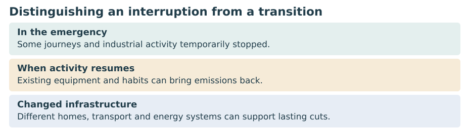

# École polytechnique FUI-FF, session 1 — Anglais 2021 · Corrigé brut

*Corrigé rédigé par IA, non officiel.*

**Rédaction** · modèle exact non renseigné (famille GPT-6) · effort non renseigné · vitesse non renseignée

**Autocontrôle** · modèle exact non renseigné (famille GPT-6) · effort non renseigné · vitesse non renseignée

**Révision** · modèle exact non renseigné (famille GPT-6) · effort non renseigné · vitesse non renseignée

**Révision** · GPT-6.2 Astra Ultra · vitesse non renseignée

**Révision** · GPT-6.2 Astra Ultra · vitesse non renseignée

**Révision (tour 4)** · GPT-6.2 Astra Ultra · vitesse non renseignée

## Reading comprehension

### 1. A lasting climate policy without upheaval

In May 2020 the authors reported a forecast of an eight per cent emissions drop for that year. A climate strategy would need reductions of roughly 7.6 per cent repeatedly throughout the following decade. An involuntary halt that impoverishes families cannot deliver those continuing changes. Planned investment in cleaner transport and energy can reduce pollution while protecting livelihoods, provided its benefits reach people exposed to hardship. (Dilworth et al., lines 9–24 and 62–76).

### 2. Priorities for public policy

The writers urge governments to direct recovery spending towards activities that lower emissions while improving livelihoods. Employing people to restore landscapes, protecting public transport and providing safer journeys without cars are possible examples. The authors call for support for vulnerable workers and international assistance reflecting richer economies’ historical responsibility for emissions. Otherwise, public money could lock in damaging infrastructure or reward companies already profiting from fossil energy. (Dilworth et al., lines 47–75 and 79–90).

### 3. The comparison with climate scepticism

The writers compare the priorities of two constituencies. One rejects action on climate risks. The other wants to reopen economic activity quickly because restrictions affect earnings and personal freedoms. In their account, lifting safeguards or assisting fossil businesses would perpetuate a carbon-dependent economy. The comparison asks what follows when present interests come first. It does not establish that every person worried about a livelihood denies climate science. (Dilworth et al., lines 25–31).

### 4. Evidence of environmental resilience

Quieter streets let wildlife venture into cities, and pandas mated while zoos were closed. Air quality improved too. At publication, an eight per cent annual decline in emissions was still a forecast. The rapid response suggested that easing human pressure can allow ecological activity to recover. The authors do not treat every effect as permanent: resuming previous travel habits could soon increase pollution again, as observations from Chinese cities indicated. (Dilworth et al., lines 9–16 and 81–90).

## Essay

When a storm cuts the electricity across a neighbourhood, the first useful invention may be a piece of paper pinned to a doorway. A resident lists the houses where somebody has a working cooker, a spare blanket or a telephone that can still be charged. By the afternoon, people who / previously barely exchanged greetings may be carrying hot food up several flights of stairs together. An emergency can make abilities and relationships visible that ordinary routines kept apart.

What interests me about this imaginary episode is how little of the response was created from nothing. Someone already knew how to / cook for a crowd. A neighbour had once helped deliver furniture and remembered which building lacked a lift. A shopkeeper recognised an older customer who had missed two usual visits. Circumstances brought these fragments of experience together around a common task. Calling the result improvisation should recognise the years of / unremarked preparation that made it possible.

The claim about generosity nevertheless needs a question about who remains unheard. A resident who cannot read the notice or reach the doorway may receive nothing. Another might hesitate to ask neighbours for help after an earlier quarrel. The person distributing food may have / a job without paid leave and lose income for each hour spent knocking on doors. Neighbours can act courageously without possessing the resources or knowledge to reach everyone. Describing hardship as an opportunity for solidarity can sound particularly hollow to somebody whose home is still cold weeks later.

A public / authority could strengthen the response by making available a heated hall, paying trained staff to visit isolated residents and keeping information accessible in several languages. Volunteers would then have somewhere to direct needs beyond their own means. Afterwards, the council could invite them to explain which places were hard to / reach and why. A better emergency plan might preserve the knowledge discovered during the storm without expecting exhausted residents to replace public services indefinitely.

I find the claim persuasive as an account of a possibility. A crisis can loosen everyday conventions about whom one may approach and what a stranger / might need. It cannot ensure that fear, prejudice or unequal resources disappear. A community shows what it learned when ordinary life resumes: whether the resident who missed the notice has a way to be heard next time, whether those who helped can recover their lost income, and whether decisions made / in a warm council chamber remember what a cold staircase felt like.

*412 words.*
