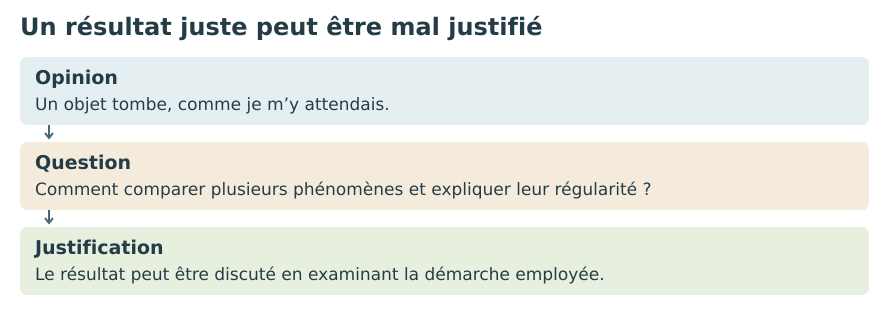

# École polytechnique FUI-FF, session 1 — Français 2021 · Corrigé brut

*Corrigé rédigé par IA, non officiel.*

**Rédaction** · modèle exact non renseigné (famille GPT-6) · effort non renseigné · vitesse non renseignée

**Autocontrôle** · modèle exact non renseigné (famille GPT-6) · effort non renseigné · vitesse non renseignée

**Révision** · modèle exact non renseigné (famille GPT-6) · effort non renseigné · vitesse non renseignée

**Révision** · GPT-6.2 Astra Ultra · vitesse non renseignée

**Révision (tour 3)** · GPT-6.2 Astra Ultra · vitesse non renseignée

Concours 2021, session d’automne. Le lundi 19 octobre 2020, de 13 h 30 à 15 h 30 (deux heures). La compréhension et l’essai de forme libre valent 10 points chacun. La première réponse doit tenir en quelques phrases. Le texte est tiré de *La Formation de l’esprit scientifique* de Gaston Bachelard (1938). [Sujet officiel](https://www.polytechnique.edu/admission-cycle-ingenieur/sites/admission/files/content/2021%20FUI-FF%20S1%20SUJET%20ECRIT%20DE%20FRANCAIS.pdf)

## 1 · La thèse et une phrase qui la résume

Bachelard oppose deux manières de se rapporter aux choses. L’opinion leur attribue d’abord un sens selon l’usage que nous en faisons ou le besoin qu’elles satisfont. La science commence quand on transforme une évidence apparente en problème et qu’on construit les moyens d’y répondre. Une opinion peut coïncider avec un résultat scientifique, mais une coïncidence ne lui donne pas la justification d’une connaissance. Je retiens la phrase suivante : « Pour un esprit scientifique, toute connaissance est une réponse à une question. »

## 2 · Le sens de « en droit »

« En droit » porte sur le titre auquel on prétend savoir. Si je dis qu’un objet lourd tombera parce qu’il me paraît fait pour aller vers le bas, je peux annoncer correctement ce qui se produira lors d’un essai. Cette réussite ne valide pas la raison que je donne. Ainsi, l’opinion peut tomber juste sur le fait. Ce qui lui manque en droit, c’est la justification : si la science confirme le résultat, elle le fait pour d’autres raisons, qui peuvent être exposées et discutées. Pour Bachelard, le travail scientifique doit reconstruire même un résultat qui nous paraissait aller de soi.

## 3 · Les conditions de l’esprit scientifique

Il faut d’abord apercevoir le rôle que jouent notre intérêt et nos habitudes dans notre description d’un objet. Corriger quelques jugements tout en conservant le même mode de justification laisserait intact l’obstacle initial. Une fois cette évidence suspendue, le chercheur peut apprendre à déterminer ce qui fait difficulté et à formuler une question assez précise pour orienter l’enquête. Construire les moyens de distinguer plusieurs réponses possibles est une conséquence de cette exigence. L’attitude scientifique passe par la possibilité de reconnaître que l’on ne sait pas encore poser correctement le problème.

## Question d’analyse · Définir la science, ses enjeux et ses limites

Pour moi, la science est une façon de rendre une question assez précise pour que plusieurs personnes puissent éprouver la réponse et expliquer un désaccord. Une élève qui demande pourquoi la cour de son école est si chaude en été peut entendre aussitôt qu’il faudrait des arbres. C’est peut-être une excellente décision. Pour chercher une explication, elle devra d’abord préciser ce qu’elle mesure : la température de la surface sous ses chaussures, celle de l’air à hauteur de visage ou l’inconfort ressenti par ses camarades. Les trois questions ne demandent pas les mêmes observations.

J’aimerais qu’on forme l’esprit scientifique en donnant aux élèves le temps de reprendre un premier essai. Comparer une cour ombragée le matin avec une autre en plein soleil à midi ne permet pas de connaître le seul effet de l’ombre. Des mesures prises aux mêmes heures, répétées plusieurs jours et accompagnées d’une description du sol rendraient la comparaison plus instructive. Reconnaître la faiblesse de la première mesure serait déjà un résultat de l’enquête.

Cette expérience a aussi une limite scientifique. Des mesures prises pendant une seule semaine ne suffiraient pas à prévoir toutes les chaleurs de l’été ; il faudrait répéter l’observation sur une période plus longue. Une telle démarche a une portée sociale. Elle permet à des habitants, à des enseignants et à une municipalité de discuter d’un aménagement à partir d’observations que chacun peut examiner. Elle a aussi une limite. Une mesure n’indique ni quelle part du budget scolaire consacrer à cette cour ni comment partager l’espace entre jeux de ballon et repos à l’ombre. À mes yeux, respecter la science consiste à demander des raisons contrôlables lorsqu’il s’agit de faits, et à reconnaître les choix collectifs qui commencent lorsqu’il faut décider de leur usage.
