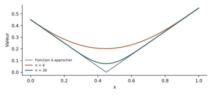

# École polytechnique FUI-FF · Session 1 — Mathématiques 2021 · Corrigé brut

*Corrigé rédigé par IA, non officiel. Signalez toute erreur.*

**Rédaction** · GPT-6.2 Astra Ultra · vitesse non renseignée · 24 novembre 2026

**Révision** · GPT-6.2 Astra Ultra · vitesse non renseignée · 26 novembre 2026

L’épreuve d’automne du concours 2021 a été composée le 19 octobre 2020, en trois heures. Les trois parties portent sur les polynômes de Bernstein, un théorème taubérien de Hardy et Littlewood et une application aux partitions. [Sujet officiel](https://www.polytechnique.edu/admission-cycle-ingenieur/sites/admission/files/content/2021FUI-FF%20Session%201%20SUJET%20de%20MATHEMATIQUES.pdf)

## I. Polynômes de Bernstein

### Question 1

Pour $\delta\ge0$, les couples admissibles forment une partie fermée non vide du carré compact, contenant la diagonale. La fonction continue $|f(x)-f(y)|$ y admet un maximum compris entre zéro et $2\|f\|_\infty$. Par uniforme continuité de $f$, pour tout $\varepsilon>0$ il existe $\eta>0$ tel que $|x-y|<\eta$ entraîne $|f(x)-f(y)|<\varepsilon$. Ainsi $0\le\omega(\delta)\le\varepsilon$ si $0\le\delta<\eta$, donc $\omega(\delta)\to0$.

### Question 2

Les $B_{n,k}=\binom nk x^k(1-x)^{n-k}$ sont de degré au plus $n$. Dans une relation nulle, si $j$ était le premier indice de coefficient $c_j\ne0$, diviser par $x^j$ et faire tendre $x$ vers zéro donnerait $c_j\binom nj=0$, impossible. Les $n+1$ polynômes indépendants forment donc une base de $\mathbb R_n[X]$, y compris pour $n=0$ où la base est $(1)$.

### Question 3

Pour $n\ge1$, $S_n$ suit la loi binomiale de paramètres $n,x$ par indépendance. Par transfert,
$$B_n(f)(x)=\sum_{k=0}^n f(k/n)\binom nk x^k(1-x)^{n-k}.$$
Le degré est **au plus** $n$. Il peut être strictement plus petit que le degré annoncé dans le sujet. Par exemple, pour $f=1$, la formule du binôme donne toujours $B_n(f)=1$. Le quotient $S_n/n$ ne se définit qu’à partir de $n=1$, ce qui suffit à l’approximation.

### Question 4

La différence est au plus $\mathbb E|f(S_n/n)-f(x)|$. Sur $|S_n/n-x|<\delta$, l’écart est au plus $\omega(\delta)$, et sur le complément il est au plus $2\|f\|_\infty$. En prenant l’espérance sur ces deux événements, on obtient
$$|B_n(f)(x)-f(x)|\le\omega(\delta)+2\|f\|_\infty\,\mathbb P\!\left(\left|S_n/n-x\right|\ge\delta\right).$$

La fréquence a pour espérance $x$ et variance $x(1-x)/n\le1/(4n)$. Bienaymé–Tchebychev majore la probabilité du complément par $1/(4n\delta^2)$ pour $\delta>0$, d’où $|B_n(f)(x)-f(x)|\le\omega(\delta)+\|f\|_\infty/(2n\delta^2)$.

### Question 5

Avec $\delta=n^{-1/4}$, la majoration de 4 tend vers zéro indépendamment de $x$. On a donc convergence uniforme sur $[0,1]$. Pour $a<b$, appliquons-la à $g(t)=f(a+(b-a)t)$. Les polynômes $P_n(x)=B_n(g)((x-a)/(b-a))$ convergent uniformément vers $f$ sur $[a,b]$. Pour $a=b$, le polynôme constant $f(a)$ suffit.

## II. Théorème de Hardy et Littlewood

### Question 6

Pour $\varepsilon>0$, choisissons $N$ avec $|a_n-b_n|\le\varepsilon b_n$ si $n\ge N$. Pour $0\le x<1$,
$$|f(x)-g(x)|\le\sum_{n<N}|a_n-b_n|+\varepsilon g(x).$$
Comme $g(x)\to+\infty$, le premier terme divisé par $g(x)$ tend vers zéro. Le rapport de l’écart à $g$ a donc une limite supérieure au plus $\varepsilon$ pour tout $\varepsilon$, d’où $f\sim g$ en $1^-$.

### Question 7

Pour $0\le x<1$, le produit de Cauchy donne $\sum_{n\ge0}s_nx^n=f(x)/(1-x)$. Si $s_n\sim n$, la question 6 avec $b_n=n$ donne $\sum s_nx^n\sim\sum nx^n=x/(1-x)^2$. En multipliant par $1-x$, on obtient $f(x)\sim1/(1-x)$.

### Question 8a

Posons $c=e^{-1}$ et $0<h<\min(c,1-c)$. Pour une minorante continue $u$, prenons zéro jusqu’à $c$, puis $u(t)=(t-c)/(ht)$ sur $[c,c+h]$, et $1/t$ après $c+h$. Pour une majorante $v$, prenons zéro jusqu’à $c-h$, puis le raccord linéaire de zéro à $1/c$ entre $c-h$ et $c$, et $1/t$ à partir de $c$. Alors $u\le\varphi\le v$. La masse de la zone de raccordement est contrôlée par $\int_0^1(v-u)\le 2he$. Choisissons $h$ pour que ce terme soit au plus $\varepsilon/2$. Par 5, approchons $u,v$ par des polynômes $Q,R$ à $\varepsilon/8$ près uniformément. Les polynômes $P^-=Q-\varepsilon/8$ et $P^+=R+\varepsilon/8$ encadrent $\varphi$, et l’intégrale de leur différence vaut au plus $2he+4\varepsilon/8\le\varepsilon$.

### Question 8b

Pour le monôme $P(t)=t^j$, la somme pondérée est $(1-x)f(x^{j+1})$. Quand $x\to1^-$, elle est équivalente à $(1-x)/(1-x^{j+1})$, de limite $1/(j+1)=\int_0^1t^j\,dt$. Toute combinaison linéaire finie conserve la limite, donnant le résultat pour les polynômes.

### Question 8c

Pour $0<x<1$, chaque poids $(1-x)a_nx^n$ est positif ou nul, d’où l’encadrement entre les deux sommes associées à $P^-$ et $P^+$. Elles tendent vers les intégrales de ces polynômes par 8b. Or $\int_0^1\varphi(t)\,dt=\int_{e^{-1}}^1dt/t=1$ est compris entre ces intégrales dont l’écart ne dépasse pas $\varepsilon$. Pour tout $\varepsilon$ cela donne la limite un.

### Question 8d

Pour $x=e^{-1/N}$, $x^n\ge e^{-1}$ équivaut à $n\le N$. Par suite $x^n\varphi(x^n)=1$ pour $0\le n\le N$ et vaut zéro au-delà. La question 8c donne $(1-e^{-1/N})s_N\to1$. Puisque $1-e^{-1/N}\sim1/N$, on conclut $s_N\sim N$.

### Question 9

Prenons $a_n=1+(-1)^n/2$, tous strictement positifs. Le rayon de convergence est un et $f(x)=1/(1-x)+1/[2(1+x)]$. Le second terme est borné près de $1$, donc $f(x)\sim1/(1-x)$. Pourtant les termes pairs valent $3/2$ et les impairs $1/2$.

## III. Partitions en parts distinctes

### Question 10

Pour $|x|<1$, les facteurs $1+x^k/k$ sont strictement positifs. La série $\sum |x|^k/k$ converge et, pour $k$ grand, $|\log(1+x^k/k)|\le2|x|^k/k$. La série des logarithmes converge donc absolument vers un réel fini. Les produits partiels convergent vers son exponentielle, strictement positive.

### Question 11

Un choix $1\le k_1<\cdots<k_r\le n$ donne le monôme $x^{k_1+\cdots+k_r}/(k_1\cdots k_r)$. Pour un exposant $q$ fixé, aucun indice supérieur à $q$ ne peut intervenir. Ainsi le coefficient se stabilise dès $n\ge q$. On a $a_0=1$, et pour $q\ge1$, $a_q$ est la somme des inverses des produits des parts de toutes les partitions distinctes de $q$.

### Question 12a

À une partition de $q$ en $r$ parts, associons l’ensemble de ses $r$ sommes partielles, strictement croissantes entre $1$ et $q$ et terminant en $q$. En les ordonnant puis en faisant les différences successives, on retrouve la partition. L’injection dans les parties à $r$ éléments de $\{1,\ldots,q\}$ donne $P(q,r)\le\binom qr$.

### Question 12b

Pour des parts distinctes $1\le k_1<\cdots<k_r$, $k_j\ge j$, donc $k_1\cdots k_r\ge r!$. Leur nombre est au plus $P(q,r)$, qui compte aussi les partitions avec répétitions. En regroupant par longueur la somme de 11, $a_q\le\sum_{r=1}^q P(q,r)/r!$ pour $q\ge1$.

### Question 12c

Pour $\varepsilon>0$, les termes $1/(r!\varepsilon^r)$ ont un rapport $1/((r+1)\varepsilon)$ tendant vers zéro, donc ils sont bornés par une constante $C_\varepsilon\ge1$. Avec 12a et 12b,
$$a_q\le C_\varepsilon\sum_{r=1}^{q}\binom qr\varepsilon^r\le C_\varepsilon(1+\varepsilon)^q.$$
Pour $q=0$, la même borne suit de $a_0=1$.

### Question 13

La majoration 12c pour tout $\varepsilon>0$ donne un rayon au moins égal à un. La partition à une part donne $a_q\ge1/q$ pour $q\ge1$, donc la série diverge en $x=1$ et le rayon vaut exactement un. Prolongeons les coefficients $a_{q,n}$ des produits finis par zéro au-delà du degré. Ils satisfont $0\le a_{q,n}\le a_q$ et se stabilisent pour chaque $q$. Comme $\sum_q a_q|x|^q$ converge pour $|x|<1$, le passage à la limite sous la somme donne $f(x)=\sum_q a_q x^q$, y compris pour $x<0$.

### Question 14

Pour $0\le x<1$, soustrayons $\sum_{k\ge1}x^k/k=-\log(1-x)$ à $\log f(x)$. L’inégalité $0\le u-\log(1+u)\le u^2/2$ pour $u\ge0$, obtenue en intégrant $t/(1+t)$, majore les valeurs absolues des différences par $1/(2k^2)$. Par convergence dominée, leur somme tend vers
$$\sum_{k\ge1}\left(\log(1+1/k)-1/k\right)
=\lim_{n\to\infty}\left(\log(n+1)-\sum_{k=1}^n1/k\right)=-\gamma.$$
Donc $\log f(x)=-\log(1-x)-\gamma+o(1)$ et $e^\gamma f(x)\sim1/(1-x)$. Les coefficients $e^\gamma a_q$ sont positifs et le rayon est un. La réciproque démontrée en 8 donne $q^{-1}\sum_{j=0}^q a_j\to e^{-\gamma}$.
