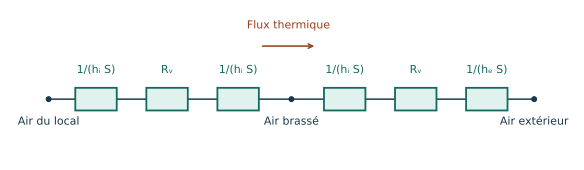
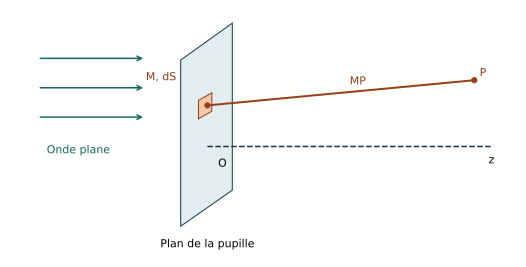
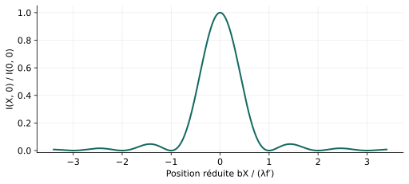
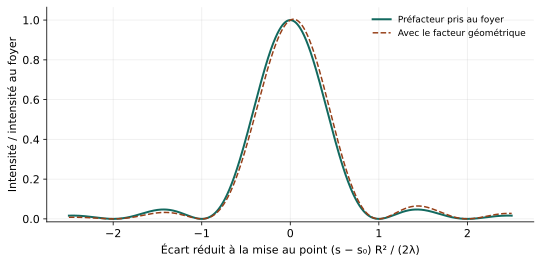

# École polytechnique · FUI-FF, session 1 · Physique 2021 · Corrigé guidé

*Corrigé rédigé par IA, non officiel. Signalez toute erreur.*

**Rédaction** · GPT-6.2 Astra Ultra · vitesse non renseignée · 24 novembre 2026

**Révision** · GPT-6.2 Astra Ultra · vitesse non renseignée · 26 novembre 2026

Session d’automne du concours 2021, épreuve du 20 octobre 2020. Les quatre exercices sont indépendants.

## Présentation du sujet

Dans les trois premiers exercices, repérez la grandeur transportée ou conservée avant de passer aux calculs. La dernière partie demande de distinguer diffraction en champ lointain et focalisation à distance finie. Les unités du paramètre de transparence permettent de repérer une discordance entre les questions 4 et 6.

## Exercice 1 · Analogies électromécaniques

### A.1 · Rappel de deux ressorts

> [!INDICATION]
> Écrivez séparément les allongements à droite et à gauche. Le facteur 2 de la forme demandée fixe la définition de la pulsation.

#### Solution

Les ressorts droit et gauche exercent sur $M_n$ les forces algébriques $K(u_{n+1}-u_n)$ et $-K(u_n-u_{n-1})$. Par la deuxième loi de Newton,

$$m\ddot u_n=K(u_{n+1}+u_{n-1}-2u_n).$$

Dans la forme imprimée, le facteur qui multiplie $2u_n-u_{n+1}-u_{n-1}$ est $\omega_0^2/2$. Ainsi $\omega_0=\sqrt{2K/m}$, de dimension $\mathrm T^{-1}$, en radians par seconde. Une translation uniforme de toute la chaîne laisse les ressorts à leur longueur de repos et vérifie l’équation.

### A.2 · Limite continue

> [!INDICATION]
> Additionnez les développements en $+a$ et $-a$ autour de la même abscisse.

#### Solution

Pour une déformation qui varie sur une longueur grande devant $a$,

$$u(x\pm a,t)=u\pm a u_x+\tfrac12a^2u_{xx}\pm\tfrac16a^3u_{xxx}+O(a^4).$$

Dans la somme des deux déplacements voisins, les termes impairs s’annulent. Au premier ordre non nul, $u_{tt}=(Ka^2/m)u_{xx}$. La célérité est donc $c=a\sqrt{K/m}=a\omega_0/\sqrt 2$, en $\mathrm{m\,s^{-1}}$.

### B.1 · Approximation des régimes quasi stationnaires

> [!INDICATION]
> Comparez le temps de propagation dans une tranche au temps de variation du signal.

#### Solution

Sur chaque tranche de longueur $dx$, le retard électromagnétique est négligeable devant la durée caractéristique de variation. À fréquence fixée, les dimensions de la tranche sont petites devant la longueur d’onde. On peut y appliquer les lois des nœuds et des mailles aux grandeurs instantanées. L’accumulation des retards sur la ligne entière rend possible la propagation recherchée.

### B.2 · Équations de la ligne

> [!INDICATION]
> Fléchez le courant vers les $x$ croissants et comptez la tension du conducteur supérieur par rapport au retour.

#### Solution

Notons $v(x,t)$ la tension appelée $u$ sur le schéma. La chute de tension dans la bobine et le courant dérivé vers le condensateur vérifient

$$v(x,t)-v(x+dx,t)=L\,dx\,\partial_t i(x,t),$$

$$i(x,t)-i(x+dx,t)=G\,dx\,\partial_t v(x+dx,t).$$

En divisant par $dx$ puis en passant à la limite, on obtient $\partial_x v=-L\partial_t i$ et $\partial_x i=-G\partial_t v$. Ici $G$ est la **capacité linéique** en $\mathrm{F\,m^{-1}}$.

### B.3 · Célérité électrique

> [!INDICATION]
> Dérivez la première relation en $x$, puis éliminez le courant grâce à la seconde.

#### Solution

Avec $L,G$ uniformes, $v_{xx}=-L\partial_t(i_x)=LGv_{tt}$. En permutant les deux variables électriques, $i_{xx}=LGi_{tt}$. Les deux ondes ont pour célérité $c=1/\sqrt{LG}$. Le produit $LG$ a la dimension d’un temps au carré par longueur au carré.

### B.4 · Impédance caractéristique

> [!INDICATION]
> Pour une onde progressive, les deux dérivées partielles se déduisent d’une dérivée par rapport à $x-ct$.

#### Solution

Si $i=f(x-ct)$ et $v=g(x-ct)$, la première équation de la ligne donne $g'=Lcf'$. Donc $g=Lcf+\mathrm{constante}$. Pour la composante propagative, après soustraction des niveaux continus éventuels, $v=Z_ci$ avec $Z_c=Lc=\sqrt{L/G}$, en ohms. Le quotient est défini lorsque $i\ne0$. Pour une onde allant dans l’autre sens, la convention de courant fixée en B.2 donne $v=-Z_ci$.

## Exercice 2 · Simple et double vitrage

### 1 · Correspondance électrique

> [!INDICATION]
> Comparez les formes locales des lois de Fourier et d’Ohm.

#### Solution

À $\vec j_{\rm th}=-\lambda\nabla T$ correspond $\vec j_{\rm él}=\sigma\vec E=-\sigma\nabla V$. La densité de flux thermique, la conductivité thermique et la température correspondent respectivement à la densité de courant, la conductivité électrique et le potentiel. Le débit thermique $\Phi$ traversant la surface joue le rôle du courant total.

### 2 · Plaque de verre

> [!INDICATION]
> En régime permanent sans source, chaque section transmet la même puissance thermique.

#### Solution

Prenons $x=0$ sur la face intérieure et $x=e$ sur la face extérieure. La loi de Fourier, avec $\Phi$ constant, rend la pente de $T$ constante. Les températures de paroi imposent

$$T(x)=T_{i,v}+(T_{e,v}-T_{i,v})x/e,\qquad \Phi=\lambda_v S(T_{i,v}-T_{e,v})/e.$$

La résistance du verre est $R_v=e/(\lambda_v S)=0{,}0040/(1{,}6\times1{,}0)=2{,}5\times10^{-3}\ \mathrm{K\,W^{-1}}$.

### 3 · Résistances d’interface

> [!INDICATION]
> Utilisez la différence de température entre l’air et la paroi qui lui fait face.

#### Solution

La loi de Newton $\Phi=hS\Delta T$ donne $R_h=\Delta T/\Phi=1/(hS)$. Pour $S=1{,}0\ \mathrm{m^2}$, $R_i=1/9{,}1\simeq0{,}110\ \mathrm{K\,W^{-1}}$ côté intérieur et $R_e=1/17\simeq0{,}0588\ \mathrm{K\,W^{-1}}$ côté extérieur.

### 4 · Simple vitrage complet

> [!INDICATION]
> Additionnez les chutes de température de l’air intérieur à l’air extérieur.

#### Solution

Les trois éléments portent le même flux. $R_{\rm simple}=R_i+R_v+R_e\simeq0{,}171\ \mathrm{K\,W^{-1}}$. Les deux résistances d’interface fournissent ensemble environ 99 % du total. La plus grande est celle du côté intérieur. Pour les 15 K d’écart imposés, $\Phi$ vaut environ 88 W vers l’extérieur.

### 5 · Lame d’air immobile

> [!INDICATION]
> Dans la couche immobile, reprenez la loi de Fourier en remplaçant l’épaisseur et la conductivité.

#### Solution

Pour $e'=16\ \mathrm{mm}$, $R_{\rm air}=e'/(\lambda_a S)=0{,}016/0{,}03\simeq0{,}53\ \mathrm{K\,W^{-1}}$. Le modèle comporte deux plaques de verre, une lame d’air conductrice et les deux échanges avec les pièces d’air extérieures au vitrage. Ainsi $R_{\rm repos}=R_i+2R_v+R_{\rm air}+R_e\simeq0{,}707\ \mathrm{K\,W^{-1}}$. La couche d’air fournit ici la majeure partie de l’isolation.

### 6 · Air brassé

> [!INDICATION]
> Une résistance de transfert se mesure par le quotient de la chute de température par le flux.

#### Solution

Dans le cœur brassé, les deux extrémités sont à la même température $T_{\rm int,vitre}$, tandis qu’une puissance non nulle traverse l’ensemble. Sa résistance effective $\Delta T/\Phi$ est donc nulle. Les chutes de température dans la cavité se concentrent dans les deux couches limites au contact des vitres.

### 7 · Double vitrage avec convection

> [!INDICATION]
> Décomptez les interfaces portant le coefficient $h_i$ sur le trajet d’une extrémité à l’autre.

#### Solution

La face tournée vers le local et les deux couches limites internes ont chacune la résistance $R_i$. À ces trois termes s’ajoutent deux résistances de verre et l’interface extérieure. Ainsi $R_{\rm conv}=3R_i+2R_v+R_e\simeq0{,}393\ \mathrm{K\,W^{-1}}$. Pour le même écart de température, le flux atteint $15/0{,}393\simeq38\ \mathrm W$.

### 8 · Température au milieu de la cavité

> [!INDICATION]
> Partez de $T_i$ et soustrayez les chutes de température jusqu’à l’air brassé.

#### Solution

Du local jusqu’au cœur de la cavité, la résistance vaut $2R_i+R_v$. Avec $\Phi=(T_i-T_e)/R_{\rm conv}$,

$$T_{\rm int,vitre}=T_i-(2R_i+R_v)\frac{T_i-T_e}{3R_i+2R_v+R_e}\simeq20{,}0-0{,}222\times38{,}1=11{,}5\,{}^\circ\mathrm C.$$

Le calcul depuis l’extérieur donne $T_e+(R_e+R_v+R_i)\Phi$, ce qui fournit le même résultat.

### 9 · Circuit équivalent

> [!INDICATION]
> Placez le nœud correspondant à l’air brassé entre les deux résistances de couche limite.

#### Solution

Les potentiels aux bornes représentent $T_i$ et $T_e$, le courant représente $\Phi$. Le potentiel intermédiaire de la cavité correspond à toute la zone d’air uniforme. La figure montre les six résistances en série dans le modèle avec convection.

## Exercice 3 · Analogie newtonienne d’un trou noir

### 1 · Champ gravitationnel

> [!INDICATION]
> Sur une sphère centrée, quelle masse intervient dans le flux du champ de gravitation ?

#### Solution

La symétrie impose un champ radial. Sur une sphère de rayon $r$, le théorème de Gauss donne $4\pi r^2g_r=-4\pi G M(r)$, où $M(r)$ est la masse intérieure. Pour $r\ge R$, $\vec g=-GM\vec e_r/r^2$. Pour $0<r<R$, $\vec g=-GM(r)\vec e_r/r^2$. Le résultat chiffré en fraction de $M$ à la question suivante suppose une sphère **homogène**. Alors $M(r)=M(r/R)^3$, $\vec g=-GMr\vec e_r/R^3$ et $\vec g(0)=\vec 0$. La seule symétrie sphérique autoriserait d’autres profils intérieurs.

### 2 · Énergie de cohésion

> [!INDICATION]
> Assemblez la sphère en apportant du matériau depuis l’infini sous forme de coquilles minces.

#### Solution

Ajouter la coquille $dm$ à la masse $M(r)$ déjà réunie coûte $dE_G=-GM(r)\,dm/r$, l’énergie à l’infini étant nulle. Pour la sphère homogène, $dm=3Mr^2dr/R^3$ et

$$E_G=-\frac{3GM^2}{R^6}\int_0^R r^4\,dr=-\frac35\frac{GM^2}{R}.$$

Le signe traduit l’attraction. $[G]=\mathrm{L^3 M^{-1}T^{-2}}$ donne $[GM^2/R]=\mathrm{M L^2 T^{-2}}$, dimension d’une énergie.

### 3 · Libération depuis la Terre

> [!INDICATION]
> Prenez l’énergie nulle à l’infini pour une vitesse finale nulle.

#### Solution

Dans le modèle terrestre sphérique, sans atmosphère, le seuil est $mv_{\rm lib}^2/2-GM_Tm/R_T=0$. Avec $R_T=6{,}4\times10^6\ \mathrm m$, $M_T=6{,}0\times10^{24}\ \mathrm{kg}$, on obtient $v_{\rm lib}=\sqrt{2GM_T/R_T}\simeq1{,}12\times10^4\ \mathrm{m\,s^{-1}}=11{,}2\ \mathrm{km\,s^{-1}}$. C’est la norme de la vitesse initiale dans le référentiel géocentrique. La rotation de la Terre compte si l’on demande la vitesse à ajouter par rapport au sol.

### 4 · Rayon associé

> [!INDICATION]
> Remplacez la vitesse de libération par $c$ dans la relation newtonienne.

#### Solution

$2GM/R=c^2$ donne $R_s=2GM/c^2$. Cette longueur coïncide avec le rayon de Schwarzschild d’un objet relativiste sphérique sans rotation. La notion d’horizon causal relève de la relativité générale.

## Exercice 4 · Diffraction et focalisation

### 1 · Superposition des ondelettes

> [!INDICATION]
> Distinguez la distance de propagation et la position de l’élément de surface émetteur.

#### Solution

Prenons des amplitudes complexes en convention temporelle $e^{j\omega t}$ et posons $k=2\pi/\lambda$. Un élément $dS$ centré sur $M$ reçoit l’amplitude incidente $a_i(M)$ et la transmet avec le facteur complexe $t(M)$. Les ondelettes issues de la pupille $\mathcal P$ s’additionnent **en amplitude** au point $P$. Dans l’approximation scalaire paraxiale, le facteur d’obliquité est voisin de un et

$$a(P)=\frac{1}{-j\lambda}\iint_{\mathcal P} a_i(M)t(M)\frac{e^{-jkMP}}{MP}\,dS.$$

Un choix différent d’origine de phase ne change pas l’intensité mesurée. Dans le plan focal d’une lentille idéale, le pixel $(X,Y)$ sélectionne la direction paraxiale de composantes $X/f'$ et $Y/f'$.

### 2 · Diffraction par la fente longue

> [!INDICATION]
> Dans la direction $X$, intégrez les contributions des points d’abscisses $-b/2$ à $b/2$ avec leur différence de phase.

#### Solution

On observe en diffraction de Fraunhofer dans le plan focal image de la lentille. Pour un éclairement uniforme, les directions paraxiales ont une amplitude proportionnelle à la transformée de Fourier de l’ouverture. En posant $\operatorname{sinc}(u)=\sin u/u$, prolongée par $\operatorname{sinc}(0)=1$, l’intégration sur la largeur donne

$$\int_{-b/2}^{b/2}e^{jkxX/f'}\,dx=b\,\operatorname{sinc}\!\left(\frac{\pi bX}{\lambda f'}\right).$$

Dans la coupe $Y=0$, $I(X,0)=I(0,0)\operatorname{sinc}^2(\pi bX/(\lambda f'))$. Les premiers zéros sont à $X=\pm\lambda f'/b$ et le lobe central a pour largeur $2\lambda f'/b$. Pour une hauteur grande mais finie $H$, il faut multiplier par $\operatorname{sinc}^2(\pi H Y/(\lambda f'))$ hors de cette coupe. La diffraction est très étroite selon $Y$.

### 3 · Ouverture rectangulaire

> [!INDICATION]
> Exploitez l’indépendance des bornes d’intégration selon $x$ et $y$.

#### Solution

Sur la pupille centrée de côtés $b$ suivant $x$ et $a$ suivant $y$, l’intégrale se factorise. Ainsi

$$I(X,Y)=I(0,0)\operatorname{sinc}^2\!\left(\frac{\pi bX}{\lambda f'}\right)\operatorname{sinc}^2\!\left(\frac{\pi aY}{\lambda f'}\right).$$

À incidence uniforme, $I(0,0)$ est proportionnelle à $(ab)^2/(\lambda f')^2$ à intensité incidente fixée. Le lobe central s’étend entre les premiers zéros sur une largeur $2\lambda f'/b$ et une hauteur $2\lambda f'/a$.

### 4 · Amplitude axiale de la pupille circulaire

> [!INDICATION]
> Écrivez la distance $MP$ pour un point sur l’axe et rassemblez les facteurs uniformes sur le disque.

#### Solution

Après retrait de la lentille, $MP=\sqrt{z^2+x^2+y^2}$. L’onde incidente a une amplitude $a_0$ de phase uniforme dans le plan de la pupille. On peut donc écrire

$$a(P)=K\iint_{x^2+y^2\le R^2}t(x,y)\frac{e^{-jkMP}}{MP}\,dx\,dy,$$

avec $K=a_0/(-j\lambda)$ dans la convention précédente. L’intégrale a la dimension d’une longueur. Ainsi $[K]=[a]/\mathrm L$, et $K$ s’exprime en $\mathrm{m^{-1}}$ si l’amplitude est normalisée à une valeur sans dimension.

### 5 · Approximation de Fresnel et notation du sujet

> [!INDICATION]
> Contrôlez l’unité du coefficient du terme quadratique de phase avant d’utiliser les inégalités imprimées.

#### Solution

Notons $r^2=x^2+y^2$ et $t=e^{jqr^2}$, où $q$ a pour unité $\mathrm{m^{-2}}$. Pour $R\ll z$, on remplace $1/MP$ par $1/z$. Dans la phase on conserve $MP=z+r^2/(2z)+O(R^4/z^3)$, avec une erreur négligeable en radians si $kR^4/(8z^3)\ll1$. L’intégrale de Fresnel devient

$$a(P)\simeq\frac{2\pi K}{z}e^{-jkz}\int_0^R r e^{j\beta r^2}\,dr,\qquad \beta=q-\frac{k}{2z}.$$

La formule de transparence imprimée donne $q=1/\alpha$, donc $\alpha$ est une aire. Les comparaisons imprimées $R\ll\alpha$ et $\alpha\lambda\ll R^2$ demandent au contraire que $\alpha$ soit une longueur. Pour obtenir la formule de la question 6 avec cette dernière convention, il faut lire $q=k/\alpha$, soit $t=e^{jkr^2/\alpha}$. Les deux lectures sont conservées ci-dessous.

### 6 · Intensité en fonction de la distance

> [!INDICATION]
> Changez de variable de $r$ à $r^2$ et gardez le facteur géométrique $1/z$.

#### Solution

L’intégrale se calcule aussi pour $\beta=0$ par continuité. Posons $w=\beta R^2/2$. Alors

$$a(P)\simeq \frac{\pi K R^2}{z}e^{-jkz}e^{jw}\operatorname{sinc}(w),\qquad I(P)=\frac{\pi^2|K|^2R^4}{z^2}\operatorname{sinc}^2(w),$$

en normalisant $I=|a|^2$. Avec la convention $q=k/\alpha$ requise par la formule demandée,

$$w=\frac{\pi R^2}{\lambda}\left(\frac1\alpha-\frac1{2z}\right).$$

Le préfacteur $C(z)=\pi^2|K|^2R^4/z^2$ dépend de $z$. Autour de la distance focale $f'=\alpha/2$, on peut le geler à $C\simeq4\pi^2|K|^2R^4/\alpha^2$ si la largeur relative du pic est petite (question 7). Avec la transparence imprimée prise littéralement, l’argument est $w=R^2/(2\alpha)-\pi R^2/(2\lambda z)$.

### 7 · Profil en fonction de la vergence d’observation

> [!INDICATION]
> Cherchez le point où les différentes zones de la pupille arrivent en phase, puis les deux premiers zéros.

#### Solution

Posons $s=1/z>0$, $s_0=2q/k$ et $A=\pi R^2/(2\lambda)$. Alors $w=A(s_0-s)$. Le profil $I/s^2$, ou l’intensité à préfacteur gelé près du foyer, est un sinus cardinal au carré centré sur $s_0$. Sa valeur au centre vaut $C$ dans cette dernière approximation. Les zéros sont à $s=s_0+2n\lambda/R^2$, $n$ entier non nul, dans le domaine $s>0$. La largeur entre les deux premiers zéros est $4\lambda/R^2$. Au-delà du lobe central, chaque intervalle entre deux zéros contient un maximum secondaire. En variable $w$, sa position satisfait $w\cos w-\sin w=0$. Le premier, à $|w|\simeq4{,}493$, atteint $\operatorname{sinc}^2(w)\simeq0{,}0472$ fois l’intensité au centre.

Avec $q=k/\alpha$, $s_0=2/\alpha$ et la demi-largeur relative est $\alpha\lambda/R^2\ll1$, ce qui justifie l’approximation sur $C$ dans le lobe central. Le profil géométriquement complet est proportionnel à $s^2\operatorname{sinc}^2[A(s-s_0)]$ et son pic est légèrement décalé vers les grands $s$. On utilise cette expression seulement dans le domaine de validité de l’approximation de Fresnel.

### 8 · Lentille équivalente

> [!INDICATION]
> Identifiez le coefficient de phase à celui d’une lentille mince focalisant une onde plane à la distance $f'$.

#### Solution

La phase de la pupille compense le retard quadratique de propagation lorsque $q=k/(2f')$. Toutes ses zones contribuent alors en phase au point axial. Dans l’approximation paraxiale, la transparence d’une lentille mince convergente est $e^{jkr^2/(2f')}$ avec notre convention temporelle. La convention de la question 6, $q=k/\alpha$, donne **$f'=\alpha/2$**. Avec $t=e^{jr^2/\alpha}$ imprimé à la question 4, le résultat est **$f'=\pi\alpha/\lambda$**, où $\alpha$ est une aire. Chacune de ces expressions a la dimension d’une longueur dans sa propre convention.

## Source

Épreuve écrite de physique, filière universitaire internationale, formation francophone, session 1. [Sujet officiel de l’École polytechnique](https://www.polytechnique.edu/admission-cycle-ingenieur/sites/admission/files/content/2021%20FUI-FF%20S1%20SUJET%20ECRIT%20DE%20PHYSIQUE_0.pdf)
