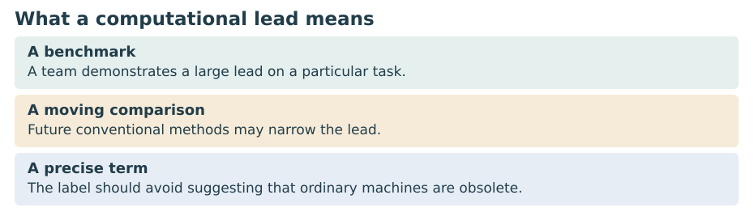

# École polytechnique FUI-FF, session 2 — Anglais 2021 · Corrigé brut

*Corrigé rédigé par IA, non officiel.*

**Rédaction** · modèle exact non renseigné (famille GPT-6) · effort non renseigné · vitesse non renseignée

**Autocontrôle** · modèle exact non renseigné (famille GPT-6) · effort non renseigné · vitesse non renseignée

**Révision** · modèle exact non renseigné (famille GPT-6) · effort non renseigné · vitesse non renseignée

**Révision** · GPT-6.2 Astra Ultra · vitesse non renseignée

**Révision** · GPT-6.2 Astra Ultra · vitesse non renseignée

**Révision (tour 4)** · GPT-6.2 Astra Ultra · vitesse non renseignée

## Reading comprehension

### 1. Reclaiming a term

A new scientific usage could eventually alter the associations of a disputed word. The article contrasts that possibility with present evidence. In the American corpus cited, the phrase linking supremacy to racial hierarchy occurs fifteen times as often as its nearest competitor, which concerns judges. Whether a community should attempt such a change also depends on who supports the effort. The authors report impressions about that support, not survey results. (Durham, Garisto and Wiesner, lines 13–23 and 60–66).

### 2. Scientific and social arguments for “primacy”

The suggested expression conveys coming first on a particular task, while avoiding both an association with racial domination and the prediction that ordinary computers will become useless. It indicates a substantial computational lead more clearly than a word suggesting a modest benefit. The Latin *primus* connects this name with primality, a familiar concept in mathematics. Future improvements in conventional methods could change which machine stays ahead. (Durham, Garisto and Wiesner, lines 67–89).

### 3. Why the context of physics matters

A technical audience has a history as well as a specialist vocabulary. American physics has long offered unequal opportunities, with Black students receiving just two per cent of undergraduate physics degrees in the figures cited. Women also seldom attain full professorships in that field. A word strongly associated with racial hierarchy may therefore discourage people whose place in that field already seems insecure. Choosing another label could show professional courtesy. (Durham, Garisto and Wiesner, lines 13–24, 36–45 and 57–60).

### 4. English as a shared scientific language

A common language allows researchers educated in different countries to exchange and challenge findings. Preskill’s English label for a computational milestone circulated into popular reporting and an international argument over names. The Chinese research team discussed here avoided that wording because its local equivalent also sounded troubling. English therefore helps a term travel without determining how every laboratory will express or understand it. (Durham, Garisto and Wiesner, lines 1–27 and 44–51).

## Essay

Suppose an international physics conference is choosing a title for a lecture about machines. One proposed title is technically familiar to senior researchers, while several younger colleagues say that one word reminds them of people claiming power over others. The organisers could dismiss this concern as an irrelevant association. They / could also remove the word immediately and accuse everyone who previously used it of hostility. Neither response would help them decide what a good title ought to do.

I agree with Pinker that words acquire meaning through human use. A reader can distinguish a technical comparison between machines from an / attack on people. The same expression might be harmless in one sentence and cruel in another. A rule prohibiting a sound wherever it appears would make it difficult to quote history, discuss abuse or even explain why a particular term has become controversial. Speakers deserve to have their intentions heard / before anyone attributes a motive to them.

But context includes the audience as well as the intention of the speaker. A conference title sits on posters, circulates online and may be seen by pupils who never enter the lecture hall. They have no access to the detailed explanation an expert / could supply. If a different title expresses the scientific claim equally accurately and reaches more of those pupils, choosing it is ordinary editorial judgement. Nobody needs to claim that spelling itself causes discrimination or that an established physicist acted maliciously.

I would ask the organisers to compare two possible titles / and state exactly what each implies about the machines. They should also invite junior researchers to describe their reactions without making them responsible for the entire decision. Perhaps the alternative will turn out to make an exaggerated scientific claim. Then another suggestion is needed. Perhaps it will improve both accuracy / and accessibility. Then continuing with the familiar term merely to prove independence would narrow rather than defend discussion.

The strongest part of Pinker’s objection concerns misplaced effort. Changing a poster is easy compared with paying junior researchers fairly, investigating harassment or making selection procedures transparent. A department that announces a / new vocabulary while neglecting those tasks deserves close questioning. Yet treating language carefully need not consume the resources required for institutional change. Listening seriously during a small disagreement may even reveal whose expertise is routinely overlooked when larger decisions are made. I would judge the organisers by the clarity of / the eventual title and by whether the people invited to comment can also influence recruitment, funding and everyday working conditions after the lecture ends.

*424 words.*
