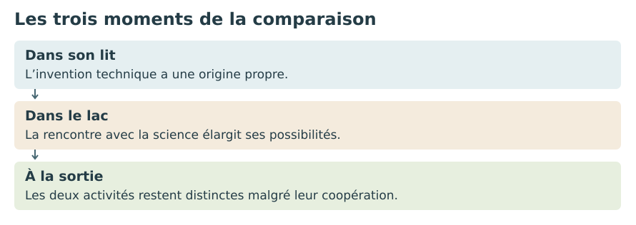
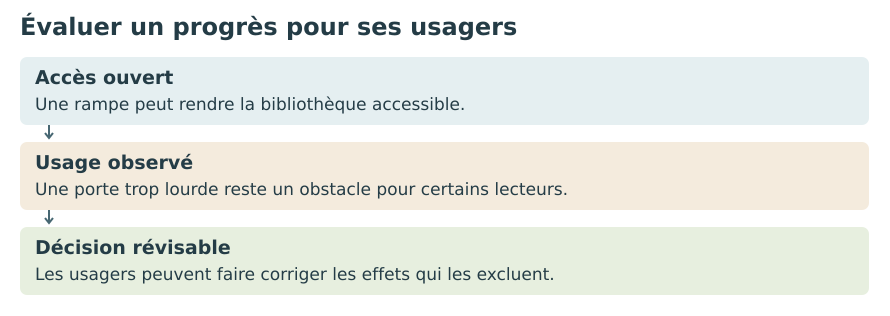

# École polytechnique FUI-FF, session 2 — Français 2021 · Corrigé guidé

*Corrigé rédigé par IA, non officiel.*

**Rédaction** · modèle exact non renseigné (famille GPT-6) · effort non renseigné · vitesse non renseignée

**Autocontrôle** · modèle exact non renseigné (famille GPT-6) · effort non renseigné · vitesse non renseignée

**Révision** · modèle exact non renseigné (famille GPT-6) · effort non renseigné · vitesse non renseignée

Cette épreuve de la filière universitaire internationale de formation francophone dure deux heures. L’extrait vient des Deux Sources de la morale et de la religion (1932). La compréhension comporte trois demandes. L’essai consacré au progrès est libre, sans limite de mots.

[Sujet officiel de la session 2](https://www.polytechnique.edu/admission-cycle-ingenieur/sites/admission/files/content/2021%20FUI-FF%20Session%202%20SUJET%20DE%20FRANCAIS_0.pdf)

## A1 · Invention et connaissance scientifique

> [!INDICATION]
> Conserver les deux étapes : l’invention peut précéder la théorie, puis l’appui de la science accroît sa puissance.

Bergson distingue l’aptitude à inventer des machines de la science théorique. Des dispositifs ingénieux ont existé avant la science moderne, et des travailleurs découvrent encore des perfectionnements qui n’avaient pas été déduits par les ingénieurs. Les deux activités peuvent cependant se rencontrer. La science donne alors à l’invention une ampleur qu’elle n’avait pas quand elle se développait seule. La machine à vapeur illustre ce double mouvement : une réalisation pratique peut précéder la théorie qui rend ensuite de nouveaux progrès possibles.

## A2 · Le don d’inventer

> [!INDICATION]
> Pourquoi l’ouvrier qui améliore un dispositif constitue-t-il un exemple décisif ?

Parler de « don naturel » revient à reconnaître une capacité humaine à imaginer et à perfectionner des dispositifs sans attendre qu’une théorie en ait fourni le plan. Un ouvrier qui connaît les mouvements d’une machine par son travail peut apercevoir une modification que le concepteur n’avait pas envisagée. Bergson ne prétend pas que les objets techniques seraient produits par la nature sans apprentissage ni effort. Il veut établir que l’invention possède une origine propre et que la science lui prête ensuite une puissance supplémentaire.

## A3 · Le Rhône et le lac

> [!INDICATION]
> Identifier ce que signifie l’entrée dans le lac puis la sortie ; rattacher chaque moment à la thèse.

Le Rhône représente l’esprit d’invention. Son lit d’abord étroit évoque les possibilités limitées d’une technique livrée à ses seules ressources. La rencontre avec le lac de Genève figure l’élargissement que permet la science. À l’intérieur du lac, le fleuve semble avoir perdu son identité ; à sa sortie il poursuit pourtant son cours. L’image sert à comprendre qu’une collaboration très étroite peut donner l’impression d’une fusion sans abolir la distinction entre les deux activités.

## B · Qu’appeler un progrès ?

> [!INDICATION]
> Choisir un changement concret et préciser à quelles conditions il élargit réellement les possibilités d’agir.

Je parlerais de progrès quand une nouveauté augmente une possibilité réelle de vivre ou d’agir et que l’on peut expliquer pour qui cette possibilité s’est ouverte. Prenons la rampe à l’entrée d’une bibliothèque. Sa construction ne constitue pas une découverte scientifique remarquable. Elle peut pourtant transformer la semaine d’une personne qui, jusque-là, devait attendre dehors pendant qu’un proche allait chercher ses livres. La discussion avec cette personne peut apporter un enseignement que le plan initial ne contenait pas : une rampe peu inclinée ne sert à rien si la porte à son sommet reste trop lourde à pousser.

Le même critère fait apparaître des limites. Une bibliothèque qui remplacerait tous ses guichets par une application permettrait peut-être à plusieurs lecteurs de gagner du temps. Elle pourrait aussi priver un habitant sans téléphone de la possibilité de s’inscrire. Une augmentation de la vitesse moyenne du service cacherait alors la disparition de l’accès pour certains. Je voudrais que l’on puisse mesurer ces deux effets et conserver une voie utilisable par ceux qui risquent de se trouver exclus.

Ce qui me paraît dangereux est donc moins la nouveauté que le moment où il devient impossible de la discuter ou de la corriger. Comme le suggère la distinction de Bergson, découvrir comment faire fonctionner un dispositif et savoir à quelles fins l’employer sont deux questions différentes. Une institution progresse aussi lorsqu’elle accepte de laisser des usagers modifier une invention dont les effets leur seront imposés chaque jour.

> [!METHODE]
> Pour terminer, relier la portée de l’exemple à la question posée. La conclusion personnelle doit pouvoir être comprise par quelqu’un qui découvre cet exemple.
