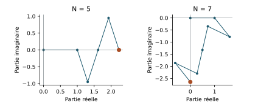

# École polytechnique FUI-FF · Session 2 — Mathématiques 2021 · Corrigé brut

*Corrigé rédigé par IA, non officiel. Signalez toute erreur.*

**Rédaction** · GPT-6.2 Astra Ultra · vitesse non renseignée · 24 novembre 2026

**Révision** · GPT-6.2 Astra Ultra · vitesse non renseignée · 26 novembre 2026

L’épreuve de printemps du concours 2021 dure trois heures. Le premier problème calcule les multiplicités des valeurs propres de la transformée discrète pour une taille impaire. Les deux suivants établissent une inversion de Fourier puis une limite gaussienne pour des variables de Bernoulli. [Sujet officiel](https://www.polytechnique.edu/admission-cycle-ingenieur/sites/admission/files/content/2021%20FUI-FF%20Session%202%20SUJET%20DE%20MATHS_0.pdf)

## I. Transformation de Fourier discrète

### Question 1

Les sorties $y_k$ sont des combinaisons linéaires des $x_n$, donc $D$ est linéaire de $\mathbb C^N$ dans lui-même. Pour des indices allant de zéro à $N-1$ et $\zeta=e^{-2\pi i/N}$, sa matrice est $U_{kn}=N^{-1/2}\zeta^{kn}$. Ce choix du signe de l’exposant fixe notamment le signe de la somme de Gauss calculée ensuite.

### Question 2

Si $N\mid q$, $\zeta^q=1$ et la somme vaut $N$. Sinon $\sum_{n=0}^{N-1}\zeta^{nq}=(1-\zeta^{Nq})/(1-\zeta^q)=0$. Le calcul dépend uniquement de la classe de $q$ modulo $N$ et vaut donc aussi pour un entier négatif.

### Question 3

Le coefficient $(k,l)$ de $UU^*$ vaut $N^{-1}\sum_n\zeta^{n(k-l)}$, soit un pour $k=l$ et zéro sinon. La matrice carrée est unitaire, $U^{-1}=U^*$. On obtient
$$(D^{-1}y)_n=N^{-1/2}\sum_{k=0}^{N-1}y_k e^{2\pi i nk/N}.$$

### Question 4

Dans $(D^2x)_k$, le coefficient de $x_j$ vaut $N^{-1}\sum_l\zeta^{l(k+j)}$, donc $(D^2x)_k=x_{-k\bmod N}$. Une deuxième inversion des indices restitue le vecteur initial. Ainsi $D^4=\mathrm{Id}$, et $U$ est annulée par $X^4-1$, scindé à racines simples sur $\mathbb C$. Elle est diagonalisable et ses valeurs propres sont parmi $1,-1,i,-i$.

### Question 5a

Dans les paires non ordonnées de deux indices distincts, chaque entier de $0$ à $N-1$ apparaît $N-1$ fois. Ainsi $\sum_{0\le l<k<N}(k+l)=(N-1)\sum_{j=0}^{N-1}j=N(N-1)^2/2$.

### Question 5b

Posons $K=N(N-1)/2$. Vandermonde donne $\det U=N^{-N/2}\prod_{l<k}(\zeta^k-\zeta^l)$. Or
$$\zeta^k-\zeta^l=(-i)e^{-\pi i(k+l)/N}\,2\sin\frac{\pi(k-l)}N.$$
En multipliant, le facteur exponentiel vaut $e^{-\pi i(N-1)^2/2}=1$, car $N$ est impair. On obtient le facteur $(-i)^K=i^K(-1)^K$ et le produit de sinus du sujet. Tous les sinus sont strictement positifs. Le module du déterminant valant un par 3, sa valeur exacte est déjà $(-i)^K$.

En particulier, avec $K=N(N-1)/2$, l’expression complète de l’énoncé et la normalisation du produit sont
$$
\det U=N^{-N/2}i^K(-1)^K\prod_{0\le l<k<N}2\sin\frac{\pi(k-l)}{N},
\qquad \prod_{0\le l<k<N}2\sin\frac{\pi(k-l)}{N}=N^{N/2}.
$$
Pour $N=1$, le produit vide vaut un.

### Question 6

Avec $S=\sum_l\zeta^{l^2}$ on trouve $|S|^2=\sum_{l,m}\zeta^{(l-m)(l+m)}$. Modulo $N$ impair, deux est inversible, donc $(l,m)\mapsto(u,v)=(l-m,l+m)$ est une bijection de $(\mathbb Z/N\mathbb Z)^2$. On obtient $\sum_u\sum_v\zeta^{uv}$. Par 2, seule la ligne $u=0$ contribue et vaut $N$. Ainsi $|S|=\sqrt N$.

### Question 7

La trace est $S/\sqrt N=(m_1-m_{-1})+i(m_i-m_{-i})$. Par 6 son module est un. Deux carrés d’entiers dont la somme vaut un sont zéro et un dans un certain ordre. D’où l’identité demandée et $S=\varepsilon\eta\sqrt N$ avec $\varepsilon\in\{-1,1\}$, $\eta\in\{1,i\}$.

### Question 8

D’après 4, $U^2$ permute les indices par $k\mapsto-k$. Pour $N$ impair, seul zéro est fixe. Chaque paire non fixe échange deux coordonnées et ne contribue pas à la trace. Ainsi $\operatorname{tr}U^2=1$. Dans une base propre de $U$, la même trace vaut $m_1+m_{-1}-m_i-m_{-i}$.

### Question 9

En ajoutant et retranchant la relation de 8 au total $N$, les effectifs réels et imaginaires sont $R=(N+1)/2$ et $T=(N-1)/2$. Leurs différences respectives ont les mêmes parités que leurs sommes. Si $N=4M+1$, $R$ est impair et $T$ pair, donc la différence non nulle de 7 est réelle et $\eta=1$. Si $N=4M+3$, c’est l’inverse et $\eta=i$.

### Question 10

Pour $N=4M+1$, on a $m_i=m_{-i}=M$ et $m_{-1}=M+(1-\varepsilon)/2$. Ainsi le produit des valeurs propres vaut $(-1)^M\varepsilon=i^K\varepsilon$, car $K=(4M+1)2M$. Pour $N=4M+3$, $m_1=m_{-1}=M+1$ et $m_{-i}=M+(1-\varepsilon)/2$. Les $2M+1$ valeurs propres imaginaires ont pour produit $i^{2M+1}(-1)^{m_{-i}}$, donc le déterminant vaut $-i^{2M+1}\varepsilon=i^K\varepsilon$, puisque $K=(4M+3)(2M+1)\equiv2M+3\pmod4$. Comparer avec $(-i)^K$ en 5b donne $\varepsilon=(-1)^K$, soit $+1$ si $N\equiv1$ et $-1$ si $N\equiv3\pmod4$.

### Question 11

Pour $N=4M+1$, les effectifs réels ont somme $2M+1$ et différence $1$, les effectifs imaginaires somme $2M$ et différence zéro. Dans l’ordre $(1,-1,i,-i)$, les multiplicités sont donc $(M+1,M,M,M)$. Pour $N=4M+3$, les réels ont somme $2M+2$ et différence zéro, les imaginaires somme $2M+1$ et différence $-1$. Les multiplicités sont $(M+1,M+1,M,M+1)$. Ces formules incluent $N=1$.

## II. Transformation de Fourier sur l’espace de Schwartz

### Question 12

Pour $u$ continue intégrable, $|u(x)e^{-2\pi ixy}|=|u(x)|$ donne la convergence absolue et $|\widehat u(y)|\le\int_{\mathbb R}|u|$ pour tout $y$. Si $y_n\to y$, l’intégrande converge ponctuellement avec le même majorant intégrable. La convergence dominée donne $\widehat u(y_n)\to\widehat u(y)$.

### Question 13

Pour $u\in\mathcal S$, toute fonction $|x|^j|u(x)|$ est intégrable. Elle est bornée sur les compacts et majorée à l’infini par $C/(1+x^2)$ en utilisant la décroissance rapide. La dérivée d’ordre $j$ de l’intégrande en $y$ vaut $(-2\pi ix)^ju(x)e^{-2\pi ixy}$, dominée par $(2\pi)^j|x|^j|u(x)|$. La dérivation sous le signe intégral à tout ordre donne $\widehat u\in C^\infty$ et $(\widehat u)^{(\alpha)}=\mathcal F[(-2\pi ix)^\alpha u]$.

### Question 14

Toutes les dérivées de $u$ sont intégrables et tendent vers zéro à l’infini par décroissance rapide. Sur un intervalle fini, l’intégration par parties transfère la dérivée de $u$ sur le noyau en produisant le facteur $2\pi i y$. Les termes $u(x)e^{-2\pi ixy}$ aux deux extrémités tendent vers zéro. En répétant avec les dérivées successives, on obtient $\widehat{u^{(\alpha)}}(y)=(2\pi i y)^\alpha\widehat u(y)$, y compris pour $\alpha=0$.

### Question 15

Fixons $a,b\ge0$ et $v(x)=(-2\pi ix)^b u(x)$. Cette fonction appartient à $\mathcal S$ par la formule de Leibniz. Les questions 13 et 14 donnent $(2\pi i y)^a(\widehat u)^{(b)}(y)=\widehat{v^{(a)}}(y)$. Par 12, le membre de droite est uniformément borné car $v^{(a)}$ est intégrable. Avec la régularité de 13, ceci établit $\widehat u\in\mathcal S$.

### Question 16

Pour $w(x)=e^{-\pi x^2}$, chaque dérivée est un polynôme fois la même gaussienne. Multipliées par des puissances de $x$, elles sont toutes bornées, donc $w\in\mathcal S$. Comme $w'=-2\pi xw$, les questions 13 et 14 donnent $\widehat w'=i\widehat{w'}=-2\pi y\widehat w$. Ainsi $\widehat w(y)=C e^{-\pi y^2}$. En zéro, le changement $t=\sqrt\pi x$ dans l’intégrale gaussienne admise donne $C=\int w=1$. Donc $\widehat w=w$.

### Question 17

Pour $u,v\in\mathcal S$, $|u(x)v(y)e^{-2\pi ixy}|=|u(x)||v(y)|$ est majoré par un produit de fonctions continues intégrables. Le théorème de Fubini permet d’intégrer d’abord en $x$ puis en $y$, ou inversement. Cela donne $\int\widehat u(y)v(y)\,dy=\int u(x)\widehat v(x)\,dx$. Ces deux intégrales sont absolument convergentes en vertu de 12 et de l’intégrabilité de $u,v$. La formule est bilinéaire, sans conjugaison.

### Question 18

Fixons $x\in\mathbb R$ et $t\ne0$. Posons $v(y)=e^{-\pi t^2y^2} e^{-2\pi ixy}$, qui est dans $\mathcal S$. Par changement de variable et 16, $\widehat v(s)=|t|^{-1}e^{-\pi((s+x)/t)^2}$. La question 17 transforme le membre de gauche en $\int u(s)\widehat v(s)\,ds$. Le changement $s=ty-x$, en tenant compte du sens si $t<0$, donne
$$\int_{\mathbb R}\widehat u(y)e^{-\pi t^2y^2}e^{-2\pi ixy}\,dy
=\int_{\mathbb R}u(ty-x)e^{-\pi y^2}\,dy.$$
Le passage à $t=0$ se fait par continuité dominée dans la question suivante.

### Question 19

À gauche en 18, $|\widehat u(y)|$ est intégrable par 15, donc la limite est $\mathcal F^2u(x)$. À droite, $\|u\|_\infty e^{-\pi y^2}$ est intégrable, et la limite vaut $u(-x)\int e^{-\pi y^2}dy=u(-x)$. Ainsi $\mathcal F^2$ est la réflexion $R:u(x)\mapsto u(-x)$, d’où $\mathcal F^4=\mathrm{Id}$. Sur $\mathcal S$, $\mathcal F$ est bijective, d’inverse $\mathcal F^3=R\mathcal F$, soit $\mathcal F^{-1}v(x)=\int v(y)e^{2\pi ixy}\,dy$.

## III. Théorème de De Moivre–Laplace

### Question 20

Chaque Bernoulli de paramètre $p$ a espérance $p$ et variance $p(1-p)$. Par linéarité, $\mathbb E S_n=np$. L’indépendance donne des covariances nulles et $\operatorname{Var}(S_n)=np(1-p)$.

### Question 21

Pour $n>2|z|$, la série du logarithme au voisinage de un donne $\log(1+z/n)=z/n+O_z(n^{-2})$. Ainsi $n\log(1+z/n)\to z$, et en prenant l’exponentielle $(1+z/n)^n\to e^z$. Le logarithme utilisé est celui donné par sa série pour $|z/n|<1$, donc son exponentielle restitue bien $1+z/n$.

L’indication de l’énoncé donne aussi une preuve qui évite le logarithme complexe. Pour $k\le n$, le coefficient de $z^k$ dans $(1+z/n)^n$ vaut $\frac1{k!}\prod_{j=0}^{k-1}(1-j/n)\le1/k!$. Il est nul pour $k>n$. Les coefficients de la différence avec $e^z$ sont donc positifs ou nuls, d’où
$$ |e^z-(1+z/n)^n|\le e^{|z|}-(1+|z|/n)^n\longrightarrow0. $$

### Question 22

Soit $Y=(X_1-p)/\sqrt{p(1-p)}$, bornée, d’espérance nulle et de moment d’ordre deux égal à un. Pour $t$ fixé, le développement de l’exponentielle donne
$$\mathbb E e^{-2\pi itY/\sqrt n}=1-\frac{2\pi^2t^2}{n}+O_t(n^{-3/2}),$$
le reste étant uniformément contrôlé par une constante fois $|Y|^3/n^{3/2}$. L’indépendance et la représentation de $S_n^*$ comme somme réduite donnent la puissance $n$ de cette quantité. Le raisonnement logarithmique de 21 montre que cette puissance tend vers $e^{-2\pi^2t^2}$.

### Question 23

Par 19, $\varphi(s)=\int\widehat\varphi(t)e^{2\pi its}\,dt$. Pour chaque $n$, $S_n^*$ a un nombre fini de valeurs, donc on peut sommer les espérances sous l’intégrale. Le module de la fonction caractéristique est au plus un et $|\widehat\varphi|$ est intégrable. Par 22 appliquée à $-t$ puis convergence dominée, la limite vaut $\int \widehat\varphi(t)e^{-2\pi^2t^2}\,dt$. La densité $g(x)=(2\pi)^{-1/2}e^{-x^2/2}$ a précisément $\widehat g(t)=e^{-2\pi^2t^2}$ par 16 et changement d’échelle. Puisque $g$ est paire, $\mathcal F(\widehat g)=g$ par 19. La question 17 appliquée à $\varphi,\widehat g$ donne finalement $\int \varphi(x)g(x)\,dx$, ce qui est la formule demandée.
