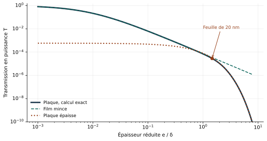
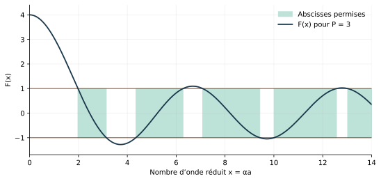

# École polytechnique · FUI-FF, session 2 · Physique 2021 · Corrigé brut

*Corrigé rédigé par IA, non officiel. Signalez toute erreur.*

**Rédaction** · GPT-6.2 Astra Ultra · vitesse non renseignée

**Révision** · GPT-6.2 Astra Ultra · vitesse non renseignée · 26 novembre 2026

Session de printemps 2021. Les trois exercices sont indépendants.

## Exercice 1 · Transmission d’une lame mince

### 1 · Onde incidente

On choisit $\mathbf e_y$ comme direction de polarisation. Le champ réel incident s’écrit $\mathbf E_i=E_0\cos(kx-\omega t+\phi)\mathbf e_y$, avec $\mathbf k=k\mathbf e_x$, $k=2\pi/\lambda=\omega/c$. Les fronts d’onde sont les plans $x=\mathrm{constante}$. À $\lambda=10\,\mu\mathrm m$, $\nu=c/\lambda=3,0\times10^{13}\,\mathrm{Hz}$, soit **30 THz, dans l’infrarouge moyen**. Dans la suite, le champ physique est la partie réelle d’une amplitude complexe multipliée par $e^{-i\omega t}$.

### 2 · Relaxation des charges dans l’or

Dans le métal homogène, $\partial_t\rho=-\nabla\cdot\mathbf J=-\sigma\nabla\cdot\mathbf E=-(\sigma/\varepsilon_0)\rho$. Ainsi $\rho(\mathbf r,t)=\rho(\mathbf r,0)e^{-t/\tau}$, où $\tau=\varepsilon_0/\sigma\simeq1,97\times10^{-19}\,\mathrm s$. Ici $\varepsilon_0$ est la permittivité **absolue** du vide. La période optique $1/\nu\simeq3,33\times10^{-14}\,\mathrm s$ dépasse $\tau$ d’environ cinq ordres de grandeur. Dans ce modèle ohmique toute charge excédentaire en volume disparaît donc sur une durée négligeable à l’échelle du champ. Une charge de surface reste possible.

### 3 · Équation du champ électrique

Comme $\nabla\cdot\mathbf E=0$ dans le volume neutre, $\nabla\times(\nabla\times\mathbf E)=-\Delta\mathbf E$. Par ailleurs $\nabla\times\mathbf B=\mu_0\sigma\mathbf E+\mu_0\varepsilon_0\partial_t\mathbf E$ et $\nabla\times\mathbf E=-\partial_t\mathbf B$. On en déduit

$$\Delta\mathbf E-\mu_0\varepsilon_0\,\partial_t^2\mathbf E=\mu_0\sigma\,\partial_t\mathbf E.$$

Dans la notation du sujet, $\alpha=\mu_0\varepsilon_0=1/c^2$ et $\beta=\mu_0\sigma$.

### 4 · Dispersion et longueur de peau

Notons $q$ le nombre d’onde dans l’or et réservons $k=\omega/c$ au vide, car les deux interviennent à l’interface. La dispersion est $q^2=k^2+i\mu_0\sigma\omega$. Or $\varepsilon_0\omega/\sigma\simeq3,7\times10^{-5}$ avec $\omega=1,88\times10^{14}\,\mathrm{s^{-1}}$. Au premier ordre du bon conducteur,

$$q=\pm(1+i)/\delta,\qquad \delta=\sqrt{2/(\mu_0\sigma\omega)}\simeq1,37\times10^{-8}\,\mathrm m.$$

La racine de partie imaginaire positive décrit un champ progressif dont l’amplitude décroît comme $e^{-x/\delta}$. La feuille de $20\,\mathrm{nm}$ a une épaisseur égale à $1,46\,\delta$. Elle est mince devant la longueur d’onde du vide, mais son épaisseur est comparable à la longueur de peau.

### 5 · Ondes de la région 1

L’amplitude $U_1$ vérifie $U_1''+k^2U_1=0$, donc $U_1(x)=Ae^{ikx}+Be^{-ikx}$. Dans $\operatorname{Re}(U_1e^{-i\omega t})$, le premier terme se propage vers $+x$, le second vers $-x$. La question imprime $Be^{i(kx+\omega t)}$ pour le second terme. Sa partie réelle s’écrit aussi $\operatorname{Re}(B^*e^{-ikx-i\omega t})$. Le nom $B$ est repris ici pour l’amplitude réfléchie avec la convention temporelle commune.

### 6 · Champs électriques dans les régions 2 et 3

Avec $0<x<e$ puis $x>e$, les amplitudes scalaires suivant $\mathbf e_y$ sont

$$U_2=Ce^{iqx}+De^{-iqx},\qquad U_3=Ee^{ikx}+Fe^{-ikx}.$$

L’éclairage vient de la gauche. Aucune source à droite n’émet d’onde revenant vers la lame, donc **$F=0$**. Le terme en $D$ dans la lame est en revanche nécessaire pour raccorder le champ à sa deuxième face. Sur un intervalle fini son augmentation avec $x$ est compatible avec l’atténuation d’une onde se propageant vers $-x$.

### 7 · Champs magnétiques

Pour $\mathbf E=U(x)e^{-i\omega t}\mathbf e_y$ en écriture complexe, $\mathbf B=U'(x)e^{-i\omega t}\mathbf e_z/(i\omega)$. En omettant le facteur commun $e^{-i\omega t}\mathbf e_z$, les trois amplitudes sont donc

$$B_{1z}=\frac{k}{\omega}(Ae^{ikx}-Be^{-ikx}),\quad B_{2z}=\frac{q}{\omega}(Ce^{iqx}-De^{-iqx}),$$

$$B_{3z}=\frac{k}{\omega}Ee^{ikx}.$$

Le changement de signe pour les ondes de retour correspond à l’inversion du sens du flux d’énergie.

### 8 · Transmission en puissance

Dans le vide $Z_0=\mu_0c$ et $\langle S_x\rangle=|U|^2/(2Z_0)$ pour une onde plane progressive vers $+x$. Le vide étant présent des deux côtés, on a $T=\langle S_{3x}\rangle/\langle S_{ix}\rangle=|E/A|^2$. Dans la lame de conductivité finie le courant est distribué en volume. Le modèle ne comporte pas de nappe de courant singulière à ses faces. Les composantes tangentielles de $\mathbf E$ et $\mathbf B$ y sont donc continues, ce qui revient à raccorder $U$ et $U'$.

### 9 · Résultat exact et limites d’épaisseur

En posant $u=Ee^{ike}$, on a $U(e)=u$, $U'(e)=iku$. La propagation inverse dans l’or donne $U(0)=u[\cos(qe)-i(k/q)\sin(qe)]$ et $U'(0)=u[q\sin(qe)+ik\cos(qe)]$. Le raccordement aux amplitudes $A,B$ fournit

$$T=\left|\cos(qe)-\frac{i}{2}\left(\frac qk+\frac kq\right)\sin(qe)\right|^{-2}.$$

En particulier $T(0)=1$. Pour $e\ll\delta$ et $k\delta\ll1$, on développe le sinus et le cosinus. Le dénominateur en amplitude vaut au premier ordre $1-i e(q^2+k^2)/(2k)=1+Z_0\sigma e/2-ike$. Le terme de phase est petit. On obtient **$T\simeq(1+Z_0\sigma e/2)^{-2}$**, décroissant avec l’épaisseur ou la conductivité. À conductivité constante, cette approximation de film mince est indépendante de la fréquence.

L’exponentielle imprimée s’obtient dans la limite **$e\gg\delta$**. En effet, si $\operatorname{Im}q>0$, le terme $e^{-iqe}$ domine dans le dénominateur, avec le coefficient $(q+k)^2/(4kq)$. Il vient

$$T\simeq\left|\frac{4kq}{(k+q)^2}\right|^2e^{-2e/\delta},\qquad \gamma\simeq8(k\delta)^2=16\varepsilon_0\omega/\sigma\quad(k\delta\ll1).$$

Ici $\gamma$ est indépendant de l’épaisseur. Une épaisseur plus grande accentue l’atténuation. Une augmentation de $\sigma$ réduit le préfacteur et la profondeur de peau. À $\sigma$ constante, $\gamma\propto\omega$ alors que $1/\delta\propto\sqrt\omega$ et l’exponentielle domine dans la limite épaisse. Pour les données du sujet $k\delta=0,0086$, $e/\delta=1,46$. La formule exacte donne $T\simeq2,84\times10^{-5}$. À cette même épaisseur, la limite mince donne $3,43\times10^{-5}$ et la limite épaisse avec son préfacteur $|4kq/(k+q)^2|^2$ donne $3,14\times10^{-5}$. Les deux écarts par rapport au résultat exact sont respectivement de $21\,\%$ et $11\,\%$.

## Exercice 2 · Écrantage de Debye

### 1 · Densités d’équilibre

Un état d’énergie potentielle $qV$ est pondéré par $\exp[-qV/(k_BT)]$ à l’équilibre thermodynamique. À l’infini, $V=0$ et chaque densité tend vers $n_e$. Au voisinage de l’ion positif, $V>0$, la densité $n_-=n_e e^{eV/(k_BT)}$ augmente, tandis que $n_+=n_e e^{-eV/(k_BT)}$ diminue. Ces deux variations contribuent au même excès de charge négative.

### 2 · Charge volumique

Pour $r>0$, on a $\rho=e(n_+-n_-)=-2en_e\sinh[eV/(k_BT)]$. L’ion fixe à l’origine a une charge ponctuelle $+e$. Sa contribution serait $e\,\delta^{(3)}(\mathbf r)$ si l’on décrivait également le point $r=0$.

### 3 · Équation de Poisson

L’équation de Poisson est $\Delta V=-\rho/\varepsilon_0$. À symétrie sphérique, pour $r>0$,

$$\frac1{r^2}\frac{\mathrm d}{\mathrm dr}\left(r^2\frac{\mathrm dV}{\mathrm dr}\right)=-\frac{\rho(r)}{\varepsilon_0}=\frac{2en_e}{\varepsilon_0}\sinh\!\left(\frac{eV}{k_BT}\right).$$

La substitution des densités à l’équilibre donne l’équation non linéaire de Poisson-Boltzmann.

### 4 · Linéarisation

Pour $|eV|\ll k_BT$, $\rho\simeq-2n_e e^2V/(k_BT)$. Posons $\kappa^2=2n_e e^2/(\varepsilon_0k_BT)>0$. Alors $\Delta V=\kappa^2V$. Si $u=rV$, $(r^2V')'=ru''$, donc **$u''-\kappa^2 u=0$** pour $r>0$. Le facteur deux provient de la mobilité des ions et des électrons dans le modèle du sujet.

### 5 · Forme générale

Ses racines sont $-\kappa$ et $+\kappa$. La solution est $u(r)=Ae^{-\kappa r}+Be^{+\kappa r}$. Dans la notation de l’énoncé $u=Ae^{-\alpha r}+Be^{-\beta r}$, on peut prendre $\alpha=\kappa$ et $\beta=-\kappa$. Leur permutation échange les noms des constantes.

### 6 · Conditions aux limites

La condition $V(\infty)=0$ élimine $Be^{+\kappa r}/r$, donc $B=0$. À travers une petite surface sphérique entourant l’ion, le flux du champ électrique tend vers $e/\varepsilon_0$ lorsque $r\to0$. Ainsi $V\sim e/(4\pi\varepsilon_0r)$ et $A=e/(4\pi\varepsilon_0)$. Les constantes des exposants sont $\alpha=\kappa$ et $\beta=-\kappa$. On utilise ici la condition coulombienne admise pour raccorder la solution linéarisée à la source. Au cœur même de l’ion, le critère de faible potentiel utilisé en question 4 cesse d’être valable.

### 7 · Potentiel et longueur de Debye

Les constantes précédentes donnent

$$V(r)=\frac{e}{4\pi\varepsilon_0r}\exp(-r/\lambda_D),\qquad \lambda_D=\sqrt{\frac{\varepsilon_0 k_BT}{2n_e e^2}}.$$

Le rapport sous la racine a pour unité $\mathrm m^2$. La contribution des deux espèces chargées à température commune apparaît dans le dénominateur.

### 8 · Interprétation physique

Le rapport au potentiel coulombien vaut $e^{-r/\lambda_D}$. À une longueur de Debye, il vaut $1/\mathrm e\simeq0,37$, puis décroît rapidement. L’excès d’électrons et le déficit d’ions écrantent donc la source. Une température plus élevée favorise l’agitation thermique et augmente la portée, tandis qu’une densité plus élevée accroît la réponse du plasma et réduit la portée.

### 9 · Valeurs pour l’argon

Pour $n_e=3,0\times10^{21}\,\mathrm{m^{-3}}$ et $T=1\,000\,\mathrm K$, le rapport sous la racine vaut environ $7,95\times10^{-16}\,\mathrm m^2$, d’où **$\lambda_D=2,8\times10^{-8}\,\mathrm m=28\,\mathrm{nm}$**. À $10\,000\,\mathrm K$, on multiplie par $\sqrt{10}$ et l’on obtient **$8,9\times10^{-8}\,\mathrm m=89\,\mathrm{nm}$**.

## Exercice 3 · Électron dans un potentiel périodique

### 1 · États sur chaque plateau

Avec $\Psi(x,t)=\psi(x)e^{-iEt/\hbar}$, Schrödinger donne $\psi''+2m(E-V)\psi/\hbar^2=0$. Si $E>V_0$, posons $\alpha=\sqrt{2mE}/\hbar$ à gauche et $\beta=\sqrt{2m(E-V_0)}/\hbar$ à droite. On obtient $\psi_1=A_1 e^{i\alpha x}+B_1e^{-i\alpha x}$ et $\psi_2=A_2 e^{i\beta x}+B_2e^{-i\beta x}$. Pour une incidence exclusivement depuis $x=-\infty$, **$B_2=0$**.

### 2 · Réflexion et transmission de la marche

La marche finie impose la continuité de $\psi$ et $\psi'$. Ainsi $A_1+B_1=A_2$ et $\alpha(A_1-B_1)=\beta A_2$. Il vient $B_1/A_1=(\alpha-\beta)/(\alpha+\beta)$ et $A_2/A_1=2\alpha/(\alpha+\beta)$. Le courant de probabilité $J=(\hbar/m)\operatorname{Im}(\psi^*\psi')$ d’une onde progressive de nombre d’onde $q$ vaut $\hbar q|A|^2/m$. Les coefficients en flux sont donc

$$R=-J_r/J_i=\left(\frac{\alpha-\beta}{\alpha+\beta}\right)^2,\qquad T=J_t/J_i=\frac{4\alpha\beta}{(\alpha+\beta)^2}.$$

On vérifie $R+T=1$. Lorsque la hauteur de marche tend vers zéro, $\beta\to\alpha$ et la réflexion disparaît.

### 3 · Limite classique

Pour $E>V_0$, l’énergie cinétique à droite $E-V_0$ est strictement positive. La particule incidente franchit la marche avec une vitesse $\sqrt{2(E-V_0)/m}$, plus petite qu’en amont. Les fractions de particules réfléchies et transmises valent **$R=0$ et $T=1$**.

### 4 · Marche plus haute que l’énergie

Pour $0<E<V_0$, posons $\chi=\sqrt{2m(V_0-E)}/\hbar$. À droite la seule solution bornée est $A_2e^{-\chi x}$. Sa dérivée est un multiple réel de la fonction, donc son courant est nul. Le raccordement donne $B_1/A_1=(\alpha-i\chi)/(\alpha+i\chi)$ de module un. Ainsi **$R=1$, $T=0$**. La densité $|A_2|^2e^{-2\chi x}$ reste pourtant non nulle près de la marche. Le plateau se prolongeant à l’infini, aucun flux ne ressort sur une seconde face.

### 5 · Valeurs permises du nombre de Bloch

La forme de Bloch implique $\psi(x+L)=e^{ikL}\psi(x)$ puisque $L=Na$ et $u_k(x+L)=u_k(x)$. La condition périodique sur la chaîne exige $e^{ikL}=1$ pour un état non nul, d’où **$k=2\pi n/L$**, $n\in\mathbb Z$. L’argument vaut en tout point de la chaîne et couvre aussi le cas où $\psi(0)=0$.

### 6 · Solutions dans une cellule de Kronig-Penney

Sur $0\le x\le a$, $V=0$ et $\psi_1=A_1e^{i\alpha x}+B_1e^{-i\alpha x}$. Sur $-b\le x\le0$, $V=V_0$ et $\psi_2=A_2e^{i\beta x}+B_2e^{-i\beta x}$. Chaque expression résout l’équation stationnaire à potentiel constant correspondante. Pour $E<V_0$, on prend $\beta=i\chi$, ce qui transforme les exponentielles de la barrière en exponentielles réelles. La barrière étant finie, on conserve les deux coefficients. La période de ce modèle est $d=a+b$.

### 7 · Barrière suivante

Pour $a\le x\le d$, on a $-b\le x-d\le0$. Comme $\psi(x)=e^{ikd}\psi(x-d)$,

$$\psi_3(x)=e^{ikd}\left[A_2e^{i\beta(x-d)}+B_2e^{-i\beta(x-d)}\right].$$

### 8 · Quatre équations de raccordement

À l’origine on obtient

$$A_1+B_1=A_2+B_2,\qquad \alpha(A_1-B_1)=\beta(A_2-B_2).$$

À $x=a$ on a $a-d=-b$. Les deux autres équations sont

$$A_1e^{i\alpha a}+B_1e^{-i\alpha a}=e^{ikd}(A_2e^{-i\beta b}+B_2e^{i\beta b}),$$

$$\alpha(A_1e^{i\alpha a}-B_1e^{-i\alpha a})=\beta e^{ikd}(A_2e^{-i\beta b}-B_2e^{i\beta b}).$$

Le facteur $i$ commun aux deux expressions de la dérivée a été simplifié.

### 9 · Relation de dispersion

Sur un plateau de longueur $\ell$ et de nombre d’onde $q$, l’intégration de $\psi''+q^2\psi=0$ transporte $(\psi,\psi')^{\mathsf T}$ par la matrice

$$M(q,\ell)=\begin{pmatrix}\cos(q\ell)&\sin(q\ell)/q\\-q\sin(q\ell)&\cos(q\ell)\end{pmatrix},\qquad\det M=1.$$

En partant du puits, le transport total est $M(\beta,b)M(\alpha,a)$. Une solution non nulle de Bloch nécessite la valeur propre $e^{ikd}$. Le déterminant total étant un, l’autre valeur propre est $e^{-ikd}$. La demi-trace vaut donc $\cos(kd)$. Les termes diagonaux du produit contiennent chacun $\cos(\alpha a)\cos(\beta b)$, et leurs termes croisés ont pour coefficients $-\alpha/\beta$ et $-\beta/\alpha$. Ainsi

$$\cos(kd)=\cos(\alpha a)\cos(\beta b)-\frac{\alpha^2+\beta^2}{2\alpha\beta}\sin(\alpha a)\sin(\beta b).$$

La même expression, prolongée à $\beta=i\chi$, décrit les énergies sous la barrière.

### 10 · Bandes d’énergie

Lorsque $b\to0$, $V_0\to\infty$ avec $g=bV_0$ fini, $\beta^2b\to-2mg/\hbar^2$ et $\beta b\to0$. En remplaçant $\sin(\beta b)$ par $\beta b$ puis $d$ par $a$, le membre de droite devient $F(x)=\cos x+P\sin x/x$, où $x=\alpha a$ et $P=mga/\hbar^2>0$. Le nombre de Bloch $k$ est réel pour un état propagatif du cristal infini. Une énergie $E=\hbar^2x^2/(2ma^2)$ est donc permise lorsque **$-1\le F(x)\le1$**. Des intervalles continus de $E$ satisfont cette condition. Entre eux, $|F|>1$ interdit un $k$ réel. Sur une chaîne finie périodique les $k$ restent discrétisés, avec un pas $2\pi/L$.

### 11 · Lecture graphique

Aux endroits où la courbe entre dans la bande horizontale comprise entre $-1$ et $+1$, la projection sur l’axe $x=\alpha a$ donne une bande permise. Dans la figure du sujet, les intervalles grisés sont ces projections. Les portions de courbe à l’extérieur correspondent aux lacunes. Leurs extrémités ont $k a$ multiple de $\pi$, puisque $F=\pm1$. Le profil est pair. Les deux signes de $x$ donnent la même valeur de $E$, de sorte que $x\ge0$ suffit à lire toutes les énergies.

On a $F(0)=1+P>1$ et $F(n\pi)=(-1)^n$ pour $n$ entier non nul. Le premier intervalle permis commence donc à une énergie positive. À grand $x$, le terme $P\sin x/x$ décroît. Les lacunes se resserrent sur l’axe $x$ et les bandes tendent vers le comportement de l’électron libre. Le passage à un axe d’énergie doit tenir compte de $E\propto x^2$.

## Source

Épreuve écrite de physique, filière universitaire internationale, formation francophone, session 2. [Sujet officiel de l’École polytechnique](https://www.polytechnique.edu/admission-cycle-ingenieur/sites/admission/files/content/2021%20FUI-FF%20Session%202%20SUJET%20DE%20PHYSIQUE_0.pdf)
