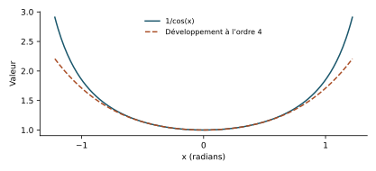

# École polytechnique MP — Mathématiques B 2021 · Corrigé brut

*Corrigé rédigé par IA, non officiel. Signalez toute erreur.*

**Rédaction** · GPT-6.2 Astra Ultra · vitesse non renseignée · 24 novembre 2026

**Révision** · GPT-6.2 Astra Ultra · vitesse non renseignée · 26 novembre 2026

La composition du 13 avril 2021 relie une loi discrète sur les entiers à la série bêta de Dirichlet. Les produits infinis du sinus et de la fonction gamma permettent ensuite d’en calculer les valeurs en 3 et en 5. [Sujet officiel](https://banques-ecoles.fr/cms/wp-content/uploads/2021/07/2021_MP_sujet_MathB.pdf) · [Rapport du jury](https://www.polytechnique.edu/admission-cycle-ingenieur/sites/admission/files/content/2021%20MP%20RAPPORT%20ECRIT%20MATHEMATIQUES%20B%20%28X%29.pdf)

## I. Loi zêta, valuations et caractère modulo quatre

### Question 1a

La loi de $X$ donne $\mathbb P(n\mid X)=\sum_{j\ge1}(jn)^{-s}/\zeta(s)=n^{-s}$, aussi pour $n=1$.

### Question 1b

Pour un ensemble fini $I$ d’indices, la divisibilité par tous les $p_i^{\alpha_i}$, $i\in I$, équivaut à la divisibilité par leur produit puisque ces puissances sont premières entre elles. Par 1a, la probabilité commune est donc $\prod_{i\in I}p_i^{-s\alpha_i}$, produit des probabilités individuelles. C’est l’indépendance mutuelle, y compris pour les exposants nuls.

### Question 2a

Par 1b, les événements $\{p_i\mid X\}$ sont mutuellement indépendants. Leurs complémentaires le sont aussi, comme on peut le vérifier en développant le produit des indicatrices $1-\mathbf1_{p_i\mid X}$. Donc $\mathbb P(\bigcap_{i=1}^r\{p_i\nmid X\})=\prod_{i=1}^r(1-p_i^{-s})$.

### Question 2b

Ces intersections décroissent en $r$, et leur intersection sur tous les rangs est $\{X=1\}$ par factorisation des entiers. Par continuité décroissante de la probabilité et 2a, $\prod_{i=1}^r(1-p_i^{-s})\to\mathbb P(X=1)=1/\zeta(s)$.

### Question 3a

Pour $p=p_k$ et $a\ge0$, $\mathbb P(\nu_p(X)\ge a)=\mathbb P(p^a\mid X)=p^{-sa}$. En retranchant la queue au rang suivant, $\mathbb P(\nu_p(X)+1=j)=(1-p^{-s})(p^{-s})^{j-1}$ pour $j\ge1$. C’est la loi géométrique de paramètre $1-p^{-s}$.

### Question 3b

Si $V_i=\nu_{p_{k_i}}(X)$, $\mathbf1_{V_i=n_i}=\mathbf1_{V_i\ge n_i}-\mathbf1_{V_i\ge n_i+1}$. Multiplions ces identités et prenons l’espérance. Le choix d’une seconde indicatrice aux indices où $\varepsilon_i=1$ porte le signe $(-1)^{\sum_i\varepsilon_i}$ et impose tous les $V_i\ge n_i+\varepsilon_i$. Regrouper par $\ell=\sum_i\varepsilon_i$ donne précisément la double somme de l’énoncé.

### Question 3c

D’après 1b, chaque probabilité de queues dans 3b est le produit des $p_{k_i}^{-s(n_i+\varepsilon_i)}$. Le développement se refactorise en $\prod_i(p_{k_i}^{-sn_i}-p_{k_i}^{-s(n_i+1)})=\prod_i\mathbb P(V_i=n_i)$. Pour ces variables discrètes et tout choix fini d’indices, la factorisation des masses démontre l’indépendance mutuelle.

### Question 4a

Par définition de $\chi_4$, $g(n)=\sum_{d\mid n}\chi_4(d)$. Lorsque $m,n$ sont premiers entre eux, chaque diviseur de $mn$ s’écrit de façon unique $d_1d_2$ avec $d_1\mid m,d_2\mid n$. La multiplicativité de $\chi_4$ permet alors de factoriser la somme et donne $g(mn)=g(m)g(n)$.

### Question 4b

On a $g(p^n)=1+\sum_{j=1}^n\chi_4(p)^j$. Si $p=2$, tous les termes de la somme sont nuls et le résultat vaut un. Si $p\equiv1\pmod4$, la somme complète vaut $n+1$. Si $p\equiv3\pmod4$, les signes alternent et le résultat vaut $(1+(-1)^n)/2$. Ces formules donnent bien $g(1)=1$ pour $n=0$.

### Question 5

Pour chaque issue, $f_n(X)\to f(X)$ puisque la convergence vaut en tout entier. De plus $|f_n(X)|\le h(X)$ et en passant à la limite $|f(X)|\le h(X)$. Les variables $f_n(X)$ et $f(X)$ sont intégrables. Le théorème de convergence dominée donne $\mathbb E f_n(X)\to\mathbb E f(X)$. En particulier cette dernière espérance est un réel fini.

### Question 6a

Le nombre $r(n)$ compte les couples $(a,b)\in(\mathbb N^*)^2$ avec $ab=n$. À termes positifs on peut regrouper indépendamment de l’ordre, donc
$$\sum_{n\ge1}r(n)n^{-s}=\sum_{a,b\ge1}(ab)^{-s}=\zeta(s)^2<\infty.$$

### Question 6b

Comme $|\chi_4(d)|\le1$, la formule de 4a donne $|g(n)|\le r(n)$. Par 6a la série $\sum g(n)n^{-s}$ converge absolument.

### Question 7a

Notons $T_n(x)=\prod_{k=1}^n p_k^{\nu_{p_k}(x)}$. L’entier fixé $x$ a un nombre fini de facteurs premiers. Dès qu’ils sont tous dans la liste, $T_n(x)=x$. Pour $x=1$ l’égalité vaut dès le début. D’où la convergence simple demandée.

### Question 7b

Comme $T_n(x)\mid x$, $|g(T_n(x))|\le r(T_n(x))\le r(x)$ et $\mathbb E r(X)=\zeta(s)$ par 6a. Avec 7a, la question 5 donne $\mathbb E g(T_n(X))\to\mathbb E g(X)$. Pour chaque $n$, par 4a, $g(T_n(X))=\prod_{k=1}^n g(p_k^{\nu_{p_k}(X)})$. Les facteurs sont indépendants par 3c et intégrables par le même majorant. L’espérance est donc le produit des espérances, d’où la formule.

### Question 8a

Pour $p\equiv1\pmod4$, $g(p^{\nu_p(X)})=1+\nu_p(X)$. Cette variable suit la loi géométrique de paramètre $1-p^{-s}$ par 3a, d’espérance $1/(1-p^{-s})$.

### Question 8b

Pour $p\equiv3\pmod4$, $g(p^j)$ vaut un pour $j$ pair, zéro pour $j$ impair. Avec $q=p^{-s}$, l’espérance vaut $(1-q)\sum_{j\ge0}q^{2j}=(1-q)/(1-q^2)=1/(1+q)$.

### Question 8c

Le facteur d’espérance vaut un pour $p=2$ par 4b. Pour les deux classes impaires, 8a et 8b donnent $1/(1-\chi_4(p)p^{-s})$. Cette écriture vaut aussi pour $p=2$ car $\chi_4(2)=0$. La limite du produit fini de ces facteurs est $\mathbb E g(X)$ par 7b.

### Question 9a

Avec $q=p^{-s}$ et $c=\chi_4(p)$, l’espérance vaut $(1-q)\sum_{j\ge0}(cq)^j=(1-q)/(1-cq)$, car $|cq|<1$. Le terme d’indice zéro est $\chi_4(1)=1$, même pour $p=2$.

### Question 9b

La variable $\chi_4(T_n(X))$ tend vers $\chi_4(X)$ et est bornée en module par un. Son espérance tend donc vers $\mathbb E\chi_4(X)$. Pour chaque $n$, multiplicativité et indépendance des valuations la factorisent en produit des facteurs de 9a. Le produit des numérateurs tend vers $1/\zeta(s)$ par 2b et le produit des inverses des dénominateurs a une limite par 8c. Ceci donne exactement 9b.

### Question 9c

Par la loi de $X$,
$$\zeta(s)\mathbb E\chi_4(X)=\sum_{n\ge1}\chi_4(n)n^{-s}
=\sum_{j\ge0}\frac{(-1)^j}{(2j+1)^s}.$$
La convergence est absolue pour $s>1$. D’après 9b et 8c, le premier membre vaut précisément $\mathbb E g(X)$.

## II. Produit infini du sinus

### Question 10a

La partie imaginaire de $(\cos\theta+i\sin\theta)^{2n+1}$ est $\sin\theta\,P_n(\sin^2\theta)$ avec
$$P_n(Y)=\sum_{j=0}^{n}(-1)^j\binom{2n+1}{2j+1}(1-Y)^{n-j}Y^j.$$
Il s’agit d’un polynôme réel de degré au plus $n$ et $P_n(0)=2n+1$.

### Question 10b

Pour $1\le k\le n$, $\theta_k=k\pi/(2n+1)$ donne $\sin((2n+1)\theta_k)=0$ et $\sin\theta_k\ne0$. Les $\theta_k$ sont strictement croissants dans $]0,\pi/2[$, donc les $\sin^2\theta_k$ sont des racines distinctes. Le degré au plus $n$ et $P_n(0)=2n+1$ donnent
$$P_n(Y)=(2n+1)\prod_{k=1}^n\left(1-\frac{Y}{\sin^2(k\pi/(2n+1))}\right).$$
Pour $n=0$, le produit vide vaut un.

### Question 10c

Prenons $\theta=\pi x/(2n+1)$ dans 10a et $Y=\sin^2\theta$ dans 10b. On obtient $\sin(\pi x)=(2n+1)\sin\theta\prod_{k=1}^n(1-\sin^2\theta/\sin^2(k\pi/(2n+1)))$ pour tout réel $x$.

### Question 11a

Pour $x\notin\mathbb Z$, $m>|x|$ fixé, $(2n+1)\sin(\pi x/(2n+1))\to\pi x$. Chaque quotient des sinus pour $k\le m$ tend vers $x/k$, et la limite du produit fini est $u_m=\pi x\prod_{k=1}^m(1-x^2/k^2)\ne0$. Pour tout $n>m$, aucun facteur n’est nul, car les arguments en valeur absolue sont dans $[0,\pi/2[$ et $|x|$ n’est pas un entier. Par 10c, $v_{m,n}=\sin(\pi x)/u_{m,n}\to v_m=\sin(\pi x)/u_m\ne0$.

### Question 11b

Pour $m<k\le n$, $0<|x|<k$ donne $0<1-\sin^2(\pi x/(2n+1))/\sin^2(\pi k/(2n+1))\le1$. Le sinus est majoré par son argument en valeur absolue, et $\sin v\ge2v/\pi$ sur $[0,\pi/2]$. On obtient donc la borne inférieure **facteur par facteur** $1-\pi^2x^2/(4k^2)$.

Pour multiplier ces minorants, il suffit que $m\ge\pi|x|/2$, hypothèse satisfaite pour tous les grands $m$ à $x$ fixé. Sous la seule condition imprimée $m>|x|$, l’encadrement par le produit peut être faux. Par exemple, pour $x=99/2$, $m=50$ et $n=52$, chacun des deux minorants est strictement inférieur à $-1$ car $\pi|x|/(2k)\ge 99\pi/208>\sqrt2$. Leur produit dépasse donc un, tandis que $v_{m,n}<1$.

Pour les grands $m$ où les minorants sont tous dans $[0,1]$, on peut les multiplier. En utilisant aussi $\prod(1-t_k)\ge1-\sum t_k$ sur $0\le t_k\le1$, on obtient
$$1\ge v_{m,n}\ge\prod_{k=m+1}^n\left(1-\frac{\pi^2x^2}{4k^2}\right)\ge1-\frac{\pi^2x^2}{4}\sum_{k>m}\frac1{k^2}.$$
La borne est uniforme en $n$. En faisant tendre $n$ puis $m$ vers l’infini, on trouve bien $v_m\to1$.

Il existe aussi un minorant valable pour **tout** $m>|x|$. Posons $a_k=\sin^2(\pi x/(2n+1))/\sin^2(\pi k/(2n+1))$. On a $0\le a_k<1$ pour $k>m$. L’inégalité $1-\prod(1-a_k)\le\sum a_k$ se démontre par récurrence. Les majorations trigonométriques précédentes entraînent
$$
0\le 1-v_{m,n}\le\frac{\pi^2 x^2}{4}\sum_{k=m+1}^n\frac1{k^2}
\le\frac{\pi^2 x^2}{4m}.
$$
La dernière inégalité suit de la comparaison à $\int_m^\infty t^{-2}\,dt$. En passant à la limite en $n$, on obtient la même borne pour $1-v_m$ sans hypothèse de signe sur les minorants imprimés.

### Question 11c

Pour $x\notin\mathbb Z$, 11a donne $\sin(\pi x)=\pi x\prod_{k=1}^m(1-x^2/k^2)\,v_m$. Comme $v_m\to1$, le passage à la limite donne le produit d’Euler pour le sinus. Si $x$ est entier non nul, le facteur $k=|x|$ annule tous les produits ultérieurs, comme le sinus. Si $x=0$, le facteur extérieur $\pi x$ et le sinus sont tous deux nuls.

## III. Fonction gamma et intégrale bêta

### Question 12

Pour $x>0$,
$$\log\Gamma_n(x)=-\log x-\gamma x+\sum_{k=1}^n\bigl(x/k-\log(1+x/k)\bigr).$$
Pour $u\ge0$, $0\le u-\log(1+u)=\int_0^u t/(1+t)\,dt\le u^2/2$. Ainsi la série converge vers un réel fini pour tout $x$. Son exponentielle définit $\Gamma(x)>0$ et $\Gamma_n(x)\to\Gamma(x)$.

### Question 13

Notons $H_n=\sum_{k=1}^n1/k$. La simplification télescopique donne
$$\frac{\Gamma_n(x+1)}{\Gamma_n(x)}=\frac{x}{x+1}e^{H_n-\gamma}\prod_{k=1}^n\frac{k+x}{k+x+1}=\frac{x e^{H_n-\gamma}}{n+x+1}.$$
Par définition de $\gamma$, $e^{H_n-\gamma}/n\to1$. Le passage à la limite donne $\Gamma(x+1)=x\Gamma(x)$. On note également $\Gamma_n(1)=e^{H_n-\gamma}/(n+1)\to1$, donc $\Gamma(1)=1$.

### Question 14a

Sur tout compact $[a,b]\subset]0,\infty[$, les termes $u_k=x/k-\log(1+x/k)$ sont dominés par $b^2/(2k^2)$. On a $u_k'=1/k-1/(k+x)=x/[k(k+x)]$, dominé par $b/k^2$, et $u_k''=(k+x)^{-2}\le k^{-2}$. Les trois séries convergent normalement sur le compact. La dérivation terme à terme deux fois donne, en incluant la dérivée seconde de $-\log x$,
$$(\log\Gamma)''(x)=\sum_{k=0}^\infty\frac1{(x+k)^2}.$$
Ainsi $\log\Gamma$, puis $\Gamma$, sont $C^2$. En particulier $\log\Gamma$ est convexe.

### Question 14b

Par décroissance de $t\mapsto(x+t)^{-2}$, $0\le(\log\Gamma)''(x)\le x^{-2}+\int_0^\infty(x+t)^{-2}dt=x^{-2}+x^{-1}$. L’encadrement donne la limite zéro.

### Question 15a

Les deux récurrences donnent $f(x+1)/\Gamma(x+1)=f(x)/\Gamma(x)$, donc $S=\log f-\log\Gamma$ est de période un. Sa dérivée seconde l’est aussi. Pour tout entier $n\ge0$,
$$S''(x)=S''(x+n)=(\log f)''(x+n)-(\log\Gamma)''(x+n)\ge-(\log\Gamma)''(x+n).$$
La borne de droite tend vers zéro par 14b. Ainsi $S''(x)\ge0$ pour chaque $x>0$ et $S$ est convexe.

### Question 15b

La dérivée $S'$ est croissante et de période un. Sur chaque segment $[x,x+1]$, ses deux valeurs extrêmes sont égales, donc elle est constante sur toute la demi-droite. La périodicité de $S$ impose alors que cette constante soit zéro. Ainsi $S$ est constante, et $S(1)=\log(f(1)/\Gamma(1))=0$ par 13. Donc $f=\Gamma$.

### Question 16

Par $u=t/(1+t)$, l’intégrale devient
$$B(x,a)=\int_0^1 u^{x-1}(1-u)^{a-1}\,du.$$
Les deux exposants sont supérieurs à $-1$, d’où convergence et positivité. Pour $a>0$ fixé, $B$ est $C^2$ en $x$. Sur $x\in[c,d]\subset]0,\infty[$, les dérivées jusqu’à l’ordre deux sont dominées par $u^{c-1}(1-u)^{a-1}(1+|\log u|^2)$, intégrable aux deux bords. En notant $w(u)=u^{x-1}(1-u)^{a-1}$, Cauchy–Schwarz pour la mesure $w(u)du$ donne $(\int w\log u)^2\le(\int w)(\int w\log^2u)$, soit $BB''-(B')^2\ge0$. Ainsi $\log B$ est convexe en $x$.

L’intégration de la dérivée de $u^x(1-u)^a$, nulle aux deux bords, donne $x[B(x,a)-B(x+1,a)]=a B(x+1,a)$. Par suite $B(x+1,a)=xB(x,a)/(x+a)$. De plus $B(1,a)=1/a$. La fonction $f(x)=\Gamma(x+a)B(x,a)/\Gamma(a)$ est strictement positive et $C^2$. Son logarithme est convexe d’après 14a et ce qui précède. Par 13 et la récurrence de $B$, elle satisfait $f(1)=1$ et $f(x+1)=xf(x)$. Donc $f=\Gamma$ par 15b. On obtient $B(x,a)=\Gamma(x)\Gamma(a)/\Gamma(x+a)$.

### Question 17

Pour $0<x<1$, la question 16 et $\Gamma(1)=1$ donnent $\int_0^\infty t^{x-1}/(1+t)\,dt=\Gamma(x)\Gamma(1-x)$. Dans les produits finis de 12, on utilise
$$\prod_{k=1}^n(k+1-x)=\frac{n+1-x}{1-x}\prod_{k=1}^n(k-x).$$
Il vient
$$\Gamma_n(x)\Gamma_n(1-x)=\frac{e^{H_n-\gamma}}{x(n+1-x)}
\prod_{k=1}^n(1-x^2/k^2)^{-1}.$$
Le préfacteur tend vers $1/x$ et le produit vers $\pi x/\sin(\pi x)$ par 11c. L’intégrale vaut donc $\pi/\sin(\pi x)$.

## IV. Série de la sécante et valeurs de la fonction bêta de Dirichlet

### Question 18a

Coupons l’intégrale de 17 en un. Le changement $t=1/u$ dans la seconde part donne $\int_0^1 [t^{x-1}+t^{-x}]/(1+t)\,dt$. Les sommes géométriques $\sum_{n=0}^N(-t)^n$ convergent vers $1/(1+t)$ pour $0<t<1$ et sont majorées en module par deux. Comme $x\in]0,1[$, $2(t^{x-1}+t^{-x})$ est intégrable. Par convergence dominée et intégration des puissances,
$$\frac{\pi}{\sin(\pi x)}=\sum_{n\ge0}\frac{(-1)^n}{n+x}
+\sum_{n\ge0}\frac{(-1)^n}{n+1-x}.$$
Chacune de ces séries alternées converge.

### Question 18b

Remplaçons $x$ par $1/2+x$ dans 18a et posons $d_n=2n+1$. La somme des deux fractions de rang $n$ vaut
$$\frac{4(-1)^n}{d_n}\frac1{1-(2x/d_n)^2}
=\frac{4(-1)^n}{d_n}\sum_{k\ge0}(2x/d_n)^{2k}.$$
Pour $|2x|<1$, le rang $k=0$ est une série alternée convergente. Pour $k\ge1$ la somme des modules est majorée par $4(2x)^2\sum_{n\ge0}d_n^{-3}/(1-(2x)^2)$, finie. On peut donc permuter ces rangs puis réintégrer le terme constant. Il vient
$$\frac{\pi}{\cos(\pi x)}=\sum_{k\ge0}2^{2k+2}x^{2k}
\sum_{n\ge0}\frac{(-1)^n}{(2n+1)^{2k+1}}.$$

### Question 18c

Pour $|y|<\pi/2$ posons $x=y/\pi$ dans la série précédente. Elle développe $v(y)=1/\cos y$ en une série entière paire. Le coefficient de $y^{2k}$ est $E_{2k}/(2k)!$, où $E_{2k}=v^{(2k)}(0)$. L’identification donne
$$\sum_{n\ge0}\frac{(-1)^n}{(2n+1)^{2k+1}}=\frac{\pi^{2k+1}E_{2k}}{2^{2k+2}(2k)!}.$$

### Question 19a

Le produit $v(y)\cos y$ vaut un. Pour $n\ge1$, sa dérivée d’ordre $2n$ en zéro est donc nulle. Par Leibniz et la parité des deux fonctions, elle vaut $\sum_{k=0}^n\binom{2n}{2k}E_{2k}(-1)^{n-k}$. En multipliant par $(-1)^n$, on obtient la relation du sujet. Enfin $E_0=1$, $1-E_2=0$ et $1-6E_2+E_4=0$, donc $E_2=1$, $E_4=5$.

### Question 19b

Par 9c et 18c, pour $s=3$ on obtient $\mathbb E g(X)=\pi^3/(2^4\,2!)=\pi^3/32$. Pour $s=5$, $\mathbb E g(X)=5\pi^5/(2^6\,4!)=5\pi^5/1536$. Les deux paramètres sont supérieurs à un, comme le requiert la loi zêta.

