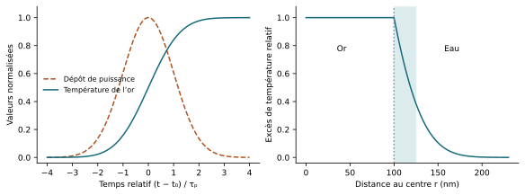
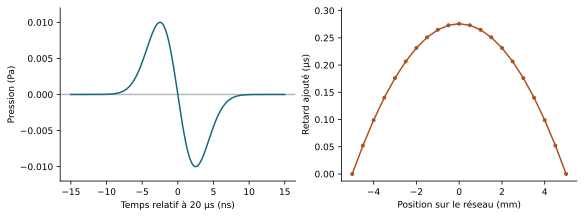

# École polytechnique et ESPCI PC 2021 — Physique A · Corrigé guidé

*Corrigé rédigé par IA, non officiel. Signalez toute erreur.*

**Lecture du rapport du jury** · GPT-6.2 Astra Ultra · vitesse non renseignée

**Rédaction** · GPT-6.2 Astra Ultra · vitesse non renseignée

## Imagerie par tomographie photoacoustique

## I. Source laser

### Question 1 — Transition émettrice

**Indication.** Repérer la flèche rouge et soustraire les deux énergies qu’elle relie.

La figure donne $E_\gamma=1{,}45-0{,}20=1{,}25\,\mathrm{eV}=2{,}00\,10^{-19}\,\mathrm{J}$. D’après $E_\gamma=h\nu=hc/\lambda_0$, les constantes arrondies du sujet donnent $\lambda_0=1{,}0\,10^{-6}\,\mathrm{m}$. Cette raie se situe dans le proche infrarouge.

### Question 2 — Conversion des fréquences

**Indication.** Développer le carré, puis chercher comment passer de l’harmonique de rang $n$ à celle de rang $n+1$.

Les carrés des sinus apportent une composante constante et les fréquences angulaires $2\omega_1,2\omega_2$. Le terme croisé est proportionnel à $\cos[(\omega_1-\omega_2)t]-\cos[(\omega_1+\omega_2)t]$. En partant de $\omega_0$, on obtient $2\omega_0$, puis $(n+1)\omega_0$ par mélange de $n\omega_0$ avec $\omega_0$. Sommes, différences et doubles préservent les multiples entiers. Les longueurs d’onde propagatives permises par ce modèle sont donc $\lambda_0/n$, $n\ge1$ (environ 1000, 500, 333, 250 nm pour les quatre premières). L’efficacité de conversion dépend du cristal.

### Question 3 — Fenêtre de transparence

**Indication.** Lire l’axe horizontal logarithmique et chercher entre l’absorption de l’hémoglobine et celle de l’eau.

L’hémoglobine absorbe fortement dans le visible et l’eau devient fortement absorbante au-delà du proche infrarouge. Le creux commun se situe vers $1\,\mu\mathrm{m}$, grossièrement de $0{,}7$ à $1{,}3\,\mu\mathrm{m}$ selon le seuil choisi. On retient le fondamental $\lambda_0\simeq1\,\mu\mathrm{m}$. Le doublement donne 500 nm, dans une zone de forte absorption par l’hémoglobine. « Transparence » signifie ici que l’absorption est faible sur l’échelle considérée.

### Question 4 — Diffraction et puissance crête

**Indication.** Distinguer le rayon du premier anneau sombre, la puissance moyenne et le rapport cyclique.

Pour une pupille circulaire uniformément éclairée de diamètre $d=1\,\mathrm{mm}$, le rayon du disque central vaut $r_A=1{,}22 f'\lambda_0/d\simeq12\,\mu\mathrm{m}$. Son aire est $S=\pi r_A^2\simeq4{,}7\,10^{-10}\,\mathrm{m^2}=4{,}7\,10^{-6}\,\mathrm{cm^2}$. En assimilant la tache à un disque recevant la puissance laser et l’impulsion à un créneau de durée $\tau_p$, la limite moyenne du modèle donne $P_{\rm moy}=\Phi S\simeq4{,}7\,10^{-4}\,\mathrm{W}$. La fraction de temps éclairée vaut $f_{\rm rep}\tau_p=5\,10^{-6}$. Ainsi $P_{\rm crête}=\Phi S/(f_{\rm rep}\tau_p)\simeq94\,\mathrm W$. Le profil réel du spot et la définition de la largeur temporelle modifient le préfacteur.

## II. Chauffage et diffusion

### Question 5 — Devenir de l’énergie optique

**Indication.** Suivre une excitation électronique jusqu’à sa relaxation, en distinguant les voies qui déposent de l’énergie et celles qui émettent de la lumière.

L’absorption élève l’énergie interne du milieu. Une relaxation non radiative transmet l’énergie aux vibrations et à l’agitation thermique, ce qui chauffe ici l’or puis l’eau. La dilatation qui en résulte met le milieu en mouvement et crée une onde acoustique. Une relaxation radiative peut réémettre de la lumière, par exemple en fluorescence. Une excitation peut aussi déclencher une réaction photochimique (isomérisation) ou, pour un photon assez énergétique, libérer un électron. Réflexion, réfraction et diffusion élastique redistribuent également la lumière incidente, sans conversion nette de son énergie en chaleur dans le modèle élastique.

### Question 6 — Bilan dans une coquille d’eau

**Indication.** La surface de sortie de la coquille est plus grande que la surface d’entrée.

À la longueur d’onde retenue, l’absorption de l’eau à l’échelle de la particule est négligeable devant celle de l’or. Pour un flux radial sortant $j=-\kappa\partial_rT$, posons $\Phi(r)=4\pi r^2j(r)$. Le premier principe appliqué à $[r,r+dr]$ donne $\rho c_p4\pi r^2dr\,\partial_t T=\Phi(r)-\Phi(r+dr)$. Après division et passage à la limite,
$$
\rho c_p\partial_t T=\frac{\kappa}{r^2}\partial_r(r^2\partial_rT),\qquad r>a .
$$

### Question 7 — Chauffage dans l’or

**Indication.** Ajouter au bilan la puissance optique déposée dans le volume élémentaire.

Dans l’or, l’énergie gagnée par unité de temps est le flux net entrant augmenté de $P_V4\pi r^2dr$. Ainsi
$$
\rho_g c_{pg}\partial_t T=\frac{\kappa_g}{r^2}\partial_r(r^2\partial_rT)+P_V(r,t),\qquad 0<r<a .
$$
Chaque terme est en $\mathrm{W\,m^{-3}}$. Par symétrie $\partial_rT(0,t)=0$. En contact thermique parfait, la température et le flux normal sont continus en $a$.

### Question 8 — Trois temps

**Indication.** Calculer chaque diffusivité avant de diviser $a^2$ par celle-ci.

Les diffusivités $D_g=\kappa_g/(\rho_g c_{pg})=1{,}25\,10^{-4}$ et $D=\kappa/(\rho c_p)=1{,}25\,10^{-7}$ sont en $\mathrm{m^2\,s^{-1}}$ pour $\rho=10^3\,\mathrm{kg\,m^{-3}}$. Avec $a=10^{-7}\,\mathrm m$, on trouve $a^2/D_g=0{,}080\,\mathrm{ns}\ll\tau_p=5\,\mathrm{ns}\ll a^2/D=80\,\mathrm{ns}$. L’or s’uniformise avant la fin du chauffage. Pendant l’impulsion, l’eau se réchauffe d’abord dans une couche mince adjacente. Après extinction, l’or cède sa chaleur à l’eau, qui la répartit à des distances croissantes. À temps long toute région finie revient vers la température initiale du bain supposé infini.

### Question 9 — Température moyenne

**Indication.** Intégrer la divergence sur la boule, puis diviser par son volume.

La moyenne $T_g=V^{-1}\int_V T\,dV$ vérifie, pour $P_V$ uniforme,
$$
\rho_g c_{pg} V\dot T_g=4\pi a^2\kappa_g\partial_r T(a^-,t)+V P_V(t),\qquad V=4\pi a^3/3.
$$
Le gradient est pris dans l’or. Si l’or est plus chaud que l’eau, le gradient radial à la frontière est négatif et cette contribution refroidit la particule.

### Question 10 — Identification des coefficients

**Indication.** Employer $(r^2T_r)_r=r(rT)_{rr}$ et le rapport surface sur volume.

En multipliant l’équation de l’eau par $r$, on obtient $(rT)_t=D(rT)_{rr}$. Dans l’or, $\dot T_g=\alpha_g\partial_rT(a^-,t)+\beta_gP_V$ avec
$$
D=\frac{\kappa}{\rho c_p},\qquad \alpha_g=\frac{3\kappa_g}{a\rho_gc_{pg}},\qquad \beta_g=\frac1{\rho_gc_{pg}} .
$$
En particulier $\alpha_g=3D_g/a$ a la dimension d’une vitesse.

### Question 11 — Réponse à l’impulsion

**Indication.** Le maximum de puissance coïncide avec le maximum de pente de la courbe de température.

Si le transfert à la frontière est négligé, $T_g(t)-T_0=\beta_g\int_{-\infty}^{t}P_V(s)\,ds$. Par exemple, pour $P_V=P_m\exp[-(t-t_c)^2/(2\tau_p^2)]$, la montée normalisée vaut $[1+\operatorname{erf}((t-t_c)/(\sqrt{2}\tau_p))]/2$. Sa largeur est de l’ordre de $\tau_p$. La tangente est horizontale avant et après l’impulsion, et le point d’inflexion est en $t_c$. Le plateau final provient de l’approximation adiabatique.

### Question 12 — Profil radial juste après l’impulsion

**Indication.** Appliquer la diffusion plane à la variable $r(T-T_0)$, en prenant pour origine spatiale la surface $r=a$.

La profondeur de diffusion est $\ell_{\rm th}=\sqrt{D\tau_p}=2{,}5\,10^{-8}\,\mathrm m=25\,\mathrm{nm}$. L’or est presque isotherme. Dans l’eau, écrivons $x=r-a$, $\theta_s(t)=T(a,t)-T_0$. Pour une surface portée d’un coup à $T_0+\theta_*$ à $t=0$, la solution extérieure de l’équation de la question 10 est
$$
T(r,t)-T_0=\theta_*\frac{a}{r}\operatorname{erfc}\!\left(\frac{r-a}{2\sqrt{Dt}}\right),\quad r\ge a .
$$
Elle retrouve la température imposée en $a$ et $T_0$ à l’infini. Pour la véritable surface qui se réchauffe progressivement, on superpose ces échelons en remplaçant $\theta_*\operatorname{erfc}(\cdots)$ par $\int_{-\infty}^{t}\dot\theta_s(s)\operatorname{erfc}[(r-a)/(2\sqrt{D(t-s)})]\,ds$. Ce profil garde le facteur sphérique $a/r$ et décroît sur quelques $\ell_{\rm th}$ à la fin du chauffage. La figure montre l’exemple de l’échelon.

## III. Génération et réception des ultrasons

### Question 13 — Conservation de la masse

**Indication.** Développer le produit masse volumique fois vitesse en conservant son premier ordre.

La continuité impose $\partial_t\rho+\nabla\cdot(\rho\mathbf v)=0$. Or $\rho_0$ est constante, et $\rho_a\mathbf v_a$ est du second ordre. Il reste $\partial_t\rho_a+\rho_0\nabla\cdot\mathbf v_a=0$.

### Question 14 — Conservation de la quantité de mouvement

**Indication.** Identifier le terme convectif et l’ordre de sa contribution.

Pour l’eau parfaite sans pesanteur, $\rho[\partial_t\mathbf v+(\mathbf v\cdot\nabla)\mathbf v]=-\nabla P$. La pression d’équilibre est uniforme. Le terme convectif et $\rho_a\partial_t\mathbf v_a$ sont quadratiques en perturbations. L’équation linéaire est $\rho_0\partial_t\mathbf v_a=-\nabla p_a$.

### Question 15 — Source thermoacoustique

**Indication.** Dériver la continuité en temps et prendre la divergence de l’équation du mouvement.

Cette combinaison donne $\partial_t^2\rho_a=\Delta p_a$. La relation d’état $\rho_a=p_a/c_0^2-\rho_0\beta T_a$ conduit à
$$
\Delta p_a-\frac{1}{c_0^2}\partial_t^2p_a=-\rho_0\beta\partial_t^2T_a .
$$
Le terme de droite est localisé dans la zone qui chauffe et refroidit. Pour $T_a$ constant dans le temps on retrouve l’équation homogène de propagation.

### Question 16 — Onde rayonnée

**Indication.** En dehors de la zone chauffée, quelle équation vérifie le produit $rp_a$ ?

La symétrie d’une source ponctuelle dans l’eau homogène impose une onde sphérique. Hors de la source, $u=rp_a$ obéit à $u_{tt}=c_0^2u_{rr}$. En l’absence d’onde incidente extérieure, $p_a(r,t)=g(t-r/c_0)/r$. L’amplitude de pression décroît comme $1/r$, l’intensité comme $1/r^2$ et la puissance transportée à travers une sphère est conservée.

### Question 17 — Fréquence caractéristique

**Indication.** Sur le signal bipolaire, mesurer le temps entre le maximum positif et le minimum négatif.

Les deux extrema de la figure 3 sont espacés d’environ 5 ns. En les assimilant à une demi-oscillation, on obtient $T_{\rm car}\simeq10\,\mathrm{ns}$, $f_{\rm car}\sim100\,\mathrm{MHz}$ et $\lambda=c_0/f_{\rm car}\sim15\,\mu\mathrm m$. Une impulsion isolée a une bande de fréquences. Cette estimation désigne une échelle de son spectre. La fréquence excède largement 20 kHz et le diamètre $2a=0{,}20\,\mu\mathrm m$ est petit devant $\lambda$ : la source ultrasonore est assimilable à un point.

### Question 18 — Signal à trois centimètres

**Indication.** Transporter le profil de surface avec le retard de propagation et appliquer la décroissance sphérique.

À $R=3\,\mathrm{cm}$ du centre, $p_R(t)=(a/R)p_a(a,t-(R-a)/c_0)$. Le retard vaut $20\,\mu\mathrm s$ et le facteur d’amplitude $3{,}3\,10^{-6}$. Les deux extrema de surface ($\pm3\,\mathrm{kPa}$) deviennent environ $\pm0{,}010\,\mathrm{Pa}$. Le pic positif arrive le premier, puis vient le creux négatif. L’écart entre les deux reste de 5 ns dans le modèle sans dispersion.

### Question 19 — Profondeur sans ambiguïté temporelle

**Indication.** Compter le trajet acoustique entre le point chauffé et la sonde.

Le prochain tir arrive après $T_{\rm rep}=1/f_{\rm rep}=1\,\mathrm{ms}$. La condition $z/c_0<T_{\rm rep}$ donne $z_{\max}\simeq1{,}5\,\mathrm m$. Il s’agit d’un aller acoustique simple après une excitation lumineuse quasi instantanée. Cette limite dépasse les profondeurs usuelles envisagées ici ; absorption et diffusion de la lumière, atténuation des ultrasons et sensibilité du capteur limitent en pratique la profondeur accessible.

### Question 20 — Séparation en profondeur

**Indication.** Relier un décalage entre temps d’arrivée à une différence de distances à la sonde.

Deux sources produisent deux copies décalées de $|R_2-R_1|/c_0$. Pour les distinguer, ce décalage doit être de l’ordre de la largeur d’une impulsion reçue. Le chauffage dure $\tau_p=5\,\mathrm{ns}$, ce qui fixe une échelle $c_0\tau_p=7{,}5\,\mu\mathrm m$. En prenant la durée d’un cycle bipolaire entier, on obtient environ $15\,\mu\mathrm m$. La résolution axiale idéale est donc de l’ordre de $10\,\mu\mathrm m$ et dépend au premier chef de la durée du laser ; une bande passante limitée de la sonde l’aggrave. Deux sources à égale distance arrivent en même temps, quelle que soit leur séparation transverse.

### Question 21 — Information manquante

**Indication.** Trouver le lieu de tous les points à une même distance du récepteur.

Une arrivée au temps $t$ situe la source sur une sphère de rayon $c_0t$, ou sur sa partie incluse dans le milieu. Le signal fournit une information de distance, sans direction. Plusieurs positions de réception apportent des sphères distinctes dont les intersections permettent la localisation, avec assez de géométries pour lever les symétries.

### Question 22 — Résolution latérale au foyer

**Indication.** Appliquer le critère de Rayleigh à la longueur d’onde acoustique.

L’angle au premier minimum d’une ouverture circulaire est $\theta\simeq1{,}22\lambda/D$. Avec $\lambda=15\,\mu\mathrm m$, $D=1\,\mathrm{cm}$, on trouve $1{,}8\,10^{-3}\,\mathrm{rad}$. Au foyer $F=3\,\mathrm{cm}$, deux points sont séparables à partir de $F\theta\simeq55\,\mu\mathrm m$. C’est le rayon du disque central ; son diamètre est voisin de $110\,\mu\mathrm m$.

### Question 23 — Focalisation par retards

**Indication.** Les éléments centraux reçoivent le signal les premiers ; leur appliquer le plus grand retard additionnel.

L’élément $i$ se trouve en $x_i=-D/2+(i-1)D/(N-1)$. Son temps d’arrivée est $t_i=\sqrt{F^2+x_i^2}/c_0$. En prenant le temps du bord comme référence, le retard électronique positif à ajouter est
$$
d_i=\frac{\sqrt{F^2+(D/2)^2}-\sqrt{F^2+x_i^2}}{c_0}.
$$
Alors $t_i+d_i$ est indépendant de $i$. Le délai minimal vaut zéro aux deux extrémités. Avec un élément central, l’étendue vaut $[\sqrt{F^2+D^2/4}-F]/c_0\simeq D^2/(8Fc_0)\simeq0{,}28\,\mu\mathrm s$. Si $N$ est pair, le plus proche élément est à $|x_i|=D/[2(N-1)]$ et l’étendue est légèrement inférieure.

## IV. Vitesse du sang et pertes de charge

### Question 24 — Décalage Doppler

**Indication.** Comparer les dates d’arrivée de deux crêtes émises à une période d’intervalle. Observer de quel côté la sonde se trouve par rapport au mouvement.

Soit $R(t)$ la distance de la particule à la sonde. L’émission à $t$ arrive à $t+R(t)/c_0$. Pendant une période $1/f$, la direction de visée reste pratiquement fixe. La période reçue vaut donc $(1+\dot R/c_0)/f$. Sur le dessin, la particule s’éloigne de la sonde avec $\dot R=v\cos\alpha$. Ainsi
$$
f'=\frac{f}{1+v\cos\alpha/c_0},\qquad
\Delta f=f'-f\simeq-\frac{fv\cos\alpha}{c_0}.
$$
Le développement vaut pour $v\ll c_0$. Un mouvement vers la sonde renverse le signe. La particule émet elle-même le son : le trajet acoustique intervient une seule fois.

### Question 25 — Vitesses mesurées

**Indication.** Isoler la norme de la vitesse et convertir les deux écarts de fréquence en hertz.

Avec $\cos60^\circ=1/2$, $v=c_0|\Delta f|/(f|\cos\alpha|)$. Pour $16\,000\,\mathrm{Hz}$, l’aorte donne $0{,}48\,\mathrm{m\,s^{-1}}$ ; pour $10\,\mathrm{Hz}$, le capillaire donne $3{,}0\,10^{-4}\,\mathrm{m\,s^{-1}}$. Ces vitesses sont respectivement environ 3000 et cinq millions de fois plus petites que la célérité du son.

### Question 26 — Nombres de Reynolds

**Indication.** Prendre le diamètre hydraulique du tube circulaire et utiliser une seule unité de longueur.

Le rapport des effets inertiels aux effets visqueux vaut $\mathrm{Re}=\rho vD/\eta$ avec $D=2R$ et $v$ la vitesse moyenne, estimée par la mesure précédente. On trouve $3840$ dans l’aorte et $2{,}4\,10^{-3}$ dans le capillaire. Le capillaire est en régime laminaire à forte domination visqueuse. Pour un tube droit, l’aorte se situe près de la transition, où les perturbations et la rugosité influent sur le régime réalisé.

### Question 27 — Distribution de pression

**Indication.** Dans un tube rectiligne loin des extrémités, regarder séparément les projections radiale et axiale de Navier–Stokes.

Interprétons le modèle visé aux questions 27 à 29 comme un écoulement établi, axisymétrique, axial et sans mouvement de giration. L’incompressibilité impose $\partial_z u=0$ pour $\mathbf v=u\mathbf e_z$. Les projections radiale et azimutale du bilan stationnaire donnent $\partial_rP=\partial_\theta P=0$. La projection axiale devient
$$
\frac{dP}{dz}=\eta\,\frac1r\frac{d}{dr}\!\left(r\frac{du}{dr}\right).
$$
Le membre de gauche dépend de $z$, celui de droite de $r$ : ils sont constants. Les pressions imposées fixent donc $P(z)=P_e+(P_s-P_e)z/L$, uniforme sur chaque section. Pris au sens strict, le mot « irrotationnel » de l’énoncé imposerait $\nabla\times\mathbf v=-u'(r)\mathbf e_\theta=0$. Avec l’adhérence, il imposerait alors un débit nul, incompatible avec le profil demandé ensuite.

### Question 28 — Profil de Poiseuille et vitesse moyenne

**Indication.** Intégrer deux fois en $r$, imposer la régularité sur l’axe et l’adhérence sur la paroi.

Posons $\Delta P=P_e-P_s>0$. L’équation précédente donne $ru'=-\Delta P r^2/(2\eta L)+C$. La régularité sur l’axe impose $C=0$, et $u(R)=0$ fixe la seconde constante. Ainsi
$$
\mathbf v(r)=\frac{\Delta P}{4\eta L}(R^2-r^2)\mathbf e_z,\qquad
D_V=2\pi\int_0^R ru(r)\,dr=\frac{\pi R^4\Delta P}{8\eta L}.
$$
La moyenne $v=D_V/(\pi R^2)=R^2\Delta P/(8\eta L)$ vaut la moitié de la vitesse axiale maximale.

### Question 29 — Friction dans le capillaire

**Indication.** Rétablir une définition adimensionnelle à partir de la figure de Moody, puis remplacer la perte de charge par celle de Poiseuille.

La formule imprimée dans la question omet $\Delta P$, comme le signale le jury. La définition figurant sur le diagramme est $\xi=(2D/L)\Delta P/(\rho v^2)$. En substituant $\Delta P=8\eta L v/R^2=32\eta L v/D^2$, on trouve $\xi=64\eta/(\rho vD)=64/\mathrm{Re}$. Dans le capillaire, $\xi\simeq2{,}7\,10^4$. Pour $L=1\,\mathrm{cm}$ et $R=10\,\mu\mathrm m$, la pression chute de $8\eta Lv/R^2=720\,\mathrm{Pa}$.

### Question 30 — Lecture du diagramme pour l’aorte

**Indication.** Préciser la rugosité choisie et le régime retenu au voisinage de la transition.

En assimilant l’aorte à une conduite droite, hydrauliquement lisse, et en suivant la branche turbulente basse du diagramme à $\mathrm{Re}\simeq3{,}8\,10^3$, on lit $\xi\simeq0{,}04$. Pour $L=0{,}15\,\mathrm m$, $D=0{,}020\,\mathrm m$, $\Delta P=\xi(L/D)\rho v^2/2\simeq41\,\mathrm{Pa}$. L’incertitude de régime compte : si un régime laminaire persiste, $64/\mathrm{Re}\simeq0{,}017$ donnerait environ 17 Pa. Le diagramme seul ne fixe pas le régime d’une aorte pulsatile.

### Question 31 — Résistances et association en parallèle

**Indication.** Calculer le débit à partir de la vitesse moyenne, puis additionner les débits sous une même différence de pression.

Le débit dans chaque vaisseau vaut $D_V=\pi R^2v$, en $\mathrm{m^3\,s^{-1}}$. Il vaut $9{,}4\,10^{-14}$ dans le capillaire et $1{,}51\,10^{-4}$ dans l’aorte. Le rapport $\mathcal R=\Delta P/D_V$ donne $\mathcal R_{\rm cap}\simeq7{,}6\,10^{15}$ et, avec la branche choisie en question 30, $\mathcal R_{\rm aorte}\simeq2{,}7\,10^5$, en $\mathrm{Pa\,s\,m^{-3}}$. Pour $N$ capillaires identiques en parallèle, la pression est commune et les débits s’ajoutent : $\mathcal R_{\rm eq}=\mathcal R_{\rm cap}/N$. L’égalité demandée conduit à $N\simeq2{,}8\,10^{10}$ dans ce modèle. La résistance aortique est évaluée au débit de la mesure.
