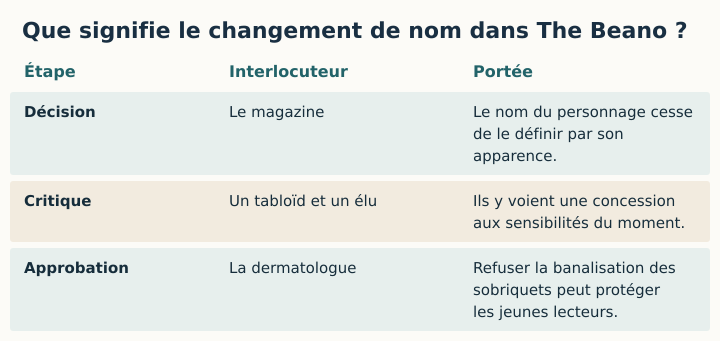

# Agro-Véto · BCPST · Anglais 2022 — Corrigé guidé

*Corrigé rédigé par IA, non officiel. Signalez toute erreur.*

**Rédaction** · GPT-6.2 Astra Ultra · vitesse non renseignée

Écrit de deux heures. Trois parties obligatoires. La compréhension demande 100 mots et l’essai 200 mots, avec une tolérance de 10 %.

## I · Thème · 6 points

Everyone in the Madrigal family has a special power. Well, almost everyone. Mirabel, the heroine of Disney's new film *Encanto*, available on Disney+ this Friday, 24 December, is the only one who has not been given a gift. Yet even though the new Disney princess has no special power, she has been given a feature that is far from insignificant. She wears glasses.

Round green glasses that bring out her hazel eyes and are also a first for a Disney princess. Before Mirabel, none of them had ever worn glasses.

It matters. With her curly hair and those glasses perched on her nose, Mirabel is a princess little girls will be able to identify with. “We're moving quite a way away from Disney stereotypes. Mirabel looks like a perfectly ordinary little girl, with an ordinary appearance and even a problem with her eyesight, which is perfectly ordinary too!” psychologist Catherine Verdier told Le HuffPost.

## II · Compréhension · 6 points

The Beano replaced nicknames referring to two characters' weight and acne with ordinary names. Critics saw the changes as a fashionable concession to political sensitivities and suggested the comic was taking harmless jokes too seriously. Dr McPherson welcomes its decision. A comic children enjoy can teach them, quite unintentionally, that someone's appearance is fair game. Acne is common, but teasing about it can damage confidence precisely when young readers are particularly vulnerable. Calling the character Scotty lets him remain the same mischievous child without making his skin his defining feature. For McPherson, listening to readers helps keep the comic relevant.

*100 words.*

## III · Expression · 8 points

We should care about people's feelings enough to ask what our words do, especially when those words reach an audience with little power to answer back. Taking a complaint seriously need not mean agreeing with every response it provokes.

A teacher who repeatedly uses an embarrassing nickname may find it affectionate. A pupil cannot object on equal terms, particularly in front of classmates. Changing the name costs almost nothing and allows the pupil to take part without expecting to be laughed at. In that situation, kindness improves the work everyone came to do.

The same principle does not require a teacher to describe an incorrect answer as correct. Suppose a group has spent a week designing an experiment without a control. Concealing the problem to avoid disappointment would make their next week of work useless. The teacher can explain what the missing comparison prevents them from concluding and ask how they might repair it. The criticism may still hurt, yet it now offers a way forward.

I would distinguish avoidable humiliation from the discomfort that sometimes accompanies learning or disagreement. Feelings are evidence about the effects of our choices. Listening to them helps us decide how to speak, while leaving room to say what others genuinely need to hear.

*209 words.*

## Construire les réponses

**Thème.** Identifier d'abord qui a reçu quoi. Mirabel est la seule personne privée de don magique et la première princesse dont parle l'article à porter des lunettes. *Glasses* reste au pluriel, et *none of them had ever worn glasses* place l'absence de précédent avant Mirabel. La reprise de *ordinary* à la fin de la citation appartient au raisonnement de la psychologue. Le texte journalistique emploie le mot « princesse », qui est conservé dans la traduction.

**Compréhension.** Le jury attend un enchaînement simple. Présenter la décision du magazine, expliquer le reproche d'une concession de façade, donner expressément le jugement favorable de la dermatologue, puis l'étayer. Le jury a valorisé l’explication du qualificatif polémique *woke*. Le dernier point porte sur l'effet possible d'un surnom répété sur des lecteurs. Les sobriquets sont donnés comme objets de la controverse.

**Expression.** Ici, *so much* interroge la place à donner à la sensibilité des autres. L'essai compare deux interventions d'un professeur, renoncer à un surnom et expliquer une erreur de méthode. Il peut donc montrer dans quelles circonstances et dans quelle mesure le souci des sentiments améliore une décision. Le jury rappelle le fil conducteur du dossier, l’inclusion et la prise en compte des différences. Il signale la confusion possible entre sentiments et opinions. L’exemple de classe transpose le mécanisme du surnom et discute sa portée.

**Décomptes.** Le thème vaut six points et n'a pas de quota de mots dans la consigne. La réponse de compréhension vaut six points et doit compter de 90 à 110 mots. L'essai vaut huit points et doit en compter de 180 à 220. Les deux totaux sont à indiquer en fin de réponse.

[Sujet officiel](https://www.concours-agro-veto.fr/sites/default/files/media/2025-10/a-bcpst_lvo-anglais_sp.pdf) · [Rapport du jury](https://www.concours-agro-veto.fr/sites/default/files/media/2025-10/rapport_a-bcpst_anglais_2022.pdf) · [Bilan du concours et rattachement à l’X, p. 4](https://concours-agro-veto.fr/sites/default/files/media/2025-10/bilan-concours-a-bcpst-session-2022.pdf#page=4)
