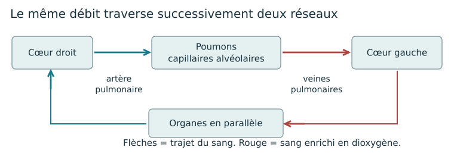
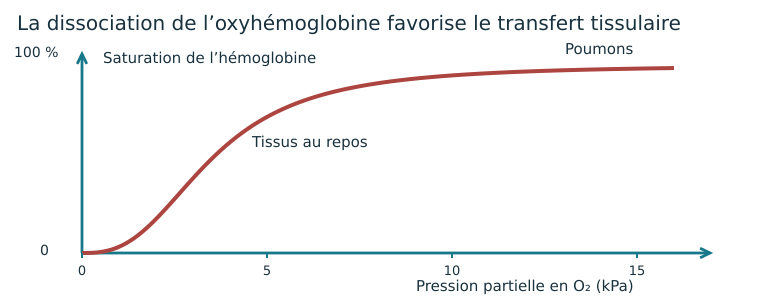
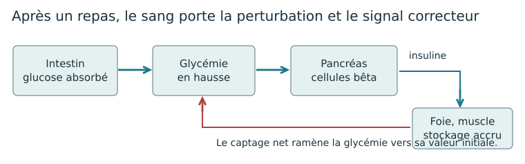

# Agro-Véto — BCPST, Biologie 2022 · Corrigé brut

*Corrigé rédigé par IA, non officiel.*

**Rédaction (tour 1)** · GPT-6.2 Astra Ultra · vitesse non renseignée

Sujet unique de synthèse. Le développement porte sur le sang des mammifères, sa circulation et les relations qu’il établit entre les organes.

## Introduction

Dans un muscle en activité, une cellule consomme du dioxygène livré quelques secondes plus tôt par le poumon. Ces deux organes n’ont pourtant aucune surface de contact. Chez les mammifères, le sang est un tissu liquide formé d’éléments figurés en suspension dans le plasma. Il reste normalement contenu dans l’appareil cardiovasculaire fermé. Comment ses propriétés et son renouvellement au contact des organes permettent-ils à la fois d’alimenter des cellules éloignées et de coordonner leur activité ? Nous relierons d’abord sa composition à sa circulation, puis ses formes de transport aux échanges locaux, avant d’envisager son rôle dans l’unité de l’organisme.

## I. Un tissu mobile relie les surfaces d’échange

### 1. Deux phases complémentaires

Un échantillon de sang rendu incoagulable et centrifugé donne une couche dense d’hématies, une mince interface de leucocytes et de plaquettes, et un surnageant, le plasma. Chez l’adulte humain, les hématies occupent couramment autour de 45 % du volume sanguin. Le plasma aqueux contient ions, petites molécules et protéines. L’albumine transporte certains composés et contribue à la pression oncotique, qui s’oppose à la filtration d’eau hors des capillaires. Après coagulation, le liquide recueilli, le sérum, a perdu notamment le fibrinogène incorporé au caillot.

La moelle osseuse rouge renouvelle à partir de cellules souches hématopoïétiques les lignées sanguines. L’hématie mammalienne mature, souple et dépourvue de noyau et de mitochondries, contient beaucoup d’hémoglobine et n’utilise pas le dioxygène qu’elle transporte pour une respiration mitochondriale. Les leucocytes peuvent quitter la circulation vers les tissus. Les plaquettes sont des fragments de mégacaryocytes. Ces différences de structure répartissent transport, surveillance et réparation entre des éléments d’origines apparentées.

### 2. Un double circuit assure un transport par convection

Le ventricule droit envoie le sang aux poumons. Après échange dans les capillaires pulmonaires, il rejoint l’oreillette puis le ventricule gauches. Le ventricule gauche le distribue aux organes par l’aorte. Les veines caves le ramènent à l’oreillette droite. Une artère s’éloigne du cœur et une veine y revient. Les valves imposent un trajet orienté. Les deux pompes, en série, ont sur la durée le même débit. La pression systémique plus élevée fournit le gradient nécessaire à la distribution aux tissus.

Pour un lit vasculaire, le débit moyen est le rapport entre la différence de pression à ses bornes et sa résistance. La variation du rayon des artérioles module fortement cette résistance. En exercice, une augmentation du débit cardiaque et la vasodilatation dans les muscles actifs accroissent la livraison locale. La disposition en parallèle de la plupart des réseaux systémiques autorise une redistribution entre organes. Dans le secteur capillaire, la grande section totale ralentit le sang à débit donné. Le transport rapide sur de longues distances se combine ainsi à un temps d’échange local.

## II. Le sang entretient les gradients nécessaires aux échanges

### 1. Les gaz changent de milieu selon leur pression partielle

À travers la barrière alvéolocapillaire, le flux diffusif de dioxygène augmente avec la surface et avec la différence de pression partielle, et diminue avec l’épaisseur. Dans les poumons, la pression partielle en dioxygène est supérieure dans l’air alvéolaire à celle du sang veineux arrivant. Le gaz se dissout, diffuse puis se lie réversiblement aux quatre hèmes du tétramère d’hémoglobine. Seule la fraction dissoute contribue directement à la pression partielle. La fixation permet donc d’accumuler beaucoup de dioxygène pour une faible quantité dissoute. Dans un muscle, la respiration consomme le gaz, abaissant sa pression partielle. Le transfert s’inverse.

La saturation sigmoïde traduit la coopération entre sites de fixation. Une forte saturation persiste dans la zone de plateau pulmonaire. Aux pressions plus basses des tissus, une variation comparable de pression libère une fraction plus importante du dioxygène lié. Une hausse locale du dioxyde de carbone et des ions hydrogène réduit l’affinité de l’hémoglobine (effet Bohr), facilitant la cession aux tissus actifs. En retour, le dioxyde de carbone produit par les cellules est transporté surtout sous forme d’hydrogénocarbonate après hydratation catalysée dans les hématies. Une fraction reste dissoute ou liée à des protéines. Au poumon, la reformation de dioxyde de carbone et sa diffusion vers l’air permettent son élimination.

### 2. L’intestin, le foie et le rein modifient le contenu du plasma

Après un repas, les monosaccharides et acides aminés traversent l’épithélium intestinal, gagnent les capillaires des villosités puis le foie par la veine porte. Le foie peut capter du glucose pour former du glycogène. Le plasma distribue les solutés disponibles aux autres organes. La plupart des lipides alimentaires à longue chaîne empruntent d’abord les vaisseaux lymphatiques sous forme de chylomicrons avant de rejoindre le sang. La distinction des voies explique pourquoi tous les produits absorbés ne parviennent pas d’abord au foie.

La diffusion agit à courte distance entre le sang capillaire, le liquide interstitiel et les cellules. Eau et petits solutés peuvent aussi être filtrés sous l’effet des différences de pressions hydrostatique et oncotique. Les cellules et la plupart des grosses protéines restent dans les vaisseaux. La lymphe draine l’excès de liquide interstitiel et le rend à la circulation. Au glomérule rénal, une partie de l’eau plasmatique et des petites molécules filtre. Le tubule réabsorbe sélectivement l’eau et les solutés utiles, dont presque tout le glucose en situation normale. L’urée issue du catabolisme azoté hépatique, véhiculée par le plasma, est excrétée dans l’urine. Chaque passage au rein contribue donc au contrôle de la composition de ce milieu.

## III. La circulation intègre les fonctions et préserve le milieu intérieur

### 1. Le même compartiment porte des substrats et des informations

Une hausse de glycémie après un repas stimule les cellules bêta du pancréas endocrine. L’insuline libérée dans le sang augmente notamment la captation de glucose par le muscle et favorise le stockage hépatique et musculaire en glycogène. La perturbation qui a déclenché la sécrétion diminue. Entre les repas, le glucagon soutient la libération hépatique de glucose. Le muscle utilise son glycogène localement. Les flux entre organes stabilisent ainsi la disponibilité plasmatique d’un substrat indispensable à d’autres tissus, dont le cerveau.

L’intégration s’étend à la reproduction. Les gonadotropines hypophysaires FSH et LH atteignent les gonades par le sang. Les hormones ovariennes circulantes agissent sur l’endomètre et participent au rétrocontrôle hypothalamo-hypophysaire. Une cellule répond si elle exprime le récepteur correspondant. Pendant la gestation chez les mammifères placentaires, le sang maternel apporte des nutriments et de l’oxygène à une surface où ils franchissent la barrière placentaire vers le sang fœtal. Les deux circulations gardent des trajets distincts. Le sang maternel reprend notamment du dioxyde de carbone fœtal.

### 2. Le maintien du volume et de l’intégrité conditionne le transport

À l’occasion d’une brèche vasculaire, les plaquettes adhèrent à la zone lésée, s’activent et s’agrègent. La coagulation forme de la fibrine à partir du fibrinogène plasmatique et stabilise le clou plaquettaire. Une perte de volume diminue le retour veineux, puis le volume d’éjection et la pression artérielle. La diminution d’étirement des barorécepteurs carotidiens et aortiques réduit leur activité. Le changement de commande autonome accroît fréquence cardiaque et tonus vasculaire. À plus long terme, l’ajustement rénal de l’eau et du sodium participe à la restauration de la volémie. Une oxygénation rénale insuffisante stimule aussi la production d’érythropoïétine, qui favorise la restauration de la masse d’hématies. Le sang constitue ici le milieu dont les propriétés changent et la voie qui achemine les messagers.

Des leucocytes circulants peuvent rejoindre un tissu inflammatoire par adhésion puis diapédèse. Les anticorps plasmatiques participent à la reconnaissance d’antigènes. Ces déplacements relient la surveillance de régions éloignées. Enfin, le sang transporte aussi de la chaleur. Une augmentation de la perfusion cutanée facilite les pertes thermiques vers un environnement plus froid, tandis qu’une diminution les limite. L’ajustement des débits concilie ainsi plusieurs fonctions du mammifère endotherme.

## Conclusion

La circulation déplace en masse une phase aqueuse et des cellules spécialisées. Au passage des capillaires, des gradients locaux sélectionnent le sens des échanges. Les transformations assurées par un organe deviennent ainsi des ressources, des signaux ou des déchets pris en charge par un autre. La régulation du débit, de la composition et du volume sanguins maintient cette coopération lorsque l’activité varie. La comparaison avec la circulation fœtale prolonge le problème initial. Avant la naissance, le placenta assure les échanges respiratoires et une partie du débit contourne les poumons. À la première ventilation, la même fonction de transport s’appuie sur une nouvelle distribution du débit.
